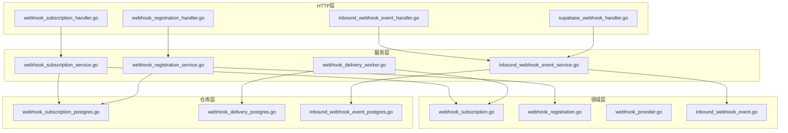
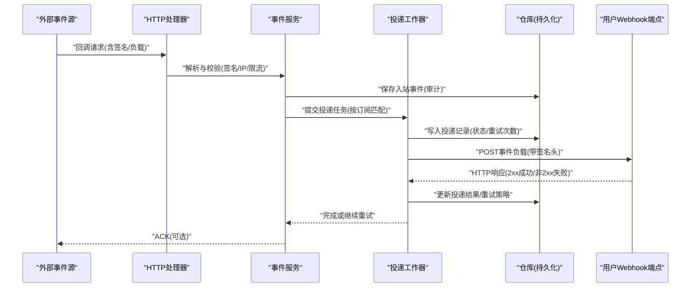
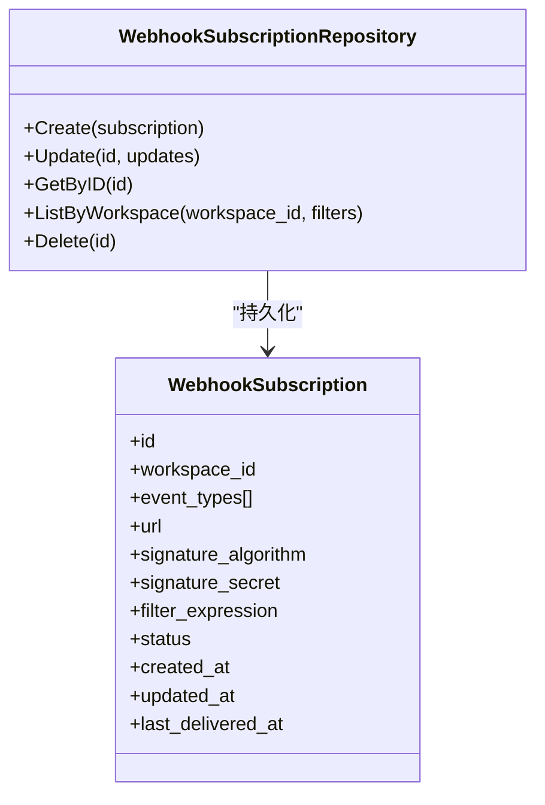
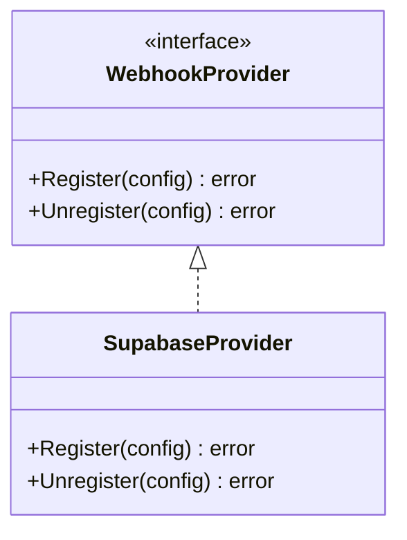
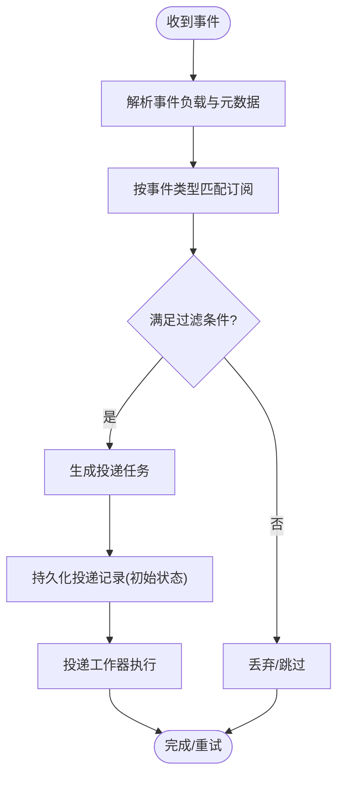
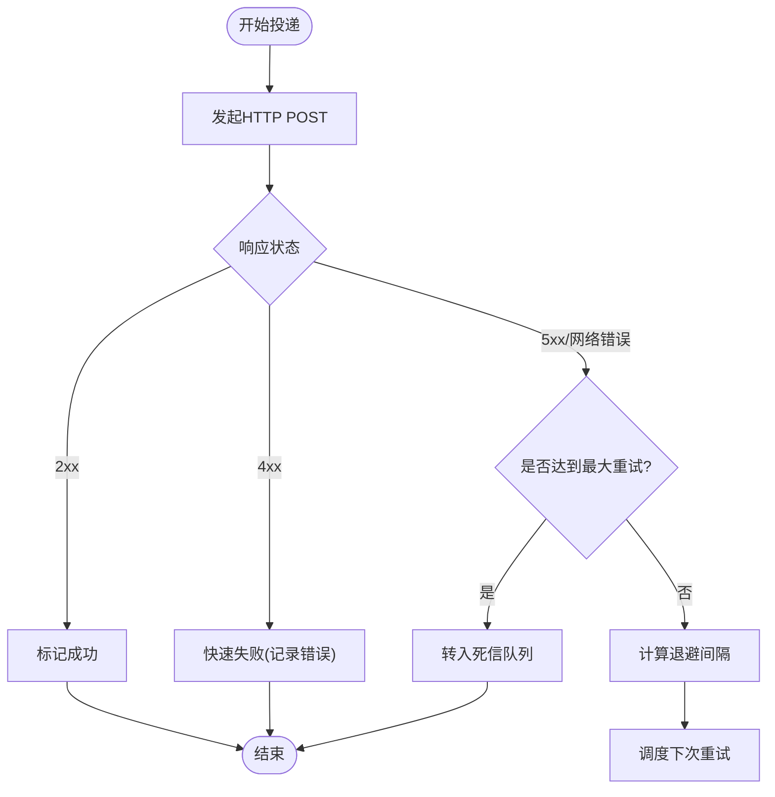
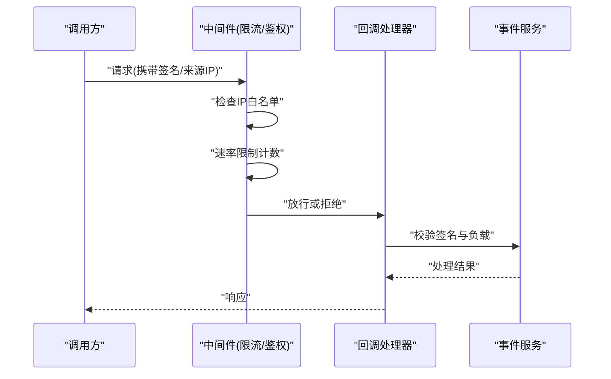
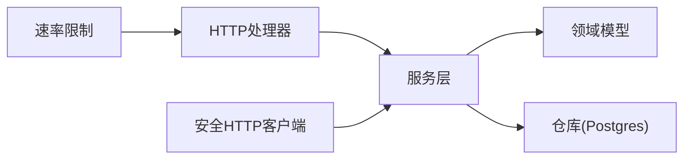

# Webhook集成

<cite>
**本文引用的文件**   
- [webhook_subscription.go](file://notifuse/internal/domain/webhook_subscription.go)
- [webhook_registration.go](file://notifuse/internal/domain/webhook_registration.go)
- [webhook_provider.go](file://notifuse/internal/domain/webhook_provider.go)
- [inbound_webhook_event.go](file://notifuse/internal/domain/inbound_webhook_event.go)
- [webhook_delivery_worker.go](file://notifuse/internal/service/webhook_delivery_worker.go)
- [webhook_subscription_service.go](file://notifuse/internal/service/webhook_subscription_service.go)
- [webhook_registration_service.go](file://notifuse/internal/service/webhook_registration_service.go)
- [inbound_webhook_event_service.go](file://notifuse/internal/service/inbound_webhook_event_service.go)
- [webhook_subscription_handler.go](file://notifuse/internal/http/webhook_subscription_handler.go)
- [webhook_registration_handler.go](file://notifuse/internal/http/webhook_registration_handler.go)
- [inbound_webhook_event_handler.go](file://notifuse/internal/http/inbound_webhook_event_handler.go)
- [supabase_webhook_handler.go](file://notifuse/internal/http/supabase_webhook_handler.go)
- [webhook_subscription_postgres.go](file://notifuse/internal/repository/webhook_subscription_postgres.go)
- [webhook_delivery_postgres.go](file://notifuse/internal/repository/webhook_delivery_postgres.go)
- [inbound_webhook_event_postgres.go](file://notifuse/internal/repository/inbound_webhook_event_postgres.go)
- [openapi.yaml](file://notifuse/openapi/openapi.yaml)
- [webhook-subscriptions.yaml](file://notifuse/openapi/paths/webhook-subscriptions.yaml)
- [subscribe.yaml](file://notifuse/openapi/paths/subscribe.yaml)
- [config.go](file://notifuse/config/config.go)
- [ratelimiter.go](file://notifuse/pkg/ratelimiter/ratelimiter.go)
- [safehttpclient.go](file://notifuse/pkg/safehttpclient/safehttpclient.go)
</cite>

## 目录
1. [简介](#简介)
2. [项目结构](#项目结构)
3. [核心组件](#核心组件)
4. [架构总览](#架构总览)
5. [详细组件分析](#详细组件分析)
6. [依赖关系分析](#依赖关系分析)
7. [性能与可靠性](#性能与可靠性)
8. [故障排查指南](#故障排查指南)
9. [结论](#结论)
10. [附录](#附录)

## 简介
本文件面向Notifuse平台的Webhook集成系统，聚焦以下目标：
- 订阅管理机制：创建、配置与生命周期管理
- 事件分发机制：事件类型定义、消息格式与路由逻辑
- 重试策略与错误处理：失败重试、超时处理与死信队列
- 安全验证：签名验证、IP白名单与速率限制
- 测试工具与调试技巧：模拟发送与问题定位
- 最佳实践与示例：生产可用的集成模式

## 项目结构
Webhook相关代码主要分布在领域模型、服务层、HTTP处理器、仓库实现以及OpenAPI规范中。整体采用分层架构：
- 领域层（domain）：定义订阅、注册、提供者、入站事件等核心实体与行为
- 服务层（service）：编排业务逻辑，协调持久化与外部调用
- HTTP层（http）：暴露REST API与回调入口，负责鉴权、校验与响应
- 仓库层（repository）：PostgreSQL持久化实现
- OpenAPI：对外接口契约

图表来源
- [webhook_subscription_handler.go](file://notifuse/internal/http/webhook_subscription_handler.go)
- [webhook_registration_handler.go](file://notifuse/internal/http/webhook_registration_handler.go)
- [inbound_webhook_event_handler.go](file://notifuse/internal/http/inbound_webhook_event_handler.go)
- [supabase_webhook_handler.go](file://notifuse/internal/http/supabase_webhook_handler.go)
- [webhook_subscription_service.go](file://notifuse/internal/service/webhook_subscription_service.go)
- [webhook_registration_service.go](file://notifuse/internal/service/webhook_registration_service.go)
- [inbound_webhook_event_service.go](file://notifuse/internal/service/inbound_webhook_event_service.go)
- [webhook_delivery_worker.go](file://notifuse/internal/service/webhook_delivery_worker.go)
- [webhook_subscription.go](file://notifuse/internal/domain/webhook_subscription.go)
- [webhook_registration.go](file://notifuse/internal/domain/webhook_registration.go)
- [webhook_provider.go](file://notifuse/internal/domain/webhook_provider.go)
- [inbound_webhook_event.go](file://notifuse/internal/domain/inbound_webhook_event.go)
- [webhook_subscription_postgres.go](file://notifuse/internal/repository/webhook_subscription_postgres.go)
- [webhook_delivery_postgres.go](file://notifuse/internal/repository/webhook_delivery_postgres.go)
- [inbound_webhook_event_postgres.go](file://notifuse/internal/repository/inbound_webhook_event_postgres.go)

章节来源
- [webhook_subscription.go](file://notifuse/internal/domain/webhook_subscription.go)
- [webhook_registration.go](file://notifuse/internal/domain/webhook_registration.go)
- [webhook_provider.go](file://notifuse/internal/domain/webhook_provider.go)
- [inbound_webhook_event.go](file://notifuse/internal/domain/inbound_webhook_event.go)
- [webhook_subscription_service.go](file://notifuse/internal/service/webhook_subscription_service.go)
- [webhook_registration_service.go](file://notifuse/internal/service/webhook_registration_service.go)
- [inbound_webhook_event_service.go](file://notifuse/internal/service/inbound_webhook_event_service.go)
- [webhook_delivery_worker.go](file://notifuse/internal/service/webhook_delivery_worker.go)
- [webhook_subscription_handler.go](file://notifuse/internal/http/webhook_subscription_handler.go)
- [webhook_registration_handler.go](file://notifuse/internal/http/webhook_registration_handler.go)
- [inbound_webhook_event_handler.go](file://notifuse/internal/http/inbound_webhook_event_handler.go)
- [supabase_webhook_handler.go](file://notifuse/internal/http/supabase_webhook_handler.go)
- [webhook_subscription_postgres.go](file://notifuse/internal/repository/webhook_subscription_postgres.go)
- [webhook_delivery_postgres.go](file://notifuse/internal/repository/webhook_delivery_postgres.go)
- [inbound_webhook_event_postgres.go](file://notifuse/internal/repository/inbound_webhook_event_postgres.go)

## 核心组件
- 订阅模型与生命周期
  - 订阅用于声明“在哪些工作区/租户下，监听哪些事件，投递到哪个URL，使用何种签名与过滤条件”。其状态机通常包含创建、启用、禁用、删除等阶段。
  - 关键职责：校验URL与事件集、维护签名密钥、记录最近投递结果与统计。
- 注册模型与提供者
  - 注册用于描述“如何向第三方平台注册或取消Webhook”，如Supabase等。不同提供者实现差异化协议。
- 入站事件模型
  - 用于记录从外部平台回调的原始事件，便于审计、重放与调试。
- 投递工作器
  - 负责按订阅规则将事件序列化并POST到目标URL，执行重试、退避、超时控制与失败归档。

章节来源
- [webhook_subscription.go](file://notifuse/internal/domain/webhook_subscription.go)
- [webhook_registration.go](file://notifuse/internal/domain/webhook_registration.go)
- [webhook_provider.go](file://notifuse/internal/domain/webhook_provider.go)
- [inbound_webhook_event.go](file://notifuse/internal/domain/inbound_webhook_event.go)
- [webhook_delivery_worker.go](file://notifuse/internal/service/webhook_delivery_worker.go)

## 架构总览
下图展示一次典型的事件分发流程：从事件源触发，经HTTP入口进入，服务层匹配订阅，投递工作器异步投递，仓库层持久化投递记录与入站事件。

图表来源
- [inbound_webhook_event_handler.go](file://notifuse/internal/http/inbound_webhook_event_handler.go)
- [inbound_webhook_event_service.go](file://notifuse/internal/service/inbound_webhook_event_service.go)
- [webhook_delivery_worker.go](file://notifuse/internal/service/webhook_delivery_worker.go)
- [inbound_webhook_event_postgres.go](file://notifuse/internal/repository/inbound_webhook_event_postgres.go)
- [webhook_delivery_postgres.go](file://notifuse/internal/repository/webhook_delivery_postgres.go)

## 详细组件分析

### 订阅管理与生命周期
- 能力概览
  - 创建订阅：指定事件类型集合、目标URL、签名算法与密钥、过滤表达式、是否启用等
  - 更新订阅：动态调整事件集、URL、签名参数与过滤条件
  - 启停与删除：支持软删除与状态切换
  - 查询与统计：按工作区/事件类型检索，查看最近投递结果与成功率
- 数据模型要点
  - 标识与工作区归属
  - 事件类型列表与过滤条件
  - 目标URL与签名配置
  - 状态与时间戳（创建/更新/最近投递）
- 持久化
  - 通过Postgres仓库实现CRUD与索引优化（按工作区、事件类型、状态）

图表来源
- [webhook_subscription.go](file://notifuse/internal/domain/webhook_subscription.go)
- [webhook_subscription_postgres.go](file://notifuse/internal/repository/webhook_subscription_postgres.go)

章节来源
- [webhook_subscription.go](file://notifuse/internal/domain/webhook_subscription.go)
- [webhook_subscription_postgres.go](file://notifuse/internal/repository/webhook_subscription_postgres.go)
- [webhook_subscription_handler.go](file://notifuse/internal/http/webhook_subscription_handler.go)
- [webhook_subscription_service.go](file://notifuse/internal/service/webhook_subscription_service.go)

### 注册与第三方平台集成
- 能力概览
  - 为特定平台（如Supabase）提供注册/取消注册能力，封装差异化的认证与回调路径
- 关键点
  - 统一抽象：Provider接口定义注册/取消注册方法
  - 具体实现：各平台适配器实现各自协议细节
  - 与订阅解耦：注册关注“平台侧”的Webhook管理，订阅关注“内部事件分发”

图表来源
- [webhook_provider.go](file://notifuse/internal/domain/webhook_provider.go)
- [supabase_webhook_handler.go](file://notifuse/internal/http/supabase_webhook_handler.go)
- [webhook_registration_service.go](file://notifuse/internal/service/webhook_registration_service.go)

章节来源
- [webhook_registration.go](file://notifuse/internal/domain/webhook_registration.go)
- [webhook_provider.go](file://notifuse/internal/domain/webhook_provider.go)
- [webhook_registration_service.go](file://notifuse/internal/service/webhook_registration_service.go)
- [supabase_webhook_handler.go](file://notifuse/internal/http/supabase_webhook_handler.go)

### 事件分发与路由
- 事件类型定义
  - 由订阅中的事件类型集合决定，常见包括资源创建、更新、删除等
- 消息格式
  - 标准JSON负载，包含事件元数据（类型、时间戳、ID）、工作区上下文与业务载荷
- 路由逻辑
  - 根据事件类型匹配订阅，应用过滤表达式，生成投递任务
  - 支持多订阅并发投递，独立重试与结果记录

图表来源
- [inbound_webhook_event_service.go](file://notifuse/internal/service/inbound_webhook_event_service.go)
- [webhook_delivery_worker.go](file://notifuse/internal/service/webhook_delivery_worker.go)
- [webhook_subscription.go](file://notifuse/internal/domain/webhook_subscription.go)

章节来源
- [inbound_webhook_event.go](file://notifuse/internal/domain/inbound_webhook_event.go)
- [inbound_webhook_event_service.go](file://notifuse/internal/service/inbound_webhook_event_service.go)
- [webhook_delivery_worker.go](file://notifuse/internal/service/webhook_delivery_worker.go)

### 重试策略与错误处理
- 重试原则
  - 对可恢复错误（网络抖动、服务端5xx）进行指数退避重试
  - 对不可恢复错误（4xx客户端错误、签名不匹配）快速失败并记录
- 超时控制
  - 单次请求设置连接与读写超时，避免长时间阻塞
- 死信队列
  - 超过最大重试次数或达到退避上限的任务转入死信队列，供人工干预与重放
- 结果持久化
  - 每次尝试均记录HTTP状态码、响应摘要、错误信息与重试次数

图表来源
- [webhook_delivery_worker.go](file://notifuse/internal/service/webhook_delivery_worker.go)
- [webhook_delivery_postgres.go](file://notifuse/internal/repository/webhook_delivery_postgres.go)

章节来源
- [webhook_delivery_worker.go](file://notifuse/internal/service/webhook_delivery_worker.go)
- [webhook_delivery_postgres.go](file://notifuse/internal/repository/webhook_delivery_postgres.go)

### 安全验证
- 签名验证
  - 服务端在投递时附加签名头；接收方可基于共享密钥与约定算法验证完整性与来源
- IP白名单
  - 可在网关或中间件层限制仅允许已知来源IP访问回调入口
- 速率限制
  - 针对回调入口与API操作实施限流，防止滥用与雪崩

图表来源
- [inbound_webhook_event_handler.go](file://notifuse/internal/http/inbound_webhook_event_handler.go)
- [inbound_webhook_event_service.go](file://notifuse/internal/service/inbound_webhook_event_service.go)
- [ratelimiter.go](file://notifuse/pkg/ratelimiter/ratelimiter.go)

章节来源
- [inbound_webhook_event_handler.go](file://notifuse/internal/http/inbound_webhook_event_handler.go)
- [inbound_webhook_event_service.go](file://notifuse/internal/service/inbound_webhook_event_service.go)
- [ratelimiter.go](file://notifuse/pkg/ratelimiter/ratelimiter.go)

### 测试工具与调试技巧
- 模拟发送
  - 使用OpenAPI定义的接口构造测试负载，覆盖成功、签名失败、过滤不匹配、超时等场景
- 调试技巧
  - 查看入站事件记录与投递记录，确认事件是否被正确匹配与投递
  - 结合日志与指标，定位签名不匹配、网络异常与下游超时
- 本地联调
  - 使用内网穿透或本地代理转发至本地服务，快速验证签名与负载结构

章节来源
- [openapi.yaml](file://notifuse/openapi/openapi.yaml)
- [webhook-subscriptions.yaml](file://notifuse/openapi/paths/webhook-subscriptions.yaml)
- [subscribe.yaml](file://notifuse/openapi/paths/subscribe.yaml)
- [inbound_webhook_event_postgres.go](file://notifuse/internal/repository/inbound_webhook_event_postgres.go)
- [webhook_delivery_postgres.go](file://notifuse/internal/repository/webhook_delivery_postgres.go)

## 依赖关系分析
- 组件耦合
  - HTTP层依赖服务层，服务层依赖领域模型与仓库层
  - 投递工作器与仓库层强耦合以保障结果一致性
- 外部依赖
  - PostgreSQL用于持久化订阅、投递记录与入站事件
  - 速率限制组件用于保护回调入口与API
  - 安全HTTP客户端用于可控的网络请求

图表来源
- [webhook_subscription_handler.go](file://notifuse/internal/http/webhook_subscription_handler.go)
- [webhook_subscription_service.go](file://notifuse/internal/service/webhook_subscription_service.go)
- [webhook_subscription.go](file://notifuse/internal/domain/webhook_subscription.go)
- [webhook_subscription_postgres.go](file://notifuse/internal/repository/webhook_subscription_postgres.go)
- [ratelimiter.go](file://notifuse/pkg/ratelimiter/ratelimiter.go)
- [safehttpclient.go](file://notifuse/pkg/safehttpclient/safehttpclient.go)

章节来源
- [webhook_subscription_handler.go](file://notifuse/internal/http/webhook_subscription_handler.go)
- [webhook_subscription_service.go](file://notifuse/internal/service/webhook_subscription_service.go)
- [webhook_subscription.go](file://notifuse/internal/domain/webhook_subscription.go)
- [webhook_subscription_postgres.go](file://notifuse/internal/repository/webhook_subscription_postgres.go)
- [ratelimiter.go](file://notifuse/pkg/ratelimiter/ratelimiter.go)
- [safehttpclient.go](file://notifuse/pkg/safehttpclient/safehttpclient.go)

## 性能与可靠性
- 并发投递
  - 按订阅并行投递，避免单条慢订阅阻塞其他订阅
- 退避与背压
  - 指数退避降低瞬时压力；对持续失败的订阅进行熔断式降速
- 超时与资源回收
  - 严格设置连接与读写超时，及时释放资源
- 观测性
  - 记录投递成功率、平均延迟、重试次数与死信数量，支撑容量规划与告警

[本节为通用指导，无需源码引用]

## 故障排查指南
- 常见问题
  - 签名不匹配：核对签名算法、密钥与负载顺序
  - 4xx错误：检查目标端点权限与参数校验
  - 5xx错误：检查下游服务健康与资源配额
  - 超时：检查网络连通性与目标端点处理能力
- 定位步骤
  - 查看入站事件与投递记录，确认事件是否到达与投递状态
  - 检查速率限制计数与IP白名单配置
  - 审查日志与指标，定位瓶颈与异常

章节来源
- [inbound_webhook_event_postgres.go](file://notifuse/internal/repository/inbound_webhook_event_postgres.go)
- [webhook_delivery_postgres.go](file://notifuse/internal/repository/webhook_delivery_postgres.go)
- [ratelimiter.go](file://notifuse/pkg/ratelimiter/ratelimiter.go)

## 结论
Notifuse的Webhook集成体系通过清晰的领域模型与服务编排，实现了高可靠的事件分发与投递。配合签名验证、IP白名单与速率限制，保障了安全性与稳定性。建议在生产环境中完善观测性与告警，并结合业务需求定制过滤与重试策略。

[本节为总结，无需源码引用]

## 附录
- OpenAPI参考
  - 订阅管理接口定义与示例
  - 订阅事件订阅与回调路径说明

章节来源
- [openapi.yaml](file://notifuse/openapi/openapi.yaml)
- [webhook-subscriptions.yaml](file://notifuse/openapi/paths/webhook-subscriptions.yaml)
- [subscribe.yaml](file://notifuse/openapi/paths/subscribe.yaml)