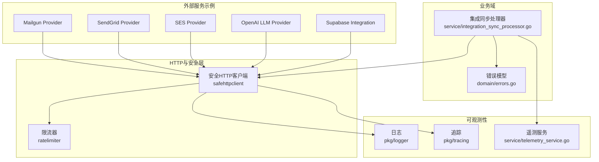
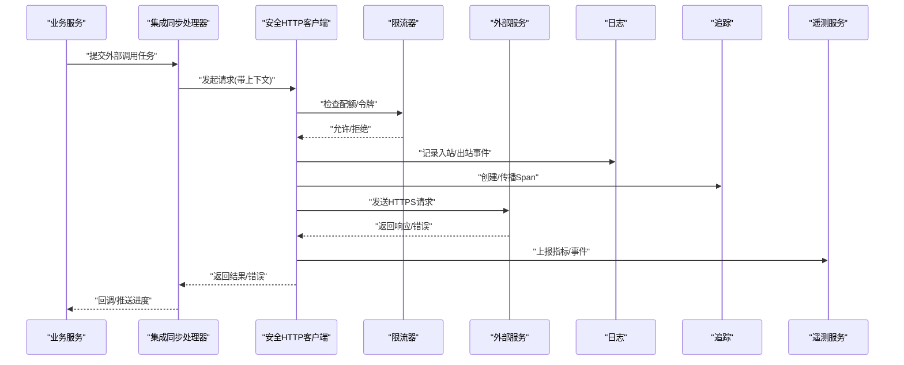
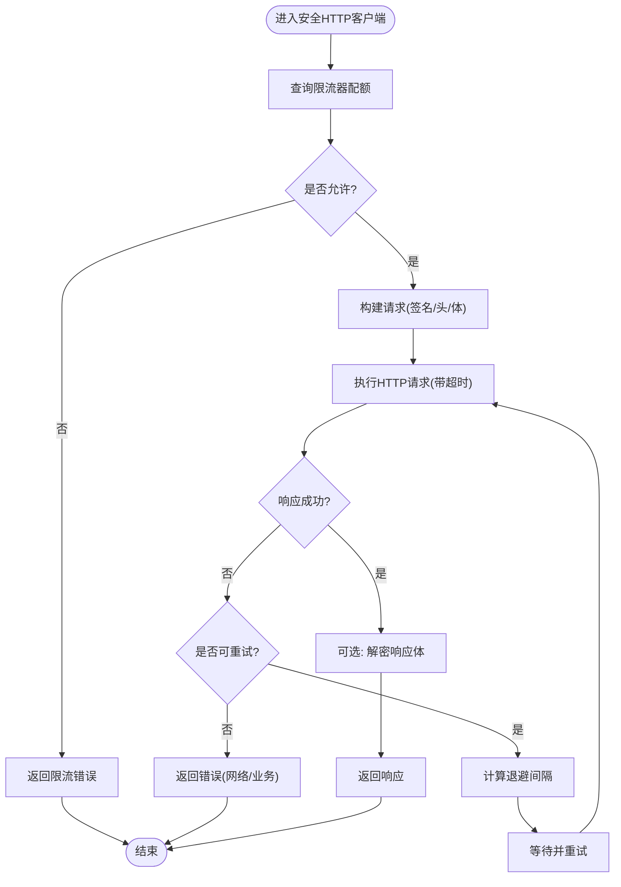
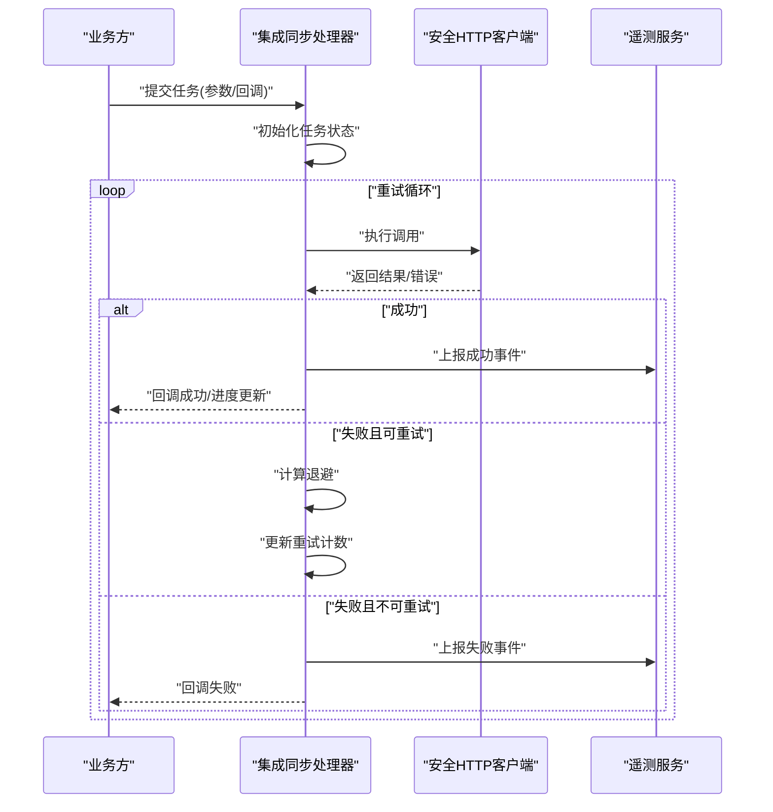
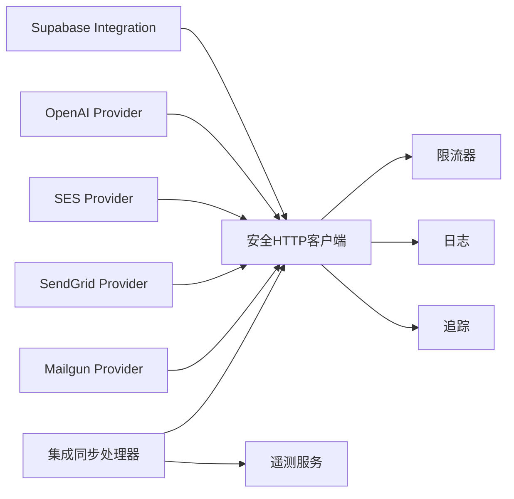

# 第三方API客户端

<cite>
**本文引用的文件**   
- [safehttpclient.go](file://notifuse/pkg/safehttpclient/safehttpclient.go)
- [safehttpclient_test.go](file://notifuse/pkg/safehttpclient/safehttpclient_test.go)
- [integration_sync_processor.go](file://notifuse/internal/service/integration_sync_processor.go)
- [integration_sync_processor_test.go](file://notifuse/internal/service/integration_sync_processor_test.go)
- [errors.go](file://notifuse/internal/domain/errors.go)
- [ratelimiter.go](file://notifuse/pkg/ratelimiter/ratelimiter.go)
- [logger.go](file://notifuse/pkg/logger/logger.go)
- [tracing.go](file://notifuse/pkg/tracing/tracing.go)
- [telemetry_service.go](file://notifuse/internal/service/telemetry_service.go)
- [email_provider_mailgun.go](file://notifuse/internal/domain/email_provider_mailgun.go)
- [email_provider_sendgrid.go](file://notifuse/internal/domain/email_provider_sendgrid.go)
- [email_provider_ses.go](file://notifuse/internal/domain/email_provider_ses.go)
- [llm_provider_openai.go](file://notifuse/internal/domain/llm_provider_openai.go)
- [supabase_integration.go](file://notifuse/internal/domain/supabase_integration.go)
</cite>

## 目录
1. [简介](#简介)
2. [项目结构](#项目结构)
3. [核心组件](#核心组件)
4. [架构总览](#架构总览)
5. [详细组件分析](#详细组件分析)
6. [依赖关系分析](#依赖关系分析)
7. [性能考量](#性能考量)
8. [故障排查指南](#故障排查指南)
9. [结论](#结论)
10. [附录](#附录)

## 简介
本文件面向Notifuse平台的第三方API客户端封装，聚焦统一HTTP客户端、安全客户端、错误处理策略、集成同步处理器以及外部服务监控与日志记录机制。文档同时提供自定义API客户端的开发指南与最佳实践，帮助开发者快速、稳定地对接各类外部服务（如邮件发送、LLM推理、Supabase等）。

## 项目结构
围绕第三方API调用，代码主要分布在以下位置：
- 通用HTTP与安全客户端：pkg/safehttpclient
- 错误模型与分类：internal/domain/errors.go
- 限流器：pkg/ratelimiter
- 日志与追踪：pkg/logger、pkg/tracing
- 遥测上报：internal/service/telemetry_service.go
- 集成同步处理器：internal/service/integration_sync_processor.go
- 典型外部服务集成示例：internal/domain 下的各Provider实现

图表来源
- [safehttpclient.go](file://notifuse/pkg/safehttpclient/safehttpclient.go)
- [integration_sync_processor.go](file://notifuse/internal/service/integration_sync_processor.go)
- [errors.go](file://notifuse/internal/domain/errors.go)
- [ratelimiter.go](file://notifuse/pkg/ratelimiter/ratelimiter.go)
- [logger.go](file://notifuse/pkg/logger/logger.go)
- [tracing.go](file://notifuse/pkg/tracing/tracing.go)
- [telemetry_service.go](file://notifuse/internal/service/telemetry_service.go)
- [email_provider_mailgun.go](file://notifuse/internal/domain/email_provider_mailgun.go)
- [email_provider_sendgrid.go](file://notifuse/internal/domain/email_provider_sendgrid.go)
- [email_provider_ses.go](file://notifuse/internal/domain/email_provider_ses.go)
- [llm_provider_openai.go](file://notifuse/internal/domain/llm_provider_openai.go)
- [supabase_integration.go](file://notifuse/internal/domain/supabase_integration.go)

章节来源
- [safehttpclient.go](file://notifuse/pkg/safehttpclient/safehttpclient.go)
- [integration_sync_processor.go](file://notifuse/internal/service/integration_sync_processor.go)
- [errors.go](file://notifuse/internal/domain/errors.go)
- [ratelimiter.go](file://notifuse/pkg/ratelimiter/ratelimiter.go)
- [logger.go](file://notifuse/pkg/logger/logger.go)
- [tracing.go](file://notifuse/pkg/tracing/tracing.go)
- [telemetry_service.go](file://notifuse/internal/service/telemetry_service.go)
- [email_provider_mailgun.go](file://notifuse/internal/domain/email_provider_mailgun.go)
- [email_provider_sendgrid.go](file://notifuse/internal/domain/email_provider_sendgrid.go)
- [email_provider_ses.go](file://notifuse/internal/domain/email_provider_ses.go)
- [llm_provider_openai.go](file://notifuse/internal/domain/llm_provider_openai.go)
- [supabase_integration.go](file://notifuse/internal/domain/supabase_integration.go)

## 核心组件
- 统一HTTP客户端与安全客户端
  - 负责连接池管理、重试机制、超时控制、SSL证书验证、请求签名与响应加密等能力。
  - 通过中间件或装饰器模式注入限流、日志、追踪等横切关注点。
- 错误处理策略
  - 将网络异常、业务错误、限流错误进行分层抽象，便于上层统一处理与告警。
- 集成同步处理器
  - 作为异步任务调度与状态跟踪的协调者，驱动外部服务调用的生命周期管理与进度报告。
- 可观测性与监控
  - 结合日志、分布式追踪与遥测上报，形成端到端可观测链路。

章节来源
- [safehttpclient.go](file://notifuse/pkg/safehttpclient/safehttpclient.go)
- [errors.go](file://notifuse/internal/domain/errors.go)
- [integration_sync_processor.go](file://notifuse/internal/service/integration_sync_processor.go)
- [logger.go](file://notifuse/pkg/logger/logger.go)
- [tracing.go](file://notifuse/pkg/tracing/tracing.go)
- [telemetry_service.go](file://notifuse/internal/service/telemetry_service.go)

## 架构总览
下图展示了从业务侧到外部服务的整体调用路径，包括安全客户端、限流、重试、日志与追踪、遥测上报等环节。

图表来源
- [integration_sync_processor.go](file://notifuse/internal/service/integration_sync_processor.go)
- [safehttpclient.go](file://notifuse/pkg/safehttpclient/safehttpclient.go)
- [ratelimiter.go](file://notifuse/pkg/ratelimiter/ratelimiter.go)
- [logger.go](file://notifuse/pkg/logger/logger.go)
- [tracing.go](file://notifuse/pkg/tracing/tracing.go)
- [telemetry_service.go](file://notifuse/internal/service/telemetry_service.go)

## 详细组件分析

### 统一HTTP客户端与安全客户端
- 设计要点
  - 连接池：复用底层传输，合理设置最大空闲连接、每主机连接数、连接存活时间等，降低握手开销。
  - 重试机制：对幂等请求在可恢复错误（如网络抖动、临时限流）时自动重试；支持指数退避与抖动。
  - 超时控制：区分连接超时、请求超时与读取超时，避免资源长期占用。
  - SSL证书验证：强制启用证书校验，支持自定义CA根证书以适配私有环境。
  - 请求签名：为需要签名的服务（如HMAC、OAuth2）在请求发出前完成签名注入。
  - 响应加密：对敏感响应体进行解密后再交由业务处理。
- 关键流程（含重试与限流）

图表来源
- [safehttpclient.go](file://notifuse/pkg/safehttpclient/safehttpclient.go)
- [ratelimiter.go](file://notifuse/pkg/ratelimiter/ratelimiter.go)

章节来源
- [safehttpclient.go](file://notifuse/pkg/safehttpclient/safehttpclient.go)
- [safehttpclient_test.go](file://notifuse/pkg/safehttpclient/safehttpclient_test.go)
- [ratelimiter.go](file://notifuse/pkg/ratelimiter/ratelimiter.go)

### 错误处理策略
- 错误分层
  - 网络异常：连接失败、DNS解析失败、TLS握手失败、超时等。
  - 业务错误：上游返回的业务码/消息，需按领域语义映射。
  - 限流错误：来自限流器或上游429/5xx等信号。
- 处理原则
  - 明确可重试与不可重试边界，避免放大雪崩。
  - 对限流错误采用指数退避+抖动，必要时降级或短路。
  - 将错误结构化并附带上下文（目标服务、请求ID、耗时等），便于追踪。
- 错误类型定义参考
  - 错误模型与分类位于内部域的错误文件中，供上层统一捕获与转换。

章节来源
- [errors.go](file://notifuse/internal/domain/errors.go)
- [safehttpclient.go](file://notifuse/pkg/safehttpclient/safehttpclient.go)
- [ratelimiter.go](file://notifuse/pkg/ratelimiter/ratelimiter.go)

### 集成同步处理器
- 职责
  - 接收业务侧的外部调用任务，编排调用生命周期（调度、重试、取消、进度上报）。
  - 维护任务状态机（待处理、进行中、成功、失败、已取消），并提供进度回调。
  - 与遥测服务协作，上报任务级指标与事件。
- 关键流程

图表来源
- [integration_sync_processor.go](file://notifuse/internal/service/integration_sync_processor.go)
- [safehttpclient.go](file://notifuse/pkg/safehttpclient/safehttpclient.go)
- [telemetry_service.go](file://notifuse/internal/service/telemetry_service.go)

章节来源
- [integration_sync_processor.go](file://notifuse/internal/service/integration_sync_processor.go)
- [integration_sync_processor_test.go](file://notifuse/internal/service/integration_sync_processor_test.go)
- [telemetry_service.go](file://notifuse/internal/service/telemetry_service.go)

### 外部服务监控与日志记录
- 日志
  - 使用统一日志接口输出结构化日志，包含请求标识、耗时、目标服务、状态码等维度。
- 追踪
  - 通过追踪库创建Span，跨进程/线程传播上下文，串联一次完整调用链。
- 遥测
  - 将关键指标（QPS、延迟分布、错误率、重试次数）上报至遥测服务，用于监控与告警。
- 建议
  - 为每个外部服务建立独立标签集，便于分服务观察。
  - 对敏感字段脱敏，避免泄露密钥或个人信息。

章节来源
- [logger.go](file://notifuse/pkg/logger/logger.go)
- [tracing.go](file://notifuse/pkg/tracing/tracing.go)
- [telemetry_service.go](file://notifuse/internal/service/telemetry_service.go)

### 典型外部服务集成示例与最佳实践
- 邮件服务（Mailgun/SendGrid/SES）
  - 使用安全HTTP客户端发起请求，按各自规范注入认证头与签名。
  - 对幂等操作开启重试，非幂等操作谨慎重试。
  - 将上游错误映射为平台内部错误模型，便于统一处理。
- LLM服务（OpenAI）
  - 注意长轮询/流式响应的特殊处理，确保超时与取消语义正确。
  - 对速率限制与配额错误做退避与降级。
- Supabase集成
  - 使用统一的认证与签名逻辑，结合追踪与遥测完善可观测性。
- 最佳实践
  - 所有外部调用必须携带请求ID与上下文，便于排障。
  - 严格配置超时与重试上限，防止级联故障。
  - 对敏感数据加解密，最小权限原则访问外部服务。

章节来源
- [email_provider_mailgun.go](file://notifuse/internal/domain/email_provider_mailgun.go)
- [email_provider_sendgrid.go](file://notifuse/internal/domain/email_provider_sendgrid.go)
- [email_provider_ses.go](file://notifuse/internal/domain/email_provider_ses.go)
- [llm_provider_openai.go](file://notifuse/internal/domain/llm_provider_openai.go)
- [supabase_integration.go](file://notifuse/internal/domain/supabase_integration.go)
- [safehttpclient.go](file://notifuse/pkg/safehttpclient/safehttpclient.go)
- [errors.go](file://notifuse/internal/domain/errors.go)

## 依赖关系分析
- 组件耦合
  - 集成同步处理器依赖安全HTTP客户端与遥测服务，低耦合于具体外部服务实现。
  - 安全HTTP客户端依赖限流器、日志与追踪模块，具备良好扩展性。
- 外部依赖
  - 标准库HTTP客户端、TLS配置、加密算法库、限流算法实现等。
- 潜在风险
  - 全局连接池配置不当可能导致资源耗尽或连接泄漏。
  - 重试策略过激可能放大上游压力，需配合熔断与降级。

图表来源
- [integration_sync_processor.go](file://notifuse/internal/service/integration_sync_processor.go)
- [safehttpclient.go](file://notifuse/pkg/safehttpclient/safehttpclient.go)
- [ratelimiter.go](file://notifuse/pkg/ratelimiter/ratelimiter.go)
- [logger.go](file://notifuse/pkg/logger/logger.go)
- [tracing.go](file://notifuse/pkg/tracing/tracing.go)
- [telemetry_service.go](file://notifuse/internal/service/telemetry_service.go)
- [email_provider_mailgun.go](file://notifuse/internal/domain/email_provider_mailgun.go)
- [email_provider_sendgrid.go](file://notifuse/internal/domain/email_provider_sendgrid.go)
- [email_provider_ses.go](file://notifuse/internal/domain/email_provider_ses.go)
- [llm_provider_openai.go](file://notifuse/internal/domain/llm_provider_openai.go)
- [supabase_integration.go](file://notifuse/internal/domain/supabase_integration.go)

章节来源
- [integration_sync_processor.go](file://notifuse/internal/service/integration_sync_processor.go)
- [safehttpclient.go](file://notifuse/pkg/safehttpclient/safehttpclient.go)
- [ratelimiter.go](file://notifuse/pkg/ratelimiter/ratelimiter.go)
- [logger.go](file://notifuse/pkg/logger/logger.go)
- [tracing.go](file://notifuse/pkg/tracing/tracing.go)
- [telemetry_service.go](file://notifuse/internal/service/telemetry_service.go)
- [email_provider_mailgun.go](file://notifuse/internal/domain/email_provider_mailgun.go)
- [email_provider_sendgrid.go](file://notifuse/internal/domain/email_provider_sendgrid.go)
- [email_provider_ses.go](file://notifuse/internal/domain/email_provider_ses.go)
- [llm_provider_openai.go](file://notifuse/internal/domain/llm_provider_openai.go)
- [supabase_integration.go](file://notifuse/internal/domain/supabase_integration.go)

## 性能考量
- 连接池
  - 根据并发量与外部服务容量调整最大空闲连接与每主机连接数，避免过多连接导致系统资源紧张。
- 重试与退避
  - 仅对幂等请求启用重试；采用指数退避与随机抖动，避免“惊群”效应。
- 超时
  - 合理设置连接、请求、读取超时，结合网关与上游SLA综合评估。
- 序列化与压缩
  - 对大体积请求/响应考虑压缩，权衡CPU与带宽。
- 背压与限流
  - 在入口层与外部调用层均实施限流，保护自身与上游。

[本节为通用指导，不直接分析具体文件]

## 故障排查指南
- 常见问题定位
  - 网络异常：检查DNS、TLS证书、代理与防火墙规则。
  - 业务错误：对照上游错误码与平台错误映射表，确认输入合法性。
  - 限流问题：查看限流器统计与上游429/5xx比例，评估阈值与退避策略。
- 可观测性手段
  - 通过日志关键字检索请求ID，关联追踪Span，定位慢调用与失败点。
  - 利用遥测面板观察错误率、P99延迟与重试次数趋势。
- 建议
  - 为每次外部调用生成唯一请求ID，贯穿全链路。
  - 对关键路径增加健康检查与探针，提前发现退化。

章节来源
- [logger.go](file://notifuse/pkg/logger/logger.go)
- [tracing.go](file://notifuse/pkg/tracing/tracing.go)
- [telemetry_service.go](file://notifuse/internal/service/telemetry_service.go)
- [errors.go](file://notifuse/internal/domain/errors.go)

## 结论
通过统一的安全HTTP客户端、完善的错误处理策略、集成同步处理器与可观测性体系，Notifuse平台能够高效、稳定地对接多种第三方服务。遵循本文的最佳实践与配置建议，可在保证安全性的前提下提升系统的弹性与可维护性。

[本节为总结性内容，不直接分析具体文件]

## 附录

### 自定义API客户端开发指南
- 接口定义
  - 定义清晰的请求/响应结构与错误类型，保持向后兼容。
  - 将认证、签名、加解密等横切逻辑下沉至安全HTTP客户端或中间件。
- 实现步骤
  - 基于安全HTTP客户端封装具体服务调用方法。
  - 在集成同步处理器中注册任务类型，定义状态机与进度回调。
  - 接入日志、追踪与遥测，确保可观测性。
- 测试方法
  - 单元测试：对错误映射、重试判定、退避计算等进行覆盖。
  - 集成测试：使用Mock或本地模拟服务验证端到端流程。
  - 混沌测试：注入网络抖动、超时与限流，验证鲁棒性。

章节来源
- [safehttpclient.go](file://notifuse/pkg/safehttpclient/safehttpclient.go)
- [safehttpclient_test.go](file://notifuse/pkg/safehttpclient/safehttpclient_test.go)
- [integration_sync_processor.go](file://notifuse/internal/service/integration_sync_processor.go)
- [integration_sync_processor_test.go](file://notifuse/internal/service/integration_sync_processor_test.go)
- [errors.go](file://notifuse/internal/domain/errors.go)