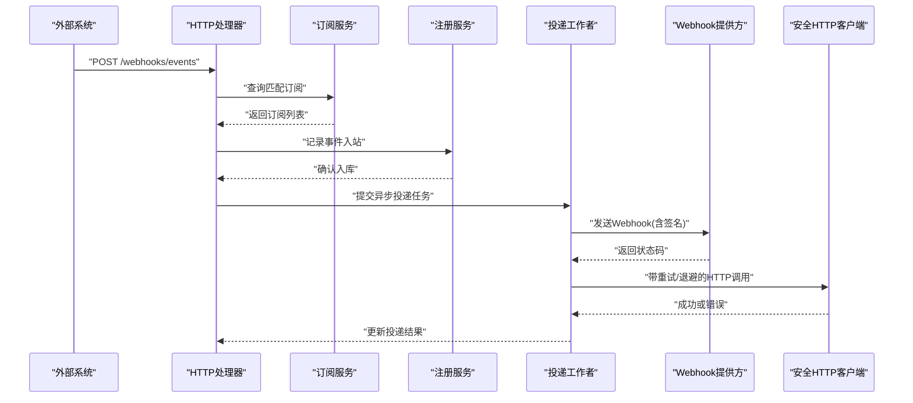
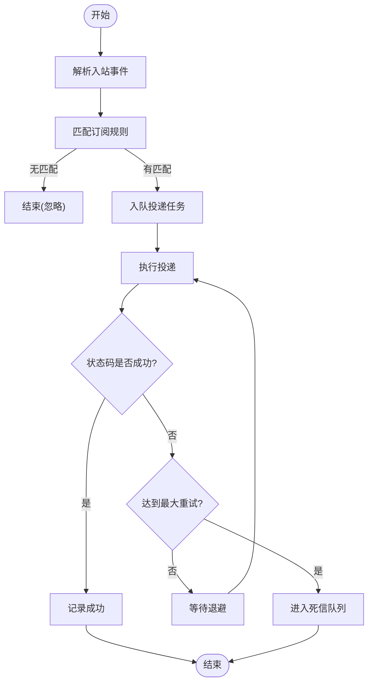
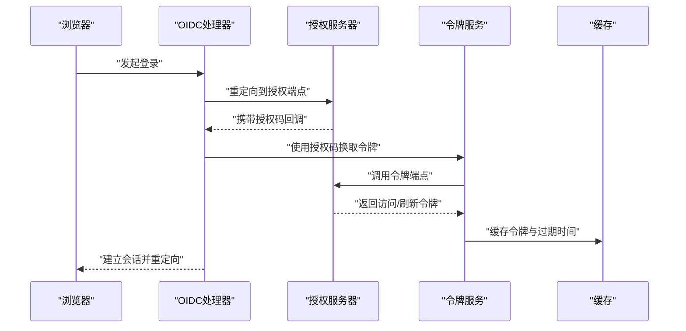
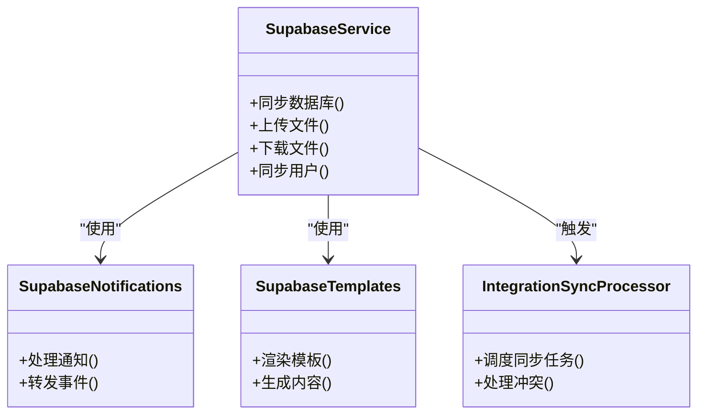
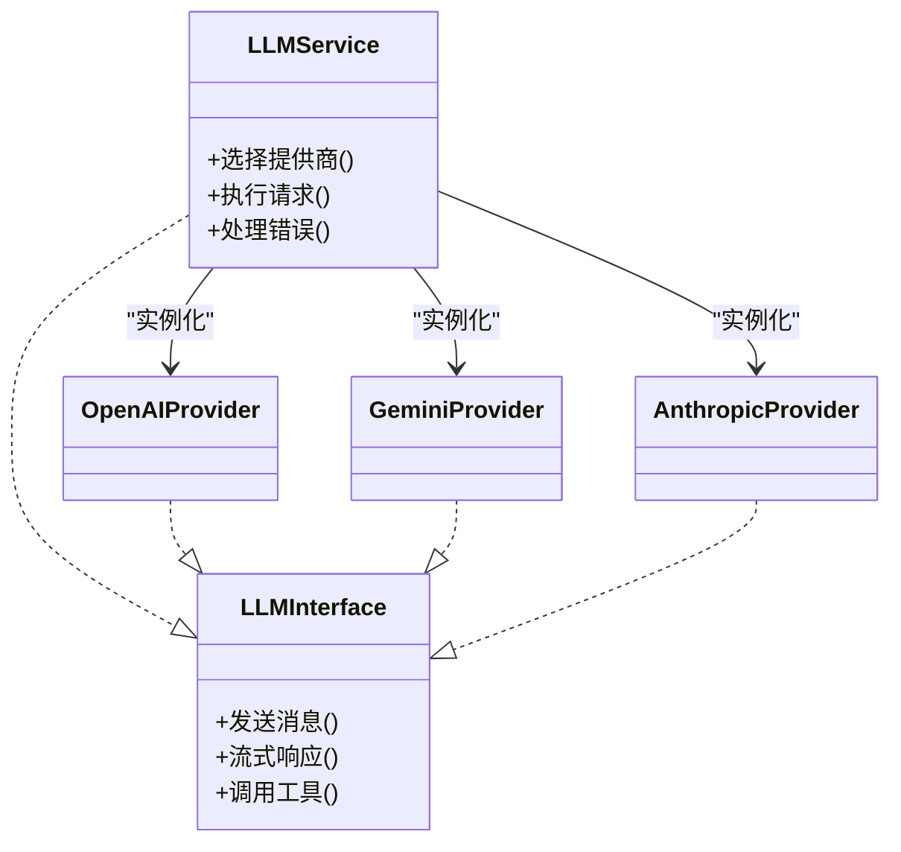
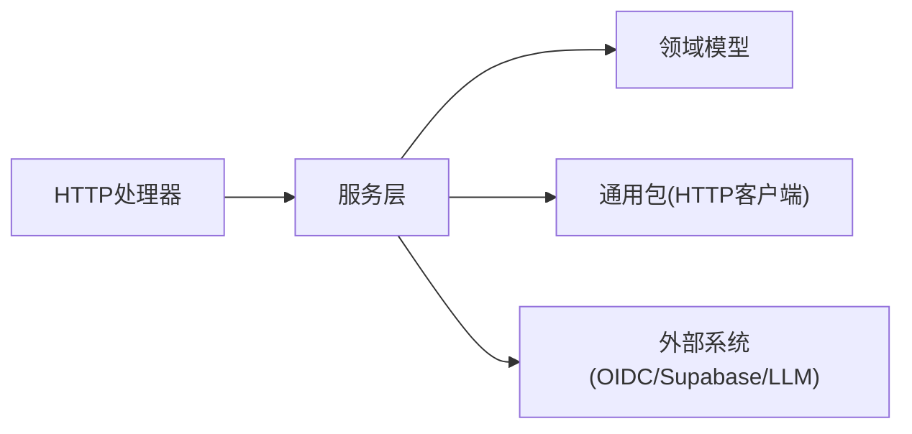

# 系统集成

<cite>
**本文引用的文件**   
- [config.go](file://notifuse/config/config.go)
- [oidc.go](file://notifuse/config/oidc.go)
- [platform.go](file://notifuse/config/platform.go)
- [inbound_webhook_event.go](file://notifuse/internal/domain/inbound_webhook_event.go)
- [webhook_provider.go](file://notifuse/internal/domain/webhook_provider.go)
- [webhook_registration.go](file://notifuse/internal/domain/webhook_registration.go)
- [webhook_subscription.go](file://notifuse/internal/domain/webhook_subscription.go)
- [supabase_integration.go](file://notifuse/internal/domain/supabase_integration.go)
- [llm.go](file://notifuse/internal/domain/llm.go)
- [llm_provider.go](file://notifuse/internal/domain/llm_provider.go)
- [llm_provider_openai.go](file://notifuse/internal/domain/llm_provider_openai.go)
- [llm_provider_gemini.go](file://notifuse/internal/domain/llm_provider_gemini.go)
- [llm_provider_anthropic.go](file://notifuse/internal/domain/llm_provider_anthropic.go)
- [safehttpclient.go](file://notifuse/pkg/safehttpclient/safehttpclient.go)
- [oauth2_token_service.go](file://notifuse/internal/service/oauth2_token_service.go)
- [oidc_service.go](file://notifuse/internal/service/oidc_service.go)
- [supabase_service.go](file://notifuse/internal/service/supabase_service.go)
- [supabase_notifications.go](file://notifuse/internal/service/supabase_notifications.go)
- [supabase_templates.go](file://notifuse/internal/service/supabase_templates.go)
- [integration_sync_processor.go](file://notifuse/internal/service/integration_sync_processor.go)
- [llm_service.go](file://notifuse/internal/service/llm_service.go)
- [llm_service_openai.go](file://notifuse/internal/service/llm_service_openai.go)
- [llm_service_gemini.go](file://notifuse/internal/service/llm_service_gemini.go)
- [webhook_delivery_worker.go](file://notifuse/internal/service/webhook_delivery_worker.go)
- [webhook_subscription_service.go](file://notifuse/internal/service/webhook_subscription_service.go)
- [webhook_registration_service.go](file://notifuse/internal/service/webhook_registration_service.go)
- [inbound_webhook_event_handler.go](file://notifuse/internal/http/inbound_webhook_event_handler.go)
- [supabase_webhook_handler.go](file://notifuse/internal/http/supabase_webhook_handler.go)
- [oidc_handler.go](file://notifuse/internal/http/oidc_handler.go)
- [llm_handler.go](file://notifuse/internal/http/llm_handler.go)
</cite>

## 目录
1. [简介](#简介)
2. [项目结构](#项目结构)
3. [核心组件](#核心组件)
4. [架构总览](#架构总览)
5. [详细组件分析](#详细组件分析)
6. [依赖分析](#依赖分析)
7. [性能考虑](#性能考虑)
8. [故障排查指南](#故障排查指南)
9. [结论](#结论)
10. [附录](#附录)

## 简介
本文件面向Notifuse平台的系统集成模块，聚焦以下能力：
- Webhook机制：订阅管理、事件分发与重试策略
- OAuth2/OIDC认证集成：配置方法与安全考量
- Supabase集成：数据库同步、文件存储与用户管理
- LLM提供商集成：OpenAI、Gemini、Anthropic等适配层设计
- 第三方API客户端统一封装与错误处理
- 集成开发最佳实践与安全配置指南
- 实际集成示例与调试工具使用方法

## 项目结构
系统集成相关代码主要分布在以下层次：
- HTTP层：路由处理器负责解析请求、鉴权、调用服务层
- 服务层：编排业务逻辑、协调领域模型与外部系统
- 领域层：定义核心实体、接口与协议（如Webhook、LLM、Supabase）
- 通用包：安全HTTP客户端、缓存、日志、速率限制等

```mermaid
graph TB
subgraph "HTTP层"
H1["inbound_webhook_event_handler.go"]
H2["supabase_webhook_handler.go"]
H3["oidc_handler.go"]
H4["llm_handler.go"]
end
subgraph "服务层"
S1["webhook_subscription_service.go"]
S2["webhook_registration_service.go"]
S3["webhook_delivery_worker.go"]
S4["oidc_service.go"]
S5["oauth2_token_service.go"]
S6["supabase_service.go"]
S7["supabase_notifications.go"]
S8["supabase_templates.go"]
S9["integration_sync_processor.go"]
S10["llm_service.go"]
S11["llm_service_openai.go"]
S12["llm_service_gemini.go"]
end
subgraph "领域层"
D1["webhook_subscription.go"]
D2["webhook_registration.go"]
D3["webhook_provider.go"]
D4["inbound_webhook_event.go"]
D5["supabase_integration.go"]
D6["llm.go"]
D7["llm_provider.go"]
D8["llm_provider_openai.go"]
D9["llm_provider_gemini.go"]
D10["llm_provider_anthropic.go"]
end
subgraph "通用包"
U1["safehttpclient.go"]
end
H1 --> S1
H1 --> S2
H1 --> S3
H2 --> S6
H3 --> S4
H3 --> S5
H4 --> S10
S1 --> D1
S2 --> D2
S3 --> D3
S6 --> D5
S10 --> D6
S10 --> D7
S10 --> D8
S10 --> D9
S10 --> D10
S4 --> U1
S5 --> U1
S6 --> U1
S10 --> U1
```

图表来源
- [inbound_webhook_event_handler.go](file://notifuse/internal/http/inbound_webhook_event_handler.go)
- [supabase_webhook_handler.go](file://notifuse/internal/http/supabase_webhook_handler.go)
- [oidc_handler.go](file://notifuse/internal/http/oidc_handler.go)
- [llm_handler.go](file://notifuse/internal/http/llm_handler.go)
- [webhook_subscription_service.go](file://notifuse/internal/service/webhook_subscription_service.go)
- [webhook_registration_service.go](file://notifuse/internal/service/webhook_registration_service.go)
- [webhook_delivery_worker.go](file://notifuse/internal/service/webhook_delivery_worker.go)
- [oidc_service.go](file://notifuse/internal/service/oidc_service.go)
- [oauth2_token_service.go](file://notifuse/internal/service/oauth2_token_service.go)
- [supabase_service.go](file://notifuse/internal/service/supabase_service.go)
- [supabase_notifications.go](file://notifuse/internal/service/supabase_notifications.go)
- [supabase_templates.go](file://notifuse/internal/service/supabase_templates.go)
- [integration_sync_processor.go](file://notifuse/internal/service/integration_sync_processor.go)
- [llm_service.go](file://notifuse/internal/service/llm_service.go)
- [llm_service_openai.go](file://notifuse/internal/service/llm_service_openai.go)
- [llm_service_gemini.go](file://notifuse/internal/service/llm_service_gemini.go)
- [webhook_subscription.go](file://notifuse/internal/domain/webhook_subscription.go)
- [webhook_registration.go](file://notifuse/internal/domain/webhook_registration.go)
- [webhook_provider.go](file://notifuse/internal/domain/webhook_provider.go)
- [inbound_webhook_event.go](file://notifuse/internal/domain/inbound_webhook_event.go)
- [supabase_integration.go](file://notifuse/internal/domain/supabase_integration.go)
- [llm.go](file://notifuse/internal/domain/llm.go)
- [llm_provider.go](file://notifuse/internal/domain/llm_provider.go)
- [llm_provider_openai.go](file://notifuse/internal/domain/llm_provider_openai.go)
- [llm_provider_gemini.go](file://notifuse/internal/domain/llm_provider_gemini.go)
- [llm_provider_anthropic.go](file://notifuse/internal/domain/llm_provider_anthropic.go)
- [safehttpclient.go](file://notifuse/pkg/safehttpclient/safehttpclient.go)

章节来源
- [inbound_webhook_event_handler.go](file://notifuse/internal/http/inbound_webhook_event_handler.go)
- [supabase_webhook_handler.go](file://notifuse/internal/http/supabase_webhook_handler.go)
- [oidc_handler.go](file://notifuse/internal/http/oidc_handler.go)
- [llm_handler.go](file://notifuse/internal/http/llm_handler.go)
- [webhook_subscription_service.go](file://notifuse/internal/service/webhook_subscription_service.go)
- [webhook_registration_service.go](file://notifuse/internal/service/webhook_registration_service.go)
- [webhook_delivery_worker.go](file://notifuse/internal/service/webhook_delivery_worker.go)
- [oidc_service.go](file://notifuse/internal/service/oidc_service.go)
- [oauth2_token_service.go](file://notifuse/internal/service/oauth2_token_service.go)
- [supabase_service.go](file://notifuse/internal/service/supabase_service.go)
- [supabase_notifications.go](file://notifuse/internal/service/supabase_notifications.go)
- [supabase_templates.go](file://notifuse/internal/service/supabase_templates.go)
- [integration_sync_processor.go](file://notifuse/internal/service/integration_sync_processor.go)
- [llm_service.go](file://notifuse/internal/service/llm_service.go)
- [llm_service_openai.go](file://notifuse/internal/service/llm_service_openai.go)
- [llm_service_gemini.go](file://notifuse/internal/service/llm_service_gemini.go)
- [webhook_subscription.go](file://notifuse/internal/domain/webhook_subscription.go)
- [webhook_registration.go](file://notifuse/internal/domain/webhook_registration.go)
- [webhook_provider.go](file://notifuse/internal/domain/webhook_provider.go)
- [inbound_webhook_event.go](file://notifuse/internal/domain/inbound_webhook_event.go)
- [supabase_integration.go](file://notifuse/internal/domain/supabase_integration.go)
- [llm.go](file://notifuse/internal/domain/llm.go)
- [llm_provider.go](file://notifuse/internal/domain/llm_provider.go)
- [llm_provider_openai.go](file://notifuse/internal/domain/llm_provider_openai.go)
- [llm_provider_gemini.go](file://notifuse/internal/domain/llm_provider_gemini.go)
- [llm_provider_anthropic.go](file://notifuse/internal/domain/llm_provider_anthropic.go)
- [safehttpclient.go](file://notifuse/pkg/safehttpclient/safehttpclient.go)

## 核心组件
- Webhook子系统
  - 订阅管理：创建、更新、启用/禁用、删除订阅；按工作区隔离
  - 事件分发：匹配订阅规则，构造事件载荷，异步投递
  - 重试策略：指数退避、最大重试次数、失败记录与告警
- OIDC/OAuth2子系统
  - 身份提供者发现、授权码流程、令牌刷新、会话管理
  - 安全校验：状态参数、nonce、签名验证、最小权限范围
- Supabase集成
  - 数据库同步：增量变更、冲突解决、幂等写入
  - 文件存储：上传/下载、访问控制、生命周期
  - 用户管理：跨源用户映射、角色同步、审计日志
- LLM适配层
  - 统一接口：消息发送、流式响应、工具调用
  - 多厂商实现：OpenAI、Gemini、Anthropic
  - 错误归一化：限流、配额、模型不可用等
- 统一HTTP客户端
  - 安全连接、超时、重试、指标采集、证书管理

章节来源
- [webhook_subscription.go](file://notifuse/internal/domain/webhook_subscription.go)
- [webhook_registration.go](file://notifuse/internal/domain/webhook_registration.go)
- [webhook_provider.go](file://notifuse/internal/domain/webhook_provider.go)
- [inbound_webhook_event.go](file://notifuse/internal/domain/inbound_webhook_event.go)
- [webhook_subscription_service.go](file://notifuse/internal/service/webhook_subscription_service.go)
- [webhook_registration_service.go](file://notifuse/internal/service/webhook_registration_service.go)
- [webhook_delivery_worker.go](file://notifuse/internal/service/webhook_delivery_worker.go)
- [oidc_service.go](file://notifuse/internal/service/oidc_service.go)
- [oauth2_token_service.go](file://notifuse/internal/service/oauth2_token_service.go)
- [supabase_service.go](file://notifuse/internal/service/supabase_service.go)
- [supabase_notifications.go](file://notifuse/internal/service/supabase_notifications.go)
- [supabase_templates.go](file://notifuse/internal/service/supabase_templates.go)
- [integration_sync_processor.go](file://notifuse/internal/service/integration_sync_processor.go)
- [llm_service.go](file://notifuse/internal/service/llm_service.go)
- [llm_service_openai.go](file://notifuse/internal/service/llm_service_openai.go)
- [llm_service_gemini.go](file://notifuse/internal/service/llm_service_gemini.go)
- [llm.go](file://notifuse/internal/domain/llm.go)
- [llm_provider.go](file://notifuse/internal/domain/llm_provider.go)
- [llm_provider_openai.go](file://notifuse/internal/domain/llm_provider_openai.go)
- [llm_provider_gemini.go](file://notifuse/internal/domain/llm_provider_gemini.go)
- [llm_provider_anthropic.go](file://notifuse/internal/domain/llm_provider_anthropic.go)
- [safehttpclient.go](file://notifuse/pkg/safehttpclient/safehttpclient.go)

## 架构总览
整体采用分层架构：HTTP处理器接收请求并委派至服务层；服务层编排领域模型与外部系统；通用HTTP客户端提供一致的网络访问能力。

图表来源
- [inbound_webhook_event_handler.go](file://notifuse/internal/http/inbound_webhook_event_handler.go)
- [webhook_subscription_service.go](file://notifuse/internal/service/webhook_subscription_service.go)
- [webhook_registration_service.go](file://notifuse/internal/service/webhook_registration_service.go)
- [webhook_delivery_worker.go](file://notifuse/internal/service/webhook_delivery_worker.go)
- [safehttpclient.go](file://notifuse/pkg/safehttpclient/safehttpclient.go)

## 详细组件分析

### Webhook机制：订阅、分发与重试
- 订阅管理
  - 支持按工作区维度隔离，包含目标URL、事件类型、过滤条件、签名密钥、启用状态等
  - 提供CRUD接口与批量操作，便于自动化集成
- 事件分发
  - 入站事件经处理器落库后，由投递工作者根据订阅规则进行匹配与派发
  - 支持模板渲染与字段映射，确保下游系统可消费
- 重试策略
  - 基于指数退避与抖动，避免雪崩
  - 可配置最大重试次数与失败阈值，失败路径进入死信队列以便人工干预
  - 投递结果持久化，便于追踪与对账

图表来源
- [inbound_webhook_event_handler.go](file://notifuse/internal/http/inbound_webhook_event_handler.go)
- [webhook_subscription_service.go](file://notifuse/internal/service/webhook_subscription_service.go)
- [webhook_delivery_worker.go](file://notifuse/internal/service/webhook_delivery_worker.go)

章节来源
- [webhook_subscription.go](file://notifuse/internal/domain/webhook_subscription.go)
- [webhook_registration.go](file://notifuse/internal/domain/webhook_registration.go)
- [webhook_provider.go](file://notifuse/internal/domain/webhook_provider.go)
- [inbound_webhook_event.go](file://notifuse/internal/domain/inbound_webhook_event.go)
- [webhook_subscription_service.go](file://notifuse/internal/service/webhook_subscription_service.go)
- [webhook_registration_service.go](file://notifuse/internal/service/webhook_registration_service.go)
- [webhook_delivery_worker.go](file://notifuse/internal/service/webhook_delivery_worker.go)

### OAuth2/OIDC认证集成
- 配置方法
  - 通过配置项设置授权服务器元数据、客户端ID/密钥、回调地址、作用域等
  - 支持动态发现与静态配置两种模式
- 安全考虑
  - 强制HTTPS、严格回调白名单、最小权限范围
  - 状态参数防CSRF、Nonce防重放、签名与时间戳校验
  - 令牌加密存储、短期有效、自动刷新
- 集成流程
  - 前端跳转至授权服务器，服务端交换授权码换取令牌，维护会话与用户信息

图表来源
- [oidc_handler.go](file://notifuse/internal/http/oidc_handler.go)
- [oidc_service.go](file://notifuse/internal/service/oidc_service.go)
- [oauth2_token_service.go](file://notifuse/internal/service/oauth2_token_service.go)
- [config.go](file://notifuse/config/config.go)
- [oidc.go](file://notifuse/config/oidc.go)

章节来源
- [oidc_handler.go](file://notifuse/internal/http/oidc_handler.go)
- [oidc_service.go](file://notifuse/internal/service/oidc_service.go)
- [oauth2_token_service.go](file://notifuse/internal/service/oauth2_token_service.go)
- [config.go](file://notifuse/config/config.go)
- [oidc.go](file://notifuse/config/oidc.go)

### Supabase集成：数据库同步、文件存储与用户管理
- 数据库同步
  - 监听变更事件，增量同步至本地，保证幂等与一致性
  - 冲突检测与回滚策略，支持断点续传
- 文件存储
  - 上传/下载接口封装，访问控制与生命周期管理
  - 分片上传与断点续传，提升大文件稳定性
- 用户管理
  - 跨源用户映射，角色与权限同步
  - 审计日志与操作追溯

图表来源
- [supabase_service.go](file://notifuse/internal/service/supabase_service.go)
- [supabase_notifications.go](file://notifuse/internal/service/supabase_notifications.go)
- [supabase_templates.go](file://notifuse/internal/service/supabase_templates.go)
- [integration_sync_processor.go](file://notifuse/internal/service/integration_sync_processor.go)
- [supabase_integration.go](file://notifuse/internal/domain/supabase_integration.go)

章节来源
- [supabase_service.go](file://notifuse/internal/service/supabase_service.go)
- [supabase_notifications.go](file://notifuse/internal/service/supabase_notifications.go)
- [supabase_templates.go](file://notifuse/internal/service/supabase_templates.go)
- [integration_sync_processor.go](file://notifuse/internal/service/integration_sync_processor.go)
- [supabase_integration.go](file://notifuse/internal/domain/supabase_integration.go)

### LLM提供商集成架构
- 统一接口
  - 抽象消息发送、流式响应、工具调用、上下文管理
- 多厂商实现
  - OpenAI、Gemini、Anthropic分别实现统一接口，屏蔽差异
- 错误归一化
  - 将各厂商错误转换为平台内部错误类型，便于统一处理与重试

图表来源
- [llm.go](file://notifuse/internal/domain/llm.go)
- [llm_provider.go](file://notifuse/internal/domain/llm_provider.go)
- [llm_provider_openai.go](file://notifuse/internal/domain/llm_provider_openai.go)
- [llm_provider_gemini.go](file://notifuse/internal/domain/llm_provider_gemini.go)
- [llm_provider_anthropic.go](file://notifuse/internal/domain/llm_provider_anthropic.go)
- [llm_service.go](file://notifuse/internal/service/llm_service.go)
- [llm_service_openai.go](file://notifuse/internal/service/llm_service_openai.go)
- [llm_service_gemini.go](file://notifuse/internal/service/llm_service_gemini.go)

章节来源
- [llm.go](file://notifuse/internal/domain/llm.go)
- [llm_provider.go](file://notifuse/internal/domain/llm_provider.go)
- [llm_provider_openai.go](file://notifuse/internal/domain/llm_provider_openai.go)
- [llm_provider_gemini.go](file://notifuse/internal/domain/llm_provider_gemini.go)
- [llm_provider_anthropic.go](file://notifuse/internal/domain/llm_provider_anthropic.go)
- [llm_service.go](file://notifuse/internal/service/llm_service.go)
- [llm_service_openai.go](file://notifuse/internal/service/llm_service_openai.go)
- [llm_service_gemini.go](file://notifuse/internal/service/llm_service_gemini.go)

### 第三方API客户端统一封装与错误处理
- 统一封装
  - 安全连接、超时、重试、指标采集、证书管理
  - 请求/响应拦截器用于日志、审计与脱敏
- 错误处理
  - 网络错误、超时、限流、认证失败等分类
  - 统一错误码与提示，便于上层处理与展示

章节来源
- [safehttpclient.go](file://notifuse/pkg/safehttpclient/safehttpclient.go)

## 依赖分析
- 组件耦合
  - HTTP层仅依赖服务层接口，服务层依赖领域模型与通用包
  - LLM服务依赖具体提供商实现，但通过统一接口解耦
- 外部依赖
  - OIDC授权服务器、Supabase服务、LLM提供商API
  - 安全HTTP客户端作为所有外部调用的基础

图表来源
- [inbound_webhook_event_handler.go](file://notifuse/internal/http/inbound_webhook_event_handler.go)
- [supabase_webhook_handler.go](file://notifuse/internal/http/supabase_webhook_handler.go)
- [oidc_handler.go](file://notifuse/internal/http/oidc_handler.go)
- [llm_handler.go](file://notifuse/internal/http/llm_handler.go)
- [webhook_subscription_service.go](file://notifuse/internal/service/webhook_subscription_service.go)
- [supabase_service.go](file://notifuse/internal/service/supabase_service.go)
- [oidc_service.go](file://notifuse/internal/service/oidc_service.go)
- [llm_service.go](file://notifuse/internal/service/llm_service.go)
- [safehttpclient.go](file://notifuse/pkg/safehttpclient/safehttpclient.go)

章节来源
- [inbound_webhook_event_handler.go](file://notifuse/internal/http/inbound_webhook_event_handler.go)
- [supabase_webhook_handler.go](file://notifuse/internal/http/supabase_webhook_handler.go)
- [oidc_handler.go](file://notifuse/internal/http/oidc_handler.go)
- [llm_handler.go](file://notifuse/internal/http/llm_handler.go)
- [webhook_subscription_service.go](file://notifuse/internal/service/webhook_subscription_service.go)
- [supabase_service.go](file://notifuse/internal/service/supabase_service.go)
- [oidc_service.go](file://notifuse/internal/service/oidc_service.go)
- [llm_service.go](file://notifuse/internal/service/llm_service.go)
- [safehttpclient.go](file://notifuse/pkg/safehttpclient/safehttpclient.go)

## 性能考虑
- Webhook投递
  - 使用异步队列与并发控制，避免阻塞主线程
  - 合理设置重试退避与最大重试次数，降低下游压力
- OIDC令牌
  - 缓存访问令牌与刷新令牌，减少重复交换
  - 短生命周期令牌配合后台刷新，提高安全性与可用性
- Supabase同步
  - 增量同步与批处理，减少网络往返
  - 冲突检测与幂等写入，避免重复与不一致
- LLM调用
  - 流式响应降低首字节延迟
  - 错误重试与熔断，防止级联故障

[本节为通用指导，不直接分析具体文件]

## 故障排查指南
- Webhook问题
  - 检查订阅规则与事件匹配
  - 查看投递记录与重试历史，定位失败原因
  - 验证签名与回调地址可达性
- OIDC问题
  - 核对回调地址与作用域
  - 检查令牌有效期与刷新逻辑
  - 审查状态参数与签名校验日志
- Supabase问题
  - 核对同步任务状态与冲突记录
  - 检查文件上传/下载权限与生命周期
  - 查看用户映射与角色同步日志
- LLM问题
  - 检查提供商密钥与配额
  - 查看错误归一化信息与重试策略
  - 评估模型可用性与限流情况

章节来源
- [webhook_delivery_worker.go](file://notifuse/internal/service/webhook_delivery_worker.go)
- [webhook_subscription_service.go](file://notifuse/internal/service/webhook_subscription_service.go)
- [oidc_service.go](file://notifuse/internal/service/oidc_service.go)
- [oauth2_token_service.go](file://notifuse/internal/service/oauth2_token_service.go)
- [supabase_service.go](file://notifuse/internal/service/supabase_service.go)
- [integration_sync_processor.go](file://notifuse/internal/service/integration_sync_processor.go)
- [llm_service.go](file://notifuse/internal/service/llm_service.go)

## 结论
Notifuse系统集成模块通过分层架构与统一接口设计，实现了高内聚、低耦合的Webhook、OIDC/OAuth2、Supabase与LLM集成能力。结合安全HTTP客户端与完善的错误处理机制，系统在可靠性、可扩展性与安全性方面具备良好表现。建议在生产环境遵循最小权限原则、开启全面审计与监控，并持续优化重试与同步策略以应对复杂场景。

[本节为总结性内容，不直接分析具体文件]

## 附录
- 集成开发最佳实践
  - 使用工作区隔离与最小权限范围
  - 对所有外部调用启用超时与重试
  - 对敏感信息进行加密与脱敏
  - 编写端到端测试覆盖关键路径
- 安全配置指南
  - 强制HTTPS与证书校验
  - 严格回调白名单与签名验证
  - 定期轮换密钥与令牌
- 实际集成示例与调试工具
  - 使用Webhook测试工具模拟回调
  - 使用OIDC调试器验证授权流程
  - 使用Supabase控制台观察同步状态
  - 使用LLM提供商控制台查看调用统计与错误

[本节为概念性内容，不直接分析具体文件]