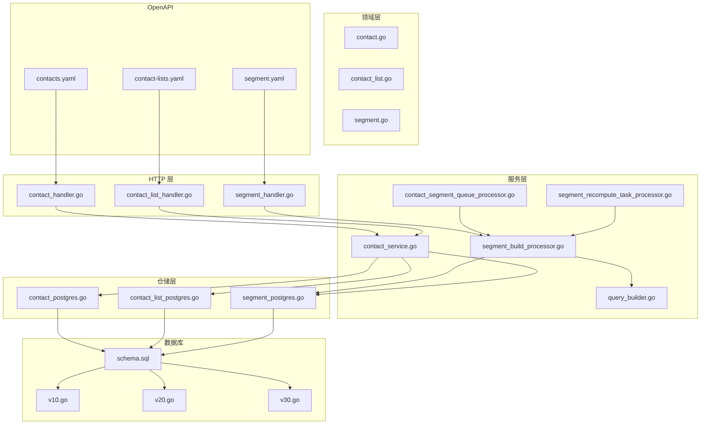
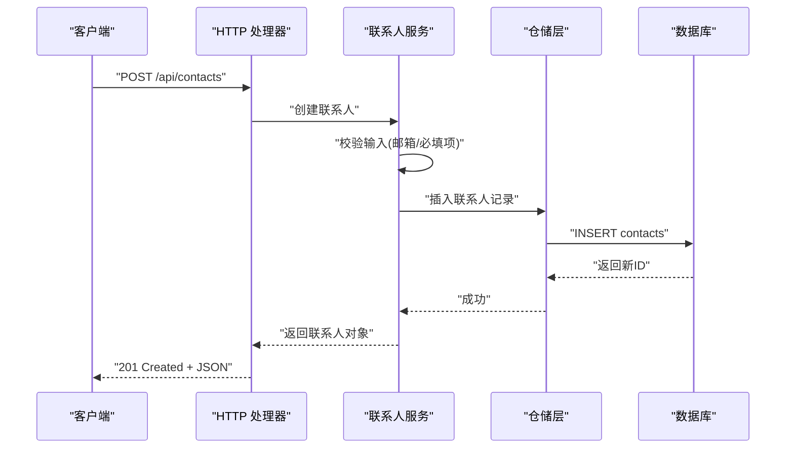
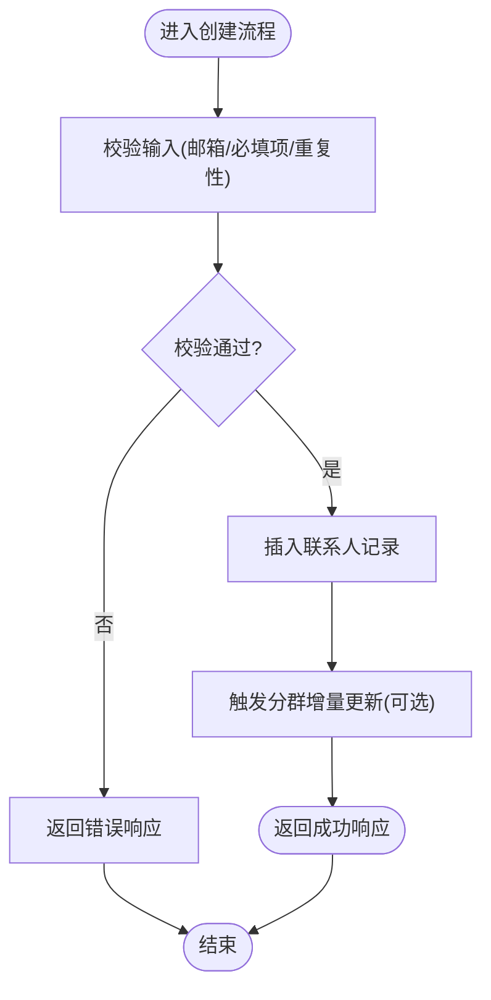
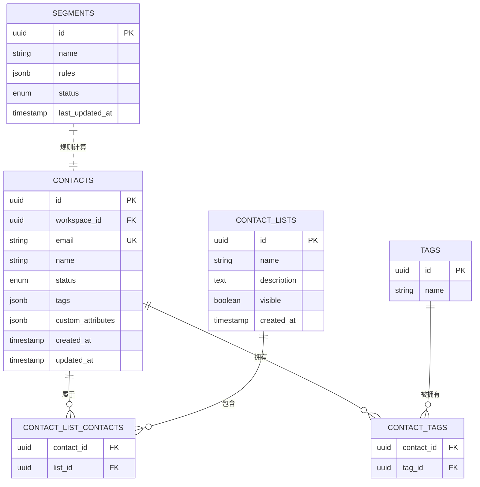
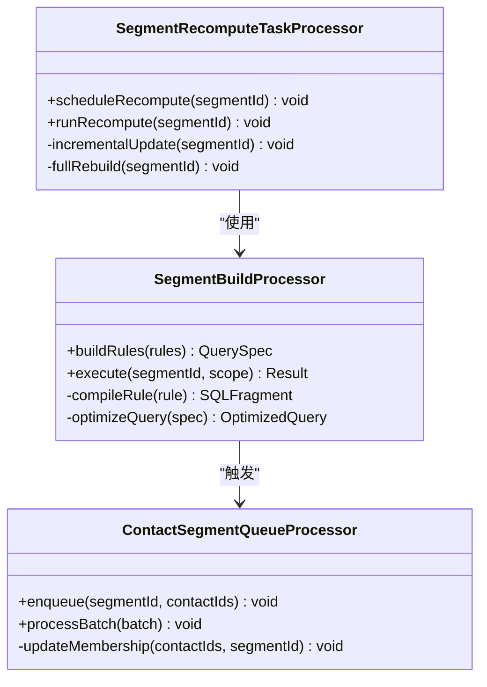
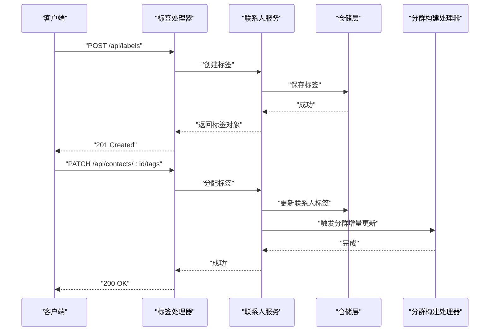
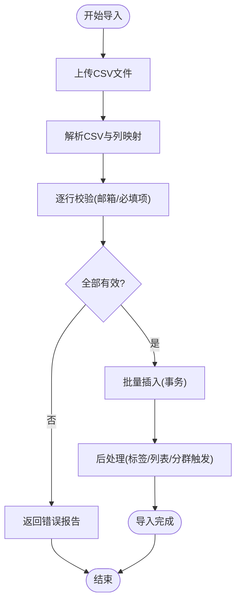
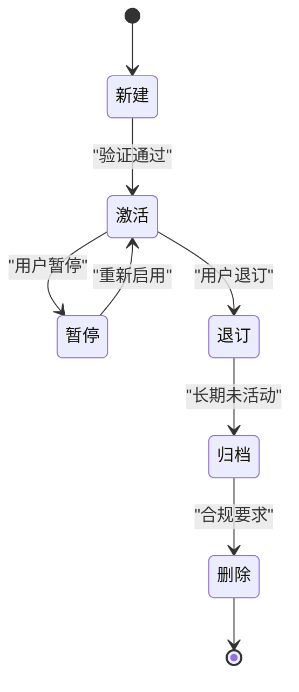
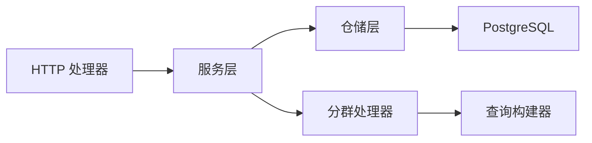

# 联系人管理

<cite>
**本文引用的文件**   
- [contact.go](file://notifuse/internal/domain/contact.go)
- [contact_list.go](file://notifuse/internal/domain/contact_list.go)
- [segment.go](file://notifuse/internal/domain/segment.go)
- [contact_postgres.go](file://notifuse/internal/repository/contact_postgres.go)
- [contact_list_postgres.go](file://notifuse/internal/repository/contact_list_postgres.go)
- [segment_postgres.go](file://notifuse/internal/repository/segment_postgres.go)
- [contact_handler.go](file://notifuse/internal/http/contact_handler.go)
- [contact_list_handler.go](file://notifuse/internal/http/contact_list_handler.go)
- [segment_handler.go](file://notifuse/internal/http/segment_handler.go)
- [contact_service.go](file://notifuse/internal/service/contact_service.go)
- [contact_segment_queue_processor.go](file://notifuse/internal/service/contact_segment_queue_processor.go)
- [segment_build_processor.go](file://notifuse/internal/service/segment_build_processor.go)
- [segment_recompute_task_processor.go](file://notifuse/internal/service/segment_recompute_task_processor.go)
- [query_builder.go](file://notifuse/internal/service/query_builder.go)
- [contacts.yaml](file://notifuse/openapi/paths/contacts.yaml)
- [contact-lists.yaml](file://notifuse/openapi/paths/contact-lists.yaml)
- [segment.yaml](file://notifuse/openapi/paths/segments.yaml)
- [schema.sql](file://notifuse/internal/database/schema/schema.sql)
- [v10.go](file://notifuse/internal/migrations/v10.go)
- [v20.go](file://notifuse/internal/migrations/v20.go)
- [v30.go](file://notifuse/internal/migrations/v30.go)
- [sample_contacts.csv](file://notifuse/samples/sample_contacts.csv)
- [generate_contacts.js](file://notifuse/samples/generate_contacts.js)
</cite>

## 目录
1. [简介](#简介)
2. [项目结构](#项目结构)
3. [核心组件](#核心组件)
4. [架构总览](#架构总览)
5. [详细组件分析](#详细组件分析)
6. [依赖关系分析](#依赖关系分析)
7. [性能考虑](#性能考虑)
8. [故障排查指南](#故障排查指南)
9. [结论](#结论)
10. [附录](#附录)

## 简介
本文件为 Notifuse 平台的“联系人管理”子系统提供系统化文档，覆盖以下主题：
- 联系人的 CRUD 操作、数据模型与验证规则
- 动态分群系统（Segment）的实现原理：规则构建、查询优化与性能考量
- 标签管理功能：创建、分配与批量操作
- 联系人导入导出：CSV 格式与数据映射配置
- 联系人生命周期管理与数据同步机制
- 最佳实践与性能优化建议
- API 调用示例与数据处理脚本指引

## 项目结构
联系人管理相关代码主要分布在如下层次：
- 领域层（Domain）：定义联系人、列表、分群等核心实体与校验逻辑
- 服务层（Service）：编排业务用例，协调仓库与队列处理器
- 仓储层（Repository）：PostgreSQL 持久化实现
- HTTP 层（HTTP Handlers）：对外暴露 REST API
- OpenAPI 规范：描述接口契约
- 迁移脚本：数据库结构演进
- 样本与脚本：用于导入导出的样例数据与生成脚本

图表来源
- [contact_handler.go:1-200](file://notifuse/internal/http/contact_handler.go#L1-L200)
- [contact_service.go:1-200](file://notifuse/internal/service/contact_service.go#L1-L200)
- [contact_postgres.go:1-200](file://notifuse/internal/repository/contact_postgres.go#L1-L200)
- [contact_list_handler.go:1-200](file://notifuse/internal/http/contact_list_handler.go#L1-L200)
- [contact_list_postgres.go:1-200](file://notifuse/internal/repository/contact_list_postgres.go#L1-L200)
- [segment_handler.go:1-200](file://notifuse/internal/http/segment_handler.go#L1-L200)
- [segment_build_processor.go:1-200](file://notifuse/internal/service/segment_build_processor.go#L1-L200)
- [contact_segment_queue_processor.go:1-200](file://notifuse/internal/service/contact_segment_queue_processor.go#L1-L200)
- [segment_recompute_task_processor.go:1-200](file://notifuse/internal/service/segment_recompute_task_processor.go#L1-L200)
- [query_builder.go:1-200](file://notifuse/internal/service/query_builder.go#L1-L200)
- [contacts.yaml:1-200](file://notifuse/openapi/paths/contacts.yaml#L1-L200)
- [contact-lists.yaml:1-200](file://notifuse/openapi/paths/contact-lists.yaml#L1-L200)
- [segment.yaml:1-200](file://notifuse/openapi/paths/segments.yaml#L1-L200)
- [schema.sql:1-200](file://notifuse/internal/database/schema/schema.sql#L1-L200)
- [v10.go:1-200](file://notifuse/internal/migrations/v10.go#L1-L200)
- [v20.go:1-200](file://notifuse/internal/migrations/v20.go#L1-L200)
- [v30.go:1-200](file://notifuse/internal/migrations/v30.go#L1-L200)

章节来源
- [contact_handler.go:1-200](file://notifuse/internal/http/contact_handler.go#L1-L200)
- [contact_service.go:1-200](file://notifuse/internal/service/contact_service.go#L1-L200)
- [contact_postgres.go:1-200](file://notifuse/internal/repository/contact_postgres.go#L1-L200)
- [contact_list_handler.go:1-200](file://notifuse/internal/http/contact_list_handler.go#L1-L200)
- [contact_list_postgres.go:1-200](file://notifuse/internal/repository/contact_list_postgres.go#L1-L200)
- [segment_handler.go:1-200](file://notifuse/internal/http/segment_handler.go#L1-L200)
- [segment_build_processor.go:1-200](file://notifuse/internal/service/segment_build_processor.go#L1-L200)
- [contact_segment_queue_processor.go:1-200](file://notifuse/internal/service/contact_segment_queue_processor.go#L1-L200)
- [segment_recompute_task_processor.go:1-200](file://notifuse/internal/service/segment_recompute_task_processor.go#L1-L200)
- [query_builder.go:1-200](file://notifuse/internal/service/query_builder.go#L1-L200)
- [contacts.yaml:1-200](file://notifuse/openapi/paths/contacts.yaml#L1-L200)
- [contact-lists.yaml:1-200](file://notifuse/openapi/paths/contact-lists.yaml#L1-L200)
- [segment.yaml:1-200](file://notifuse/openapi/paths/segments.yaml#L1-L200)
- [schema.sql:1-200](file://notifuse/internal/database/schema/schema.sql#L1-L200)
- [v10.go:1-200](file://notifuse/internal/migrations/v10.go#L1-L200)
- [v20.go:1-200](file://notifuse/internal/migrations/v20.go#L1-L200)
- [v30.go:1-200](file://notifuse/internal/migrations/v30.go#L1-L200)

## 核心组件
本节聚焦联系人、列表与分群的核心领域模型与服务编排。

- 联系人实体与字段约束
  - 关键字段包括唯一标识、工作空间归属、邮箱、姓名、状态、标签集合、自定义属性等
  - 邮箱需满足基本格式校验；状态包含有效、无效、退订等
  - 自定义属性以键值对形式存储，便于扩展

- 联系人列表
  - 支持将联系人分组到不同列表，便于批量操作与权限隔离
  - 列表与联系人之间为多对多关系

- 动态分群（Segment）
  - 通过条件表达式（如等于、不等于、包含、不包含、大于、小于、正则匹配等）组合筛选联系人
  - 分群结果可增量更新或全量重建，支持任务调度与重试

- 服务编排
  - 联系人服务负责 CRUD、导入导出、标签分配、列表关联、分群触发
  - 分群构建处理器解析规则并生成查询
  - 队列处理器异步执行分群成员计算与重算任务

章节来源
- [contact.go:1-200](file://notifuse/internal/domain/contact.go#L1-L200)
- [contact_list.go:1-200](file://notifuse/internal/domain/contact_list.go#L1-L200)
- [segment.go:1-200](file://notifuse/internal/domain/segment.go#L1-L200)
- [contact_service.go:1-200](file://notifuse/internal/service/contact_service.go#L1-L200)
- [segment_build_processor.go:1-200](file://notifuse/internal/service/segment_build_processor.go#L1-L200)
- [contact_segment_queue_processor.go:1-200](file://notifuse/internal/service/contact_segment_queue_processor.go#L1-L200)
- [segment_recompute_task_processor.go:1-200](file://notifuse/internal/service/segment_recompute_task_processor.go#L1-L200)

## 架构总览
整体采用分层架构：HTTP 层接收请求，交由服务层编排业务逻辑，仓储层访问数据库，领域层定义数据模型与校验。

图表来源
- [contact_handler.go:1-200](file://notifuse/internal/http/contact_handler.go#L1-L200)
- [contact_service.go:1-200](file://notifuse/internal/service/contact_service.go#L1-L200)
- [contact_postgres.go:1-200](file://notifuse/internal/repository/contact_postgres.go#L1-L200)
- [schema.sql:1-200](file://notifuse/internal/database/schema/schema.sql#L1-L200)

## 详细组件分析

### 联系人 CRUD 与验证
- 创建联系人
  - 校验邮箱格式、必填字段、去重策略（按邮箱+工作空间）
  - 写入联系人表，必要时初始化默认标签与时间戳
- 读取联系人
  - 支持按 ID、邮箱、标签、列表过滤
  - 分页与排序参数控制
- 更新联系人
  - 支持部分更新，避免覆盖未提供的字段
  - 变更时触发分群增量更新（若涉及关键属性）
- 删除联系人
  - 软删除标记或物理删除（取决于配置）
  - 清理关联的列表与标签关系

图表来源
- [contact_handler.go:1-200](file://notifuse/internal/http/contact_handler.go#L1-L200)
- [contact_service.go:1-200](file://notifuse/internal/service/contact_service.go#L1-L200)
- [contact_postgres.go:1-200](file://notifuse/internal/repository/contact_postgres.go#L1-L200)

章节来源
- [contact_handler.go:1-200](file://notifuse/internal/http/contact_handler.go#L1-L200)
- [contact_service.go:1-200](file://notifuse/internal/service/contact_service.go#L1-L200)
- [contact_postgres.go:1-200](file://notifuse/internal/repository/contact_postgres.go#L1-L200)
- [contacts.yaml:1-200](file://notifuse/openapi/paths/contacts.yaml#L1-L200)

### 数据模型设计
- 联系人表
  - 主键：自增 ID
  - 唯一索引：邮箱 + 工作空间 ID
  - 字段：姓名、状态、标签数组、自定义属性 JSON、时间戳
- 联系人列表
  - 主键：自增 ID
  - 名称、描述、可见性
- 分群
  - 主键：自增 ID
  - 名称、规则表达式、状态、最后更新时间
- 关系
  - 联系人 ↔ 列表：多对多（中间表）
  - 联系人 ↔ 标签：多对多（中间表）
  - 分群 → 联系人：基于规则计算的虚拟集合

图表来源
- [schema.sql:1-200](file://notifuse/internal/database/schema/schema.sql#L1-L200)
- [v10.go:1-200](file://notifuse/internal/migrations/v10.go#L1-L200)
- [v20.go:1-200](file://notifuse/internal/migrations/v20.go#L1-L200)
- [v30.go:1-200](file://notifuse/internal/migrations/v30.go#L1-L200)

章节来源
- [schema.sql:1-200](file://notifuse/internal/database/schema/schema.sql#L1-L200)
- [v10.go:1-200](file://notifuse/internal/migrations/v10.go#L1-L200)
- [v20.go:1-200](file://notifuse/internal/migrations/v20.go#L1-L200)
- [v30.go:1-200](file://notifuse/internal/migrations/v30.go#L1-L200)

### 动态分群系统
- 规则构建
  - 支持字段级条件（邮箱、姓名、状态、标签、自定义属性）
  - 组合运算符：AND/OR、NOT
  - 比较操作符：等于、不等于、包含、不包含、大于、小于、正则匹配
- 查询优化
  - 使用 JSONB 索引加速自定义属性查询
  - 预编译规则为 SQL 片段，减少运行时开销
  - 增量更新：仅处理受影响联系人
- 性能考虑
  - 大表分群采用分批扫描与限流
  - 任务队列与重试机制保障可靠性
  - 缓存热点分群结果，降低频繁重建成本

图表来源
- [segment_build_processor.go:1-200](file://notifuse/internal/service/segment_build_processor.go#L1-L200)
- [contact_segment_queue_processor.go:1-200](file://notifuse/internal/service/contact_segment_queue_processor.go#L1-L200)
- [segment_recompute_task_processor.go:1-200](file://notifuse/internal/service/segment_recompute_task_processor.go#L1-L200)
- [query_builder.go:1-200](file://notifuse/internal/service/query_builder.go#L1-L200)

章节来源
- [segment_build_processor.go:1-200](file://notifuse/internal/service/segment_build_processor.go#L1-L200)
- [contact_segment_queue_processor.go:1-200](file://notifuse/internal/service/contact_segment_queue_processor.go#L1-L200)
- [segment_recompute_task_processor.go:1-200](file://notifuse/internal/service/segment_recompute_task_processor.go#L1-L200)
- [query_builder.go:1-200](file://notifuse/internal/service/query_builder.go#L1-L200)

### 标签管理
- 标签创建
  - 命名规范与唯一性校验
  - 支持颜色与描述元数据
- 标签分配
  - 单个或批量分配至联系人
  - 自动触发分群增量更新（若规则依赖标签）
- 批量操作
  - 批量移除、替换标签
  - 导出带标签的联系人清单

图表来源
- [contact_handler.go:1-200](file://notifuse/internal/http/contact_handler.go#L1-L200)
- [contact_service.go:1-200](file://notifuse/internal/service/contact_service.go#L1-L200)
- [segment_build_processor.go:1-200](file://notifuse/internal/service/segment_build_processor.go#L1-L200)

章节来源
- [contact_handler.go:1-200](file://notifuse/internal/http/contact_handler.go#L1-L200)
- [contact_service.go:1-200](file://notifuse/internal/service/contact_service.go#L1-L200)
- [segment_build_processor.go:1-200](file://notifuse/internal/service/segment_build_processor.go#L1-L200)

### 联系人导入导出
- 导入 CSV
  - 支持列映射配置（邮箱、姓名、标签、自定义属性）
  - 批量插入与事务回滚保证一致性
  - 重复检测与冲突策略（跳过/覆盖）
- 导出 CSV
  - 按筛选条件导出联系人
  - 可选择字段集与分隔符
- 数据处理脚本
  - 提供生成测试数据的脚本
  - 提供批量导入示例脚本

图表来源
- [contact_service.go:1-200](file://notifuse/internal/service/contact_service.go#L1-L200)
- [contact_postgres.go:1-200](file://notifuse/internal/repository/contact_postgres.go#L1-L200)
- [sample_contacts.csv:1-200](file://notifuse/samples/sample_contacts.csv#L1-L200)
- [generate_contacts.js:1-200](file://notifuse/samples/generate_contacts.js#L1-L200)

章节来源
- [contact_service.go:1-200](file://notifuse/internal/service/contact_service.go#L1-L200)
- [contact_postgres.go:1-200](file://notifuse/internal/repository/contact_postgres.go#L1-L200)
- [sample_contacts.csv:1-200](file://notifuse/samples/sample_contacts.csv#L1-L200)
- [generate_contacts.js:1-200](file://notifuse/samples/generate_contacts.js#L1-L200)

### 联系人生命周期管理与数据同步
- 生命周期
  - 新建、激活、暂停、退订、归档、删除
  - 状态变更影响发送策略与分群结果
- 数据同步
  - 外部系统集成（如 CRM）通过 Webhook 或 API 推送变更
  - 增量同步与冲突解决策略（最新时间戳优先）
  - 审计日志记录关键变更

[此图为概念性状态图，不直接映射具体源码文件]

## 依赖关系分析
- 组件耦合
  - HTTP 处理器依赖服务层，服务层依赖仓储层与分群处理器
  - 分群处理器依赖查询构建器与仓储层
- 外部依赖
  - PostgreSQL 作为主数据存储
  - 消息队列用于异步任务（分群重建、导入导出）
- 潜在循环依赖
  - 服务层不应直接依赖 HTTP 层
  - 仓储层不应依赖服务层

图表来源
- [contact_handler.go:1-200](file://notifuse/internal/http/contact_handler.go#L1-L200)
- [contact_service.go:1-200](file://notifuse/internal/service/contact_service.go#L1-L200)
- [contact_postgres.go:1-200](file://notifuse/internal/repository/contact_postgres.go#L1-L200)
- [segment_build_processor.go:1-200](file://notifuse/internal/service/segment_build_processor.go#L1-L200)
- [query_builder.go:1-200](file://notifuse/internal/service/query_builder.go#L1-L200)

章节来源
- [contact_handler.go:1-200](file://notifuse/internal/http/contact_handler.go#L1-L200)
- [contact_service.go:1-200](file://notifuse/internal/service/contact_service.go#L1-L200)
- [contact_postgres.go:1-200](file://notifuse/internal/repository/contact_postgres.go#L1-L200)
- [segment_build_processor.go:1-200](file://notifuse/internal/service/segment_build_processor.go#L1-L200)
- [query_builder.go:1-200](file://notifuse/internal/service/query_builder.go#L1-L200)

## 性能考虑
- 数据库层面
  - 为常用查询字段建立索引（邮箱、状态、标签、工作空间 ID）
  - 对 JSONB 字段使用 GIN 索引以加速自定义属性查询
  - 分区表策略：按时间或工作空间进行水平拆分
- 应用层面
  - 批量操作使用事务与批量插入减少 IO 次数
  - 分群任务分片执行，限制并发度避免资源争用
  - 缓存热点分群结果，设置合理过期策略
- 导入导出
  - 大文件分块读取与写入，避免内存溢出
  - 断点续传与失败重试机制

[本节为通用性能指导，不直接分析具体源码文件]

## 故障排查指南
- 常见问题
  - 导入失败：检查 CSV 列映射与必填字段
  - 分群结果异常：核对规则表达式与字段类型
  - 性能退化：查看慢查询日志与索引使用情况
- 诊断步骤
  - 启用详细日志，定位错误堆栈
  - 检查数据库锁等待与长事务
  - 监控队列积压与任务重试次数

章节来源
- [contact_handler.go:1-200](file://notifuse/internal/http/contact_handler.go#L1-L200)
- [contact_service.go:1-200](file://notifuse/internal/service/contact_service.go#L1-L200)
- [segment_build_processor.go:1-200](file://notifuse/internal/service/segment_build_processor.go#L1-L200)

## 结论
Notifuse 的联系人管理系统通过清晰的分层架构与可扩展的领域模型，提供了健壮的 CRUD 能力、灵活的动态分群、完善的标签管理与高效的导入导出机制。结合合理的索引策略与异步任务处理，可在大规模数据场景下保持良好性能与稳定性。

[本节为总结性内容，不直接分析具体源码文件]

## 附录

### API 调用示例
- 创建联系人
  - 方法：POST
  - 路径：/api/contacts
  - 请求体：包含邮箱、姓名、标签、自定义属性等字段
  - 响应：201 Created + 联系人对象
- 更新联系人
  - 方法：PATCH
  - 路径：/api/contacts/{id}
  - 请求体：部分更新字段
  - 响应：200 OK + 更新后的联系人对象
- 删除联系人
  - 方法：DELETE
  - 路径：/api/contacts/{id}
  - 响应：204 No Content
- 导入联系人
  - 方法：POST
  - 路径：/api/contacts/import
  - 请求体：multipart/form-data 包含 CSV 文件与列映射配置
  - 响应：202 Accepted + 任务 ID
- 导出联系人
  - 方法：GET
  - 路径：/api/contacts/export?filters=...&fields=...
  - 响应：200 OK + CSV 文件流

章节来源
- [contacts.yaml:1-200](file://notifuse/openapi/paths/contacts.yaml#L1-L200)
- [contact-lists.yaml:1-200](file://notifuse/openapi/paths/contact-lists.yaml#L1-L200)
- [segment.yaml:1-200](file://notifuse/openapi/paths/segments.yaml#L1-L200)

### 数据处理脚本
- 生成测试联系人数据
  - 脚本：generate_contacts.js
  - 用途：批量生成符合格式的 CSV 文件，便于导入测试
- 示例 CSV 文件
  - 文件：sample_contacts.csv
  - 用途：展示标准列结构与数据样例

章节来源
- [generate_contacts.js:1-200](file://notifuse/samples/generate_contacts.js#L1-L200)
- [sample_contacts.csv:1-200](file://notifuse/samples/sample_contacts.csv#L1-L200)