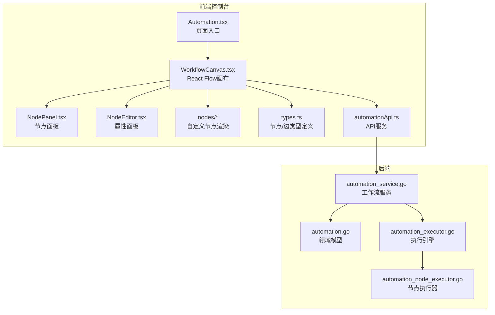
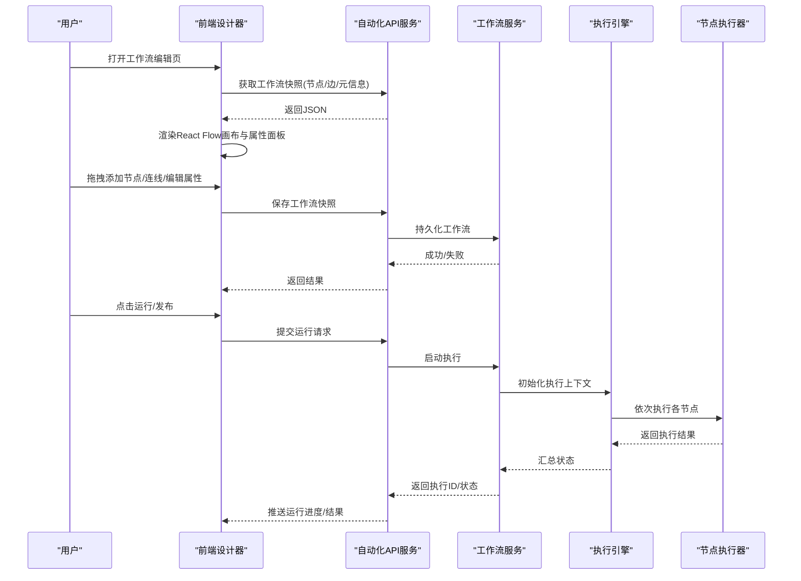
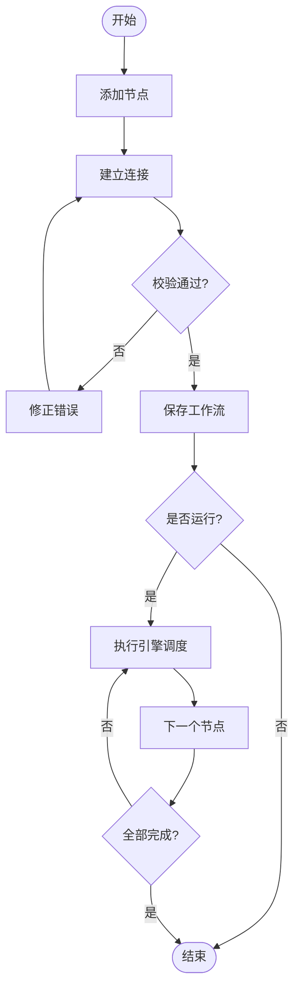
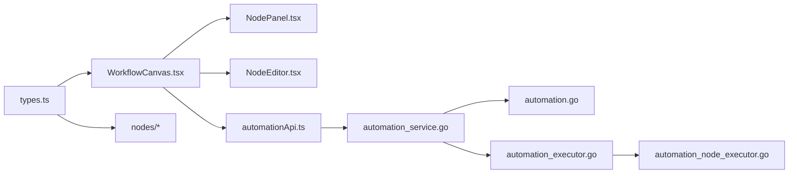

# 工作流设计器

<cite>
**本文引用的文件**   
- [console/src/pages/Automation.tsx](file://notifuse/console/src/pages/Automation.tsx)
- [console/src/components/automation/WorkflowCanvas.tsx](file://notifuse/console/src/components/automation/WorkflowCanvas.tsx)
- [console/src/components/automation/NodePanel.tsx](file://notifuse/console/src/components/automation/NodePanel.tsx)
- [console/src/components/automation/NodeEditor.tsx](file://notifuse/console/src/components/automation/NodeEditor.tsx)
- [console/src/components/automation/nodes/TriggerNode.tsx](file://notifuse/console/src/components/automation/nodes/TriggerNode.tsx)
- [console/src/components/automation/nodes/DelayNode.tsx](file://notifuse/console/src/components/automation/nodes/DelayNode.tsx)
- [console/src/components/automation/nodes/ConditionNode.tsx](file://notifuse/console/src/components/automation/nodes/ConditionNode.tsx)
- [console/src/components/automation/nodes/EmailNode.tsx](file://notifuse/console/src/components/automation/nodes/EmailNode.tsx)
- [console/src/components/automation/types.ts](file://notifuse/console/src/components/automation/types.ts)
- [console/src/services/api/automationApi.ts](file://notifuse/console/src/services/api/automationApi.ts)
- [internal/domain/automation.go](file://notifuse/internal/domain/automation.go)
- [internal/service/automation_service.go](file://notifuse/internal/service/automation_service.go)
- [internal/service/automation_executor.go](file://notifuse/internal/service/automation_executor.go)
- [internal/service/automation_node_executor.go](file://notifuse/internal/service/automation_node_executor.go)
</cite>

## 目录
1. [简介](#简介)
2. [项目结构](#项目结构)
3. [核心组件](#核心组件)
4. [架构总览](#架构总览)
5. [详细组件分析](#详细组件分析)
6. [依赖关系分析](#依赖关系分析)
7. [性能考虑](#性能考虑)
8. [故障排查指南](#故障排查指南)
9. [结论](#结论)
10. [附录](#附录)

## 简介
本文件面向Notifuse平台的工作流设计器，系统性说明可视化拖拽界面的实现原理、节点类型与属性配置、连接与数据传递机制、画布操作能力以及自定义节点开发指南。文档同时覆盖前后端交互流程、执行期行为与最佳实践，帮助读者快速上手并扩展设计器功能。

## 项目结构
工作流设计器位于前端控制台（console）中，围绕React Flow构建可视化画布，提供节点面板、编辑器、节点渲染与API服务；后端通过领域模型与服务层定义自动化工作流的存储、调度与执行。

图表来源
- [console/src/pages/Automation.tsx](file://notifuse/console/src/pages/Automation.tsx)
- [console/src/components/automation/WorkflowCanvas.tsx](file://notifuse/console/src/components/automation/WorkflowCanvas.tsx)
- [console/src/components/automation/NodePanel.tsx](file://notifuse/console/src/components/automation/NodePanel.tsx)
- [console/src/components/automation/NodeEditor.tsx](file://notifuse/console/src/components/automation/NodeEditor.tsx)
- [console/src/components/automation/nodes/TriggerNode.tsx](file://notifuse/console/src/components/automation/nodes/TriggerNode.tsx)
- [console/src/components/automation/nodes/DelayNode.tsx](file://notifuse/console/src/components/automation/nodes/DelayNode.tsx)
- [console/src/components/automation/nodes/ConditionNode.tsx](file://notifuse/console/src/components/automation/nodes/ConditionNode.tsx)
- [console/src/components/automation/nodes/EmailNode.tsx](file://notifuse/console/src/components/automation/nodes/EmailNode.tsx)
- [console/src/components/automation/types.ts](file://notifuse/console/src/components/automation/types.ts)
- [console/src/services/api/automationApi.ts](file://notifuse/console/src/services/api/automationApi.ts)
- [internal/domain/automation.go](file://notifuse/internal/domain/automation.go)
- [internal/service/automation_service.go](file://notifuse/internal/service/automation_service.go)
- [internal/service/automation_executor.go](file://notifuse/internal/service/automation_executor.go)
- [internal/service/automation_node_executor.go](file://notifuse/internal/service/automation_node_executor.go)

章节来源
- [console/src/pages/Automation.tsx](file://notifuse/console/src/pages/Automation.tsx)
- [console/src/components/automation/WorkflowCanvas.tsx](file://notifuse/console/src/components/automation/WorkflowCanvas.tsx)
- [console/src/components/automation/types.ts](file://notifuse/console/src/components/automation/types.ts)
- [console/src/services/api/automationApi.ts](file://notifuse/console/src/services/api/automationApi.ts)
- [internal/domain/automation.go](file://notifuse/internal/domain/automation.go)
- [internal/service/automation_service.go](file://notifuse/internal/service/automation_service.go)
- [internal/service/automation_executor.go](file://notifuse/internal/service/automation_executor.go)
- [internal/service/automation_node_executor.go](file://notifuse/internal/service/automation_node_executor.go)

## 核心组件
- 页面入口：负责挂载画布、加载/保存工作流、注册全局事件与快捷键。
- 画布容器：集成React Flow，管理节点与边的增删改、选中状态、拖拽连线、批量选择等。
- 节点面板：按类别展示可用节点，支持拖拽到画布创建新节点。
- 属性面板：根据选中节点动态渲染表单，校验输入并同步至节点数据。
- 自定义节点：基于React Flow的Node接口实现具体业务节点渲染与交互。
- 类型定义：统一节点与边的数据结构、默认值与校验规则。
- API服务：封装工作流CRUD、版本控制、发布与执行相关接口。

章节来源
- [console/src/pages/Automation.tsx](file://notifuse/console/src/pages/Automation.tsx)
- [console/src/components/automation/WorkflowCanvas.tsx](file://notifuse/console/src/components/automation/WorkflowCanvas.tsx)
- [console/src/components/automation/NodePanel.tsx](file://notifuse/console/src/components/automation/NodePanel.tsx)
- [console/src/components/automation/NodeEditor.tsx](file://notifuse/console/src/components/automation/NodeEditor.tsx)
- [console/src/components/automation/types.ts](file://notifuse/console/src/components/automation/types.ts)
- [console/src/services/api/automationApi.ts](file://notifuse/console/src/services/api/automationApi.ts)

## 架构总览
前端以React Flow为可视化内核，承载节点与边；属性面板驱动节点配置；API服务将工作流序列化后持久化到后端。后端通过领域模型描述工作流图，服务层负责编排执行引擎与节点执行器，完成触发、延迟、条件分支、邮件发送等动作。

图表来源
- [console/src/pages/Automation.tsx](file://notifuse/console/src/pages/Automation.tsx)
- [console/src/components/automation/WorkflowCanvas.tsx](file://notifuse/console/src/components/automation/WorkflowCanvas.tsx)
- [console/src/services/api/automationApi.ts](file://notifuse/console/src/services/api/automationApi.ts)
- [internal/service/automation_service.go](file://notifuse/internal/service/automation_service.go)
- [internal/service/automation_executor.go](file://notifuse/internal/service/automation_executor.go)
- [internal/service/automation_node_executor.go](file://notifuse/internal/service/automation_node_executor.go)

## 详细组件分析

### React Flow画布集成与交互
- 画布容器负责：
  - 初始化React Flow实例，设置节点/边集合、视图状态与布局选项。
  - 监听onNodesChange/onEdgesChange/onConnect等事件，维护本地状态并与属性面板联动。
  - 处理键盘快捷键（删除、撤销/重做）、批量选择、对齐与吸附等辅助操作。
  - 在保存前对节点/边进行规范化与校验，确保可被后端解析。
- 关键交互：
  - 从节点面板拖拽新增节点，自动分配唯一ID与默认位置。
  - 拖拽连线时校验源/目标端口合法性与循环依赖。
  - 选中节点高亮并显示属性面板，修改即时回写至节点数据。

章节来源
- [console/src/components/automation/WorkflowCanvas.tsx](file://notifuse/console/src/components/automation/WorkflowCanvas.tsx)
- [console/src/components/automation/NodePanel.tsx](file://notifuse/console/src/components/automation/NodePanel.tsx)
- [console/src/components/automation/NodeEditor.tsx](file://notifuse/console/src/components/automation/NodeEditor.tsx)
- [console/src/components/automation/types.ts](file://notifuse/console/src/components/automation/types.ts)

### 节点类型与属性配置
以下为内置节点类型的职责与典型属性（示例字段名仅为示意，实际以类型定义为准）：
- 触发器节点（TriggerNode）
  - 作用：作为工作流起点，响应外部事件或定时任务。
  - 常见属性：触发源类型、过滤条件、重试策略、超时时间。
- 延迟节点（DelayNode）
  - 作用：等待指定时长或到达特定时间点后再继续。
  - 常见属性：延迟时长、相对时间表达式、最大重试次数。
- 条件分支节点（ConditionNode）
  - 作用：根据表达式或变量判断走不同分支。
  - 常见属性：条件表达式、分支标签、默认分支。
- 邮件发送节点（EmailNode）
  - 作用：发送邮件通知或模板消息。
  - 常见属性：收件人、主题、正文模板、附件、发送通道配置。

节点属性由属性面板动态渲染，包含基础校验与提示，并在保存前进行一致性检查。

章节来源
- [console/src/components/automation/nodes/TriggerNode.tsx](file://notifuse/console/src/components/automation/nodes/TriggerNode.tsx)
- [console/src/components/automation/nodes/DelayNode.tsx](file://notifuse/console/src/components/automation/nodes/DelayNode.tsx)
- [console/src/components/automation/nodes/ConditionNode.tsx](file://notifuse/console/src/components/automation/nodes/ConditionNode.tsx)
- [console/src/components/automation/nodes/EmailNode.tsx](file://notifuse/console/src/components/automation/nodes/EmailNode.tsx)
- [console/src/components/automation/types.ts](file://notifuse/console/src/components/automation/types.ts)

### 连接关系与数据传递
- 连接关系
  - 边表示节点间的执行顺序与分支路径。
  - 条件分支节点通常具备多个出边，分别对应True/False或其他分支标签。
  - 连线建立时需校验端口匹配与环状依赖。
- 数据传递
  - 每个节点持有输入/输出变量映射，上游节点的输出可作为下游节点的输入。
  - 属性面板支持变量引用与简单表达式，便于跨节点传递上下文。
  - 运行时由执行引擎维护上下文对象，节点执行器按需读取/写入。

图表来源
- [console/src/components/automation/WorkflowCanvas.tsx](file://notifuse/console/src/components/automation/WorkflowCanvas.tsx)
- [console/src/components/automation/types.ts](file://notifuse/console/src/components/automation/types.ts)
- [internal/service/automation_executor.go](file://notifuse/internal/service/automation_executor.go)

### 画布操作能力
- 节点操作
  - 新增：从节点面板拖拽或菜单插入，自动生成ID与默认位置。
  - 移动：拖拽调整位置，支持网格吸附与对齐参考线。
  - 删除：选中后删除或批量删除，附带确认提示。
  - 复制/粘贴：支持复制节点及其连接关系。
- 边操作
  - 新建：从源节点端口拖拽至目标节点端口。
  - 删除：选中边后删除，自动清理无效连接。
  - 重连：拖动现有边端口重新连接。
- 编辑
  - 双击节点打开属性面板，实时预览与校验。
  - 支持撤销/重做、搜索节点、聚焦选中项。

章节来源
- [console/src/components/automation/WorkflowCanvas.tsx](file://notifuse/console/src/components/automation/WorkflowCanvas.tsx)
- [console/src/components/automation/NodeEditor.tsx](file://notifuse/console/src/components/automation/NodeEditor.tsx)

### 自定义节点开发指南
- 节点类型定义
  - 在类型文件中声明节点类型枚举、默认属性与校验规则。
  - 为每种节点定义最小必要字段与可选扩展字段。
- 节点渲染
  - 基于React Flow的Node接口实现自定义组件，处理端口、样式与交互。
  - 使用统一的图标与颜色体系，保持视觉一致性。
- 属性面板
  - 在属性面板中按节点类型渲染表单控件，绑定变更事件。
  - 实现字段级校验与错误提示，避免非法配置进入保存流程。
- 事件处理
  - 订阅画布事件（如onConnect、onNodeClick），更新节点状态与UI。
  - 对于异步操作（如测试连接），提供反馈与重试机制。
- 调试与测试
  - 提供单元测试验证属性校验逻辑。
  - 在画布中增加“预览模式”以便快速验证节点行为。

章节来源
- [console/src/components/automation/types.ts](file://notifuse/console/src/components/automation/types.ts)
- [console/src/components/automation/NodeEditor.tsx](file://notifuse/console/src/components/automation/NodeEditor.tsx)
- [console/src/components/automation/nodes/TriggerNode.tsx](file://notifuse/console/src/components/automation/nodes/TriggerNode.tsx)
- [console/src/components/automation/nodes/DelayNode.tsx](file://notifuse/console/src/components/automation/nodes/DelayNode.tsx)
- [console/src/components/automation/nodes/ConditionNode.tsx](file://notifuse/console/src/components/automation/nodes/ConditionNode.tsx)
- [console/src/components/automation/nodes/EmailNode.tsx](file://notifuse/console/src/components/automation/nodes/EmailNode.tsx)

### 使用示例与最佳实践
- 示例场景
  - 新用户注册后发送欢迎邮件：触发器节点（注册事件）→ 条件分支（是否VIP）→ 邮件发送节点（普通/VIP模板）。
  - 定时巡检与告警：触发器节点（定时）→ 延迟节点（冷却）→ 条件分支（阈值判断）→ 邮件发送节点（告警）。
- 最佳实践
  - 合理拆分节点粒度，避免单个节点承担过多职责。
  - 为条件分支命名清晰，减少歧义。
  - 使用变量与模板复用内容，降低重复配置。
  - 对耗时操作引入延迟与重试，提升鲁棒性。
  - 保存前进行完整性校验，避免运行时错误。

[本节为概念性指导，不直接分析具体文件]

## 依赖关系分析
- 前端内部依赖
  - 页面入口依赖画布容器、节点面板与属性面板。
  - 画布容器依赖类型定义与API服务。
  - 自定义节点依赖类型定义与通用UI组件。
- 前后端依赖
  - 前端通过API服务调用后端工作流服务。
  - 后端服务依赖领域模型与执行引擎。
  - 执行引擎依赖节点执行器完成具体动作。

图表来源
- [console/src/components/automation/types.ts](file://notifuse/console/src/components/automation/types.ts)
- [console/src/components/automation/WorkflowCanvas.tsx](file://notifuse/console/src/components/automation/WorkflowCanvas.tsx)
- [console/src/components/automation/NodePanel.tsx](file://notifuse/console/src/components/automation/NodePanel.tsx)
- [console/src/components/automation/NodeEditor.tsx](file://notifuse/console/src/components/automation/NodeEditor.tsx)
- [console/src/services/api/automationApi.ts](file://notifuse/console/src/services/api/automationApi.ts)
- [internal/service/automation_service.go](file://notifuse/internal/service/automation_service.go)
- [internal/domain/automation.go](file://notifuse/internal/domain/automation.go)
- [internal/service/automation_executor.go](file://notifuse/internal/service/automation_executor.go)
- [internal/service/automation_node_executor.go](file://notifuse/internal/service/automation_node_executor.go)

章节来源
- [console/src/components/automation/types.ts](file://notifuse/console/src/components/automation/types.ts)
- [console/src/components/automation/WorkflowCanvas.tsx](file://notifuse/console/src/components/automation/WorkflowCanvas.tsx)
- [console/src/services/api/automationApi.ts](file://notifuse/console/src/services/api/automationApi.ts)
- [internal/service/automation_service.go](file://notifuse/internal/service/automation_service.go)
- [internal/domain/automation.go](file://notifuse/internal/domain/automation.go)
- [internal/service/automation_executor.go](file://notifuse/internal/service/automation_executor.go)
- [internal/service/automation_node_executor.go](file://notifuse/internal/service/automation_node_executor.go)

## 性能考虑
- 前端
  - 大量节点时启用虚拟化渲染与懒加载，减少DOM压力。
  - 合并多次变更，避免频繁重绘。
  - 对复杂表达式计算进行缓存与去抖。
- 后端
  - 执行引擎采用队列与并发控制，避免资源争用。
  - 节点执行器支持幂等与重试，提高稳定性。
  - 对I/O密集型操作（邮件发送）进行异步化与批量化。

[本节为通用建议，不直接分析具体文件]

## 故障排查指南
- 常见问题
  - 无法连线：检查端口类型与方向是否匹配，是否存在环状依赖。
  - 属性校验失败：查看属性面板错误提示，确认必填字段与格式。
  - 保存失败：检查网络状态与权限，查看后端返回的错误码。
  - 运行异常：查看执行日志与节点输出，定位失败节点与原因。
- 调试技巧
  - 在属性面板开启“调试模式”，打印节点输入/输出。
  - 使用浏览器开发者工具监控网络请求与状态变化。
  - 在后端启用更详细的日志级别，追踪执行链路。

章节来源
- [console/src/components/automation/NodeEditor.tsx](file://notifuse/console/src/components/automation/NodeEditor.tsx)
- [console/src/services/api/automationApi.ts](file://notifuse/console/src/services/api/automationApi.ts)
- [internal/service/automation_executor.go](file://notifuse/internal/service/automation_executor.go)
- [internal/service/automation_node_executor.go](file://notifuse/internal/service/automation_node_executor.go)

## 结论
工作流设计器以React Flow为核心，结合类型化的节点定义与属性面板，提供了直观的可视化编排体验。前后端协作明确，执行引擎与节点执行器保证了工作流的稳定运行。遵循本文档的最佳实践与排障建议，可高效构建与维护复杂自动化流程。

[本节为总结性内容，不直接分析具体文件]

## 附录
- 术语
  - 节点：工作流中的基本执行单元。
  - 边：节点之间的连接关系，表示执行顺序或分支。
  - 属性面板：用于编辑节点配置的界面。
  - 执行上下文：运行期间在各节点间传递的数据载体。
- 参考文件
  - 前端：页面入口、画布容器、节点面板、属性面板、类型定义、API服务、自定义节点。
  - 后端：领域模型、工作流服务、执行引擎、节点执行器。

[本节为补充信息，不直接分析具体文件]