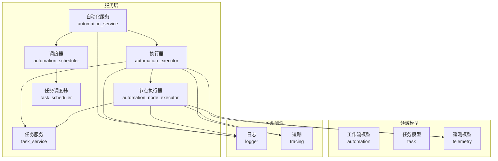
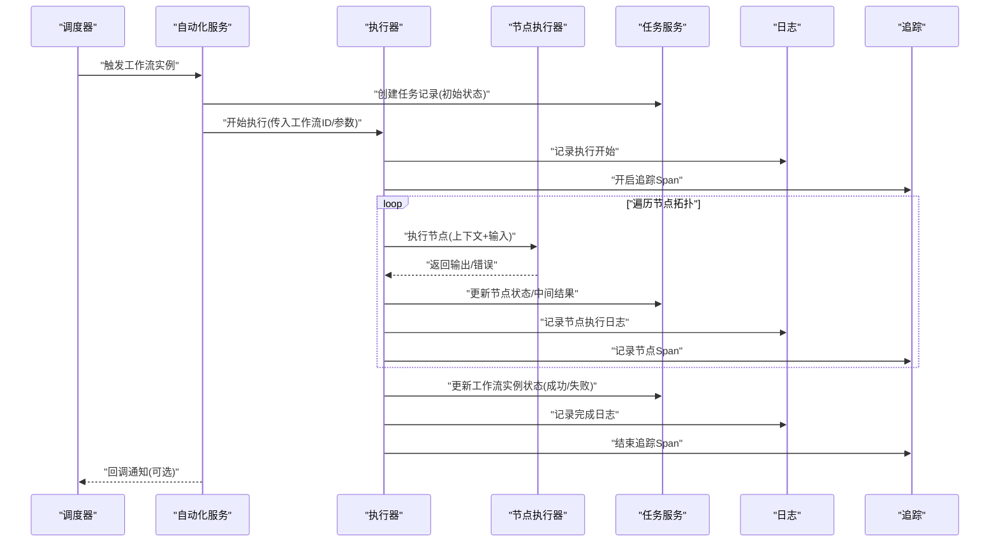
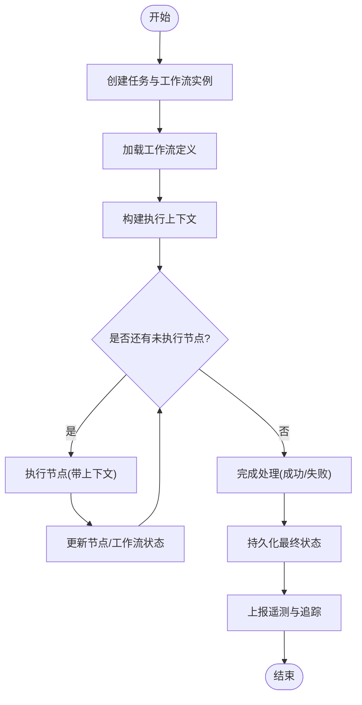
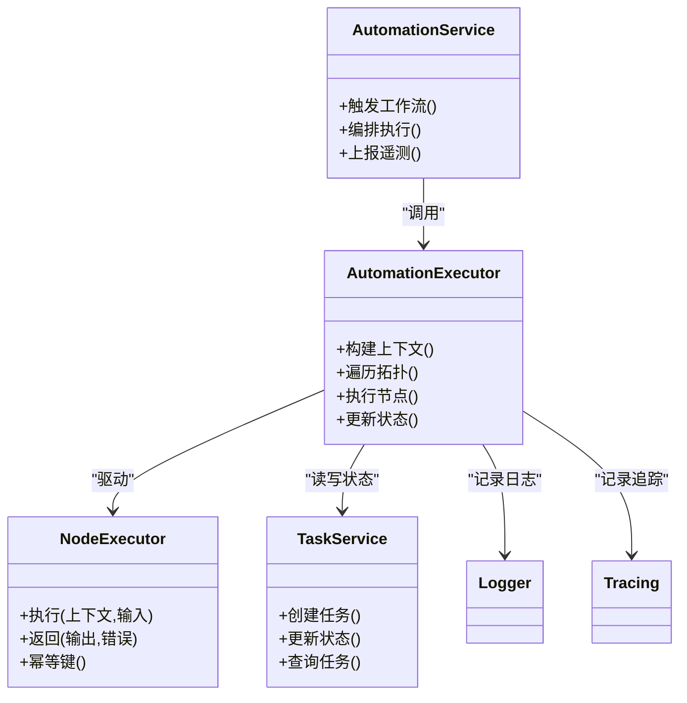
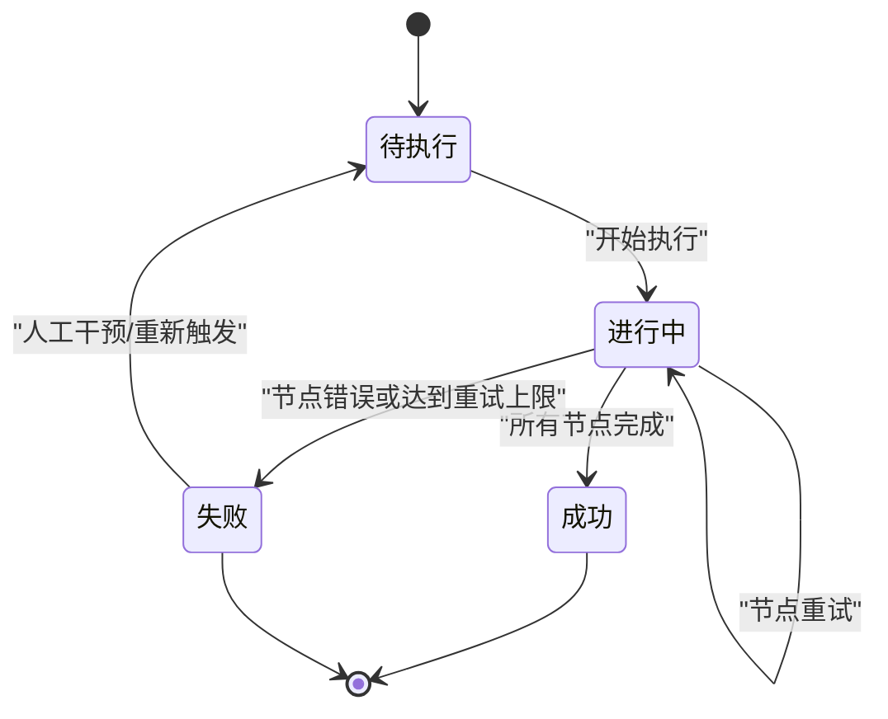
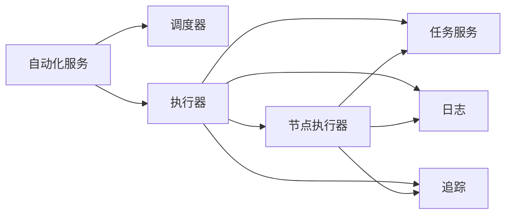

# 执行引擎

<cite>
**本文引用的文件**   
- [automation_executor.go](file://notifuse/internal/service/automation_executor.go)
- [automation_node_executor.go](file://notifuse/internal/service/automation_node_executor.go)
- [automation_scheduler.go](file://notifuse/internal/service/automation_scheduler.go)
- [automation_service.go](file://notifuse/internal/service/automation_service.go)
- [task_scheduler.go](file://notifuse/internal/service/task_scheduler.go)
- [task_service.go](file://notifuse/internal/service/task_service.go)
- [task.go](file://notifuse/internal/domain/task.go)
- [automation.go](file://notifuse/internal/domain/automation.go)
- [telemetry.go](file://notifuse/internal/domain/telemetry.go)
- [logger.go](file://notifuse/pkg/logger/logger.go)
- [tracing.go](file://notifuse/pkg/tracing/tracing.go)
</cite>

## 目录
1. [简介](#简介)
2. [项目结构](#项目结构)
3. [核心组件](#核心组件)
4. [架构总览](#架构总览)
5. [详细组件分析](#详细组件分析)
6. [依赖关系分析](#依赖关系分析)
7. [性能考量](#性能考量)
8. [故障排查指南](#故障排查指南)
9. [结论](#结论)
10. [附录](#附录)

## 简介
本文件面向 Notifuse 平台的自动化工作流执行引擎，系统化阐述工作流从触发、调度、节点执行到完成的全生命周期。文档聚焦以下主题：
- 执行生命周期：启动、节点执行、状态跟踪与完成处理
- 节点执行器架构模式：执行上下文管理、数据传递与错误传播
- 执行状态持久化与恢复策略
- 并发执行控制与资源管理
- 执行日志记录与调试信息收集
- 执行性能监控与故障排查最佳实践

## 项目结构
执行引擎相关代码主要位于 internal/service 与 internal/domain 下，配合 pkg/logger 与 pkg/tracing 提供可观测性能力。关键模块职责如下：
- 服务层（service）
  - automation_service：编排工作流生命周期，协调调度器与执行器
  - automation_scheduler：负责定时/事件驱动的触发与任务入队
  - automation_executor：工作流实例的执行编排，驱动节点执行器
  - automation_node_executor：具体节点的执行实现与上下文管理
  - task_scheduler / task_service：通用任务调度与持久化支撑
- 领域模型（domain）
  - automation：工作流定义与运行态元数据
  - task：任务抽象与状态机
  - telemetry：遥测指标与追踪上下文
- 可观测性（pkg）
  - logger：结构化日志
  - tracing：分布式追踪集成

图表来源
- [automation_service.go](file://notifuse/internal/service/automation_service.go)
- [automation_scheduler.go](file://notifuse/internal/service/automation_scheduler.go)
- [automation_executor.go](file://notifuse/internal/service/automation_executor.go)
- [automation_node_executor.go](file://notifuse/internal/service/automation_node_executor.go)
- [task_scheduler.go](file://notifuse/internal/service/task_scheduler.go)
- [task_service.go](file://notifuse/internal/service/task_service.go)
- [automation.go](file://notifuse/internal/domain/automation.go)
- [task.go](file://notifuse/internal/domain/task.go)
- [telemetry.go](file://notifuse/internal/domain/telemetry.go)
- [logger.go](file://notifuse/pkg/logger/logger.go)
- [tracing.go](file://notifuse/pkg/tracing/tracing.go)

章节来源
- [automation_service.go](file://notifuse/internal/service/automation_service.go)
- [automation_scheduler.go](file://notifuse/internal/service/automation_scheduler.go)
- [automation_executor.go](file://notifuse/internal/service/automation_executor.go)
- [automation_node_executor.go](file://notifuse/internal/service/automation_node_executor.go)
- [task_scheduler.go](file://notifuse/internal/service/task_scheduler.go)
- [task_service.go](file://notifuse/internal/service/task_service.go)
- [automation.go](file://notifuse/internal/domain/automation.go)
- [task.go](file://notifuse/internal/domain/task.go)
- [telemetry.go](file://notifuse/internal/domain/telemetry.go)
- [logger.go](file://notifuse/pkg/logger/logger.go)
- [tracing.go](file://notifuse/pkg/tracing/tracing.go)

## 核心组件
- 自动化服务（Automation Service）
  - 职责：创建工作流实例、协调调度与执行、汇总结果与状态、上报遥测
  - 关键点：对外暴露的编排入口；对调度器与执行器的组合使用
- 调度器（Scheduler）
  - 职责：基于时间或外部事件生成任务并投递至任务队列
  - 关键点：去重、退避重试、批量化触发
- 执行器（Executor）
  - 职责：加载工作流定义、构建执行上下文、按拓扑顺序执行节点、维护运行态状态
  - 关键点：上下文隔离、数据传递、错误传播、幂等与重试
- 节点执行器（Node Executor）
  - 职责：实现具体业务节点逻辑（如 HTTP 调用、模板渲染、条件分支等）
  - 关键点：输入输出契约、副作用边界、超时与熔断
- 任务服务（Task Service）
  - 职责：任务的持久化、查询、状态更新与补偿
  - 关键点：乐观锁、幂等键、状态机一致性
- 任务调度器（Task Scheduler）
  - 职责：拉取待执行任务、并发消费、失败重试与死信处理
  - 关键点：并发度控制、背压、公平性与优先级

章节来源
- [automation_service.go](file://notifuse/internal/service/automation_service.go)
- [automation_scheduler.go](file://notifuse/internal/service/automation_scheduler.go)
- [automation_executor.go](file://notifuse/internal/service/automation_executor.go)
- [automation_node_executor.go](file://notifuse/internal/service/automation_node_executor.go)
- [task_service.go](file://notifuse/internal/service/task_service.go)
- [task_scheduler.go](file://notifuse/internal/service/task_scheduler.go)

## 架构总览
下图展示一次典型的工作流执行流程：调度器触发任务，执行器载入工作流并创建执行上下文，依次驱动节点执行器，期间持续更新任务与工作流状态，最终完成并上报遥测。

图表来源
- [automation_scheduler.go](file://notifuse/internal/service/automation_scheduler.go)
- [automation_service.go](file://notifuse/internal/service/automation_service.go)
- [automation_executor.go](file://notifuse/internal/service/automation_executor.go)
- [automation_node_executor.go](file://notifuse/internal/service/automation_node_executor.go)
- [task_service.go](file://notifuse/internal/service/task_service.go)
- [logger.go](file://notifuse/pkg/logger/logger.go)
- [tracing.go](file://notifuse/pkg/tracing/tracing.go)

## 详细组件分析

### 工作流执行生命周期
- 启动阶段
  - 调度器根据规则（定时/事件）生成任务并持久化
  - 自动化服务接收触发信号，初始化执行上下文，写入任务与工作流实例初始状态
- 节点执行阶段
  - 执行器解析工作流拓扑，按依赖顺序调度节点执行器
  - 每个节点执行前注入上下文与上游输出，执行后合并输出并更新状态
- 状态跟踪
  - 任务与服务端工作流实例状态在每次节点完成后落库
  - 支持断点续跑：通过“已执行节点集合”和“幂等键”避免重复执行
- 完成处理
  - 全部节点成功则标记工作流完成；任一节点失败则进入失败分支或重试策略
  - 最终状态持久化，并上报遥测指标与追踪信息

图表来源
- [automation_service.go](file://notifuse/internal/service/automation_service.go)
- [automation_executor.go](file://notifuse/internal/service/automation_executor.go)
- [task_service.go](file://notifuse/internal/service/task_service.go)
- [telemetry.go](file://notifuse/internal/domain/telemetry.go)

章节来源
- [automation_service.go](file://notifuse/internal/service/automation_service.go)
- [automation_executor.go](file://notifuse/internal/service/automation_executor.go)
- [task_service.go](file://notifuse/internal/service/task_service.go)
- [telemetry.go](file://notifuse/internal/domain/telemetry.go)

### 节点执行器架构模式
- 执行上下文管理
  - 为每个工作流实例维护独立上下文，包含运行时变量、配置、密钥引用、追踪ID等
  - 上下文在节点间以只读方式共享，节点输出作为新的上下文片段注入下游
- 数据传递
  - 采用有向无环图（DAG）的数据流语义，上游节点输出映射到下游节点输入
  - 支持类型安全的数据桥接与默认值回退
- 错误传播
  - 节点错误分为可重试与不可重试两类
  - 执行器根据策略决定短路失败、继续执行其他分支或进入补偿流程
- 幂等与重试
  - 节点执行携带幂等键，结合任务服务保证重复投递不产生副作用
  - 指数退避与最大重试次数控制

图表来源
- [automation_service.go](file://notifuse/internal/service/automation_service.go)
- [automation_executor.go](file://notifuse/internal/service/automation_executor.go)
- [automation_node_executor.go](file://notifuse/internal/service/automation_node_executor.go)
- [task_service.go](file://notifuse/internal/service/task_service.go)
- [logger.go](file://notifuse/pkg/logger/logger.go)
- [tracing.go](file://notifuse/pkg/tracing/tracing.go)

章节来源
- [automation_node_executor.go](file://notifuse/internal/service/automation_node_executor.go)
- [automation_executor.go](file://notifuse/internal/service/automation_executor.go)
- [task_service.go](file://notifuse/internal/service/task_service.go)

### 执行状态持久化与恢复策略
- 状态模型
  - 任务与工作流实例均具备明确的状态机（例如：待执行、进行中、成功、失败、取消）
  - 节点级状态用于细粒度恢复与进度可视化
- 持久化时机
  - 每次节点执行前后进行原子状态更新，确保崩溃后可恢复
  - 大对象输出采用外置存储，状态中仅保留引用
- 恢复策略
  - 重启后扫描“进行中”的任务与工作流实例，依据幂等键与已执行节点集合进行断点续跑
  - 对于外部副作用，优先采用幂等接口或补偿动作

图表来源
- [task.go](file://notifuse/internal/domain/task.go)
- [automation.go](file://notifuse/internal/domain/automation.go)
- [task_service.go](file://notifuse/internal/service/task_service.go)

章节来源
- [task.go](file://notifuse/internal/domain/task.go)
- [automation.go](file://notifuse/internal/domain/automation.go)
- [task_service.go](file://notifuse/internal/service/task_service.go)

### 并发执行控制与资源管理
- 并发度控制
  - 全局与租户级并发限制，防止资源争用
  - 节点级超时与熔断，避免长尾任务拖垮系统
- 资源隔离
  - 工作流实例级别上下文隔离，避免跨实例污染
  - 外部依赖（数据库、HTTP、消息队列）连接池与限流
- 背压与队列
  - 任务队列容量上限与丢弃策略
  - 消费者数量动态调整与优雅扩缩容

章节来源
- [task_scheduler.go](file://notifuse/internal/service/task_scheduler.go)
- [automation_executor.go](file://notifuse/internal/service/automation_executor.go)

### 执行日志记录与调试信息收集
- 结构化日志
  - 统一日志格式，包含工作流ID、任务ID、节点ID、耗时、错误码等字段
  - 敏感信息脱敏与采样策略
- 追踪集成
  - 以 Span 为单位记录节点执行链路，便于端到端定位问题
  - 跨进程/跨服务追踪上下文透传
- 调试辅助
  - 提供“回放”能力：基于历史输入与上下文重现节点执行
  - 快照导出：将工作流实例的关键状态与中间结果导出供离线分析

章节来源
- [logger.go](file://notifuse/pkg/logger/logger.go)
- [tracing.go](file://notifuse/pkg/tracing/tracing.go)
- [automation_executor.go](file://notifuse/internal/service/automation_executor.go)

### 执行性能监控与故障排查最佳实践
- 指标采集
  - 工作流实例数、节点执行成功率、平均/分位耗时、重试率、失败原因分布
  - 资源使用（CPU、内存、连接池利用率）
- 告警策略
  - 失败率突增、P95/P99 延迟升高、重试风暴、队列积压
- 排查步骤
  - 通过追踪 ID 快速定位失败节点与根因
  - 检查节点幂等键与外部依赖健康状态
  - 对比历史快照与当前上下文差异，识别数据漂移

章节来源
- [telemetry.go](file://notifuse/internal/domain/telemetry.go)
- [automation_executor.go](file://notifuse/internal/service/automation_executor.go)

## 依赖关系分析
- 内部依赖
  - 自动化服务依赖调度器与执行器，执行器依赖节点执行器与任务服务
  - 节点执行器依赖任务服务与可观测性组件
- 外部依赖
  - 数据库（任务与工作流状态）、消息队列（任务分发）、外部 API（节点副作用）
- 耦合与内聚
  - 服务层高内聚，执行器与节点执行器解耦，通过清晰接口契约协作
- 潜在循环依赖
  - 通过分层与接口抽象避免循环导入

图表来源
- [automation_service.go](file://notifuse/internal/service/automation_service.go)
- [automation_scheduler.go](file://notifuse/internal/service/automation_scheduler.go)
- [automation_executor.go](file://notifuse/internal/service/automation_executor.go)
- [automation_node_executor.go](file://notifuse/internal/service/automation_node_executor.go)
- [task_service.go](file://notifuse/internal/service/task_service.go)
- [logger.go](file://notifuse/pkg/logger/logger.go)
- [tracing.go](file://notifuse/pkg/tracing/tracing.go)

章节来源
- [automation_service.go](file://notifuse/internal/service/automation_service.go)
- [automation_scheduler.go](file://notifuse/internal/service/automation_scheduler.go)
- [automation_executor.go](file://notifuse/internal/service/automation_executor.go)
- [automation_node_executor.go](file://notifuse/internal/service/automation_node_executor.go)
- [task_service.go](file://notifuse/internal/service/task_service.go)
- [logger.go](file://notifuse/pkg/logger/logger.go)
- [tracing.go](file://notifuse/pkg/tracing/tracing.go)

## 性能考量
- 批量触发与批处理：减少频繁小任务带来的开销
- 节点并行度：在无依赖的节点上启用并行执行，提升吞吐
- 缓存与复用：对热点配置与模板进行缓存
- 超时与熔断：保护外部依赖，避免雪崩
- 背压与限流：在高峰期自动降载，保障稳定性

[本节为通用指导，无需特定文件来源]

## 故障排查指南
- 常见问题
  - 任务堆积：检查任务调度器并发度与消费者健康
  - 节点超时：查看节点超时配置与外部依赖延迟
  - 重试风暴：确认幂等键与退避策略是否生效
  - 状态不一致：核对任务与工作流实例的最终一致性
- 诊断工具
  - 使用追踪 ID 串联日志与指标
  - 导出工作流快照进行离线复现
  - 针对失败节点打印最小可复现场景

章节来源
- [task_scheduler.go](file://notifuse/internal/service/task_scheduler.go)
- [automation_executor.go](file://notifuse/internal/service/automation_executor.go)
- [logger.go](file://notifuse/pkg/logger/logger.go)
- [tracing.go](file://notifuse/pkg/tracing/tracing.go)

## 结论
Notifuse 的执行引擎以服务化编排为核心，通过清晰的执行上下文、严格的幂等与重试机制、完善的状态持久化与可观测性体系，实现了高可靠、可扩展的自动化工作流执行。在生产环境中，建议结合指标与追踪建立完善的监控告警与排障流程，并持续优化并发与资源策略以提升整体吞吐与稳定性。

[本节为总结性内容，无需特定文件来源]

## 附录
- 术语
  - 工作流：由多个节点组成的有向无环图，描述业务流程
  - 任务：工作流的一次执行实例
  - 节点：工作流中的最小执行单元
  - 上下文：执行期变量与作用域
  - 幂等键：保证重复执行不产生副作用的唯一标识
- 参考实现路径
  - 工作流编排入口：[automation_service.go](file://notifuse/internal/service/automation_service.go)
  - 执行器与上下文：[automation_executor.go](file://notifuse/internal/service/automation_executor.go)
  - 节点执行器：[automation_node_executor.go](file://notifuse/internal/service/automation_node_executor.go)
  - 任务调度与持久化：[task_scheduler.go](file://notifuse/internal/service/task_scheduler.go)、[task_service.go](file://notifuse/internal/service/task_service.go)
  - 领域模型：[automation.go](file://notifuse/internal/domain/automation.go)、[task.go](file://notifuse/internal/domain/task.go)
  - 可观测性：[logger.go](file://notifuse/pkg/logger/logger.go)、[tracing.go](file://notifuse/pkg/tracing/tracing.go)、[telemetry.go](file://notifuse/internal/domain/telemetry.go)