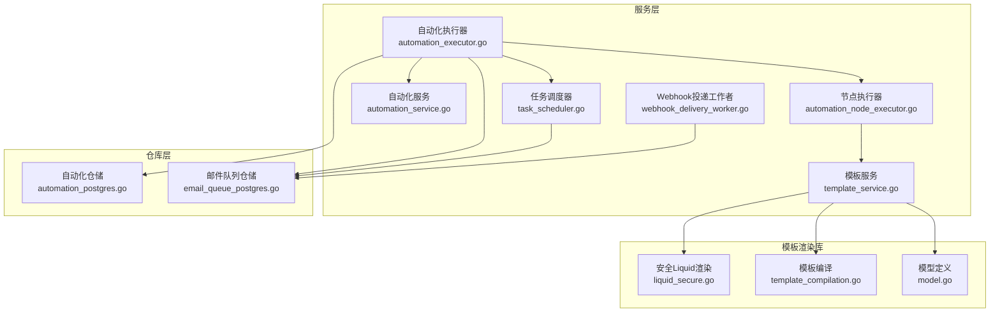
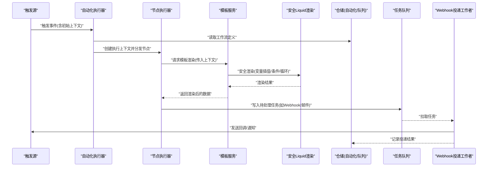
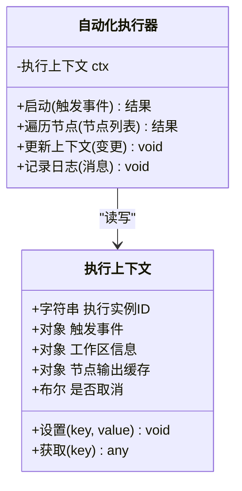
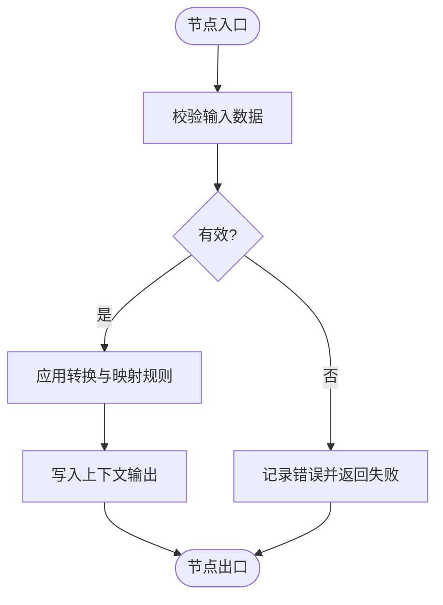
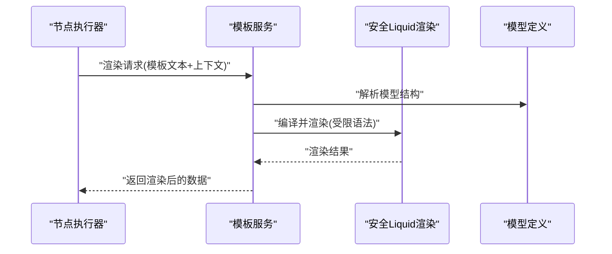
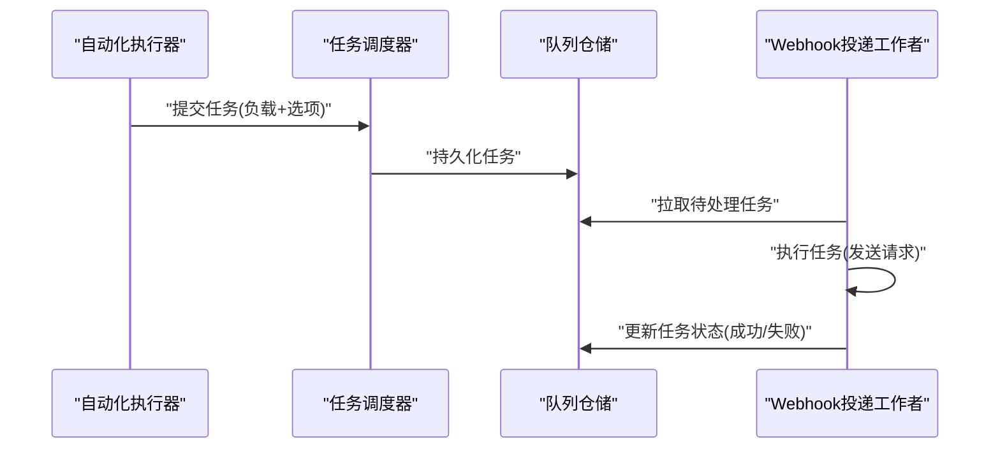
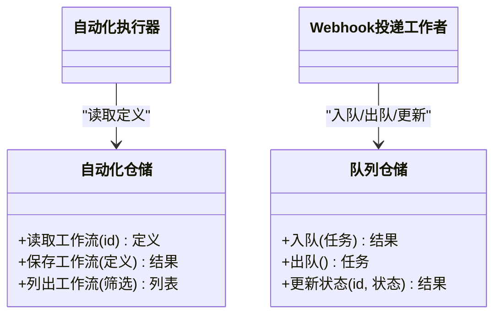
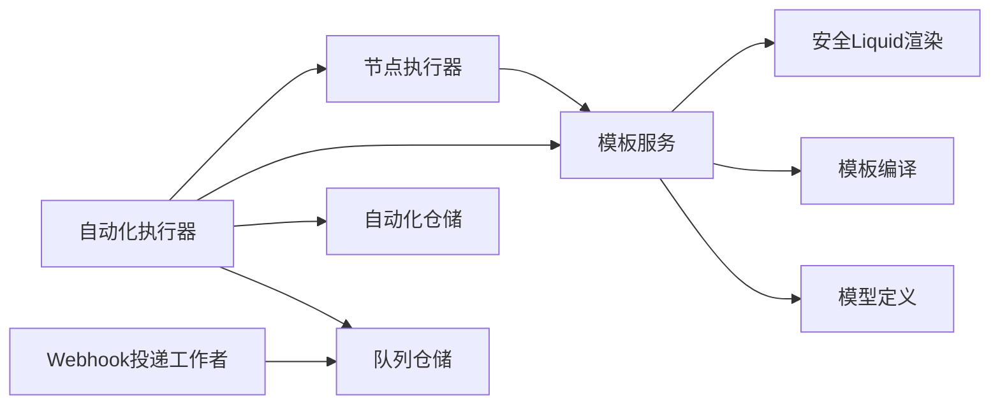

# 数据流管理

<cite>
**本文引用的文件**   
- [automation_executor.go](file://notifuse/internal/service/automation_executor.go)
- [automation_node_executor.go](file://notifuse/internal/service/automation_node_executor.go)
- [automation_service.go](file://notifuse/internal/service/automation_service.go)
- [template_service.go](file://notifuse/internal/service/template_service.go)
- [liquid_secure.go](file://notifuse/pkg/notifuse_mjml/liquid_secure.go)
- [template_compilation.go](file://notifuse/pkg/notifuse_mjml/template_compilation.go)
- [model.go](file://notifuse/pkg/notifuse_mjml/model.go)
- [automation_postgres.go](file://notifuse/internal/repository/automation_postgres.go)
- [email_queue_postgres.go](file://notifuse/internal/repository/email_queue_postgres.go)
- [task_scheduler.go](file://notifuse/internal/service/task_scheduler.go)
- [webhook_delivery_worker.go](file://notifuse/internal/service/webhook_delivery_worker.go)
- [logger.go](file://notifuse/pkg/logger/logger.go)
</cite>

## 目录
1. [简介](#简介)
2. [项目结构](#项目结构)
3. [核心组件](#核心组件)
4. [架构总览](#架构总览)
5. [详细组件分析](#详细组件分析)
6. [依赖关系分析](#依赖关系分析)
7. [性能考虑](#性能考虑)
8. [故障排查指南](#故障排查指南)
9. [结论](#结论)
10. [附录](#附录)

## 简介
本文件面向Notifuse平台的工作流（自动化）数据流管理，聚焦以下目标：
- 工作流执行过程中的数据传递机制：上下文变量、节点间数据共享与全局状态管理
- Liquid模板引擎在工作流中的应用：变量插值、条件渲染与循环处理
- 数据转换与映射工具的使用方法与自定义函数开发
- 大数据量处理的分片策略与内存优化技术
- 数据流调试与监控的实现方案
- 数据安全与隐私保护的最佳实践

## 项目结构
围绕工作流数据流的关键代码主要分布在服务层、仓库层与模板渲染库中：
- 服务层负责编排工作流、调度任务、驱动节点执行与持久化状态
- 仓库层提供工作流定义、队列与任务的数据库访问
- 模板渲染库提供安全的Liquid模板编译与渲染能力

图表来源
- [automation_executor.go](file://notifuse/internal/service/automation_executor.go)
- [automation_node_executor.go](file://notifuse/internal/service/automation_node_executor.go)
- [automation_service.go](file://notifuse/internal/service/automation_service.go)
- [template_service.go](file://notifuse/internal/service/template_service.go)
- [liquid_secure.go](file://notifuse/pkg/notifuse_mjml/liquid_secure.go)
- [template_compilation.go](file://notifuse/pkg/notifuse_mjml/template_compilation.go)
- [model.go](file://notifuse/pkg/notifuse_mjml/model.go)
- [automation_postgres.go](file://notifuse/internal/repository/automation_postgres.go)
- [email_queue_postgres.go](file://notifuse/internal/repository/email_queue_postgres.go)
- [task_scheduler.go](file://notifuse/internal/service/task_scheduler.go)
- [webhook_delivery_worker.go](file://notifuse/internal/service/webhook_delivery_worker.go)

章节来源
- [automation_executor.go](file://notifuse/internal/service/automation_executor.go)
- [automation_node_executor.go](file://notifuse/internal/service/automation_node_executor.go)
- [automation_service.go](file://notifuse/internal/service/automation_service.go)
- [template_service.go](file://notifuse/internal/service/template_service.go)
- [liquid_secure.go](file://notifuse/pkg/notifuse_mjml/liquid_secure.go)
- [template_compilation.go](file://notifuse/pkg/notifuse_mjml/template_compilation.go)
- [model.go](file://notifuse/pkg/notifuse_mjml/model.go)
- [automation_postgres.go](file://notifuse/internal/repository/automation_postgres.go)
- [email_queue_postgres.go](file://notifuse/internal/repository/email_queue_postgres.go)
- [task_scheduler.go](file://notifuse/internal/service/task_scheduler.go)
- [webhook_delivery_worker.go](file://notifuse/internal/service/webhook_delivery_worker.go)

## 核心组件
- 自动化执行器：负责加载工作流定义、解析触发事件、构建执行上下文、按图遍历节点并协调子流程与并发控制。
- 节点执行器：封装具体节点类型的执行逻辑，包括数据获取、转换、调用外部服务、写入队列等。
- 模板服务：统一封装模板渲染流程，注入上下文变量，调用安全Liquid渲染器进行内容生成。
- 任务调度器：将耗时或批量任务入队，支持重试、退避与限流。
- Webhook投递工作者：从队列拉取任务并发送HTTP请求，记录投递结果。
- 仓储层：提供工作流、任务、队列的持久化访问接口。
- 模板渲染库：提供安全的模板编译与渲染能力，限制危险操作，保障沙箱环境。

章节来源
- [automation_executor.go](file://notifuse/internal/service/automation_executor.go)
- [automation_node_executor.go](file://notifuse/internal/service/automation_node_executor.go)
- [template_service.go](file://notifuse/internal/service/template_service.go)
- [task_scheduler.go](file://notifuse/internal/service/task_scheduler.go)
- [webhook_delivery_worker.go](file://notifuse/internal/service/webhook_delivery_worker.go)
- [automation_postgres.go](file://notifuse/internal/repository/automation_postgres.go)
- [email_queue_postgres.go](file://notifuse/internal/repository/email_queue_postgres.go)
- [liquid_secure.go](file://notifuse/pkg/notifuse_mjml/liquid_secure.go)
- [template_compilation.go](file://notifuse/pkg/notifuse_mjml/template_compilation.go)
- [model.go](file://notifuse/pkg/notifuse_mjml/model.go)

## 架构总览
下图展示了工作流从触发到完成的数据流转路径，以及关键组件之间的交互。

图表来源
- [automation_executor.go](file://notifuse/internal/service/automation_executor.go)
- [automation_node_executor.go](file://notifuse/internal/service/automation_node_executor.go)
- [template_service.go](file://notifuse/internal/service/template_service.go)
- [liquid_secure.go](file://notifuse/pkg/notifuse_mjml/liquid_secure.go)
- [automation_postgres.go](file://notifuse/internal/repository/automation_postgres.go)
- [email_queue_postgres.go](file://notifuse/internal/repository/email_queue_postgres.go)
- [webhook_delivery_worker.go](file://notifuse/internal/service/webhook_delivery_worker.go)

## 详细组件分析

### 工作流执行器与上下文管理
- 职责
  - 解析工作流定义，构建执行上下文（包含触发事件、用户信息、工作区信息等）
  - 维护节点间数据共享：通过上下文对象在各节点之间传递中间结果
  - 控制执行顺序与分支：根据节点类型与条件表达式决定下一步
  - 错误处理与重试：捕获异常并记录日志，必要时回滚或标记失败
- 上下文变量
  - 根级变量：工作区ID、用户标识、触发时间戳等
  - 事件变量：来自触发源的原始载荷，经清洗后进入上下文
  - 节点输出变量：每个节点完成后将其输出写入上下文，供后续节点使用
- 全局状态
  - 执行实例ID、阶段标记、累计指标（如已处理数量、失败计数）
  - 超时与取消信号，用于中断长时间运行的节点

图表来源
- [automation_executor.go](file://notifuse/internal/service/automation_executor.go)

章节来源
- [automation_executor.go](file://notifuse/internal/service/automation_executor.go)

### 节点执行器与数据转换
- 职责
  - 实现各类节点的具体执行逻辑：数据查询、过滤、聚合、映射、外部API调用
  - 对输入数据进行校验与规范化，确保下游节点可消费
  - 将处理结果写回执行上下文，形成节点间数据共享
- 数据转换与映射
  - 内置转换：类型转换、字段重命名、数组切片、去重、排序
  - 映射规则：基于键路径的提取与合并，支持嵌套对象展开
  - 自定义函数扩展点：在模板服务或节点执行器注册函数，供模板或节点逻辑调用
- 错误与边界
  - 空值处理：默认值、跳过、短路
  - 大对象裁剪：仅保留必要字段，避免内存膨胀

图表来源
- [automation_node_executor.go](file://notifuse/internal/service/automation_node_executor.go)

章节来源
- [automation_node_executor.go](file://notifuse/internal/service/automation_node_executor.go)

### 模板服务与安全Liquid渲染
- 职责
  - 统一模板渲染入口，接收上下文与模板文本，返回渲染结果
  - 注入系统变量与业务变量，保证变量命名空间清晰
  - 限制危险操作，启用沙箱模式，防止任意代码执行
- Liquid特性
  - 变量插值：{{ variable }}
  - 条件渲染：
  - 循环处理：...
  - 过滤器与内置函数：大小写转换、日期格式化、数值计算等
- 自定义函数开发
  - 在模板服务注册自定义函数，暴露给模板使用
  - 函数签名需明确参数类型与返回值，便于类型检查与错误处理
  - 建议为自定义函数添加单元测试，覆盖边界情况

图表来源
- [template_service.go](file://notifuse/internal/service/template_service.go)
- [liquid_secure.go](file://notifuse/pkg/notifuse_mjml/liquid_secure.go)
- [template_compilation.go](file://notifuse/pkg/notifuse_mjml/template_compilation.go)
- [model.go](file://notifuse/pkg/notifuse_mjml/model.go)

章节来源
- [template_service.go](file://notifuse/internal/service/template_service.go)
- [liquid_secure.go](file://notifuse/pkg/notifuse_mjml/liquid_secure.go)
- [template_compilation.go](file://notifuse/pkg/notifuse_mjml/template_compilation.go)
- [model.go](file://notifuse/pkg/notifuse_mjml/model.go)

### 任务调度与队列
- 职责
  - 将耗时任务（如大批量Webhook投递、邮件发送）入队
  - 支持重试、退避、限流与优先级
  - 持久化任务状态，支持断点续跑
- 与执行器的协作
  - 执行器在需要时提交任务至队列
  - 工作者从队列拉取任务并执行，完成后更新状态

图表来源
- [task_scheduler.go](file://notifuse/internal/service/task_scheduler.go)
- [email_queue_postgres.go](file://notifuse/internal/repository/email_queue_postgres.go)
- [webhook_delivery_worker.go](file://notifuse/internal/service/webhook_delivery_worker.go)

章节来源
- [task_scheduler.go](file://notifuse/internal/service/task_scheduler.go)
- [email_queue_postgres.go](file://notifuse/internal/repository/email_queue_postgres.go)
- [webhook_delivery_worker.go](file://notifuse/internal/service/webhook_delivery_worker.go)

### 仓储层与工作流定义
- 职责
  - 提供工作流定义的CRUD与版本管理
  - 提供任务与队列的持久化访问
  - 提供索引与查询优化，提升检索效率
- 与执行器的协作
  - 执行器在启动时加载工作流定义
  - 节点执行过程中按需读取关联数据

图表来源
- [automation_postgres.go](file://notifuse/internal/repository/automation_postgres.go)
- [email_queue_postgres.go](file://notifuse/internal/repository/email_queue_postgres.go)

章节来源
- [automation_postgres.go](file://notifuse/internal/repository/automation_postgres.go)
- [email_queue_postgres.go](file://notifuse/internal/repository/email_queue_postgres.go)

## 依赖关系分析
- 组件耦合
  - 执行器强依赖节点执行器与模板服务；节点执行器依赖模板服务；模板服务依赖安全Liquid渲染与模型定义
  - 任务调度器与队列仓储解耦良好，通过接口抽象降低耦合度
- 外部依赖
  - 数据库PostgreSQL（通过仓储层访问）
  - HTTP客户端（Webhook投递工作者）
- 潜在循环依赖
  - 当前设计未发现明显循环依赖；若新增跨模块回调需谨慎评估

图表来源
- [automation_executor.go](file://notifuse/internal/service/automation_executor.go)
- [automation_node_executor.go](file://notifuse/internal/service/automation_node_executor.go)
- [template_service.go](file://notifuse/internal/service/template_service.go)
- [liquid_secure.go](file://notifuse/pkg/notifuse_mjml/liquid_secure.go)
- [template_compilation.go](file://notifuse/pkg/notifuse_mjml/template_compilation.go)
- [model.go](file://notifuse/pkg/notifuse_mjml/model.go)
- [automation_postgres.go](file://notifuse/internal/repository/automation_postgres.go)
- [email_queue_postgres.go](file://notifuse/internal/repository/email_queue_postgres.go)
- [webhook_delivery_worker.go](file://notifuse/internal/service/webhook_delivery_worker.go)

章节来源
- [automation_executor.go](file://notifuse/internal/service/automation_executor.go)
- [automation_node_executor.go](file://notifuse/internal/service/automation_node_executor.go)
- [template_service.go](file://notifuse/internal/service/template_service.go)
- [liquid_secure.go](file://notifuse/pkg/notifuse_mjml/liquid_secure.go)
- [template_compilation.go](file://notifuse/pkg/notifuse_mjml/template_compilation.go)
- [model.go](file://notifuse/pkg/notifuse_mjml/model.go)
- [automation_postgres.go](file://notifuse/internal/repository/automation_postgres.go)
- [email_queue_postgres.go](file://notifuse/internal/repository/email_queue_postgres.go)
- [webhook_delivery_worker.go](file://notifuse/internal/service/webhook_delivery_worker.go)

## 性能考虑
- 分片策略
  - 将大数据集拆分为固定大小的批次，逐批处理并落盘中间结果，避免一次性加载导致内存峰值过高
  - 使用游标或分页查询减少数据库压力
- 内存优化
  - 在节点执行器中对大对象进行裁剪，仅保留必要字段
  - 使用流式处理替代全量加载，结合通道与缓冲控制并发度
- 并发控制
  - 限制并行节点数与HTTP并发度，避免资源争用
  - 引入令牌桶或滑动窗口限流，保护下游服务
- 缓存与复用
  - 对只读配置与字典数据进行缓存，减少重复IO
  - 模板编译结果缓存，避免重复解析

[本节为通用指导，不直接分析具体文件]

## 故障排查指南
- 日志与追踪
  - 在执行器与节点执行器中记录关键步骤与上下文快照，便于定位问题
  - 使用结构化日志，包含执行实例ID、节点ID、错误码与堆栈
- 常见问题
  - 模板渲染失败：检查变量是否存在、类型是否匹配、权限是否允许
  - 节点执行超时：检查外部服务响应时间与重试策略
  - 队列堆积：检查工作者并发度与任务复杂度
- 诊断手段
  - 开启详细日志级别，收集执行轨迹
  - 对热点节点进行性能剖析，识别瓶颈

章节来源
- [logger.go](file://notifuse/pkg/logger/logger.go)

## 结论
Notifuse的工作流数据流管理以执行器为核心，通过上下文变量实现节点间数据共享，借助模板服务与安全Liquid渲染提供强大的内容生成能力。配合任务调度与队列机制，系统能够稳定处理大规模数据与高并发场景。通过合理的分片策略、内存优化与限流措施，系统在性能与稳定性方面具备良好表现。完善的日志与追踪机制为问题定位提供了有力支撑。

[本节为总结性内容，不直接分析具体文件]

## 附录
- 最佳实践
  - 数据安全与隐私保护
    - 最小化上下文变量范围，避免泄露敏感信息
    - 在模板渲染中启用沙箱模式，禁用危险函数
    - 对输入数据进行严格校验与白名单过滤
    - 对外部调用进行鉴权与速率限制
  - 自定义函数开发
    - 保持函数幂等与无副作用
    - 提供清晰的文档与测试用例
    - 对异常进行包装与上报
  - 监控与告警
    - 对工作流成功率、延迟与错误率设置阈值告警
    - 对队列积压与工作者健康状态进行监控

[本节为通用指导，不直接分析具体文件]