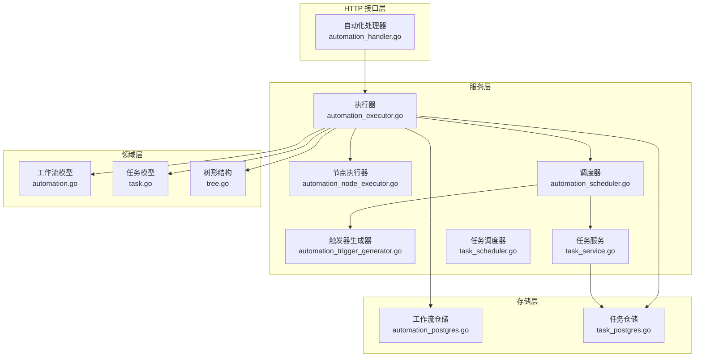
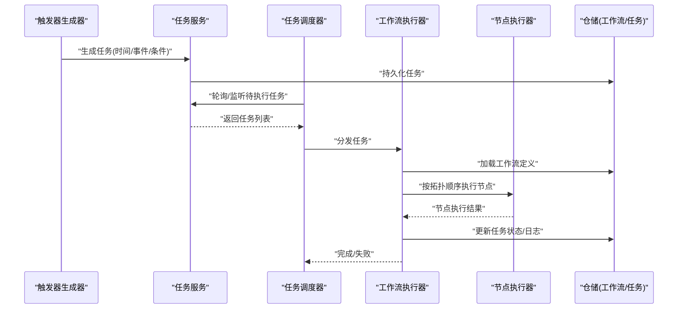
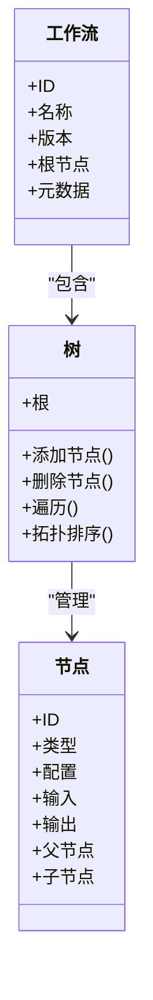
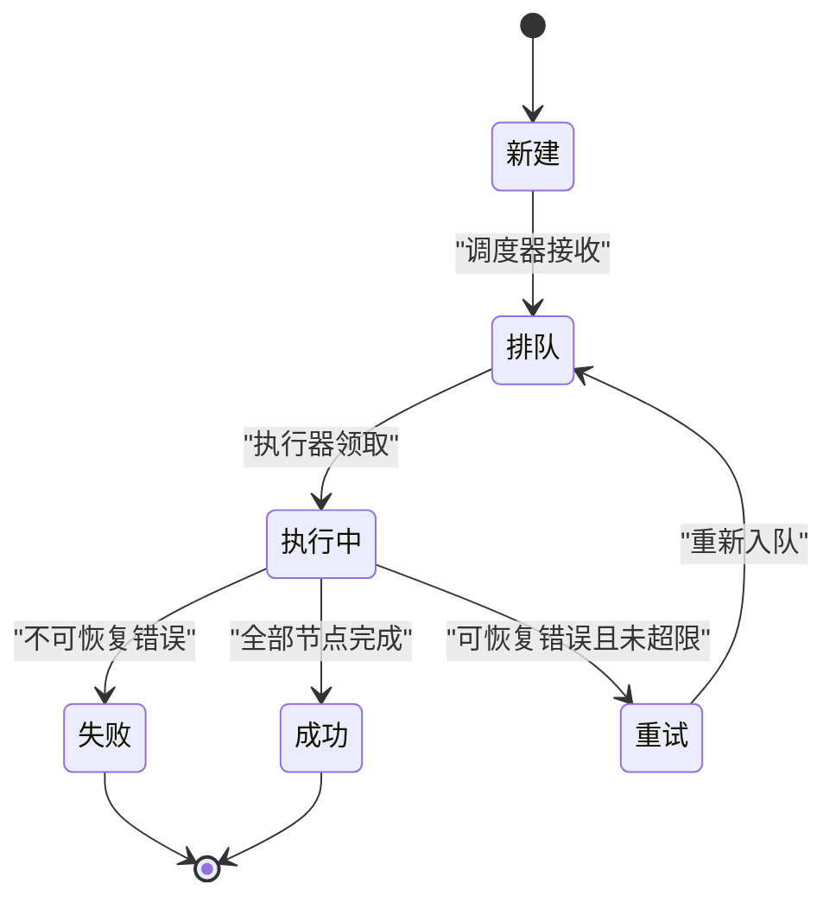
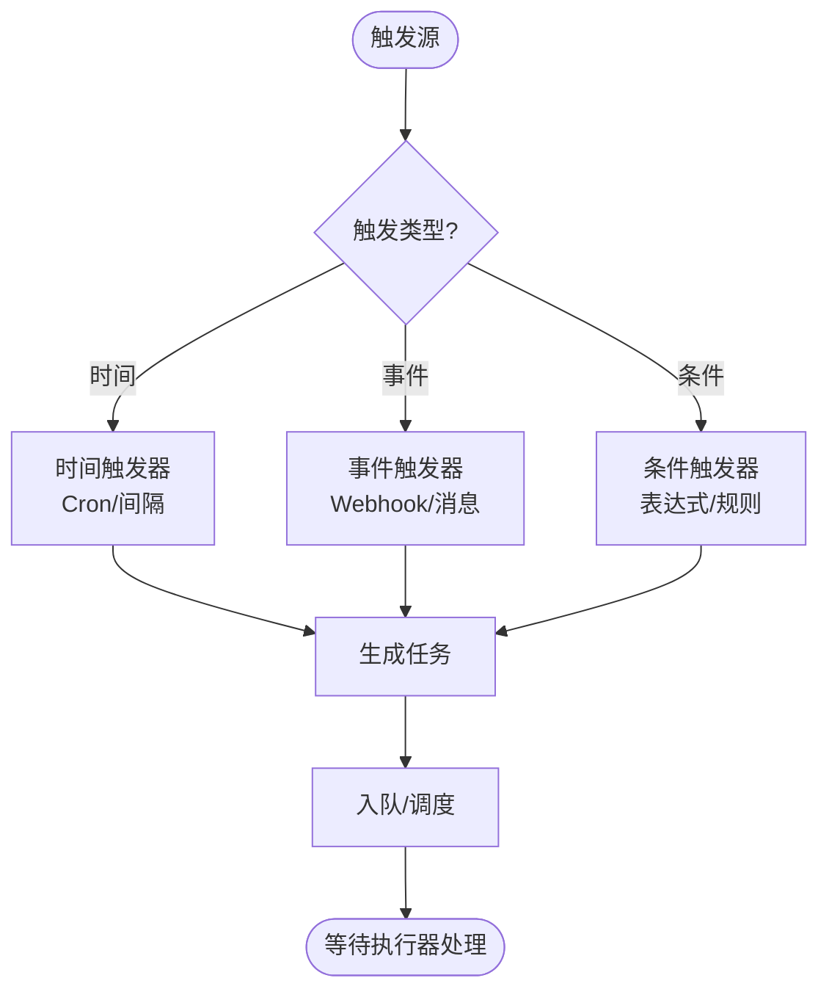
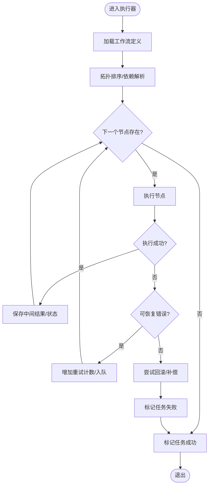
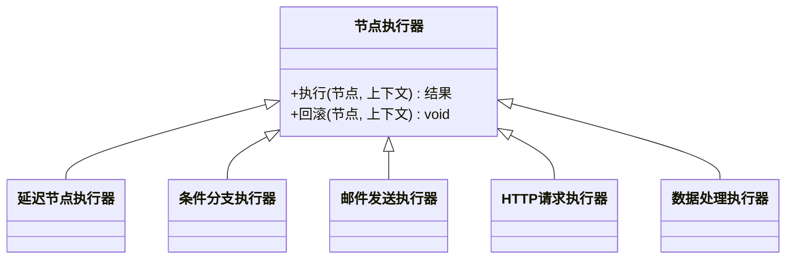
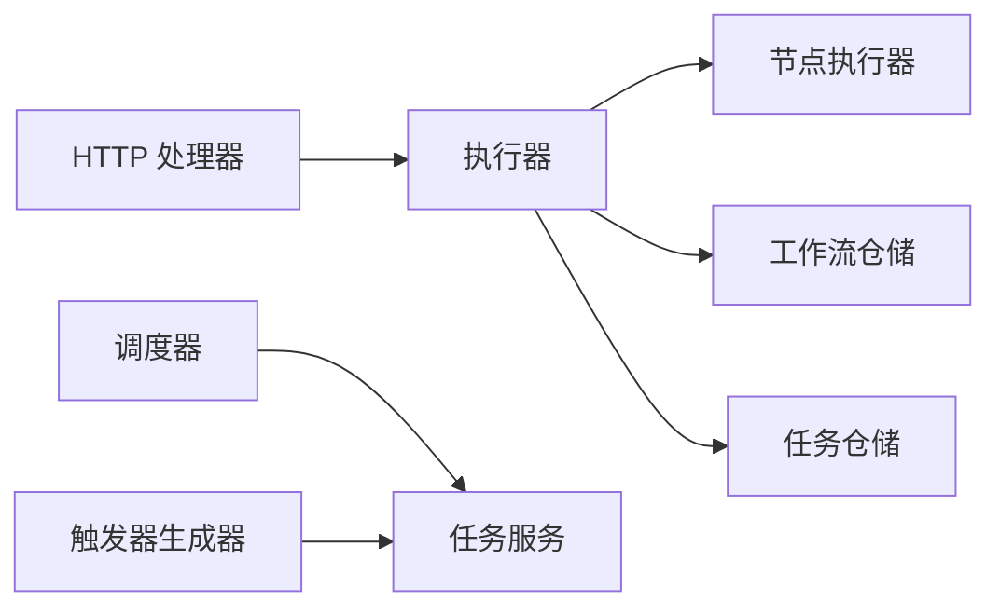

# 自动化工作流

<cite>
**本文引用的文件**   
- [automation.go](file://notifuse/internal/domain/automation.go)
- [automation_test.go](file://notifuse/internal/domain/automation_test.go)
- [automation_executor.go](file://notifuse/internal/service/automation_executor.go)
- [automation_node_executor.go](file://notifuse/internal/service/automation_node_executor.go)
- [automation_scheduler.go](file://notifuse/internal/service/automation_scheduler.go)
- [automation_trigger_generator.go](file://notifuse/internal/service/automation_trigger_generator.go)
- [automation_handler.go](file://notifuse/internal/http/automation_handler.go)
- [automation_postgres.go](file://notifuse/internal/repository/automation_postgres.go)
- [task.go](file://notifuse/internal/domain/task.go)
- [task_service.go](file://notifuse/internal/service/task_service.go)
- [task_scheduler.go](file://notifuse/internal/service/task_scheduler.go)
- [task_postgres.go](file://notifuse/internal/repository/task_postgres.go)
- [tree.go](file://notifuse/internal/domain/tree.go)
</cite>

## 目录
1. [简介](#简介)
2. [项目结构](#项目结构)
3. [核心组件](#核心组件)
4. [架构总览](#架构总览)
5. [详细组件分析](#详细组件分析)
6. [依赖关系分析](#依赖关系分析)
7. [性能考虑](#性能考虑)
8. [故障排查指南](#故障排查指南)
9. [结论](#结论)
10. [附录](#附录)

## 简介
本文件面向 Notifuse 平台的“自动化工作流”子系统，系统性阐述可视化工作流设计器的实现原理、触发器体系、执行引擎机制与节点类型配置方法。文档覆盖：
- 可视化工作流设计器：节点类型、连接关系、执行逻辑
- 触发器系统：时间触发、事件触发、条件触发
- 执行引擎：状态管理、错误处理、回滚策略
- 节点类型：延迟、条件分支、邮件发送等配置与使用场景
- 最佳实践与性能优化建议
- 实际工作流配置的代码示例路径与调试技巧

## 项目结构
自动化工作流相关代码主要分布在以下层次：
- 领域层（domain）：定义工作流模型、任务模型、树形结构等
- 服务层（service）：编排调度、执行器、触发器生成器
- 存储层（repository）：持久化工作流、任务等数据
- HTTP 接口层（http）：对外暴露的 REST API 处理器
- 前端控制台（console）：可视化工作流编辑器与运行态监控（不在本文深入展开）

图表来源
- [automation_handler.go](file://notifuse/internal/http/automation_handler.go)
- [automation_executor.go](file://notifuse/internal/service/automation_executor.go)
- [automation_node_executor.go](file://notifuse/internal/service/automation_node_executor.go)
- [automation_scheduler.go](file://notifuse/internal/service/automation_scheduler.go)
- [automation_trigger_generator.go](file://notifuse/internal/service/automation_trigger_generator.go)
- [automation_postgres.go](file://notifuse/internal/repository/automation_postgres.go)
- [task_service.go](file://notifuse/internal/service/task_service.go)
- [task_scheduler.go](file://notifuse/internal/service/task_scheduler.go)
- [task_postgres.go](file://notifuse/internal/repository/task_postgres.go)
- [automation.go](file://notifuse/internal/domain/automation.go)
- [task.go](file://notifuse/internal/domain/task.go)
- [tree.go](file://notifuse/internal/domain/tree.go)

章节来源
- [automation.go](file://notifuse/internal/domain/automation.go)
- [automation_executor.go](file://notifuse/internal/service/automation_executor.go)
- [automation_node_executor.go](file://notifuse/internal/service/automation_node_executor.go)
- [automation_scheduler.go](file://notifuse/internal/service/automation_scheduler.go)
- [automation_trigger_generator.go](file://notifuse/internal/service/automation_trigger_generator.go)
- [automation_handler.go](file://notifuse/internal/http/automation_handler.go)
- [automation_postgres.go](file://notifuse/internal/repository/automation_postgres.go)
- [task.go](file://notifuse/internal/domain/task.go)
- [task_service.go](file://notifuse/internal/service/task_service.go)
- [task_scheduler.go](file://notifuse/internal/service/task_scheduler.go)
- [task_postgres.go](file://notifuse/internal/repository/task_postgres.go)
- [tree.go](file://notifuse/internal/domain/tree.go)

## 核心组件
- 工作流模型与树结构：以树形结构表达工作流的节点与边，支持根节点、子节点、父节点关系，便于遍历与执行。
- 任务模型：表示一次工作流实例的执行上下文，包含状态、输入输出、重试计数、错误信息等。
- 执行器：负责加载工作流定义、解析树结构、按拓扑顺序或依赖关系驱动节点执行、维护任务状态。
- 节点执行器：针对具体节点类型（如延迟、条件分支、外部调用等）提供可插拔的执行逻辑。
- 调度器与触发器生成器：将时间/事件/条件转换为具体的任务或工作流启动信号，并交由任务调度器安排执行。
- 任务服务与调度器：统一管理任务的创建、更新、重试、完成与失败处理，并与持久化层交互。
- 仓储层：提供工作流与任务的持久化能力（PostgreSQL）。

章节来源
- [automation.go](file://notifuse/internal/domain/automation.go)
- [task.go](file://notifuse/internal/domain/task.go)
- [automation_executor.go](file://notifuse/internal/service/automation_executor.go)
- [automation_node_executor.go](file://notifuse/internal/service/automation_node_executor.go)
- [automation_scheduler.go](file://notifuse/internal/service/automation_scheduler.go)
- [automation_trigger_generator.go](file://notifuse/internal/service/automation_trigger_generator.go)
- [task_service.go](file://notifuse/internal/service/task_service.go)
- [task_scheduler.go](file://notifuse/internal/service/task_scheduler.go)
- [automation_postgres.go](file://notifuse/internal/repository/automation_postgres.go)
- [task_postgres.go](file://notifuse/internal/repository/task_postgres.go)
- [tree.go](file://notifuse/internal/domain/tree.go)

## 架构总览
下图展示了从触发到执行的端到端流程：触发器生成器根据规则生成任务；任务调度器将任务入队；执行器拉取任务并驱动工作流节点执行；节点执行器完成具体业务动作；最终结果落库并更新任务状态。

图表来源
- [automation_trigger_generator.go](file://notifuse/internal/service/automation_trigger_generator.go)
- [task_service.go](file://notifuse/internal/service/task_service.go)
- [task_scheduler.go](file://notifuse/internal/service/task_scheduler.go)
- [automation_executor.go](file://notifuse/internal/service/automation_executor.go)
- [automation_node_executor.go](file://notifuse/internal/service/automation_node_executor.go)
- [automation_postgres.go](file://notifuse/internal/repository/automation_postgres.go)
- [task_postgres.go](file://notifuse/internal/repository/task_postgres.go)

## 详细组件分析

### 工作流模型与树结构
- 工作流定义采用树形结构组织节点，根节点为入口，子节点表示后续步骤，边表示执行流向。
- 树结构支持遍历、查找、拓扑排序等基础操作，为执行器提供稳定的数据结构支撑。
- 节点类型通过统一接口抽象，具体实现由节点执行器注册并提供。

图表来源
- [automation.go](file://notifuse/internal/domain/automation.go)
- [tree.go](file://notifuse/internal/domain/tree.go)

章节来源
- [automation.go](file://notifuse/internal/domain/automation.go)
- [tree.go](file://notifuse/internal/domain/tree.go)

### 任务模型与生命周期
- 任务表示一次工作流实例的执行上下文，包含状态机（新建、排队、执行中、成功、失败、重试等）。
- 任务携带输入参数、中间结果、错误信息、重试次数、超时时间等字段。
- 任务服务负责状态的转换与一致性保证，任务调度器负责定时拉取与并发控制。

图表来源
- [task.go](file://notifuse/internal/domain/task.go)
- [task_service.go](file://notifuse/internal/service/task_service.go)
- [task_scheduler.go](file://notifuse/internal/service/task_scheduler.go)

章节来源
- [task.go](file://notifuse/internal/domain/task.go)
- [task_service.go](file://notifuse/internal/service/task_service.go)
- [task_scheduler.go](file://notifuse/internal/service/task_scheduler.go)

### 触发器系统（时间/事件/条件）
- 时间触发：基于 Cron 或固定间隔生成任务，用于周期性工作流。
- 事件触发：监听外部事件（如 Webhook、消息队列），在事件到达时生成任务。
- 条件触发：在工作流内部对数据进行判断，决定后续分支或是否继续执行。

图表来源
- [automation_trigger_generator.go](file://notifuse/internal/service/automation_trigger_generator.go)
- [task_service.go](file://notifuse/internal/service/task_service.go)
- [task_scheduler.go](file://notifuse/internal/service/task_scheduler.go)

章节来源
- [automation_trigger_generator.go](file://notifuse/internal/service/automation_trigger_generator.go)
- [task_service.go](file://notifuse/internal/service/task_service.go)
- [task_scheduler.go](file://notifuse/internal/service/task_scheduler.go)

### 执行引擎（状态管理、错误处理、回滚策略）
- 状态管理：执行器在节点执行前后更新任务状态，记录开始/结束时间、错误堆栈、中间变量。
- 错误处理：区分可恢复与不可恢复错误；可恢复错误进入重试队列，不可恢复错误直接标记失败。
- 回滚策略：对于幂等性良好的节点，可在失败后尝试撤销已完成的副作用；否则记录补偿动作并在后续重试中执行。

图表来源
- [automation_executor.go](file://notifuse/internal/service/automation_executor.go)
- [automation_node_executor.go](file://notifuse/internal/service/automation_node_executor.go)
- [task_service.go](file://notifuse/internal/service/task_service.go)

章节来源
- [automation_executor.go](file://notifuse/internal/service/automation_executor.go)
- [automation_node_executor.go](file://notifuse/internal/service/automation_node_executor.go)
- [task_service.go](file://notifuse/internal/service/task_service.go)

### 节点类型与配置（延迟、条件分支、邮件发送等）
- 延迟节点：用于等待一段时间后再执行后续节点，常用于异步处理或限流。
- 条件分支：根据输入数据或环境变量进行布尔判断，选择不同分支路径。
- 邮件发送：调用邮件服务发送通知，支持模板渲染与附件。
- 其他常见节点：HTTP 请求、数据处理、数据库读写、第三方集成等。

图表来源
- [automation_node_executor.go](file://notifuse/internal/service/automation_node_executor.go)

章节来源
- [automation_node_executor.go](file://notifuse/internal/service/automation_node_executor.go)

### 可视化工作流设计器（前端视角）
- 节点拖拽与连线：用户在画布上放置节点并通过连线建立依赖关系，后端以树结构存储。
- 属性面板：每个节点类型对应不同的配置项，提交后持久化为工作流定义的 JSON。
- 运行态监控：展示任务状态、节点执行日志、错误信息与重试情况。

说明：本节为概念性描述，不直接分析具体前端源码文件。

## 依赖关系分析
- 低耦合高内聚：执行器与节点执行器通过接口解耦，新增节点类型无需修改核心执行逻辑。
- 明确的职责边界：触发器生成器仅负责生成任务；任务服务专注状态管理；调度器负责并发与重试。
- 持久化隔离：仓储层屏蔽数据库细节，领域与服务层不直接依赖 SQL。

图表来源
- [automation_handler.go](file://notifuse/internal/http/automation_handler.go)
- [automation_executor.go](file://notifuse/internal/service/automation_executor.go)
- [automation_node_executor.go](file://notifuse/internal/service/automation_node_executor.go)
- [automation_postgres.go](file://notifuse/internal/repository/automation_postgres.go)
- [task_service.go](file://notifuse/internal/service/task_service.go)
- [task_scheduler.go](file://notifuse/internal/service/task_scheduler.go)
- [automation_trigger_generator.go](file://notifuse/internal/service/automation_trigger_generator.go)
- [task_postgres.go](file://notifuse/internal/repository/task_postgres.go)

章节来源
- [automation_handler.go](file://notifuse/internal/http/automation_handler.go)
- [automation_executor.go](file://notifuse/internal/service/automation_executor.go)
- [automation_node_executor.go](file://notifuse/internal/service/automation_node_executor.go)
- [automation_postgres.go](file://notifuse/internal/repository/automation_postgres.go)
- [task_service.go](file://notifuse/internal/service/task_service.go)
- [task_scheduler.go](file://notifuse/internal/service/task_scheduler.go)
- [automation_trigger_generator.go](file://notifuse/internal/service/automation_trigger_generator.go)
- [task_postgres.go](file://notifuse/internal/repository/task_postgres.go)

## 性能考虑
- 并行执行：对无依赖的节点进行并行执行，提升吞吐；注意资源竞争与外部服务限流。
- 批处理与分页：批量读取任务与工作流定义，减少数据库往返。
- 缓存热点数据：工作流定义与节点配置可短期缓存，降低重复查询开销。
- 重试退避：指数退避与抖动避免雪崩效应。
- 超时与熔断：为外部调用设置合理超时与熔断策略，防止级联失败。
- 日志采样：对高频节点执行日志进行采样，避免 I/O 瓶颈。

[本节为通用指导，不直接分析具体文件]

## 故障排查指南
- 查看任务状态与错误信息：定位失败节点与错误堆栈，确认是否为可恢复错误。
- 检查重试计数与退避策略：若频繁重试，需排查上游依赖稳定性与限流配置。
- 验证工作流定义与节点配置：确保必填字段完整、表达式语法正确。
- 观察调度器负载：若任务积压，评估并发度与资源配额。
- 启用更详细的执行日志：在关键节点增加上下文信息，便于复现问题。

章节来源
- [automation_executor.go](file://notifuse/internal/service/automation_executor.go)
- [task_service.go](file://notifuse/internal/service/task_service.go)
- [task_scheduler.go](file://notifuse/internal/service/task_scheduler.go)

## 结论
Notifuse 的自动化工作流系统通过清晰的领域模型、可插拔的节点执行器与稳健的任务调度机制，实现了灵活、可扩展的可视化工作流编排。触发器体系支持时间、事件与条件三类触发方式，执行引擎具备完善的错误处理与回滚策略。遵循最佳实践与性能优化建议，可在生产环境中获得稳定高效的自动化体验。

[本节为总结性内容，不直接分析具体文件]

## 附录
- 实际工作流配置示例路径：
  - 工作流定义与测试用例：[automation_test.go](file://notifuse/internal/domain/automation_test.go)
  - 节点执行器示例与测试：[automation_node_executor_test.go](file://notifuse/internal/service/automation_node_executor_test.go)
  - 触发器生成器示例与测试：[automation_trigger_generator_test.go](file://notifuse/internal/service/automation_trigger_generator_test.go)
  - 任务服务与调度器示例与测试：[task_service_test.go](file://notifuse/internal/service/task_service_test.go)、[task_scheduler_test.go](file://notifuse/internal/service/task_scheduler_test.go)
- 调试技巧：
  - 在节点执行器中打印输入/输出快照，便于比对期望与实际值。
  - 使用唯一 ID 关联任务与节点执行日志，方便跨服务追踪。
  - 对条件分支与延迟节点增加阈值与断点，逐步缩小问题范围。

章节来源
- [automation_test.go](file://notifuse/internal/domain/automation_test.go)
- [automation_node_executor_test.go](file://notifuse/internal/service/automation_node_executor_test.go)
- [automation_trigger_generator_test.go](file://notifuse/internal/service/automation_trigger_generator_test.go)
- [task_service_test.go](file://notifuse/internal/service/task_service_test.go)
- [task_scheduler_test.go](file://notifuse/internal/service/task_scheduler_test.go)