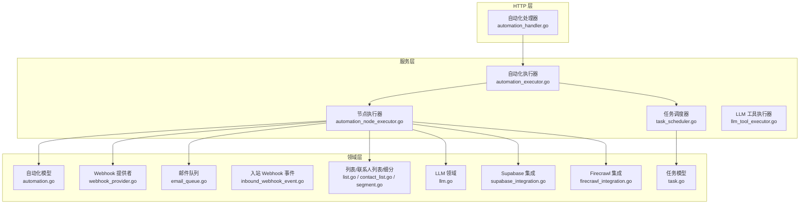
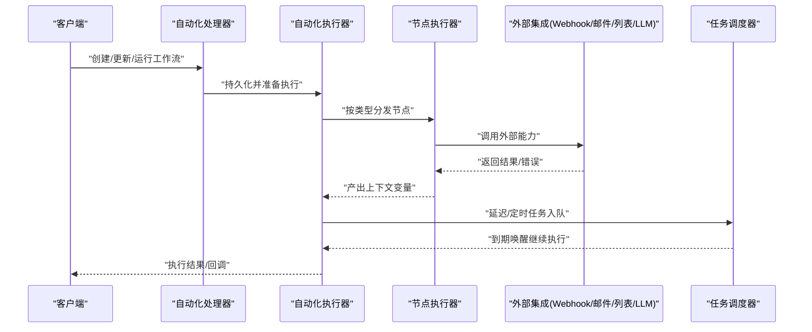
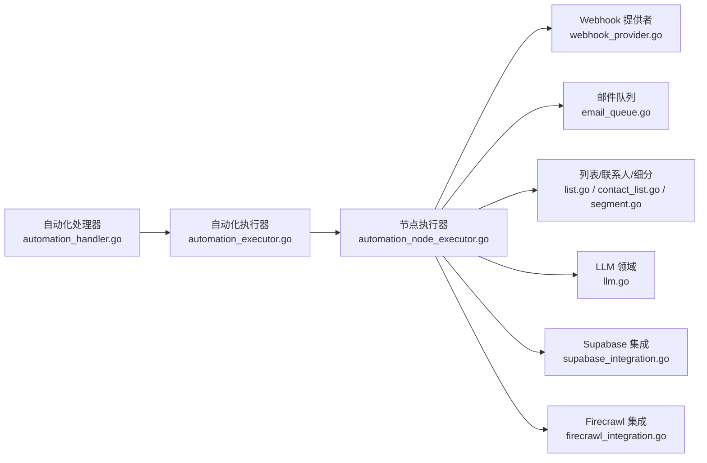

# 节点类型

<cite>
**本文引用的文件**   
- [automation.go](file://notifuse/internal/domain/automation.go)
- [automation_node_executor.go](file://notifuse/internal/service/automation_node_executor.go)
- [automation_executor.go](file://notifuse/internal/service/automation_executor.go)
- [automation_handler.go](file://notifuse/internal/http/automation_handler.go)
- [automation_service.go](file://notifuse/internal/service/automation_service.go)
- [task.go](file://notifuse/internal/domain/task.go)
- [task_scheduler.go](file://notifuse/internal/service/task_scheduler.go)
- [webhook_provider.go](file://notifuse/internal/domain/webhook_provider.go)
- [inbound_webhook_event.go](file://notifuse/internal/domain/inbound_webhook_event.go)
- [email_queue.go](file://notifuse/internal/domain/email_queue.go)
- [list.go](file://notifuse/internal/domain/list.go)
- [contact_list.go](file://notifuse/internal/domain/contact_list.go)
- [segment.go](file://notifuse/internal/domain/segment.go)
- [llm.go](file://notifuse/internal/domain/llm.go)
- [llm_tool_executor.go](file://notifuse/internal/service/llm_tool_executor.go)
- [supabase_integration.go](file://notifuse/internal/domain/supabase_integration.go)
- [firecrawl_integration.go](file://notifuse/internal/domain/firecrawl_integration.go)
- [automation_use_cases.md](file://notifuse/plans/automation-use-cases.md)
</cite>

## 目录
1. [简介](#简介)
2. [项目结构](#项目结构)
3. [核心组件](#核心组件)
4. [架构总览](#架构总览)
5. [详细组件分析](#详细组件分析)
6. [依赖分析](#依赖分析)
7. [性能考虑](#性能考虑)
8. [故障排查指南](#故障排查指南)
9. [结论](#结论)
10. [附录](#附录)

## 简介
本文件为 Notifuse 平台的自动化工作流“节点类型”提供全面文档。内容覆盖内置节点的功能特性、配置方法、输入输出规范与执行行为，并提供组合使用案例与常见模板。同时说明自定义节点的扩展机制与开发接口，帮助读者快速上手并安全扩展平台能力。

## 项目结构
Notifuse 的自动化系统由领域模型、服务层、HTTP 接口与调度器组成。节点类型定义在领域层，执行逻辑在服务层编排，HTTP 层负责持久化与工作流管理，任务调度器驱动延迟与定时类节点。

图表来源
- [automation_handler.go](file://notifuse/internal/http/automation_handler.go)
- [automation_executor.go](file://notifuse/internal/service/automation_executor.go)
- [automation_node_executor.go](file://notifuse/internal/service/automation_node_executor.go)
- [automation.go](file://notifuse/internal/domain/automation.go)
- [task.go](file://notifuse/internal/domain/task.go)
- [task_scheduler.go](file://notifuse/internal/service/task_scheduler.go)
- [webhook_provider.go](file://notifuse/internal/domain/webhook_provider.go)
- [inbound_webhook_event.go](file://notifuse/internal/domain/inbound_webhook_event.go)
- [email_queue.go](file://notifuse/internal/domain/email_queue.go)
- [list.go](file://notifuse/internal/domain/list.go)
- [contact_list.go](file://notifuse/internal/domain/contact_list.go)
- [segment.go](file://notifuse/internal/domain/segment.go)
- [llm.go](file://notifuse/internal/domain/llm.go)
- [llm_tool_executor.go](file://notifuse/internal/service/llm_tool_executor.go)
- [supabase_integration.go](file://notifuse/internal/domain/supabase_integration.go)
- [firecrawl_integration.go](file://notifuse/internal/domain/firecrawl_integration.go)

章节来源
- [automation_handler.go](file://notifuse/internal/http/automation_handler.go)
- [automation_executor.go](file://notifuse/internal/service/automation_executor.go)
- [automation_node_executor.go](file://notifuse/internal/service/automation_node_executor.go)
- [automation.go](file://notifuse/internal/domain/automation.go)
- [task.go](file://notifuse/internal/domain/task.go)
- [task_scheduler.go](file://notifuse/internal/service/task_scheduler.go)
- [webhook_provider.go](file://notifuse/internal/domain/webhook_provider.go)
- [inbound_webhook_event.go](file://notifuse/internal/domain/inbound_webhook_event.go)
- [email_queue.go](file://notifuse/internal/domain/email_queue.go)
- [list.go](file://notifuse/internal/domain/list.go)
- [contact_list.go](file://notifuse/internal/domain/contact_list.go)
- [segment.go](file://notifuse/internal/domain/segment.go)
- [llm.go](file://notifuse/internal/domain/llm.go)
- [llm_tool_executor.go](file://notifuse/internal/service/llm_tool_executor.go)
- [supabase_integration.go](file://notifuse/internal/domain/supabase_integration.go)
- [firecrawl_integration.go](file://notifuse/internal/domain/firecrawl_integration.go)

## 核心组件
- 自动化模型：定义工作流、节点、边与上下文数据结构的存储形态。
- 节点执行器：按节点类型路由到具体实现，处理参数解析、外部调用与结果合并。
- 自动化执行器：加载工作流图、维护运行期状态、控制并发与重试。
- 任务调度器：支持延迟与定时触发，将任务写入持久化队列并在到期时唤醒。
- 外部集成：Webhook 发送/接收、邮件队列投递、列表/联系人/细分操作、LLM 工具、Supabase/Firecrawl 等。

章节来源
- [automation.go](file://notifuse/internal/domain/automation.go)
- [automation_node_executor.go](file://notifuse/internal/service/automation_node_executor.go)
- [automation_executor.go](file://notifuse/internal/service/automation_executor.go)
- [task_scheduler.go](file://notifuse/internal/service/task_scheduler.go)
- [webhook_provider.go](file://notifuse/internal/domain/webhook_provider.go)
- [email_queue.go](file://notifuse/internal/domain/email_queue.go)
- [list.go](file://notifuse/internal/domain/list.go)
- [contact_list.go](file://notifuse/internal/domain/contact_list.go)
- [segment.go](file://notifuse/internal/domain/segment.go)
- [llm.go](file://notifuse/internal/domain/llm.go)
- [llm_tool_executor.go](file://notifuse/internal/service/llm_tool_executor.go)
- [supabase_integration.go](file://notifuse/internal/domain/supabase_integration.go)
- [firecrawl_integration.go](file://notifuse/internal/domain/firecrawl_integration.go)

## 架构总览
下图展示从 HTTP 请求到节点执行的端到端流程，以及关键的外部集成点。

图表来源
- [automation_handler.go](file://notifuse/internal/http/automation_handler.go)
- [automation_executor.go](file://notifuse/internal/service/automation_executor.go)
- [automation_node_executor.go](file://notifuse/internal/service/automation_node_executor.go)
- [task_scheduler.go](file://notifuse/internal/service/task_scheduler.go)
- [webhook_provider.go](file://notifuse/internal/domain/webhook_provider.go)
- [email_queue.go](file://notifuse/internal/domain/email_queue.go)
- [llm_tool_executor.go](file://notifuse/internal/service/llm_tool_executor.go)

## 详细组件分析

### 触发器节点（Trigger）
- 功能特性
  - 支持多种触发源：Webhook 入站事件、定时/周期任务、外部系统回调等。
  - 可携带初始上下文数据，作为后续节点的输入。
- 输入参数
  - 触发源标识（如 webhook 订阅 ID、cron 表达式或事件类型）。
  - 可选：过滤条件、去重键、超时时间。
- 输出结果
  - 标准化事件对象（包含事件类型、时间戳、负载数据等）。
- 执行行为
  - 注册监听器或调度任务；收到事件后生成上下文并进入工作流。
- 配置要点
  - 确保触发源唯一性与幂等性；合理设置超时与重试策略。

章节来源
- [inbound_webhook_event.go](file://notifuse/internal/domain/inbound_webhook_event.go)
- [task.go](file://notifuse/internal/domain/task.go)
- [task_scheduler.go](file://notifuse/internal/service/task_scheduler.go)

### 延迟节点（Delay）
- 功能特性
  - 将工作流暂停指定时长或等待特定时间点再继续。
- 输入参数
  - 延迟时长（秒/分钟/小时）或目标时间（UTC）。
  - 可选：最大重试次数、失败回退路径。
- 输出结果
  - 保持上下文不变，仅推进到下一节点。
- 执行行为
  - 入队延迟任务；到期后恢复执行。
- 配置要点
  - 避免过长延迟导致资源占用；建议结合重试与告警。

章节来源
- [task.go](file://notifuse/internal/domain/task.go)
- [task_scheduler.go](file://notifuse/internal/service/task_scheduler.go)

### 条件分支节点（Condition）
- 功能特性
  - 基于上下文变量进行布尔判断，选择不同分支继续执行。
- 输入参数
  - 条件表达式（支持比较、包含、正则匹配等）。
  - 分支出口（True/False 或更多分支）。
- 输出结果
  - 根据条件选择下一个节点；可附加分支标记到上下文。
- 执行行为
  - 短路求值；若条件不合法则记录错误并终止该分支。
- 配置要点
  - 条件表达式需具备幂等性与确定性；对空值做防御性处理。

章节来源
- [automation.go](file://notifuse/internal/domain/automation.go)
- [automation_node_executor.go](file://notifuse/internal/service/automation_node_executor.go)

### AB 测试节点（A/B Test）
- 功能特性
  - 将流量按比例分流至多个实验组，用于对比不同策略效果。
- 输入参数
  - 分组权重（百分比或绝对比例）、分组标识、采样键（如用户 ID）。
  - 可选：统计指标上报字段。
- 输出结果
  - 当前样本所属组别；可附带组内配置项。
- 执行行为
  - 基于采样键计算哈希决定分组；保证同一键稳定命中同一组。
- 配置要点
  - 权重总和需归一；注意冷启动阶段的统计偏差。

章节来源
- [automation.go](file://notifuse/internal/domain/automation.go)
- [automation_node_executor.go](file://notifuse/internal/service/automation_node_executor.go)

### 列表操作节点（List Operations）
- 功能特性
  - 对联系人列表、细分（Segment）进行增删改查与批量操作。
- 输入参数
  - 操作类型（添加/移除/查询/同步）、目标列表/细分标识、筛选条件。
- 输出结果
  - 受影响记录数、新增/删除详情、分页游标等。
- 执行行为
  - 批量事务提交；失败时部分回滚或记录失败明细。
- 配置要点
  - 大批量操作建议分片执行；关注速率限制与幂等键。

章节来源
- [list.go](file://notifuse/internal/domain/list.go)
- [contact_list.go](file://notifuse/internal/domain/contact_list.go)
- [segment.go](file://notifuse/internal/domain/segment.go)
- [automation_node_executor.go](file://notifuse/internal/service/automation_node_executor.go)

### 邮件发送节点（Email Send）
- 功能特性
  - 通过内置邮件队列投递邮件，支持多提供商与模板渲染。
- 输入参数
  - 收件人集合、主题、正文（文本/HTML）、附件、模板变量。
- 输出结果
  - 投递 ID、状态码、错误信息（如有）。
- 执行行为
  - 入队异步投递；失败自动重试与死信队列。
- 配置要点
  - 模板变量校验；敏感信息脱敏；限流与退避策略。

章节来源
- [email_queue.go](file://notifuse/internal/domain/email_queue.go)
- [automation_node_executor.go](file://notifuse/internal/service/automation_node_executor.go)

### Webhook 节点（Webhook）
- 功能特性
  - 向外发起 HTTP 请求（发送），或接收外部系统回调（入站）。
- 输入参数（发送）
  - 目标 URL、HTTP 方法、头部、请求体、签名密钥、重试策略。
- 输入参数（入站）
  - 订阅 URL、事件类型、签名验证、负载映射。
- 输出结果
  - 响应状态、响应体、耗时、重试计数。
- 执行行为
  - 发送：带重试与指数退避；入站：验签后转换为标准事件。
- 配置要点
  - 严格校验签名；避免泄露密钥；设置合理的超时与熔断。

章节来源
- [webhook_provider.go](file://notifuse/internal/domain/webhook_provider.go)
- [inbound_webhook_event.go](file://notifuse/internal/domain/inbound_webhook_event.go)
- [automation_node_executor.go](file://notifuse/internal/service/automation_node_executor.go)

### LLM 工具节点（LLM Tool）
- 功能特性
  - 调用大语言模型完成文本生成、摘要、分类、翻译等任务。
- 输入参数
  - 模型名称、提示词、温度、最大令牌数、工具函数绑定。
- 输出结果
  - 生成文本、结构化 JSON（可选）、引用来源。
- 执行行为
  - 串行调用；支持缓存与重试；失败降级返回默认值。
- 配置要点
  - 提示词注入防护；输出格式校验；成本与配额控制。

章节来源
- [llm.go](file://notifuse/internal/domain/llm.go)
- [llm_tool_executor.go](file://notifuse/internal/service/llm_tool_executor.go)
- [automation_node_executor.go](file://notifuse/internal/service/automation_node_executor.go)

### Supabase 集成节点（Supabase）
- 功能特性
  - 读写 Supabase 数据库、存储桶、实时通道等。
- 输入参数
  - 操作类型（CRUD/查询/上传）、表名/桶名、过滤条件、凭证。
- 输出结果
  - 记录对象、元数据、错误信息。
- 执行行为
  - 连接池复用；失败重试；敏感字段加密传输。
- 配置要点
  - 最小权限原则；行级安全策略配合；审计日志。

章节来源
- [supabase_integration.go](file://notifuse/internal/domain/supabase_integration.go)
- [automation_node_executor.go](file://notifuse/internal/service/automation_node_executor.go)

### Firecrawl 集成节点（Firecrawl）
- 功能特性
  - 抓取网页内容、提取结构化信息、批量爬取。
- 输入参数
  - 目标 URL、抓取深度、选择器、导出格式。
- 输出结果
  - 页面文本、表格、图片链接、元数据。
- 执行行为
  - 反爬策略适配；并发控制；内容清洗。
- 配置要点
  - 遵守 robots.txt；限速与重试；内容合规检查。

章节来源
- [firecrawl_integration.go](file://notifuse/internal/domain/firecrawl_integration.go)
- [automation_node_executor.go](file://notifuse/internal/service/automation_node_executor.go)

### 节点组合使用案例与常见模板
- 案例一：Webhook 触发 + 条件分支 + 邮件发送
  - 描述：当外部系统推送订单事件时，根据金额大小分支，高价值订单发送邮件通知。
  - 参考：[automation_use_cases.md](file://notifuse/plans/automation-use-cases.md)
- 案例二：定时任务 + 列表操作 + Webhook 回调
  - 描述：每日定时拉取新订阅者加入列表，并通过 Webhook 通知 CRM。
  - 参考：[task.go](file://notifuse/internal/domain/task.go)、[list.go](file://notifuse/internal/domain/list.go)、[webhook_provider.go](file://notifuse/internal/domain/webhook_provider.go)
- 案例三：AB 测试 + LLM 工具 + 邮件发送
  - 描述：对不同文案进行 A/B 测试，LLM 生成个性化内容，最终发送邮件。
  - 参考：[llm.go](file://notifuse/internal/domain/llm.go)、[email_queue.go](file://notifuse/internal/domain/email_queue.go)

章节来源
- [automation_use_cases.md](file://notifuse/plans/automation-use-cases.md)
- [task.go](file://notifuse/internal/domain/task.go)
- [list.go](file://notifuse/internal/domain/list.go)
- [webhook_provider.go](file://notifuse/internal/domain/webhook_provider.go)
- [llm.go](file://notifuse/internal/domain/llm.go)
- [email_queue.go](file://notifuse/internal/domain/email_queue.go)

### 自定义节点的开发接口与扩展机制
- 扩展点
  - 节点类型注册：在服务层注册新的节点类型与执行器。
  - 上下文协议：节点间通过统一的上下文对象传递数据。
  - 外部集成抽象：通过适配器模式封装第三方服务。
- 开发步骤
  - 定义节点配置结构与校验规则。
  - 实现节点执行器，处理输入解析、外部调用与错误处理。
  - 注册到节点执行器路由表，并在 HTTP 层暴露配置入口。
- 最佳实践
  - 幂等设计、超时与重试、可观测性（日志/指标/追踪）。
  - 配置项版本化与向后兼容。

章节来源
- [automation_node_executor.go](file://notifuse/internal/service/automation_node_executor.go)
- [automation.go](file://notifuse/internal/domain/automation.go)
- [automation_handler.go](file://notifuse/internal/http/automation_handler.go)

## 依赖分析
节点执行器对外部能力的依赖关系如下：

图表来源
- [automation_node_executor.go](file://notifuse/internal/service/automation_node_executor.go)
- [webhook_provider.go](file://notifuse/internal/domain/webhook_provider.go)
- [email_queue.go](file://notifuse/internal/domain/email_queue.go)
- [list.go](file://notifuse/internal/domain/list.go)
- [contact_list.go](file://notifuse/internal/domain/contact_list.go)
- [segment.go](file://notifuse/internal/domain/segment.go)
- [llm.go](file://notifuse/internal/domain/llm.go)
- [supabase_integration.go](file://notifuse/internal/domain/supabase_integration.go)
- [firecrawl_integration.go](file://notifuse/internal/domain/firecrawl_integration.go)
- [automation_executor.go](file://notifuse/internal/service/automation_executor.go)
- [automation_handler.go](file://notifuse/internal/http/automation_handler.go)

章节来源
- [automation_node_executor.go](file://notifuse/internal/service/automation_node_executor.go)
- [automation_executor.go](file://notifuse/internal/service/automation_executor.go)
- [automation_handler.go](file://notifuse/internal/http/automation_handler.go)

## 性能考虑
- 并发与批处理：列表操作与邮件发送应分批执行，避免一次性加载大量数据。
- 延迟与调度：长延迟任务尽量使用任务调度器，减少内存占用。
- 外部调用限流：对 Webhook、LLM、Supabase、Firecrawl 等外部服务实施限流与退避。
- 缓存与去重：对频繁读取的数据与重复事件启用缓存与去重键。
- 监控与告警：为关键节点埋点，跟踪成功率、延迟与错误分布。

## 故障排查指南
- 常见问题
  - 触发器未生效：检查订阅 URL、签名验证与事件映射。
  - 延迟节点不触发：确认任务是否入队成功、调度器是否运行。
  - 条件分支异常：核对上下文变量是否存在与类型是否正确。
  - 邮件发送失败：查看队列状态、提供商回执与重试计数。
  - Webhook 回调无响应：检查网络连通性、证书与超时配置。
- 定位手段
  - 查看节点执行日志与上下文快照。
  - 检查任务队列与重试历史。
  - 使用外部服务的诊断工具（如邮件提供商控制台、Webhook 调试面板）。

章节来源
- [automation_node_executor.go](file://notifuse/internal/service/automation_node_executor.go)
- [task_scheduler.go](file://notifuse/internal/service/task_scheduler.go)
- [webhook_provider.go](file://notifuse/internal/domain/webhook_provider.go)
- [email_queue.go](file://notifuse/internal/domain/email_queue.go)

## 结论
Notifuse 的节点体系以清晰的领域模型与服务编排为核心，提供丰富的内置节点类型与可扩展的自定义机制。通过合理的配置与组合，可构建复杂而稳定的自动化工作流。建议在扩展节点时遵循幂等、可观测与安全的最佳实践，并结合监控与告警保障生产稳定性。

## 附录
- 配置 JSON 规范与验证规则
  - 通用字段
    - id: 字符串，节点唯一标识。
    - type: 字符串，节点类型（trigger/delay/condition/ab_test/list_op/email_send/webhook/send_llm/supabase/firecrawl）。
    - inputs: 对象，节点输入参数。
    - outputs: 对象，节点输出映射（可选）。
    - retry: 对象，重试策略（max_attempts, backoff）。
    - timeout: 整数，超时秒数（可选）。
  - 触发器
    - source: 字符串（webhook/cron/event）。
    - filter: 对象（可选）。
  - 延迟
    - duration: 字符串或数字（秒/分钟/小时）。
    - until: ISO8601 时间（可选）。
  - 条件
    - expression: 字符串（条件表达式）。
    - branches: 对象（true/false 或其他分支名）。
  - AB 测试
    - groups: 数组（name, weight）。
    - sampling_key: 字符串。
  - 列表操作
    - action: 字符串（add/remove/query/sync）。
    - target_id: 字符串（列表/细分 ID）。
    - filters: 对象。
  - 邮件发送
    - to: 数组。
    - subject: 字符串。
    - body: 字符串（文本/HTML）。
    - template_vars: 对象。
  - Webhook
    - url: 字符串。
    - method: 字符串。
    - headers: 对象。
    - body: 字符串或对象。
    - signature_secret: 字符串（可选）。
  - LLM
    - model: 字符串。
    - prompt: 字符串。
    - temperature: 数字。
    - max_tokens: 整数。
  - Supabase
    - operation: 字符串（create/read/update/delete/query/upload）。
    - table_or_bucket: 字符串。
    - payload: 对象。
  - Firecrawl
    - url: 字符串。
    - depth: 整数。
    - selectors: 数组。
    - format: 字符串（text/json/markdown）。
  - 验证规则
    - 必填字段校验、类型校验、范围校验（如权重总和=100%）。
    - 表达式语法校验（条件节点）。
    - 外部凭据不可明文存储，需加密或引用密钥管理器。