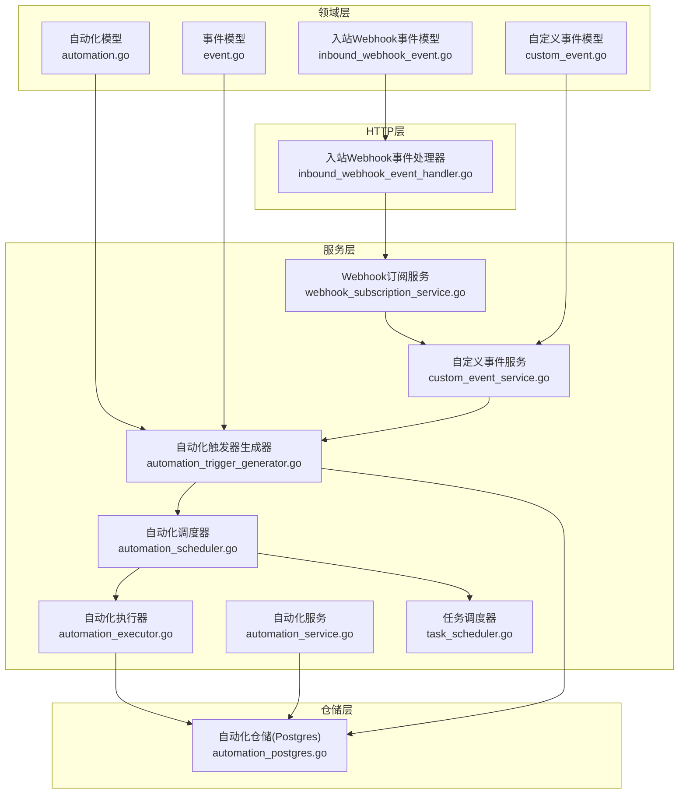
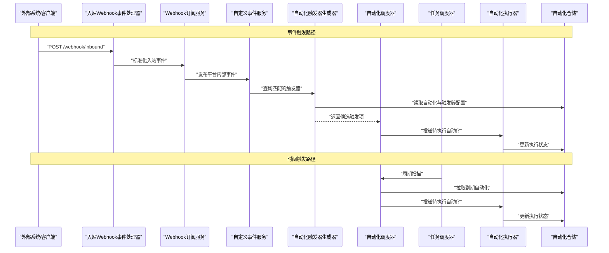
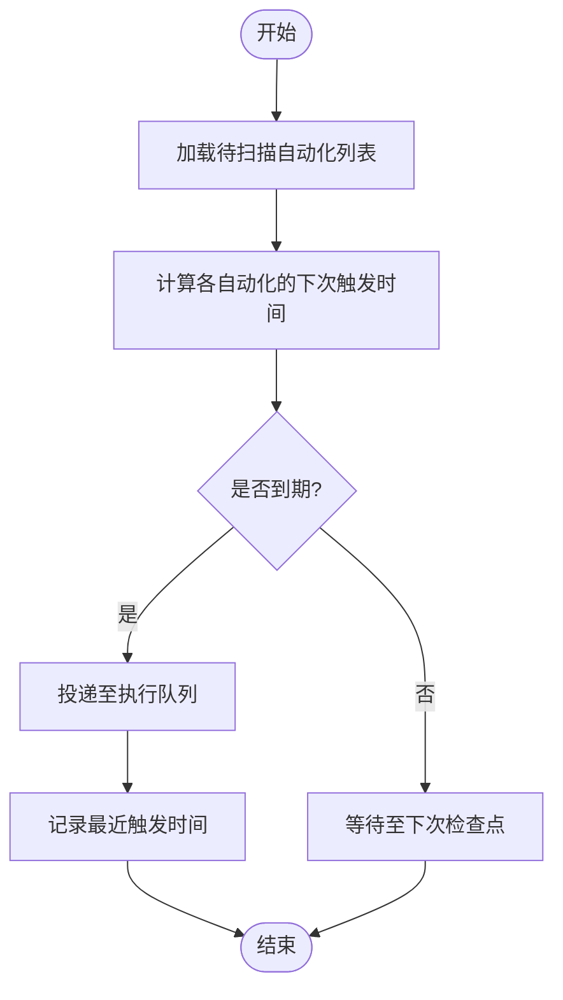
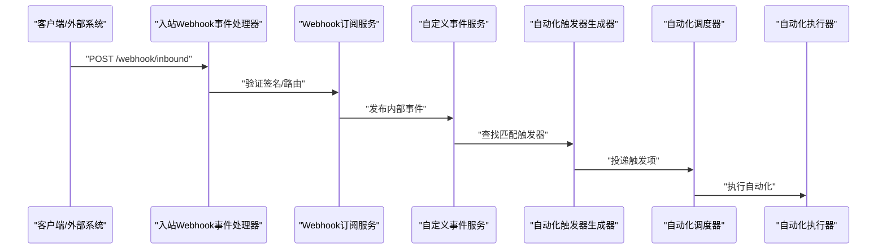
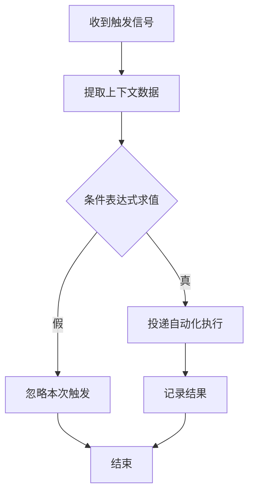
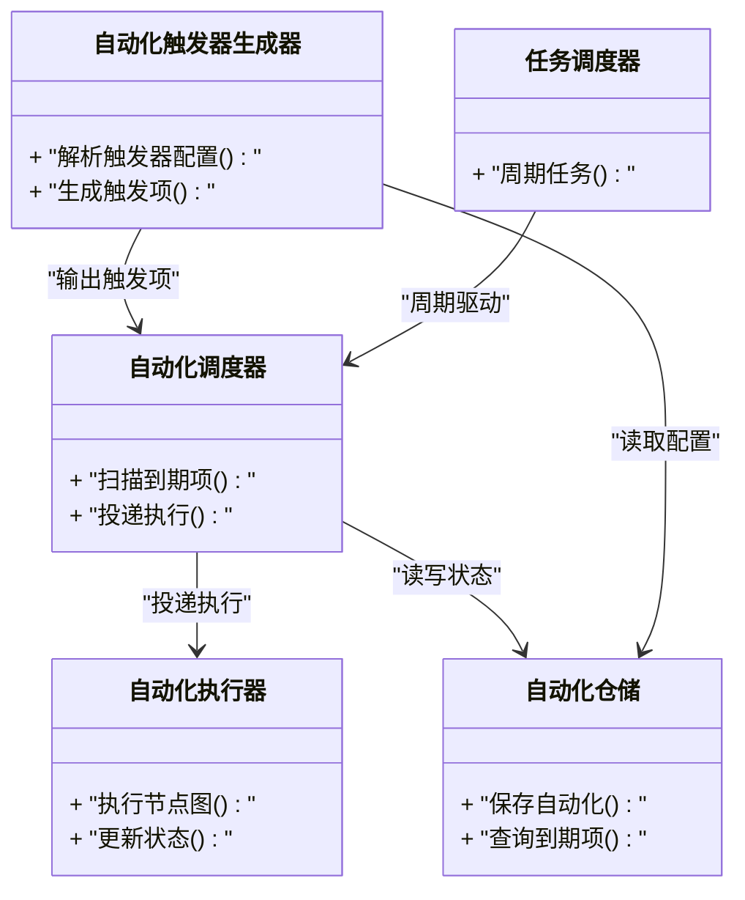
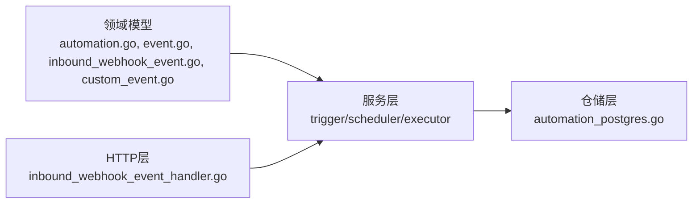

# 触发器系统

<cite>
**本文引用的文件**   
- [automation_trigger_generator.go](file://notifuse/internal/service/automation_trigger_generator.go)
- [automation_scheduler.go](file://notifuse/internal/service/automation_scheduler.go)
- [automation_executor.go](file://notifuse/internal/service/automation_executor.go)
- [automation_service.go](file://notifuse/internal/service/automation_service.go)
- [task_scheduler.go](file://notifuse/internal/service/task_scheduler.go)
- [inbound_webhook_event_handler.go](file://notifuse/internal/http/inbound_webhook_event_handler.go)
- [webhook_subscription_service.go](file://notifuse/internal/service/webhook_subscription_service.go)
- [custom_event_service.go](file://notifuse/internal/service/custom_event_service.go)
- [automation_postgres.go](file://notifuse/internal/repository/automation_postgres.go)
- [automation.go](file://notifuse/internal/domain/automation.go)
- [event.go](file://notifuse/internal/domain/event.go)
- [inbound_webhook_event.go](file://notifuse/internal/domain/inbound_webhook_event.go)
- [custom_event.go](file://notifuse/internal/domain/custom_event.go)
</cite>

## 目录
1. [简介](#简介)
2. [项目结构](#项目结构)
3. [核心组件](#核心组件)
4. [架构总览](#架构总览)
5. [详细组件分析](#详细组件分析)
6. [依赖关系分析](#依赖关系分析)
7. [性能考虑](#性能考虑)
8. [故障排查指南](#故障排查指南)
9. [结论](#结论)
10. [附录](#附录)

## 简介
本文件面向Notifuse平台的“触发器系统”，聚焦三类触发器：时间触发器（Cron表达式）、事件触发器（Webhook、API调用）与条件触发器。文档覆盖触发器的注册、调度与执行流程，状态管理与错误处理策略，以及与自动化工作流的绑定和数据传递机制；并提供配置示例、使用场景以及性能优化与监控告警方案。

## 项目结构
触发器系统位于后端服务内部，围绕“自动化”领域模型展开，关键路径如下：
- 领域层：定义自动化、事件、入站Webhook事件等数据结构与约束
- 仓储层：持久化自动化及其触发器配置
- 服务层：提供触发器生成、调度、执行与外部事件接入能力
- HTTP层：接收外部Webhook事件并转换为平台内部事件

图表来源
- [inbound_webhook_event_handler.go](file://notifuse/internal/http/inbound_webhook_event_handler.go)
- [webhook_subscription_service.go](file://notifuse/internal/service/webhook_subscription_service.go)
- [custom_event_service.go](file://notifuse/internal/service/custom_event_service.go)
- [automation_trigger_generator.go](file://notifuse/internal/service/automation_trigger_generator.go)
- [automation_scheduler.go](file://notifuse/internal/service/automation_scheduler.go)
- [automation_executor.go](file://notifuse/internal/service/automation_executor.go)
- [task_scheduler.go](file://notifuse/internal/service/task_scheduler.go)
- [automation_postgres.go](file://notifuse/internal/repository/automation_postgres.go)
- [automation.go](file://notifuse/internal/domain/automation.go)
- [event.go](file://notifuse/internal/domain/event.go)
- [inbound_webhook_event.go](file://notifuse/internal/domain/inbound_webhook_event.go)
- [custom_event.go](file://notifuse/internal/domain/custom_event.go)

章节来源
- [automation_trigger_generator.go](file://notifuse/internal/service/automation_trigger_generator.go)
- [automation_scheduler.go](file://notifuse/internal/service/automation_scheduler.go)
- [automation_executor.go](file://notifuse/internal/service/automation_executor.go)
- [automation_service.go](file://notifuse/internal/service/automation_service.go)
- [task_scheduler.go](file://notifuse/internal/service/task_scheduler.go)
- [inbound_webhook_event_handler.go](file://notifuse/internal/http/inbound_webhook_event_handler.go)
- [webhook_subscription_service.go](file://notifuse/internal/service/webhook_subscription_service.go)
- [custom_event_service.go](file://notifuse/internal/service/custom_event_service.go)
- [automation_postgres.go](file://notifuse/internal/repository/automation_postgres.go)
- [automation.go](file://notifuse/internal/domain/automation.go)
- [event.go](file://notifuse/internal/domain/event.go)
- [inbound_webhook_event.go](file://notifuse/internal/domain/inbound_webhook_event.go)
- [custom_event.go](file://notifuse/internal/domain/custom_event.go)

## 核心组件
- 自动化触发器生成器：将用户配置的触发器规则解析为可调度项，支持时间触发器（Cron）、事件触发器（Webhook/自定义事件）和条件触发器。
- 自动化调度器：负责按周期扫描待触发的自动化，基于触发器类型进行匹配与投递。
- 自动化执行器：根据已触发的自动化实例执行节点编排与数据注入。
- 任务调度器：承载周期性任务（如Cron扫描），保证高可用与幂等执行。
- Webhook订阅服务与入站Webhook事件处理器：将外部Webhook事件标准化为平台内部事件，驱动事件型触发器。
- 自定义事件服务：通过API暴露的自定义事件入口，驱动事件型触发器。
- 自动化仓储：持久化自动化、触发器配置及运行状态。

章节来源
- [automation_trigger_generator.go](file://notifuse/internal/service/automation_trigger_generator.go)
- [automation_scheduler.go](file://notifuse/internal/service/automation_scheduler.go)
- [automation_executor.go](file://notifuse/internal/service/automation_executor.go)
- [task_scheduler.go](file://notifuse/internal/service/task_scheduler.go)
- [webhook_subscription_service.go](file://notifuse/internal/service/webhook_subscription_service.go)
- [inbound_webhook_event_handler.go](file://notifuse/internal/http/inbound_webhook_event_handler.go)
- [custom_event_service.go](file://notifuse/internal/service/custom_event_service.go)
- [automation_postgres.go](file://notifuse/internal/repository/automation_postgres.go)

## 架构总览
下图展示从外部事件或定时任务到自动化执行的端到端流程。

图表来源
- [inbound_webhook_event_handler.go](file://notifuse/internal/http/inbound_webhook_event_handler.go)
- [webhook_subscription_service.go](file://notifuse/internal/service/webhook_subscription_service.go)
- [custom_event_service.go](file://notifuse/internal/service/custom_event_service.go)
- [automation_trigger_generator.go](file://notifuse/internal/service/automation_trigger_generator.go)
- [automation_scheduler.go](file://notifuse/internal/service/automation_scheduler.go)
- [task_scheduler.go](file://notifuse/internal/service/task_scheduler.go)
- [automation_executor.go](file://notifuse/internal/service/automation_executor.go)
- [automation_postgres.go](file://notifuse/internal/repository/automation_postgres.go)

## 详细组件分析

### 时间触发器（Cron表达式）
- 触发方式：由任务调度器周期性扫描，自动化调度器依据Cron表达式计算下次触发时间，命中时投递执行。
- 关键点：
  - 时间窗口与去重：避免重复触发与抖动导致的并发执行。
  - 时区与夏令时：确保跨时区一致性。
  - 失败重试与退避：对执行失败的自动化进行指数退避重试。
- 典型场景：
  - 每日/每周报表生成
  - 定期清理过期数据
  - 周期性同步第三方数据

图表来源
- [automation_scheduler.go](file://notifuse/internal/service/automation_scheduler.go)
- [task_scheduler.go](file://notifuse/internal/service/task_scheduler.go)
- [automation_postgres.go](file://notifuse/internal/repository/automation_postgres.go)

章节来源
- [automation_scheduler.go](file://notifuse/internal/service/automation_scheduler.go)
- [task_scheduler.go](file://notifuse/internal/service/task_scheduler.go)
- [automation_postgres.go](file://notifuse/internal/repository/automation_postgres.go)

### 事件触发器（Webhook、API调用）
- 触发方式：
  - Webhook：外部系统向入站Webhook接口推送事件，经标准化后进入平台内部事件总线，匹配事件型触发器。
  - API调用：通过自定义事件服务暴露的API创建平台内部事件，驱动触发器。
- 关键点：
  - 事件标准化：统一事件结构与字段映射。
  - 匹配策略：基于事件类型、标签、工作空间等维度匹配自动化。
  - 幂等性：同一事件ID多次投递不重复执行。
- 典型场景：
  - 订单创建/支付成功通知
  - 用户注册/登录行为
  - 第三方系统集成回调

图表来源
- [inbound_webhook_event_handler.go](file://notifuse/internal/http/inbound_webhook_event_handler.go)
- [webhook_subscription_service.go](file://notifuse/internal/service/webhook_subscription_service.go)
- [custom_event_service.go](file://notifuse/internal/service/custom_event_service.go)
- [automation_trigger_generator.go](file://notifuse/internal/service/automation_trigger_generator.go)
- [automation_scheduler.go](file://notifuse/internal/service/automation_scheduler.go)
- [automation_executor.go](file://notifuse/internal/service/automation_executor.go)

章节来源
- [inbound_webhook_event_handler.go](file://notifuse/internal/http/inbound_webhook_event_handler.go)
- [webhook_subscription_service.go](file://notifuse/internal/service/webhook_subscription_service.go)
- [custom_event_service.go](file://notifuse/internal/service/custom_event_service.go)
- [automation_trigger_generator.go](file://notifuse/internal/service/automation_trigger_generator.go)
- [automation_scheduler.go](file://notifuse/internal/service/automation_scheduler.go)
- [automation_executor.go](file://notifuse/internal/service/automation_executor.go)

### 条件触发器
- 触发方式：在事件或时间触发基础上附加条件判断，仅当条件满足时才执行自动化。
- 关键点：
  - 条件表达式：支持字段比较、集合包含、正则匹配等。
  - 短路评估：优先快速失败以减少资源消耗。
  - 上下文注入：将事件/时间上下文注入到条件与后续节点。
- 典型场景：
  - 仅在工作日触发
  - 仅对特定标签的用户生效
  - 金额阈值以上才执行

图表来源
- [automation_trigger_generator.go](file://notifuse/internal/service/automation_trigger_generator.go)
- [automation_scheduler.go](file://notifuse/internal/service/automation_scheduler.go)
- [automation_executor.go](file://notifuse/internal/service/automation_executor.go)

章节来源
- [automation_trigger_generator.go](file://notifuse/internal/service/automation_trigger_generator.go)
- [automation_scheduler.go](file://notifuse/internal/service/automation_scheduler.go)
- [automation_executor.go](file://notifuse/internal/service/automation_executor.go)

### 触发器注册、调度与执行流程
- 注册：用户在控制台或通过API创建自动化，定义触发器类型与参数，存储于数据库。
- 调度：
  - 时间触发：任务调度器周期扫描，自动化调度器计算命中项并投递。
  - 事件触发：事件到达后立即匹配并投递。
- 执行：自动化执行器加载节点图，注入上下文数据，顺序/并行执行节点，更新状态。

图表来源
- [automation_trigger_generator.go](file://notifuse/internal/service/automation_trigger_generator.go)
- [automation_scheduler.go](file://notifuse/internal/service/automation_scheduler.go)
- [automation_executor.go](file://notifuse/internal/service/automation_executor.go)
- [task_scheduler.go](file://notifuse/internal/service/task_scheduler.go)
- [automation_postgres.go](file://notifuse/internal/repository/automation_postgres.go)

章节来源
- [automation_trigger_generator.go](file://notifuse/internal/service/automation_trigger_generator.go)
- [automation_scheduler.go](file://notifuse/internal/service/automation_scheduler.go)
- [automation_executor.go](file://notifuse/internal/service/automation_executor.go)
- [task_scheduler.go](file://notifuse/internal/service/task_scheduler.go)
- [automation_postgres.go](file://notifuse/internal/repository/automation_postgres.go)

### 状态管理与错误处理
- 状态管理：
  - 自动化生命周期：草稿、启用、禁用、暂停、失败。
  - 触发器状态：未触发、已触发、执行中、成功、失败。
  - 最近触发时间与下次触发时间用于时间触发器。
- 错误处理：
  - 分类：配置错误、运行时错误、外部依赖错误。
  - 重试策略：固定间隔与指数退避结合。
  - 死信与告警：连续失败达到阈值后进入死信队列并触发告警。
  - 幂等与补偿：基于事件ID或自动化实例ID去重，必要时补偿执行。

章节来源
- [automation_executor.go](file://notifuse/internal/service/automation_executor.go)
- [automation_scheduler.go](file://notifuse/internal/service/automation_scheduler.go)
- [automation_postgres.go](file://notifuse/internal/repository/automation_postgres.go)

### 与自动化工作流的绑定与数据传递
- 绑定关系：
  - 一个自动化可包含多个触发器，任一触发器命中即启动一次执行。
  - 触发器与工作空间隔离，确保多租户安全。
- 数据传递：
  - 上下文对象：包含触发源信息（时间戳、事件载荷、请求头、用户上下文）。
  - 变量注入：将上下文映射为模板变量供后续节点使用。
  - 变更追踪：记录每次执行的输入输出快照，便于审计与调试。

章节来源
- [automation.go](file://notifuse/internal/domain/automation.go)
- [event.go](file://notifuse/internal/domain/event.go)
- [inbound_webhook_event.go](file://notifuse/internal/domain/inbound_webhook_event.go)
- [custom_event.go](file://notifuse/internal/domain/custom_event.go)

### 配置示例与使用场景
- 时间触发器（Cron）
  - 示例：每周一上午9点执行周报发送
  - 要点：设置时区、避免高峰时段、失败重试
- 事件触发器（Webhook）
  - 示例：订单支付成功后触发发货流程
  - 要点：签名校验、事件版本兼容、幂等键
- 事件触发器（API调用）
  - 示例：业务系统通过API上报自定义事件
  - 要点：鉴权、限流、错误码规范
- 条件触发器
  - 示例：仅对VIP客户发送邮件
  - 要点：条件表达式清晰、短路评估、日志记录

[本节为概念性说明，无需代码片段]

## 依赖关系分析
- 组件耦合：
  - 触发器生成器依赖自动化与事件领域模型，低耦合高内聚。
  - 调度器与执行器通过仓储抽象交互，便于替换存储实现。
- 外部依赖：
  - 数据库：PostgreSQL用于持久化自动化与状态。
  - 消息通道：可选的消息队列用于削峰填谷（可扩展）。
- 潜在循环依赖：
  - 当前分层清晰，未发现直接循环依赖。

图表来源
- [automation.go](file://notifuse/internal/domain/automation.go)
- [event.go](file://notifuse/internal/domain/event.go)
- [inbound_webhook_event.go](file://notifuse/internal/domain/inbound_webhook_event.go)
- [custom_event.go](file://notifuse/internal/domain/custom_event.go)
- [automation_trigger_generator.go](file://notifuse/internal/service/automation_trigger_generator.go)
- [automation_scheduler.go](file://notifuse/internal/service/automation_scheduler.go)
- [automation_executor.go](file://notifuse/internal/service/automation_executor.go)
- [automation_postgres.go](file://notifuse/internal/repository/automation_postgres.go)
- [inbound_webhook_event_handler.go](file://notifuse/internal/http/inbound_webhook_event_handler.go)

章节来源
- [automation.go](file://notifuse/internal/domain/automation.go)
- [event.go](file://notifuse/internal/domain/event.go)
- [inbound_webhook_event.go](file://notifuse/internal/domain/inbound_webhook_event.go)
- [custom_event.go](file://notifuse/internal/domain/custom_event.go)
- [automation_trigger_generator.go](file://notifuse/internal/service/automation_trigger_generator.go)
- [automation_scheduler.go](file://notifuse/internal/service/automation_scheduler.go)
- [automation_executor.go](file://notifuse/internal/service/automation_executor.go)
- [automation_postgres.go](file://notifuse/internal/repository/automation_postgres.go)
- [inbound_webhook_event_handler.go](file://notifuse/internal/http/inbound_webhook_event_handler.go)

## 性能考虑
- 调度优化
  - 批量扫描与分页拉取，减少单次查询压力。
  - 增量计算下次触发时间，避免全量重算。
- 事件处理
  - 异步化处理与背压控制，防止雪崩。
  - 事件去重与合并，降低重复触发。
- 执行优化
  - 节点级并行与超时控制。
  - 缓存热点配置与字典表，减少IO。
- 资源隔离
  - 按工作空间或触发器类型划分执行池。
  - 限流与熔断保护下游依赖。

[本节为通用指导，无需具体文件引用]

## 故障排查指南
- 常见问题
  - 时间触发器未触发：检查Cron表达式与时区设置、任务调度器是否运行、数据库连接是否正常。
  - 事件触发器无响应：确认Webhook签名校验、事件格式、订阅配置是否正确。
  - 执行失败：查看执行日志、重试次数、死信队列与告警信息。
- 定位步骤
  - 检索自动化实例的执行历史与上下文快照。
  - 核对触发器条件表达式与输入数据。
  - 检查外部依赖（数据库、第三方API）健康状态。
- 恢复建议
  - 修正配置后手动重试或重新启用自动化。
  - 对持续失败的事件进行人工干预与补偿。

章节来源
- [automation_executor.go](file://notifuse/internal/service/automation_executor.go)
- [automation_scheduler.go](file://notifuse/internal/service/automation_scheduler.go)
- [automation_postgres.go](file://notifuse/internal/repository/automation_postgres.go)

## 结论
Notifuse的触发器系统以自动化为核心，围绕时间、事件与条件三类触发器构建完整的注册、调度与执行闭环。通过清晰的领域模型与服务分层、稳健的状态管理与错误处理策略，以及与工作流的紧密绑定与数据传递机制，平台能够支撑多样化的自动化场景。配合性能优化与监控告警方案，可在高负载环境下保持稳定与可观测性。

## 附录
- 术语
  - 自动化：一组节点构成的工作流，由触发器驱动执行。
  - 触发器：定义何时以及如何启动自动化的规则。
  - 上下文：触发时携带的数据，包括事件载荷与元数据。
- 参考
  - 领域模型文件：automation.go、event.go、inbound_webhook_event.go、custom_event.go
  - 服务实现文件：automation_trigger_generator.go、automation_scheduler.go、automation_executor.go、task_scheduler.go
  - 仓储实现文件：automation_postgres.go
  - HTTP入口文件：inbound_webhook_event_handler.go