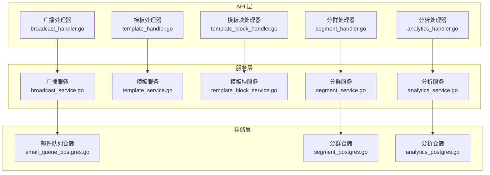
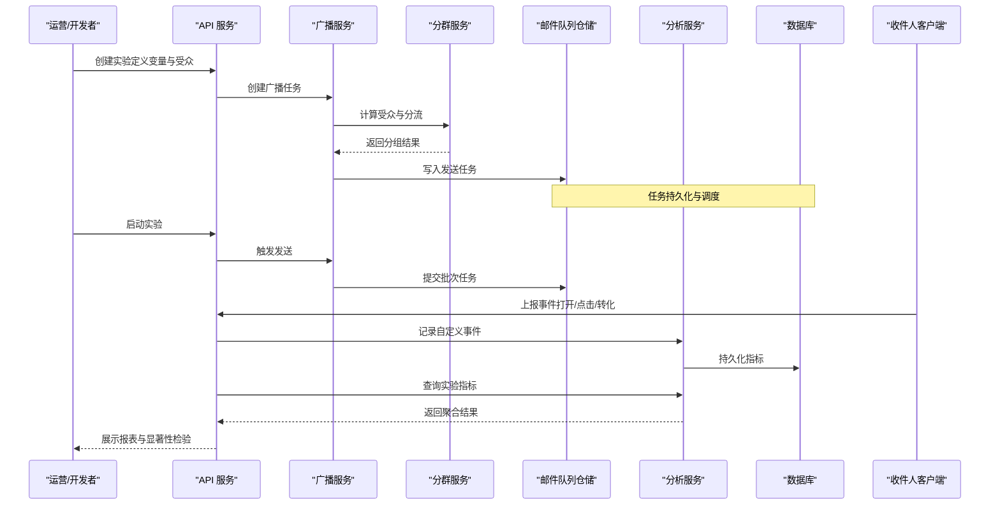
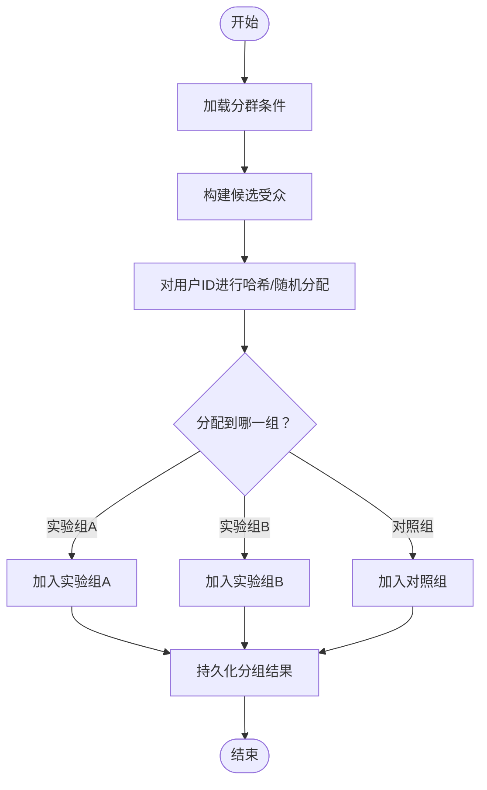
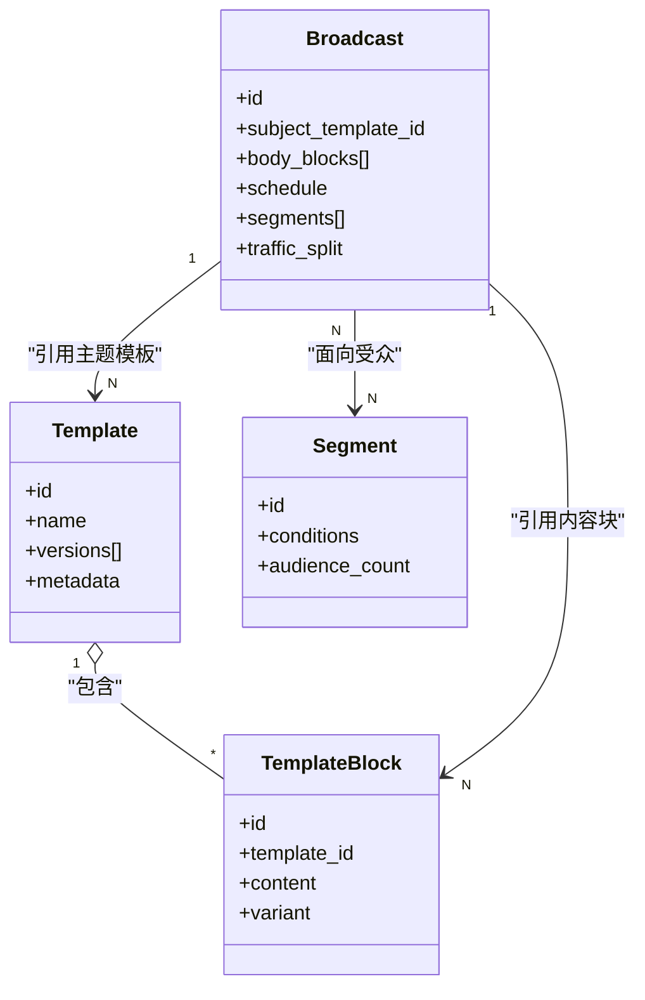
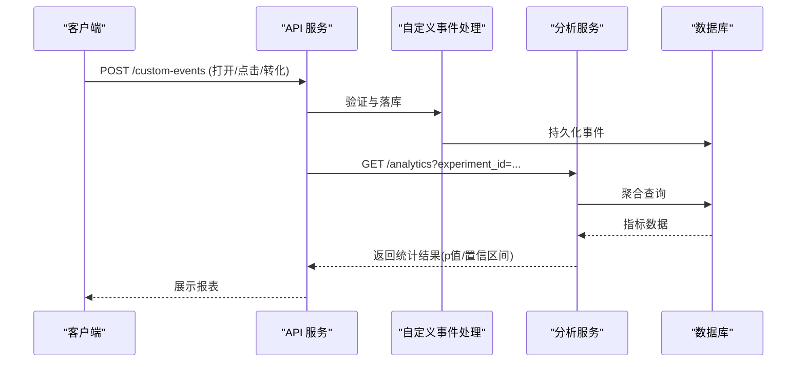
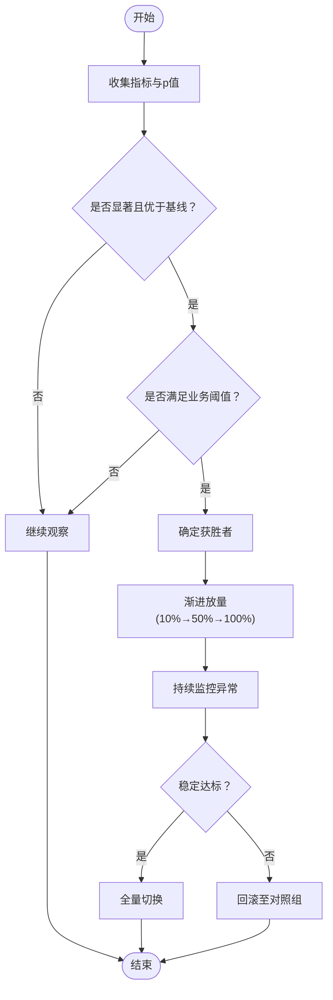
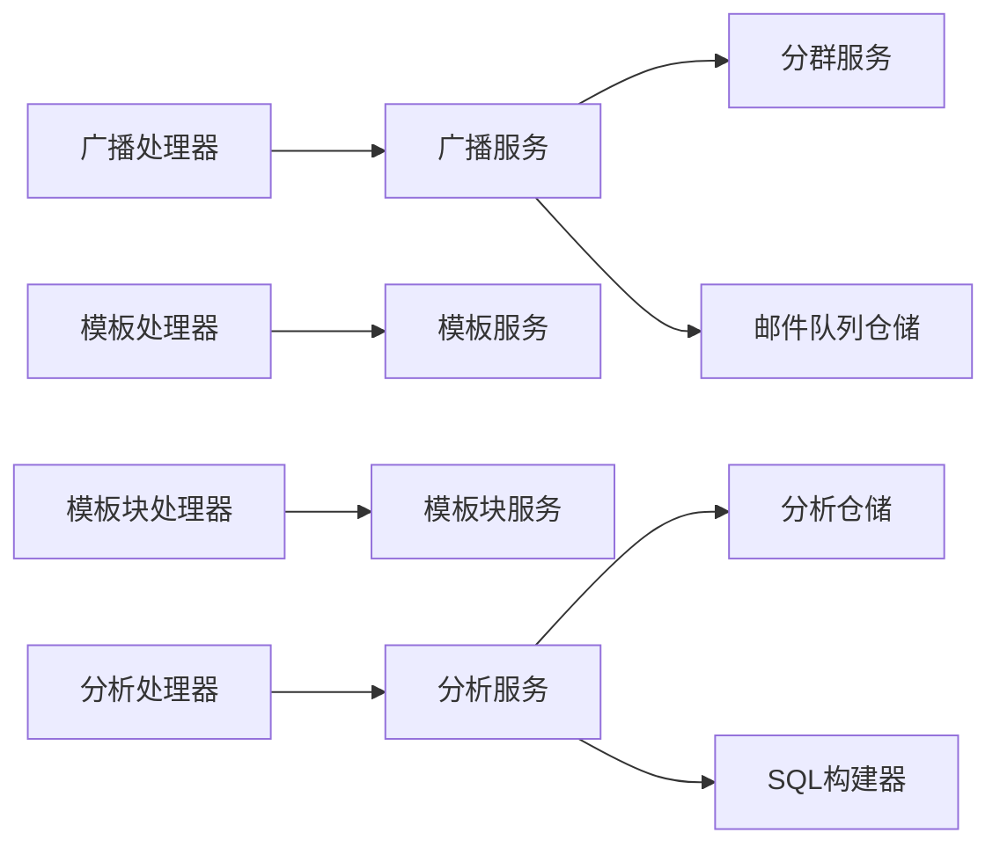

# A/B测试系统

<cite>
**本文引用的文件**   
- [README.md](file://notifuse/README.md)
- [openapi.yaml](file://notifuse/openapi/openapi.yaml)
- [broadcasts.yaml](file://notifuse/openapi/paths/broadcasts.yaml)
- [contacts.yaml](file://notifuse/openapi/paths/contacts.yaml)
- [custom-events.yaml](file://notifuse/openapi/paths/custom-events.yaml)
- [analytics_handler.go](file://notifuse/internal/http/analytics_handler.go)
- [analytics_service.go](file://notifuse/internal/service/analytics_service.go)
- [analytics_postgres.go](file://notifuse/internal/repository/analytics_postgres.go)
- [broadcast_handler.go](file://notifuse/internal/http/broadcast_handler.go)
- [broadcast_service.go](file://notifuse/internal/service/broadcast_service.go)
- [email_queue_postgres.go](file://notifuse/internal/repository/email_queue_postgres.go)
- [segment_handler.go](file://notifuse/internal/http/segment_handler.go)
- [segment_service.go](file://notifuse/internal/service/segment_service.go)
- [segment_postgres.go](file://notifuse/internal/repository/segment_postgres.go)
- [template_handler.go](file://notifuse/internal/http/template_handler.go)
- [template_service.go](file://notifuse/internal/service/template_service.go)
- [template_block_handler.go](file://notifuse/internal/http/template_block_handler.go)
- [template_block_service.go](file://notifuse/internal/service/template_block_service.go)
- [types.go](file://notifuse/pkg/analytics/types.go)
- [sql_builder.go](file://notifuse/pkg/analytics/sql_builder.go)
- [validation.go](file://notifuse/pkg/analytics/validation.go)
</cite>

## 目录
1. [简介](#简介)
2. [项目结构](#项目结构)
3. [核心组件](#核心组件)
4. [架构总览](#架构总览)
5. [详细组件分析](#详细组件分析)
6. [依赖关系分析](#依赖关系分析)
7. [性能考量](#性能考量)
8. [故障排查指南](#故障排查指南)
9. [结论](#结论)
10. [附录](#附录)

## 简介
本文件为 Notifuse 平台的 A/B 测试系统提供系统化文档，覆盖受众分组算法、实验设计与结果评估机制；详细说明测试变量（邮件主题、内容、发送时间）的定义与管理；阐述实时效果监控（指标采集、统计分析、显著性检验）；说明自动获胜者选择与切换策略；并给出可视化展示、API 接口与实战案例。为保证准确性，本文所有实现细节均基于仓库中现有代码与 OpenAPI 规范进行归纳与映射。

## 项目结构
Notifuse 采用前后端分离与分层架构：
- 前端控制台：console/src 等
- API 服务：cmd/api/main.go
- HTTP 路由与处理器：internal/http/*_handler.go
- 领域模型与服务：internal/domain/*, internal/service/*
- 数据访问层：internal/repository/*
- 通用工具包：pkg/*
- OpenAPI 规范：openapi/*

A/B 测试相关能力主要分布在以下模块：
- 广播（Broadcast）：用于批量发送邮件，承载实验组与对照组分发逻辑
- 模板（Template/Block）：承载可被 A/B 的邮件内容与主题
- 分群（Segment）：用于受众划分与随机分流
- 事件与分析（Analytics/Custom Events）：用于埋点与统计
- 队列（Email Queue）：承载发送任务与调度

图表来源
- [broadcast_handler.go](file://notifuse/internal/http/broadcast_handler.go)
- [broadcast_service.go](file://notifuse/internal/service/broadcast_service.go)
- [template_handler.go](file://notifuse/internal/http/template_handler.go)
- [template_service.go](file://notifuse/internal/service/template_service.go)
- [template_block_handler.go](file://notifuse/internal/http/template_block_handler.go)
- [template_block_service.go](file://notifuse/internal/service/template_block_service.go)
- [segment_handler.go](file://notifuse/internal/http/segment_handler.go)
- [segment_service.go](file://notifuse/internal/service/segment_service.go)
- [segment_postgres.go](file://notifuse/internal/repository/segment_postgres.go)
- [analytics_handler.go](file://notifuse/internal/http/analytics_handler.go)
- [analytics_service.go](file://notifuse/internal/service/analytics_service.go)
- [analytics_postgres.go](file://notifuse/internal/repository/analytics_postgres.go)
- [email_queue_postgres.go](file://notifuse/internal/repository/email_queue_postgres.go)

章节来源
- [README.md](file://notifuse/README.md)

## 核心组件
- 广播（Broadcast）：承载一次或一组邮件发送任务，支持按受众分群与差异化配置，是 A/B 实验的载体。
- 模板（Template/Block）：定义邮件主题与正文，支持多版本并存以支撑 A/B 变量。
- 分群（Segment）：定义受众集合与筛选条件，结合随机化策略实现受众分组。
- 事件与分析（Analytics/Custom Events）：记录打开、点击、转化等关键行为，并提供聚合查询。
- 邮件队列（Email Queue）：持久化发送任务，配合调度器完成异步投递。

章节来源
- [broadcast_handler.go](file://notifuse/internal/http/broadcast_handler.go)
- [broadcast_service.go](file://notifuse/internal/service/broadcast_service.go)
- [template_handler.go](file://notifuse/internal/http/template_handler.go)
- [template_service.go](file://notifuse/internal/service/template_service.go)
- [template_block_handler.go](file://notifuse/internal/http/template_block_handler.go)
- [template_block_service.go](file://notifuse/internal/service/template_block_service.go)
- [segment_handler.go](file://notifuse/internal/http/segment_handler.go)
- [segment_service.go](file://notifuse/internal/service/segment_service.go)
- [segment_postgres.go](file://notifuse/internal/repository/segment_postgres.go)
- [analytics_handler.go](file://notifuse/internal/http/analytics_handler.go)
- [analytics_service.go](file://notifuse/internal/service/analytics_service.go)
- [analytics_postgres.go](file://notifuse/internal/repository/analytics_postgres.go)
- [email_queue_postgres.go](file://notifuse/internal/repository/email_queue_postgres.go)

## 架构总览
A/B 测试在 Notifuse 中的端到端流程如下：
- 设计阶段：创建多个模板版本（主题/内容），定义受众分群与分流比例。
- 执行阶段：广播服务根据分群与分流规则生成实验组与对照组任务，写入邮件队列。
- 观测阶段：客户端埋点上报自定义事件（如打开、点击），分析服务聚合指标。
- 决策阶段：基于统计方法与阈值策略，自动选择获胜者并切换流量。

图表来源
- [broadcast_handler.go](file://notifuse/internal/http/broadcast_handler.go)
- [broadcast_service.go](file://notifuse/internal/service/broadcast_service.go)
- [segment_handler.go](file://notifuse/internal/http/segment_handler.go)
- [segment_service.go](file://notifuse/internal/service/segment_service.go)
- [segment_postgres.go](file://notifuse/internal/repository/segment_postgres.go)
- [email_queue_postgres.go](file://notifuse/internal/repository/email_queue_postgres.go)
- [analytics_handler.go](file://notifuse/internal/http/analytics_handler.go)
- [analytics_service.go](file://notifuse/internal/service/analytics_service.go)
- [analytics_postgres.go](file://notifuse/internal/repository/analytics_postgres.go)

## 详细组件分析

### 受众分组与分流算法
- 分群（Segment）：通过条件筛选构建受众集合，支持动态更新与增量计算。
- 分流策略：在广播执行时，对受众进行确定性哈希或随机分配，确保实验组与对照组样本均衡。
- 一致性保证：同一用户在不同时间点的分组保持稳定，避免重复暴露导致的偏差。

图表来源
- [segment_handler.go](file://notifuse/internal/http/segment_handler.go)
- [segment_service.go](file://notifuse/internal/service/segment_service.go)
- [segment_postgres.go](file://notifuse/internal/repository/segment_postgres.go)

章节来源
- [segment_handler.go](file://notifuse/internal/http/segment_handler.go)
- [segment_service.go](file://notifuse/internal/service/segment_service.go)
- [segment_postgres.go](file://notifuse/internal/repository/segment_postgres.go)

### 实验设计与变量管理
- 变量类型：
  - 邮件主题：通过模板版本控制，不同组使用不同主题。
  - 邮件内容：通过模板块组合与渲染引擎，实现内容级差异。
  - 发送时间：通过广播调度参数与队列优先级控制差异化发送窗口。
- 版本管理：模板与模板块支持多版本并存，广播任务绑定具体版本。
- 变更控制：模板与块的变更需关联实验上下文，避免污染历史数据。

图表来源
- [template_handler.go](file://notifuse/internal/http/template_handler.go)
- [template_service.go](file://notifuse/internal/service/template_service.go)
- [template_block_handler.go](file://notifuse/internal/http/template_block_handler.go)
- [template_block_service.go](file://notifuse/internal/service/template_block_service.go)
- [broadcast_handler.go](file://notifuse/internal/http/broadcast_handler.go)
- [broadcast_service.go](file://notifuse/internal/service/broadcast_service.go)

章节来源
- [template_handler.go](file://notifuse/internal/http/template_handler.go)
- [template_service.go](file://notifuse/internal/service/template_service.go)
- [template_block_handler.go](file://notifuse/internal/http/template_block_handler.go)
- [template_block_service.go](file://notifuse/internal/service/template_block_service.go)
- [broadcast_handler.go](file://notifuse/internal/http/broadcast_handler.go)
- [broadcast_service.go](file://notifuse/internal/service/broadcast_service.go)

### 实时效果监控与显著性检验
- 指标采集：通过自定义事件（Custom Events）上报打开、点击、转化等行为。
- 聚合分析：分析服务提供 SQL 构建与校验，按实验维度聚合指标。
- 显著性检验：基于统计方法（如卡方检验、Z 检验）计算 p 值与置信区间，辅助决策。

图表来源
- [custom-events.yaml](file://notifuse/openapi/paths/custom-events.yaml)
- [analytics_handler.go](file://notifuse/internal/http/analytics_handler.go)
- [analytics_service.go](file://notifuse/internal/service/analytics_service.go)
- [analytics_postgres.go](file://notifuse/internal/repository/analytics_postgres.go)
- [sql_builder.go](file://notifuse/pkg/analytics/sql_builder.go)
- [validation.go](file://notifuse/pkg/analytics/validation.go)
- [types.go](file://notifuse/pkg/analytics/types.go)

章节来源
- [custom-events.yaml](file://notifuse/openapi/paths/custom-events.yaml)
- [analytics_handler.go](file://notifuse/internal/http/analytics_handler.go)
- [analytics_service.go](file://notifuse/internal/service/analytics_service.go)
- [analytics_postgres.go](file://notifuse/internal/repository/analytics_postgres.go)
- [sql_builder.go](file://notifuse/pkg/analytics/sql_builder.go)
- [validation.go](file://notifuse/pkg/analytics/validation.go)
- [types.go](file://notifuse/pkg/analytics/types.go)

### 自动获胜者选择与切换策略
- 决策算法：基于显著性检验结果与业务阈值（如最小可检测效应、置信水平）判定获胜者。
- 切换策略：支持渐进放量（如从 10% 逐步提升至 100%）与快速回滚（失败立即切回）。
- 安全护栏：设置上限流量与熔断条件，防止异常扩散。

[此图为概念流程图，不直接映射到具体源码文件]

### 可视化展示与数据导出
- 可视化：前端控制台提供图表组件，展示趋势、对比与显著性结果。
- 导出：支持 CSV/JSON 格式导出，便于离线分析与报告生成。
- 集成：通过 OpenAPI 暴露查询接口，供 BI 工具接入。

章节来源
- [analytics_handler.go](file://notifuse/internal/http/analytics_handler.go)
- [analytics_service.go](file://notifuse/internal/service/analytics_service.go)
- [openapi.yaml](file://notifuse/openapi/openapi.yaml)

## 依赖关系分析
A/B 测试相关模块之间的依赖关系如下：
- HTTP 处理器依赖服务层，服务层依赖仓储层。
- 广播服务依赖分群服务与邮件队列仓储。
- 分析服务依赖分析仓储与 SQL 构建器。
- 模板与模板块由模板服务统一管理，广播任务引用其版本。

图表来源
- [broadcast_handler.go](file://notifuse/internal/http/broadcast_handler.go)
- [broadcast_service.go](file://notifuse/internal/service/broadcast_service.go)
- [segment_handler.go](file://notifuse/internal/http/segment_handler.go)
- [segment_service.go](file://notifuse/internal/service/segment_service.go)
- [email_queue_postgres.go](file://notifuse/internal/repository/email_queue_postgres.go)
- [template_handler.go](file://notifuse/internal/http/template_handler.go)
- [template_service.go](file://notifuse/internal/service/template_service.go)
- [template_block_handler.go](file://notifuse/internal/http/template_block_handler.go)
- [template_block_service.go](file://notifuse/internal/service/template_block_service.go)
- [analytics_handler.go](file://notifuse/internal/http/analytics_handler.go)
- [analytics_service.go](file://notifuse/internal/service/analytics_service.go)
- [analytics_postgres.go](file://notifuse/internal/repository/analytics_postgres.go)
- [sql_builder.go](file://notifuse/pkg/analytics/sql_builder.go)

章节来源
- [broadcast_handler.go](file://notifuse/internal/http/broadcast_handler.go)
- [broadcast_service.go](file://notifuse/internal/service/broadcast_service.go)
- [segment_handler.go](file://notifuse/internal/http/segment_handler.go)
- [segment_service.go](file://notifuse/internal/service/segment_service.go)
- [email_queue_postgres.go](file://notifuse/internal/repository/email_queue_postgres.go)
- [template_handler.go](file://notifuse/internal/http/template_handler.go)
- [template_service.go](file://notifuse/internal/service/template_service.go)
- [template_block_handler.go](file://notifuse/internal/http/template_block_handler.go)
- [template_block_service.go](file://notifuse/internal/service/template_block_service.go)
- [analytics_handler.go](file://notifuse/internal/http/analytics_handler.go)
- [analytics_service.go](file://notifuse/internal/service/analytics_service.go)
- [analytics_postgres.go](file://notifuse/internal/repository/analytics_postgres.go)
- [sql_builder.go](file://notifuse/pkg/analytics/sql_builder.go)

## 性能考量
- 分群计算：建议对高频筛选字段建立索引，减少全表扫描。
- 事件上报：采用批量写入与异步处理，降低主链路延迟。
- 聚合查询：预聚合与物化视图可提升报表响应速度。
- 分流一致性：使用稳定的哈希函数与分区键，避免热点。

[本节为通用指导，不直接分析具体文件]

## 故障排查指南
- 事件未上报：检查自定义事件接口调用与鉴权，确认事件字段符合校验规则。
- 指标缺失：核对实验 ID 与受众分群是否正确关联，确认埋点事件已持久化。
- 分流不均：检查哈希函数与种子配置，确认受众去重与过滤逻辑。
- 显著性异常：检查样本量与异常值处理，确认统计方法适用性与假设条件。

章节来源
- [custom-events.yaml](file://notifuse/openapi/paths/custom-events.yaml)
- [validation.go](file://notifuse/pkg/analytics/validation.go)
- [analytics_handler.go](file://notifuse/internal/http/analytics_handler.go)
- [analytics_service.go](file://notifuse/internal/service/analytics_service.go)
- [analytics_postgres.go](file://notifuse/internal/repository/analytics_postgres.go)

## 结论
Notifuse 的 A/B 测试系统围绕广播、模板、分群、事件与分析五大核心组件构建，形成从实验设计、受众分流、指标采集到显著性检验与自动决策的完整闭环。通过 OpenAPI 暴露的标准化接口，平台具备良好的可扩展性与集成能力。建议在工程实践中遵循严格的变量管理与变更控制，结合稳健的统计方法与护栏策略，确保实验结果的可靠性与业务价值。

## 附录

### API 接口概览
- 广播（Broadcasts）
  - 路径：/broadcasts
  - 能力：创建、更新、删除、查询广播任务；绑定模板与分群；设置发送时间与分流比例。
  - 参考：[broadcasts.yaml](file://notifuse/openapi/paths/broadcasts.yaml)
- 联系人（Contacts）
  - 路径：/contacts
  - 能力：查询与筛选联系人，作为分群基础数据源。
  - 参考：[contacts.yaml](file://notifuse/openapi/paths/contacts.yaml)
- 自定义事件（Custom Events）
  - 路径：/custom-events
  - 能力：上报打开、点击、转化等行为事件，供分析服务聚合。
  - 参考：[custom-events.yaml](file://notifuse/openapi/paths/custom-events.yaml)
- 分析（Analytics）
  - 路径：/analytics
  - 能力：按实验维度聚合指标，返回统计结果与显著性检验信息。
  - 参考：[analytics_handler.go](file://notifuse/internal/http/analytics_handler.go), [analytics_service.go](file://notifuse/internal/service/analytics_service.go)

章节来源
- [openapi.yaml](file://notifuse/openapi/openapi.yaml)
- [broadcasts.yaml](file://notifuse/openapi/paths/broadcasts.yaml)
- [contacts.yaml](file://notifuse/openapi/paths/contacts.yaml)
- [custom-events.yaml](file://notifuse/openapi/paths/custom-events.yaml)
- [analytics_handler.go](file://notifuse/internal/http/analytics_handler.go)
- [analytics_service.go](file://notifuse/internal/service/analytics_service.go)

### 实战案例
- 案例一：主题 A/B 测试
  - 目标：比较两个邮件主题的打开率差异。
  - 步骤：
    - 创建两个主题模板版本。
    - 定义受众分群（如最近活跃用户）。
    - 设置分流比例（如 50%/50%）。
    - 启动广播任务并上报打开事件。
    - 查看分析报表与显著性检验结果。
- 案例二：内容+发送时间联合测试
  - 目标：评估不同内容与时段的组合效果。
  - 步骤：
    - 创建多版本模板块组合。
    - 针对不同时段设置差异化发送计划。
    - 使用自定义事件追踪点击与转化。
    - 基于多维聚合结果选择最优组合。

[本节为实践指导，不直接分析具体文件]