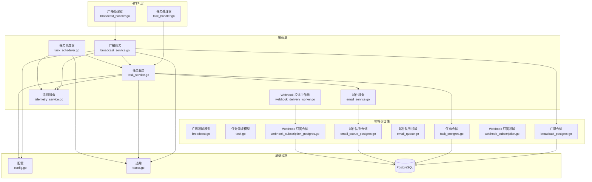
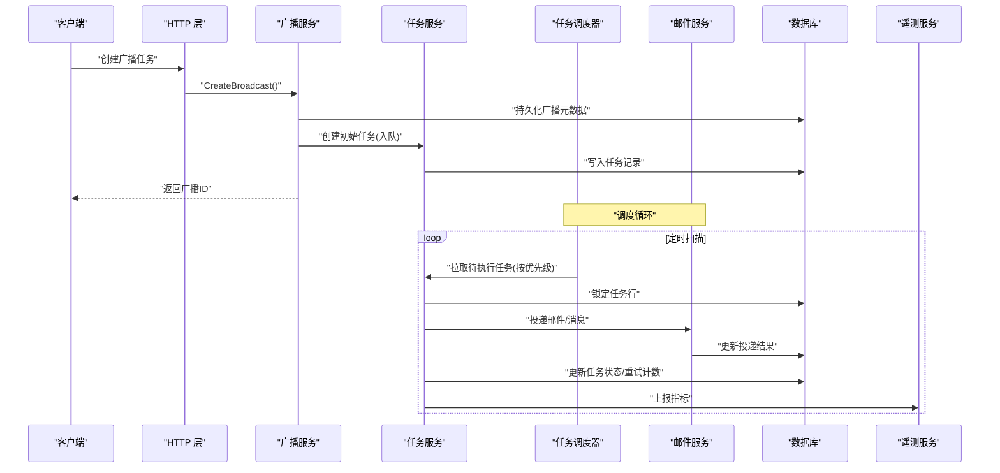
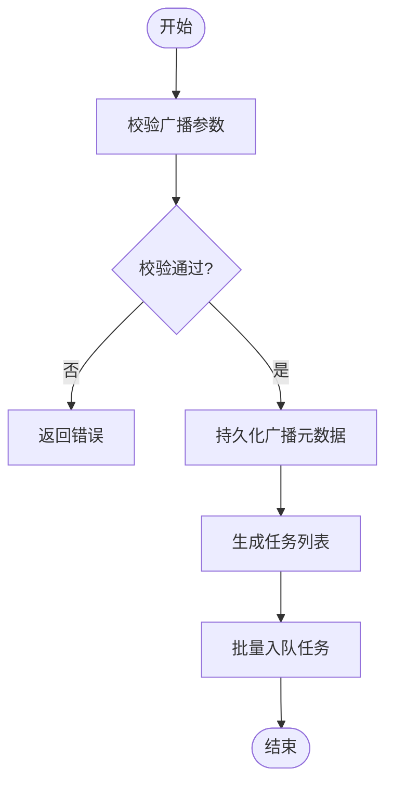
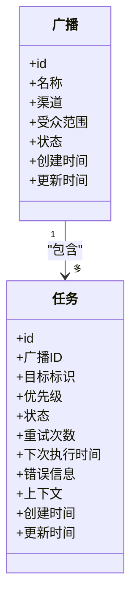
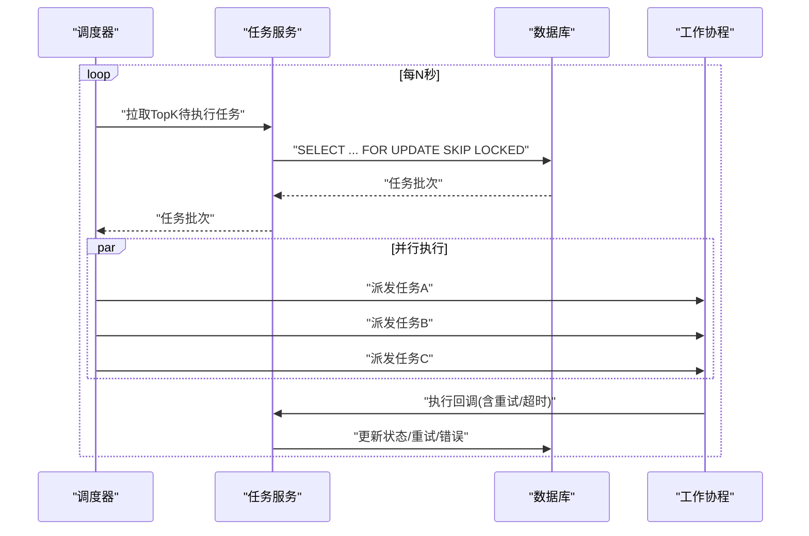
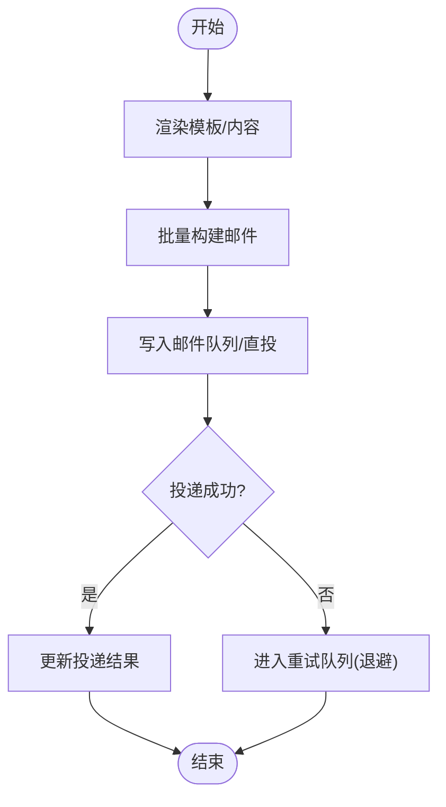
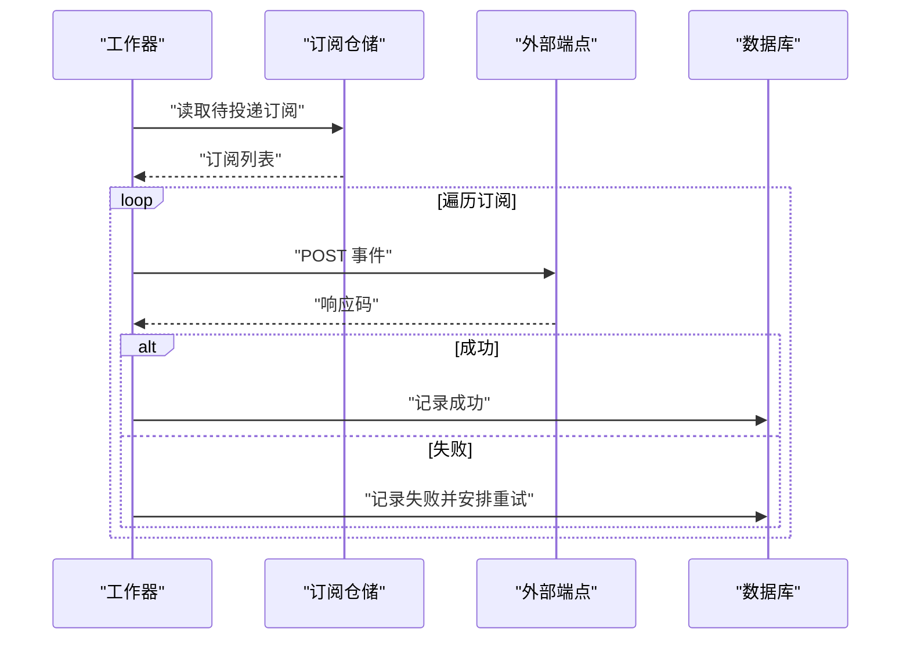
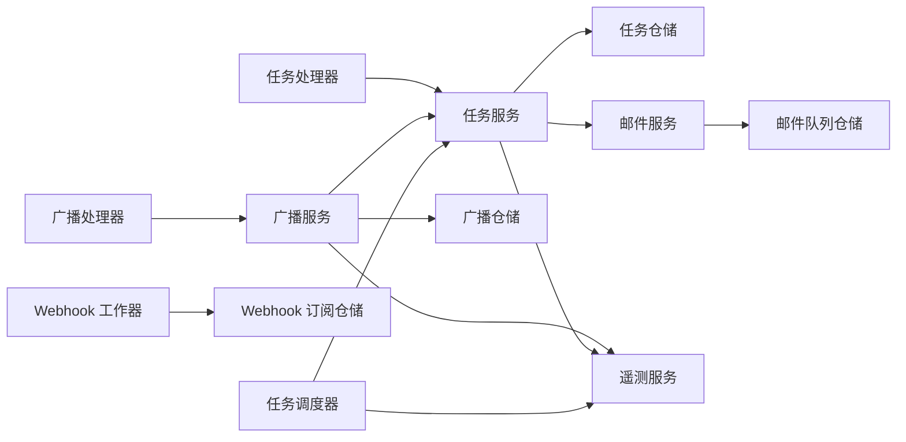

# 广播任务编排器

<cite>
**本文引用的文件**   
- [cmd/api/main.go](file://notifuse/cmd/api/main.go)
- [internal/app/app.go](file://notifuse/internal/app/app.go)
- [config/config.go](file://notifuse/config/config.go)
- [internal/domain/broadcast.go](file://notifuse/internal/domain/broadcast.go)
- [internal/repository/broadcast_postgres.go](file://notifuse/internal/repository/broadcast_postgres.go)
- [internal/service/broadcast_service.go](file://notifuse/internal/service/broadcast_service.go)
- [internal/service/task_scheduler.go](file://notifuse/internal/service/task_scheduler.go)
- [internal/service/task_service.go](file://notifuse/internal/service/task_service.go)
- [internal/domain/task.go](file://notifuse/internal/domain/task.go)
- [internal/repository/task_postgres.go](file://notifuse/internal/repository/task_postgres.go)
- [internal/http/broadcast_handler.go](file://notifuse/internal/http/broadcast_handler.go)
- [internal/http/task_handler.go](file://notifuse/internal/http/task_handler.go)
- [openapi/paths/broadcasts.yaml](file://notifuse/openapi/paths/broadcasts.yaml)
- [internal/service/email_service.go](file://notifuse/internal/service/email_service.go)
- [internal/domain/email_queue.go](file://notifuse/internal/domain/email_queue.go)
- [internal/repository/email_queue_postgres.go](file://notifuse/internal/repository/email_queue_postgres.go)
- [internal/service/webhook_delivery_worker.go](file://notifuse/internal/service/webhook_delivery_worker.go)
- [internal/domain/webhook_subscription.go](file://notifuse/internal/domain/webhook_subscription.go)
- [internal/repository/webhook_subscription_postgres.go](file://notifuse/internal/repository/webhook_subscription_postgres.go)
- [internal/service/telemetry_service.go](file://notifuse/internal/service/telemetry_service.go)
- [pkg/tracing/tracer.go](file://notifuse/pkg/tracing/tracer.go)
</cite>

## 目录
1. [简介](#简介)
2. [项目结构](#项目结构)
3. [核心组件](#核心组件)
4. [架构总览](#架构总览)
5. [详细组件分析](#详细组件分析)
6. [依赖关系分析](#依赖关系分析)
7. [性能考虑](#性能考虑)
8. [故障排查指南](#故障排查指南)
9. [结论](#结论)
10. [附录：API 与使用案例](#附录api-与使用案例)

## 简介
本文件面向 Notifuse 平台的“广播任务编排器”，聚焦于广播任务的创建、调度与执行全链路，包括任务生命周期管理、状态跟踪、错误处理机制；并详细说明编排器的配置项（并发控制、重试策略、超时设置）、任务队列管理机制（优先级调度、资源分配、负载均衡），以及与消息发送器、数据源和监控系统的集成方式。文末提供性能调优建议、故障排查指南以及完整的 API 接口文档与实际使用案例。

## 项目结构
围绕广播任务编排的核心代码主要分布在以下模块：
- HTTP 层：接收外部请求，校验参数，调用服务层
- 服务层：编排业务逻辑，协调任务调度、持久化与投递
- 领域模型与仓储：定义广播与任务实体及数据库访问
- 调度器与服务：负责周期性扫描、任务派发与执行
- 消息投递：邮件队列与 Webhook 投递工作流
- 配置与追踪：系统配置加载与可观测性埋点

图表来源
- [internal/http/broadcast_handler.go](file://notifuse/internal/http/broadcast_handler.go)
- [internal/http/task_handler.go](file://notifuse/internal/http/task_handler.go)
- [internal/service/broadcast_service.go](file://notifuse/internal/service/broadcast_service.go)
- [internal/service/task_service.go](file://notifuse/internal/service/task_service.go)
- [internal/service/task_scheduler.go](file://notifuse/internal/service/task_scheduler.go)
- [internal/service/email_service.go](file://notifuse/internal/service/email_service.go)
- [internal/service/webhook_delivery_worker.go](file://notifuse/internal/service/webhook_delivery_worker.go)
- [internal/service/telemetry_service.go](file://notifuse/internal/service/telemetry_service.go)
- [internal/domain/broadcast.go](file://notifuse/internal/domain/broadcast.go)
- [internal/domain/task.go](file://notifuse/internal/domain/task.go)
- [internal/domain/email_queue.go](file://notifuse/internal/domain/email_queue.go)
- [internal/domain/webhook_subscription.go](file://notifuse/internal/domain/webhook_subscription.go)
- [internal/repository/broadcast_postgres.go](file://notifuse/internal/repository/broadcast_postgres.go)
- [internal/repository/task_postgres.go](file://notifuse/internal/repository/task_postgres.go)
- [internal/repository/email_queue_postgres.go](file://notifuse/internal/repository/email_queue_postgres.go)
- [internal/repository/webhook_subscription_postgres.go](file://notifuse/internal/repository/webhook_subscription_postgres.go)
- [config/config.go](file://notifuse/config/config.go)
- [pkg/tracing/tracer.go](file://notifuse/pkg/tracing/tracer.go)

章节来源
- [cmd/api/main.go](file://notifuse/cmd/api/main.go)
- [internal/app/app.go](file://notifuse/internal/app/app.go)
- [config/config.go](file://notifuse/config/config.go)

## 核心组件
- 广播服务：负责广播的创建、更新、查询、启动/停止、统计等编排逻辑，并与任务服务协作生成与下发任务。
- 任务服务：维护任务的生命周期（新建、入队、执行、完成/失败）、重试与超时控制、状态回写与审计。
- 任务调度器：定时扫描待执行任务，按优先级与资源配额进行派发，驱动工作协程池消费。
- 邮件服务：将广播内容渲染为邮件，写入邮件队列或直投，支持批量与限流。
- Webhook 投递工作器：根据订阅规则触发 Webhook 事件，具备重试与退避能力。
- 遥测服务：记录关键指标与日志，支撑监控与告警。
- 配置模块：集中管理并发度、重试次数、超时时间、队列容量等运行时参数。

章节来源
- [internal/service/broadcast_service.go](file://notifuse/internal/service/broadcast_service.go)
- [internal/service/task_service.go](file://notifuse/internal/service/task_service.go)
- [internal/service/task_scheduler.go](file://notifuse/internal/service/task_scheduler.go)
- [internal/service/email_service.go](file://notifuse/internal/service/email_service.go)
- [internal/service/webhook_delivery_worker.go](file://notifuse/internal/service/webhook_delivery_worker.go)
- [internal/service/telemetry_service.go](file://notifuse/internal/service/telemetry_service.go)
- [config/config.go](file://notifuse/config/config.go)

## 架构总览
广播任务编排采用分层架构：HTTP 层暴露 RESTful API，服务层实现编排与协调，仓储层对接数据库，调度器与工作器负责异步执行，遥测与追踪贯穿全链路。

图表来源
- [internal/http/broadcast_handler.go](file://notifuse/internal/http/broadcast_handler.go)
- [internal/service/broadcast_service.go](file://notifuse/internal/service/broadcast_service.go)
- [internal/service/task_service.go](file://notifuse/internal/service/task_service.go)
- [internal/service/task_scheduler.go](file://notifuse/internal/service/task_scheduler.go)
- [internal/service/email_service.go](file://notifuse/internal/service/email_service.go)
- [internal/repository/broadcast_postgres.go](file://notifuse/internal/repository/broadcast_postgres.go)
- [internal/repository/task_postgres.go](file://notifuse/internal/repository/task_postgres.go)
- [internal/repository/email_queue_postgres.go](file://notifuse/internal/repository/email_queue_postgres.go)
- [internal/service/telemetry_service.go](file://notifuse/internal/service/telemetry_service.go)

## 详细组件分析

### 广播服务（Broadcast Service）
职责
- 接收创建广播请求，校验模板、受众与渠道
- 生成广播元数据并持久化
- 初始化任务集（按受众拆分或批量任务）
- 启动/暂停/终止广播，聚合进度与统计
- 与遥测与追踪集成，输出关键指标

关键流程
- 创建广播：校验输入 -> 落库 -> 生成任务 -> 返回 ID
- 启动广播：将任务置为待执行 -> 通知调度器
- 查询进度：汇总任务状态分布与成功率

图表来源
- [internal/service/broadcast_service.go](file://notifuse/internal/service/broadcast_service.go)
- [internal/repository/broadcast_postgres.go](file://notifuse/internal/repository/broadcast_postgres.go)
- [internal/service/task_service.go](file://notifuse/internal/service/task_service.go)

章节来源
- [internal/service/broadcast_service.go](file://notifuse/internal/service/broadcast_service.go)
- [internal/repository/broadcast_postgres.go](file://notifuse/internal/repository/broadcast_postgres.go)
- [internal/domain/broadcast.go](file://notifuse/internal/domain/broadcast.go)

### 任务服务（Task Service）
职责
- 任务 CRUD 与状态机管理（新建、排队、执行中、成功、失败、取消）
- 重试与退避策略（指数退避、最大重试次数）
- 超时控制（单任务执行超时、整体广播超时）
- 原子性更新与幂等保护（避免重复执行）
- 与遥测服务对接，上报延迟、吞吐、错误率

关键数据结构与关系
- 任务实体包含：广播关联、目标受众、优先级、状态、重试计数、下次执行时间、错误信息、上下文
- 与广播实体一对多关系

图表来源
- [internal/domain/broadcast.go](file://notifuse/internal/domain/broadcast.go)
- [internal/domain/task.go](file://notifuse/internal/domain/task.go)

章节来源
- [internal/service/task_service.go](file://notifuse/internal/service/task_service.go)
- [internal/repository/task_postgres.go](file://notifuse/internal/repository/task_postgres.go)
- [internal/domain/task.go](file://notifuse/internal/domain/task.go)

### 任务调度器（Task Scheduler）
职责
- 定时扫描待执行任务，按优先级与资源配额派发
- 限制并发度，防止过载
- 与任务服务协作，获取锁、更新状态、记录指标
- 支持优雅关闭与背压

并发与资源控制
- 全局并发上限
- 每通道/每租户并发限制（可按配置扩展）
- 任务优先级队列（高优先先执行）

图表来源
- [internal/service/task_scheduler.go](file://notifuse/internal/service/task_scheduler.go)
- [internal/service/task_service.go](file://notifuse/internal/service/task_service.go)
- [internal/repository/task_postgres.go](file://notifuse/internal/repository/task_postgres.go)

章节来源
- [internal/service/task_scheduler.go](file://notifuse/internal/service/task_scheduler.go)
- [internal/service/task_service.go](file://notifuse/internal/service/task_service.go)
- [internal/repository/task_postgres.go](file://notifuse/internal/repository/task_postgres.go)

### 邮件服务（Email Service）
职责
- 渲染模板与内容，组装收件人列表
- 批量写入邮件队列或直接投递
- 限流与退避，失败重试
- 与遥测服务对接，记录投递时延与错误分类

图表来源
- [internal/service/email_service.go](file://notifuse/internal/service/email_service.go)
- [internal/domain/email_queue.go](file://notifuse/internal/domain/email_queue.go)
- [internal/repository/email_queue_postgres.go](file://notifuse/internal/repository/email_queue_postgres.go)

章节来源
- [internal/service/email_service.go](file://notifuse/internal/service/email_service.go)
- [internal/domain/email_queue.go](file://notifuse/internal/domain/email_queue.go)
- [internal/repository/email_queue_postgres.go](file://notifuse/internal/repository/email_queue_postgres.go)

### Webhook 投递工作器（Webhook Delivery Worker）
职责
- 基于订阅规则触发 Webhook 事件
- 失败重试与指数退避
- 记录投递历史与错误原因
- 与遥测服务对接

图表来源
- [internal/service/webhook_delivery_worker.go](file://notifuse/internal/service/webhook_delivery_worker.go)
- [internal/domain/webhook_subscription.go](file://notifuse/internal/domain/webhook_subscription.go)
- [internal/repository/webhook_subscription_postgres.go](file://notifuse/internal/repository/webhook_subscription_postgres.go)

章节来源
- [internal/service/webhook_delivery_worker.go](file://notifuse/internal/service/webhook_delivery_worker.go)
- [internal/domain/webhook_subscription.go](file://notifuse/internal/domain/webhook_subscription.go)
- [internal/repository/webhook_subscription_postgres.go](file://notifuse/internal/repository/webhook_subscription_postgres.go)

### 遥测与追踪（Telemetry & Tracing）
职责
- 采集关键指标（创建量、执行量、成功率、P95/P99 延迟、错误率）
- 结构化日志与分布式追踪上下文传播
- 为监控面板与告警提供数据源

章节来源
- [internal/service/telemetry_service.go](file://notifuse/internal/service/telemetry_service.go)
- [pkg/tracing/tracer.go](file://notifuse/pkg/tracing/tracer.go)

## 依赖关系分析
- 低耦合分层：HTTP 仅做参数校验与路由转发，核心逻辑在服务层
- 明确边界：领域模型与仓储分离，便于替换存储实现
- 可插拔投递：邮件与 Webhook 作为独立工作流，可通过配置切换
- 可观测性内建：遥测与追踪贯穿各层，便于定位问题

图表来源
- [internal/http/broadcast_handler.go](file://notifuse/internal/http/broadcast_handler.go)
- [internal/http/task_handler.go](file://notifuse/internal/http/task_handler.go)
- [internal/service/broadcast_service.go](file://notifuse/internal/service/broadcast_service.go)
- [internal/service/task_service.go](file://notifuse/internal/service/task_service.go)
- [internal/service/task_scheduler.go](file://notifuse/internal/service/task_scheduler.go)
- [internal/service/email_service.go](file://notifuse/internal/service/email_service.go)
- [internal/service/webhook_delivery_worker.go](file://notifuse/internal/service/webhook_delivery_worker.go)
- [internal/service/telemetry_service.go](file://notifuse/internal/service/telemetry_service.go)
- [internal/repository/broadcast_postgres.go](file://notifuse/internal/repository/broadcast_postgres.go)
- [internal/repository/task_postgres.go](file://notifuse/internal/repository/task_postgres.go)
- [internal/repository/email_queue_postgres.go](file://notifuse/internal/repository/email_queue_postgres.go)
- [internal/repository/webhook_subscription_postgres.go](file://notifuse/internal/repository/webhook_subscription_postgres.go)

章节来源
- [internal/app/app.go](file://notifuse/internal/app/app.go)
- [cmd/api/main.go](file://notifuse/cmd/api/main.go)

## 性能考虑
- 并发控制
  - 合理设置全局并发上限与每通道并发，避免数据库连接耗尽
  - 对热点受众或大名单分批处理，降低单次事务压力
- 重试策略
  - 采用指数退避与抖动，避免雪崩
  - 区分可重试与不可重试错误，减少无效重试
- 超时设置
  - 单任务执行超时与整体广播超时分离，避免长尾阻塞
  - 网络 I/O 超时与渲染超时分别配置
- 队列与优先级
  - 高优先级任务优先派发，保障重要广播时效
  - 队列容量与丢弃策略需结合业务 SLA 评估
- 资源分配与负载均衡
  - 多实例部署时，利用数据库行级锁与跳过已锁定行，避免重复执行
  - 按租户或渠道分片，隔离热点
- 可观测性
  - 采集端到端延迟、吞吐、错误分类与重试次数，用于容量规划与告警

[本节为通用指导，不直接分析具体文件]

## 故障排查指南
- 常见问题定位
  - 任务堆积：检查调度器是否运行、数据库锁竞争、并发上限过低
  - 投递失败：查看错误分类（网络、认证、模板渲染），确认重试与退避配置
  - 超时频繁：调整执行超时与 I/O 超时，优化模板渲染与批量大小
  - 重复执行：确认幂等键与行级锁是否正确生效
- 诊断步骤
  - 查看遥测指标与追踪跨度，定位瓶颈阶段
  - 核对任务状态流转与重试计数，识别异常路径
  - 检查数据库慢查询与锁等待，优化索引与批大小
- 恢复策略
  - 暂停广播后清理死锁任务，重新入队
  - 针对特定渠道降级（如切换到备用 SMTP）
  - 扩容并发与实例数，缓解瞬时峰值

章节来源
- [internal/service/task_service.go](file://notifuse/internal/service/task_service.go)
- [internal/service/task_scheduler.go](file://notifuse/internal/service/task_scheduler.go)
- [internal/service/email_service.go](file://notifuse/internal/service/email_service.go)
- [internal/service/webhook_delivery_worker.go](file://notifuse/internal/service/webhook_delivery_worker.go)
- [internal/service/telemetry_service.go](file://notifuse/internal/service/telemetry_service.go)

## 结论
广播任务编排器通过清晰的分层与模块化设计，实现了高可靠的任务生命周期管理与可观测性。借助并发控制、重试与超时策略，以及优先级队列与资源隔离，平台能够在大规模广播场景下保持稳定与高效。配合完善的 API 与监控体系，运维与开发团队可以快速定位与解决问题。

[本节为总结性内容，不直接分析具体文件]

## 附录：API 与使用案例

### API 概览
- 广播相关接口
  - 创建广播：POST /api/v1/broadcasts
  - 查询广播详情：GET /api/v1/broadcasts/{id}
  - 启动/暂停/终止广播：PATCH /api/v1/broadcasts/{id}/state
  - 广播统计：GET /api/v1/broadcasts/{id}/stats
- 任务相关接口
  - 查询任务列表：GET /api/v1/tasks?broadcast_id=...&status=...
  - 查询任务详情：GET /api/v1/tasks/{id}
  - 强制重放任务：POST /api/v1/tasks/{id}/retry

章节来源
- [openapi/paths/broadcasts.yaml](file://notifuse/openapi/paths/broadcasts.yaml)
- [internal/http/broadcast_handler.go](file://notifuse/internal/http/broadcast_handler.go)
- [internal/http/task_handler.go](file://notifuse/internal/http/task_handler.go)

### 使用案例
- 创建一次邮件广播
  - 准备模板与受众列表
  - 调用创建广播接口，指定渠道为邮件
  - 观察任务入队与执行进度
- 设置高优先级与快速重试
  - 在创建广播时指定优先级与重试策略
  - 监控 P95 延迟与错误率，必要时调整并发与超时
- 批量导入联系人并触发广播
  - 批量导入联系人至列表
  - 基于列表筛选受众，创建广播
  - 观察队列积压与投递成功率

[本节为概念性说明，不直接分析具体文件]