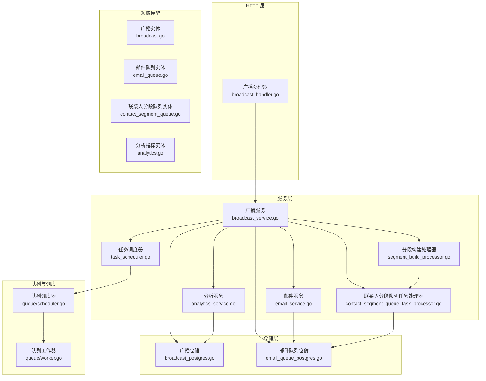
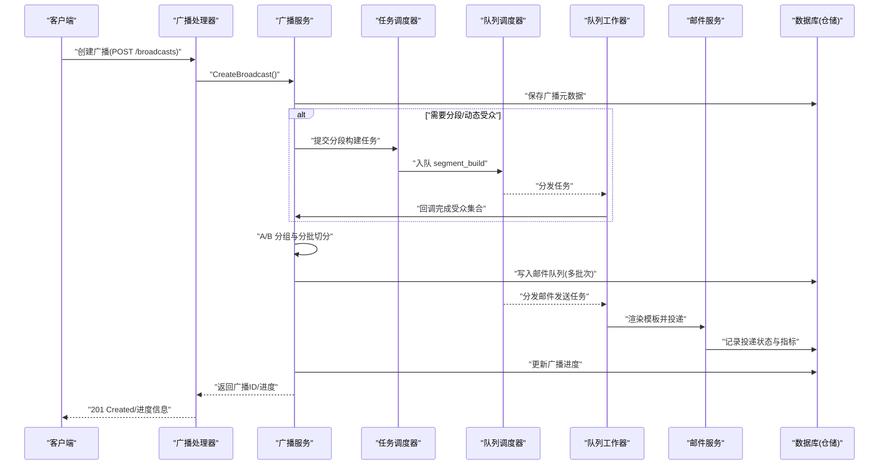
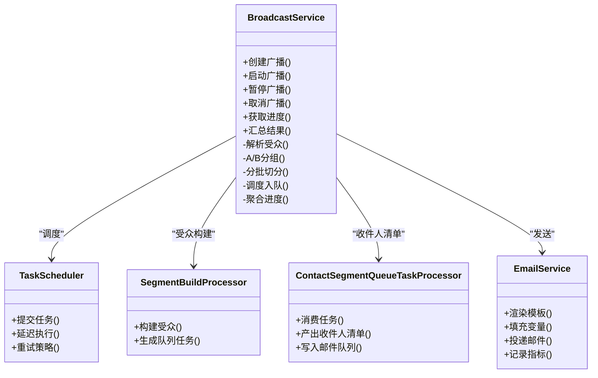
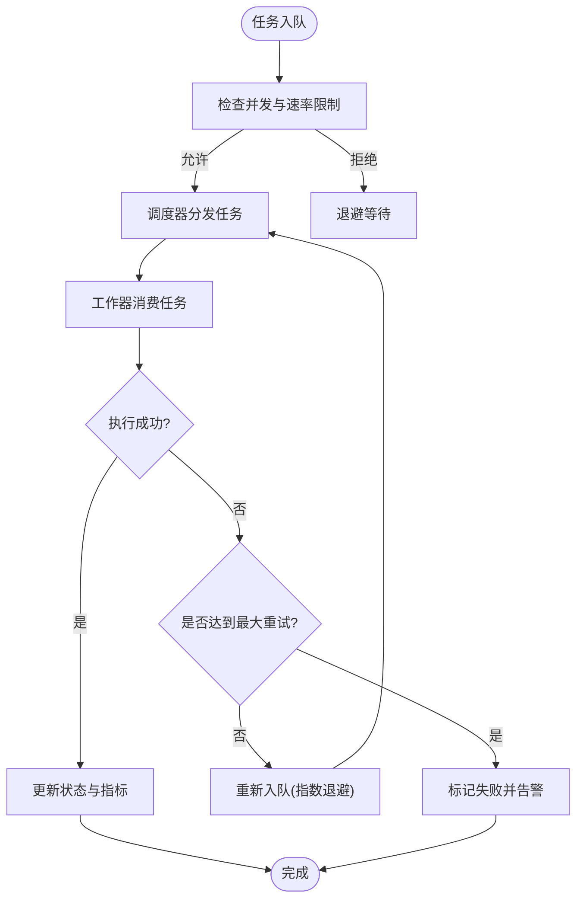
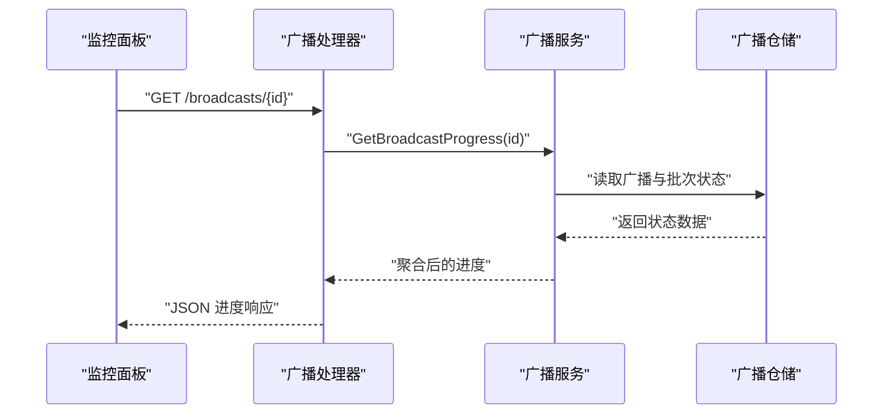
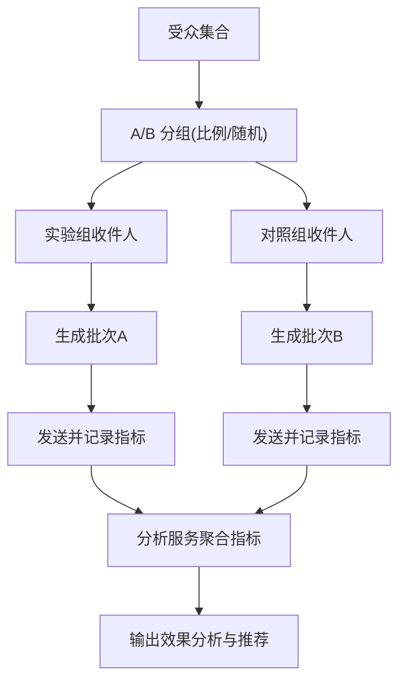
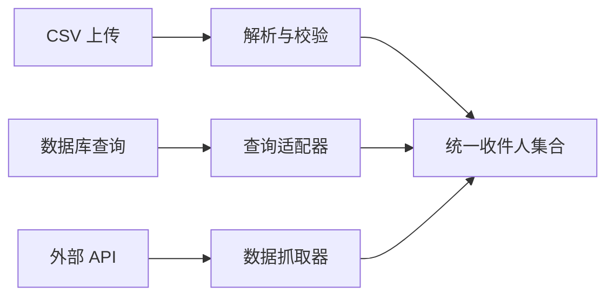
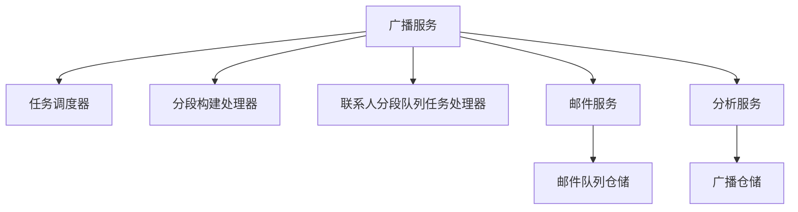

# 广播发送系统

<cite>
**本文引用的文件**   
- [cmd/api/main.go](file://notifuse/cmd/api/main.go)
- [internal/app/app.go](file://notifuse/internal/app/app.go)
- [internal/http/broadcast_handler.go](file://notifuse/internal/http/broadcast_handler.go)
- [internal/service/broadcast_service.go](file://notifuse/internal/service/broadcast_service.go)
- [internal/domain/broadcast.go](file://notifuse/internal/domain/broadcast.go)
- [internal/repository/broadcast_postgres.go](file://notifuse/internal/repository/broadcast_postgres.go)
- [internal/service/task_scheduler.go](file://notifuse/internal/service/task_scheduler.go)
- [internal/service/email_service.go](file://notifuse/internal/service/email_service.go)
- [internal/domain/email_queue.go](file://notifuse/internal/domain/email_queue.go)
- [internal/repository/email_queue_postgres.go](file://notifuse/internal/repository/email_queue_postgres.go)
- [internal/service/segment_build_processor.go](file://notifuse/internal/service/segment_build_processor.go)
- [internal/service/contact_segment_queue_task_processor.go](file://notifuse/internal/service/contact_segment_queue_task_processor.go)
- [internal/domain/contact_segment_queue.go](file://notifuse/internal/domain/contact_segment_queue.go)
- [internal/service/analytics_service.go](file://notifuse/internal/service/analytics_service.go)
- [internal/domain/analytics.go](file://notifuse/internal/domain/analytics.go)
- [internal/service/queue/scheduler.go](file://notifuse/internal/service/queue/scheduler.go)
- [internal/service/queue/worker.go](file://notifuse/internal/service/queue/worker.go)
- [openapi/openapi.yaml](file://notifuse/openapi/openapi.yaml)
- [openapi/paths/broadcasts.yaml](file://notifuse/openapi/paths/broadcasts.yaml)
</cite>

## 目录
1. [简介](#简介)
2. [项目结构](#项目结构)
3. [核心组件](#核心组件)
4. [架构总览](#架构总览)
5. [详细组件分析](#详细组件分析)
6. [依赖关系分析](#依赖关系分析)
7. [性能考虑](#性能考虑)
8. [故障排查指南](#故障排查指南)
9. [结论](#结论)
10. [附录：API 接口与使用案例](#附录api-接口与使用案例)

## 简介
本文件面向 Notifuse 平台的“广播发送系统”，聚焦批量邮件发送的架构设计与实现细节。文档覆盖以下关键主题：
- 广播任务编排器、消息发送器与进度跟踪机制
- 广播任务的创建、调度与执行流程（分批次、并发控制、资源管理）
- A/B 测试受众分组、结果统计与效果分析
- 数据源集成能力（CSV 上传、数据库查询、API 对接）
- 监控面板、实时进度显示与异常处理
- 性能调优建议与故障排查指南
- API 接口文档与实际使用案例

## 项目结构
广播发送系统位于后端服务内部，采用分层架构：HTTP 层暴露 REST API，服务层封装业务逻辑，领域模型定义核心实体，仓储层负责持久化，队列与调度子系统负责异步执行与批处理。

图表来源
- [internal/http/broadcast_handler.go](file://notifuse/internal/http/broadcast_handler.go)
- [internal/service/broadcast_service.go](file://notifuse/internal/service/broadcast_service.go)
- [internal/service/task_scheduler.go](file://notifuse/internal/service/task_scheduler.go)
- [internal/service/email_service.go](file://notifuse/internal/service/email_service.go)
- [internal/service/segment_build_processor.go](file://notifuse/internal/service/segment_build_processor.go)
- [internal/service/contact_segment_queue_task_processor.go](file://notifuse/internal/service/contact_segment_queue_task_processor.go)
- [internal/service/analytics_service.go](file://notifuse/internal/service/analytics_service.go)
- [internal/domain/broadcast.go](file://notifuse/internal/domain/broadcast.go)
- [internal/domain/email_queue.go](file://notifuse/internal/domain/email_queue.go)
- [internal/domain/contact_segment_queue.go](file://notifuse/internal/domain/contact_segment_queue.go)
- [internal/domain/analytics.go](file://notifuse/internal/domain/analytics.go)
- [internal/repository/broadcast_postgres.go](file://notifuse/internal/repository/broadcast_postgres.go)
- [internal/repository/email_queue_postgres.go](file://notifuse/internal/repository/email_queue_postgres.go)
- [internal/service/queue/scheduler.go](file://notifuse/internal/service/queue/scheduler.go)
- [internal/service/queue/worker.go](file://notifuse/internal/service/queue/worker.go)

章节来源
- [cmd/api/main.go](file://notifuse/cmd/api/main.go)
- [internal/app/app.go](file://notifuse/internal/app/app.go)

## 核心组件
- 广播处理器：接收 HTTP 请求，校验参数，调用广播服务完成创建、预览、启动、暂停、取消与状态查询。
- 广播服务：编排广播生命周期，包括受众解析（列表、分段、CSV、外部数据）、A/B 分组、分批切分、调度入队、进度聚合与结果汇总。
- 任务调度器：基于定时或事件触发将广播任务写入队列；支持延迟执行与重试策略。
- 邮件服务：负责模板渲染、收件人填充、附件处理、速率限制与投递到各邮件提供商。
- 分段构建处理器：根据条件规则计算受众集合，生成联系人分段队列任务。
- 联系人分段队列任务处理器：消费分段任务，产出最终收件人清单并写入邮件队列。
- 分析服务：采集打开、点击、退订、拒收等指标，提供 A/B 对比与效果分析。
- 仓储层：持久化广播、邮件队列、联系人分段队列与分析指标。

章节来源
- [internal/http/broadcast_handler.go](file://notifuse/internal/http/broadcast_handler.go)
- [internal/service/broadcast_service.go](file://notifuse/internal/service/broadcast_service.go)
- [internal/service/task_scheduler.go](file://notifuse/internal/service/task_scheduler.go)
- [internal/service/email_service.go](file://notifuse/internal/service/email_service.go)
- [internal/service/segment_build_processor.go](file://notifuse/internal/service/segment_build_processor.go)
- [internal/service/contact_segment_queue_task_processor.go](file://notifuse/internal/service/contact_segment_queue_task_processor.go)
- [internal/service/analytics_service.go](file://notifuse/internal/service/analytics_service.go)
- [internal/domain/broadcast.go](file://notifuse/internal/domain/broadcast.go)
- [internal/domain/email_queue.go](file://notifuse/internal/domain/email_queue.go)
- [internal/domain/contact_segment_queue.go](file://notifuse/internal/domain/contact_segment_queue.go)
- [internal/domain/analytics.go](file://notifuse/internal/domain/analytics.go)
- [internal/repository/broadcast_postgres.go](file://notifuse/internal/repository/broadcast_postgres.go)
- [internal/repository/email_queue_postgres.go](file://notifuse/internal/repository/email_queue_postgres.go)

## 架构总览
广播发送系统以“任务驱动 + 队列消费”的方式实现高吞吐与可观测性。整体流程如下：
- 创建广播：选择受众来源（列表/分段/CSV/外部数据），配置模板与变量，可选开启 A/B 测试。
- 受众解析与分段：若为分段或动态数据源，先构建受众集合，生成联系人分段队列任务。
- 分批与入队：按批次大小切分收件人，写入邮件队列；每个批次由队列工作器并行消费。
- 发送与追踪：邮件服务渲染模板并投递，记录投递状态与用户行为指标。
- 进度与结果：广播服务聚合各批次状态，更新广播进度；分析服务汇总 A/B 效果。

图表来源
- [internal/http/broadcast_handler.go](file://notifuse/internal/http/broadcast_handler.go)
- [internal/service/broadcast_service.go](file://notifuse/internal/service/broadcast_service.go)
- [internal/service/task_scheduler.go](file://notifuse/internal/service/task_scheduler.go)
- [internal/service/queue/scheduler.go](file://notifuse/internal/service/queue/scheduler.go)
- [internal/service/queue/worker.go](file://notifuse/internal/service/queue/worker.go)
- [internal/service/email_service.go](file://notifuse/internal/service/email_service.go)
- [internal/repository/broadcast_postgres.go](file://notifuse/internal/repository/broadcast_postgres.go)
- [internal/repository/email_queue_postgres.go](file://notifuse/internal/repository/email_queue_postgres.go)

## 详细组件分析

### 广播服务与任务编排
- 职责：协调受众解析、A/B 分组、分批切分、调度入队、进度聚合与结果汇总。
- 关键点：
  - 受众来源统一抽象：列表、分段、CSV、外部数据源（通过服务层适配）。
  - A/B 测试：将受众随机或按比例分配到实验组与对照组，分别生成独立批次。
  - 分批策略：按批次大小与并发度切分，避免单次负载过大。
  - 进度跟踪：维护每批次的状态（待处理、进行中、成功、失败），聚合为总体进度。
  - 幂等与重试：对失败的批次进行有限次重试，避免重复投递。

图表来源
- [internal/service/broadcast_service.go](file://notifuse/internal/service/broadcast_service.go)
- [internal/service/task_scheduler.go](file://notifuse/internal/service/task_scheduler.go)
- [internal/service/segment_build_processor.go](file://notifuse/internal/service/segment_build_processor.go)
- [internal/service/contact_segment_queue_task_processor.go](file://notifuse/internal/service/contact_segment_queue_task_processor.go)
- [internal/service/email_service.go](file://notifuse/internal/service/email_service.go)

章节来源
- [internal/service/broadcast_service.go](file://notifuse/internal/service/broadcast_service.go)
- [internal/service/task_scheduler.go](file://notifuse/internal/service/task_scheduler.go)
- [internal/service/segment_build_processor.go](file://notifuse/internal/service/segment_build_processor.go)
- [internal/service/contact_segment_queue_task_processor.go](file://notifuse/internal/service/contact_segment_queue_task_processor.go)
- [internal/domain/broadcast.go](file://notifuse/internal/domain/broadcast.go)

### 队列与并发控制
- 队列调度器：负责任务的分发与负载均衡，支持优先级与限流。
- 队列工作器：并行消费任务，执行具体操作（如发送邮件），失败时进入重试队列。
- 并发控制：通过工作器数量与任务队列长度控制整体吞吐；结合速率限制器保护下游服务。

图表来源
- [internal/service/queue/scheduler.go](file://notifuse/internal/service/queue/scheduler.go)
- [internal/service/queue/worker.go](file://notifuse/internal/service/queue/worker.go)

章节来源
- [internal/service/queue/scheduler.go](file://notifuse/internal/service/queue/scheduler.go)
- [internal/service/queue/worker.go](file://notifuse/internal/service/queue/worker.go)

### 进度跟踪与监控
- 进度字段：总收件人数、已发送数、成功数、失败数、当前批次状态。
- 实时更新：队列工作器在投递完成后回写状态，广播服务聚合后对外暴露。
- 监控面板：前端轮询广播详情接口，展示进度条、错误分布与 A/B 对比图。

图表来源
- [internal/http/broadcast_handler.go](file://notifuse/internal/http/broadcast_handler.go)
- [internal/service/broadcast_service.go](file://notifuse/internal/service/broadcast_service.go)
- [internal/repository/broadcast_postgres.go](file://notifuse/internal/repository/broadcast_postgres.go)

章节来源
- [internal/http/broadcast_handler.go](file://notifuse/internal/http/broadcast_handler.go)
- [internal/service/broadcast_service.go](file://notifuse/internal/service/broadcast_service.go)
- [internal/repository/broadcast_postgres.go](file://notifuse/internal/repository/broadcast_postgres.go)

### A/B 测试实现原理
- 受众分组：在受众解析阶段，按预设比例或随机策略将收件人划分到实验组与对照组。
- 独立批次：为每组生成独立的邮件批次，确保隔离与可比性。
- 结果统计：分析服务收集打开、点击、退订、拒收等指标，按组聚合。
- 效果分析：对比两组的关键指标差异，输出显著性与推荐版本。

图表来源
- [internal/service/broadcast_service.go](file://notifuse/internal/service/broadcast_service.go)
- [internal/service/analytics_service.go](file://notifuse/internal/service/analytics_service.go)
- [internal/domain/analytics.go](file://notifuse/internal/domain/analytics.go)

章节来源
- [internal/service/broadcast_service.go](file://notifuse/internal/service/broadcast_service.go)
- [internal/service/analytics_service.go](file://notifuse/internal/service/analytics_service.go)
- [internal/domain/analytics.go](file://notifuse/internal/domain/analytics.go)

### 数据源集成能力
- CSV 上传：支持上传联系人 CSV，解析为收件人清单，校验邮箱格式与去重。
- 数据库查询：通过服务层适配 SQL 查询，动态拉取联系人或标签过滤结果。
- API 数据对接：调用外部 API 获取联系人数据，并进行缓存与增量同步。
- 统一抽象：所有数据源在服务层转换为统一的收件人集合，供广播服务使用。

图表来源
- [internal/service/broadcast_service.go](file://notifuse/internal/service/broadcast_service.go)

章节来源
- [internal/service/broadcast_service.go](file://notifuse/internal/service/broadcast_service.go)

## 依赖关系分析
- 组件耦合：
  - 广播服务依赖任务调度器、分段处理器、联系人分段队列处理器、邮件服务与分析服务。
  - 邮件服务依赖邮件队列仓储与邮件提供商适配。
  - 分析服务依赖广播仓储与分析指标仓储。
- 外部依赖：
  - 数据库（PostgreSQL）用于持久化广播、队列与分析指标。
  - 邮件提供商（SMTP、SendGrid、Mailgun、SES 等）通过邮件服务抽象接入。
- 潜在循环依赖：
  - 服务层之间通过接口解耦，避免直接循环引用。
  - 仓储层仅被服务层调用，不反向依赖。

图表来源
- [internal/service/broadcast_service.go](file://notifuse/internal/service/broadcast_service.go)
- [internal/service/email_service.go](file://notifuse/internal/service/email_service.go)
- [internal/service/analytics_service.go](file://notifuse/internal/service/analytics_service.go)
- [internal/repository/email_queue_postgres.go](file://notifuse/internal/repository/email_queue_postgres.go)
- [internal/repository/broadcast_postgres.go](file://notifuse/internal/repository/broadcast_postgres.go)

章节来源
- [internal/service/broadcast_service.go](file://notifuse/internal/service/broadcast_service.go)
- [internal/service/email_service.go](file://notifuse/internal/service/email_service.go)
- [internal/service/analytics_service.go](file://notifuse/internal/service/analytics_service.go)
- [internal/repository/email_queue_postgres.go](file://notifuse/internal/repository/email_queue_postgres.go)
- [internal/repository/broadcast_postgres.go](file://notifuse/internal/repository/broadcast_postgres.go)

## 性能考虑
- 分批大小：根据收件人总量与下游邮件提供商速率限制调整批次大小，避免超时与限流。
- 并发度：合理设置队列工作器数量，平衡 CPU、内存与网络 I/O。
- 速率限制：在邮件服务层启用速率限制器，平滑峰值流量。
- 索引优化：为广播、邮件队列与分析指标表建立合适索引，提升查询与聚合性能。
- 缓存策略：对静态模板与常用变量进行缓存，减少渲染开销。
- 重试与退避：对瞬时失败采用指数退避重试，降低抖动影响。
- 资源隔离：不同工作区或租户的任务可隔离队列与工作器，避免相互干扰。

[本节为通用性能指导，无需特定文件来源]

## 故障排查指南
- 常见问题定位：
  - 广播未启动：检查任务调度器是否正常入队，队列是否有积压。
  - 发送失败：查看邮件服务日志与邮件提供商返回码，确认认证与域名配置。
  - 进度停滞：检查队列工作器是否存活，是否存在死锁或长时间阻塞。
  - A/B 结果异常：核对受众分组比例与指标采集完整性。
- 诊断步骤：
  - 查看广播详情与批次状态，定位失败批次 ID。
  - 检索邮件队列仓储中对应批次的投递记录与错误信息。
  - 分析服务聚合指标，确认打开、点击、退订、拒收计数是否一致。
  - 检查速率限制与重试策略配置，必要时调整并发与批次大小。
- 恢复措施：
  - 重启队列工作器或扩容实例。
  - 清理失败任务并重试。
  - 修正模板变量或收件人数据后重新发送。

章节来源
- [internal/service/broadcast_service.go](file://notifuse/internal/service/broadcast_service.go)
- [internal/service/email_service.go](file://notifuse/internal/service/email_service.go)
- [internal/service/analytics_service.go](file://notifuse/internal/service/analytics_service.go)
- [internal/repository/email_queue_postgres.go](file://notifuse/internal/repository/email_queue_postgres.go)
- [internal/repository/broadcast_postgres.go](file://notifuse/internal/repository/broadcast_postgres.go)

## 结论
广播发送系统通过分层架构与队列驱动实现了高吞吐、可扩展与可观测的批量邮件发送能力。其核心在于受众解析与 A/B 分组、分批与并发控制、以及完善的进度跟踪与指标分析。配合合理的性能调优与故障排查流程，可在大规模场景下稳定运行。

[本节为总结性内容，无需特定文件来源]

## 附录：API 接口与使用案例

### API 概览
- 基础路径：/api/v1
- 认证：Bearer Token（参考 OpenAPI 安全方案）
- 主要资源：
  - 广播：创建、预览、启动、暂停、取消、查询进度与结果
  - 联系人列表与分段：用于受众选择
  - 模板：用于邮件内容渲染
  - 自定义事件与分析：用于效果评估

章节来源
- [openapi/openapi.yaml](file://notifuse/openapi/openapi.yaml)
- [openapi/paths/broadcasts.yaml](file://notifuse/openapi/paths/broadcasts.yaml)

### 广播相关接口
- 创建广播
  - 方法：POST
  - 路径：/api/v1/broadcasts
  - 请求体：包含标题、模板ID、受众来源（列表/分段/CSV/外部数据）、A/B 配置、发送时间等
  - 响应：广播ID、初始进度
- 启动广播
  - 方法：POST
  - 路径：/api/v1/broadcasts/{id}/start
  - 响应：启动状态
- 暂停广播
  - 方法：POST
  - 路径：/api/v1/broadcasts/{id}/pause
  - 响应：暂停状态
- 取消广播
  - 方法：POST
  - 路径：/api/v1/broadcasts/{id}/cancel
  - 响应：取消状态
- 查询进度
  - 方法：GET
  - 路径：/api/v1/broadcasts/{id}
  - 响应：总收件人数、已发送、成功、失败、批次状态、A/B 指标摘要

章节来源
- [internal/http/broadcast_handler.go](file://notifuse/internal/http/broadcast_handler.go)
- [openapi/paths/broadcasts.yaml](file://notifuse/openapi/paths/broadcasts.yaml)

### 实际使用案例
- 批量导入联系人并发送
  - 上传 CSV 文件，解析为收件人清单
  - 选择模板与变量，创建广播
  - 启动广播，监控进度与结果
- A/B 测试
  - 配置两个变体模板与受众分组比例
  - 启动广播，观察打开率与点击率差异
  - 根据分析结果选择最优版本
- 定时发送
  - 设置发送时间为未来某时刻
  - 任务调度器在指定时间自动入队并执行

章节来源
- [internal/service/broadcast_service.go](file://notifuse/internal/service/broadcast_service.go)
- [internal/service/task_scheduler.go](file://notifuse/internal/service/task_scheduler.go)
- [internal/service/email_service.go](file://notifuse/internal/service/email_service.go)