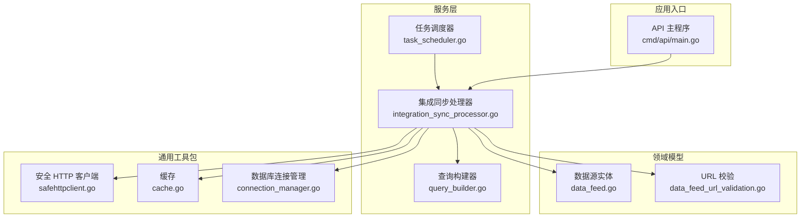
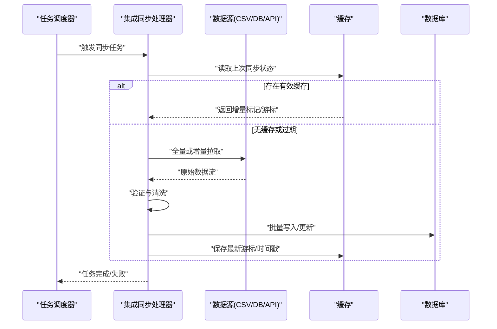
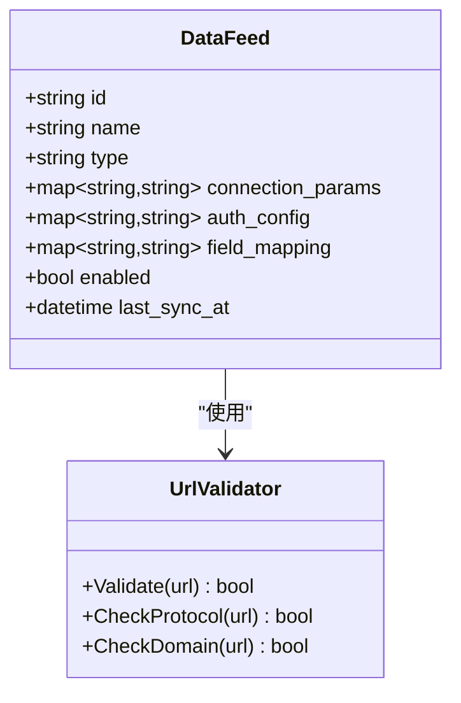
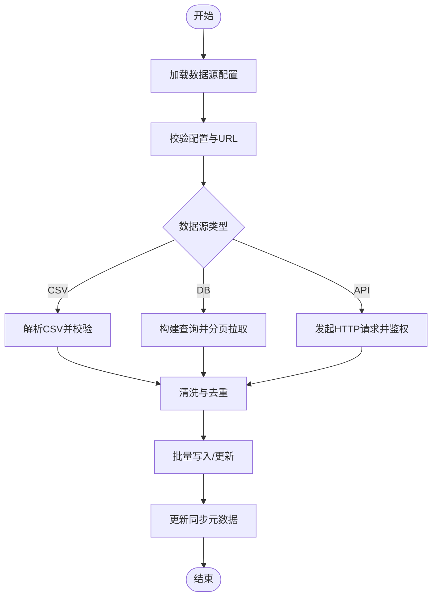
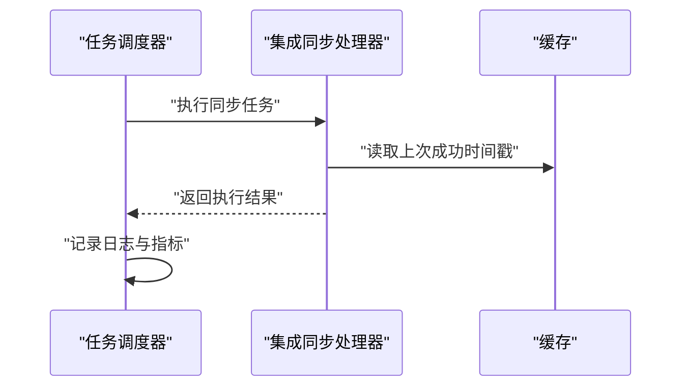
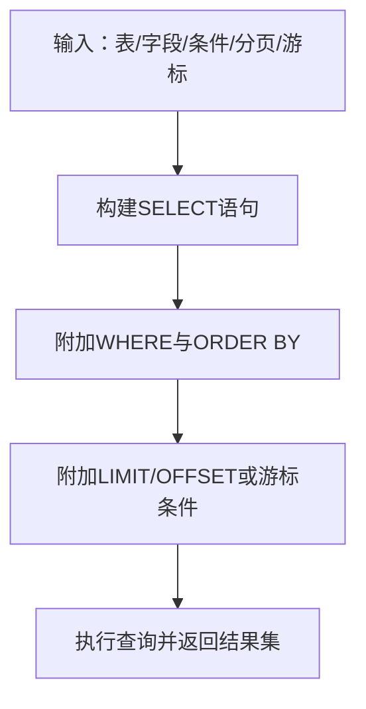
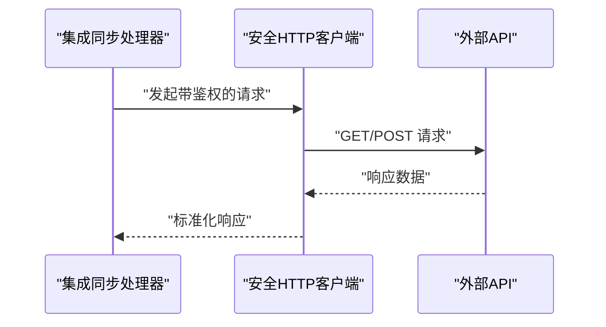
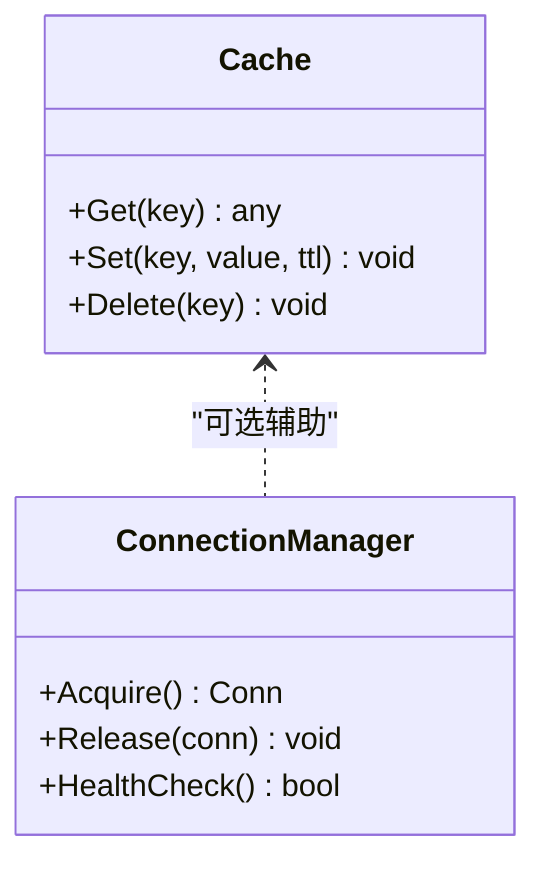
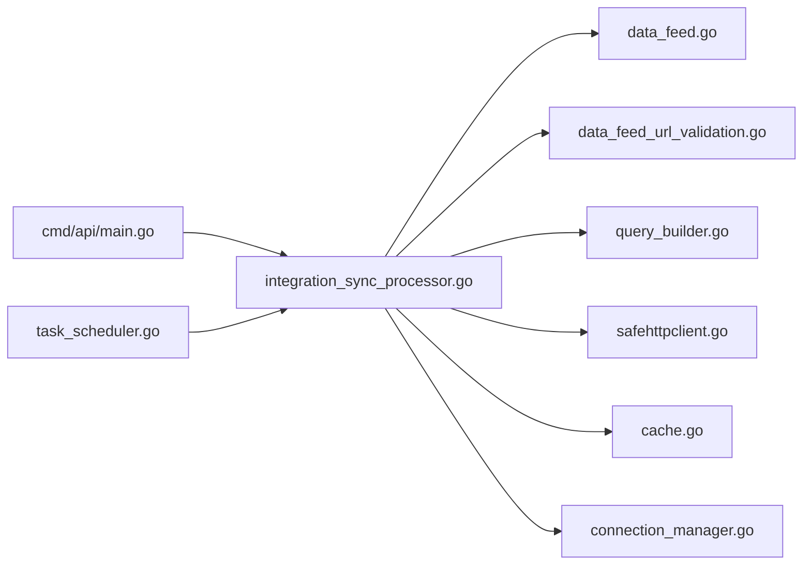

# 数据源集成

<cite>
**本文引用的文件**   
- [data_feed.go](file://notifuse/internal/domain/data_feed.go)
- [data_feed_test.go](file://notifuse/internal/domain/data_feed_test.go)
- [data_feed_url_validation.go](file://notifuse/internal/domain/data_feed_url_validation.go)
- [data_feed_url_validation_test.go](file://notifuse/internal/domain/data_feed_url_validation_test.go)
- [integration_sync_processor.go](file://notifuse/internal/service/integration_sync_processor.go)
- [integration_sync_processor_test.go](file://notifuse/internal/service/integration_sync_processor_test.go)
- [task_scheduler.go](file://notifuse/internal/service/task_scheduler.go)
- [task_scheduler_test.go](file://notifuse/internal/service/task_scheduler_test.go)
- [query_builder.go](file://notifuse/internal/service/query_builder.go)
- [query_builder_test.go](file://notifuse/internal/service/query_builder_test.go)
- [safehttpclient.go](file://notifuse/pkg/safehttpclient/safehttpclient.go)
- [cache.go](file://notifuse/pkg/cache/cache.go)
- [connection_manager.go](file://notifuse/pkg/database/connection_manager.go)
- [config.go](file://notifuse/config/config.go)
- [platform.go](file://notifuse/config/platform.go)
- [main.go](file://notifuse/cmd/api/main.go)
</cite>

## 目录
1. [简介](#简介)
2. [项目结构](#项目结构)
3. [核心组件](#核心组件)
4. [架构总览](#架构总览)
5. [详细组件分析](#详细组件分析)
6. [依赖分析](#依赖分析)
7. [性能考虑](#性能考虑)
8. [故障排查指南](#故障排查指南)
9. [结论](#结论)
10. [附录：配置与集成示例](#附录配置与集成示例)

## 简介
本文件面向 Notifuse 平台的数据源集成系统，聚焦多类型数据源的接入与管理，包括 CSV 文件上传、数据库查询与 API 数据对接。文档覆盖以下主题：
- 数据源配置管理：连接参数、认证机制、数据映射规则
- 动态数据获取：定时刷新、增量更新、缓存策略
- 数据验证与清洗：格式检查、去重处理、异常值过滤
- 大数据集处理：分页加载、流式处理、内存优化
- 性能调优建议与常见问题解决方案
- 各数据源配置示例与集成指南

## 项目结构
Notifuse 后端采用 Go 语言实现，数据源相关能力主要分布在领域模型、服务层与通用工具包中：
- 领域模型：定义数据源实体、URL 校验等
- 服务层：提供同步处理器、任务调度器、查询构建器等
- 通用工具包：HTTP 客户端、缓存、数据库连接管理等

图表来源
- [data_feed.go](file://notifuse/internal/domain/data_feed.go)
- [data_feed_url_validation.go](file://notifuse/internal/domain/data_feed_url_validation.go)
- [integration_sync_processor.go](file://notifuse/internal/service/integration_sync_processor.go)
- [task_scheduler.go](file://notifuse/internal/service/task_scheduler.go)
- [query_builder.go](file://notifuse/internal/service/query_builder.go)
- [safehttpclient.go](file://notifuse/pkg/safehttpclient/safehttpclient.go)
- [cache.go](file://notifuse/pkg/cache/cache.go)
- [connection_manager.go](file://notifuse/pkg/database/connection_manager.go)
- [main.go](file://notifuse/cmd/api/main.go)

章节来源
- [data_feed.go](file://notifuse/internal/domain/data_feed.go)
- [data_feed_url_validation.go](file://notifuse/internal/domain/data_feed_url_validation.go)
- [integration_sync_processor.go](file://notifuse/internal/service/integration_sync_processor.go)
- [task_scheduler.go](file://notifuse/internal/service/task_scheduler.go)
- [query_builder.go](file://notifuse/internal/service/query_builder.go)
- [safehttpclient.go](file://notifuse/pkg/safehttpclient/safehttpclient.go)
- [cache.go](file://notifuse/pkg/cache/cache.go)
- [connection_manager.go](file://notifuse/pkg/database/connection_manager.go)
- [main.go](file://notifuse/cmd/api/main.go)

## 核心组件
- 数据源实体（Data Feed）：描述数据源的基本信息、类型、连接参数、认证方式与映射规则，用于统一抽象不同来源的数据。
- URL 校验器：对数据源地址进行合法性与安全校验，防止非法或危险请求。
- 集成同步处理器：协调多种数据源的拉取、转换、写入流程，支持定时触发与增量更新。
- 任务调度器：基于时间或事件驱动的任务编排，负责周期性刷新与重试。
- 查询构建器：为数据库数据源生成高效查询语句，支持分页与条件过滤。
- 安全 HTTP 客户端：封装对外部 API 的访问，包含超时、重试、限流等策略。
- 缓存：提供键值存储能力，用于减少重复请求与提升读取性能。
- 数据库连接管理：统一管理数据库连接池、健康检查与错误恢复。

章节来源
- [data_feed.go](file://notifuse/internal/domain/data_feed.go)
- [data_feed_url_validation.go](file://notifuse/internal/domain/data_feed_url_validation.go)
- [integration_sync_processor.go](file://notifuse/internal/service/integration_sync_processor.go)
- [task_scheduler.go](file://notifuse/internal/service/task_scheduler.go)
- [query_builder.go](file://notifuse/internal/service/query_builder.go)
- [safehttpclient.go](file://notifuse/pkg/safehttpclient/safehttpclient.go)
- [cache.go](file://notifuse/pkg/cache/cache.go)
- [connection_manager.go](file://notifuse/pkg/database/connection_manager.go)

## 架构总览
下图展示从任务调度到数据源拉取、清洗、落库的整体流程，以及缓存与外部系统的交互点。

图表来源
- [task_scheduler.go](file://notifuse/internal/service/task_scheduler.go)
- [integration_sync_processor.go](file://notifuse/internal/service/integration_sync_processor.go)
- [cache.go](file://notifuse/pkg/cache/cache.go)
- [connection_manager.go](file://notifuse/pkg/database/connection_manager.go)

## 详细组件分析

### 数据源实体与 URL 校验
- 数据源实体定义了统一的元数据与配置项，涵盖类型标识、连接参数、认证方式、字段映射与更新策略。
- URL 校验器确保数据源地址符合协议白名单、域名与路径规范，避免注入与越权访问风险。

图表来源
- [data_feed.go](file://notifuse/internal/domain/data_feed.go)
- [data_feed_url_validation.go](file://notifuse/internal/domain/data_feed_url_validation.go)

章节来源
- [data_feed.go](file://notifuse/internal/domain/data_feed.go)
- [data_feed_url_validation.go](file://notifuse/internal/domain/data_feed_url_validation.go)
- [data_feed_test.go](file://notifuse/internal/domain/data_feed_test.go)
- [data_feed_url_validation_test.go](file://notifuse/internal/domain/data_feed_url_validation_test.go)

### 集成同步处理器（CSV/DB/API）
- CSV 文件上传：解析上传文件，执行行级校验与类型转换，按批次写入目标存储。
- 数据库查询：通过查询构建器生成 SQL，支持分页与增量游标，结合连接管理器进行事务控制。
- API 数据对接：调用安全 HTTP 客户端，处理鉴权头、分页参数与速率限制，将响应转换为内部模型。

图表来源
- [integration_sync_processor.go](file://notifuse/internal/service/integration_sync_processor.go)
- [query_builder.go](file://notifuse/internal/service/query_builder.go)
- [safehttpclient.go](file://notifuse/pkg/safehttpclient/safehttpclient.go)
- [connection_manager.go](file://notifuse/pkg/database/connection_manager.go)

章节来源
- [integration_sync_processor.go](file://notifuse/internal/service/integration_sync_processor.go)
- [integration_sync_processor_test.go](file://notifuse/internal/service/integration_sync_processor_test.go)
- [query_builder.go](file://notifuse/internal/service/query_builder.go)
- [query_builder_test.go](file://notifuse/internal/service/query_builder_test.go)
- [safehttpclient.go](file://notifuse/pkg/safehttpclient/safehttpclient.go)
- [connection_manager.go](file://notifuse/pkg/database/connection_manager.go)

### 任务调度器（定时刷新与重试）
- 支持周期性与一次性任务，可配置 Cron 表达式或固定间隔。
- 任务失败时具备自动重试与退避策略，保障最终一致性。
- 与集成同步处理器协作，按数据源维度独立调度。

图表来源
- [task_scheduler.go](file://notifuse/internal/service/task_scheduler.go)
- [integration_sync_processor.go](file://notifuse/internal/service/integration_sync_processor.go)
- [cache.go](file://notifuse/pkg/cache/cache.go)

章节来源
- [task_scheduler.go](file://notifuse/internal/service/task_scheduler.go)
- [task_scheduler_test.go](file://notifuse/internal/service/task_scheduler_test.go)

### 查询构建器（数据库数据源）
- 根据数据源配置的表名、字段映射与过滤条件生成 SQL。
- 支持分页参数（页码、每页大小）、排序与增量游标（如更新时间戳）。
- 与连接管理器配合，确保连接复用与事务边界清晰。

图表来源
- [query_builder.go](file://notifuse/internal/service/query_builder.go)
- [connection_manager.go](file://notifuse/pkg/database/connection_manager.go)

章节来源
- [query_builder.go](file://notifuse/internal/service/query_builder.go)
- [query_builder_test.go](file://notifuse/internal/service/query_builder_test.go)

### 安全 HTTP 客户端（API 数据源）
- 统一封装 HTTP 请求，支持超时、重试、限流与错误分类。
- 支持常见认证方式（如 Bearer Token、Basic Auth），并可注入自定义 Header。
- 与缓存联动，对幂等 GET 请求进行短期缓存以减少外部压力。

图表来源
- [safehttpclient.go](file://notifuse/pkg/safehttpclient/safehttpclient.go)
- [integration_sync_processor.go](file://notifuse/internal/service/integration_sync_processor.go)

章节来源
- [safehttpclient.go](file://notifuse/pkg/safehttpclient/safehttpclient.go)
- [integration_sync_processor.go](file://notifuse/internal/service/integration_sync_processor.go)

### 缓存与连接管理
- 缓存：提供键值存取，适合存储增量游标、最近同步时间戳与热点数据。
- 连接管理：维护数据库连接池，支持健康检查、自动重连与错误隔离。

图表来源
- [cache.go](file://notifuse/pkg/cache/cache.go)
- [connection_manager.go](file://notifuse/pkg/database/connection_manager.go)

章节来源
- [cache.go](file://notifuse/pkg/cache/cache.go)
- [connection_manager.go](file://notifuse/pkg/database/connection_manager.go)

## 依赖分析
- 低耦合设计：服务层通过接口与工具包解耦，便于替换实现与扩展新数据源。
- 直接依赖关系：
  - 集成同步处理器依赖数据源实体、URL 校验器、查询构建器、安全 HTTP 客户端、缓存与连接管理。
  - 任务调度器依赖集成同步处理器与缓存。
  - 应用入口初始化并装配上述组件。

图表来源
- [main.go](file://notifuse/cmd/api/main.go)
- [integration_sync_processor.go](file://notifuse/internal/service/integration_sync_processor.go)
- [data_feed.go](file://notifuse/internal/domain/data_feed.go)
- [data_feed_url_validation.go](file://notifuse/internal/domain/data_feed_url_validation.go)
- [query_builder.go](file://notifuse/internal/service/query_builder.go)
- [safehttpclient.go](file://notifuse/pkg/safehttpclient/safehttpclient.go)
- [cache.go](file://notifuse/pkg/cache/cache.go)
- [connection_manager.go](file://notifuse/pkg/database/connection_manager.go)
- [task_scheduler.go](file://notifuse/internal/service/task_scheduler.go)

章节来源
- [main.go](file://notifuse/cmd/api/main.go)
- [integration_sync_processor.go](file://notifuse/internal/service/integration_sync_processor.go)
- [task_scheduler.go](file://notifuse/internal/service/task_scheduler.go)

## 性能考虑
- 分页与游标：数据库与 API 数据源优先使用分页与增量游标，避免全量拉取导致内存与带宽压力。
- 批处理写入：合并多次写入操作，降低事务开销与锁竞争。
- 缓存命中：对幂等读取与热点数据进行缓存，缩短响应时间。
- 连接池调优：合理设置最大连接数、空闲超时与重试次数，避免连接泄漏。
- 并发控制：对多个数据源并行拉取时，限制并发度以避免下游系统过载。
- 资源监控：记录关键指标（拉取耗时、失败率、缓存命中率、队列长度），用于容量规划与问题定位。

## 故障排查指南
- 连接失败：检查数据库连接管理与网络连通性，确认凭据与权限正确。
- 鉴权错误：核对 API 密钥、Token 有效期与签名算法，必要时启用调试日志。
- 数据不一致：对比上游系统与本地数据的游标与时间戳，确认增量逻辑是否生效。
- 性能退化：观察缓存命中率与连接池利用率，调整批大小与并发度。
- 任务失败：查看任务调度器的重试记录与错误堆栈，定位具体数据源与步骤。

章节来源
- [integration_sync_processor.go](file://notifuse/internal/service/integration_sync_processor.go)
- [task_scheduler.go](file://notifuse/internal/service/task_scheduler.go)
- [connection_manager.go](file://notifuse/pkg/database/connection_manager.go)
- [safehttpclient.go](file://notifuse/pkg/safehttpclient/safehttpclient.go)

## 结论
Notifuse 的数据源集成系统通过统一的实体模型与服务编排，实现了 CSV、数据库与 API 的多源接入。借助任务调度、增量游标、缓存与连接管理，系统在稳定性与性能方面具备良好的可扩展性。建议在生产环境完善监控告警与压测验证，持续优化批处理与并发策略。

## 附录：配置与集成示例
以下为各数据源的典型配置要点与集成步骤（以路径引用代替具体代码内容）：

- CSV 文件上传
  - 配置要点：文件编码、分隔符、首行是否为标题、必填字段映射、去重键。
  - 集成步骤：上传文件 -> 解析与校验 -> 清洗与去重 -> 批量写入 -> 更新元数据。
  - 参考路径：[integration_sync_processor.go](file://notifuse/internal/service/integration_sync_processor.go)

- 数据库查询
  - 配置要点：连接字符串、表名、字段映射、过滤条件、分页大小、增量游标字段。
  - 集成步骤：构建查询 -> 分页拉取 -> 转换与清洗 -> 批量写入 -> 更新游标。
  - 参考路径：[query_builder.go](file://notifuse/internal/service/query_builder.go)、[connection_manager.go](file://notifuse/pkg/database/connection_manager.go)

- API 数据对接
  - 配置要点：基础 URL、鉴权方式（Bearer/Basic）、分页参数、速率限制、重试策略。
  - 集成步骤：组装请求 -> 发送并处理响应 -> 转换与清洗 -> 批量写入 -> 更新元数据。
  - 参考路径：[safehttpclient.go](file://notifuse/pkg/safehttpclient/safehttpclient.go)、[integration_sync_processor.go](file://notifuse/internal/service/integration_sync_processor.go)

- 定时刷新与增量更新
  - 配置要点：Cron 表达式或固定间隔、增量游标字段、失败重试与退避。
  - 集成步骤：调度器触发 -> 读取上次同步状态 -> 增量拉取 -> 写入与更新。
  - 参考路径：[task_scheduler.go](file://notifuse/internal/service/task_scheduler.go)、[cache.go](file://notifuse/pkg/cache/cache.go)

- 数据验证与清洗
  - 配置要点：字段类型约束、空值处理、枚举映射、异常值阈值。
  - 集成步骤：格式检查 -> 类型转换 -> 去重 -> 异常值过滤 -> 输出标准模型。
  - 参考路径：[integration_sync_processor.go](file://notifuse/internal/service/integration_sync_processor.go)

- 性能调优建议
  - 增大批大小、开启缓存、限制并发、优化索引与查询计划。
  - 参考路径：[query_builder.go](file://notifuse/internal/service/query_builder.go)、[cache.go](file://notifuse/pkg/cache/cache.go)

- 常见问题解决方案
  - 鉴权失败：检查密钥与签名；启用调试日志。
  - 数据缺失：核对分页与游标；确认上游变更时间戳。
  - 性能瓶颈：监控缓存命中率与连接池；调整批大小与并发。
  - 参考路径：[safehttpclient.go](file://notifuse/pkg/safehttpclient/safehttpclient.go)、[connection_manager.go](file://notifuse/pkg/database/connection_manager.go)

章节来源
- [integration_sync_processor.go](file://notifuse/internal/service/integration_sync_processor.go)
- [query_builder.go](file://notifuse/internal/service/query_builder.go)
- [safehttpclient.go](file://notifuse/pkg/safehttpclient/safehttpclient.go)
- [task_scheduler.go](file://notifuse/internal/service/task_scheduler.go)
- [cache.go](file://notifuse/pkg/cache/cache.go)
- [connection_manager.go](file://notifuse/pkg/database/connection_manager.go)