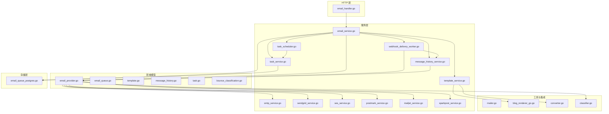
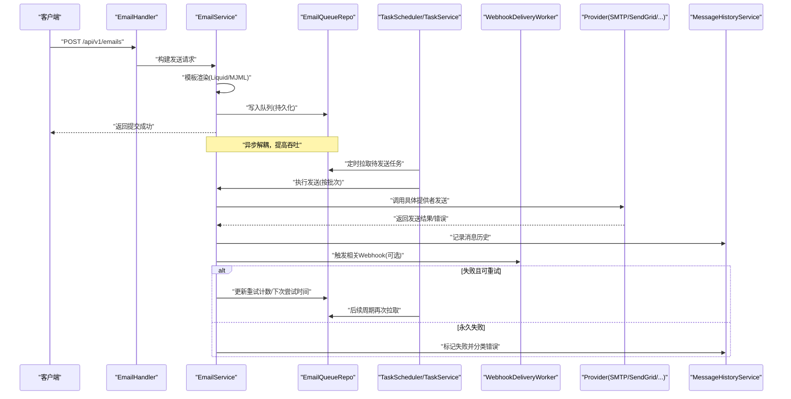
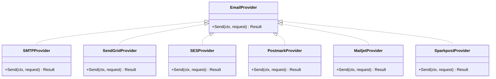
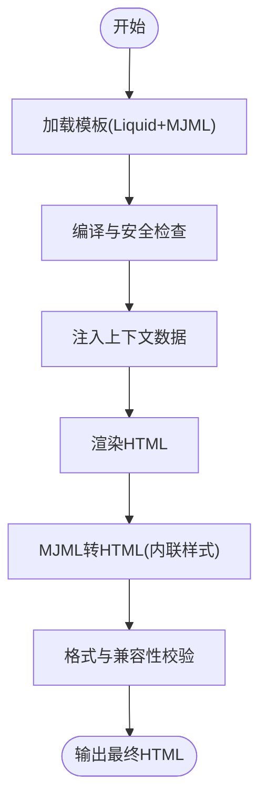
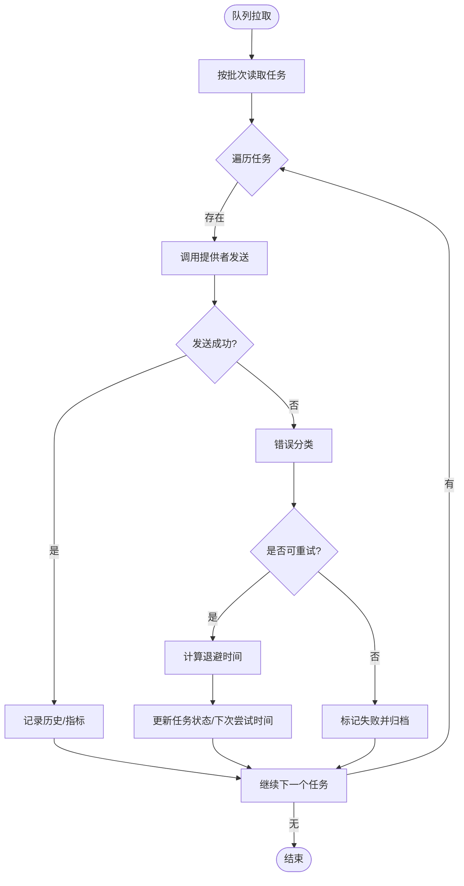
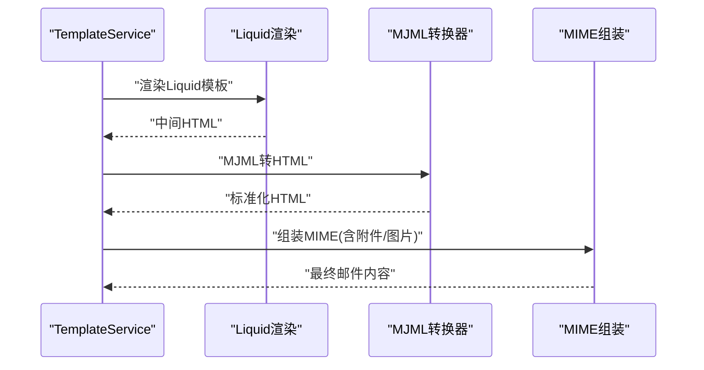
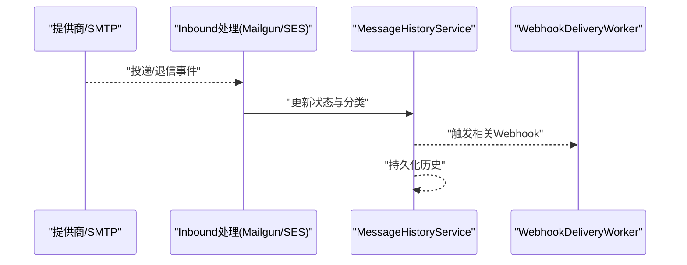
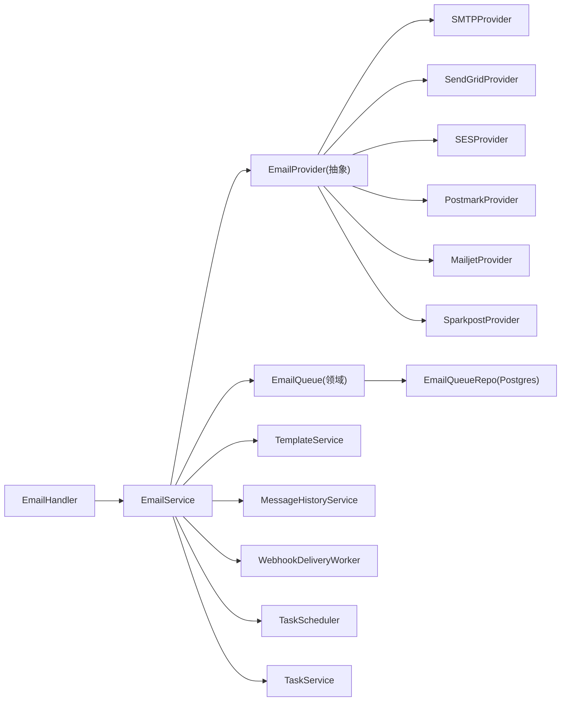

# 消息发送引擎

<cite>
**本文引用的文件**   
- [internal/domain/email_provider.go](file://notifuse/internal/domain/email_provider.go)
- [internal/domain/email_provider_smtp.go](file://notifuse/internal/domain/email_provider_smtp.go)
- [internal/domain/email_queue.go](file://notifuse/internal/domain/email_queue.go)
- [internal/service/email_service.go](file://notifuse/internal/service/email_service.go)
- [internal/service/smtp_service.go](file://notifuse/internal/service/smtp_service.go)
- [internal/service/sendgrid_service.go](file://notifuse/internal/service/sendgrid_service.go)
- [internal/service/ses_service.go](file://notifuse/internal/service/ses_service.go)
- [internal/service/postmark_service.go](file://notifuse/internal/service/postmark_service.go)
- [internal/service/mailjet_service.go](file://notifuse/internal/service/mailjet_service.go)
- [internal/service/sparkpost_service.go](file://notifuse/internal/service/sparkpost_service.go)
- [internal/service/template_service.go](file://notifuse/internal/service/template_service.go)
- [internal/domain/template.go](file://notifuse/internal/domain/template.go)
- [pkg/mailer/mailer.go](file://notifuse/pkg/mailer/mailer.go)
- [pkg/liquid/blog_renderer_go.go](file://notifuse/pkg/liquid/blog_renderer_go.go)
- [pkg/notifuse_mjml/converter.go](file://notifuse/pkg/notifuse_mjml/converter.go)
- [internal/repository/email_queue_postgres.go](file://notifuse/internal/repository/email_queue_postgres.go)
- [internal/http/email_handler.go](file://notifuse/internal/http/email_handler.go)
- [internal/service/message_history_service.go](file://notifuse/internal/service/message_history_service.go)
- [internal/domain/message_history.go](file://notifuse/internal/domain/message_history.go)
- [internal/service/inbound_reply_mailgun.go](file://notifuse/internal/service/inbound_reply_mailgun.go)
- [internal/service/inbound_reply_ses.go](file://notifuse/internal/service/inbound_reply_ses.go)
- [internal/service/webhook_delivery_worker.go](file://notifuse/internal/service/webhook_delivery_worker.go)
- [internal/service/task_scheduler.go](file://notifuse/internal/service/task_scheduler.go)
- [internal/service/task_service.go](file://notifuse/internal/service/task_service.go)
- [internal/domain/task.go](file://notifuse/internal/domain/task.go)
- [internal/service/bounce_classification.go](file://notifuse/internal/domain/bounce_classification.go)
- [pkg/emailerror/classifier.go](file://notifuse/pkg/emailerror/classifier.go)
</cite>

## 目录
1. [简介](#简介)
2. [项目结构](#项目结构)
3. [核心组件](#核心组件)
4. [架构总览](#架构总览)
5. [详细组件分析](#详细组件分析)
6. [依赖关系分析](#依赖关系分析)
7. [性能考虑](#性能考虑)
8. [故障排查指南](#故障排查指南)
9. [结论](#结论)
10. [附录：使用示例与最佳实践](#附录使用示例与最佳实践)

## 简介
本文件为 Notifuse 平台“消息发送引擎”的技术文档，聚焦邮件发送能力。内容覆盖：
- SMTP 协议支持与多提供商适配（SendGrid、SES、Postmark、Mailjet、SparkPost）
- 模板渲染机制（Liquid + MJML 转换）
- 消息队列发送器（异步处理、批量发送、失败重试）
- HTML 模板到最终邮件内容的生成流程
- 发送状态跟踪（送达确认、退信处理、打开率统计）
- 邮件内容优化（附件、图片嵌入、链接追踪）
- 性能调优建议与常见问题解决方案
- 完整使用示例与最佳实践

## 项目结构
围绕“消息发送引擎”，代码主要分布在以下层次：
- HTTP 层：接收发送请求并编排服务调用
- 服务层：封装业务逻辑（模板渲染、队列入队、发送调度、事件处理）
- 领域模型：统一抽象（邮件提供者接口、队列项、任务、历史等）
- 存储层：持久化队列、历史、任务等数据
- 外部集成：SMTP 客户端与各第三方邮件服务商 SDK
- 工具库：错误分类、MJML 转换、Liquid 渲染等

图表来源
- [internal/http/email_handler.go](file://notifuse/internal/http/email_handler.go)
- [internal/service/email_service.go](file://notifuse/internal/service/email_service.go)
- [internal/service/template_service.go](file://notifuse/internal/service/template_service.go)
- [internal/service/smtp_service.go](file://notifuse/internal/service/smtp_service.go)
- [internal/service/sendgrid_service.go](file://notifuse/internal/service/sendgrid_service.go)
- [internal/service/ses_service.go](file://notifuse/internal/service/ses_service.go)
- [internal/service/postmark_service.go](file://notifuse/internal/service/postmark_service.go)
- [internal/service/mailjet_service.go](file://notifuse/internal/service/mailjet_service.go)
- [internal/service/sparkpost_service.go](file://notifuse/internal/service/sparkpost_service.go)
- [internal/service/message_history_service.go](file://notifuse/internal/service/message_history_service.go)
- [internal/service/webhook_delivery_worker.go](file://notifuse/internal/service/webhook_delivery_worker.go)
- [internal/service/task_scheduler.go](file://notifuse/internal/service/task_scheduler.go)
- [internal/service/task_service.go](file://notifuse/internal/service/task_service.go)
- [internal/domain/email_provider.go](file://notifuse/internal/domain/email_provider.go)
- [internal/domain/email_queue.go](file://notifuse/internal/domain/email_queue.go)
- [internal/domain/template.go](file://notifuse/internal/domain/template.go)
- [internal/domain/message_history.go](file://notifuse/internal/domain/message_history.go)
- [internal/domain/task.go](file://notifuse/internal/domain/task.go)
- [internal/domain/bounce_classification.go](file://notifuse/internal/domain/bounce_classification.go)
- [internal/repository/email_queue_postgres.go](file://notifuse/internal/repository/email_queue_postgres.go)
- [pkg/mailer/mailer.go](file://notifuse/pkg/mailer/mailer.go)
- [pkg/liquid/blog_renderer_go.go](file://notifuse/pkg/liquid/blog_renderer_go.go)
- [pkg/notifuse_mjml/converter.go](file://notifuse/pkg/notifuse_mjml/converter.go)
- [pkg/emailerror/classifier.go](file://notifuse/pkg/emailerror/classifier.go)

章节来源
- [internal/http/email_handler.go](file://notifuse/internal/http/email_handler.go)
- [internal/service/email_service.go](file://notifuse/internal/service/email_service.go)
- [internal/repository/email_queue_postgres.go](file://notifuse/internal/repository/email_queue_postgres.go)

## 核心组件
- 邮件提供者抽象：定义统一的 Send 接口，屏蔽不同后端差异
- 具体提供者实现：SMTP、SendGrid、SES、Postmark、Mailjet、SparkPost
- 模板服务：基于 Liquid 与 MJML 的模板编译与渲染
- 队列与任务：持久化待发送邮件，支持定时拉取与重试
- 消息历史：记录每次发送的上下文与结果
- 错误分类：将各提供商返回的错误归一化为可操作类型
- Webhook 投递：在关键事件发生时触发下游回调

章节来源
- [internal/domain/email_provider.go](file://notifuse/internal/domain/email_provider.go)
- [internal/domain/email_queue.go](file://notifuse/internal/domain/email_queue.go)
- [internal/domain/template.go](file://notifuse/internal/domain/template.go)
- [internal/domain/message_history.go](file://notifuse/internal/domain/message_history.go)
- [internal/domain/task.go](file://notifuse/internal/domain/task.go)
- [internal/domain/bounce_classification.go](file://notifuse/internal/domain/bounce_classification.go)
- [pkg/emailerror/classifier.go](file://notifuse/pkg/emailerror/classifier.go)

## 架构总览
下图展示了从 HTTP 入口到最终投递的关键路径，以及事件回写与重试机制。

图表来源
- [internal/http/email_handler.go](file://notifuse/internal/http/email_handler.go)
- [internal/service/email_service.go](file://notifuse/internal/service/email_service.go)
- [internal/repository/email_queue_postgres.go](file://notifuse/internal/repository/email_queue_postgres.go)
- [internal/service/task_scheduler.go](file://notifuse/internal/service/task_scheduler.go)
- [internal/service/task_service.go](file://notifuse/internal/service/task_service.go)
- [internal/service/webhook_delivery_worker.go](file://notifuse/internal/service/webhook_delivery_worker.go)
- [internal/service/message_history_service.go](file://notifuse/internal/service/message_history_service.go)
- [internal/domain/email_provider.go](file://notifuse/internal/domain/email_provider.go)

## 详细组件分析

### 邮件提供者抽象与多提供商适配
- 抽象接口：统一 Send 方法签名，输入包含收件人、主题、正文、附件、头部等；输出包含发送 ID、状态码、错误信息
- 适配器实现：
  - SMTP：通过标准 SMTP 协议直连，支持认证与 TLS
  - SendGrid/SES/Postmark/Mailjet/SparkPost：分别对接各自 API，统一错误映射
- 错误分类：将不同提供商的错误码映射为通用分类（如软失败、硬失败、验证错误、速率限制等），便于重试策略与告警

图表来源
- [internal/domain/email_provider.go](file://notifuse/internal/domain/email_provider.go)
- [internal/service/smtp_service.go](file://notifuse/internal/service/smtp_service.go)
- [internal/service/sendgrid_service.go](file://notifuse/internal/service/sendgrid_service.go)
- [internal/service/ses_service.go](file://notifuse/internal/service/ses_service.go)
- [internal/service/postmark_service.go](file://notifuse/internal/service/postmark_service.go)
- [internal/service/mailjet_service.go](file://notifuse/internal/service/mailjet_service.go)
- [internal/service/sparkpost_service.go](file://notifuse/internal/service/sparkpost_service.go)
- [pkg/emailerror/classifier.go](file://notifuse/pkg/emailerror/classifier.go)

章节来源
- [internal/domain/email_provider.go](file://notifuse/internal/domain/email_provider.go)
- [internal/service/smtp_service.go](file://notifuse/internal/service/smtp_service.go)
- [internal/service/sendgrid_service.go](file://notifuse/internal/service/sendgrid_service.go)
- [internal/service/ses_service.go](file://notifuse/internal/service/ses_service.go)
- [internal/service/postmark_service.go](file://notifuse/internal/service/postmark_service.go)
- [internal/service/mailjet_service.go](file://notifuse/internal/service/mailjet_service.go)
- [internal/service/sparkpost_service.go](file://notifuse/internal/service/sparkpost_service.go)
- [pkg/emailerror/classifier.go](file://notifuse/pkg/emailerror/classifier.go)

### 模板渲染机制（Liquid + MJML）
- 模板源：支持 Liquid 语法变量与条件控制，结合 MJML 响应式布局
- 编译期：对模板进行安全校验与片段提取，预编译提升运行时性能
- 运行期：注入上下文数据（联系人字段、动态内容、追踪参数），生成 HTML 文本
- 转换：MJML 转换为兼容邮件客户端的 HTML，内联样式，确保跨客户端一致性

图表来源
- [internal/service/template_service.go](file://notifuse/internal/service/template_service.go)
- [internal/domain/template.go](file://notifuse/internal/domain/template.go)
- [pkg/liquid/blog_renderer_go.go](file://notifuse/pkg/liquid/blog_renderer_go.go)
- [pkg/notifuse_mjml/converter.go](file://notifuse/pkg/notifuse_mjml/converter.go)

章节来源
- [internal/service/template_service.go](file://notifuse/internal/service/template_service.go)
- [internal/domain/template.go](file://notifuse/internal/domain/template.go)
- [pkg/liquid/blog_renderer_go.go](file://notifuse/pkg/liquid/blog_renderer_go.go)
- [pkg/notifuse_mjml/converter.go](file://notifuse/pkg/notifuse_mjml/converter.go)

### 消息队列发送器（异步、批量、重试）
- 入队：HTTP 接口接收后，立即持久化到队列表，返回提交成功
- 拉取：任务调度器周期性扫描未发送或需重试的任务
- 批量：按批次大小拉取，减少数据库往返与网络开销
- 发送：选择合适提供者（根据配置或路由规则）执行发送
- 重试：依据错误分类决定重试次数与退避策略（指数退避、最大重试上限）
- 完成：成功后记录历史与指标，必要时触发 Webhook

图表来源
- [internal/repository/email_queue_postgres.go](file://notifuse/internal/repository/email_queue_postgres.go)
- [internal/service/task_scheduler.go](file://notifuse/internal/service/task_scheduler.go)
- [internal/service/task_service.go](file://notifuse/internal/service/task_service.go)
- [internal/domain/email_queue.go](file://notifuse/internal/domain/email_queue.go)
- [internal/domain/bounce_classification.go](file://notifuse/internal/domain/bounce_classification.go)
- [pkg/emailerror/classifier.go](file://notifuse/pkg/emailerror/classifier.go)

章节来源
- [internal/repository/email_queue_postgres.go](file://notifuse/internal/repository/email_queue_postgres.go)
- [internal/service/task_scheduler.go](file://notifuse/internal/service/task_scheduler.go)
- [internal/service/task_service.go](file://notifuse/internal/service/task_service.go)
- [internal/domain/email_queue.go](file://notifuse/internal/domain/email_queue.go)
- [internal/domain/bounce_classification.go](file://notifuse/internal/domain/bounce_classification.go)
- [pkg/emailerror/classifier.go](file://notifuse/pkg/emailerror/classifier.go)

### 邮件格式转换流程（HTML 模板到最终内容）
- 输入：Liquid 模板 + 上下文数据 + MJML 布局
- 步骤：
  1) 解析与编译模板，提取静态片段
  2) 注入动态数据（包括追踪参数）
  3) 渲染为 HTML，并进行 MJML 到 HTML 的转换
  4) 内联样式、清理不安全标签、压缩资源
  5) 附加附件与图片（按需内嵌或外链）
  6) 生成最终 MIME 内容（文本/HTML 双版本）

图表来源
- [internal/service/template_service.go](file://notifuse/internal/service/template_service.go)
- [pkg/liquid/blog_renderer_go.go](file://notifuse/pkg/liquid/blog_renderer_go.go)
- [pkg/notifuse_mjml/converter.go](file://notifuse/pkg/notifuse_mjml/converter.go)
- [pkg/mailer/mailer.go](file://notifuse/pkg/mailer/mailer.go)

章节来源
- [internal/service/template_service.go](file://notifuse/internal/service/template_service.go)
- [pkg/liquid/blog_renderer_go.go](file://notifuse/pkg/liquid/blog_renderer_go.go)
- [pkg/notifuse_mjml/converter.go](file://notifuse/pkg/notifuse_mjml/converter.go)
- [pkg/mailer/mailer.go](file://notifuse/pkg/mailer/mailer.go)

### 发送状态跟踪（送达、退信、打开率）
- 送达确认：通过提供商回执或系统回执事件更新状态
- 退信处理：解析退信事件，分类为软/硬退信，更新用户与列表状态
- 打开率统计：通过追踪像素或链接重定向记录打开行为
- 历史记录：持久化每次发送的请求与响应摘要，便于审计与排障

图表来源
- [internal/service/inbound_reply_mailgun.go](file://notifuse/internal/service/inbound_reply_mailgun.go)
- [internal/service/inbound_reply_ses.go](file://notifuse/internal/service/inbound_reply_ses.go)
- [internal/service/message_history_service.go](file://notifuse/internal/service/message_history_service.go)
- [internal/service/webhook_delivery_worker.go](file://notifuse/internal/service/webhook_delivery_worker.go)
- [internal/domain/message_history.go](file://notifuse/internal/domain/message_history.go)

章节来源
- [internal/service/inbound_reply_mailgun.go](file://notifuse/internal/service/inbound_reply_mailgun.go)
- [internal/service/inbound_reply_ses.go](file://notifuse/internal/service/inbound_reply_ses.go)
- [internal/service/message_history_service.go](file://notifuse/internal/service/message_history_service.go)
- [internal/service/webhook_delivery_worker.go](file://notifuse/internal/service/webhook_delivery_worker.go)
- [internal/domain/message_history.go](file://notifuse/internal/domain/message_history.go)

### 邮件内容优化技术
- 附件处理：大附件优先外链，小附件内嵌；限制大小与类型白名单
- 图片嵌入：CDN 托管与缓存策略，避免重复上传
- 链接追踪：在 URL 中注入唯一标识，记录点击事件并转发至分析服务
- 内容压缩：移除多余空白、合并样式、懒加载非关键资源

章节来源
- [internal/service/template_service.go](file://notifuse/internal/service/template_service.go)
- [pkg/notifuse_mjml/converter.go](file://notifuse/pkg/notifuse_mjml/converter.go)
- [pkg/mailer/mailer.go](file://notifuse/pkg/mailer/mailer.go)

## 依赖关系分析
- 低耦合：HTTP 层仅依赖服务层；服务层通过领域接口与仓库交互
- 可扩展：新增邮件提供商只需实现统一接口并在注册处声明
- 可观测：所有关键路径均记录历史与指标，便于监控与排障
- 外部依赖：数据库（PostgreSQL）、第三方邮件 API、Webhook 目标

图表来源
- [internal/http/email_handler.go](file://notifuse/internal/http/email_handler.go)
- [internal/service/email_service.go](file://notifuse/internal/service/email_service.go)
- [internal/domain/email_provider.go](file://notifuse/internal/domain/email_provider.go)
- [internal/domain/email_queue.go](file://notifuse/internal/domain/email_queue.go)
- [internal/service/template_service.go](file://notifuse/internal/service/template_service.go)
- [internal/service/message_history_service.go](file://notifuse/internal/service/message_history_service.go)
- [internal/service/webhook_delivery_worker.go](file://notifuse/internal/service/webhook_delivery_worker.go)
- [internal/service/task_scheduler.go](file://notifuse/internal/service/task_scheduler.go)
- [internal/service/task_service.go](file://notifuse/internal/service/task_service.go)
- [internal/repository/email_queue_postgres.go](file://notifuse/internal/repository/email_queue_postgres.go)

章节来源
- [internal/http/email_handler.go](file://notifuse/internal/http/email_handler.go)
- [internal/service/email_service.go](file://notifuse/internal/service/email_service.go)
- [internal/domain/email_provider.go](file://notifuse/internal/domain/email_provider.go)
- [internal/domain/email_queue.go](file://notifuse/internal/domain/email_queue.go)
- [internal/repository/email_queue_postgres.go](file://notifuse/internal/repository/email_queue_postgres.go)

## 性能考虑
- 批量拉取与发送：合理设置批次大小，平衡吞吐与内存占用
- 连接复用：SMTP 保持长连接，第三方 SDK 启用连接池
- 模板预编译：减少运行时解析开销
- 异步解耦：HTTP 快速返回，后台队列驱动发送
- 限流与退避：遵循提供商速率限制，指数退避避免雪崩
- 索引优化：队列表按状态与下次尝试时间建立索引，加速扫描
- 资源裁剪：图片外链、附件分片、压缩 HTML/CSS

[本节为通用指导，不直接分析具体文件]

## 故障排查指南
- 常见错误分类：
  - 软失败（临时性）：网络抖动、服务器繁忙、速率限制
  - 硬失败（永久性）：地址无效、域名未验证、权限不足
- 定位步骤：
  1) 查看消息历史，确认请求参数与响应摘要
  2) 检查错误分类结果，判断是否可重试
  3) 核对提供商配置（密钥、域名、DNS 记录）
  4) 观察 Webhook 事件，确认退信与打开事件是否到达
- 恢复策略：
  - 调整重试间隔与上限
  - 切换备用提供商或 SMTP 通道
  - 修正模板或链接追踪参数

章节来源
- [internal/domain/bounce_classification.go](file://notifuse/internal/domain/bounce_classification.go)
- [pkg/emailerror/classifier.go](file://notifuse/pkg/emailerror/classifier.go)
- [internal/service/message_history_service.go](file://notifuse/internal/service/message_history_service.go)

## 结论
Notifuse 的消息发送引擎以“统一抽象 + 多提供商适配 + 模板渲染 + 队列异步 + 状态跟踪”为核心，提供高可用、可扩展、可观测的邮件发送能力。通过合理的批处理、重试与优化策略，可在保证质量的同时获得良好吞吐。

[本节为总结，不直接分析具体文件]

## 附录：使用示例与最佳实践
- 基本发送流程
  - 调用 HTTP 接口提交邮件请求
  - 系统自动渲染模板并写入队列
  - 后台任务拉取并发送，记录历史与指标
- 模板编写建议
  - 使用 Liquid 变量与条件语句组织动态内容
  - 使用 MJML 构建响应式布局，避免复杂 CSS
  - 链接追踪参数集中管理，便于分析
- 附件与图片
  - 大图外链，小图内嵌；注意大小限制与类型白名单
  - 使用 CDN 提升加载速度
- 错误与重试
  - 区分软/硬失败，合理设置重试策略
  - 对不可重试错误及时告警并人工介入
- 监控与审计
  - 关注消息历史与 Webhook 事件
  - 定期审查退信率与打开率，优化内容与发送策略

[本节为通用指导，不直接分析具体文件]