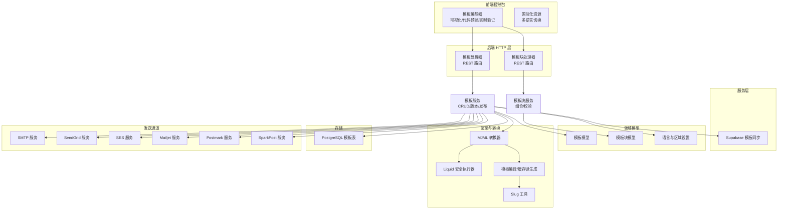
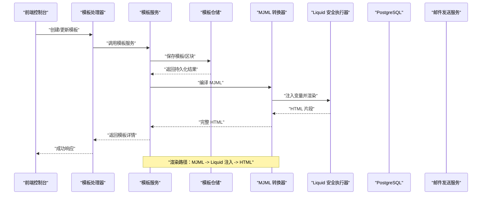
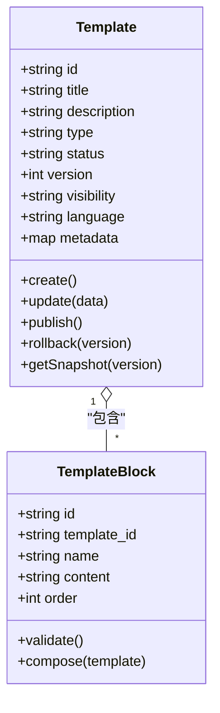
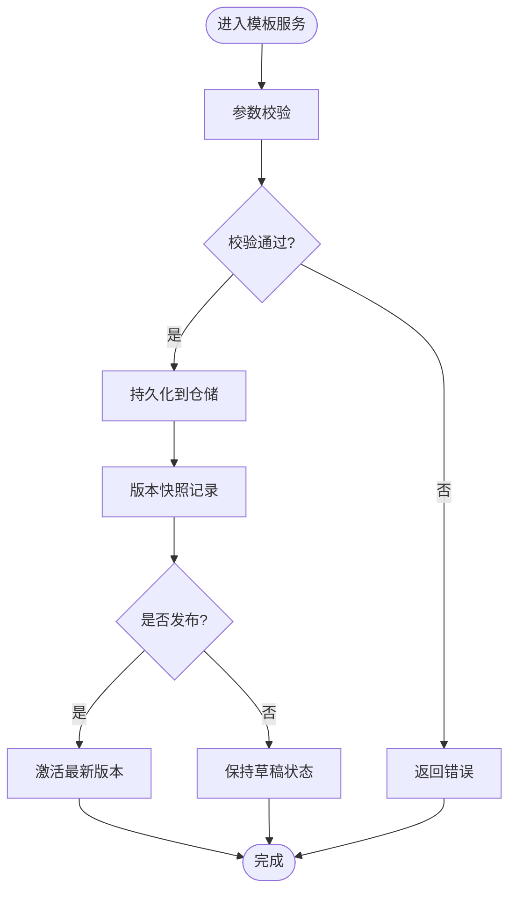
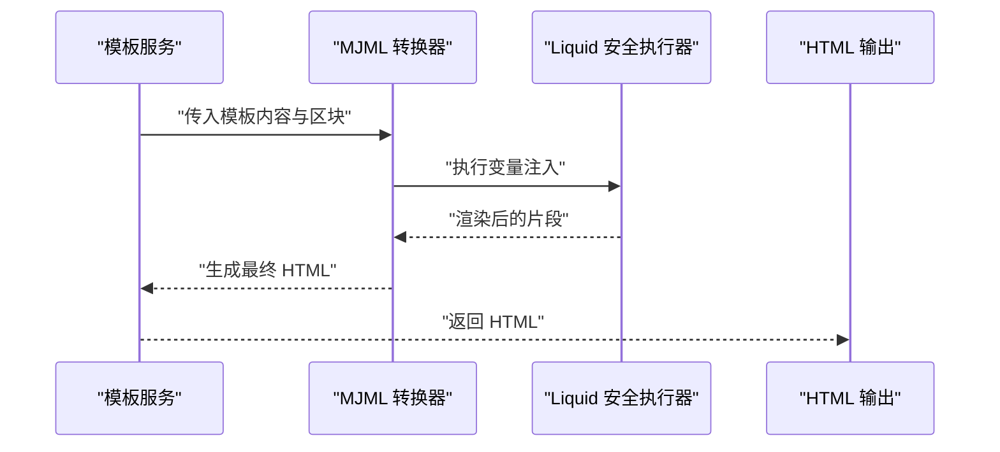
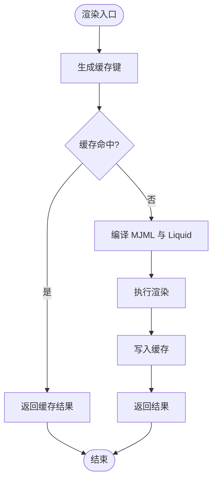
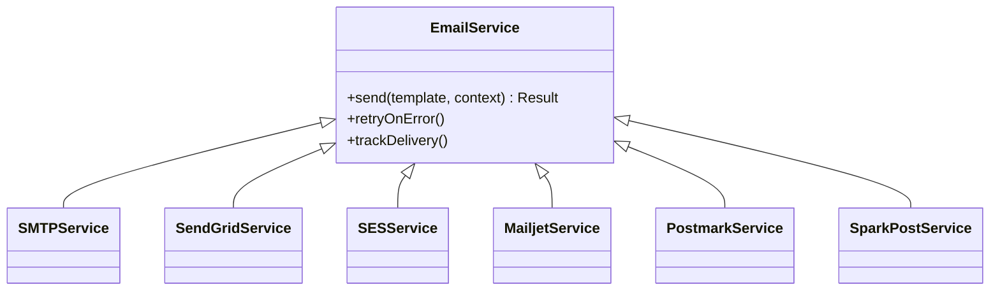
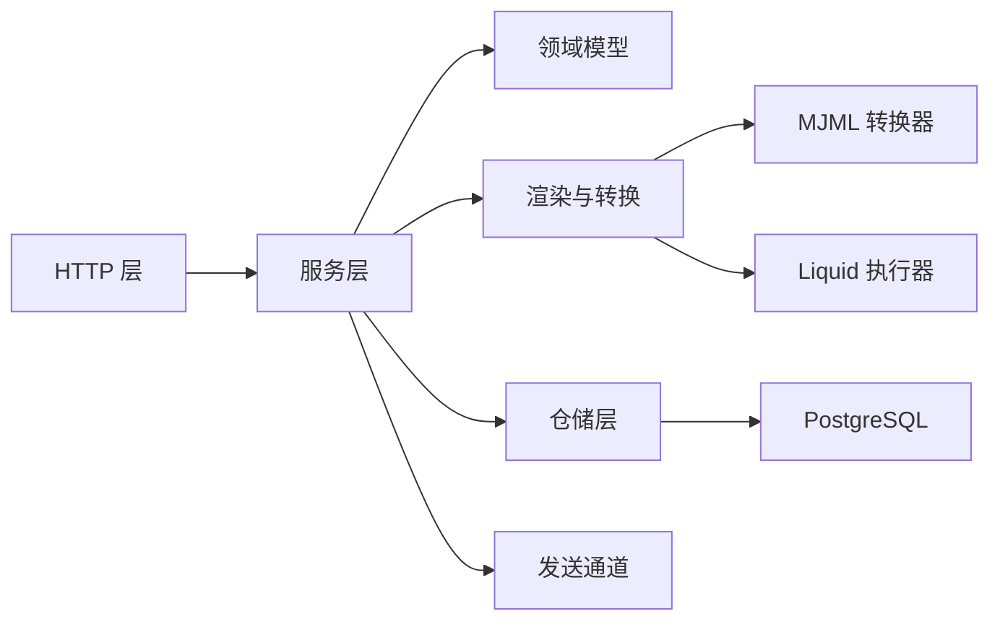

# 模板管理系统

<cite>
**本文引用的文件**
- [template.go](file://notifuse/internal/domain/template.go)
- [template_block.go](file://notifuse/internal/domain/template_block.go)
- [template_postgres.go](file://notifuse/internal/repository/template_postgres.go)
- [template_handler.go](file://notifuse/internal/http/template_handler.go)
- [template_block_handler.go](file://notifuse/internal/http/template_block_handler.go)
- [template_service.go](file://notifuse/internal/service/template_service.go)
- [template_block_service.go](file://notifuse/internal/service/template_block_service.go)
- [supabase_templates.go](file://notifuse/internal/service/supabase_templates.go)
- [templates.yaml](file://notifuse/openapi/paths/templates.yaml)
- [converter.go](file://notifuse/pkg/notifuse_mjml/converter.go)
- [liquid_secure.go](file://notifuse/pkg/notifuse_mjml/liquid_secure.go)
- [template_compilation.go](file://notifuse/pkg/notifuse_mjml/template_compilation.go)
- [model.go](file://notifuse/pkg/notifuse_mjml/model.go)
- [slug.go](file://notifuse/pkg/notifuse_mjml/slug.go)
- [cache.go](file://notifuse/pkg/cache/cache.go)
- [email_service.go](file://notifuse/internal/service/email_service.go)
- [smtp_service.go](file://notifuse/internal/service/smtp_service.go)
- [sendgrid_service.go](file://notifuse/internal/service/sendgrid_service.go)
- [ses_service.go](file://notifuse/internal/service/ses_service.go)
- [mailjet_service.go](file://notifuse/internal/service/mailjet_service.go)
- [postmark_service.go](file://notifuse/internal/service/postmark_service.go)
- [sparkpost_service.go](file://notifuse/internal/service/sparkpost_service.go)
- [mailer.go](file://notifuse/pkg/mailer/mailer.go)
- [translations.go](file://notifuse/pkg/mailer/translations.go)
- [languages.go](file://notifuse/internal/domain/languages.go)
- [i18n.ts](file://notifuse/console/src/i18n/index.ts)
- [App.tsx](file://notifuse/console/src/App.tsx)
- [router.tsx](file://notifuse/console/src/router.tsx)
</cite>

## 目录
1. [简介](#简介)
2. [项目结构](#项目结构)
3. [核心组件](#核心组件)
4. [架构总览](#架构总览)
5. [详细组件分析](#详细组件分析)
6. [依赖关系分析](#依赖关系分析)
7. [性能考虑](#性能考虑)
8. [故障排查指南](#故障排查指南)
9. [结论](#结论)
10. [附录：API 接口文档与示例](#附录api-接口文档与示例)

## 简介
本文件为 Notifuse 平台的“模板管理系统”提供系统化、可落地的技术文档。内容覆盖邮件模板的设计架构（MJML 模板格式支持、Liquid 模板引擎集成与渲染机制）、版本控制、多语言支持与动态内容替换；并详细说明模板编辑器的工作原理（可视化编辑界面、代码预览与实时验证）、导入导出、复用机制与权限管理；同时给出开发最佳实践、调试技巧、性能优化与缓存策略，以及完整的 API 接口文档与使用示例。

## 项目结构
模板管理系统在后端采用分层架构：HTTP 层暴露 RESTful 接口，服务层编排业务逻辑，领域模型定义数据与行为，仓储层对接数据库，渲染与转换模块负责 MJML 到 HTML 的转换及 Liquid 变量注入。前端控制台提供模板的可视化编辑、预览与多语言配置能力。

图表来源
- [template_handler.go:1-200](file://notifuse/internal/http/template_handler.go#L1-L200)
- [template_block_handler.go:1-200](file://notifuse/internal/http/template_block_handler.go#L1-L200)
- [template_service.go:1-300](file://notifuse/internal/service/template_service.go#L1-L300)
- [template_block_service.go:1-200](file://notifuse/internal/service/template_block_service.go#L1-L200)
- [supabase_templates.go:1-200](file://notifuse/internal/service/supabase_templates.go#L1-L200)
- [template.go:1-200](file://notifuse/internal/domain/template.go#L1-L200)
- [template_block.go:1-200](file://notifuse/internal/domain/template_block.go#L1-L200)
- [converter.go:1-200](file://notifuse/pkg/notifuse_mjml/converter.go#L1-L200)
- [liquid_secure.go:1-200](file://notifuse/pkg/notifuse_mjml/liquid_secure.go#L1-L200)
- [template_compilation.go:1-200](file://notifuse/pkg/notifuse_mjml/template_compilation.go#L1-L200)
- [model.go:1-200](file://notifuse/pkg/notifuse_mjml/model.go#L1-L200)
- [slug.go:1-200](file://notifuse/pkg/notifuse_mjml/slug.go#L1-L200)
- [template_postgres.go:1-200](file://notifuse/internal/repository/template_postgres.go#L1-L200)
- [email_service.go:1-200](file://notifuse/internal/service/email_service.go#L1-L200)
- [smtp_service.go:1-200](file://notifuse/internal/service/smtp_service.go#L1-L200)
- [sendgrid_service.go:1-200](file://notifuse/internal/service/sendgrid_service.go#L1-L200)
- [ses_service.go:1-200](file://notifuse/internal/service/ses_service.go#L1-L200)
- [mailjet_service.go:1-200](file://notifuse/internal/service/mailjet_service.go#L1-L200)
- [postmark_service.go:1-200](file://notifuse/internal/service/postmark_service.go#L1-L200)
- [sparkpost_service.go:1-200](file://notifuse/internal/service/sparkpost_service.go#L1-L200)
- [mailer.go:1-200](file://notifuse/pkg/mailer/mailer.go#L1-L200)
- [translations.go:1-200](file://notifuse/pkg/mailer/translations.go#L1-L200)
- [languages.go:1-200](file://notifuse/internal/domain/languages.go#L1-L200)
- [i18n.ts:1-200](file://notifuse/console/src/i18n/index.ts#L1-L200)
- [App.tsx:1-200](file://notifuse/console/src/App.tsx#L1-L200)
- [router.tsx:1-200](file://notifuse/console/src/router.tsx#L1-L200)

章节来源
- [template_handler.go:1-200](file://notifuse/internal/http/template_handler.go#L1-L200)
- [template_service.go:1-300](file://notifuse/internal/service/template_service.go#L1-L300)
- [template.go:1-200](file://notifuse/internal/domain/template.go#L1-L200)
- [template_postgres.go:1-200](file://notifuse/internal/repository/template_postgres.go#L1-L200)
- [converter.go:1-200](file://notifuse/pkg/notifuse_mjml/converter.go#L1-L200)
- [liquid_secure.go:1-200](file://notifuse/pkg/notifuse_mjml/liquid_secure.go#L1-L200)
- [template_compilation.go:1-200](file://notifuse/pkg/notifuse_mjml/template_compilation.go#L1-L200)
- [model.go:1-200](file://notifuse/pkg/notifuse_mjml/model.go#L1-L200)
- [slug.go:1-200](file://notifuse/pkg/notifuse_mjml/slug.go#L1-L200)
- [email_service.go:1-200](file://notifuse/internal/service/email_service.go#L1-L200)
- [mailer.go:1-200](file://notifuse/pkg/mailer/mailer.go#L1-L200)
- [translations.go:1-200](file://notifuse/pkg/mailer/translations.go#L1-L200)
- [languages.go:1-200](file://notifuse/internal/domain/languages.go#L1-L200)
- [i18n.ts:1-200](file://notifuse/console/src/i18n/index.ts#L1-L200)
- [App.tsx:1-200](file://notifuse/console/src/App.tsx#L1-L200)
- [router.tsx:1-200](file://notifuse/console/src/router.tsx#L1-L200)

## 核心组件
- 模板领域模型：定义模板实体、状态、版本、可见性与关联信息，支撑版本化与发布流程。
- 模板块模型：将复杂模板拆分为可复用的区块，支持组合与独立维护。
- 模板服务：实现模板的创建、更新、删除、版本管理、发布与回滚、批量操作等。
- 模板块服务：负责区块的组合、校验、排序与依赖解析。
- Supabase 模板同步：在需要时与外部模板仓库或共享库进行同步。
- MJML 转换器：将 MJML 转换为最终 HTML，支持主题、样式与响应式布局。
- Liquid 安全执行器：在沙箱环境中执行 Liquid 表达式，注入动态数据。
- 模板编译与缓存：预编译模板、生成稳定缓存键、减少重复渲染开销。
- Slug 工具：生成稳定的 URL 友好标识，用于模板分享与引用。
- 模板仓储：持久化模板与区块数据，支持查询与迁移。
- 邮件发送服务：整合多种发送通道（SMTP、SendGrid、SES、Mailjet、Postmark、SparkPost），统一调用入口。
- 国际化与翻译：提供多语言文本与运行时翻译能力。

章节来源
- [template.go:1-200](file://notifuse/internal/domain/template.go#L1-L200)
- [template_block.go:1-200](file://notifuse/internal/domain/template_block.go#L1-L200)
- [template_service.go:1-300](file://notifuse/internal/service/template_service.go#L1-L300)
- [template_block_service.go:1-200](file://notifuse/internal/service/template_block_service.go#L1-L200)
- [supabase_templates.go:1-200](file://notifuse/internal/service/supabase_templates.go#L1-L200)
- [converter.go:1-200](file://notifuse/pkg/notifuse_mjml/converter.go#L1-L200)
- [liquid_secure.go:1-200](file://notifuse/pkg/notifuse_mjml/liquid_secure.go#L1-L200)
- [template_compilation.go:1-200](file://notifuse/pkg/notifuse_mjml/template_compilation.go#L1-L200)
- [model.go:1-200](file://notifuse/pkg/notifuse_mjml/model.go#L1-L200)
- [slug.go:1-200](file://notifuse/pkg/notifuse_mjml/slug.go#L1-L200)
- [template_postgres.go:1-200](file://notifuse/internal/repository/template_postgres.go#L1-L200)
- [email_service.go:1-200](file://notifuse/internal/service/email_service.go#L1-L200)
- [mailer.go:1-200](file://notifuse/pkg/mailer/mailer.go#L1-L200)
- [translations.go:1-200](file://notifuse/pkg/mailer/translations.go#L1-L200)
- [languages.go:1-200](file://notifuse/internal/domain/languages.go#L1-L200)

## 架构总览
模板系统遵循清晰的职责分离：HTTP 层仅做请求解析与响应封装；服务层协调领域模型与外部依赖；渲染与转换模块专注于 MJML 与 Liquid 的处理；仓储层负责数据持久化；发送通道抽象了不同邮件服务商的差异。

图表来源
- [template_handler.go:1-200](file://notifuse/internal/http/template_handler.go#L1-L200)
- [template_service.go:1-300](file://notifuse/internal/service/template_service.go#L1-L300)
- [template_postgres.go:1-200](file://notifuse/internal/repository/template_postgres.go#L1-L200)
- [converter.go:1-200](file://notifuse/pkg/notifuse_mjml/converter.go#L1-L200)
- [liquid_secure.go:1-200](file://notifuse/pkg/notifuse_mjml/liquid_secure.go#L1-L200)
- [email_service.go:1-200](file://notifuse/internal/service/email_service.go#L1-L200)

## 详细组件分析

### 模板领域模型与版本控制
- 模板实体包含唯一标识、标题、描述、类型、状态、版本、可见性、语言、标签、元数据等字段。
- 版本控制通过版本号与快照实现，支持发布、回滚与差异对比。
- 状态机包括草稿、已发布、归档等，确保生命周期清晰。
- 多语言支持通过语言代码与本地化资源映射，结合运行时选择语言。

图表来源
- [template.go:1-200](file://notifuse/internal/domain/template.go#L1-L200)
- [template_block.go:1-200](file://notifuse/internal/domain/template_block.go#L1-L200)

章节来源
- [template.go:1-200](file://notifuse/internal/domain/template.go#L1-L200)
- [template_block.go:1-200](file://notifuse/internal/domain/template_block.go#L1-L200)

### 模板服务与仓储
- 模板服务提供 CRUD、版本管理、发布/回滚、批量操作、校验与审计。
- 仓储层基于 PostgreSQL，提供高效查询与事务支持，保证一致性。
- 支持按工作区、标签、状态、语言等多维度筛选。

图表来源
- [template_service.go:1-300](file://notifuse/internal/service/template_service.go#L1-L300)
- [template_postgres.go:1-200](file://notifuse/internal/repository/template_postgres.go#L1-L200)

章节来源
- [template_service.go:1-300](file://notifuse/internal/service/template_service.go#L1-L300)
- [template_postgres.go:1-200](file://notifuse/internal/repository/template_postgres.go#L1-L200)

### MJML 模板格式支持与渲染机制
- MJML 作为结构化标记语言，提供响应式与跨客户端兼容的邮件模板编写体验。
- 转换器负责解析 MJML、应用主题与样式、合并区块，输出标准 HTML。
- 渲染管线中，Liquid 在安全沙箱内执行，注入用户上下文、联系人信息与业务数据。

图表来源
- [converter.go:1-200](file://notifuse/pkg/notifuse_mjml/converter.go#L1-L200)
- [liquid_secure.go:1-200](file://notifuse/pkg/notifuse_mjml/liquid_secure.go#L1-L200)
- [template_compilation.go:1-200](file://notifuse/pkg/notifuse_mjml/template_compilation.go#L1-L200)
- [model.go:1-200](file://notifuse/pkg/notifuse_mjml/model.go#L1-L200)

章节来源
- [converter.go:1-200](file://notifuse/pkg/notifuse_mjml/converter.go#L1-L200)
- [liquid_secure.go:1-200](file://notifuse/pkg/notifuse_mjml/liquid_secure.go#L1-L200)
- [template_compilation.go:1-200](file://notifuse/pkg/notifuse_mjml/template_compilation.go#L1-L200)
- [model.go:1-200](file://notifuse/pkg/notifuse_mjml/model.go#L1-L200)

### Liquid 模板引擎集成与安全执行
- 提供白名单函数与受限语法，防止任意代码执行。
- 支持条件判断、循环、过滤器与自定义函数扩展点。
- 错误隔离与超时保护，避免恶意或低效模板导致系统不稳定。

章节来源
- [liquid_secure.go:1-200](file://notifuse/pkg/notifuse_mjml/liquid_secure.go#L1-L200)

### 模板编译与缓存策略
- 预编译模板以减少运行时开销，生成稳定缓存键（基于内容哈希与语言）。
- 缓存命中直接返回渲染结果，未命中则执行渲染并写入缓存。
- 支持失效策略与热更新，确保发布后及时生效。

图表来源
- [template_compilation.go:1-200](file://notifuse/pkg/notifuse_mjml/template_compilation.go#L1-L200)
- [cache.go:1-200](file://notifuse/pkg/cache/cache.go#L1-L200)

章节来源
- [template_compilation.go:1-200](file://notifuse/pkg/notifuse_mjml/template_compilation.go#L1-L200)
- [cache.go:1-200](file://notifuse/pkg/cache/cache.go#L1-L200)

### 多语言支持与动态内容替换
- 模板语言与运行时语言选择相结合，支持按用户偏好或上下文切换。
- 动态内容通过 Liquid 变量注入，包括联系人属性、业务对象与全局配置。
- 翻译资源集中管理，便于维护与扩展。

章节来源
- [languages.go:1-200](file://notifuse/internal/domain/languages.go#L1-L200)
- [translations.go:1-200](file://notifuse/pkg/mailer/translations.go#L1-L200)
- [i18n.ts:1-200](file://notifuse/console/src/i18n/index.ts#L1-L200)

### 模板编辑器工作原理（前端）
- 可视化编辑界面：拖拽区块、调整布局、实时预览效果。
- 代码预览：支持 MJML 源码查看与高亮。
- 实时验证：语法检查、缺失必填项提示、兼容性警告。
- 多语言配置：在编辑器中切换语言并预览对应文案。

章节来源
- [App.tsx:1-200](file://notifuse/console/src/App.tsx#L1-L200)
- [router.tsx:1-200](file://notifuse/console/src/router.tsx#L1-L200)
- [i18n.ts:1-200](file://notifuse/console/src/i18n/index.ts#L1-L200)

### 模板导入导出、复用机制与权限管理
- 导入导出：支持 JSON/YAML 格式的模板包，便于迁移与备份。
- 复用机制：通过模板块与主题共享，减少重复劳动。
- 权限管理：基于工作区与角色控制访问与操作权限，确保数据安全。

章节来源
- [template_handler.go:1-200](file://notifuse/internal/http/template_handler.go#L1-L200)
- [template_block_handler.go:1-200](file://notifuse/internal/http/template_block_handler.go#L1-L200)
- [template_service.go:1-300](file://notifuse/internal/service/template_service.go#L1-L300)

### 模板发送与通道集成
- 统一邮件发送服务，屏蔽底层通道差异。
- 支持 SMTP、SendGrid、SES、Mailjet、Postmark、SparkPost 等多种通道。
- 失败重试、退信分类与追踪日志，提升可观测性。

图表来源
- [email_service.go:1-200](file://notifuse/internal/service/email_service.go#L1-L200)
- [smtp_service.go:1-200](file://notifuse/internal/service/smtp_service.go#L1-L200)
- [sendgrid_service.go:1-200](file://notifuse/internal/service/sendgrid_service.go#L1-L200)
- [ses_service.go:1-200](file://notifuse/internal/service/ses_service.go#L1-L200)
- [mailjet_service.go:1-200](file://notifuse/internal/service/mailjet_service.go#L1-L200)
- [postmark_service.go:1-200](file://notifuse/internal/service/postmark_service.go#L1-L200)
- [sparkpost_service.go:1-200](file://notifuse/internal/service/sparkpost_service.go#L1-L200)

章节来源
- [email_service.go:1-200](file://notifuse/internal/service/email_service.go#L1-L200)
- [smtp_service.go:1-200](file://notifuse/internal/service/smtp_service.go#L1-L200)
- [sendgrid_service.go:1-200](file://notifuse/internal/service/sendgrid_service.go#L1-L200)
- [ses_service.go:1-200](file://notifuse/internal/service/ses_service.go#L1-L200)
- [mailjet_service.go:1-200](file://notifuse/internal/service/mailjet_service.go#L1-L200)
- [postmark_service.go:1-200](file://notifuse/internal/service/postmark_service.go#L1-L200)
- [sparkpost_service.go:1-200](file://notifuse/internal/service/sparkpost_service.go#L1-L200)

## 依赖关系分析
模板系统各层之间耦合度低、内聚度高，关键依赖如下：
- HTTP 层依赖服务层，不直接访问仓储或渲染模块。
- 服务层依赖领域模型、渲染与转换模块、仓储与发送通道。
- 渲染与转换模块相互协作，但对外暴露统一接口。
- 仓储层仅关注数据存取，不包含业务逻辑。

图表来源
- [template_handler.go:1-200](file://notifuse/internal/http/template_handler.go#L1-L200)
- [template_service.go:1-300](file://notifuse/internal/service/template_service.go#L1-L300)
- [template.go:1-200](file://notifuse/internal/domain/template.go#L1-L200)
- [template_postgres.go:1-200](file://notifuse/internal/repository/template_postgres.go#L1-L200)
- [converter.go:1-200](file://notifuse/pkg/notifuse_mjml/converter.go#L1-L200)
- [liquid_secure.go:1-200](file://notifuse/pkg/notifuse_mjml/liquid_secure.go#L1-L200)
- [email_service.go:1-200](file://notifuse/internal/service/email_service.go#L1-L200)

章节来源
- [template_handler.go:1-200](file://notifuse/internal/http/template_handler.go#L1-L200)
- [template_service.go:1-300](file://notifuse/internal/service/template_service.go#L1-L300)
- [template.go:1-200](file://notifuse/internal/domain/template.go#L1-L200)
- [template_postgres.go:1-200](file://notifuse/internal/repository/template_postgres.go#L1-L200)
- [converter.go:1-200](file://notifuse/pkg/notifuse_mjml/converter.go#L1-L200)
- [liquid_secure.go:1-200](file://notifuse/pkg/notifuse_mjml/liquid_secure.go#L1-L200)
- [email_service.go:1-200](file://notifuse/internal/service/email_service.go#L1-L200)

## 性能考虑
- 预编译与缓存：对常用模板进行预编译，利用内容哈希生成稳定缓存键，显著降低渲染延迟。
- 区块复用：通过模板块减少重复代码，提高构建效率与维护性。
- 渲染并行：在安全范围内并行处理多个区块，缩短整体渲染时间。
- 通道优化：根据发送量与成本选择合适的邮件通道，启用连接池与重试策略。
- 监控与告警：跟踪渲染耗时、缓存命中率与发送成功率，及时发现瓶颈。

[本节为通用指导，无需特定文件来源]

## 故障排查指南
- 渲染失败：检查 MJML 语法与 Liquid 表达式，确认变量存在且类型正确。
- 缓存异常：清理缓存键或强制刷新模板，观察是否恢复。
- 发送失败：核对通道配置与凭据，查看退信分类与重试日志。
- 权限问题：确认工作区与角色权限，检查访问控制策略。
- 多语言缺失：检查翻译资源是否齐全，确认语言代码匹配。

章节来源
- [template_service.go:1-300](file://notifuse/internal/service/template_service.go#L1-L300)
- [email_service.go:1-200](file://notifuse/internal/service/email_service.go#L1-L200)
- [mailer.go:1-200](file://notifuse/pkg/mailer/mailer.go#L1-L200)

## 结论
Notifuse 模板管理系统以模块化与可扩展为核心设计原则，结合 MJML 与 Liquid 的强大能力，提供了从编辑、渲染到发送的全链路解决方案。通过版本控制、多语言支持与缓存策略，系统在易用性、稳定性与性能方面达到良好平衡。建议在生产环境持续监控与优化，确保模板质量与发送可靠性。

[本节为总结，无需特定文件来源]

## 附录：API 接口文档与示例
以下为模板相关 API 的核心说明与示例，具体字段与约束请参考 OpenAPI 定义。

- 获取模板列表
  - 方法：GET
  - 路径：/api/v1/templates
  - 查询参数：workspace_id、status、language、tag
  - 响应：模板分页列表

- 获取模板详情
  - 方法：GET
  - 路径：/api/v1/templates/{id}
  - 路径参数：id
  - 响应：模板详情与版本信息

- 创建模板
  - 方法：POST
  - 路径：/api/v1/templates
  - 请求体：模板基本信息、初始区块、语言与可见性
  - 响应：创建的模板详情

- 更新模板
  - 方法：PUT
  - 路径：/api/v1/templates/{id}
  - 路径参数：id
  - 请求体：更新的字段与区块
  - 响应：更新后的模板详情

- 删除模板
  - 方法：DELETE
  - 路径：/api/v1/templates/{id}
  - 路径参数：id
  - 响应：删除结果

- 发布模板
  - 方法：POST
  - 路径：/api/v1/templates/{id}/publish
  - 路径参数：id
  - 响应：发布后的模板详情

- 回滚模板
  - 方法：POST
  - 路径：/api/v1/templates/{id}/rollback
  - 路径参数：id
  - 请求体：目标版本号
  - 响应：回滚后的模板详情

- 获取模板区块
  - 方法：GET
  - 路径：/api/v1/templates/{id}/blocks
  - 路径参数：id
  - 响应：区块列表

- 创建模板区块
  - 方法：POST
  - 路径：/api/v1/templates/{id}/blocks
  - 路径参数：id
  - 请求体：区块名称与内容
  - 响应：创建的区块详情

- 更新模板区块
  - 方法：PUT
  - 路径：/api/v1/templates/{id}/blocks/{block_id}
  - 路径参数：id、block_id
  - 请求体：更新的区块内容
  - 响应：更新后的区块详情

- 删除模板区块
  - 方法：DELETE
  - 路径：/api/v1/templates/{id}/blocks/{block_id}
  - 路径参数：id、block_id
  - 响应：删除结果

- 导入模板
  - 方法：POST
  - 路径：/api/v1/templates/import
  - 请求体：模板包（JSON/YAML）
  - 响应：导入结果

- 导出模板
  - 方法：GET
  - 路径：/api/v1/templates/{id}/export
  - 路径参数：id
  - 响应：模板包（JSON/YAML）

章节来源
- [templates.yaml:1-200](file://notifuse/openapi/paths/templates.yaml#L1-L200)
- [template_handler.go:1-200](file://notifuse/internal/http/template_handler.go#L1-L200)
- [template_block_handler.go:1-200](file://notifuse/internal/http/template_block_handler.go#L1-L200)