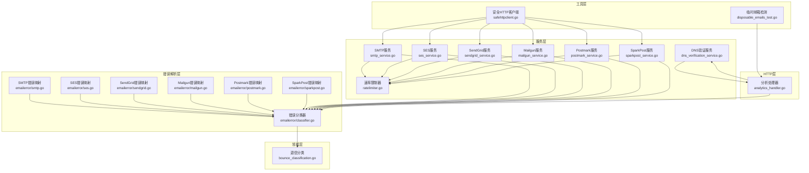
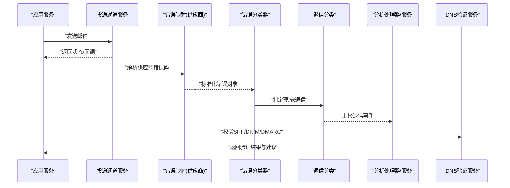
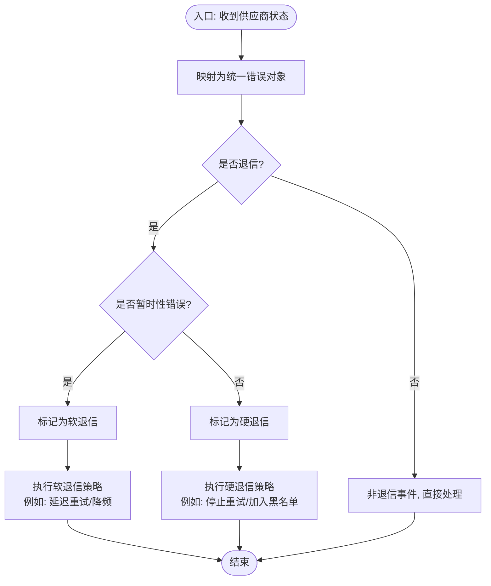
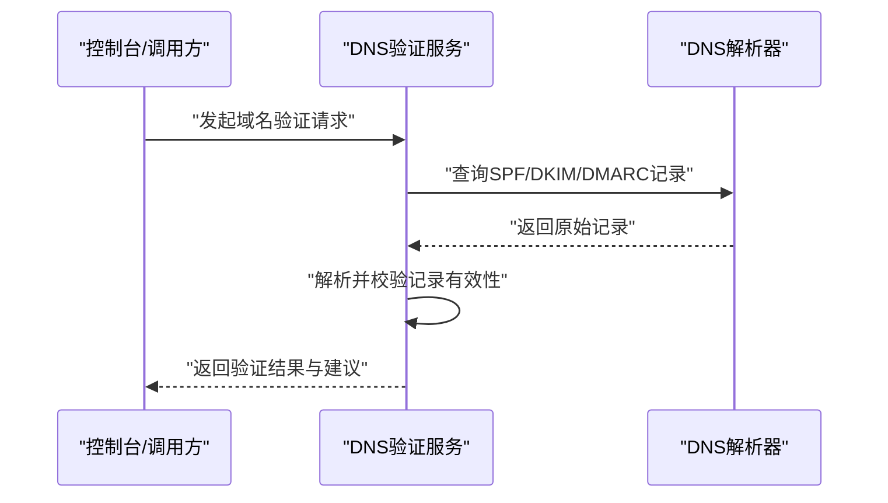
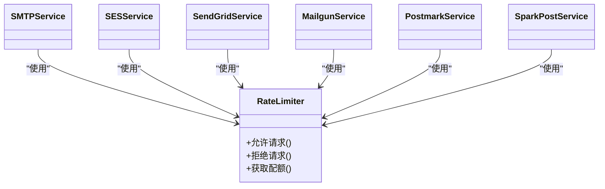
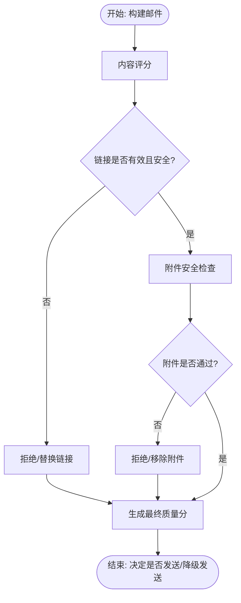
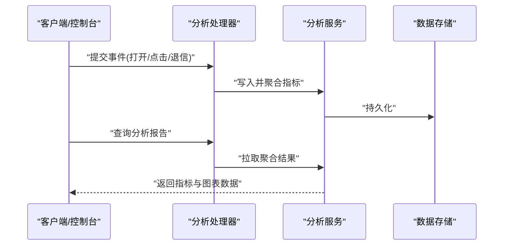
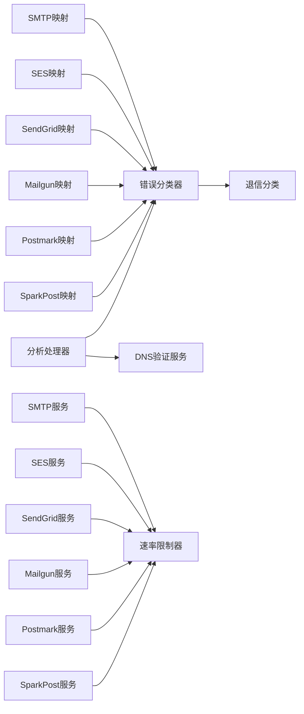

# 送达率优化

<cite>
**本文引用的文件**   
- [bounce_classification.go](file://notifuse/internal/domain/bounce_classification.go)
- [emailerror/classifier.go](file://notifuse/pkg/emailerror/classifier.go)
- [emailerror/error.go](file://notifuse/pkg/emailerror/error.go)
- [emailerror/smtp.go](file://notifuse/pkg/emailerror/smtp.go)
- [emailerror/ses.go](file://notifuse/pkg/emailerror/ses.go)
- [emailerror/sendgrid.go](file://notifuse/pkg/emailerror/sendgrid.go)
- [emailerror/mailgun.go](file://notifuse/pkg/emailerror/mailgun.go)
- [emailerror/postmark.go](file://notifuse/pkg/emailerror/postmark.go)
- [emailerror/sparkpost.go](file://notifuse/pkg/emailerror/sparkpost.go)
- [email_provider_smtp.go](file://notifuse/internal/domain/email_provider_smtp.go)
- [smtp_service.go](file://notifuse/internal/service/smtp_service.go)
- [ses_service.go](file://notifuse/internal/service/ses_service.go)
- [sendgrid_service.go](file://notifuse/internal/service/sendgrid_service.go)
- [mailgun_service.go](file://notifuse/internal/service/mailgun_service.go)
- [postmark_service.go](file://notifuse/internal/service/postmark_service.go)
- [sparkpost_service.go](file://notifuse/internal/service/sparkpost_service.go)
- [dns_verification_service.go](file://notifuse/internal/service/dns_verification_service.go)
- [analytics_handler.go](file://notifuse/internal/http/analytics_handler.go)
- [analytics_service.go](file://notifuse/internal/service/analytics_service.go)
- [ratelimiter.go](file://notifuse/pkg/ratelimiter/ratelimiter.go)
- [safehttpclient.go](file://notifuse/pkg/safehttpclient/safehttpclient.go)
- [disposable_emails_test.go](file://notifuse/pkg/disposable_emails/disposable_emails_test.go)
</cite>

## 目录
1. [简介](#简介)
2. [项目结构](#项目结构)
3. [核心组件](#核心组件)
4. [架构总览](#架构总览)
5. [详细组件分析](#详细组件分析)
6. [依赖关系分析](#依赖关系分析)
7. [性能考量](#性能考量)
8. [故障诊断指南](#故障诊断指南)
9. [结论](#结论)
10. [附录](#附录)

## 简介
本文件面向Notifuse平台的邮件送达率优化系统，聚焦以下目标：
- DNS记录配置（SPF、DKIM、DMARC）与验证流程
- IP预热与发送频率控制策略
- 退信分类与自动处理机制（硬退信/软退信）
- 邮件质量评分体系（内容过滤、链接校验、附件安全）
- 反垃圾邮件策略配置与优化
- 送达率监控指标与分析报告
- 问题诊断工具与解决方案
- 主流邮件提供商的特定优化建议与最佳实践

## 项目结构
围绕“送达率优化”的关键代码分布在以下模块：
- 领域层：退信分类模型与规则
- 错误解析层：多供应商退信码统一归一化
- 服务层：DNS验证、各投递通道服务、速率限制
- HTTP层：分析数据上报与查询接口
- 工具层：安全HTTP客户端、临时邮箱检测等

图表来源
- [bounce_classification.go](file://notifuse/internal/domain/bounce_classification.go)
- [emailerror/classifier.go](file://notifuse/pkg/emailerror/classifier.go)
- [emailerror/smtp.go](file://notifuse/pkg/emailerror/smtp.go)
- [emailerror/ses.go](file://notifuse/pkg/emailerror/ses.go)
- [emailerror/sendgrid.go](file://notifuse/pkg/emailerror/sendgrid.go)
- [emailerror/mailgun.go](file://notifuse/pkg/emailerror/mailgun.go)
- [emailerror/postmark.go](file://notifuse/pkg/emailerror/postmark.go)
- [emailerror/sparkpost.go](file://notifuse/pkg/emailerror/sparkpost.go)
- [dns_verification_service.go](file://notifuse/internal/service/dns_verification_service.go)
- [smtp_service.go](file://notifuse/internal/service/smtp_service.go)
- [ses_service.go](file://notifuse/internal/service/ses_service.go)
- [sendgrid_service.go](file://notifuse/internal/service/sendgrid_service.go)
- [mailgun_service.go](file://notifuse/internal/service/mailgun_service.go)
- [postmark_service.go](file://notifuse/internal/service/postmark_service.go)
- [sparkpost_service.go](file://notifuse/internal/service/sparkpost_service.go)
- [analytics_handler.go](file://notifuse/internal/http/analytics_handler.go)
- [ratelimiter.go](file://notifuse/pkg/ratelimiter/ratelimiter.go)
- [safehttpclient.go](file://notifuse/pkg/safehttpclient/safehttpclient.go)
- [disposable_emails_test.go](file://notifuse/pkg/disposable_emails/disposable_emails_test.go)

章节来源
- [bounce_classification.go](file://notifuse/internal/domain/bounce_classification.go)
- [emailerror/classifier.go](file://notifuse/pkg/emailerror/classifier.go)
- [emailerror/smtp.go](file://notifuse/pkg/emailerror/smtp.go)
- [emailerror/ses.go](file://notifuse/pkg/emailerror/ses.go)
- [emailerror/sendgrid.go](file://notifuse/pkg/emailerror/sendgrid.go)
- [emailerror/mailgun.go](file://notifuse/pkg/emailerror/mailgun.go)
- [emailerror/postmark.go](file://notifuse/pkg/emailerror/postmark.go)
- [emailerror/sparkpost.go](file://notifuse/pkg/emailerror/sparkpost.go)
- [dns_verification_service.go](file://notifuse/internal/service/dns_verification_service.go)
- [smtp_service.go](file://notifuse/internal/service/smtp_service.go)
- [ses_service.go](file://notifuse/internal/service/ses_service.go)
- [sendgrid_service.go](file://notifuse/internal/service/sendgrid_service.go)
- [mailgun_service.go](file://notifuse/internal/service/mailgun_service.go)
- [postmark_service.go](file://notifuse/internal/service/postmark_service.go)
- [sparkpost_service.go](file://notifuse/internal/service/sparkpost_service.go)
- [analytics_handler.go](file://notifuse/internal/http/analytics_handler.go)
- [ratelimiter.go](file://notifuse/pkg/ratelimiter/ratelimiter.go)
- [safehttpclient.go](file://notifuse/pkg/safehttpclient/safehttpclient.go)
- [disposable_emails_test.go](file://notifuse/pkg/disposable_emails/disposable_emails_test.go)

## 核心组件
- 退信分类与错误归一化
  - 通过统一的错误分类器将不同供应商的退信码映射为内部标准类型，并进一步归类为硬退信或软退信，驱动后续自动处理。
- DNS验证服务
  - 提供域名级SPF/DKIM/DMARC记录的读取与校验能力，辅助定位认证失败导致的低送达率问题。
- 投递通道服务
  - 针对SMTP、SES、SendGrid、Mailgun、Postmark、SparkPost等通道实现发送与状态回传处理，结合速率限制器进行流量整形。
- 分析处理器与服务
  - 接收并聚合事件（如打开、点击、退信），对外暴露分析接口，支撑送达率报表与告警。
- 安全与风控工具
  - 安全HTTP客户端用于出站请求的安全控制；临时邮箱检测用于降低无效地址带来的退信风险。

章节来源
- [emailerror/classifier.go](file://notifuse/pkg/emailerror/classifier.go)
- [bounce_classification.go](file://notifuse/internal/domain/bounce_classification.go)
- [dns_verification_service.go](file://notifuse/internal/service/dns_verification_service.go)
- [smtp_service.go](file://notifuse/internal/service/smtp_service.go)
- [ses_service.go](file://notifuse/internal/service/ses_service.go)
- [sendgrid_service.go](file://notifuse/internal/service/sendgrid_service.go)
- [mailgun_service.go](file://notifuse/internal/service/mailgun_service.go)
- [postmark_service.go](file://notifuse/internal/service/postmark_service.go)
- [sparkpost_service.go](file://notifuse/internal/service/sparkpost_service.go)
- [analytics_handler.go](file://notifuse/internal/http/analytics_handler.go)
- [analytics_service.go](file://notifuse/internal/service/analytics_service.go)
- [safehttpclient.go](file://notifuse/pkg/safehttpclient/safehttpclient.go)
- [disposable_emails_test.go](file://notifuse/pkg/disposable_emails/disposable_emails_test.go)

## 架构总览
下图展示了从“发送”到“退信分类”再到“分析上报”的整体链路，以及DNS验证在问题定位中的作用。

图表来源
- [smtp_service.go](file://notifuse/internal/service/smtp_service.go)
- [ses_service.go](file://notifuse/internal/service/ses_service.go)
- [sendgrid_service.go](file://notifuse/internal/service/sendgrid_service.go)
- [mailgun_service.go](file://notifuse/internal/service/mailgun_service.go)
- [postmark_service.go](file://notifuse/internal/service/postmark_service.go)
- [sparkpost_service.go](file://notifuse/internal/service/sparkpost_service.go)
- [emailerror/smtp.go](file://notifuse/pkg/emailerror/smtp.go)
- [emailerror/ses.go](file://notifuse/pkg/emailerror/ses.go)
- [emailerror/sendgrid.go](file://notifuse/pkg/emailerror/sendgrid.go)
- [emailerror/mailgun.go](file://notifuse/pkg/emailerror/mailgun.go)
- [emailerror/postmark.go](file://notifuse/pkg/emailerror/postmark.go)
- [emailerror/sparkpost.go](file://notifuse/pkg/emailerror/sparkpost.go)
- [emailerror/classifier.go](file://notifuse/pkg/emailerror/classifier.go)
- [bounce_classification.go](file://notifuse/internal/domain/bounce_classification.go)
- [analytics_handler.go](file://notifuse/internal/http/analytics_handler.go)
- [analytics_service.go](file://notifuse/internal/service/analytics_service.go)
- [dns_verification_service.go](file://notifuse/internal/service/dns_verification_service.go)

## 详细组件分析

### 退信分类与处理机制
- 设计要点
  - 供应商错误映射：将各供应商的错误码转换为统一错误对象，便于跨通道一致处理。
  - 错误分类器：基于错误对象特征判定是否为退信、是否为暂时性错误。
  - 退信分类：进一步区分硬退信（永久失败）与软退信（暂时失败），驱动去重、暂停重试、黑名单等动作。
- 关键流程
  - 收到供应商回调或状态后，先做错误映射，再交由分类器判断，最后输出退信类别并触发相应策略。

图表来源
- [emailerror/classifier.go](file://notifuse/pkg/emailerror/classifier.go)
- [emailerror/smtp.go](file://notifuse/pkg/emailerror/smtp.go)
- [emailerror/ses.go](file://notifuse/pkg/emailerror/ses.go)
- [emailerror/sendgrid.go](file://notifuse/pkg/emailerror/sendgrid.go)
- [emailerror/mailgun.go](file://notifuse/pkg/emailerror/mailgun.go)
- [emailerror/postmark.go](file://notifuse/pkg/emailerror/postmark.go)
- [emailerror/sparkpost.go](file://notifuse/pkg/emailerror/sparkpost.go)
- [bounce_classification.go](file://notifuse/internal/domain/bounce_classification.go)

章节来源
- [emailerror/classifier.go](file://notifuse/pkg/emailerror/classifier.go)
- [bounce_classification.go](file://notifuse/internal/domain/bounce_classification.go)

### DNS记录配置与验证（SPF、DKIM、DMARC）
- 功能概述
  - 提供对域名的SPF、DKIM、DMARC记录读取与校验能力，帮助快速定位因认证失败导致的低送达率问题。
- 使用场景
  - 新域名上线前的预检
  - 送达率异常时的根因排查
  - 定期健康检查与告警

图表来源
- [dns_verification_service.go](file://notifuse/internal/service/dns_verification_service.go)

章节来源
- [dns_verification_service.go](file://notifuse/internal/service/dns_verification_service.go)

### IP预热与发送频率控制
- 发送频率控制
  - 通过速率限制器对各通道实施限流，避免突发流量导致被收件方拒收或降权。
- IP预热策略（概念性说明）
  - 逐步提升发送量，优先向高信誉地址发送，配合退信反馈动态调整节奏。
  - 结合通道特性（如SES、SendGrid等）设置合理的并发与队列深度。

图表来源
- [ratelimiter.go](file://notifuse/pkg/ratelimiter/ratelimiter.go)
- [smtp_service.go](file://notifuse/internal/service/smtp_service.go)
- [ses_service.go](file://notifuse/internal/service/ses_service.go)
- [sendgrid_service.go](file://notifuse/internal/service/sendgrid_service.go)
- [mailgun_service.go](file://notifuse/internal/service/mailgun_service.go)
- [postmark_service.go](file://notifuse/internal/service/postmark_service.go)
- [sparkpost_service.go](file://notifuse/internal/service/sparkpost_service.go)

章节来源
- [ratelimiter.go](file://notifuse/pkg/ratelimiter/ratelimiter.go)
- [smtp_service.go](file://notifuse/internal/service/smtp_service.go)
- [ses_service.go](file://notifuse/internal/service/ses_service.go)
- [sendgrid_service.go](file://notifuse/internal/service/sendgrid_service.go)
- [mailgun_service.go](file://notifuse/internal/service/mailgun_service.go)
- [postmark_service.go](file://notifuse/internal/service/postmark_service.go)
- [sparkpost_service.go](file://notifuse/internal/service/sparkpost_service.go)

### 邮件质量评分系统（内容过滤、链接验证、附件安全检查）
- 内容过滤
  - 建议在模板渲染前后增加内容评分逻辑（关键词、HTML比例、图片/文本比等），以降低进入垃圾箱的概率。
- 链接验证
  - 使用安全HTTP客户端对URL进行可达性与安全性检查，阻断可疑或不可达链接。
- 附件安全检查
  - 对附件类型、大小、内容进行扫描与白名单校验，防止恶意附件影响信誉。

图表来源
- [safehttpclient.go](file://notifuse/pkg/safehttpclient/safehttpclient.go)

章节来源
- [safehttpclient.go](file://notifuse/pkg/safehttpclient/safehttpclient.go)

### 反垃圾邮件策略的配置与优化
- 基础策略
  - 严格遵循SPF/DKIM/DMARC配置，确保发件人身份可信。
  - 控制发送频率与并发，避免短时间内大量发送。
  - 清理无效地址（包括临时邮箱），减少硬退信。
- 行为优化
  - 根据退信反馈动态调整发送节奏与目标列表。
  - 对高退信率的域名或IP段进行隔离与降权。

章节来源
- [dns_verification_service.go](file://notifuse/internal/service/dns_verification_service.go)
- [disposable_emails_test.go](file://notifuse/pkg/disposable_emails/disposable_emails_test.go)
- [ratelimiter.go](file://notifuse/pkg/ratelimiter/ratelimiter.go)

### 送达率监控指标与分析报告
- 指标定义
  - 发送总量、成功投递量、退信量（硬/软）、打开率、点击率、投诉率等。
- 数据采集
  - 通过HTTP分析处理器接收事件，由分析服务聚合存储，并提供查询接口。
- 可视化与告警
  - 基于分析数据生成报表，支持阈值告警与趋势对比。

图表来源
- [analytics_handler.go](file://notifuse/internal/http/analytics_handler.go)
- [analytics_service.go](file://notifuse/internal/service/analytics_service.go)

章节来源
- [analytics_handler.go](file://notifuse/internal/http/analytics_handler.go)
- [analytics_service.go](file://notifuse/internal/service/analytics_service.go)

### 不同邮件提供商的特定优化建议与最佳实践
- Amazon SES
  - 关注SES错误映射中的状态码，合理设置退信重试与冷却时间。
- SendGrid
  - 利用其事件回调细化退信原因，结合分类器进行自动化处理。
- Mailgun
  - 结合其API返回码与事件流，完善退信分类与指标统计。
- Postmark
  - 使用其明确的错误分类，优化模板与认证配置。
- SparkPost
  - 依据其事件与错误码，调整发送策略与域名信誉管理。
- SMTP
  - 针对SMTP协议错误码进行映射与处理，注意连接池与重试策略。

章节来源
- [emailerror/ses.go](file://notifuse/pkg/emailerror/ses.go)
- [emailerror/sendgrid.go](file://notifuse/pkg/emailerror/sendgrid.go)
- [emailerror/mailgun.go](file://notifuse/pkg/emailerror/mailgun.go)
- [emailerror/postmark.go](file://notifuse/pkg/emailerror/postmark.go)
- [emailerror/sparkpost.go](file://notifuse/pkg/emailerror/sparkpost.go)
- [emailerror/smtp.go](file://notifuse/pkg/emailerror/smtp.go)
- [ses_service.go](file://notifuse/internal/service/ses_service.go)
- [sendgrid_service.go](file://notifuse/internal/service/sendgrid_service.go)
- [mailgun_service.go](file://notifuse/internal/service/mailgun_service.go)
- [postmark_service.go](file://notifuse/internal/service/postmark_service.go)
- [sparkpost_service.go](file://notifuse/internal/service/sparkpost_service.go)
- [smtp_service.go](file://notifuse/internal/service/smtp_service.go)

## 依赖关系分析
- 松耦合与高内聚
  - 错误映射与分类解耦，新增供应商只需扩展对应映射文件。
  - 通道服务统一依赖速率限制器，便于集中管控流量。
- 外部依赖
  - DNS解析、HTTP客户端、第三方API回调等。

图表来源
- [emailerror/classifier.go](file://notifuse/pkg/emailerror/classifier.go)
- [bounce_classification.go](file://notifuse/internal/domain/bounce_classification.go)
- [emailerror/smtp.go](file://notifuse/pkg/emailerror/smtp.go)
- [emailerror/ses.go](file://notifuse/pkg/emailerror/ses.go)
- [emailerror/sendgrid.go](file://notifuse/pkg/emailerror/sendgrid.go)
- [emailerror/mailgun.go](file://notifuse/pkg/emailerror/mailgun.go)
- [emailerror/postmark.go](file://notifuse/pkg/emailerror/postmark.go)
- [emailerror/sparkpost.go](file://notifuse/pkg/emailerror/sparkpost.go)
- [analytics_handler.go](file://notifuse/internal/http/analytics_handler.go)
- [dns_verification_service.go](file://notifuse/internal/service/dns_verification_service.go)
- [smtp_service.go](file://notifuse/internal/service/smtp_service.go)
- [ses_service.go](file://notifuse/internal/service/ses_service.go)
- [sendgrid_service.go](file://notifuse/internal/service/sendgrid_service.go)
- [mailgun_service.go](file://notifuse/internal/service/mailgun_service.go)
- [postmark_service.go](file://notifuse/internal/service/postmark_service.go)
- [sparkpost_service.go](file://notifuse/internal/service/sparkpost_service.go)
- [ratelimiter.go](file://notifuse/pkg/ratelimiter/ratelimiter.go)

章节来源
- [emailerror/classifier.go](file://notifuse/pkg/emailerror/classifier.go)
- [bounce_classification.go](file://notifuse/internal/domain/bounce_classification.go)
- [emailerror/smtp.go](file://notifuse/pkg/emailerror/smtp.go)
- [emailerror/ses.go](file://notifuse/pkg/emailerror/ses.go)
- [emailerror/sendgrid.go](file://notifuse/pkg/emailerror/sendgrid.go)
- [emailerror/mailgun.go](file://notifuse/pkg/emailerror/mailgun.go)
- [emailerror/postmark.go](file://notifuse/pkg/emailerror/postmark.go)
- [emailerror/sparkpost.go](file://notifuse/pkg/emailerror/sparkpost.go)
- [analytics_handler.go](file://notifuse/internal/http/analytics_handler.go)
- [dns_verification_service.go](file://notifuse/internal/service/dns_verification_service.go)
- [smtp_service.go](file://notifuse/internal/service/smtp_service.go)
- [ses_service.go](file://notifuse/internal/service/ses_service.go)
- [sendgrid_service.go](file://notifuse/internal/service/sendgrid_service.go)
- [mailgun_service.go](file://notifuse/internal/service/mailgun_service.go)
- [postmark_service.go](file://notifuse/internal/service/postmark_service.go)
- [sparkpost_service.go](file://notifuse/internal/service/sparkpost_service.go)
- [ratelimiter.go](file://notifuse/pkg/ratelimiter/ratelimiter.go)

## 性能考量
- 速率限制与背压
  - 通过速率限制器平滑发送峰值，避免触发收件方的反垃圾策略。
- 异步与批处理
  - 事件上报与分析聚合采用异步处理，降低主路径延迟。
- 缓存与重试
  - 对DNS解析与高频查询结果进行缓存；对软退信实施指数退避重试。

[本节为通用指导，不直接分析具体文件]

## 故障诊断指南
- 常见问题定位
  - 认证失败：检查SPF/DKIM/DMARC记录是否正确配置与生效。
  - 高退信率：查看退信分类分布，识别硬退信与软退信占比，定位问题域名或IP。
  - 链接/附件问题：使用安全HTTP客户端与附件检查工具进行前置验证。
- 诊断步骤
  - 使用DNS验证服务进行域名健康检查。
  - 通过错误映射与分类器定位具体错误原因。
  - 结合分析处理器与服务的指标数据，评估趋势与异常点。

章节来源
- [dns_verification_service.go](file://notifuse/internal/service/dns_verification_service.go)
- [emailerror/classifier.go](file://notifuse/pkg/emailerror/classifier.go)
- [emailerror/smtp.go](file://notifuse/pkg/emailerror/smtp.go)
- [emailerror/ses.go](file://notifuse/pkg/emailerror/ses.go)
- [emailerror/sendgrid.go](file://notifuse/pkg/emailerror/sendgrid.go)
- [emailerror/mailgun.go](file://notifuse/pkg/emailerror/mailgun.go)
- [emailerror/postmark.go](file://notifuse/pkg/emailerror/postmark.go)
- [emailerror/sparkpost.go](file://notifuse/pkg/emailerror/sparkpost.go)
- [analytics_handler.go](file://notifuse/internal/http/analytics_handler.go)
- [analytics_service.go](file://notifuse/internal/service/analytics_service.go)
- [safehttpclient.go](file://notifuse/pkg/safehttpclient/safehttpclient.go)

## 结论
Notifuse平台通过“错误映射+分类器+退信分类”的统一架构，实现了跨通道的退信自动处理；借助DNS验证与安全HTTP客户端，提升了认证正确性与内容安全性；结合速率限制与分析上报，形成闭环的送达率优化体系。建议持续完善质量评分与反垃圾策略，并结合各供应商的最佳实践进行精细化调优。

[本节为总结性内容，不直接分析具体文件]

## 附录
- 术语表
  - 硬退信：永久性失败，通常无需重试。
  - 软退信：暂时性失败，可延迟重试。
  - SPF/DKIM/DMARC：邮件认证相关DNS记录。
- 参考文件清单
  - 详见“本文引用的文件”部分。

[本节为补充信息，不直接分析具体文件]