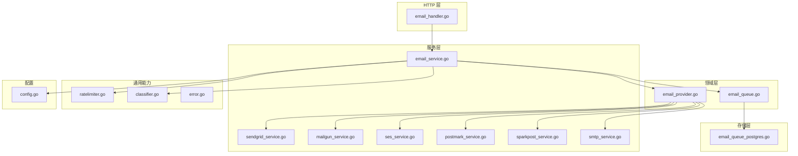
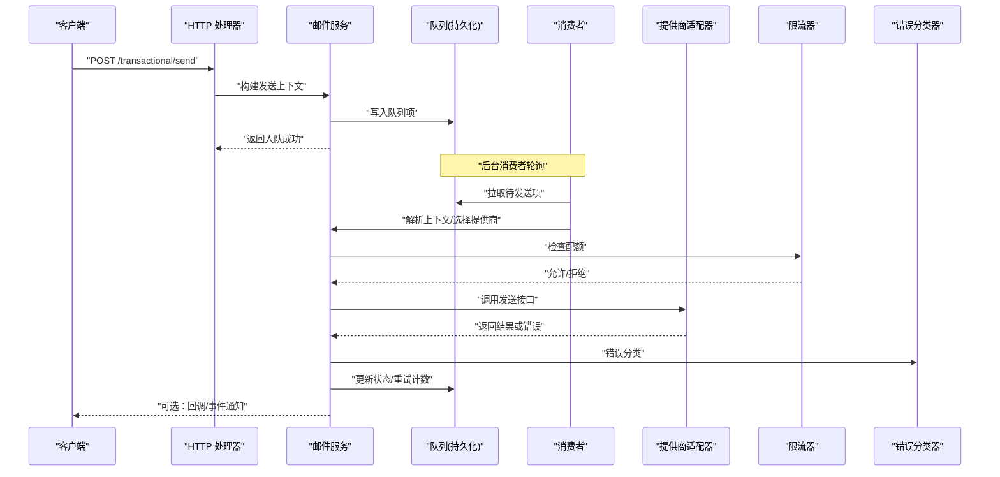
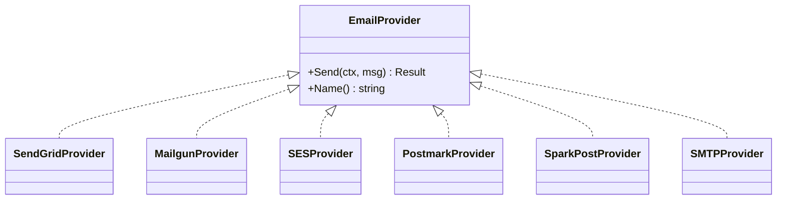
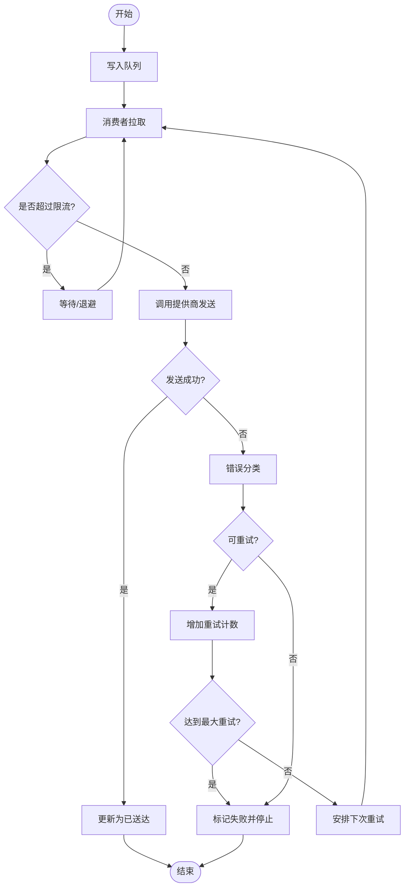
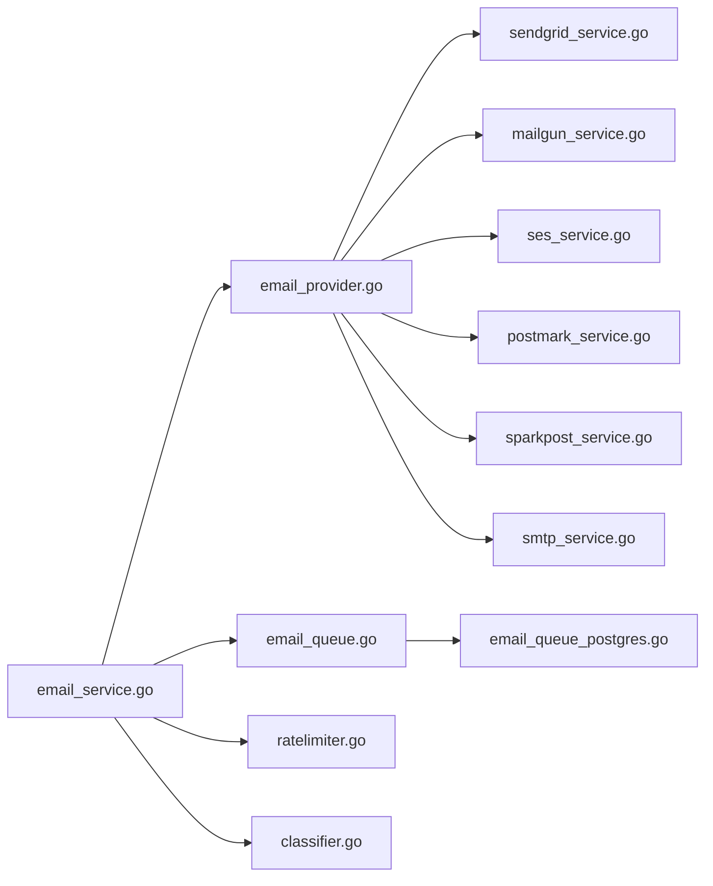

# 邮件发送引擎

<cite>
**本文引用的文件**   
- [internal/domain/email_provider.go](file://notifuse/internal/domain/email_provider.go)
- [internal/domain/email_provider_sendgrid.go](file://notifuse/internal/domain/email_provider_sendgrid.go)
- [internal/domain/email_provider_mailgun.go](file://notifuse/internal/domain/email_provider_mailgun.go)
- [internal/domain/email_provider_ses.go](file://notifuse/internal/domain/email_provider_ses.go)
- [internal/domain/email_provider_postmark.go](file://notifuse/internal/domain/email_provider_postmark.go)
- [internal/domain/email_provider_sparkpost.go](file://notifuse/internal/domain/email_provider_sparkpost.go)
- [internal/domain/email_provider_smtp.go](file://notifuse/internal/domain/email_provider_smtp.go)
- [internal/domain/email_queue.go](file://notifuse/internal/domain/email_queue.go)
- [internal/service/email_service.go](file://notifuse/internal/service/email_service.go)
- [internal/service/sendgrid_service.go](file://notifuse/internal/service/sendgrid_service.go)
- [internal/service/mailgun_service.go](file://notifuse/internal/service/mailgun_service.go)
- [internal/service/ses_service.go](file://notifuse/internal/service/ses_service.go)
- [internal/service/postmark_service.go](file://notifuse/internal/service/postmark_service.go)
- [internal/service/sparkpost_service.go](file://notifuse/internal/service/sparkpost_service.go)
- [internal/service/smtp_service.go](file://notifuse/internal/service/smtp_service.go)
- [internal/repository/email_queue_postgres.go](file://notifuse/internal/repository/email_queue_postgres.go)
- [pkg/ratelimiter/ratelimiter.go](file://notifuse/pkg/ratelimiter/ratelimiter.go)
- [pkg/emailerror/classifier.go](file://notifuse/pkg/emailerror/classifier.go)
- [pkg/emailerror/error.go](file://notifuse/pkg/emailerror/error.go)
- [pkg/emailerror/sendgrid.go](file://notifuse/pkg/emailerror/sendgrid.go)
- [pkg/emailerror/mailgun.go](file://notifuse/pkg/emailerror/mailgun.go)
- [pkg/emailerror/ses.go](file://notifuse/pkg/emailerror/ses.go)
- [pkg/emailerror/postmark.go](file://notifuse/pkg/emailerror/postmark.go)
- [pkg/emailerror/sparkpost.go](file://notifuse/pkg/emailerror/sparkpost.go)
- [pkg/emailerror/smtp.go](file://notifuse/pkg/emailerror/smtp.go)
- [internal/http/email_handler.go](file://notifuse/internal/http/email_handler.go)
- [config/config.go](file://notifuse/config/config.go)
</cite>

## 目录
1. [简介](#简介)
2. [项目结构](#项目结构)
3. [核心组件](#核心组件)
4. [架构总览](#架构总览)
5. [详细组件分析](#详细组件分析)
6. [依赖关系分析](#依赖关系分析)
7. [性能与并发控制](#性能与并发控制)
8. [故障排查指南](#故障排查指南)
9. [结论](#结论)
10. [附录：API 调用示例](#附录api-调用示例)

## 简介
本文件面向 Notifuse 平台的“邮件发送引擎”，系统性阐述其多提供商抽象层、SMTP 协议支持、异步队列与重试策略、限流与熔断、状态追踪与送达率监控，以及 SendGrid、Mailgun、AWS SES、Postmark、SparkPost 等主流邮件服务的集成方式与安全最佳实践。文档同时提供端到端流程图与代码级类图，帮助读者快速理解从 API 到投递的完整生命周期。

## 项目结构
邮件发送相关代码主要分布在以下模块：
- 领域模型与接口定义：internal/domain/*
- 服务编排与调度：internal/service/*
- HTTP 入口与路由处理：internal/http/*
- 持久化（队列）：internal/repository/*
- 通用能力（限流、错误分类、安全客户端等）：pkg/*
- 配置加载：config/*

图表来源
- [internal/http/email_handler.go](file://notifuse/internal/http/email_handler.go)
- [internal/service/email_service.go](file://notifuse/internal/service/email_service.go)
- [internal/domain/email_provider.go](file://notifuse/internal/domain/email_provider.go)
- [internal/domain/email_queue.go](file://notifuse/internal/domain/email_queue.go)
- [internal/repository/email_queue_postgres.go](file://notifuse/internal/repository/email_queue_postgres.go)
- [pkg/ratelimiter/ratelimiter.go](file://notifuse/pkg/ratelimiter/ratelimiter.go)
- [pkg/emailerror/classifier.go](file://notifuse/pkg/emailerror/classifier.go)
- [pkg/emailerror/error.go](file://notifuse/pkg/emailerror/error.go)
- [config/config.go](file://notifuse/config/config.go)

章节来源
- [internal/http/email_handler.go](file://notifuse/internal/http/email_handler.go)
- [internal/service/email_service.go](file://notifuse/internal/service/email_service.go)
- [internal/domain/email_provider.go](file://notifuse/internal/domain/email_provider.go)
- [internal/domain/email_queue.go](file://notifuse/internal/domain/email_queue.go)
- [internal/repository/email_queue_postgres.go](file://notifuse/internal/repository/email_queue_postgres.go)
- [pkg/ratelimiter/ratelimiter.go](file://notifuse/pkg/ratelimiter/ratelimiter.go)
- [pkg/emailerror/classifier.go](file://notifuse/pkg/emailerror/classifier.go)
- [pkg/emailerror/error.go](file://notifuse/pkg/emailerror/error.go)
- [config/config.go](file://notifuse/config/config.go)

## 核心组件
- 邮件提供商抽象层
  - 通过统一接口屏蔽不同后端差异，对外暴露一致的发送方法签名与错误语义。
  - 各提供商实现遵循相同的数据结构与返回约定，便于组合与替换。
- 异步队列与持久化
  - 入队时落库，后台消费者按优先级/时间窗口拉取并执行发送。
  - 失败记录与重试计数持久化，支撑可观测性与告警。
- 限流器
  - 基于令牌桶或滑动窗口对每个提供商进行速率限制，避免触发上游配额。
- 错误分类器
  - 将下游错误归一化为平台内部错误类型，区分硬失败与软失败，指导重试与退避。
- 配置中心
  - 集中管理各提供商密钥、域名、区域、TLS 模式等敏感信息。

章节来源
- [internal/domain/email_provider.go](file://notifuse/internal/domain/email_provider.go)
- [internal/domain/email_queue.go](file://notifuse/internal/domain/email_queue.go)
- [pkg/ratelimiter/ratelimiter.go](file://notifuse/pkg/ratelimiter/ratelimiter.go)
- [pkg/emailerror/classifier.go](file://notifuse/pkg/emailerror/classifier.go)
- [pkg/emailerror/error.go](file://notifuse/pkg/emailerror/error.go)
- [config/config.go](file://notifuse/config/config.go)

## 架构总览
下图展示一次典型邮件发送的生命周期：API 接收请求 -> 校验与模板渲染 -> 入队 -> 消费者拉取 -> 选择提供商 -> 限流 -> 发送 -> 结果回写与事件上报。

图表来源
- [internal/http/email_handler.go](file://notifuse/internal/http/email_handler.go)
- [internal/service/email_service.go](file://notifuse/internal/service/email_service.go)
- [internal/domain/email_queue.go](file://notifuse/internal/domain/email_queue.go)
- [internal/repository/email_queue_postgres.go](file://notifuse/internal/repository/email_queue_postgres.go)
- [internal/domain/email_provider.go](file://notifuse/internal/domain/email_provider.go)
- [pkg/ratelimiter/ratelimiter.go](file://notifuse/pkg/ratelimiter/ratelimiter.go)
- [pkg/emailerror/classifier.go](file://notifuse/pkg/emailerror/classifier.go)

## 详细组件分析

### 邮件提供商抽象层与实现
- 抽象接口
  - 统一发送方法、错误返回、必要元数据（如 provider ID）。
- 具体实现
  - SendGrid、Mailgun、AWS SES、Postmark、SparkPost、SMTP。
  - 各自封装认证、签名、重试、错误映射与特性开关（如标签、跟踪、DKIM）。
- 选择策略
  - 根据工作区/租户配置、域名白名单、成本与可用性动态选择提供商。

图表来源
- [internal/domain/email_provider.go](file://notifuse/internal/domain/email_provider.go)
- [internal/domain/email_provider_sendgrid.go](file://notifuse/internal/domain/email_provider_sendgrid.go)
- [internal/domain/email_provider_mailgun.go](file://notifuse/internal/domain/email_provider_mailgun.go)
- [internal/domain/email_provider_ses.go](file://notifuse/internal/domain/email_provider_ses.go)
- [internal/domain/email_provider_postmark.go](file://notifuse/internal/domain/email_provider_postmark.go)
- [internal/domain/email_provider_sparkpost.go](file://notifuse/internal/domain/email_provider_sparkpost.go)
- [internal/domain/email_provider_smtp.go](file://notifuse/internal/domain/email_provider_smtp.go)

章节来源
- [internal/domain/email_provider.go](file://notifuse/internal/domain/email_provider.go)
- [internal/domain/email_provider_sendgrid.go](file://notifuse/internal/domain/email_provider_sendgrid.go)
- [internal/domain/email_provider_mailgun.go](file://notifuse/internal/domain/email_provider_mailgun.go)
- [internal/domain/email_provider_ses.go](file://notifuse/internal/domain/email_provider_ses.go)
- [internal/domain/email_provider_postmark.go](file://notifuse/internal/domain/email_provider_postmark.go)
- [internal/domain/email_provider_sparkpost.go](file://notifuse/internal/domain/email_provider_sparkpost.go)
- [internal/domain/email_provider_smtp.go](file://notifuse/internal/domain/email_provider_smtp.go)

### 异步队列与重试策略
- 入队
  - 包含目标地址、主题、正文、附件、提供商选择、优先级、超时、重试次数上限等。
- 消费
  - 消费者按批次拉取，结合限流器控制并发与速率。
- 重试与退避
  - 依据错误分类决定立即重试、指数退避或放弃；记录每次尝试时间与错误码。
- 幂等与去重
  - 使用消息唯一键防止重复投递。

图表来源
- [internal/domain/email_queue.go](file://notifuse/internal/domain/email_queue.go)
- [internal/repository/email_queue_postgres.go](file://notifuse/internal/repository/email_queue_postgres.go)
- [pkg/emailerror/classifier.go](file://notifuse/pkg/emailerror/classifier.go)
- [pkg/ratelimiter/ratelimiter.go](file://notifuse/pkg/ratelimiter/ratelimiter.go)

章节来源
- [internal/domain/email_queue.go](file://notifuse/internal/domain/email_queue.go)
- [internal/repository/email_queue_postgres.go](file://notifuse/internal/repository/email_queue_postgres.go)
- [pkg/emailerror/classifier.go](file://notifuse/pkg/emailerror/classifier.go)
- [pkg/ratelimiter/ratelimiter.go](file://notifuse/pkg/ratelimiter/ratelimiter.go)

### 错误分类与失败处理
- 错误分类器
  - 将各提供商的错误码映射为平台统一的错误类别（如认证失败、收件人无效、配额超限、网络异常等）。
- 影响面
  - 决定重试策略、告警级别、是否切换备用提供商。
- 可观测性
  - 输出结构化日志与指标，便于定位问题与优化送达率。

章节来源
- [pkg/emailerror/classifier.go](file://notifuse/pkg/emailerror/classifier.go)
- [pkg/emailerror/error.go](file://notifuse/pkg/emailerror/error.go)
- [pkg/emailerror/sendgrid.go](file://notifuse/pkg/emailerror/sendgrid.go)
- [pkg/emailerror/mailgun.go](file://notifuse/pkg/emailerror/mailgun.go)
- [pkg/emailerror/ses.go](file://notifuse/pkg/emailerror/ses.go)
- [pkg/emailerror/postmark.go](file://notifuse/pkg/emailerror/postmark.go)
- [pkg/emailerror/sparkpost.go](file://notifuse/pkg/emailerror/sparkpost.go)
- [pkg/emailerror/smtp.go](file://notifuse/pkg/emailerror/smtp.go)

### 限流与熔断
- 限流
  - 针对每个提供商维度进行速率限制，避免触发上游配额与封禁。
- 熔断
  - 当连续失败比例超过阈值时，暂时短路该提供商，降低雪崩风险。
- 恢复
  - 周期性探测健康度，逐步放开流量。

章节来源
- [pkg/ratelimiter/ratelimiter.go](file://notifuse/pkg/ratelimiter/ratelimiter.go)
- [internal/service/email_service.go](file://notifuse/internal/service/email_service.go)

### 各提供商集成要点与配置
- SendGrid
  - 需要 API Key、默认发件人与域名验证；支持标签与跟踪。
- Mailgun
  - 需要 API Key、域名与签名私钥；支持事件回调与模板。
- AWS SES
  - 需要 AccessKey/SecretKey、Region、SES Identity；支持 DKIM 与事件。
- Postmark
  - 需要 Server Token、From 邮箱；支持模板与活动跟踪。
- SparkPost
  - 需要 API Key、域名与 DNS 验证；支持内容分析与事件。
- SMTP
  - 标准 SMTP 协议，支持 TLS/STARTTLS、认证机制；适合自建或企业网关。

章节来源
- [internal/service/sendgrid_service.go](file://notifuse/internal/service/sendgrid_service.go)
- [internal/service/mailgun_service.go](file://notifuse/internal/service/mailgun_service.go)
- [internal/service/ses_service.go](file://notifuse/internal/service/ses_service.go)
- [internal/service/postmark_service.go](file://notifuse/internal/service/postmark_service.go)
- [internal/service/sparkpost_service.go](file://notifuse/internal/service/sparkpost_service.go)
- [internal/service/smtp_service.go](file://notifuse/internal/service/smtp_service.go)
- [config/config.go](file://notifuse/config/config.go)

## 依赖关系分析
- 低耦合
  - 服务层仅依赖抽象接口，新增提供商无需改动上层逻辑。
- 内聚性
  - 错误分类、限流、队列等通用能力集中在 pkg 与 domain 层，复用度高。
- 外部依赖
  - 数据库用于队列持久化；各第三方 SDK 仅在对应 Provider 中引入。

图表来源
- [internal/service/email_service.go](file://notifuse/internal/service/email_service.go)
- [internal/domain/email_provider.go](file://notifuse/internal/domain/email_provider.go)
- [internal/domain/email_queue.go](file://notifuse/internal/domain/email_queue.go)
- [internal/repository/email_queue_postgres.go](file://notifuse/internal/repository/email_queue_postgres.go)
- [pkg/ratelimiter/ratelimiter.go](file://notifuse/pkg/ratelimiter/ratelimiter.go)
- [pkg/emailerror/classifier.go](file://notifuse/pkg/emailerror/classifier.go)
- [internal/service/sendgrid_service.go](file://notifuse/internal/service/sendgrid_service.go)
- [internal/service/mailgun_service.go](file://notifuse/internal/service/mailgun_service.go)
- [internal/service/ses_service.go](file://notifuse/internal/service/ses_service.go)
- [internal/service/postmark_service.go](file://notifuse/internal/service/postmark_service.go)
- [internal/service/sparkpost_service.go](file://notifuse/internal/service/sparkpost_service.go)
- [internal/service/smtp_service.go](file://notifuse/internal/service/smtp_service.go)

## 性能与并发控制
- 并发
  - 消费者侧按 CPU 核数与 I/O 能力设置并发度，避免过度竞争。
- 批处理
  - 批量拉取与批量提交，减少数据库往返与网络开销。
- 连接池
  - 合理配置 HTTP/SMTP 连接池大小与空闲回收策略。
- 缓存
  - 模板编译结果、DNS 解析、提供商元数据可短期缓存。
- 背压
  - 队列积压时自动降速，保护系统稳定性。

[本节为通用建议，不直接分析具体文件]

## 故障排查指南
- 常见问题
  - 认证失败：检查密钥、权限与域名验证。
  - 配额超限：调整限流参数或升级套餐。
  - 网络抖动：启用重试与退避，观察失败比例。
  - 收件人无效：前置校验与黑名单过滤。
- 诊断手段
  - 查看错误分类结果与重试轨迹。
  - 核对限流器统计与熔断状态。
  - 关联队列项与下游事件回调。

章节来源
- [pkg/emailerror/classifier.go](file://notifuse/pkg/emailerror/classifier.go)
- [pkg/emailerror/error.go](file://notifuse/pkg/emailerror/error.go)
- [internal/domain/email_queue.go](file://notifuse/internal/domain/email_queue.go)
- [pkg/ratelimiter/ratelimiter.go](file://notifuse/pkg/ratelimiter/ratelimiter.go)

## 结论
Notifuse 邮件发送引擎以“抽象层 + 服务编排 + 持久化队列 + 限流熔断 + 错误分类”为核心，实现了高可用、可扩展、可观测的跨提供商邮件投递体系。通过合理的并发与限流策略、完善的错误分类与重试机制，能够在复杂生产环境中保持稳定的送达率与良好的资源利用率。

[本节为总结性内容，不直接分析具体文件]

## 附录：API 调用示例
以下为常见调用路径与参数说明（以字段名描述为主，不包含具体代码片段）：
- 事务型发送
  - 路径：POST /transactional/send
  - 请求体关键字段：
    - from：发件人地址
    - to/cc/bcc：收件人列表
    - subject：主题
    - html/text：正文
    - attachments：附件数组（文件名、MIME、Base64 或 URL）
    - metadata：自定义键值对
    - provider_hint：可选，指定首选提供商
    - tags：标签（用于追踪与分析）
  - 响应：
    - id：队列项 ID
    - status：queued
- 查询发送状态
  - 路径：GET /transactional/{id}/status
  - 响应：
    - status：queued/sending/delivered/bounced/complained/failed
    - last_error：最近错误摘要
    - retry_count：重试次数
- 批量发送
  - 路径：POST /broadcasts
  - 请求体：包含受众筛选条件、模板 ID、变量映射等

章节来源
- [internal/http/email_handler.go](file://notifuse/internal/http/email_handler.go)
- [internal/service/email_service.go](file://notifuse/internal/service/email_service.go)
- [internal/domain/email_queue.go](file://notifuse/internal/domain/email_queue.go)