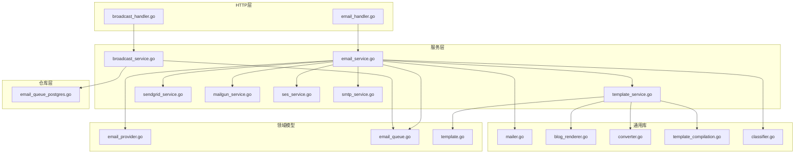
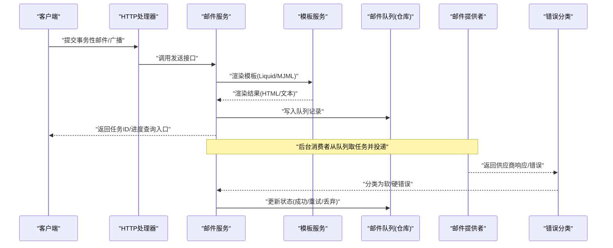
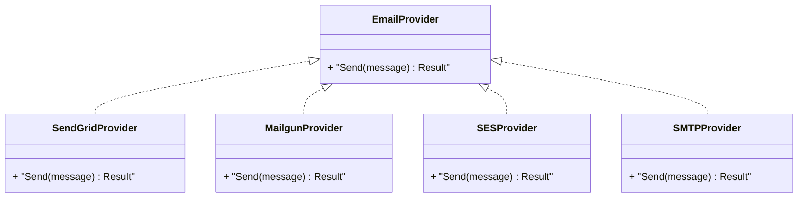
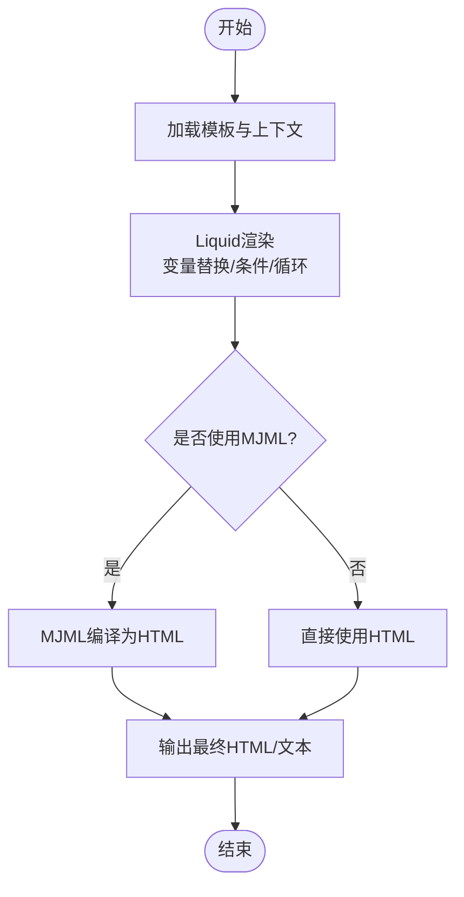
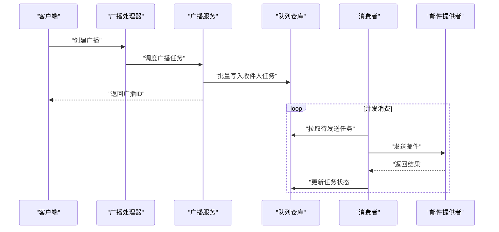
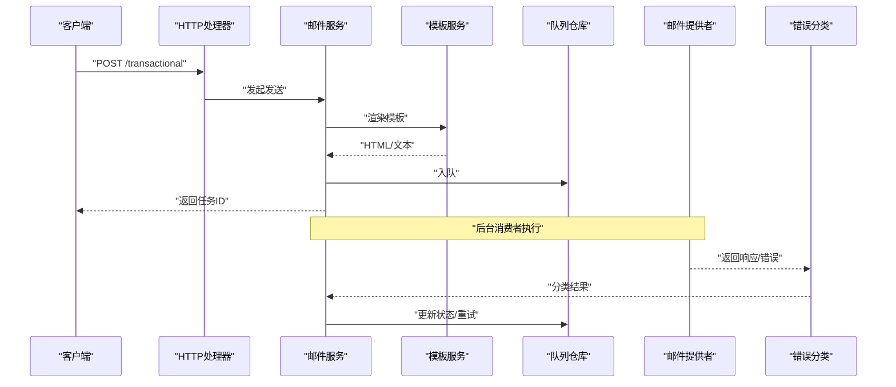
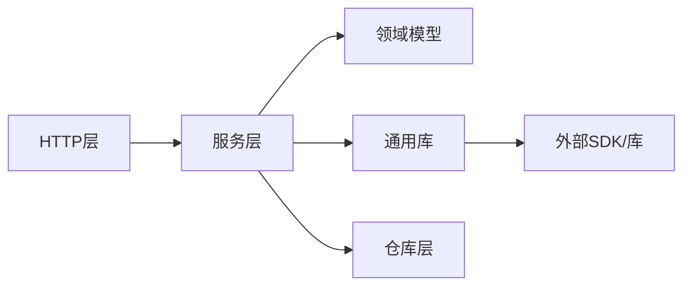

# 邮件营销系统

<cite>
**本文引用的文件**   
- [internal/domain/email_provider.go](file://notifuse/internal/domain/email_provider.go)
- [internal/domain/email_provider_sendgrid.go](file://notifuse/internal/domain/email_provider_sendgrid.go)
- [internal/domain/email_provider_mailgun.go](file://notifuse/internal/domain/email_provider_mailgun.go)
- [internal/domain/email_provider_ses.go](file://notifuse/internal/domain/email_provider_ses.go)
- [internal/domain/email_provider_smtp.go](file://notifuse/internal/domain/email_provider_smtp.go)
- [internal/domain/email_queue.go](file://notifuse/internal/domain/email_queue.go)
- [internal/service/email_service.go](file://notifuse/internal/service/email_service.go)
- [internal/service/broadcast_service.go](file://notifuse/internal/service/broadcast_service.go)
- [internal/repository/email_queue_postgres.go](file://notifuse/internal/repository/email_queue_postgres.go)
- [internal/http/email_handler.go](file://notifuse/internal/http/email_handler.go)
- [internal/domain/template.go](file://notifuse/internal/domain/template.go)
- [internal/service/template_service.go](file://notifuse/internal/service/template_service.go)
- [pkg/liquid/blog_renderer.go](file://notifuse/pkg/liquid/blog_renderer.go)
- [pkg/notifuse_mjml/converter.go](file://notifuse/pkg/notifuse_mjml/converter.go)
- [pkg/notifuse_mjml/template_compilation.go](file://notifuse/pkg/notifuse_mjml/template_compilation.go)
- [pkg/mailer/mailer.go](file://notifuse/pkg/mailer/mailer.go)
- [pkg/emailerror/classifier.go](file://notifuse/pkg/emailerror/classifier.go)
- [internal/service/sendgrid_service.go](file://notifuse/internal/service/sendgrid_service.go)
- [internal/service/mailgun_service.go](file://notifuse/internal/service/mailgun_service.go)
- [internal/service/ses_service.go](file://notifuse/internal/service/ses_service.go)
- [internal/service/smtp_service.go](file://notifuse/internal/service/smtp_service.go)
- [openapi/paths/transactional.yaml](file://notifuse/openapi/paths/transactional.yaml)
- [openapi/paths/broadcasts.yaml](file://notifuse/openapi/paths/broadcasts.yaml)
</cite>

## 目录
1. [简介](#简介)
2. [项目结构](#项目结构)
3. [核心组件](#核心组件)
4. [架构总览](#架构总览)
5. [详细组件分析](#详细组件分析)
6. [依赖关系分析](#依赖关系分析)
7. [性能与送达率优化](#性能与送达率优化)
8. [故障排查指南](#故障排查指南)
9. [结论](#结论)
10. [附录：API与配置参考](#附录api与配置参考)

## 简介
本文件面向Notifuse平台的邮件营销系统，聚焦于邮件发送引擎的架构设计与实现细节。内容涵盖多邮件提供商集成（SendGrid、Mailgun、AWS SES、SMTP等）、模板渲染系统（Liquid语法支持、MJML转换）、批量处理机制与广播发送流程、队列管理与并发控制、错误分类与重试策略、送达率优化策略、监控与排障方法，以及API调用示例与最佳实践。

## 项目结构
邮件营销相关代码主要分布在以下模块：
- 领域模型与接口定义：internal/domain/*
- 服务层编排：internal/service/*
- HTTP API处理器：internal/http/*
- 持久化仓库：internal/repository/*
- 通用能力库：pkg/*（邮件器、错误分类、Liquid渲染、MJML转换等）
- OpenAPI规范：openapi/paths/*

图表来源
- [internal/http/email_handler.go](file://notifuse/internal/http/email_handler.go)
- [internal/service/email_service.go](file://notifuse/internal/service/email_service.go)
- [internal/service/broadcast_service.go](file://notifuse/internal/service/broadcast_service.go)
- [internal/domain/email_provider.go](file://notifuse/internal/domain/email_provider.go)
- [internal/domain/email_queue.go](file://notifuse/internal/domain/email_queue.go)
- [internal/repository/email_queue_postgres.go](file://notifuse/internal/repository/email_queue_postgres.go)
- [internal/service/template_service.go](file://notifuse/internal/service/template_service.go)
- [internal/domain/template.go](file://notifuse/internal/domain/template.go)
- [pkg/mailer/mailer.go](file://notifuse/pkg/mailer/mailer.go)
- [pkg/liquid/blog_renderer.go](file://notifuse/pkg/liquid/blog_renderer.go)
- [pkg/notifuse_mjml/converter.go](file://notifuse/pkg/notifuse_mjml/converter.go)
- [pkg/notifuse_mjml/template_compilation.go](file://notifuse/pkg/notifuse_mjml/template_compilation.go)
- [pkg/emailerror/classifier.go](file://notifuse/pkg/emailerror/classifier.go)
- [internal/service/sendgrid_service.go](file://notifuse/internal/service/sendgrid_service.go)
- [internal/service/mailgun_service.go](file://notifuse/internal/service/mailgun_service.go)
- [internal/service/ses_service.go](file://notifuse/internal/service/ses_service.go)
- [internal/service/smtp_service.go](file://notifuse/internal/service/smtp_service.go)

章节来源
- [internal/http/email_handler.go](file://notifuse/internal/http/email_handler.go)
- [internal/service/email_service.go](file://notifuse/internal/service/email_service.go)
- [internal/service/broadcast_service.go](file://notifuse/internal/service/broadcast_service.go)
- [internal/domain/email_provider.go](file://notifuse/internal/domain/email_provider.go)
- [internal/domain/email_queue.go](file://notifuse/internal/domain/email_queue.go)
- [internal/repository/email_queue_postgres.go](file://notifuse/internal/repository/email_queue_postgres.go)
- [internal/service/template_service.go](file://notifuse/internal/service/template_service.go)
- [internal/domain/template.go](file://notifuse/internal/domain/template.go)
- [pkg/mailer/mailer.go](file://notifuse/pkg/mailer/mailer.go)
- [pkg/liquid/blog_renderer.go](file://notifuse/pkg/liquid/blog_renderer.go)
- [pkg/notifuse_mjml/converter.go](file://notifuse/pkg/notifuse_mjml/converter.go)
- [pkg/notifuse_mjml/template_compilation.go](file://notifuse/pkg/notifuse_mjml/template_compilation.go)
- [pkg/emailerror/classifier.go](file://notifuse/pkg/emailerror/classifier.go)
- [internal/service/sendgrid_service.go](file://notifuse/internal/service/sendgrid_service.go)
- [internal/service/mailgun_service.go](file://notifuse/internal/service/mailgun_service.go)
- [internal/service/ses_service.go](file://notifuse/internal/service/ses_service.go)
- [internal/service/smtp_service.go](file://notifuse/internal/service/smtp_service.go)

## 核心组件
- 邮件提供者抽象与实现
  - 统一接口定义，屏蔽不同供应商差异，提供一致的发送能力。
  - 已实现：SendGrid、Mailgun、AWS SES、SMTP等。
- 邮件队列与任务
  - 持久化队列记录，支撑高吞吐与失败重试。
- 模板与渲染
  - 模板模型与存储服务；Liquid语言变量替换、条件逻辑；MJML到HTML转换。
- 邮件服务编排
  - 事务性邮件与批量广播的统一入口，负责模板渲染、队列入队、投递执行与状态回写。
- 错误分类与重试
  - 对各类供应商返回码进行分类，区分软/硬错误，驱动重试或丢弃策略。

章节来源
- [internal/domain/email_provider.go](file://notifuse/internal/domain/email_provider.go)
- [internal/domain/email_provider_sendgrid.go](file://notifuse/internal/domain/email_provider_sendgrid.go)
- [internal/domain/email_provider_mailgun.go](file://notifuse/internal/domain/email_provider_mailgun.go)
- [internal/domain/email_provider_ses.go](file://notifuse/internal/domain/email_provider_ses.go)
- [internal/domain/email_provider_smtp.go](file://notifuse/internal/domain/email_provider_smtp.go)
- [internal/domain/email_queue.go](file://notifuse/internal/domain/email_queue.go)
- [internal/service/email_service.go](file://notifuse/internal/service/email_service.go)
- [internal/service/template_service.go](file://notifuse/internal/service/template_service.go)
- [internal/domain/template.go](file://notifuse/internal/domain/template.go)
- [pkg/liquid/blog_renderer.go](file://notifuse/pkg/liquid/blog_renderer.go)
- [pkg/notifuse_mjml/converter.go](file://notifuse/pkg/notifuse_mjml/converter.go)
- [pkg/notifuse_mjml/template_compilation.go](file://notifuse/pkg/notifuse_mjml/template_compilation.go)
- [pkg/emailerror/classifier.go](file://notifuse/pkg/emailerror/classifier.go)

## 架构总览
整体采用分层架构：HTTP层接收请求，服务层编排业务逻辑，领域层定义模型与接口，仓库层负责数据持久化，通用库提供跨域能力（邮件器、错误分类、模板渲染等）。

图表来源
- [internal/http/email_handler.go](file://notifuse/internal/http/email_handler.go)
- [internal/service/email_service.go](file://notifuse/internal/service/email_service.go)
- [internal/service/template_service.go](file://notifuse/internal/service/template_service.go)
- [internal/repository/email_queue_postgres.go](file://notifuse/internal/repository/email_queue_postgres.go)
- [internal/domain/email_provider.go](file://notifuse/internal/domain/email_provider.go)
- [pkg/emailerror/classifier.go](file://notifuse/pkg/emailerror/classifier.go)

## 详细组件分析

### 邮件提供者抽象与实现
- 设计要点
  - 通过统一接口封装各供应商差异，便于扩展新供应商。
  - 每个实现负责构建消息、鉴权、发送与错误映射。
- 关键类与方法
  - 抽象接口：定义发送方法与必要参数。
  - SendGrid实现：基于SendGrid SDK进行发送。
  - Mailgun实现：基于Mailgun API进行发送。
  - AWS SES实现：基于SES SDK进行发送。
  - SMTP实现：基于标准SMTP协议进行发送。

图表来源
- [internal/domain/email_provider.go](file://notifuse/internal/domain/email_provider.go)
- [internal/domain/email_provider_sendgrid.go](file://notifuse/internal/domain/email_provider_sendgrid.go)
- [internal/domain/email_provider_mailgun.go](file://notifuse/internal/domain/email_provider_mailgun.go)
- [internal/domain/email_provider_ses.go](file://notifuse/internal/domain/email_provider_ses.go)
- [internal/domain/email_provider_smtp.go](file://notifuse/internal/domain/email_provider_smtp.go)

章节来源
- [internal/domain/email_provider.go](file://notifuse/internal/domain/email_provider.go)
- [internal/domain/email_provider_sendgrid.go](file://notifuse/internal/domain/email_provider_sendgrid.go)
- [internal/domain/email_provider_mailgun.go](file://notifuse/internal/domain/email_provider_mailgun.go)
- [internal/domain/email_provider_ses.go](file://notifuse/internal/domain/email_provider_ses.go)
- [internal/domain/email_provider_smtp.go](file://notifuse/internal/domain/email_provider_smtp.go)

### 模板渲染系统（Liquid + MJML）
- 功能概述
  - 模板模型与存储：模板版本管理、块组合、发布态控制。
  - Liquid渲染：变量替换、条件逻辑、循环遍历、过滤器等。
  - MJML转换：将MJML模板编译为HTML，适配移动端与主流客户端。
- 渲染流程
  - 加载模板与上下文数据 -> 解析Liquid表达式 -> 生成中间HTML -> MJML编译（如需要）-> 输出最终HTML/文本。

图表来源
- [internal/domain/template.go](file://notifuse/internal/domain/template.go)
- [internal/service/template_service.go](file://notifuse/internal/service/template_service.go)
- [pkg/liquid/blog_renderer.go](file://notifuse/pkg/liquid/blog_renderer.go)
- [pkg/notifuse_mjml/converter.go](file://notifuse/pkg/notifuse_mjml/converter.go)
- [pkg/notifuse_mjml/template_compilation.go](file://notifuse/pkg/notifuse_mjml/template_compilation.go)

章节来源
- [internal/domain/template.go](file://notifuse/internal/domain/template.go)
- [internal/service/template_service.go](file://notifuse/internal/service/template_service.go)
- [pkg/liquid/blog_renderer.go](file://notifuse/pkg/liquid/blog_renderer.go)
- [pkg/notifuse_mjml/converter.go](file://notifuse/pkg/notifuse_mjml/converter.go)
- [pkg/notifuse_mjml/template_compilation.go](file://notifuse/pkg/notifuse_mjml/template_compilation.go)

### 批量处理与广播发送
- 广播工作流
  - 创建广播任务 -> 选择受众（列表/细分）-> 生成收件人集合 -> 批量入队 -> 消费者并发投递 -> 进度聚合与回调。
- 队列与并发
  - 使用数据库队列持久化任务，消费者按并发度拉取任务并行处理，避免内存溢出。
- 进度追踪
  - 维护广播任务与各子任务的发送状态，支持查询完成比例与失败明细。

图表来源
- [internal/service/broadcast_service.go](file://notifuse/internal/service/broadcast_service.go)
- [internal/repository/email_queue_postgres.go](file://notifuse/internal/repository/email_queue_postgres.go)
- [internal/domain/email_queue.go](file://notifuse/internal/domain/email_queue.go)
- [internal/domain/email_provider.go](file://notifuse/internal/domain/email_provider.go)

章节来源
- [internal/service/broadcast_service.go](file://notifuse/internal/service/broadcast_service.go)
- [internal/repository/email_queue_postgres.go](file://notifuse/internal/repository/email_queue_postgres.go)
- [internal/domain/email_queue.go](file://notifuse/internal/domain/email_queue.go)

### 事务性邮件发送流程
- 典型调用链
  - HTTP处理器接收请求 -> 邮件服务编排 -> 模板渲染 -> 写入队列 -> 消费者投递 -> 错误分类与重试 -> 状态回写。

图表来源
- [internal/http/email_handler.go](file://notifuse/internal/http/email_handler.go)
- [internal/service/email_service.go](file://notifuse/internal/service/email_service.go)
- [internal/service/template_service.go](file://notifuse/internal/service/template_service.go)
- [internal/repository/email_queue_postgres.go](file://notifuse/internal/repository/email_queue_postgres.go)
- [internal/domain/email_provider.go](file://notifuse/internal/domain/email_provider.go)
- [pkg/emailerror/classifier.go](file://notifuse/pkg/emailerror/classifier.go)

章节来源
- [internal/http/email_handler.go](file://notifuse/internal/http/email_handler.go)
- [internal/service/email_service.go](file://notifuse/internal/service/email_service.go)
- [internal/service/template_service.go](file://notifuse/internal/service/template_service.go)
- [internal/repository/email_queue_postgres.go](file://notifuse/internal/repository/email_queue_postgres.go)
- [internal/domain/email_provider.go](file://notifuse/internal/domain/email_provider.go)
- [pkg/emailerror/classifier.go](file://notifuse/pkg/emailerror/classifier.go)

## 依赖关系分析
- 组件耦合
  - HTTP层仅依赖服务层接口，服务层依赖领域模型与通用库，仓库层独立于上层逻辑。
- 外部依赖
  - 第三方SDK：SendGrid、Mailgun、AWS SES、SMTP库。
  - 渲染库：Liquid解析器、MJML编译器。
- 潜在循环依赖
  - 通过接口解耦与服务/仓库分层，避免直接循环引用。

图表来源
- [internal/http/email_handler.go](file://notifuse/internal/http/email_handler.go)
- [internal/service/email_service.go](file://notifuse/internal/service/email_service.go)
- [internal/domain/email_provider.go](file://notifuse/internal/domain/email_provider.go)
- [pkg/mailer/mailer.go](file://notifuse/pkg/mailer/mailer.go)
- [pkg/emailerror/classifier.go](file://notifuse/pkg/emailerror/classifier.go)

章节来源
- [internal/http/email_handler.go](file://notifuse/internal/http/email_handler.go)
- [internal/service/email_service.go](file://notifuse/internal/service/email_service.go)
- [internal/domain/email_provider.go](file://notifuse/internal/domain/email_provider.go)
- [pkg/mailer/mailer.go](file://notifuse/pkg/mailer/mailer.go)
- [pkg/emailerror/classifier.go](file://notifuse/pkg/emailerror/classifier.go)

## 性能与送达率优化
- 并发与限流
  - 根据供应商配额设置并发度与速率限制，避免触发限流或封禁。
- 批量入队与分片
  - 大广播拆分为多个批次，降低单次负载与失败影响面。
- 退避重试
  - 对软错误采用指数退避与抖动，减少瞬时拥塞导致的失败。
- 送达率优化
  - 预热域名与IP、合理设置SPF/DKIM/DMARC、避免黑名单关键词、A/B测试主题行与发件人信息。
- 监控指标
  - 发送成功率、延迟分布、错误分类占比、供应商配额使用率、队列积压量。

[本节为通用指导，不直接分析具体文件]

## 故障排查指南
- 常见问题定位
  - 模板渲染错误：检查Liquid语法与变量完整性，确认MJML编译是否成功。
  - 供应商认证失败：核对密钥、域名验证、权限范围。
  - 限流与封禁：观察供应商返回码，调整并发与退避策略。
  - 队列堆积：检查消费者健康状态、数据库连接池与锁竞争。
- 错误分类与日志
  - 利用错误分类器识别硬错误（立即丢弃）与软错误（可重试），结合日志与追踪ID快速定位问题。
- 建议步骤
  - 复现最小用例，隔离模板与收件人因素。
  - 查看队列任务状态与最近失败原因。
  - 对比不同供应商表现，必要时切换备用通道。

章节来源
- [pkg/emailerror/classifier.go](file://notifuse/pkg/emailerror/classifier.go)
- [internal/repository/email_queue_postgres.go](file://notifuse/internal/repository/email_queue_postgres.go)
- [internal/service/email_service.go](file://notifuse/internal/service/email_service.go)

## 结论
Notifuse邮件营销系统通过统一的提供者抽象、可靠的队列与重试机制、灵活的模板渲染与MJML转换，实现了高可用、可扩展的邮件发送能力。配合广播批量处理与送达率优化策略，可在大规模场景下保持稳定与高效。建议在生产环境完善监控告警与灰度发布流程，持续优化供应商路由与退避策略。

[本节为总结性内容，不直接分析具体文件]

## 附录：API与配置参考
- 事务性邮件API
  - 路径与请求体定义参见OpenAPI文档。
  - 典型字段：收件人、主题、正文（HTML/文本）、模板ID、变量上下文、附件等。
- 广播API
  - 创建广播、选择受众、预览与发送、查询进度与结果。
- 配置项建议
  - 供应商凭据：API Key/Secret、区域/端点、默认发件人与域名。
  - 并发与限流：每供应商最大并发、每秒上限、退避策略。
  - 队列与重试：最大重试次数、退避间隔、死信队列。
  - 模板与渲染：启用MJML、缓存编译结果、安全沙箱（禁用危险函数）。

章节来源
- [openapi/paths/transactional.yaml](file://notifuse/openapi/paths/transactional.yaml)
- [openapi/paths/broadcasts.yaml](file://notifuse/openapi/paths/broadcasts.yaml)