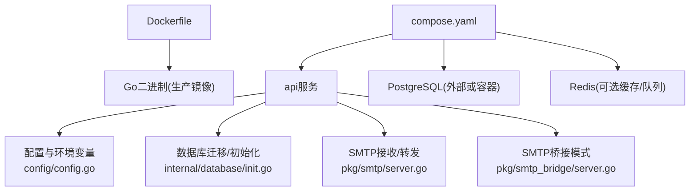
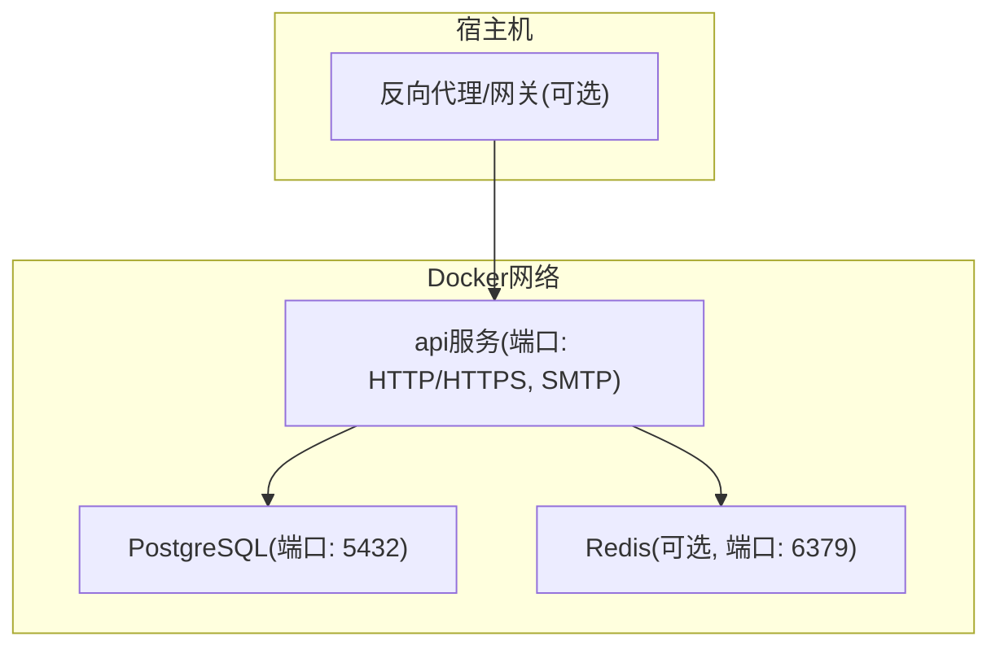
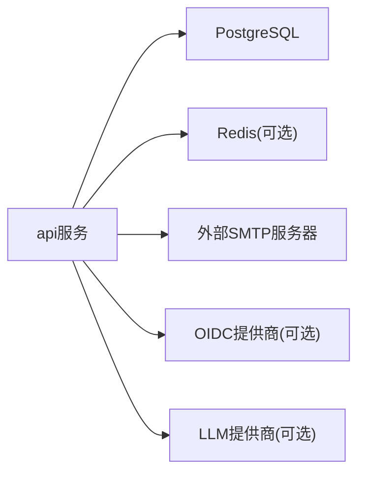

# Docker容器化部署

<cite>
**本文引用的文件**   
- [Dockerfile](file://notifuse/Dockerfile)
- [compose.yaml](file://notifuse/compose.yaml)
- [env.example](file://notifuse/env.example)
- [Makefile](file://notifuse/Makefile)
- [cmd/api/main.go](file://notifuse/cmd/api/main.go)
- [config/config.go](file://notifuse/config/config.go)
- [internal/database/init.go](file://notifuse/internal/database/init.go)
- [pkg/smtp/server.go](file://notifuse/pkg/smtp/server.go)
- [pkg/smtp_bridge/server.go](file://notifuse/pkg/smtp_bridge/server.go)
- [scripts/generate-dev-certs.sh](file://notifuse/scripts/generate-dev-certs.sh)
</cite>

## 目录
1. [简介](#简介)
2. [项目结构](#项目结构)
3. [核心组件](#核心组件)
4. [架构总览](#架构总览)
5. [详细组件分析](#详细组件分析)
6. [依赖关系分析](#依赖关系分析)
7. [性能考虑](#性能考虑)
8. [故障排查指南](#故障排查指南)
9. [结论](#结论)
10. [附录](#附录)

## 简介
本文件面向Notifuse平台的Docker容器化部署，覆盖镜像构建、多阶段优化、分层策略与安全加固；详细说明Docker Compose编排、网络与数据卷配置、环境变量注入；提供单机、开发与测试环境的完整示例；包含健康检查、日志收集、资源限制、服务间通信与服务发现、依赖管理；并给出故障排查与性能调优建议。

## 项目结构
Notifuse后端为Go应用，前端控制台与通知中心为独立Web工程。容器化相关的关键文件位于notifuse目录：
- 镜像构建：Dockerfile
- 服务编排：compose.yaml
- 环境示例：env.example
- 构建脚本：Makefile（含开发证书生成等）
- 启动入口：cmd/api/main.go
- 配置加载：config/config.go
- 数据库初始化：internal/database/init.go
- SMTP/SMTP桥接服务：pkg/smtp/server.go、pkg/smtp_bridge/server.go
- 开发证书生成：scripts/generate-dev-certs.sh

图表来源
- [Dockerfile](file://notifuse/Dockerfile)
- [compose.yaml](file://notifuse/compose.yaml)
- [cmd/api/main.go](file://notifuse/cmd/api/main.go)
- [config/config.go](file://notifuse/config/config.go)
- [internal/database/init.go](file://notifuse/internal/database/init.go)
- [pkg/smtp/server.go](file://notifuse/pkg/smtp/server.go)
- [pkg/smtp_bridge/server.go](file://notifuse/pkg/smtp_bridge/server.go)

章节来源
- [Dockerfile](file://notifuse/Dockerfile)
- [compose.yaml](file://notifuse/compose.yaml)
- [env.example](file://notifuse/env.example)
- [Makefile](file://notifuse/Makefile)

## 核心组件
- API服务：Go主程序，负责HTTP API、模板渲染、任务调度、邮件发送、Webhook处理等。
- 数据库：PostgreSQL，用于持久化业务数据。
- 缓存/队列（可选）：Redis，用于会话、缓存、任务队列等。
- SMTP/SMTP桥接：内置SMTP服务器与桥接模式，支持入站邮件解析与转发。
- 前端控制台与通知中心：静态资源由API服务托管或通过反向代理暴露。

章节来源
- [cmd/api/main.go](file://notifuse/cmd/api/main.go)
- [config/config.go](file://notifuse/config/config.go)
- [internal/database/init.go](file://notifuse/internal/database/init.go)
- [pkg/smtp/server.go](file://notifuse/pkg/smtp/server.go)
- [pkg/smtp_bridge/server.go](file://notifuse/pkg/smtp_bridge/server.go)

## 架构总览
下图展示容器化后的整体架构与关键交互：

图表来源
- [compose.yaml](file://notifuse/compose.yaml)
- [cmd/api/main.go](file://notifuse/cmd/api/main.go)

## 详细组件分析

### 镜像构建与多阶段优化
- 构建阶段
  - 使用多阶段构建分离依赖安装、编译与运行镜像，减小最终镜像体积。
  - 第一阶段：安装系统依赖、下载Go模块、编译Go二进制。
  - 第二阶段：仅拷贝运行时所需文件与二进制，最小化攻击面。
- 分层策略
  - 将go.mod/go.sum作为独立层，利用缓存加速重复构建。
  - 源码与二进制分阶段拷贝，避免在最终镜像中保留源码与构建工具链。
- 安全加固
  - 使用非root用户运行进程。
  - 仅暴露必要端口（HTTP/HTTPS/SMTP）。
  - 禁用不必要的包管理器与shell，减少漏洞面。
  - 定期更新基础镜像版本。

章节来源
- [Dockerfile](file://notifuse/Dockerfile)

### Docker Compose编排
- 服务定义
  - api：Notifuse API服务，挂载配置文件、证书、数据卷，设置健康检查、资源限制与重启策略。
  - postgres：PostgreSQL数据库，通过数据卷持久化数据。
  - redis：可选缓存/队列服务，通过数据卷持久化状态。
- 网络配置
  - 默认bridge网络，服务间通过服务名进行DNS解析。
  - 可自定义网络以隔离不同环境。
- 数据卷管理
  - 使用命名卷或绑定挂载，确保数据持久化与备份。
- 环境变量注入
  - 通过.env文件或compose中的environment字段注入配置。
  - 敏感信息建议使用secrets或外部密钥管理服务。

章节来源
- [compose.yaml](file://notifuse/compose.yaml)
- [env.example](file://notifuse/env.example)

### 环境变量与配置
- 关键配置项
  - 数据库连接：主机、端口、用户名、密码、库名。
  - Redis连接：主机、端口、认证。
  - SMTP/SMTP桥接：监听端口、TLS模式、上游SMTP服务器。
  - 应用端口：HTTP/HTTPS监听端口。
  - 日志级别、时区、域名与协议。
- 配置加载流程
  - 应用启动时读取环境变量与配置文件，合并后初始化各子系统。

章节来源
- [config/config.go](file://notifuse/config/config.go)
- [env.example](file://notifuse/env.example)

### 数据库初始化与迁移
- 启动流程
  - 等待数据库可用后进行连接测试。
  - 执行迁移脚本，确保schema一致。
- 错误处理
  - 重试机制与超时控制，失败时退出以便编排器重启。

章节来源
- [internal/database/init.go](file://notifuse/internal/database/init.go)

### SMTP与SMTP桥接服务
- SMTP服务
  - 监听SMTP端口，接收入站邮件，解析信封与内容，路由至业务逻辑。
- SMTP桥接模式
  - 作为中间代理，将入站邮件转发到上游SMTP服务器，支持TLS与认证。
- TLS与证书
  - 支持自签与第三方证书，开发环境可通过脚本生成临时证书。

章节来源
- [pkg/smtp/server.go](file://notifuse/pkg/smtp/server.go)
- [pkg/smtp_bridge/server.go](file://notifuse/pkg/smtp_bridge/server.go)
- [scripts/generate-dev-certs.sh](file://notifuse/scripts/generate-dev-certs.sh)

### 健康检查与就绪探针
- 健康检查
  - 基于HTTP端点返回200表示服务正常。
  - 结合数据库连通性与依赖可用性判断。
- 就绪探针
  - 在迁移完成且依赖就绪后再加入负载均衡。

章节来源
- [compose.yaml](file://notifuse/compose.yaml)
- [cmd/api/main.go](file://notifuse/cmd/api/main.go)

### 日志收集与结构化输出
- 输出格式
  - 采用JSON结构化日志，便于集中采集与分析。
- 采集方案
  - 使用Docker日志驱动或侧车容器（如Fluent Bit）转发至ELK/Loki。
- 日志轮转
  - 在宿主机或日志系统中配置轮转策略，避免磁盘占满。

章节来源
- [compose.yaml](file://notifuse/compose.yaml)

### 资源限制与弹性伸缩
- 资源限制
  - 为每个服务设置CPU与内存上限，防止单点占用过多资源。
- 副本数
  - 根据负载水平调整api服务副本数，配合负载均衡。
- 优雅停机
  - 实现SIGTERM处理，完成正在处理的请求后退出。

章节来源
- [compose.yaml](file://notifuse/compose.yaml)

## 依赖关系分析
- 直接依赖
  - API服务依赖PostgreSQL与可选Redis。
  - SMTP/SMTP桥接依赖外部SMTP服务器。
- 间接依赖
  - 模板渲染、邮件发送、Webhook投递等子模块。
- 外部集成
  - OIDC、LLM提供商、邮件服务商等通过环境变量配置。

图表来源
- [compose.yaml](file://notifuse/compose.yaml)
- [config/config.go](file://notifuse/config/config.go)

章节来源
- [compose.yaml](file://notifuse/compose.yaml)
- [config/config.go](file://notifuse/config/config.go)

## 性能考虑
- 镜像优化
  - 多阶段构建、精简基础镜像、启用构建缓存。
- 运行时优化
  - 合理设置GOMAXPROCS、连接池大小、并发度。
  - 启用HTTP/2与压缩，减少带宽消耗。
- 缓存与队列
  - 使用Redis缓存热点数据，队列异步处理耗时任务。
- 数据库优化
  - 索引设计、查询优化、连接池参数调优。
- 监控与告警
  - 指标导出、链路追踪、异常告警。

[本节为通用指导，不直接分析具体文件]

## 故障排查指南
- 常见问题
  - 数据库连接失败：检查主机、端口、用户名、密码与网络连通性。
  - Redis不可用：确认服务是否启动、认证是否正确。
  - SMTP无法收发：校验上游SMTP地址、端口、认证与TLS设置。
  - 证书问题：确认证书路径、权限与域名匹配。
- 诊断步骤
  - 查看容器日志与结构化日志。
  - 进入容器执行网络连通性测试。
  - 验证健康检查端点与就绪探针。
- 恢复策略
  - 重启服务、回滚配置、重建数据卷备份。

章节来源
- [compose.yaml](file://notifuse/compose.yaml)
- [config/config.go](file://notifuse/config/config.go)
- [pkg/smtp/server.go](file://notifuse/pkg/smtp/server.go)
- [pkg/smtp_bridge/server.go](file://notifuse/pkg/smtp_bridge/server.go)

## 结论
通过多阶段构建与最小化运行镜像，Notifuse实现了高效、安全的容器化部署。借助Compose编排，可在单机、开发与测试环境中快速拉起完整栈。结合健康检查、日志收集与资源限制，平台具备高可用与可观测性。建议在生产环境引入外部密钥管理、集中日志与监控系统，并根据负载进行弹性伸缩与性能调优。

[本节为总结性内容，不直接分析具体文件]

## 附录

### 单机部署示例
- 前置条件
  - 安装Docker与Docker Compose。
- 步骤
  - 复制env.example为.env并填写必要配置。
  - 执行构建与启动命令。
  - 访问HTTP/HTTPS端口与SMTP端口。

章节来源
- [compose.yaml](file://notifuse/compose.yaml)
- [env.example](file://notifuse/env.example)

### 开发环境示例
- 特点
  - 启用热重载、调试端口、开发证书。
- 步骤
  - 使用Makefile生成开发证书。
  - 启动开发服务与依赖。
  - 本地浏览器访问控制台与API文档。

章节来源
- [Makefile](file://notifuse/Makefile)
- [scripts/generate-dev-certs.sh](file://notifuse/scripts/generate-dev-certs.sh)
- [compose.yaml](file://notifuse/compose.yaml)

### 测试环境示例
- 特点
  - 隔离网络与数据卷，预置测试数据。
- 步骤
  - 使用独立compose文件与环境变量。
  - 运行自动化测试套件。
  - 收集测试结果与覆盖率报告。

章节来源
- [compose.yaml](file://notifuse/compose.yaml)
- [env.example](file://notifuse/env.example)

### 容器间通信与服务发现
- 通信方式
  - 通过Docker网络的服务名进行DNS解析。
- 服务发现
  - 无需额外服务发现组件，Compose自动注册服务。
- 依赖管理
  - 使用depends_on与健康检查确保启动顺序。

章节来源
- [compose.yaml](file://notifuse/compose.yaml)

### 安全加固清单
- 使用非root用户运行。
- 最小化镜像与暴露端口。
- 使用只读根文件系统（可选）。
- 定期扫描镜像漏洞。
- 使用secrets管理敏感信息。

章节来源
- [Dockerfile](file://notifuse/Dockerfile)
- [compose.yaml](file://notifuse/compose.yaml)