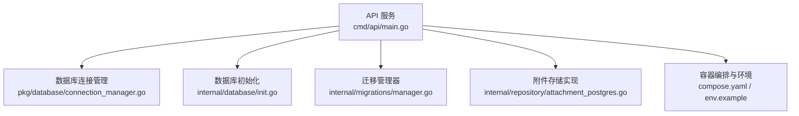
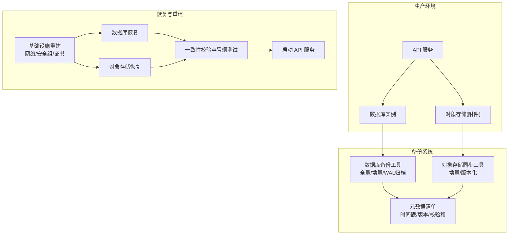
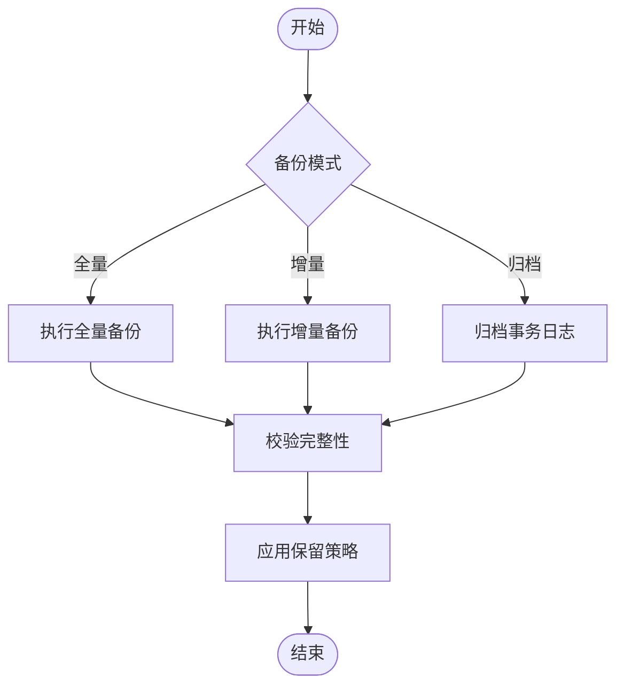
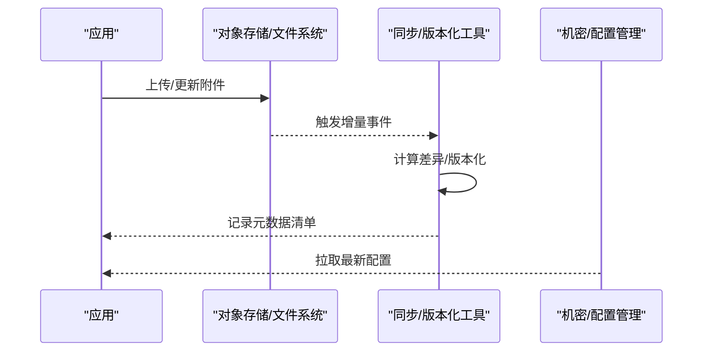
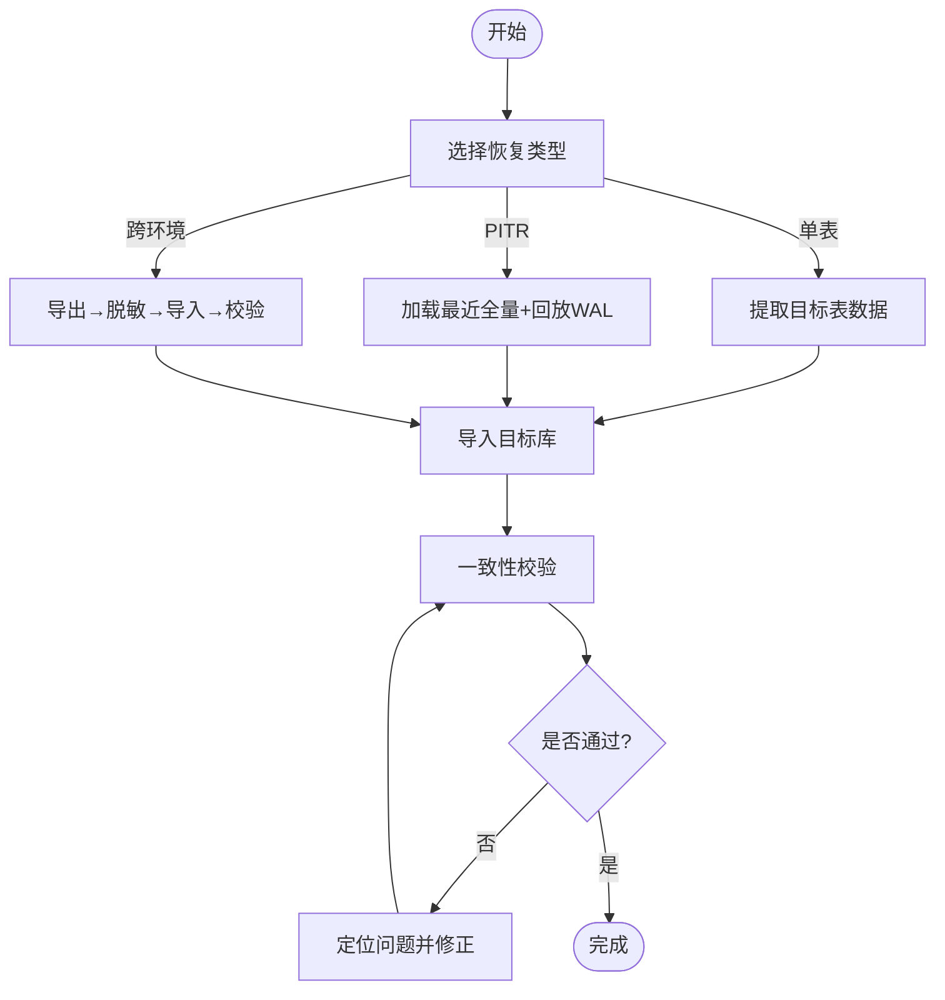
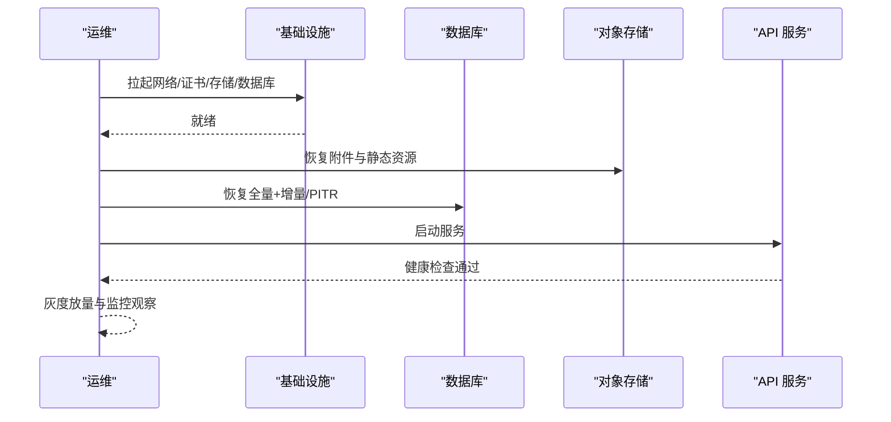
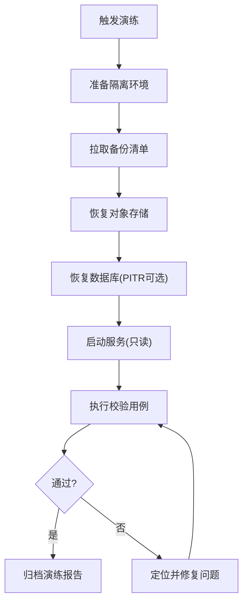
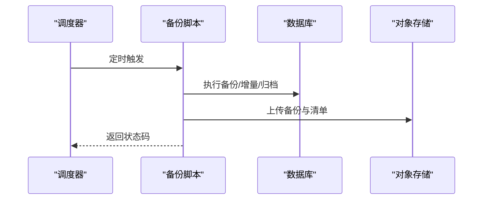
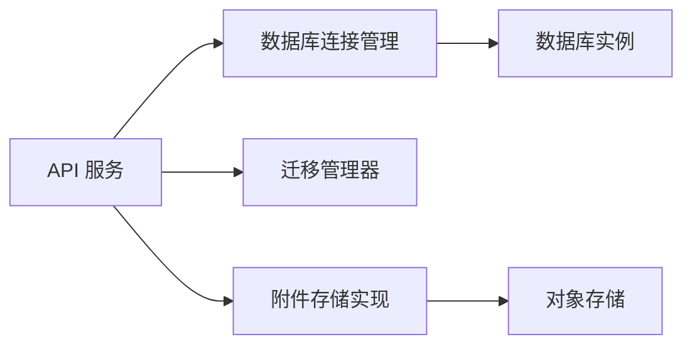

# 备份恢复与灾难重建

<cite>
**本文引用的文件**   
- [compose.yaml](file://notifuse/compose.yaml)
- [env.example](file://notifuse/env.example)
- [Makefile](file://notifuse/Makefile)
- [internal/database/init.go](file://notifuse/internal/database/init.go)
- [internal/migrations/manager.go](file://notifuse/internal/migrations/manager.go)
- [internal/repository/attachment_postgres.go](file://notifuse/internal/repository/attachment_postgres.go)
- [pkg/database/connection_manager.go](file://notifuse/pkg/database/connection_manager.go)
- [cmd/api/main.go](file://notifuse/cmd/api/main.go)
</cite>

## 目录
1. [简介](#简介)
2. [项目结构](#项目结构)
3. [核心组件](#核心组件)
4. [架构总览](#架构总览)
5. [详细组件分析](#详细组件分析)
6. [依赖分析](#依赖分析)
7. [性能考虑](#性能考虑)
8. [故障排查指南](#故障排查指南)
9. [结论](#结论)
10. [附录](#附录)

## 简介
本文件为 Notifuse 平台提供完整的“备份、恢复与灾难重建”方案，覆盖数据库与对象存储（附件）的备份策略、数据恢复流程、跨环境迁移、灾难重建步骤、RTO/RPO 目标设定、自动化脚本、监控告警与运维手册。文档同时给出基于仓库现有配置与代码结构的落地建议，确保可操作、可验证、可审计。

## 项目结构
Notifuse 采用 Go 后端 + 前端控制台的双端结构，运行时通过容器编排启动，依赖外部数据库与对象存储。关键路径包括：
- 应用入口与生命周期管理：cmd/api/main.go
- 数据库连接与初始化：pkg/database/connection_manager.go、internal/database/init.go
- 迁移管理器：internal/migrations/manager.go
- 附件持久化实现：internal/repository/attachment_postgres.go
- 容器编排与环境变量示例：compose.yaml、env.example
- 构建与测试命令：Makefile

**图示来源** 
- [cmd/api/main.go](file://notifuse/cmd/api/main.go)
- [pkg/database/connection_manager.go](file://notifuse/pkg/database/connection_manager.go)
- [internal/database/init.go](file://notifuse/internal/database/init.go)
- [internal/migrations/manager.go](file://notifuse/internal/migrations/manager.go)
- [internal/repository/attachment_postgres.go](file://notifuse/internal/repository/attachment_postgres.go)
- [compose.yaml](file://notifuse/compose.yaml)
- [env.example](file://notifuse/env.example)

**章节来源**
- [compose.yaml](file://notifuse/compose.yaml)
- [env.example](file://notifuse/env.example)
- [Makefile](file://notifuse/Makefile)
- [internal/database/init.go](file://notifuse/internal/database/init.go)
- [internal/migrations/manager.go](file://notifuse/internal/migrations/manager.go)
- [internal/repository/attachment_postgres.go](file://notifuse/internal/repository/attachment_postgres.go)
- [pkg/database/connection_manager.go](file://notifuse/pkg/database/connection_manager.go)
- [cmd/api/main.go](file://notifuse/cmd/api/main.go)

## 核心组件
- 数据库层
  - 连接管理：负责连接池、重试、健康检查等，是备份窗口期控制的关键点。
  - 初始化与迁移：在启动时执行迁移，保证 schema 版本一致。
- 对象存储层
  - 附件存储：根据实现选择本地磁盘或云对象存储（如 S3/R2），需独立备份策略。
- 运行环境
  - 容器编排与环境变量：定义服务端口、数据库连接、对象存储凭据等。
- 构建与测试
  - Makefile：提供常用命令，便于在 CI/CD 中集成备份验证任务。

**章节来源**
- [pkg/database/connection_manager.go](file://notifuse/pkg/database/connection_manager.go)
- [internal/database/init.go](file://notifuse/internal/database/init.go)
- [internal/migrations/manager.go](file://notifuse/internal/migrations/manager.go)
- [internal/repository/attachment_postgres.go](file://notifuse/internal/repository/attachment_postgres.go)
- [compose.yaml](file://notifuse/compose.yaml)
- [env.example](file://notifuse/env.example)
- [Makefile](file://notifuse/Makefile)

## 架构总览
下图展示备份与恢复的整体架构：数据库与对象存储分别由专用工具进行快照/导出；恢复阶段按顺序还原并校验一致性；灾难重建则从基础设施到数据再到服务的完整流水线。

[此图为概念性架构图，不直接映射具体源码文件]

## 详细组件分析

### 数据库备份策略
- 全量备份
  - 使用数据库原生逻辑备份工具生成一致性快照，建议在低峰期执行，并在备份前短暂降低写入负载或暂停非关键任务。
  - 保留策略：至少保留最近 N 份全量（例如 7 天滚动），用于快速回滚。
- 增量备份
  - 启用增量机制（如基于事务日志的增量），缩短备份窗口，提升 RPO。
  - 增量链必须与最近一次全量关联，定期合并以维持恢复效率。
- 实时同步
  - 开启事务日志归档（WAL），将 WAL 持续复制到异地存储，支持时间点恢复（PITR）。
  - 结合增量与归档可实现分钟级 RPO。

[此流程图展示通用备份流程，未绑定特定源码文件]

**章节来源**
- [pkg/database/connection_manager.go](file://notifuse/pkg/database/connection_manager.go)
- [internal/database/init.go](file://notifuse/internal/database/init.go)
- [internal/migrations/manager.go](file://notifuse/internal/migrations/manager.go)

### 文件存储备份策略（附件、配置、日志）
- 附件文件
  - 若使用对象存储（S3/R2 等）：启用版本化与跨区域复制，配合生命周期策略自动清理旧版本。
  - 若使用本地磁盘：采用周期性快照与异地复制，注意 inode 与权限一致性。
- 配置文件
  - 将敏感配置（密钥、凭据）纳入机密管理，仅对只读副本开放访问；对非敏感配置进行版本化管理。
- 日志文件
  - 集中收集至日志系统，设置保留周期与脱敏规则；避免将高价值数据写入日志。

[此序列图为概念性流程，不直接映射具体源码文件]

**章节来源**
- [internal/repository/attachment_postgres.go](file://notifuse/internal/repository/attachment_postgres.go)
- [compose.yaml](file://notifuse/compose.yaml)
- [env.example](file://notifuse/env.example)

### 数据恢复流程
- 单表恢复
  - 从全量或增量快照中提取目标表数据，导入到目标库；注意外键约束与索引重建。
- 时间点恢复（PITR）
  - 先恢复到最近全量，再回放 WAL 至目标时间点；适用于误删/误改的快速修复。
- 跨环境迁移
  - 开发/测试/预发/生产环境间的数据迁移需遵循：导出→脱敏→导入→校验→灰度切换。

[此流程图展示通用恢复流程，未绑定特定源码文件]

**章节来源**
- [internal/database/init.go](file://notifuse/internal/database/init.go)
- [internal/migrations/manager.go](file://notifuse/internal/migrations/manager.go)

### 灾难重建方案
- 基础设施重建
  - 网络与安全组、域名与证书、负载均衡、对象存储桶、数据库实例等按模板快速拉起。
- 数据恢复
  - 优先恢复对象存储（静态资源），再恢复数据库（业务数据），最后恢复缓存与队列状态（如有）。
- 服务重启
  - 启动 API 服务，执行健康检查与冒烟测试，逐步放量。

[此序列图为概念性流程，不直接映射具体源码文件]

**章节来源**
- [compose.yaml](file://notifuse/compose.yaml)
- [env.example](file://notifuse/env.example)
- [cmd/api/main.go](file://notifuse/cmd/api/main.go)

### 备份验证测试与恢复演练
- 自动化验证
  - 在 CI/CD 中增加“备份可用性”任务：下载备份→解压→导入临时库→运行最小查询集→输出结果。
- 恢复演练
  - 定期在隔离环境执行端到端恢复演练，记录耗时与失败原因，形成改进项。
- 指标与报告
  - 记录备份成功率、大小、耗时、校验通过率；生成月度报告。

[此流程图展示演练流程，未绑定特定源码文件]

**章节来源**
- [Makefile](file://notifuse/Makefile)

### 自动化备份脚本与调度
- 调度策略
  - 全量：每日一次（低峰期）
  - 增量：每小时一次
  - WAL 归档：连续
- 脚本职责
  - 调用备份工具、校验完整性、上传至远端、更新元数据清单、发送通知。
- 幂等与重试
  - 所有任务具备幂等性与重试机制，失败后进入死信队列并告警。

[此序列图为概念性流程，不直接映射具体源码文件]

**章节来源**
- [Makefile](file://notifuse/Makefile)

### 监控告警
- 监控指标
  - 备份任务成功率、时长、大小；对象存储容量与版本数；数据库连接池与健康状态。
- 告警阈值
  - 失败次数、延迟超过阈值、空间不足、校验失败等立即告警。
- 可视化
  - 仪表盘展示备份趋势、恢复演练结果、RTO/RPO 达成情况。

[本节为通用指导，无需源码引用]

### 运维手册（摘要）
- 日常巡检
  - 查看备份任务日志、对象存储版本列表、数据库连接池状态。
- 变更管理
  - 任何涉及备份策略、保留期、存储位置的变更需评审与灰度。
- 应急流程
  - 明确角色分工、升级路径、沟通渠道与复盘要求。

[本节为通用指导，无需源码引用]

## 依赖分析
- 组件耦合
  - API 服务依赖数据库连接管理与迁移管理器；附件存储实现可能依赖外部对象存储 SDK。
- 外部依赖
  - 数据库实例、对象存储服务、机密管理服务、日志与监控系统。
- 潜在风险
  - 备份期间锁竞争、对象存储带宽瓶颈、WAL 传输延迟导致 PITR 精度下降。

**图示来源** 
- [cmd/api/main.go](file://notifuse/cmd/api/main.go)
- [pkg/database/connection_manager.go](file://notifuse/pkg/database/connection_manager.go)
- [internal/migrations/manager.go](file://notifuse/internal/migrations/manager.go)
- [internal/repository/attachment_postgres.go](file://notifuse/internal/repository/attachment_postgres.go)

**章节来源**
- [cmd/api/main.go](file://notifuse/cmd/api/main.go)
- [pkg/database/connection_manager.go](file://notifuse/pkg/database/connection_manager.go)
- [internal/migrations/manager.go](file://notifuse/internal/migrations/manager.go)
- [internal/repository/attachment_postgres.go](file://notifuse/internal/repository/attachment_postgres.go)

## 性能考虑
- 备份窗口
  - 全量备份尽量安排在低峰期；增量与归档保持轻量。
- 并发与限流
  - 备份任务限制并发度，避免影响在线读写。
- 压缩与去重
  - 对备份数据进行压缩与去重，减少存储与传输成本。
- 网络与地域
  - 就近备份与异地复制分离，降低跨域延迟。

[本节为通用指导，无需源码引用]

## 故障排查指南
- 常见问题
  - 备份失败：检查数据库连接、权限、存储空间、网络连通性。
  - 恢复失败：确认备份版本与目标库兼容、外键约束冲突、索引缺失。
  - 对象存储不一致：核对版本列表与校验和，重新同步差异。
- 诊断手段
  - 查看任务日志与指标；在隔离环境复现；对比元数据清单与实际内容。
- 回退策略
  - 保留上一可用版本，快速回退并继续定位问题。

**章节来源**
- [pkg/database/connection_manager.go](file://notifuse/pkg/database/connection_manager.go)
- [internal/database/init.go](file://notifuse/internal/database/init.go)
- [internal/migrations/manager.go](file://notifuse/internal/migrations/manager.go)

## 结论
通过“全量+增量+WAL 归档”的组合策略与对象存储的版本化/复制能力，Notifuse 可实现分钟级 RPO 与小时级 RTO 的目标。配套的自动化脚本、监控告警与演练机制，保障恢复过程的可预期与可审计。建议在生产环境中严格执行变更评审与定期演练，持续提升韧性。

## 附录

### RTO/RPO 目标建议
- RPO
  - 核心业务数据：≤ 5 分钟（基于 WAL 归档与高频增量）
  - 非核心数据：≤ 1 小时
- RTO
  - 核心服务：≤ 2 小时（含基础设施重建与数据恢复）
  - 非核心服务：≤ 4 小时

[本节为通用指导，无需源码引用]

### 环境变量与配置要点
- 数据库连接参数、对象存储凭据、备份路径与保留策略应通过环境变量注入，避免硬编码。
- 敏感信息建议使用机密管理服务，仅在运行时挂载。

**章节来源**
- [env.example](file://notifuse/env.example)
- [compose.yaml](file://notifuse/compose.yaml)

### 常用命令参考
- 构建与测试：参考 Makefile 中的任务定义，可在 CI/CD 中集成备份验证任务。

**章节来源**
- [Makefile](file://notifuse/Makefile)