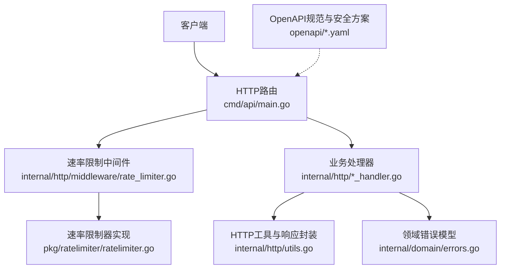
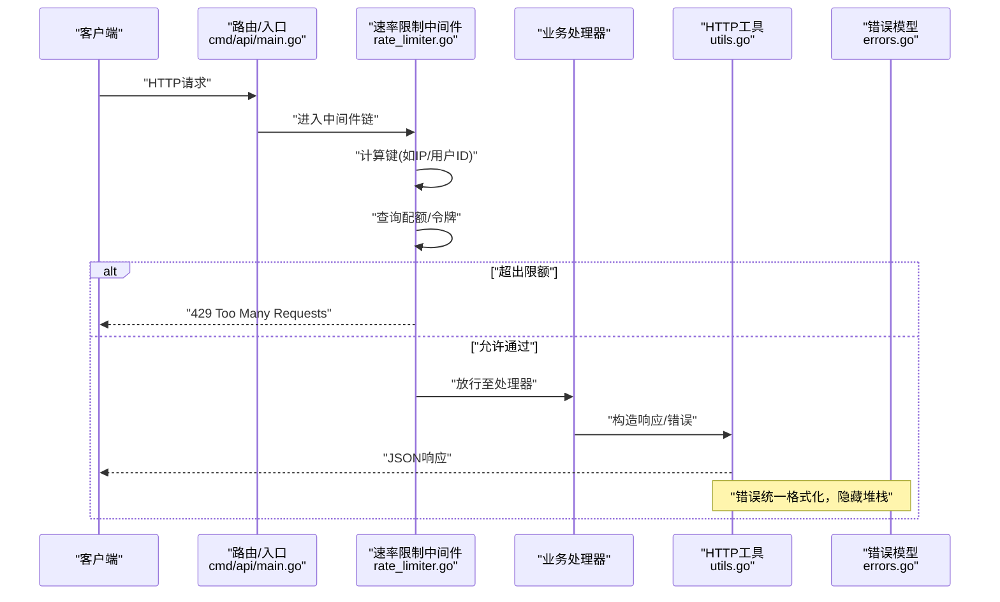
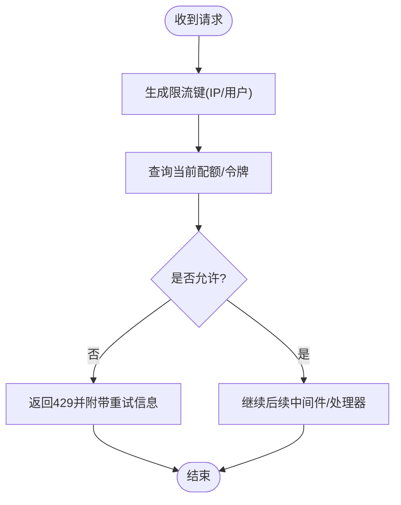
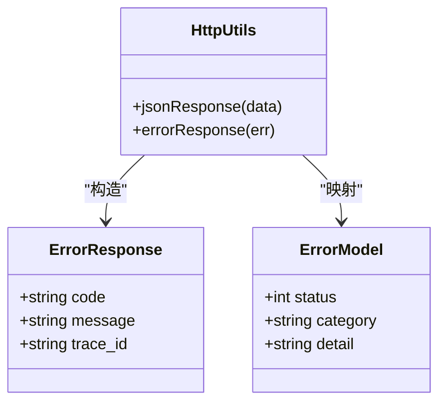
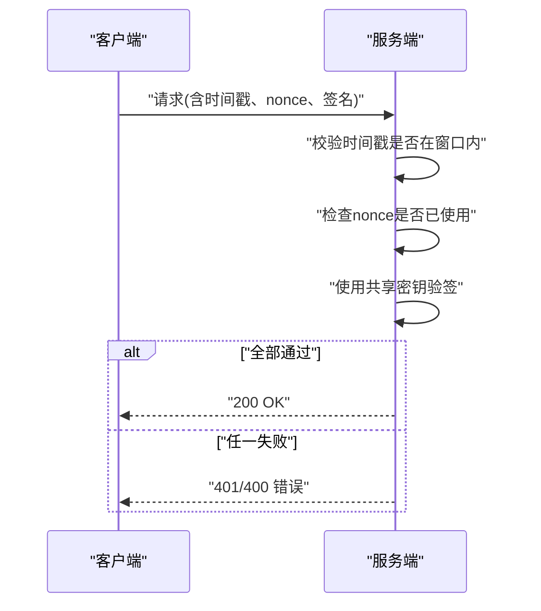
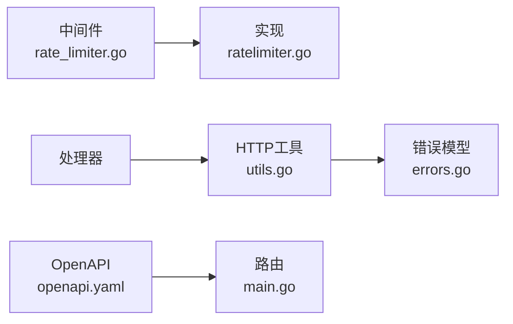

# API安全防护

<cite>
**本文引用的文件**   
- [cmd/api/main.go](file://notifuse/cmd/api/main.go)
- [internal/http/middleware/rate_limiter.go](file://notifuse/internal/http/middleware/rate_limiter.go)
- [pkg/ratelimiter/ratelimiter.go](file://notifuse/pkg/ratelimiter/ratelimiter.go)
- [internal/http/utils.go](file://notifuse/internal/http/utils.go)
- [internal/domain/errors.go](file://notifuse/internal/domain/errors.go)
- [openapi/openapi.yaml](file://notifuse/openapi/openapi.yaml)
- [openapi/components/security.yaml](file://notifuse/openapi/components/security.yaml)
- [SECURITY.md](file://notifuse/SECURITY.md)
</cite>

## 目录
1. [简介](#简介)
2. [项目结构](#项目结构)
3. [核心组件](#核心组件)
4. [架构总览](#架构总览)
5. [详细组件分析](#详细组件分析)
6. [依赖分析](#依赖分析)
7. [性能考虑](#性能考虑)
8. [故障排查指南](#故障排查指南)
9. [结论](#结论)
10. [附录](#附录)

## 简介
本文件面向Notifuse平台的API安全，聚焦以下方面：
- 速率限制与防滥用：请求频率控制、IP级别限流、用户行为分析
- 输入验证与参数过滤：SQL注入、XSS、命令注入防护
- API版本控制与向后兼容：废弃API迁移路径与客户端适配
- 错误处理与敏感信息泄露防护：统一错误格式、堆栈跟踪隐藏、调试信息控制
- 签名验证与重放攻击防护：时间戳校验、签名算法、nonce机制
- 安全监控、异常检测与自动封禁
- 安全测试方法与漏洞扫描工具集成

## 项目结构
Notifuse后端采用Go语言实现，HTTP层位于internal/http，中间件位于internal/http/middleware，通用能力封装在pkg下。OpenAPI规范定义于openapi目录，入口程序位于cmd/api。

图表来源
- [cmd/api/main.go](file://notifuse/cmd/api/main.go)
- [internal/http/middleware/rate_limiter.go](file://notifuse/internal/http/middleware/rate_limiter.go)
- [pkg/ratelimiter/ratelimiter.go](file://notifuse/pkg/ratelimiter/ratelimiter.go)
- [internal/http/utils.go](file://notifuse/internal/http/utils.go)
- [internal/domain/errors.go](file://notifuse/internal/domain/errors.go)
- [openapi/openapi.yaml](file://notifuse/openapi/openapi.yaml)

章节来源
- [cmd/api/main.go](file://notifuse/cmd/api/main.go)
- [openapi/openapi.yaml](file://notifuse/openapi/openapi.yaml)

## 核心组件
- 速率限制中间件：对进入的请求进行频率控制，支持按IP或用户维度统计并返回标准限流响应。
- 速率限制器实现：提供滑动窗口或令牌桶等算法的计数与判定逻辑。
- HTTP工具与响应封装：统一成功/失败响应结构、错误码映射与日志脱敏。
- 领域错误模型：标准化错误类型与消息，避免将内部细节暴露给客户端。
- OpenAPI与安全方案：声明式定义接口、鉴权方式与安全性约束。

章节来源
- [internal/http/middleware/rate_limiter.go](file://notifuse/internal/http/middleware/rate_limiter.go)
- [pkg/ratelimiter/ratelimiter.go](file://notifuse/pkg/ratelimiter/ratelimiter.go)
- [internal/http/utils.go](file://notifuse/internal/http/utils.go)
- [internal/domain/errors.go](file://notifuse/internal/domain/errors.go)
- [openapi/openapi.yaml](file://notifuse/openapi/openapi.yaml)

## 架构总览
下图展示一次受保护的API请求从网关到业务处理的完整链路，以及关键安全点（鉴权、限流、输入校验、错误收敛）。

图表来源
- [cmd/api/main.go](file://notifuse/cmd/api/main.go)
- [internal/http/middleware/rate_limiter.go](file://notifuse/internal/http/middleware/rate_limiter.go)
- [internal/http/utils.go](file://notifuse/internal/http/utils.go)
- [internal/domain/errors.go](file://notifuse/internal/domain/errors.go)

## 详细组件分析

### 速率限制与防滥用
- 请求频率控制
  - 中间件在请求进入时提取限流键（例如客户端IP、用户标识），调用底层速率限制器判断是否超过阈值。
  - 超限直接返回标准429响应，并在响应头中携带剩余配额与重试时间，便于客户端退避。
- IP级别限流
  - 以源IP为键进行全局限流，防止单IP暴力探测或资源耗尽。
  - 可结合白名单与灰度策略，对可信流量放宽限制。
- 用户行为分析
  - 基于用户ID或会话ID进行细粒度限流，识别异常模式（如高频创建、批量拉取）。
  - 可将异常指标上报至监控系统，触发告警或临时封禁。

图表来源
- [internal/http/middleware/rate_limiter.go](file://notifuse/internal/http/middleware/rate_limiter.go)
- [pkg/ratelimiter/ratelimiter.go](file://notifuse/pkg/ratelimiter/ratelimiter.go)

章节来源
- [internal/http/middleware/rate_limiter.go](file://notifuse/internal/http/middleware/rate_limiter.go)
- [pkg/ratelimiter/ratelimiter.go](file://notifuse/pkg/ratelimiter/ratelimiter.go)

### 输入验证与参数过滤
- SQL注入防护
  - 使用参数化查询与ORM，禁止拼接用户输入到SQL语句。
  - 对复杂查询条件进行白名单校验与类型转换。
- XSS攻击防护
  - 对所有输出进行HTML转义；富文本场景采用安全的渲染引擎与内容净化库。
  - 设置合适的Content-Type与CSP策略，避免脚本执行。
- 命令注入防护
  - 禁止直接使用用户输入调用系统命令；如需调用，严格白名单与参数隔离。
  - 对外部服务调用进行URL与协议白名单校验。

章节来源
- [internal/http/utils.go](file://notifuse/internal/http/utils.go)
- [internal/domain/errors.go](file://notifuse/internal/domain/errors.go)

### API版本控制与向后兼容
- 版本策略
  - 通过URL前缀或Header进行版本管理（如/v1、/v2）。
  - 新版本引入破坏性变更时，保留旧版本至少一个稳定周期。
- 废弃与迁移
  - 在响应头或文档中标注废弃字段与端点，提供迁移指南。
  - 客户端侧增加兼容性适配层，逐步切换至新接口。
- OpenAPI驱动
  - 使用OpenAPI规范描述接口契约，确保前后端一致演进。

章节来源
- [openapi/openapi.yaml](file://notifuse/openapi/openapi.yaml)

### 错误处理与敏感信息泄露防护
- 统一错误格式
  - 所有错误响应遵循一致的JSON结构，包含错误码、消息与可选的追踪ID。
- 堆栈跟踪隐藏
  - 生产环境不返回堆栈与内部细节；仅在本地或授权调试通道可见。
- 调试信息控制
  - 通过环境变量或配置开关控制详细日志与诊断输出。
- 安全事件记录
  - 记录必要的审计信息（如访问者、时间、结果），避免记录敏感数据。

图表来源
- [internal/http/utils.go](file://notifuse/internal/http/utils.go)
- [internal/domain/errors.go](file://notifuse/internal/domain/errors.go)

章节来源
- [internal/http/utils.go](file://notifuse/internal/http/utils.go)
- [internal/domain/errors.go](file://notifuse/internal/domain/errors.go)

### 签名验证、请求重放防护与时间戳验证
- 签名算法
  - 客户端使用共享密钥对请求体与关键字段进行签名，服务端验签通过后放行。
- 时间戳与Nonce
  - 请求携带时间戳与唯一nonce，服务端校验时间窗口与去重，防止重放。
- 传输安全
  - 强制HTTPS，证书校验与HSTS启用。
- OpenAPI安全方案
  - 在OpenAPI中声明鉴权方案（如自定义Header或Bearer Token），明确签名要求。

图表来源
- [openapi/openapi.yaml](file://notifuse/openapi/openapi.yaml)
- [openapi/components/security.yaml](file://notifuse/openapi/components/security.yaml)

章节来源
- [openapi/openapi.yaml](file://notifuse/openapi/openapi.yaml)
- [openapi/components/security.yaml](file://notifuse/openapi/components/security.yaml)

### 安全监控、异常检测与自动封禁
- 监控指标
  - 记录限流命中次数、认证失败率、异常状态码分布、慢请求比例。
- 异常检测
  - 基于阈值与趋势分析识别异常流量（如突发峰值、地域异常）。
- 自动封禁
  - 对持续超阈值的IP或用户实施临时封禁，配合解封策略与申诉通道。
- 审计与合规
  - 保留必要审计日志，满足合规要求，同时避免记录敏感数据。

章节来源
- [SECURITY.md](file://notifuse/SECURITY.md)

### API安全测试方法与漏洞扫描工具集成
- 单元测试与集成测试
  - 针对限流、鉴权、错误处理编写用例，覆盖边界与异常分支。
- 模糊测试与渗透测试
  - 对输入点进行模糊测试，模拟SQL注入、XSS、命令注入等攻击向量。
- 自动化扫描
  - 在CI中集成静态分析与依赖漏洞扫描，阻断高危问题合并。
- 回归与压测
  - 结合压测验证限流与降级策略的有效性。

章节来源
- [SECURITY.md](file://notifuse/SECURITY.md)

## 依赖分析
- 中间件与实现解耦
  - 速率限制中间件依赖pkg/ratelimiter的具体实现，便于替换算法与存储后端。
- 响应与错误收敛
  - 处理器通过HTTP工具统一构造响应，错误模型保证一致性。
- 规范驱动开发
  - OpenAPI作为契约，指导路由注册、鉴权与文档生成。

图表来源
- [internal/http/middleware/rate_limiter.go](file://notifuse/internal/http/middleware/rate_limiter.go)
- [pkg/ratelimiter/ratelimiter.go](file://notifuse/pkg/ratelimiter/ratelimiter.go)
- [internal/http/utils.go](file://notifuse/internal/http/utils.go)
- [internal/domain/errors.go](file://notifuse/internal/domain/errors.go)
- [openapi/openapi.yaml](file://notifuse/openapi/openapi.yaml)
- [cmd/api/main.go](file://notifuse/cmd/api/main.go)

章节来源
- [internal/http/middleware/rate_limiter.go](file://notifuse/internal/http/middleware/rate_limiter.go)
- [pkg/ratelimiter/ratelimiter.go](file://notifuse/pkg/ratelimiter/ratelimiter.go)
- [internal/http/utils.go](file://notifuse/internal/http/utils.go)
- [internal/domain/errors.go](file://notifuse/internal/domain/errors.go)
- [openapi/openapi.yaml](file://notifuse/openapi/openapi.yaml)
- [cmd/api/main.go](file://notifuse/cmd/api/main.go)

## 性能考虑
- 限流算法选择
  - 滑动窗口适合精确控制，令牌桶适合平滑流量；根据QPS与延迟目标选择。
- 存储后端
  - 使用内存或分布式缓存（如Redis）提升吞吐，注意序列化与网络开销。
- 响应体积
  - 压缩与分页减少带宽占用，避免大对象频繁序列化。
- 连接池与超时
  - 合理配置数据库与外部服务连接池与超时，避免雪崩。

[本节为通用建议，无需特定文件引用]

## 故障排查指南
- 常见问题定位
  - 限流误伤：检查限流键是否正确、阈值是否合理、白名单是否生效。
  - 鉴权失败：核对签名算法、时间戳窗口、nonce去重逻辑。
  - 错误信息泄露：确认生产环境关闭详细日志，统一错误格式。
- 快速恢复
  - 临时放宽限流阈值或添加白名单；对异常IP进行封禁。
  - 回滚最近变更，观察错误率与延迟指标。
- 日志与追踪
  - 使用trace_id关联请求链路，定位瓶颈与异常点。

章节来源
- [internal/http/utils.go](file://notifuse/internal/http/utils.go)
- [internal/domain/errors.go](file://notifuse/internal/domain/errors.go)
- [SECURITY.md](file://notifuse/SECURITY.md)

## 结论
Notifuse平台通过中间件化的速率限制、统一的错误处理与OpenAPI驱动的契约管理，构建了较为完善的API安全基线。建议在现有基础上进一步完善签名验签与重放防护、强化输入校验与输出净化，并将安全监控与自动化封禁纳入常态化运营流程。

[本节为总结，无需特定文件引用]

## 附录
- 术语
  - 限流键：用于区分不同维度的请求计数（如IP、用户ID）。
  - Nonce：一次性随机值，用于防止请求重放。
  - 时间戳窗口：允许请求的时间偏差范围，用于抵御时钟漂移。
- 参考
  - OpenAPI安全方案定义与示例见openapi目录。
  - 安全策略与报告流程参见SECURITY.md。

章节来源
- [openapi/openapi.yaml](file://notifuse/openapi/openapi.yaml)
- [openapi/components/security.yaml](file://notifuse/openapi/components/security.yaml)
- [SECURITY.md](file://notifuse/SECURITY.md)