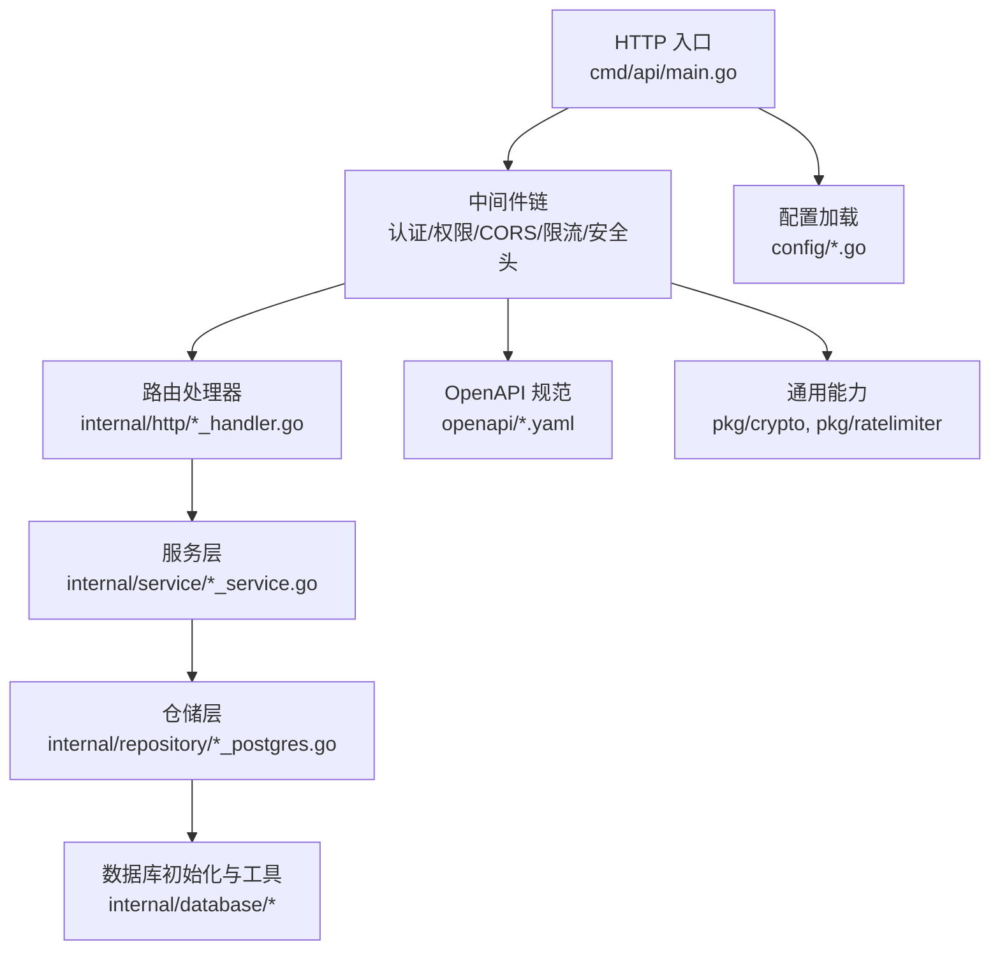
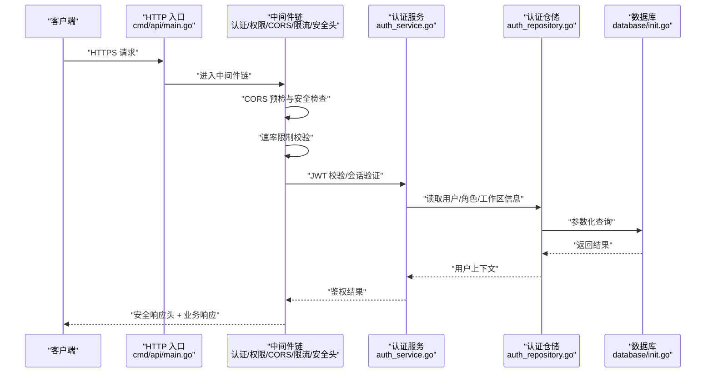
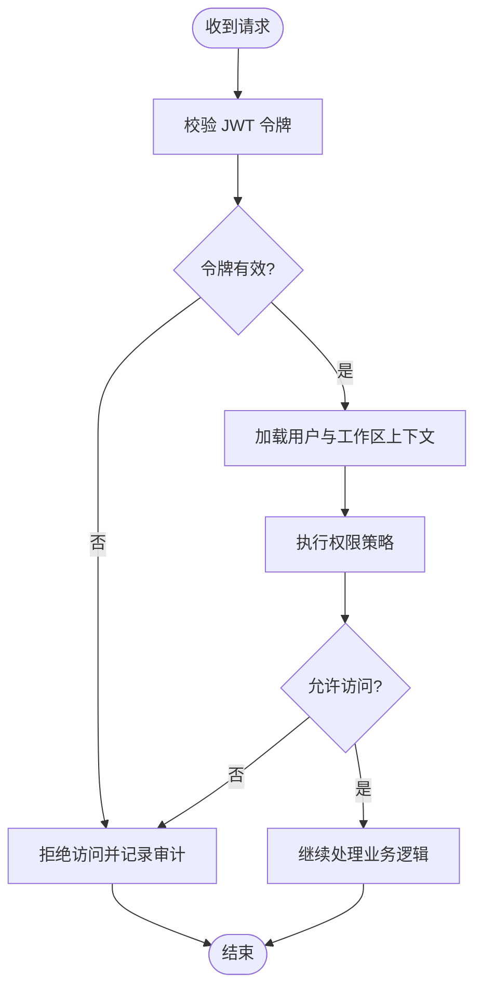
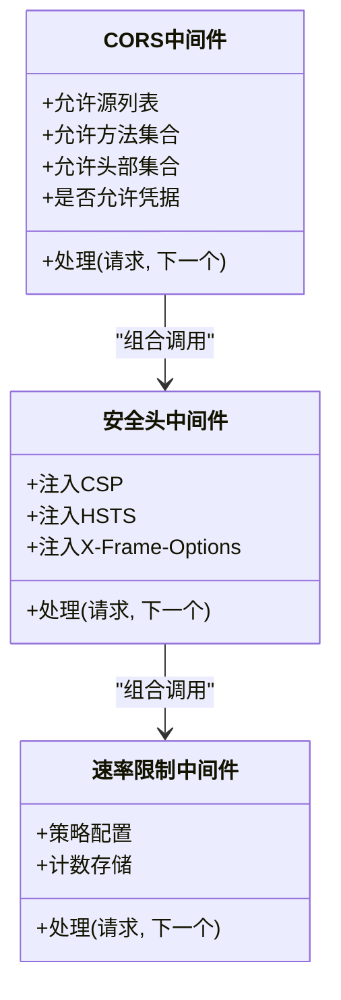
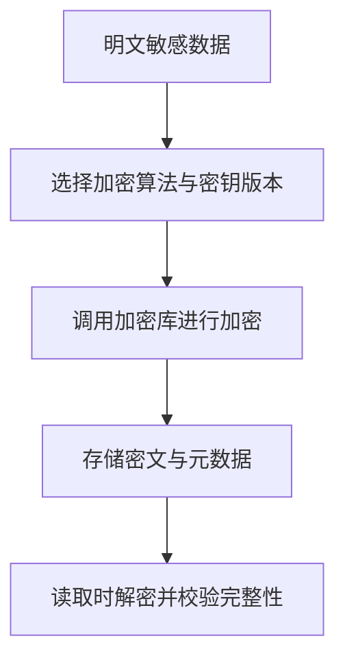
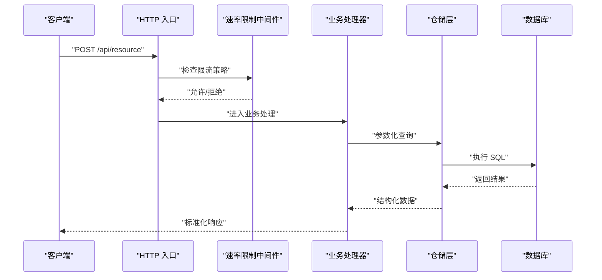
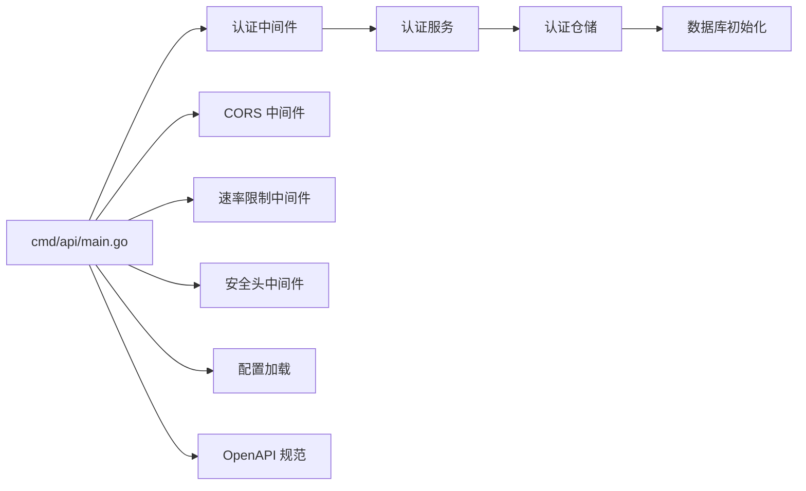

# 安全加固与防护

<cite>
**本文引用的文件**   
- [cmd/api/main.go](file://notifuse/cmd/api/main.go)
- [internal/http/middleware/auth_middleware.go](file://notifuse/internal/http/middleware/auth_middleware.go)
- [internal/http/middleware/cors_middleware.go](file://notifuse/internal/http/middleware/cors_middleware.go)
- [internal/http/middleware/rate_limit_middleware.go](file://notifuse/internal/http/middleware/rate_limit_middleware.go)
- [internal/http/middleware/security_headers_middleware.go](file://notifuse/internal/http/middleware/security_headers_middleware.go)
- [pkg/crypto/crypto.go](file://notifuse/pkg/crypto/crypto.go)
- [pkg/ratelimiter/ratelimiter.go](file://notifuse/pkg/ratelimiter/ratelimiter.go)
- [config/config.go](file://notifuse/config/config.go)
- [config/oidc.go](file://notifuse/config/oidc.go)
- [internal/domain/auth.go](file://notifuse/internal/domain/auth.go)
- [internal/service/auth_service.go](file://notifuse/internal/service/auth_service.go)
- [internal/repository/auth_repository.go](file://notifuse/internal/repository/auth_repository.go)
- [internal/database/init.go](file://notifuse/internal/database/init.go)
- [internal/database/utils.go](file://notifuse/internal/database/utils.go)
- [openapi/openapi.yaml](file://notifuse/openapi/openapi.yaml)
- [openapi/components/security.yaml](file://notifuse/openapi/components/security.yaml)
- [SECURITY.md](file://notifuse/SECURITY.md)
</cite>

## 目录
1. [简介](#简介)
2. [项目结构](#项目结构)
3. [核心组件](#核心组件)
4. [架构总览](#架构总览)
5. [详细组件分析](#详细组件分析)
6. [依赖分析](#依赖分析)
7. [性能考虑](#性能考虑)
8. [故障排查指南](#故障排查指南)
9. [结论](#结论)
10. [附录](#附录)

## 简介
本文件为 Notifuse 平台的安全加固与防护文档，聚焦身份认证与授权、网络安全配置、数据加密保护、API 安全防护、安全审计日志、漏洞扫描与安全合规检查、安全事件响应与入侵检测等关键领域。文档基于仓库中现有实现进行梳理，并给出可操作的加固建议与最佳实践，帮助读者在不改变业务逻辑的前提下提升系统整体安全性。

## 项目结构
Notifuse 后端采用 Go 语言实现，HTTP 服务入口位于 cmd/api，中间件层负责认证、CORS、速率限制与安全头注入；领域模型与服务逻辑位于 internal/domain 与 internal/service；持久化访问通过 repository 与 database 层完成；OpenAPI 定义在 openapi 目录；配置集中在 config 目录；通用能力如加解密、速率限制封装在 pkg 目录。

图表来源
- [cmd/api/main.go](file://notifuse/cmd/api/main.go)
- [internal/http/middleware/auth_middleware.go](file://notifuse/internal/http/middleware/auth_middleware.go)
- [internal/http/middleware/cors_middleware.go](file://notifuse/internal/http/middleware/cors_middleware.go)
- [internal/http/middleware/rate_limit_middleware.go](file://notifuse/internal/http/middleware/rate_limit_middleware.go)
- [internal/http/middleware/security_headers_middleware.go](file://notifuse/internal/http/middleware/security_headers_middleware.go)
- [internal/service/auth_service.go](file://notifuse/internal/service/auth_service.go)
- [internal/repository/auth_repository.go](file://notifuse/internal/repository/auth_repository.go)
- [internal/database/init.go](file://notifuse/internal/database/init.go)
- [openapi/openapi.yaml](file://notifuse/openapi/openapi.yaml)
- [config/config.go](file://notifuse/config/config.go)

章节来源
- [cmd/api/main.go](file://notifuse/cmd/api/main.go)
- [config/config.go](file://notifuse/config/config.go)

## 核心组件
- 认证与授权
  - JWT 令牌签发与校验：由认证服务与中间件协作完成，包含令牌生命周期、刷新策略与撤销机制。
  - 会话安全：结合 Cookie 属性（HttpOnly、Secure、SameSite）与短期会话令牌降低劫持风险。
  - 权限控制：基于工作区与角色的细粒度鉴权，确保资源隔离与最小权限原则。
- 网络安全
  - HTTPS 强制：通过反向代理或应用层重定向强制 TLS。
  - CORS 策略：白名单域名、受限方法与头部、禁止凭据滥用。
  - 请求头安全：注入 CSP、HSTS、X-Frame-Options、Referrer-Policy 等。
- 数据加密
  - 敏感字段加密存储：使用强算法与独立密钥管理。
  - 传输加密：全链路 TLS，内部服务间 mTLS。
  - 密钥管理：KMS/HSM 集成、轮换与审计。
- API 安全
  - 速率限制：按 IP/用户/接口维度限流，防暴力破解与滥用。
  - 输入验证：严格模式、白名单校验、长度与类型约束。
  - SQL 注入防护：参数化查询与 ORM 抽象。
- 审计与合规
  - 安全审计日志：登录、授权失败、敏感操作记录。
  - 漏洞扫描：CI 集成 SAST/DAST/依赖扫描。
  - 合规检查：OpenAPI 安全方案声明与一致性校验。
- 事件响应与威胁防护
  - 入侵检测：异常登录、高频失败、越权尝试告警。
  - 威胁防护：黑名单、封禁策略、自动熔断。

章节来源
- [internal/service/auth_service.go](file://notifuse/internal/service/auth_service.go)
- [internal/http/middleware/auth_middleware.go](file://notifuse/internal/http/middleware/auth_middleware.go)
- [internal/http/middleware/cors_middleware.go](file://notifuse/internal/http/middleware/cors_middleware.go)
- [internal/http/middleware/security_headers_middleware.go](file://notifuse/internal/http/middleware/security_headers_middleware.go)
- [pkg/crypto/crypto.go](file://notifuse/pkg/crypto/crypto.go)
- [pkg/ratelimiter/ratelimiter.go](file://notifuse/pkg/ratelimiter/ratelimiter.go)
- [internal/database/utils.go](file://notifuse/internal/database/utils.go)
- [openapi/openapi.yaml](file://notifuse/openapi/openapi.yaml)
- [openapi/components/security.yaml](file://notifuse/openapi/components/security.yaml)

## 架构总览
下图展示从客户端到数据库的完整安全路径，包括认证、授权、CORS、限流与安全头等关键节点。

图表来源
- [cmd/api/main.go](file://notifuse/cmd/api/main.go)
- [internal/http/middleware/cors_middleware.go](file://notifuse/internal/http/middleware/cors_middleware.go)
- [internal/http/middleware/rate_limit_middleware.go](file://notifuse/internal/http/middleware/rate_limit_middleware.go)
- [internal/http/middleware/auth_middleware.go](file://notifuse/internal/http/middleware/auth_middleware.go)
- [internal/service/auth_service.go](file://notifuse/internal/service/auth_service.go)
- [internal/repository/auth_repository.go](file://notifuse/internal/repository/auth_repository.go)
- [internal/database/init.go](file://notifuse/internal/database/init.go)

## 详细组件分析

### 身份认证与授权
- JWT 令牌管理
  - 签发：认证服务生成短期访问令牌与可选刷新令牌，绑定用户与工作区上下文。
  - 校验：认证中间件解析签名、过期时间、受众与发行者，拒绝无效或过期令牌。
  - 刷新：提供刷新端点，支持令牌轮换与撤销。
  - 撤销：维护令牌黑名单或版本戳，支持登出与批量撤销。
- 会话安全
  - Cookie 设置：启用 HttpOnly、Secure、SameSite=Strict/Lax，缩短会话有效期。
  - CSRF 防护：对状态变更接口要求同源与自定义头部或一次性令牌。
- 权限控制
  - 基于工作区的资源隔离，结合角色与策略决定读写权限。
  - 中间件注入当前用户与工作区上下文，供后续处理逻辑使用。

图表来源
- [internal/http/middleware/auth_middleware.go](file://notifuse/internal/http/middleware/auth_middleware.go)
- [internal/service/auth_service.go](file://notifuse/internal/service/auth_service.go)
- [internal/domain/auth.go](file://notifuse/internal/domain/auth.go)

章节来源
- [internal/service/auth_service.go](file://notifuse/internal/service/auth_service.go)
- [internal/http/middleware/auth_middleware.go](file://notifuse/internal/http/middleware/auth_middleware.go)
- [internal/domain/auth.go](file://notifuse/internal/domain/auth.go)

### 网络安全配置
- HTTPS 强制
  - 建议在反向代理层强制 HTTP→HTTPS 重定向，并在应用层校验协议头。
  - 启用 HSTS 与证书校验，禁用弱密码套件。
- CORS 策略
  - 仅允许受信任源，限制方法与头部，谨慎启用凭据。
  - 预检请求缓存，减少开销。
- 请求头安全
  - 注入 CSP、X-Content-Type-Options、X-Frame-Options、Referrer-Policy、Permissions-Policy 等。
  - 移除敏感服务器标识与堆栈信息。

图表来源
- [internal/http/middleware/cors_middleware.go](file://notifuse/internal/http/middleware/cors_middleware.go)
- [internal/http/middleware/security_headers_middleware.go](file://notifuse/internal/http/middleware/security_headers_middleware.go)
- [internal/http/middleware/rate_limit_middleware.go](file://notifuse/internal/http/middleware/rate_limit_middleware.go)

章节来源
- [internal/http/middleware/cors_middleware.go](file://notifuse/internal/http/middleware/cors_middleware.go)
- [internal/http/middleware/security_headers_middleware.go](file://notifuse/internal/http/middleware/security_headers_middleware.go)
- [internal/http/middleware/rate_limit_middleware.go](file://notifuse/internal/http/middleware/rate_limit_middleware.go)

### 数据加密保护
- 敏感数据加密存储
  - 使用强对称算法（如 AES-GCM）对敏感字段加密，密钥与密文分离存储。
  - 引入密钥版本与轮换机制，支持历史数据迁移。
- 传输加密
  - 全链路 TLS，内部服务间启用双向认证（mTLS）。
- 密钥管理
  - 优先使用 KMS/HSM，避免硬编码；定期轮换与审计访问。

图表来源
- [pkg/crypto/crypto.go](file://notifuse/pkg/crypto/crypto.go)

章节来源
- [pkg/crypto/crypto.go](file://notifuse/pkg/crypto/crypto.go)

### API 安全防护
- 速率限制
  - 按 IP、用户 ID、接口路径等多维度限流，支持滑动窗口与令牌桶。
  - 超限返回标准错误码与重试提示，记录审计日志。
- 输入验证
  - 严格模式：拒绝未知字段；白名单校验；长度、格式、范围约束。
  - 统一错误响应，避免泄露内部细节。
- SQL 注入防护
  - 全部使用参数化查询与 ORM 抽象，禁止拼接 SQL。
  - 数据库账户最小权限，只读/读写分离。

图表来源
- [internal/http/middleware/rate_limit_middleware.go](file://notifuse/internal/http/middleware/rate_limit_middleware.go)
- [internal/database/utils.go](file://notifuse/internal/database/utils.go)

章节来源
- [pkg/ratelimiter/ratelimiter.go](file://notifuse/pkg/ratelimiter/ratelimiter.go)
- [internal/database/utils.go](file://notifuse/internal/database/utils.go)

### 安全审计日志、漏洞扫描与安全合规
- 安全审计日志
  - 记录认证事件、授权失败、敏感操作、限流触发与异常。
  - 日志脱敏，避免泄露敏感信息；集中收集与不可篡改存储。
- 漏洞扫描
  - CI 集成 SAST/DAST/依赖漏洞扫描，阻断高危问题合并。
- 安全合规检查
  - OpenAPI 安全方案声明与实际实现一致；自动化校验安全头与 CORS。

章节来源
- [SECURITY.md](file://notifuse/SECURITY.md)
- [openapi/openapi.yaml](file://notifuse/openapi/openapi.yaml)
- [openapi/components/security.yaml](file://notifuse/openapi/components/security.yaml)

### 安全事件响应、入侵检测与威胁防护
- 入侵检测
  - 监控异常登录、频繁失败、越权尝试、异常地域与设备指纹。
  - 阈值告警与自动封禁策略。
- 威胁防护
  - 动态黑名单、IP 信誉评分、行为基线偏离检测。
  - 熔断与降级，防止雪崩效应。
- 事件响应
  - 标准化流程：发现、遏制、根因分析、修复、复盘。
  - 保留证据链，满足合规与取证需求。

[本节为概念性内容，不直接分析具体文件]

## 依赖分析
- 组件耦合与内聚
  - 中间件层高内聚，职责清晰；认证中间件依赖认证服务与仓储层。
  - 数据库层通过参数化工具函数保证安全与一致性。
- 外部依赖与集成点
  - OpenAPI 作为契约驱动，保障前后端一致性与安全方案声明。
  - 配置模块集中管理环境变量与运行时开关。

图表来源
- [cmd/api/main.go](file://notifuse/cmd/api/main.go)
- [internal/http/middleware/auth_middleware.go](file://notifuse/internal/http/middleware/auth_middleware.go)
- [internal/http/middleware/cors_middleware.go](file://notifuse/internal/http/middleware/cors_middleware.go)
- [internal/http/middleware/rate_limit_middleware.go](file://notifuse/internal/http/middleware/rate_limit_middleware.go)
- [internal/http/middleware/security_headers_middleware.go](file://notifuse/internal/http/middleware/security_headers_middleware.go)
- [internal/service/auth_service.go](file://notifuse/internal/service/auth_service.go)
- [internal/repository/auth_repository.go](file://notifuse/internal/repository/auth_repository.go)
- [internal/database/init.go](file://notifuse/internal/database/init.go)
- [config/config.go](file://notifuse/config/config.go)
- [openapi/openapi.yaml](file://notifuse/openapi/openapi.yaml)

章节来源
- [cmd/api/main.go](file://notifuse/cmd/api/main.go)
- [config/config.go](file://notifuse/config/config.go)

## 性能考虑
- 中间件顺序优化：将轻量级中间件（安全头、CORS）前置，耗时操作后置。
- 速率限制存储：使用内存或 Redis 分布式计数，避免热点键。
- 数据库连接池：合理配置最大连接数与超时，避免阻塞。
- 缓存策略：对只读数据与令牌黑名单进行缓存，注意失效与一致性。

[本节提供一般性指导，不直接分析具体文件]

## 故障排查指南
- 认证失败
  - 检查 JWT 签名、过期时间与受众；确认中间件顺序与上下文注入。
- CORS 预检失败
  - 核对允许源、方法与头部；确认凭据策略与浏览器同源策略。
- 速率限制触发
  - 查看限流策略与计数存储；调整阈值或扩容。
- 数据库错误
  - 检查参数化查询与连接池；确认最小权限账户。
- 安全头缺失
  - 确认安全头中间件生效；检查反向代理覆盖情况。

章节来源
- [internal/http/middleware/auth_middleware.go](file://notifuse/internal/http/middleware/auth_middleware.go)
- [internal/http/middleware/cors_middleware.go](file://notifuse/internal/http/middleware/cors_middleware.go)
- [internal/http/middleware/rate_limit_middleware.go](file://notifuse/internal/http/middleware/rate_limit_middleware.go)
- [internal/http/middleware/security_headers_middleware.go](file://notifuse/internal/http/middleware/security_headers_middleware.go)
- [internal/database/utils.go](file://notifuse/internal/database/utils.go)

## 结论
通过对认证授权、网络安全、数据加密、API 安全、审计合规与事件响应的系统化加固，Notifuse 可在保持业务稳定性的同时显著提升抗攻击能力与合规水平。建议在生产环境持续运行安全扫描与合规检查，完善告警与响应流程，形成闭环的安全运营体系。

[本节为总结性内容，不直接分析具体文件]

## 附录
- OIDC 集成要点
  - 配置发行者与客户端凭据，启用 PKCE 与状态参数，校验回调域与跳转白名单。
- 参考实现路径
  - OIDC 配置：[config/oidc.go](file://notifuse/config/oidc.go)
  - OpenAPI 安全方案：[openapi/components/security.yaml](file://notifuse/openapi/components/security.yaml)

章节来源
- [config/oidc.go](file://notifuse/config/oidc.go)
- [openapi/components/security.yaml](file://notifuse/openapi/components/security.yaml)