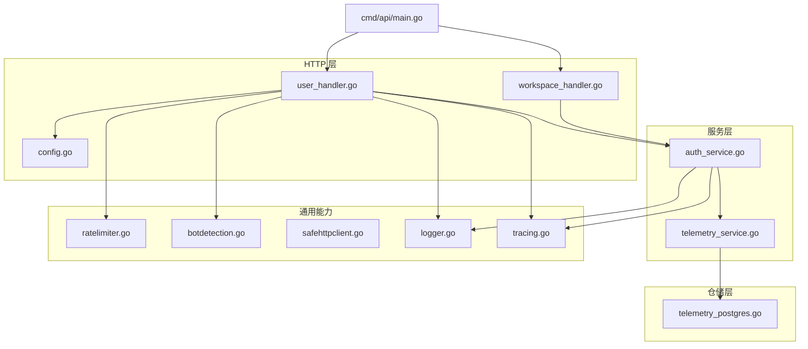
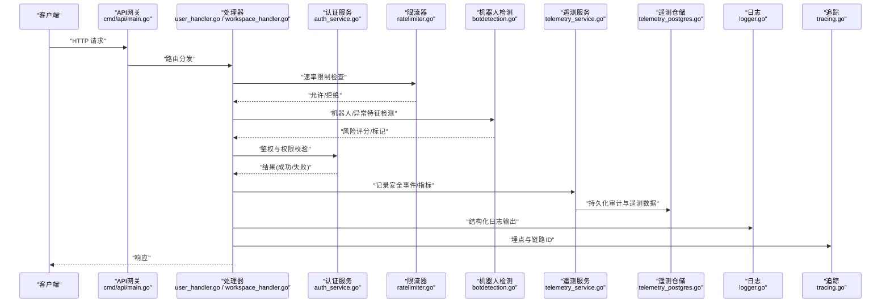
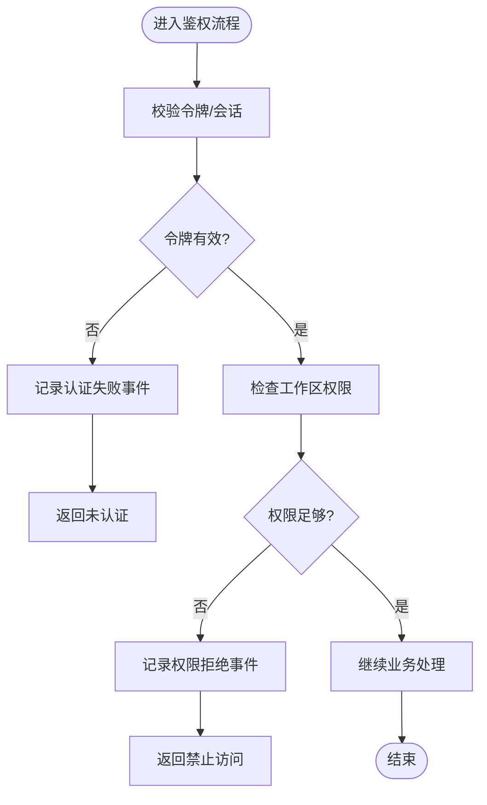
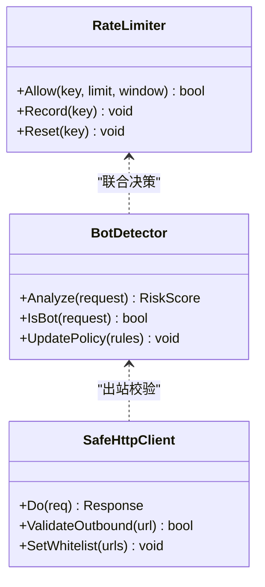
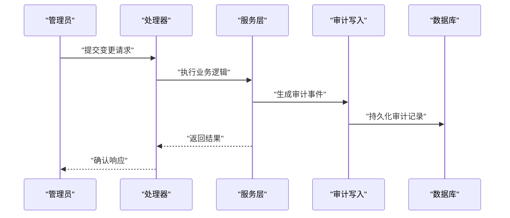
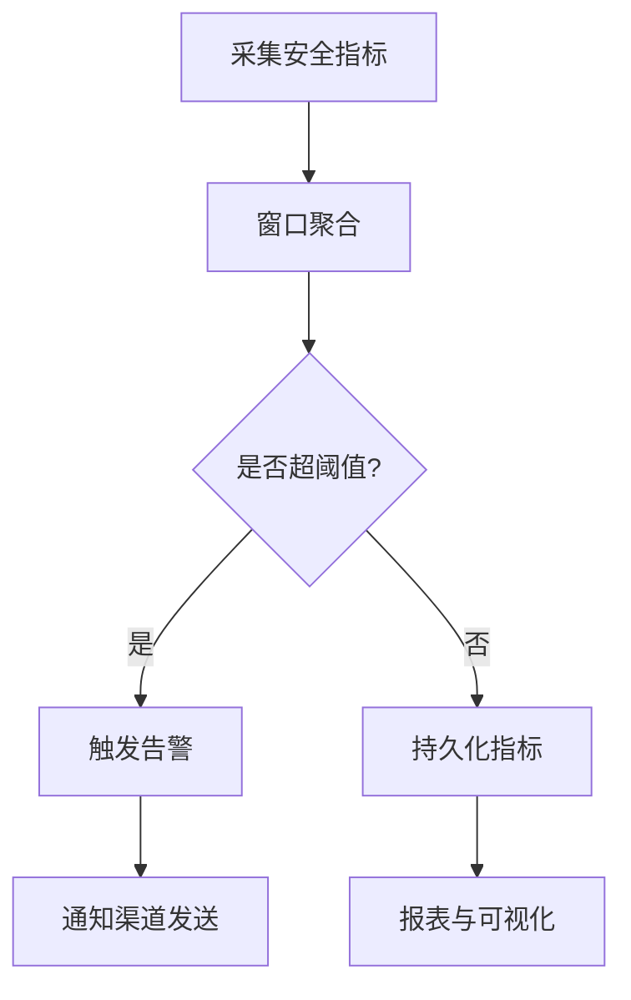
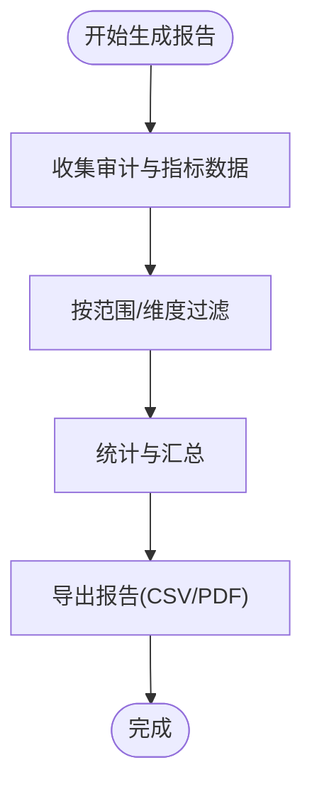
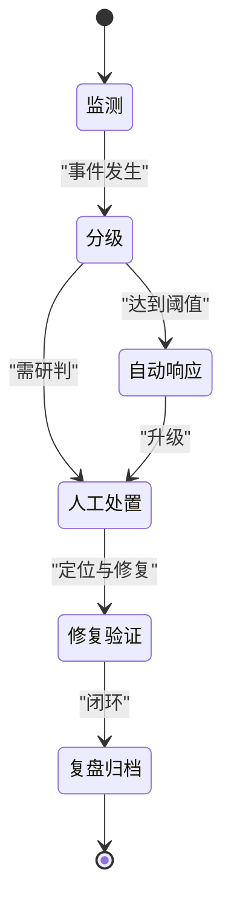
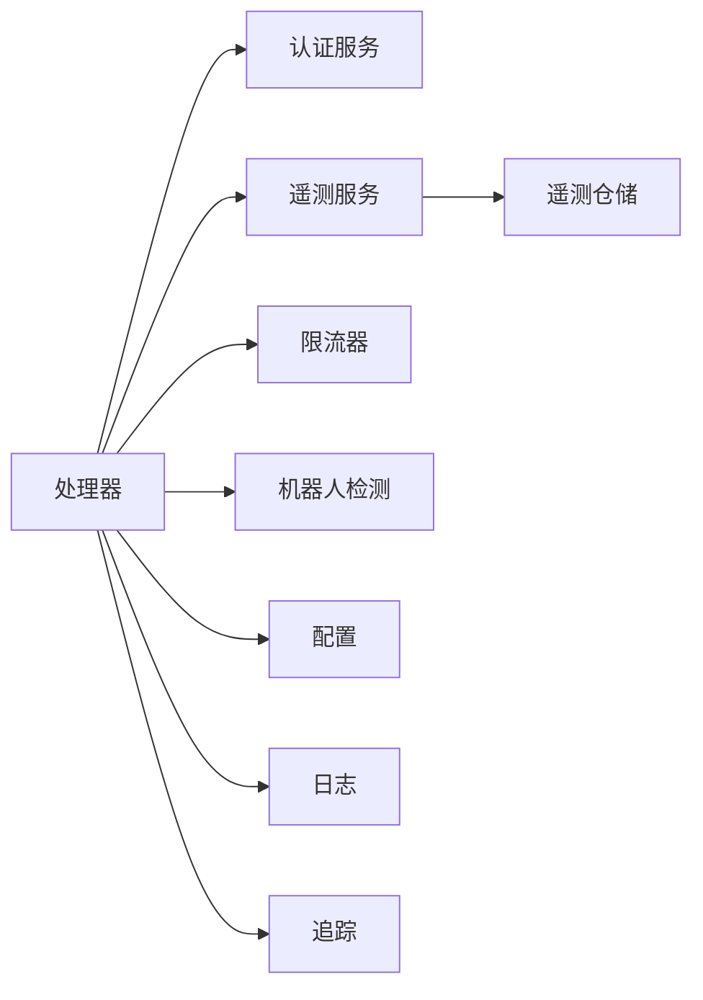

# 安全监控与审计

<cite>
**本文引用的文件**   
- [SECURITY.md](file://notifuse/SECURITY.md)
- [config.go](file://notifuse/config/config.go)
- [auth_service.go](file://notifuse/internal/service/auth_service.go)
- [user_handler.go](file://notifuse/internal/http/user_handler.go)
- [workspace_handler.go](file://notifuse/internal/http/workspace_handler.go)
- [telemetry_postgres.go](file://notifuse/internal/repository/telemetry_postgres.go)
- [telemetry_service.go](file://notifuse/internal/service/telemetry_service.go)
- [ratelimiter.go](file://notifuse/pkg/ratelimiter/ratelimiter.go)
- [botdetection.go](file://notifuse/pkg/botdetection/botdetection.go)
- [safehttpclient.go](file://notifuse/pkg/safehttpclient/safehttpclient.go)
- [logger.go](file://notifuse/pkg/logger/logger.go)
- [tracing.go](file://notifuse/pkg/tracing/tracing.go)
- [openapi.yaml](file://notifuse/openapi/openapi.yaml)
- [security.yaml](file://notifuse/openapi/components/security.yaml)
- [main.go](file://notifuse/cmd/api/main.go)
</cite>

## 目录
1. [简介](#简介)
2. [项目结构](#项目结构)
3. [核心组件](#核心组件)
4. [架构总览](#架构总览)
5. [详细组件分析](#详细组件分析)
6. [依赖关系分析](#依赖关系分析)
7. [性能考量](#性能考量)
8. [故障排查指南](#故障排查指南)
9. [结论](#结论)
10. [附录](#附录)

## 简介
本文件为 Notifuse 平台的安全监控与审计文档，聚焦以下目标：
- 安全事件日志记录：认证失败、权限违规、可疑行为的自动检测与记录。
- 安全审计追踪系统：用户操作审计、数据变更追踪、系统访问日志。
- 威胁检测与入侵防御：异常行为识别、恶意请求拦截、自动响应策略。
- 安全指标收集与告警配置：关键安全KPI监控、阈值设置、通知渠道。
- 安全合规报告生成：GDPR合规检查、安全态势评估、审计报告导出。
- 安全事件响应流程、故障排查与取证分析方法。
- 安全监控工具集成与自定义规则配置。

## 项目结构
Notifuse 后端采用分层架构：HTTP 层（handlers）、服务层（services）、仓储层（repositories）以及通用能力包（pkg）。与安全监控和审计相关的代码主要分布在以下位置：
- HTTP 中间件与处理器：负责鉴权、限流、审计入口点。
- 服务层：实现认证、工作区权限控制、遥测指标上报等。
- 仓储层：持久化遥测与审计相关数据。
- 通用包：限流、机器人检测、安全客户端、日志与链路追踪。

图表来源
- [main.go:1-200](file://notifuse/cmd/api/main.go#L1-L200)
- [user_handler.go:1-200](file://notifuse/internal/http/user_handler.go#L1-L200)
- [workspace_handler.go:1-200](file://notifuse/internal/http/workspace_handler.go#L1-L200)
- [auth_service.go:1-200](file://notifuse/internal/service/auth_service.go#L1-L200)
- [telemetry_service.go:1-200](file://notifuse/internal/service/telemetry_service.go#L1-L200)
- [telemetry_postgres.go:1-200](file://notifuse/internal/repository/telemetry_postgres.go#L1-L200)
- [ratelimiter.go:1-200](file://notifuse/pkg/ratelimiter/ratelimiter.go#L1-L200)
- [botdetection.go:1-200](file://notifuse/pkg/botdetection/botdetection.go#L1-L200)
- [safehttpclient.go:1-200](file://notifuse/pkg/safehttpclient/safehttpclient.go#L1-L200)
- [logger.go:1-200](file://notifuse/pkg/logger/logger.go#L1-L200)
- [tracing.go:1-200](file://notifuse/pkg/tracing/tracing.go#L1-L200)

章节来源
- [main.go:1-200](file://notifuse/cmd/api/main.go#L1-L200)
- [config.go:1-200](file://notifuse/config/config.go#L1-L200)

## 核心组件
- 认证与授权服务：提供登录、令牌校验、工作区级权限判定，并触发安全事件记录。
- 遥测与审计存储：将安全指标与审计事件写入数据库，供后续分析与报表使用。
- 限流与反机器人：在接入层对高频请求与自动化脚本进行识别与限制。
- 安全客户端：对外部调用进行白名单与证书校验，降低供应链风险。
- 日志与链路追踪：统一结构化日志与分布式追踪，支撑可观测性与取证。

章节来源
- [auth_service.go:1-200](file://notifuse/internal/service/auth_service.go#L1-L200)
- [telemetry_service.go:1-200](file://notifuse/internal/service/telemetry_service.go#L1-L200)
- [telemetry_postgres.go:1-200](file://notifuse/internal/repository/telemetry_postgres.go#L1-L200)
- [ratelimiter.go:1-200](file://notifuse/pkg/ratelimiter/ratelimiter.go#L1-L200)
- [botdetection.go:1-200](file://notifuse/pkg/botdetection/botdetection.go#L1-L200)
- [safehttpclient.go:1-200](file://notifuse/pkg/safehttpclient/safehttpclient.go#L1-L200)
- [logger.go:1-200](file://notifuse/pkg/logger/logger.go#L1-L200)
- [tracing.go:1-200](file://notifuse/pkg/tracing/tracing.go#L1-L200)

## 架构总览
下图展示了从HTTP请求进入，到鉴权、限流、审计与遥测上报的端到端流程。

图表来源
- [main.go:1-200](file://notifuse/cmd/api/main.go#L1-L200)
- [user_handler.go:1-200](file://notifuse/internal/http/user_handler.go#L1-L200)
- [workspace_handler.go:1-200](file://notifuse/internal/http/workspace_handler.go#L1-L200)
- [auth_service.go:1-200](file://notifuse/internal/service/auth_service.go#L1-L200)
- [ratelimiter.go:1-200](file://notifuse/pkg/ratelimiter/ratelimiter.go#L1-L200)
- [botdetection.go:1-200](file://notifuse/pkg/botdetection/botdetection.go#L1-L200)
- [telemetry_service.go:1-200](file://notifuse/internal/service/telemetry_service.go#L1-L200)
- [telemetry_postgres.go:1-200](file://notifuse/internal/repository/telemetry_postgres.go#L1-L200)
- [logger.go:1-200](file://notifuse/pkg/logger/logger.go#L1-L200)
- [tracing.go:1-200](file://notifuse/pkg/tracing/tracing.go#L1-L200)

## 详细组件分析

### 认证失败与权限违规审计
- 认证失败记录：当登录或令牌校验失败时，服务层应记录失败原因、来源IP、用户标识（若存在）、时间戳与追踪ID，便于后续统计与溯源。
- 权限违规记录：在工作区资源访问时，若权限不足，应记录操作主体、目标资源、动作类型与拒绝原因。
- 建议落地方式：在处理器或服务层捕获错误后，通过遥测服务写入审计表；同时输出结构化日志并附带链路ID。

图表来源
- [auth_service.go:1-200](file://notifuse/internal/service/auth_service.go#L1-L200)
- [workspace_handler.go:1-200](file://notifuse/internal/http/workspace_handler.go#L1-L200)
- [telemetry_service.go:1-200](file://notifuse/internal/service/telemetry_service.go#L1-L200)
- [telemetry_postgres.go:1-200](file://notifuse/internal/repository/telemetry_postgres.go#L1-L200)

章节来源
- [auth_service.go:1-200](file://notifuse/internal/service/auth_service.go#L1-L200)
- [workspace_handler.go:1-200](file://notifuse/internal/http/workspace_handler.go#L1-L200)
- [telemetry_service.go:1-200](file://notifuse/internal/service/telemetry_service.go#L1-L200)
- [telemetry_postgres.go:1-200](file://notifuse/internal/repository/telemetry_postgres.go#L1-L200)

### 可疑行为自动检测与拦截
- 限流策略：基于IP或用户维度进行请求频率限制，超过阈值直接拒绝，避免暴力破解与滥用。
- 机器人检测：结合User-Agent、行为模式、请求时序等特征识别自动化脚本与爬虫，必要时加入验证码或降权。
- 恶意请求拦截：对异常路径、参数注入、过大负载等进行快速拒绝，减少攻击面。

图表来源
- [ratelimiter.go:1-200](file://notifuse/pkg/ratelimiter/ratelimiter.go#L1-L200)
- [botdetection.go:1-200](file://notifuse/pkg/botdetection/botdetection.go#L1-L200)
- [safehttpclient.go:1-200](file://notifuse/pkg/safehttpclient/safehttpclient.go#L1-L200)

章节来源
- [ratelimiter.go:1-200](file://notifuse/pkg/ratelimiter/ratelimiter.go#L1-L200)
- [botdetection.go:1-200](file://notifuse/pkg/botdetection/botdetection.go#L1-L200)
- [safehttpclient.go:1-200](file://notifuse/pkg/safehttpclient/safehttpclient.go#L1-L200)

### 用户操作审计与数据变更追踪
- 操作审计：对用户创建、更新、删除、角色变更、工作区成员管理等敏感操作进行记录，包含操作者、对象、变更前后差异摘要。
- 数据变更追踪：对核心实体（联系人、模板、订阅等）的关键字段变更进行快照或差异记录，支持回溯与合规审查。
- 系统访问日志：记录接口访问、错误码、耗时、来源IP、UA等元信息，配合追踪ID形成完整链路。

图表来源
- [user_handler.go:1-200](file://notifuse/internal/http/user_handler.go#L1-L200)
- [workspace_handler.go:1-200](file://notifuse/internal/http/workspace_handler.go#L1-L200)
- [telemetry_service.go:1-200](file://notifuse/internal/service/telemetry_service.go#L1-L200)
- [telemetry_postgres.go:1-200](file://notifuse/internal/repository/telemetry_postgres.go#L1-L200)

章节来源
- [user_handler.go:1-200](file://notifuse/internal/http/user_handler.go#L1-L200)
- [workspace_handler.go:1-200](file://notifuse/internal/http/workspace_handler.go#L1-L200)
- [telemetry_service.go:1-200](file://notifuse/internal/service/telemetry_service.go#L1-L200)
- [telemetry_postgres.go:1-200](file://notifuse/internal/repository/telemetry_postgres.go#L1-L200)

### 安全指标收集与告警配置
- 关键安全KPI：认证失败率、权限拒绝率、限流触发次数、机器人命中数、外部调用阻断数、平均鉴权耗时。
- 阈值与告警：按分钟/小时窗口聚合指标，超过阈值触发告警；支持多渠道通知（邮件、Webhook等）。
- 指标持久化：通过遥测服务写入数据库，供报表与趋势分析使用。

图表来源
- [telemetry_service.go:1-200](file://notifuse/internal/service/telemetry_service.go#L1-L200)
- [telemetry_postgres.go:1-200](file://notifuse/internal/repository/telemetry_postgres.go#L1-L200)
- [config.go:1-200](file://notifuse/config/config.go#L1-L200)

章节来源
- [telemetry_service.go:1-200](file://notifuse/internal/service/telemetry_service.go#L1-L200)
- [telemetry_postgres.go:1-200](file://notifuse/internal/repository/telemetry_postgres.go#L1-L200)
- [config.go:1-200](file://notifuse/config/config.go#L1-L200)

### 安全合规报告生成
- GDPR合规检查：确保个人数据处理最小化、目的限定、保留期限可控；提供数据删除与导出接口。
- 安全态势评估：汇总认证失败、权限拒绝、限流与机器人检测等指标，生成周期报告。
- 审计报告导出：支持按时间范围、主体、资源维度导出审计记录，满足内审与外审需求。

图表来源
- [telemetry_service.go:1-200](file://notifuse/internal/service/telemetry_service.go#L1-L200)
- [telemetry_postgres.go:1-200](file://notifuse/internal/repository/telemetry_postgres.go#L1-L200)

章节来源
- [telemetry_service.go:1-200](file://notifuse/internal/service/telemetry_service.go#L1-L200)
- [telemetry_postgres.go:1-200](file://notifuse/internal/repository/telemetry_postgres.go#L1-L200)

### 安全事件响应流程
- 事件分级：根据影响范围与严重性划分等级（低/中/高/紧急）。
- 自动响应：对高危事件（如批量认证失败、越权访问）自动限流、封禁IP、冻结账号。
- 人工处置：工单流转、根因分析、修复验证与复盘归档。

图表来源
- [ratelimiter.go:1-200](file://notifuse/pkg/ratelimiter/ratelimiter.go#L1-L200)
- [botdetection.go:1-200](file://notifuse/pkg/botdetection/botdetection.go#L1-L200)
- [telemetry_service.go:1-200](file://notifuse/internal/service/telemetry_service.go#L1-L200)

章节来源
- [ratelimiter.go:1-200](file://notifuse/pkg/ratelimiter/ratelimiter.go#L1-L200)
- [botdetection.go:1-200](file://notifuse/pkg/botdetection/botdetection.go#L1-L200)
- [telemetry_service.go:1-200](file://notifuse/internal/service/telemetry_service.go#L1-L200)

### 故障排查指南
- 常见问题：
  - 认证失败激增：检查令牌有效期、密钥轮换、上游身份源可用性。
  - 权限拒绝频繁：核对工作区成员角色与资源可见性策略。
  - 限流误伤：调整限流窗口与阈值，区分正常峰值与攻击流量。
  - 机器人误判：优化检测规则，引入人机验证或白名单机制。
- 取证方法：
  - 使用追踪ID串联请求链路，定位失败节点。
  - 导出审计记录与遥测指标，进行时间序列分析。
  - 结合日志与数据库快照，还原事件上下文。

章节来源
- [logger.go:1-200](file://notifuse/pkg/logger/logger.go#L1-L200)
- [tracing.go:1-200](file://notifuse/pkg/tracing/tracing.go#L1-L200)
- [telemetry_service.go:1-200](file://notifuse/internal/service/telemetry_service.go#L1-L200)
- [telemetry_postgres.go:1-200](file://notifuse/internal/repository/telemetry_postgres.go#L1-L200)

### 安全监控工具集成与自定义规则配置
- 集成点：
  - 日志与追踪：统一接入结构化日志与分布式追踪，便于集中采集与分析。
  - 指标与告警：将安全指标暴露给监控系统，配置阈值与通知渠道。
- 自定义规则：
  - 限流规则：按IP/用户/接口维度定义窗口与上限。
  - 机器人检测：维护UA黑名单、行为指纹与动态阈值。
  - 出站安全：维护外部URL白名单与证书校验策略。

章节来源
- [logger.go:1-200](file://notifuse/pkg/logger/logger.go#L1-L200)
- [tracing.go:1-200](file://notifuse/pkg/tracing/tracing.go#L1-L200)
- [ratelimiter.go:1-200](file://notifuse/pkg/ratelimiter/ratelimiter.go#L1-L200)
- [botdetection.go:1-200](file://notifuse/pkg/botdetection/botdetection.go#L1-L200)
- [safehttpclient.go:1-200](file://notifuse/pkg/safehttpclient/safehttpclient.go#L1-L200)
- [config.go:1-200](file://notifuse/config/config.go#L1-L200)

## 依赖关系分析
- 组件耦合：
  - 处理器依赖认证服务与工作区权限服务，间接依赖遥测与日志。
  - 遥测服务依赖仓储层进行持久化，受配置项驱动。
  - 限流与机器人检测作为横切关注点，被处理器与服务复用。
- 外部依赖：
  - 数据库用于存储遥测与审计数据。
  - 外部身份提供方（OIDC/OAuth2）用于认证。
  - 外部服务调用通过安全客户端进行校验与防护。

图表来源
- [user_handler.go:1-200](file://notifuse/internal/http/user_handler.go#L1-L200)
- [workspace_handler.go:1-200](file://notifuse/internal/http/workspace_handler.go#L1-L200)
- [auth_service.go:1-200](file://notifuse/internal/service/auth_service.go#L1-L200)
- [telemetry_service.go:1-200](file://notifuse/internal/service/telemetry_service.go#L1-L200)
- [telemetry_postgres.go:1-200](file://notifuse/internal/repository/telemetry_postgres.go#L1-L200)
- [ratelimiter.go:1-200](file://notifuse/pkg/ratelimiter/ratelimiter.go#L1-L200)
- [botdetection.go:1-200](file://notifuse/pkg/botdetection/botdetection.go#L1-L200)
- [config.go:1-200](file://notifuse/config/config.go#L1-L200)
- [logger.go:1-200](file://notifuse/pkg/logger/logger.go#L1-L200)
- [tracing.go:1-200](file://notifuse/pkg/tracing/tracing.go#L1-L200)

章节来源
- [user_handler.go:1-200](file://notifuse/internal/http/user_handler.go#L1-L200)
- [workspace_handler.go:1-200](file://notifuse/internal/http/workspace_handler.go#L1-L200)
- [auth_service.go:1-200](file://notifuse/internal/service/auth_service.go#L1-L200)
- [telemetry_service.go:1-200](file://notifuse/internal/service/telemetry_service.go#L1-L200)
- [telemetry_postgres.go:1-200](file://notifuse/internal/repository/telemetry_postgres.go#L1-L200)
- [ratelimiter.go:1-200](file://notifuse/pkg/ratelimiter/ratelimiter.go#L1-L200)
- [botdetection.go:1-200](file://notifuse/pkg/botdetection/botdetection.go#L1-L200)
- [config.go:1-200](file://notifuse/config/config.go#L1-L200)
- [logger.go:1-200](file://notifuse/pkg/logger/logger.go#L1-L200)
- [tracing.go:1-200](file://notifuse/pkg/tracing/tracing.go#L1-L200)

## 性能考量
- 限流与检测应在最外层执行，避免无效请求进入业务层。
- 遥测写入采用异步批处理与缓冲，降低对主流程的影响。
- 审计记录尽量精简关键字段，避免大对象落库。
- 指标聚合使用滑动窗口与近似算法，平衡精度与开销。
- 日志采样在高并发场景下启用采样策略，保留关键上下文。

## 故障排查指南
- 快速定位：
  - 通过追踪ID检索全链路日志与遥测记录。
  - 查看认证失败与权限拒绝的热点IP与用户。
  - 检查限流与机器人检测的命中率与阈值设置。
- 深入分析：
  - 对比历史基线，识别突增指标与异常模式。
  - 导出审计记录，进行关联分析与时间线重建。
  - 复现问题并开启调试日志，捕获必要上下文。

章节来源
- [logger.go:1-200](file://notifuse/pkg/logger/logger.go#L1-L200)
- [tracing.go:1-200](file://notifuse/pkg/tracing/tracing.go#L1-L200)
- [telemetry_service.go:1-200](file://notifuse/internal/service/telemetry_service.go#L1-L200)
- [telemetry_postgres.go:1-200](file://notifuse/internal/repository/telemetry_postgres.go#L1-L200)

## 结论
Notifuse 平台在接入层与服务层构建了较为完善的安全监控与审计基础能力，涵盖认证与权限审计、限流与反机器人、遥测指标与日志追踪。建议在此基础上进一步完善：
- 标准化安全事件模型与命名规范，提升跨模块一致性。
- 建立统一的告警编排与自动化响应策略，缩短MTTR。
- 强化合规能力，完善数据保留策略与审计导出功能。
- 持续优化限流与检测规则，降低误报与漏报。

## 附录
- 参考文件
  - [SECURITY.md](file://notifuse/SECURITY.md)
  - [openapi.yaml](file://notifuse/openapi/openapi.yaml)
  - [security.yaml](file://notifuse/openapi/components/security.yaml)