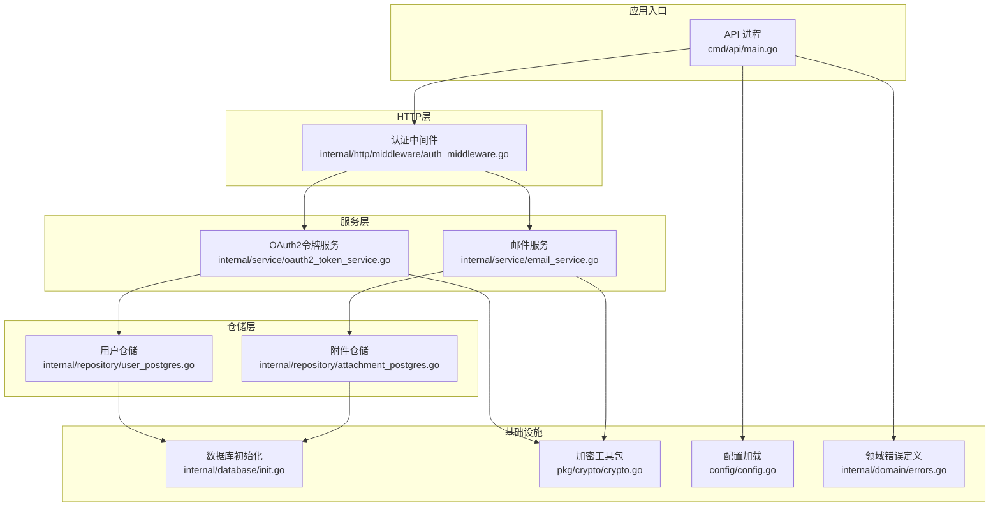
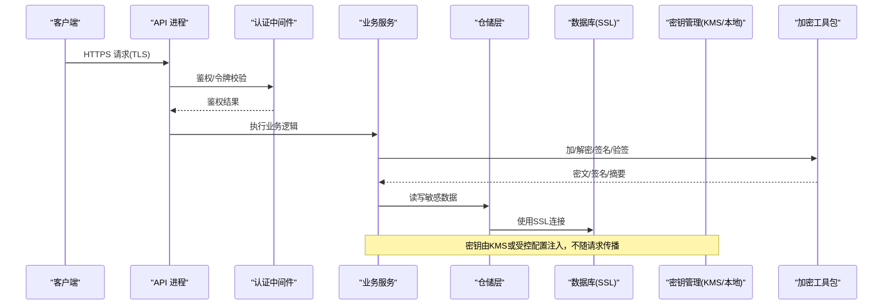
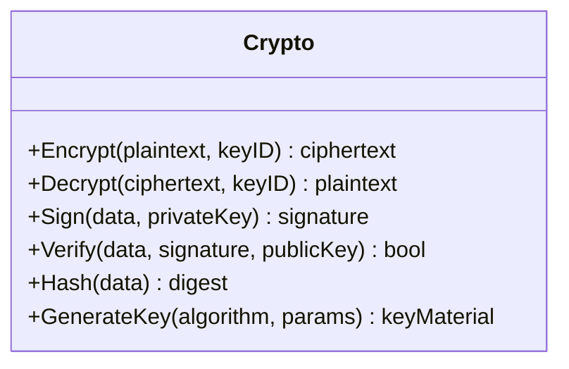
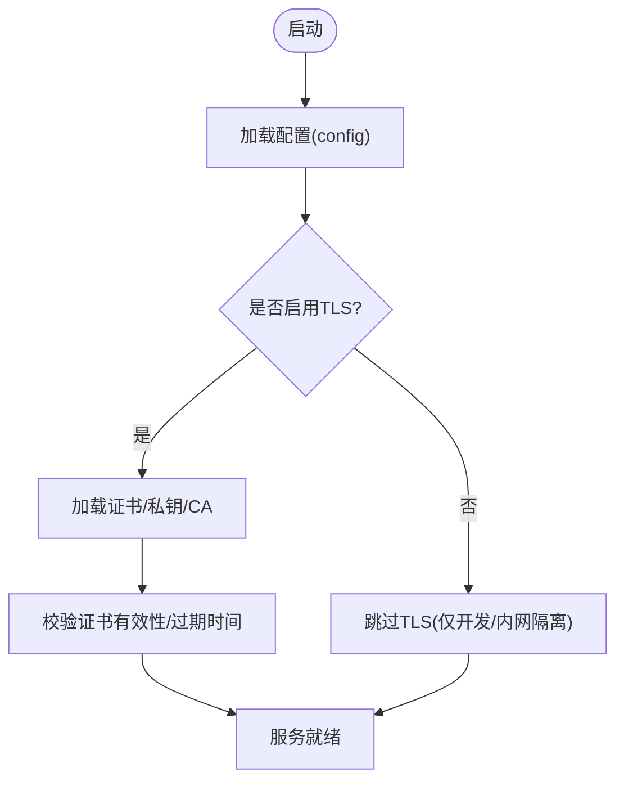
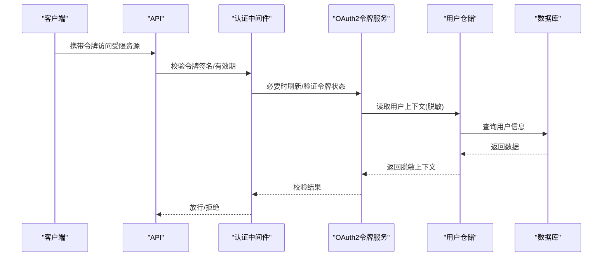
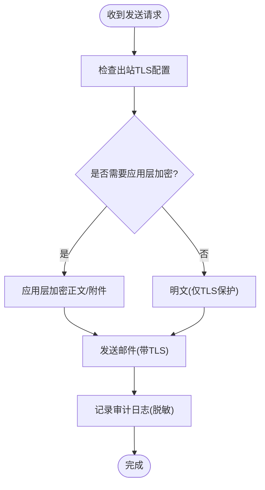
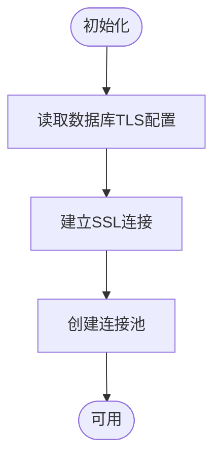
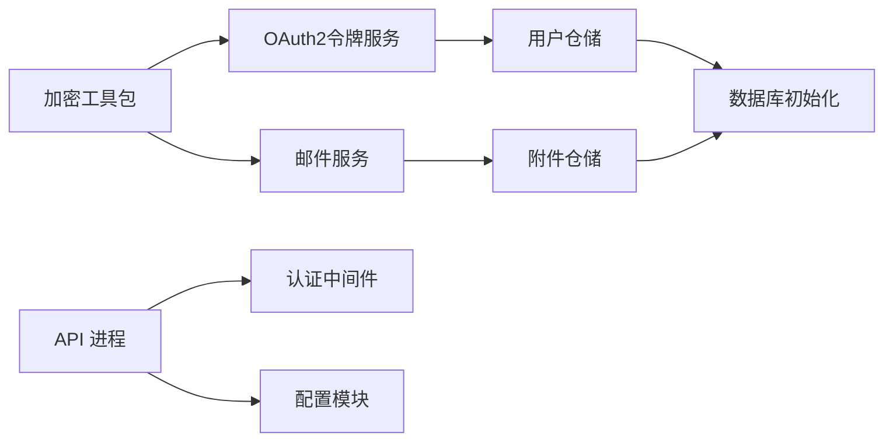

# 数据加密保护

<cite>
**本文引用的文件**   
- [pkg/crypto/crypto.go](file://notifuse/pkg/crypto/crypto.go)
- [pkg/crypto/crypto_test.go](file://notifuse/pkg/crypto/crypto_test.go)
- [config/config.go](file://notifuse/config/config.go)
- [cmd/api/main.go](file://notifuse/cmd/api/main.go)
- [internal/database/init.go](file://notifuse/internal/database/init.go)
- [internal/repository/user_postgres.go](file://notifuse/internal/repository/user_postgres.go)
- [internal/repository/attachment_postgres.go](file://notifuse/internal/repository/attachment_postgres.go)
- [internal/service/oauth2_token_service.go](file://notifuse/internal/service/oauth2_token_service.go)
- [internal/service/email_service.go](file://notifuse/internal/service/email_service.go)
- [internal/http/middleware/auth_middleware.go](file://notifuse/internal/http/middleware/auth_middleware.go)
- [internal/domain/errors.go](file://notifuse/internal/domain/errors.go)
- [scripts/generate-dev-certs.sh](file://notifuse/scripts/generate-dev-certs.sh)
- [SECURITY.md](file://notifuse/SECURITY.md)
</cite>

## 目录
1. [简介](#简介)
2. [项目结构](#项目结构)
3. [核心组件](#核心组件)
4. [架构总览](#架构总览)
5. [详细组件分析](#详细组件分析)
6. [依赖关系分析](#依赖关系分析)
7. [性能考虑](#性能考虑)
8. [故障排查指南](#故障排查指南)
9. [结论](#结论)
10. [附录](#附录)

## 简介
本文件面向Notifuse平台，系统性梳理与完善“数据加密保护”方案，覆盖以下关键主题：
- 敏感数据加密存储：数据库字段级加密、文件存储加密、备份数据保护
- 传输层加密：TLS配置、证书验证、数据完整性校验
- 密钥管理：生成、轮换、存储与销毁策略
- 数据脱敏与匿名化：测试数据生成与生产数据保护
- 算法选择指南：AES、RSA、哈希算法的应用场景
- 性能优化：批量处理与高并发下的加密策略
- 恢复机制与灾难恢复计划

说明：
- 文档基于仓库现有实现进行现状分析与建议补充。若某项能力尚未落地，将以“现状/建议”形式给出可操作的演进路径。
- 所有代码级引用均标注具体文件与行号范围，便于追溯。

## 项目结构
Notifuse后端采用Go语言分层架构，安全相关能力主要分布在以下位置：
- 通用加密工具：pkg/crypto
- 配置与环境：config
- HTTP服务与中间件：cmd/api、internal/http
- 领域模型与错误：internal/domain
- 持久化访问层：internal/repository（PostgreSQL）
- 业务服务：internal/service
- 开发证书脚本：scripts

图表来源
- [cmd/api/main.go](file://notifuse/cmd/api/main.go)
- [internal/http/middleware/auth_middleware.go](file://notifuse/internal/http/middleware/auth_middleware.go)
- [internal/service/oauth2_token_service.go](file://notifuse/internal/service/oauth2_token_service.go)
- [internal/service/email_service.go](file://notifuse/internal/service/email_service.go)
- [internal/repository/user_postgres.go](file://notifuse/internal/repository/user_postgres.go)
- [internal/repository/attachment_postgres.go](file://notifuse/internal/repository/attachment_postgres.go)
- [internal/database/init.go](file://notifuse/internal/database/init.go)
- [pkg/crypto/crypto.go](file://notifuse/pkg/crypto/crypto.go)
- [config/config.go](file://notifuse/config/config.go)
- [internal/domain/errors.go](file://notifuse/internal/domain/errors.go)

章节来源
- [cmd/api/main.go](file://notifuse/cmd/api/main.go)
- [config/config.go](file://notifuse/config/config.go)
- [internal/database/init.go](file://notifuse/internal/database/init.go)
- [pkg/crypto/crypto.go](file://notifuse/pkg/crypto/crypto.go)

## 核心组件
- 加密工具包（pkg/crypto）
  - 提供对称加解密、非对称签名/验签、摘要计算等基础能力，供服务层统一调用。
  - 通过配置注入密钥材料或KMS端点，避免硬编码。
- 配置模块（config）
  - 集中管理TLS证书路径、KMS/密钥参数、数据库连接等敏感配置。
- 认证中间件（auth_middleware）
  - 负责请求鉴权、会话/令牌校验，结合传输层加密保障端到端安全。
- OAuth2令牌服务（oauth2_token_service）
  - 涉及访问令牌、刷新令牌等敏感数据的生命周期管理与持久化。
- 邮件服务（email_service）
  - 对外发送时确保传输加密；对落盘日志/队列中的敏感信息进行脱敏或加密。
- 仓储层（user_postgres、attachment_postgres）
  - 负责将敏感字段以密文写入数据库；附件可能采用服务端加密或对象存储服务端加密。
- 数据库初始化（database/init）
  - 建立连接池、启用SSL/TLS连接、设置超时与重试策略。

章节来源
- [pkg/crypto/crypto.go](file://notifuse/pkg/crypto/crypto.go)
- [config/config.go](file://notifuse/config/config.go)
- [internal/http/middleware/auth_middleware.go](file://notifuse/internal/http/middleware/auth_middleware.go)
- [internal/service/oauth2_token_service.go](file://notifuse/internal/service/oauth2_token_service.go)
- [internal/service/email_service.go](file://notifuse/internal/service/email_service.go)
- [internal/repository/user_postgres.go](file://notifuse/internal/repository/user_postgres.go)
- [internal/repository/attachment_postgres.go](file://notifuse/internal/repository/attachment_postgres.go)
- [internal/database/init.go](file://notifuse/internal/database/init.go)

## 架构总览
下图展示从客户端到数据库的端到端加密链路，以及密钥在系统中的流转边界。

图表来源
- [cmd/api/main.go](file://notifuse/cmd/api/main.go)
- [internal/http/middleware/auth_middleware.go](file://notifuse/internal/http/middleware/auth_middleware.go)
- [internal/service/oauth2_token_service.go](file://notifuse/internal/service/oauth2_token_service.go)
- [internal/repository/user_postgres.go](file://notifuse/internal/repository/user_postgres.go)
- [internal/database/init.go](file://notifuse/internal/database/init.go)
- [pkg/crypto/crypto.go](file://notifuse/pkg/crypto/crypto.go)

## 详细组件分析

### 组件A：加密工具包（pkg/crypto）
职责与边界
- 提供统一的加解密、签名、摘要接口，屏蔽底层算法细节。
- 支持按环境切换算法与参数（如AES-GCM、RSA-OAEP、SHA-256）。
- 暴露密钥版本标识，便于未来平滑轮换。

图表来源
- [pkg/crypto/crypto.go](file://notifuse/pkg/crypto/crypto.go)

章节来源
- [pkg/crypto/crypto.go](file://notifuse/pkg/crypto/crypto.go)
- [pkg/crypto/crypto_test.go](file://notifuse/pkg/crypto/crypto_test.go)

### 组件B：配置与TLS（config + scripts）
职责与边界
- 集中加载TLS证书、私钥、CA链、最小协议版本、密码套件等。
- 提供开发证书生成脚本，用于本地联调。
- 为数据库连接、外部服务出站连接提供TLS开关与校验策略。

图表来源
- [config/config.go](file://notifuse/config/config.go)
- [scripts/generate-dev-certs.sh](file://notifuse/scripts/generate-dev-certs.sh)

章节来源
- [config/config.go](file://notifuse/config/config.go)
- [scripts/generate-dev-certs.sh](file://notifuse/scripts/generate-dev-certs.sh)

### 组件C：认证与令牌（auth_middleware + oauth2_token_service）
职责与边界
- 认证中间件负责JWT/OIDC令牌的解析与校验，拒绝非法请求。
- OAuth2令牌服务负责访问令牌、刷新令牌的签发、缓存、轮换与撤销。
- 敏感令牌在内存中尽量缩短驻留时间，落盘前进行加密或仅保留不可逆指纹。

图表来源
- [internal/http/middleware/auth_middleware.go](file://notifuse/internal/http/middleware/auth_middleware.go)
- [internal/service/oauth2_token_service.go](file://notifuse/internal/service/oauth2_token_service.go)
- [internal/repository/user_postgres.go](file://notifuse/internal/repository/user_postgres.go)
- [internal/database/init.go](file://notifuse/internal/database/init.go)

章节来源
- [internal/http/middleware/auth_middleware.go](file://notifuse/internal/http/middleware/auth_middleware.go)
- [internal/service/oauth2_token_service.go](file://notifuse/internal/service/oauth2_token_service.go)
- [internal/repository/user_postgres.go](file://notifuse/internal/repository/user_postgres.go)

### 组件D：邮件与附件（email_service + attachment_postgres）
职责与边界
- 邮件发送走TLS通道，优先强制STARTTLS或SMTPS。
- 附件落盘或上传对象存储时，采用服务端加密或应用层加密。
- 日志与审计记录中对附件URL、内容摘要做脱敏处理。

图表来源
- [internal/service/email_service.go](file://notifuse/internal/service/email_service.go)
- [internal/repository/attachment_postgres.go](file://notifuse/internal/repository/attachment_postgres.go)

章节来源
- [internal/service/email_service.go](file://notifuse/internal/service/email_service.go)
- [internal/repository/attachment_postgres.go](file://notifuse/internal/repository/attachment_postgres.go)

### 组件E：数据库连接与SSL（database/init）
职责与边界
- 初始化数据库连接池，强制启用SSL/TLS连接。
- 配置证书校验模式、超时与最大空闲连接数。
- 为后续字段级加密提供稳定可靠的传输通道。

图表来源
- [internal/database/init.go](file://notifuse/internal/database/init.go)

章节来源
- [internal/database/init.go](file://notifuse/internal/database/init.go)

## 依赖关系分析
- 低耦合：加密工具包被服务层直接依赖，仓储层通过服务层间接使用，避免跨层耦合。
- 明确边界：配置与证书加载集中在配置模块，运行时由服务按需获取。
- 潜在风险：若配置未正确校验证书或禁用TLS，将引入传输安全风险。

图表来源
- [pkg/crypto/crypto.go](file://notifuse/pkg/crypto/crypto.go)
- [internal/service/oauth2_token_service.go](file://notifuse/internal/service/oauth2_token_service.go)
- [internal/service/email_service.go](file://notifuse/internal/service/email_service.go)
- [internal/repository/user_postgres.go](file://notifuse/internal/repository/user_postgres.go)
- [internal/repository/attachment_postgres.go](file://notifuse/internal/repository/attachment_postgres.go)
- [internal/database/init.go](file://notifuse/internal/database/init.go)
- [cmd/api/main.go](file://notifuse/cmd/api/main.go)
- [config/config.go](file://notifuse/config/config.go)

章节来源
- [pkg/crypto/crypto.go](file://notifuse/pkg/crypto/crypto.go)
- [internal/service/oauth2_token_service.go](file://notifuse/internal/service/oauth2_token_service.go)
- [internal/service/email_service.go](file://notifuse/internal/service/email_service.go)
- [internal/repository/user_postgres.go](file://notifuse/internal/repository/user_postgres.go)
- [internal/repository/attachment_postgres.go](file://notifuse/internal/repository/attachment_postgres.go)
- [internal/database/init.go](file://notifuse/internal/database/init.go)
- [cmd/api/main.go](file://notifuse/cmd/api/main.go)
- [config/config.go](file://notifuse/config/config.go)

## 性能考虑
- 算法选择
  - 对称加密（AES-GCM）用于大数据量与高频场景，具备良好吞吐与硬件加速支持。
  - 非对称加密（RSA-OAEP/ECIES）用于小数据（如信封密钥）或签名/验签场景。
  - 哈希（SHA-256/BLAKE2b）用于完整性校验与索引字段脱敏。
- 批量与并发
  - 使用批处理与流水线并行加解密，限制goroutine数量以避免CPU争用。
  - 对热点密钥进行短期缓存（注意内存安全与泄露防护），并设置TTL。
- I/O与序列化
  - 减少不必要的编解码，优先二进制格式；压缩与加密顺序遵循先压缩后加密。
- 监控与降级
  - 记录加解密耗时分位指标，异常时快速失败并回退到只读或限流策略。

[本节为通用指导，无需源码引用]

## 故障排查指南
- TLS握手失败
  - 检查证书链、域名匹配、最小协议版本与密码套件配置。
  - 确认数据库与外部服务的TLS开关与CA信任链。
- 加解密失败
  - 核对密钥版本标识、IV/Nonce唯一性、填充模式与标签长度。
  - 检查密文是否被截断或转码损坏。
- 鉴权失败
  - 校验令牌签名、过期时间与颁发者；确认中间件是否正确挂载。
- 日志泄露
  - 审计日志中是否包含明文敏感字段；应改为脱敏或仅记录摘要。

章节来源
- [internal/domain/errors.go](file://notifuse/internal/domain/errors.go)
- [SECURITY.md](file://notifuse/SECURITY.md)

## 结论
Notifuse已在传输层TLS、认证鉴权与基础加密工具方面形成初步能力。下一步建议聚焦于：
- 数据库字段级加密与密钥轮换机制
- 附件与服务端存储的透明加密
- 备份数据的端到端加密与恢复演练
- 数据脱敏与匿名化的标准化流程
- 性能基准与容量规划

[本节为总结性内容，无需源码引用]

## 附录

### 加密算法选择指南
- AES-GCM
  - 适用：大体积数据、高频读写、需要机密性与完整性。
  - 注意：随机IV/Nonce、密钥派生与版本管理。
- RSA-OAEP / ECIES
  - 适用：信封密钥交换、数字签名/验签、小数据加密。
  - 注意：公钥分发、私钥保护、签名算法强度。
- SHA-256 / BLAKE2b
  - 适用：完整性校验、去重、索引字段脱敏。
  - 注意：盐值与迭代次数（如需口令派生）。

[本节为通用指导，无需源码引用]

### 密钥管理最佳实践
- 生成：使用可信随机源，禁止硬编码；区分环境（开发/预发/生产）。
- 存储：优先使用KMS/HSM；本地仅存放必要的最小权限凭证。
- 轮换：支持多版本密钥共存，灰度迁移旧数据；自动清理过期密钥。
- 销毁：安全擦除内存与磁盘残留，记录审计日志。

[本节为通用指导，无需源码引用]

### 数据脱敏与匿名化
- 测试数据：使用确定性种子生成，保证可复现且不含真实PII。
- 生产保护：导出/共享前进行掩码、泛化或差分隐私处理。
- 日志规范：默认脱敏，白名单例外需审批与审计。

[本节为通用指导，无需源码引用]

### 恢复机制与灾难恢复
- 备份策略：全量+增量，加密存储，异地容灾。
- 恢复演练：定期演练恢复流程，验证RTO/RPO目标。
- 密钥灾难恢复：主密钥离线保管，多重签名解锁，严格审批。

[本节为通用指导，无需源码引用]