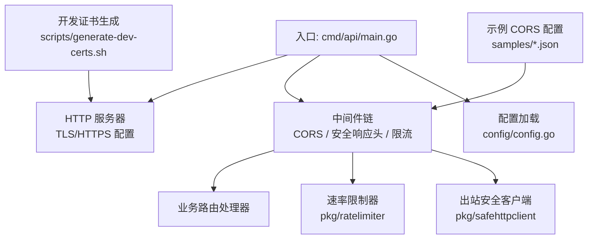
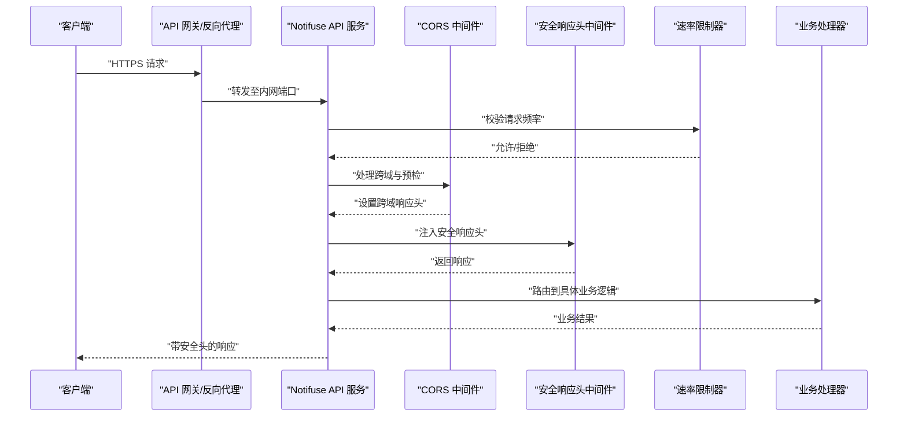
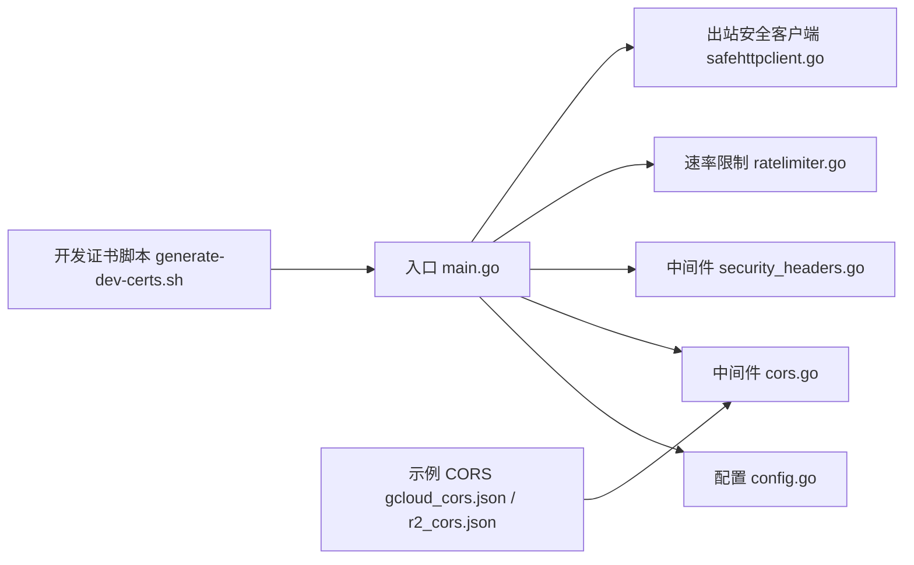

# 网络安全防护

<cite>
**本文引用的文件**   
- [cmd/api/main.go](file://notifuse/cmd/api/main.go)
- [config/config.go](file://notifuse/config/config.go)
- [internal/http/middleware/cors.go](file://notifuse/internal/http/middleware/cors.go)
- [internal/http/middleware/security_headers.go](file://notifuse/internal/http/middleware/security_headers.go)
- [pkg/ratelimiter/ratelimiter.go](file://notifuse/pkg/ratelimiter/ratelimiter.go)
- [pkg/safehttpclient/safehttpclient.go](file://notifuse/pkg/safehttpclient/safehttpclient.go)
- [scripts/generate-dev-certs.sh](file://notifuse/scripts/generate-dev-certs.sh)
- [samples/gcloud_cors.json](file://notifuse/samples/gcloud_cors.json)
- [samples/r2_cors.json](file://notifuse/samples/r2_cors.json)
- [SECURITY.md](file://notifuse/SECURITY.md)
</cite>

## 目录
1. [简介](#简介)
2. [项目结构](#项目结构)
3. [核心组件](#核心组件)
4. [架构总览](#架构总览)
5. [详细组件分析](#详细组件分析)
6. [依赖关系分析](#依赖关系分析)
7. [性能考虑](#性能考虑)
8. [故障排查指南](#故障排查指南)
9. [结论](#结论)
10. [附录](#附录)

## 简介
本文件为 Notifuse 平台提供全面的网络安全防护文档，覆盖 HTTPS 强制启用与证书管理、CORS 策略、请求头安全加固、网络层防护（IP 白名单、地理位置限制、DDoS 防护）、API 网关安全配置（请求大小限制、超时控制、连接池管理）、网络安全监控与异常检测、以及合规与审计日志记录。文档面向运维、安全与研发人员，既给出可落地的配置建议，也结合代码仓库中的现有实现进行说明。

## 项目结构
Notifuse 后端以 Go 语言实现，HTTP 服务入口位于 cmd/api，中间件集中在 internal/http/middleware，速率限制与出站 HTTP 客户端封装在 pkg 下，开发证书生成脚本位于 scripts，示例 CORS 配置位于 samples。

图表来源
- [cmd/api/main.go](file://notifuse/cmd/api/main.go)
- [config/config.go](file://notifuse/config/config.go)
- [internal/http/middleware/cors.go](file://notifuse/internal/http/middleware/cors.go)
- [internal/http/middleware/security_headers.go](file://notifuse/internal/http/middleware/security_headers.go)
- [pkg/ratelimiter/ratelimiter.go](file://notifuse/pkg/ratelimiter/ratelimiter.go)
- [pkg/safehttpclient/safehttpclient.go](file://notifuse/pkg/safehttpclient/safehttpclient.go)
- [scripts/generate-dev-certs.sh](file://notifuse/scripts/generate-dev-certs.sh)
- [samples/gcloud_cors.json](file://notifuse/samples/gcloud_cors.json)
- [samples/r2_cors.json](file://notifuse/samples/r2_cors.json)

章节来源
- [cmd/api/main.go](file://notifuse/cmd/api/main.go)
- [config/config.go](file://notifuse/config/config.go)

## 核心组件
- HTTPS/TLS 启动与证书管理：由入口程序负责加载 TLS 配置并启动 HTTPS 监听；开发环境可通过脚本生成自签名证书用于本地调试。
- CORS 中间件：集中处理跨域策略，支持白名单域名、预检请求与敏感头保护。
- 安全响应头中间件：统一注入安全相关响应头，降低 XSS、点击劫持等风险。
- 速率限制：基于 IP 或会话维度的请求频率控制，缓解暴力破解与滥用。
- 出站安全客户端：对外部服务的 HTTP 调用采用严格的安全策略（如禁用重定向、最小化协议版本）。
- 配置中心：集中读取环境变量与配置文件，驱动上述安全能力。

章节来源
- [cmd/api/main.go](file://notifuse/cmd/api/main.go)
- [config/config.go](file://notifuse/config/config.go)
- [internal/http/middleware/cors.go](file://notifuse/internal/http/middleware/cors.go)
- [internal/http/middleware/security_headers.go](file://notifuse/internal/http/middleware/security_headers.go)
- [pkg/ratelimiter/ratelimiter.go](file://notifuse/pkg/ratelimiter/ratelimiter.go)
- [pkg/safehttpclient/safehttpclient.go](file://notifuse/pkg/safehttpclient/safehttpclient.go)

## 架构总览
下图展示了从客户端到服务端的关键安全路径：客户端经反向代理进入 API 网关，依次经过速率限制、CORS 与安全响应头中间件，再到达具体业务处理器。

图表来源
- [cmd/api/main.go](file://notifuse/cmd/api/main.go)
- [internal/http/middleware/cors.go](file://notifuse/internal/http/middleware/cors.go)
- [internal/http/middleware/security_headers.go](file://notifuse/internal/http/middleware/security_headers.go)
- [pkg/ratelimiter/ratelimiter.go](file://notifuse/pkg/ratelimiter/ratelimiter.go)

## 详细组件分析

### HTTPS 强制启用与证书管理
- 强制 HTTPS：在生产环境中应仅暴露 HTTPS 端口，并在反向代理层将 HTTP 请求重定向至 HTTPS。
- 证书管理：建议使用受信任 CA 签发的证书，并通过密钥管理服务（KMS）或云厂商托管证书进行生命周期管理。开发环境可使用脚本生成自签名证书用于本地联调。
- 协议版本与加密套件：推荐仅启用 TLS 1.2 及以上，优先选择 AEAD 套件（如 AES-GCM、ChaCha20-Poly1305），禁用已知弱算法与过时套件。
- 证书热更新：生产环境建议通过外部代理（如 Nginx/Envoy）或操作系统级工具完成证书热重载，避免服务重启。

章节来源
- [cmd/api/main.go](file://notifuse/cmd/api/main.go)
- [scripts/generate-dev-certs.sh](file://notifuse/scripts/generate-dev-certs.sh)

### CORS 策略配置
- 跨域白名单：明确允许的源（Origin），禁止使用通配符 "*" 在生产环境。
- 预检请求处理：对 OPTIONS 方法正确返回 2xx，并携带必要的 Access-Control-* 头。
- 敏感头保护：谨慎暴露敏感响应头（如 Authorization、Set-Cookie），必要时通过 Access-Control-Expose-Headers 精确放行。
- 凭证模式：当需要携带 Cookie 时，Access-Control-Allow-Credentials 设为 true，同时 Origin 必须显式指定且不可为 "*"。
- 参考示例：仓库提供了 Google Cloud 与 R2 的 CORS 示例 JSON，可作为模板调整。

章节来源
- [internal/http/middleware/cors.go](file://notifuse/internal/http/middleware/cors.go)
- [samples/gcloud_cors.json](file://notifuse/samples/gcloud_cors.json)
- [samples/r2_cors.json](file://notifuse/samples/r2_cors.json)

### 请求头安全加固
- CSRF 防护：对状态变更接口采用同源策略 + 自定义请求头校验或 SameSite Cookie 策略；前端需确保在跨域场景下正确传递必要令牌。
- XSS 防护：通过安全响应头（如 Content-Security-Policy、X-Content-Type-Options、X-Frame-Options、Referrer-Policy、Permissions-Policy）强化浏览器端安全。
- 安全响应头：统一由中间件注入，避免遗漏或不一致。

章节来源
- [internal/http/middleware/security_headers.go](file://notifuse/internal/http/middleware/security_headers.go)

### 网络层防护措施
- IP 白名单：在反向代理或防火墙层维护可信来源列表，仅允许特定 CIDR 访问管理面或敏感接口。
- 地理位置限制：在边缘节点或网关层按国家/地区阻断高风险来源。
- DDoS 防护：结合云厂商 DDoS 防护、WAF 与速率限制，限制单 IP 并发与 QPS，并对异常流量进行告警与自动封禁。

章节来源
- [pkg/ratelimiter/ratelimiter.go](file://notifuse/pkg/ratelimiter/ratelimiter.go)

### API 网关安全配置
- 请求大小限制：在网关层限制最大请求体大小，防止大体积载荷导致资源耗尽。
- 超时控制：合理设置连接、读、写超时，避免慢客户端攻击。
- 连接池管理：根据并发规模与下游容量配置连接池上限与空闲回收策略，避免连接泄漏。
- 入站鉴权与签名校验：对 Webhook 与第三方回调进行签名验证与时间戳校验，防重放。

章节来源
- [cmd/api/main.go](file://notifuse/cmd/api/main.go)

### 网络安全监控、流量分析与异常检测
- 指标采集：收集请求量、错误率、延迟分位、速率限制命中数、TLS 握手失败率等关键指标。
- 日志记录：结构化记录访问日志与审计日志，包含来源 IP、用户标识、操作类型、结果与耗时，注意脱敏。
- 异常检测：基于阈值与基线进行实时告警，识别突发流量、异常地域来源与高频失败。
- 链路追踪：对关键路径开启分布式追踪，便于定位瓶颈与问题根因。

章节来源
- [SECURITY.md](file://notifuse/SECURITY.md)

### 出站通信安全
- 安全客户端：对外部服务发起 HTTP 请求时，禁用重定向、限制协议版本、校验证书、设置超时与重试退避。
- 敏感信息：避免在 URL 或日志中输出凭据与令牌，使用环境变量或密钥管理服务注入。

章节来源
- [pkg/safehttpclient/safehttpclient.go](file://notifuse/pkg/safehttpclient/safehttpclient.go)

## 依赖关系分析

图表来源
- [cmd/api/main.go](file://notifuse/cmd/api/main.go)
- [config/config.go](file://notifuse/config/config.go)
- [internal/http/middleware/cors.go](file://notifuse/internal/http/middleware/cors.go)
- [internal/http/middleware/security_headers.go](file://notifuse/internal/http/middleware/security_headers.go)
- [pkg/ratelimiter/ratelimiter.go](file://notifuse/pkg/ratelimiter/ratelimiter.go)
- [pkg/safehttpclient/safehttpclient.go](file://notifuse/pkg/safehttpclient/safehttpclient.go)
- [scripts/generate-dev-certs.sh](file://notifuse/scripts/generate-dev-certs.sh)
- [samples/gcloud_cors.json](file://notifuse/samples/gcloud_cors.json)
- [samples/r2_cors.json](file://notifuse/samples/r2_cors.json)

章节来源
- [cmd/api/main.go](file://notifuse/cmd/api/main.go)
- [config/config.go](file://notifuse/config/config.go)

## 性能考虑
- 合理设置 TLS 会话复用与缓存，减少握手开销。
- 在网关层实施压缩与缓存策略，减轻后端压力。
- 速率限制粒度要平衡用户体验与安全性，避免误伤正常流量。
- 连接池参数需依据 CPU、内存与下游服务容量调优。
- 监控与日志采样策略应避免过度写入影响吞吐。

## 故障排查指南
- HTTPS 无法建立：检查证书路径、权限与格式；确认端口与防火墙规则；查看 TLS 握手错误日志。
- CORS 报错：核对 Origin 是否完全匹配、是否启用了凭证模式、预检请求是否返回 2xx。
- 安全响应头缺失：确认中间件顺序与生效范围，检查是否被上层代理覆盖。
- 速率限制触发频繁：观察限制策略与阈值，区分正常峰值与恶意流量。
- 出站请求失败：核查证书校验、重定向策略、超时与重试配置。

章节来源
- [SECURITY.md](file://notifuse/SECURITY.md)

## 结论
通过在本仓库基础上完善 HTTPS 强制启用、CORS 策略、安全响应头、速率限制与出站安全客户端，并结合反向代理与云原生安全能力，Notifuse 可在应用层与网络层形成纵深防御体系。配合完善的监控、审计与合规流程，可有效降低安全风险并满足企业级安全要求。

## 附录
- 参考示例 CORS 配置：
  - [Google Cloud CORS 示例](file://notifuse/samples/gcloud_cors.json)
  - [R2 CORS 示例](file://notifuse/samples/r2_cors.json)
- 开发证书生成脚本：
  - [generate-dev-certs.sh](file://notifuse/scripts/generate-dev-certs.sh)
- 安全策略与安全事件说明：
  - [SECURITY.md](file://notifuse/SECURITY.md)