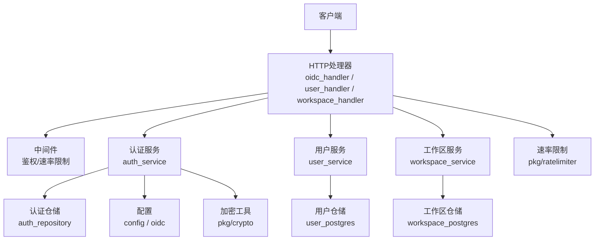
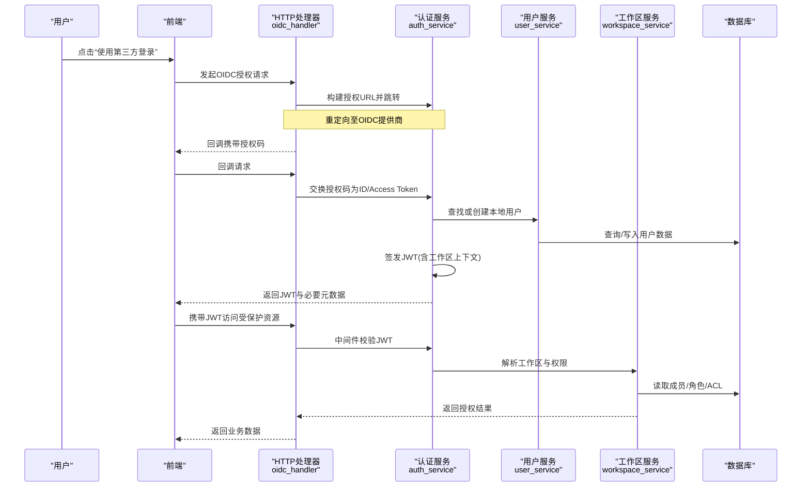
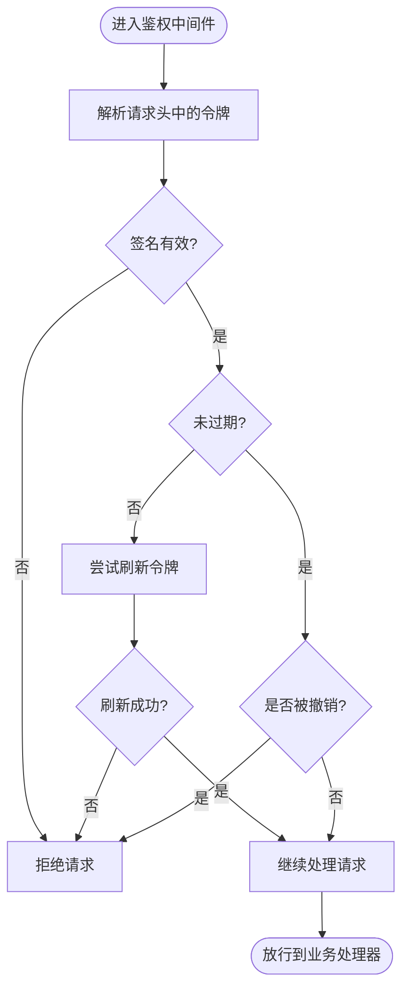
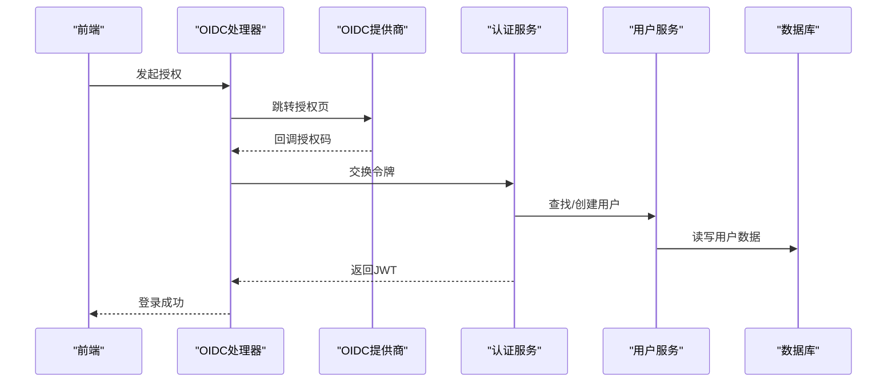
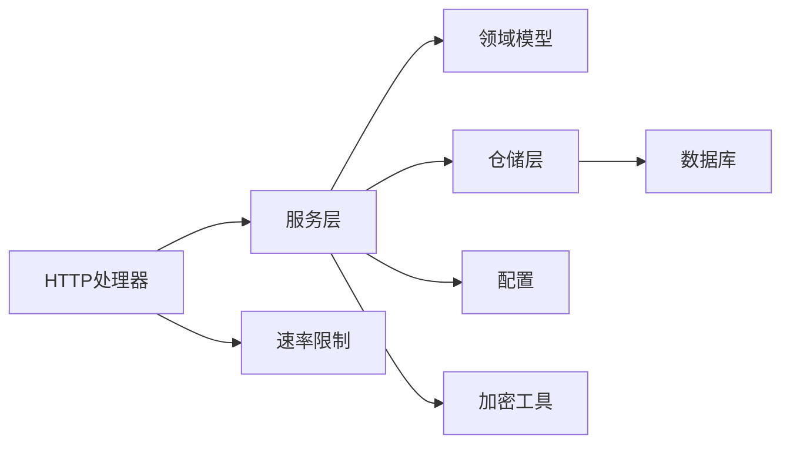

# 身份认证与授权

<cite>
**本文引用的文件**   
- [config.go](file://notifuse/config/config.go)
- [oidc.go](file://notifuse/config/oidc.go)
- [auth_service.go](file://notifuse/internal/service/auth_service.go)
- [user_service.go](file://notifuse/internal/service/user_service.go)
- [workspace_service.go](file://notifuse/internal/service/workspace_service.go)
- [auth_repository.go](file://notifuse/internal/repository/auth_repository.go)
- [user_postgres.go](file://notifuse/internal/repository/user_postgres.go)
- [workspace_postgres.go](file://notifuse/internal/repository/workspace_postgres.go)
- [auth.go](file://notifuse/internal/domain/auth.go)
- [user.go](file://notifuse/internal/domain/user.go)
- [workspace.go](file://notifuse/internal/domain/workspace.go)
- [oidc_handler.go](file://notifuse/internal/http/oidc_handler.go)
- [user_handler.go](file://notifuse/internal/http/user_handler.go)
- [workspace_handler.go](file://notifuse/internal/http/workspace_handler.go)
- [middleware](file://notifuse/internal/http/middleware)
- [oauth2_token_service.go](file://notifuse/internal/service/oauth2_token_service.go)
- [crypto.go](file://notifuse/pkg/crypto/crypto.go)
- [ratelimiter.go](file://notifuse/pkg/ratelimiter/ratelimiter.go)
- [openapi.yaml](file://notifuse/openapi/openapi.yaml)
- [security.yaml](file://notifuse/openapi/components/security.yaml)
</cite>

## 目录
1. [简介](#简介)
2. [项目结构](#项目结构)
3. [核心组件](#核心组件)
4. [架构总览](#架构总览)
5. [详细组件分析](#详细组件分析)
6. [依赖关系分析](#依赖关系分析)
7. [性能与安全考量](#性能与安全考量)
8. [故障排查指南](#故障排查指南)
9. [结论](#结论)
10. [附录](#附录)

## 简介
本文件面向Notifuse平台的身份认证与授权体系，覆盖以下主题：
- JWT令牌生命周期管理（生成、验证、刷新、撤销）
- 用户会话安全策略（存储、超时、并发控制）
- 基于工作区的权限控制（角色、权限分配、访问控制列表）
- OAuth2/OIDC集成（第三方登录配置、用户信息同步）
- 密码安全策略（哈希算法、盐值、强度校验）
- 多因素认证(MFA)支持与API密钥管理
- 安全最佳实践与常见攻击防护

## 项目结构
认证与授权相关代码主要分布在以下层次：
- HTTP层：OIDC回调、用户与会话相关处理器
- 中间件层：鉴权、速率限制等通用能力
- 服务层：认证流程编排、OAuth2/OIDC交互、工作区权限决策
- 领域模型：用户、工作区、认证实体定义
- 仓储层：PostgreSQL持久化实现
- 配置层：平台配置、OIDC提供者参数
- OpenAPI规范：安全方案与接口契约



图表来源
- [oidc_handler.go](file://notifuse/internal/http/oidc_handler.go)
- [user_handler.go](file://notifuse/internal/http/user_handler.go)
- [workspace_handler.go](file://notifuse/internal/http/workspace_handler.go)
- [auth_service.go](file://notifuse/internal/service/auth_service.go)
- [user_service.go](file://notifuse/internal/service/user_service.go)
- [workspace_service.go](file://notifuse/internal/service/workspace_service.go)
- [auth_repository.go](file://notifuse/internal/repository/auth_repository.go)
- [user_postgres.go](file://notifuse/internal/repository/user_postgres.go)
- [workspace_postgres.go](file://notifuse/internal/repository/workspace_postgres.go)
- [config.go](file://notifuse/config/config.go)
- [oidc.go](file://notifuse/config/oidc.go)
- [crypto.go](file://notifuse/pkg/crypto/crypto.go)
- [ratelimiter.go](file://notifuse/pkg/ratelimiter/ratelimiter.go)

章节来源
- [oidc_handler.go](file://notifuse/internal/http/oidc_handler.go)
- [user_handler.go](file://notifuse/internal/http/user_handler.go)
- [workspace_handler.go](file://notifuse/internal/http/workspace_handler.go)
- [auth_service.go](file://notifuse/internal/service/auth_service.go)
- [user_service.go](file://notifuse/internal/service/user_service.go)
- [workspace_service.go](file://notifuse/internal/service/workspace_service.go)
- [auth_repository.go](file://notifuse/internal/repository/auth_repository.go)
- [user_postgres.go](file://notifuse/internal/repository/user_postgres.go)
- [workspace_postgres.go](file://notifuse/internal/repository/workspace_postgres.go)
- [config.go](file://notifuse/config/config.go)
- [oidc.go](file://notifuse/config/oidc.go)
- [crypto.go](file://notifuse/pkg/crypto/crypto.go)
- [ratelimiter.go](file://notifuse/pkg/ratelimiter/ratelimiter.go)

## 核心组件
- 认证服务(auth_service)：负责登录、注册、密码重置、JWT签发与校验、会话状态维护、MFA流程编排。
- 用户服务(user_service)：用户资料、密码策略、账户状态、第三方身份绑定。
- 工作区服务(workspace_service)：工作区成员、角色、权限与访问控制列表(ACL)。
- OIDC处理器(oidc_handler)：处理第三方登录回调、交换令牌、创建或关联本地用户。
- 配置(config/oidc)：加载平台与OIDC提供者参数，如签名密钥、过期时间、回调URL等。
- 加密工具(pkg/crypto)：提供安全的随机数、哈希、加解密能力。
- 速率限制(pkg/ratelimiter)：对敏感接口进行限流，防止暴力破解与枚举。

章节来源
- [auth_service.go](file://notifuse/internal/service/auth_service.go)
- [user_service.go](file://notifuse/internal/service/user_service.go)
- [workspace_service.go](file://notifuse/internal/service/workspace_service.go)
- [oidc_handler.go](file://notifuse/internal/http/oidc_handler.go)
- [config.go](file://notifuse/config/config.go)
- [oidc.go](file://notifuse/config/oidc.go)
- [crypto.go](file://notifuse/pkg/crypto/crypto.go)
- [ratelimiter.go](file://notifuse/pkg/ratelimiter/ratelimiter.go)

## 架构总览
下图展示一次完整的OIDC第三方登录到获取工作区资源的端到端流程，包括JWT签发与鉴权中间件的作用。



图表来源
- [oidc_handler.go](file://notifuse/internal/http/oidc_handler.go)
- [auth_service.go](file://notifuse/internal/service/auth_service.go)
- [user_service.go](file://notifuse/internal/service/user_service.go)
- [workspace_service.go](file://notifuse/internal/service/workspace_service.go)
- [auth_repository.go](file://notifuse/internal/repository/auth_repository.go)
- [user_postgres.go](file://notifuse/internal/repository/user_postgres.go)
- [workspace_postgres.go](file://notifuse/internal/repository/workspace_postgres.go)

## 详细组件分析

### JWT令牌管理机制
- 令牌生成
  - 由认证服务在成功登录后签发，载荷包含用户标识、工作区上下文、角色与权限摘要、签发时间与过期时间。
  - 签名密钥与算法由配置层注入，确保跨实例一致性。
- 令牌验证
  - 鉴权中间件拦截受保护请求，校验签名、过期时间、工作区有效性及吊销状态。
  - 支持短生命周期访问令牌与可选的刷新令牌机制。
- 令牌刷新
  - 当访问令牌即将过期时，客户端使用刷新令牌换取新访问令牌；刷新令牌需具备更长有效期且可被服务端撤销。
- 令牌撤销
  - 通过黑名单或版本戳实现即时失效；登出、密码修改、高危操作后触发撤销。
- 安全要点
  - 最小化载荷，避免敏感信息入JWT。
  - 严格校验iss、aud、exp、nbf等标准字段。
  - 结合速率限制与审计日志，防范暴力刷新与重放。



图表来源
- [auth_service.go](file://notifuse/internal/service/auth_service.go)
- [middleware](file://notifuse/internal/http/middleware)
- [config.go](file://notifuse/config/config.go)

章节来源
- [auth_service.go](file://notifuse/internal/service/auth_service.go)
- [config.go](file://notifuse/config/config.go)
- [middleware](file://notifuse/internal/http/middleware)

### 用户会话安全策略
- 会话存储
  - 无状态优先：以JWT为主，必要时配合短期会话记录用于撤销与审计。
  - 若采用有状态会话，应使用分布式缓存并设置TTL与滚动续期。
- 超时管理
  - 访问令牌短效、刷新令牌中长效；会话空闲超时与绝对超时双重控制。
- 并发控制
  - 同一用户多设备登录时，支持强制下线或按工作区分发会话。
  - 关键操作要求重新认证或二次确认。

章节来源
- [auth_service.go](file://notifuse/internal/service/auth_service.go)
- [user_service.go](file://notifuse/internal/service/user_service.go)

### 基于工作区的权限控制系统
- 角色定义
  - 典型角色包括所有者、管理员、编辑者、观察者等，不同角色拥有不同操作集。
- 权限分配
  - 用户与工作区建立成员关系，赋予角色；支持批量导入与审批流程。
- 访问控制列表(ACL)
  - 针对资源级细粒度控制，允许白名单/黑名单式访问策略。
- 鉴权流程
  - 中间件解析JWT中的工作区上下文，调用工作区服务校验成员与角色，再根据ACL判定是否允许。

```mermaid
classDiagram
class 用户 {
+id
+邮箱
+状态
+创建时间
}
class 工作区 {
+id
+名称
+状态
+创建时间
}
class 成员关系 {
+用户ID
+工作区ID
+角色
+加入时间
}
class 权限策略 {
+资源类型
+动作集合
+条件表达式
}
用户 ||--o{ 成员关系 : "属于"
工作区 ||--o{ 成员关系 : "包含"
成员关系 --> 权限策略 : "继承/叠加"
```

图表来源
- [workspace_service.go](file://notifuse/internal/service/workspace_service.go)
- [workspace_postgres.go](file://notifuse/internal/repository/workspace_postgres.go)
- [workspace.go](file://notifuse/internal/domain/workspace.go)
- [user.go](file://notifuse/internal/domain/user.go)
- [auth.go](file://notifuse/internal/domain/auth.go)

章节来源
- [workspace_service.go](file://notifuse/internal/service/workspace_service.go)
- [workspace_postgres.go](file://notifuse/internal/repository/workspace_postgres.go)
- [workspace.go](file://notifuse/internal/domain/workspace.go)
- [user.go](file://notifuse/internal/domain/user.go)
- [auth.go](file://notifuse/internal/domain/auth.go)

### OAuth2/OIDC集成实现
- 第三方登录配置
  - 通过配置层注入提供商元数据、客户端ID/密钥、回调地址、作用域与映射规则。
- 授权流程
  - 前端跳转到提供商，后端接收回调并交换令牌，完成用户发现与本地账户关联。
- 用户信息同步
  - 将提供商返回的用户属性映射到本地用户模型，支持首次登录自动注册与后续更新。
- 错误处理
  - 对无效状态、重复绑定、网络异常等进行明确错误码与重试策略。



图表来源
- [oidc_handler.go](file://notifuse/internal/http/oidc_handler.go)
- [auth_service.go](file://notifuse/internal/service/auth_service.go)
- [user_service.go](file://notifuse/internal/service/user_service.go)
- [oidc.go](file://notifuse/config/oidc.go)

章节来源
- [oidc_handler.go](file://notifuse/internal/http/oidc_handler.go)
- [auth_service.go](file://notifuse/internal/service/auth_service.go)
- [user_service.go](file://notifuse/internal/service/user_service.go)
- [oidc.go](file://notifuse/config/oidc.go)

### 密码安全策略
- 哈希算法选择
  - 使用抗GPU/ASIC的慢哈希算法，确保计算成本可控且不可逆。
- 盐值生成
  - 每次密码变更生成独立随机盐，避免彩虹表攻击。
- 密码强度验证
  - 长度、复杂度、历史重复、字典词检测等策略组合。
- 传输与存储
  - 全链路TLS；服务端仅存储哈希值，不保存明文。

章节来源
- [user_service.go](file://notifuse/internal/service/user_service.go)
- [crypto.go](file://notifuse/pkg/crypto/crypto.go)

### 多因素认证(MFA)支持
- 支持TOTP或短信/邮件验证码作为第二因素。
- 登录流程在密码通过后进入MFA阶段，成功后签发JWT。
- 支持信任设备与免密访问策略（可选）。

章节来源
- [auth_service.go](file://notifuse/internal/service/auth_service.go)
- [user_service.go](file://notifuse/internal/service/user_service.go)

### API密钥管理
- 生成与轮换
  - 服务端生成高熵密钥，支持定期轮换与版本前缀。
- 权限范围
  - 密钥绑定工作区与作用域，限制可访问的资源与操作。
- 审计与限流
  - 记录使用方、IP、时间、资源；对密钥访问实施更严格的速率限制。

章节来源
- [auth_service.go](file://notifuse/internal/service/auth_service.go)
- [workspace_service.go](file://notifuse/internal/service/workspace_service.go)
- [ratelimiter.go](file://notifuse/pkg/ratelimiter/ratelimiter.go)

## 依赖关系分析
- 组件耦合
  - HTTP处理器依赖服务层；服务层依赖领域模型与仓储；仓储依赖数据库。
- 外部依赖
  - OIDC提供商、数据库、缓存（可选）、消息队列（可选）。
- 潜在循环依赖
  - 通过接口抽象与服务分层避免循环引用。



图表来源
- [oidc_handler.go](file://notifuse/internal/http/oidc_handler.go)
- [auth_service.go](file://notifuse/internal/service/auth_service.go)
- [auth_repository.go](file://notifuse/internal/repository/auth_repository.go)
- [config.go](file://notifuse/config/config.go)
- [crypto.go](file://notifuse/pkg/crypto/crypto.go)
- [ratelimiter.go](file://notifuse/pkg/ratelimiter/ratelimiter.go)

章节来源
- [oidc_handler.go](file://notifuse/internal/http/oidc_handler.go)
- [auth_service.go](file://notifuse/internal/service/auth_service.go)
- [auth_repository.go](file://notifuse/internal/repository/auth_repository.go)
- [config.go](file://notifuse/config/config.go)
- [crypto.go](file://notifuse/pkg/crypto/crypto.go)
- [ratelimiter.go](file://notifuse/pkg/ratelimiter/ratelimiter.go)

## 性能与安全考量
- 性能
  - JWT无状态校验降低会话存储压力；工作区权限缓存减少频繁查询。
  - 合理设置令牌过期时间与刷新窗口，平衡安全性与用户体验。
- 安全
  - 全面启用TLS，禁用弱算法；对敏感接口实施速率限制与输入校验。
  - 最小权限原则，默认拒绝；所有鉴权失败记录审计日志。
  - 防CSRF/XSS：同源策略、SameSite Cookie、输出编码。
  - 防暴力破解：账号锁定、验证码、动态限速。
  - 防重放：nonce/time-window校验，短期令牌。

[本节为通用指导，无需具体文件来源]

## 故障排查指南
- 常见问题
  - 令牌无效：检查签名密钥、过期时间、吊销状态。
  - 权限不足：核对工作区成员关系、角色与ACL策略。
  - OIDC回调失败：确认回调URL、作用域、状态参数与网络连通性。
  - 密码重置失败：检查邮箱模板、SMTP配置与链接时效。
- 定位方法
  - 查看鉴权中间件与认证服务的错误日志。
  - 开启调试模式，打印JWT载荷与权限决策路径。
  - 使用OpenAPI文档校验请求格式与安全头。

章节来源
- [auth_service.go](file://notifuse/internal/service/auth_service.go)
- [oidc_handler.go](file://notifuse/internal/http/oidc_handler.go)
- [openapi.yaml](file://notifuse/openapi/openapi.yaml)
- [security.yaml](file://notifuse/openapi/components/security.yaml)

## 结论
Notifuse的身份认证与授权体系以JWT为核心，结合工作区维度的RBAC与ACL，实现了灵活而安全的访问控制。通过OIDC集成、密码安全策略、MFA与API密钥管理，平台在多租户场景下提供了完善的身份治理与风险控制能力。建议在生产环境持续完善审计、监控与自动化合规检查，确保系统长期稳定与安全。

[本节为总结，无需具体文件来源]

## 附录
- OpenAPI安全方案
  - 参考OpenAPI规范中的安全方案定义，统一描述Bearer Token、API Key等认证方式。

章节来源
- [openapi.yaml](file://notifuse/openapi/openapi.yaml)
- [security.yaml](file://notifuse/openapi/components/security.yaml)