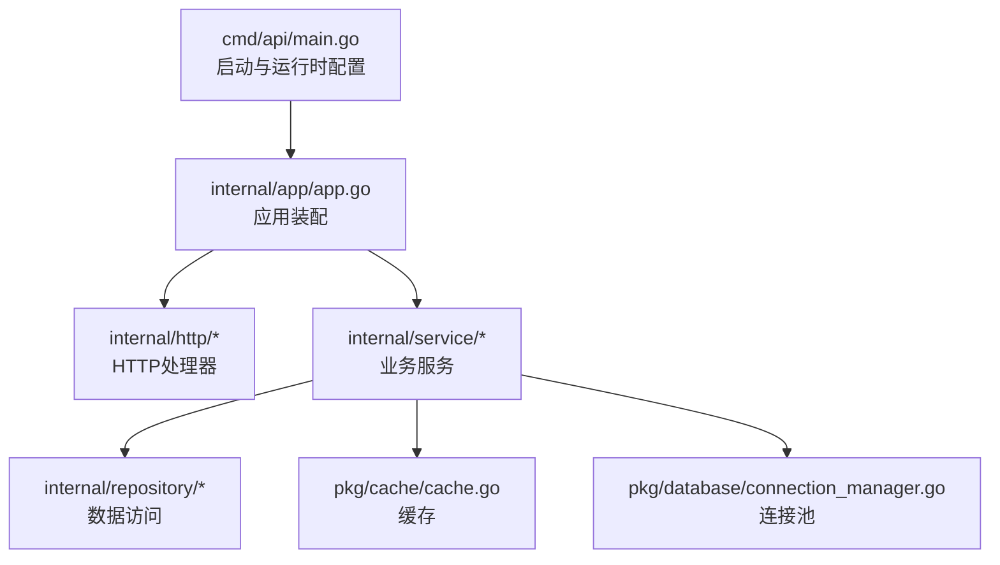
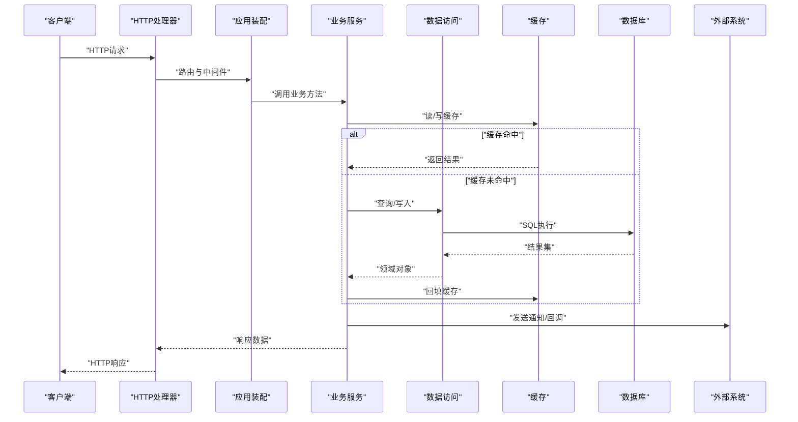
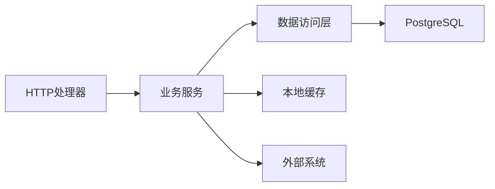

# 内存与CPU优化

<cite>
**本文引用的文件**   
- [cmd/api/main.go](file://notifuse/cmd/api/main.go)
- [internal/app/app.go](file://notifuse/internal/app/app.go)
- [pkg/cache/cache.go](file://notifuse/pkg/cache/cache.go)
- [pkg/database/connection_manager.go](file://notifuse/pkg/database/connection_manager.go)
- [internal/repository/email_queue_postgres.go](file://notifuse/internal/repository/email_queue_postgres.go)
- [internal/service/webhook_delivery_worker.go](file://notifuse/internal/service/webhook_delivery_worker.go)
- [internal/service/automation_executor.go](file://notifuse/internal/service/automation_executor.go)
- [internal/service/task_scheduler.go](file://notifuse/internal/service/task_scheduler.go)
- [internal/http/utils.go](file://notifuse/internal/http/utils.go)
- [Makefile](file://notifuse/Makefile)
- [tests/Makefile.test](file://notifuse/tests/Makefile.test)
</cite>

## 目录
1. [简介](#简介)
2. [项目结构](#项目结构)
3. [核心组件](#核心组件)
4. [架构总览](#架构总览)
5. [详细组件分析](#详细组件分析)
6. [依赖关系分析](#依赖关系分析)
7. [性能考量](#性能考量)
8. [故障排查指南](#故障排查指南)
9. [结论](#结论)
10. [附录](#附录)

## 简介
本文件面向Notifuse平台的Go后端，聚焦内存与CPU使用优化。内容涵盖：
- Go垃圾回收（GC）调优：参数配置、内存分配策略与对象生命周期管理
- 内存泄漏检测工具：pprof的heap profile与block profile解读
- CPU性能优化：热点函数识别、算法优化与并行计算利用
- 大对象处理、内存复用与零拷贝技术
- 性能基准测试、压力测试与回归检测方法

## 项目结构
Notifuse后端采用分层与按领域组织的方式：入口在cmd/api，应用层在internal/app，业务服务在internal/service，HTTP处理器在internal/http，数据访问在internal/repository，通用能力在pkg。

图表来源
- [cmd/api/main.go](file://notifuse/cmd/api/main.go)
- [internal/app/app.go](file://notifuse/internal/app/app.go)
- [pkg/cache/cache.go](file://notifuse/pkg/cache/cache.go)
- [pkg/database/connection_manager.go](file://notifuse/pkg/database/connection_manager.go)

章节来源
- [cmd/api/main.go](file://notifuse/cmd/api/main.go)
- [internal/app/app.go](file://notifuse/internal/app/app.go)

## 核心组件
- HTTP服务器与中间件：负责请求接入、鉴权、限流、日志与指标收集
- 任务调度与执行器：自动化流程、定时任务与后台工作协程
- 队列与持久化：邮件队列、Webhook投递等I/O密集型路径
- 缓存与数据库连接池：减少重复计算与DB往返，控制并发与资源上限

章节来源
- [internal/http/utils.go](file://notifuse/internal/http/utils.go)
- [internal/service/task_scheduler.go](file://notifuse/internal/service/task_scheduler.go)
- [internal/service/automation_executor.go](file://notifuse/internal/service/automation_executor.go)
- [internal/repository/email_queue_postgres.go](file://notifuse/internal/repository/email_queue_postgres.go)
- [internal/service/webhook_delivery_worker.go](file://notifuse/internal/service/webhook_delivery_worker.go)
- [pkg/cache/cache.go](file://notifuse/pkg/cache/cache.go)
- [pkg/database/connection_manager.go](file://notifuse/pkg/database/connection_manager.go)

## 架构总览
下图展示从HTTP请求到业务处理、再到外部系统交互的关键路径，并标注了可观测性与性能优化的关键节点。

图表来源
- [internal/http/utils.go](file://notifuse/internal/http/utils.go)
- [internal/app/app.go](file://notifuse/internal/app/app.go)
- [pkg/cache/cache.go](file://notifuse/pkg/cache/cache.go)
- [pkg/database/connection_manager.go](file://notifuse/pkg/database/connection_manager.go)
- [internal/repository/email_queue_postgres.go](file://notifuse/internal/repository/email_queue_postgres.go)
- [internal/service/webhook_delivery_worker.go](file://notifuse/internal/service/webhook_delivery_worker.go)

## 详细组件分析

### 组件A：HTTP处理器与中间件
- 职责：解析请求、鉴权、限流、日志、指标上报；将请求委派给服务层
- 内存与CPU关注点：
  - 避免在请求路径中创建大对象或频繁字符串拼接
  - 复用缓冲与上下文，减少GC压力
  - 合理设置超时与并发度，防止协程泄漏

章节来源
- [internal/http/utils.go](file://notifuse/internal/http/utils.go)

### 组件B：任务调度与执行器
- 职责：周期性任务、延迟任务、自动化流程编排与执行
- 内存与CPU关注点：
  - 批处理与分页拉取，降低单次内存峰值
  - 限制并发goroutine数量，避免CPU抖动与锁竞争
  - 失败重试退避与幂等设计，减少无效计算

章节来源
- [internal/service/task_scheduler.go](file://notifuse/internal/service/task_scheduler.go)
- [internal/service/automation_executor.go](file://notifuse/internal/service/automation_executor.go)

### 组件C：队列与持久化（邮件队列示例）
- 职责：高吞吐地持久化与消费消息，驱动后续发送逻辑
- 内存与CPU关注点：
  - 批量提交与事务边界控制，减少锁与网络开销
  - 流式读取与分块处理，避免一次性加载大结果集
  - 使用对象池或预分配切片，降低分配次数

章节来源
- [internal/repository/email_queue_postgres.go](file://notifuse/internal/repository/email_queue_postgres.go)

### 组件D：Webhook投递工作协程
- 职责：异步投递Webhook事件，具备重试与去重机制
- 内存与CPU关注点：
  - 控制并发度与背压，避免下游拥塞导致内存膨胀
  - 使用零拷贝传输大附件（如直接管道传递），减少复制
  - 监控阻塞等待，结合block profile定位锁与I/O瓶颈

章节来源
- [internal/service/webhook_delivery_worker.go](file://notifuse/internal/service/webhook_delivery_worker.go)

### 组件E：缓存与数据库连接池
- 职责：提供本地缓存与DB连接池，提升命中率与吞吐
- 内存与CPU关注点：
  - 设置合理的TTL与容量上限，避免缓存无限增长
  - 连接池大小与最大空闲连接数需匹配负载与DB能力
  - 预热常用键，减少冷启动时的突发分配

章节来源
- [pkg/cache/cache.go](file://notifuse/pkg/cache/cache.go)
- [pkg/database/connection_manager.go](file://notifuse/pkg/database/connection_manager.go)

## 依赖关系分析
- 低耦合：HTTP层仅依赖服务接口，服务通过仓库访问数据，便于替换实现与注入mock
- 内聚性：每个服务模块围绕单一领域职责组织，利于局部优化与测试
- 外部依赖：PostgreSQL、外部SMTP/邮件服务商、第三方API等，需在性能测试中模拟真实延迟

图表来源
- [internal/http/utils.go](file://notifuse/internal/http/utils.go)
- [internal/service/automation_executor.go](file://notifuse/internal/service/automation_executor.go)
- [internal/repository/email_queue_postgres.go](file://notifuse/internal/repository/email_queue_postgres.go)
- [pkg/cache/cache.go](file://notifuse/pkg/cache/cache.go)
- [pkg/database/connection_manager.go](file://notifuse/pkg/database/connection_manager.go)

章节来源
- [internal/app/app.go](file://notifuse/internal/app/app.go)

## 性能考量

### Go垃圾回收（GC）调优
- 目标：降低STW时间、减少分配频率、稳定内存占用
- 建议实践：
  - 根据部署环境调整GOGC与GOMEMLIMIT，观察p95/p99延迟与RSS变化
  - 使用pprof heap profile定位热点分配，优先消除热点对象
  - 对高频小对象使用对象池或预分配切片，减少分配次数
  - 避免长生命周期持有短生命周期引用，缩短对象存活期

章节来源
- [cmd/api/main.go](file://notifuse/cmd/api/main.go)
- [internal/app/app.go](file://notifuse/internal/app/app.go)

### 内存分配策略与对象生命周期管理
- 分配策略：
  - 尽量复用缓冲区与临时对象，避免在热路径上频繁new/make
  - 使用[]byte与string转换时注意零拷贝场景，必要时使用unsafe或标准库提供的无拷贝API
  - 对大对象进行分块处理，降低单对象体积
- 生命周期管理：
  - 明确作用域，及时释放不再使用的引用
  - 使用context控制取消与超时，避免协程泄漏
  - 对长时间运行的任务引入心跳与检查点，便于恢复与清理

章节来源
- [internal/service/webhook_delivery_worker.go](file://notifuse/internal/service/webhook_delivery_worker.go)
- [internal/repository/email_queue_postgres.go](file://notifuse/internal/repository/email_queue_postgres.go)

### 内存泄漏检测工具使用（pprof）
- 采集方式：
  - 在HTTP端点暴露pprof接口，或使用SIGUSR1触发profile采集
  - 针对heap、cpu、block、mutex等维度分别采集
- 解读要点：
  - heap profile：关注top分配者、累积字节数与对象计数
  - block profile：定位阻塞等待的锁与I/O，评估并发度是否合理
  - 结合火焰图对比不同版本差异，快速发现回归

章节来源
- [cmd/api/main.go](file://notifuse/cmd/api/main.go)

### CPU性能优化技术
- 热点函数识别：
  - 使用pprof cpu profile生成火焰图，定位Top函数
  - 结合trace分析goroutine切换与系统调用开销
- 算法优化：
  - 减少不必要的字符串拼接与正则匹配，改用更高效的数据结构
  - 批量处理与向量化操作，提高吞吐
- 并行计算：
  - 合理设置GOMAXPROCS，避免过度并行导致上下文切换
  - 使用worker pool限制并发，配合令牌桶限流保护下游

章节来源
- [internal/service/automation_executor.go](file://notifuse/internal/service/automation_executor.go)
- [internal/service/task_scheduler.go](file://notifuse/internal/service/task_scheduler.go)

### 大对象处理、内存复用与零拷贝
- 大对象处理：
  - 分块上传/下载，边读边写，避免一次性加载到内存
  - 使用流式JSON解析与序列化，降低峰值内存
- 内存复用：
  - 使用sync.Pool维护临时对象，减少分配与GC压力
  - 预分配切片与缓冲，避免扩容带来的额外拷贝
- 零拷贝：
  - 在网络IO中使用io.Copy或类似API，避免中间缓冲
  - 谨慎使用unsafe，确保语义正确与安全

章节来源
- [internal/repository/email_queue_postgres.go](file://notifuse/internal/repository/email_queue_postgres.go)
- [internal/service/webhook_delivery_worker.go](file://notifuse/internal/service/webhook_delivery_worker.go)

### 性能基准测试、压力测试与回归检测
- 基准测试：
  - 使用go test -bench编写微基准，覆盖热点路径
  - 固定输入规模，记录分配次数与耗时，建立基线
- 压力测试：
  - 使用wrk、hey或自定义脚本模拟高并发
  - 监控CPU、内存、GC、锁等待与I/O指标
- 回归检测：
  - 在CI中集成基准与压力用例，阈值告警
  - 对比diff报告，自动标记潜在回归

章节来源
- [Makefile](file://notifuse/Makefile)
- [tests/Makefile.test](file://notifuse/tests/Makefile.test)

## 故障排查指南
- 常见症状：
  - RSS持续增长：可能为缓存未设上限或长生命周期引用未释放
  - GC停顿明显：可能存在热点分配或大对象频繁创建
  - CPU飙升：热点函数或锁竞争严重
- 排查步骤：
  - 开启pprof并采集heap/cpu/block/profile
  - 对比不同版本的profile差异，定位新增热点
  - 结合trace分析goroutine与系统调用
  - 检查连接池与缓存配置，确认是否超出预期
- 修复建议：
  - 引入对象池与预分配，减少分配
  - 调整并发度与超时，避免协程泄漏
  - 优化SQL与索引，减少DB往返与锁等待

章节来源
- [pkg/cache/cache.go](file://notifuse/pkg/cache/cache.go)
- [pkg/database/connection_manager.go](file://notifuse/pkg/database/connection_manager.go)
- [internal/service/webhook_delivery_worker.go](file://notifuse/internal/service/webhook_delivery_worker.go)

## 结论
通过对GC调优、内存分配策略、对象生命周期管理以及CPU热点优化的系统化改进，并结合pprof与基准/压力测试，可有效提升Notifuse后端的稳定性与吞吐。建议在持续集成中固化性能回归检测，确保每次变更都经过严格的性能验证。

## 附录
- 术语说明：
  - STW：Stop-The-World，垃圾回收暂停阶段
  - RSS：常驻集大小，反映进程实际占用的物理内存
  - P95/P99：延迟分布的分位数指标
- 参考命令（概念性描述，不附具体代码）：
  - 采集heap profile：访问pprof端点或发送信号触发
  - 采集cpu profile：运行基准或压测时附加profile开关
  - 分析block profile：定位锁与I/O阻塞热点
  - 运行基准与压测：通过Makefile目标统一执行