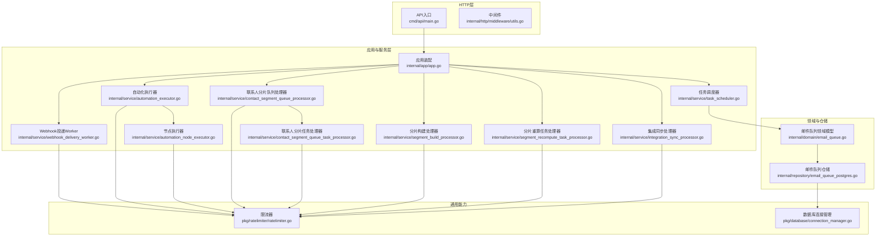
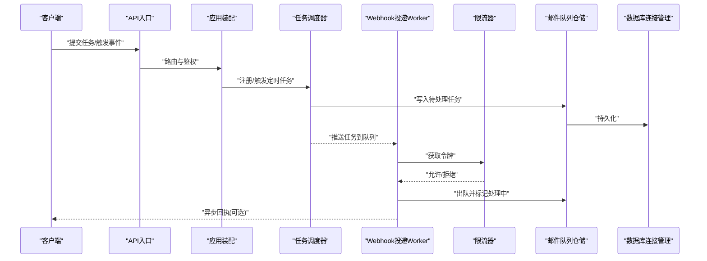
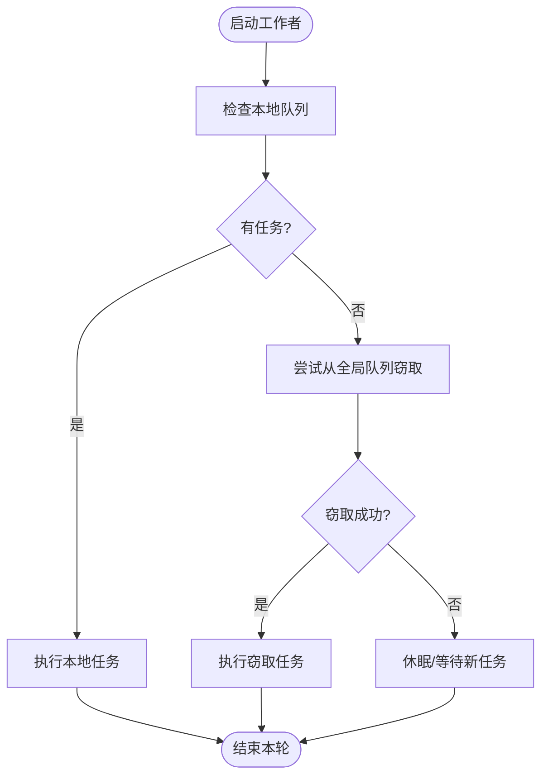
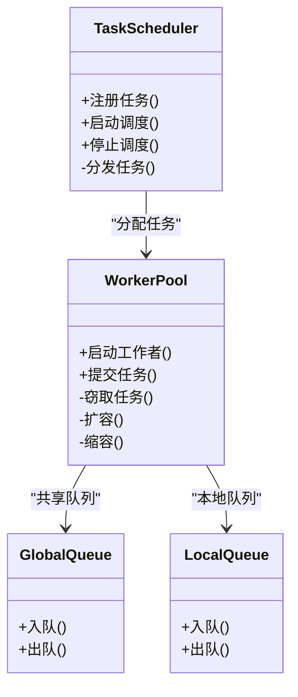
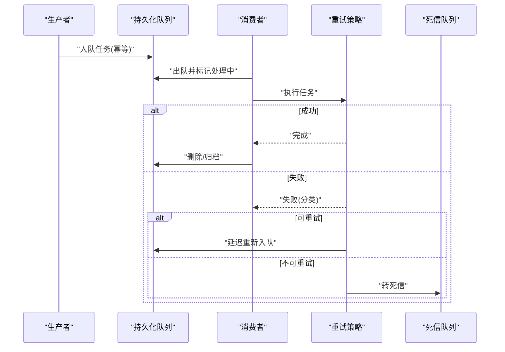
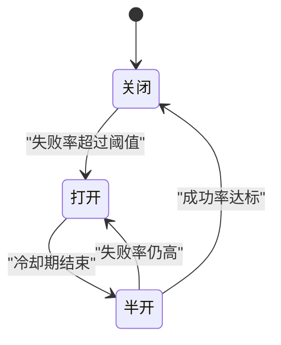
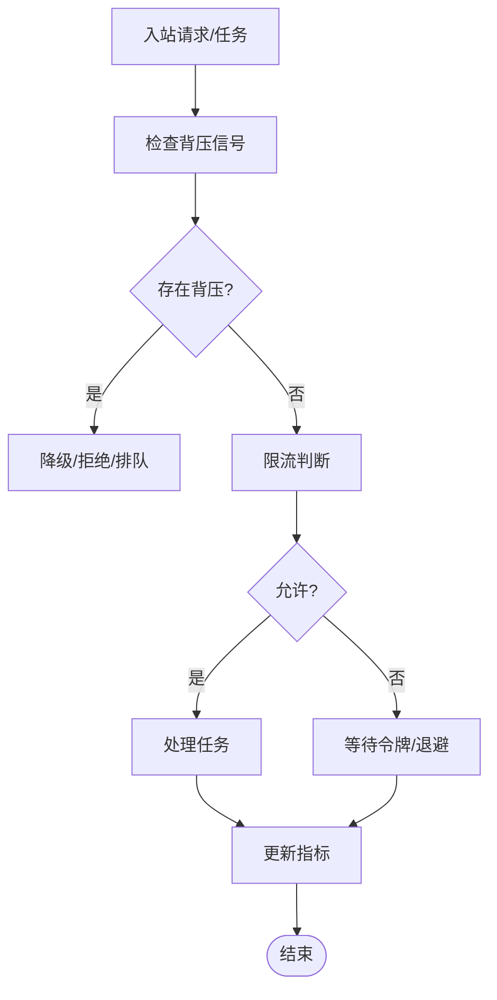
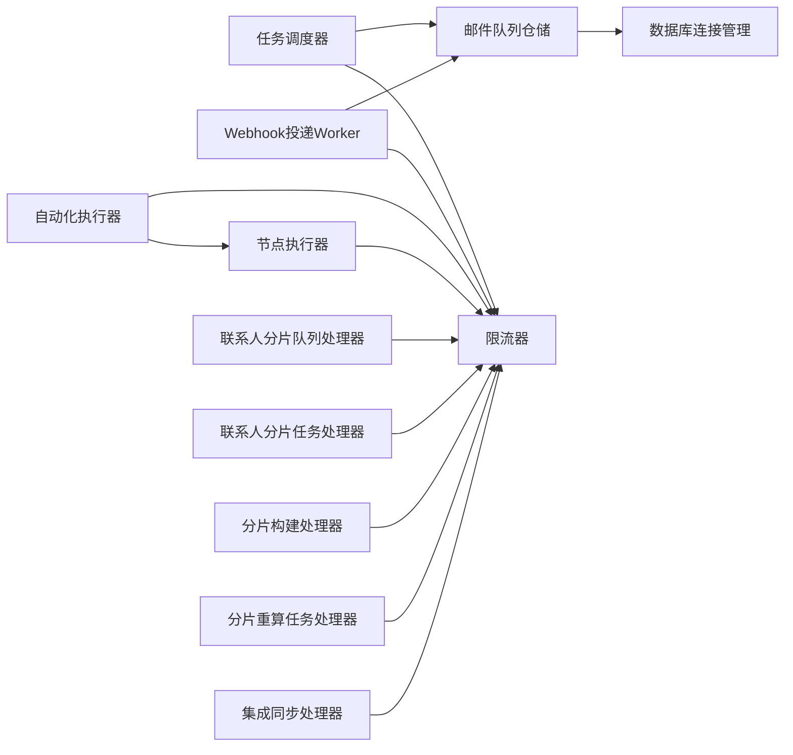

# 并发处理优化

<cite>
**本文引用的文件**   
- [cmd/api/main.go](file://notifuse/cmd/api/main.go)
- [internal/app/app.go](file://notifuse/internal/app/app.go)
- [internal/service/task_scheduler.go](file://notifuse/internal/service/task_scheduler.go)
- [internal/service/webhook_delivery_worker.go](file://notifuse/internal/service/webhook_delivery_worker.go)
- [internal/service/automation_executor.go](file://notifuse/internal/service/automation_executor.go)
- [internal/service/automation_node_executor.go](file://notifuse/internal/service/automation_node_executor.go)
- [internal/service/contact_segment_queue_processor.go](file://notifuse/internal/service/contact_segment_queue_processor.go)
- [internal/service/contact_segment_queue_task_processor.go](file://notifuse/internal/service/contact_segment_queue_task_processor.go)
- [internal/service/segment_build_processor.go](file://notifuse/internal/service/segment_build_processor.go)
- [internal/service/segment_recompute_task_processor.go](file://notifuse/internal/service/segment_recompute_task_processor.go)
- [internal/service/integration_sync_processor.go](file://notifuse/internal/service/integration_sync_processor.go)
- [internal/domain/email_queue.go](file://notifuse/internal/domain/email_queue.go)
- [internal/repository/email_queue_postgres.go](file://notifuse/internal/repository/email_queue_postgres.go)
- [pkg/ratelimiter/ratelimiter.go](file://notifuse/pkg/ratelimiter/ratelimiter.go)
- [internal/database/connection_manager.go](file://notifuse/pkg/database/connection_manager.go)
- [internal/http/middleware/utils.go](file://notifuse/internal/http/middleware/utils.go)
</cite>

## 目录
1. [简介](#简介)
2. [项目结构](#项目结构)
3. [核心组件](#核心组件)
4. [架构总览](#架构总览)
5. [详细组件分析](#详细组件分析)
6. [依赖分析](#依赖分析)
7. [性能考虑](#性能考虑)
8. [故障排查指南](#故障排查指南)
9. [结论](#结论)
10. [附录](#附录)

## 简介
本文件面向Notifuse平台的并发处理优化，聚焦以下主题：
- goroutine池设计与任务调度策略（含工作窃取与负载均衡）
- 异步处理机制（消息队列集成、任务重试与失败处理）
- 并发控制策略（互斥锁、读写锁、原子操作的使用场景）
- Circuit Breaker模式、限流算法与背压处理
- 并发性能监控、死锁检测与内存泄漏排查方法

目标是在不改变现有业务语义的前提下，提升吞吐、降低延迟、增强稳定性与可观测性。

## 项目结构
Notifuse后端采用分层架构：HTTP层负责请求路由与中间件；服务层编排业务流程；领域模型与仓储层对接数据库与外部系统；通用能力封装在pkg中（如限流、连接管理）。

图表来源
- [cmd/api/main.go:1-200](file://notifuse/cmd/api/main.go#L1-L200)
- [internal/app/app.go:1-200](file://notifuse/internal/app/app.go#L1-L200)
- [internal/service/task_scheduler.go:1-200](file://notifuse/internal/service/task_scheduler.go#L1-L200)
- [internal/service/webhook_delivery_worker.go:1-200](file://notifuse/internal/service/webhook_delivery_worker.go#L1-L200)
- [internal/service/automation_executor.go:1-200](file://notifuse/internal/service/automation_executor.go#L1-L200)
- [internal/service/automation_node_executor.go:1-200](file://notifuse/internal/service/automation_node_executor.go#L1-L200)
- [internal/service/contact_segment_queue_processor.go:1-200](file://notifuse/internal/service/contact_segment_queue_processor.go#L1-L200)
- [internal/service/contact_segment_queue_task_processor.go:1-200](file://notifuse/internal/service/contact_segment_queue_task_processor.go#L1-L200)
- [internal/service/segment_build_processor.go:1-200](file://notifuse/internal/service/segment_build_processor.go#L1-L200)
- [internal/service/segment_recompute_task_processor.go:1-200](file://notifuse/internal/service/segment_recompute_task_processor.go#L1-L200)
- [internal/service/integration_sync_processor.go:1-200](file://notifuse/internal/service/integration_sync_processor.go#L1-L200)
- [internal/domain/email_queue.go:1-200](file://notifuse/internal/domain/email_queue.go#L1-L200)
- [internal/repository/email_queue_postgres.go:1-200](file://notifuse/internal/repository/email_queue_postgres.go#L1-L200)
- [pkg/ratelimiter/ratelimiter.go:1-200](file://notifuse/pkg/ratelimiter/ratelimiter.go#L1-L200)
- [pkg/database/connection_manager.go:1-200](file://notifuse/pkg/database/connection_manager.go#L1-L200)

章节来源
- [cmd/api/main.go:1-200](file://notifuse/cmd/api/main.go#L1-L200)
- [internal/app/app.go:1-200](file://notifuse/internal/app/app.go#L1-L200)

## 核心组件
- 任务调度器：集中式定时任务与周期性作业调度，驱动后台任务入队与触发。
- Webhook投递Worker：按优先级与速率限制投递Webhook事件，具备重试与退避策略。
- 自动化执行器与节点执行器：编排复杂自动化流程，支持并行节点执行与错误隔离。
- 联系人分片队列处理器与任务处理器：将大规模联系人集合切分为分片，并行构建与更新。
- 分片构建与重算处理器：针对Segment的增量/全量构建与重计算。
- 集成同步处理器：对外部系统集成进行异步拉取与状态同步。
- 邮件队列领域与仓储：持久化待发送消息，提供出队与幂等保障。
- 限流器：令牌桶或漏桶实现，保护下游服务与数据库。
- 数据库连接管理：连接池配置、健康检查与优雅关闭。

章节来源
- [internal/service/task_scheduler.go:1-200](file://notifuse/internal/service/task_scheduler.go#L1-L200)
- [internal/service/webhook_delivery_worker.go:1-200](file://notifuse/internal/service/webhook_delivery_worker.go#L1-L200)
- [internal/service/automation_executor.go:1-200](file://notifuse/internal/service/automation_executor.go#L1-L200)
- [internal/service/automation_node_executor.go:1-200](file://notifuse/internal/service/automation_node_executor.go#L1-L200)
- [internal/service/contact_segment_queue_processor.go:1-200](file://notifuse/internal/service/contact_segment_queue_processor.go#L1-L200)
- [internal/service/contact_segment_queue_task_processor.go:1-200](file://notifuse/internal/service/contact_segment_queue_task_processor.go#L1-L200)
- [internal/service/segment_build_processor.go:1-200](file://notifuse/internal/service/segment_build_processor.go#L1-L200)
- [internal/service/segment_recompute_task_processor.go:1-200](file://notifuse/internal/service/segment_recompute_task_processor.go#L1-L200)
- [internal/service/integration_sync_processor.go:1-200](file://notifuse/internal/service/integration_sync_processor.go#L1-L200)
- [internal/domain/email_queue.go:1-200](file://notifuse/internal/domain/email_queue.go#L1-L200)
- [internal/repository/email_queue_postgres.go:1-200](file://notifuse/internal/repository/email_queue_postgres.go#L1-L200)
- [pkg/ratelimiter/ratelimiter.go:1-200](file://notifuse/pkg/ratelimiter/ratelimiter.go#L1-L200)
- [pkg/database/connection_manager.go:1-200](file://notifuse/pkg/database/connection_manager.go#L1-L200)

## 架构总览
下图展示从HTTP请求到后台异步处理的端到端路径，以及关键并发控制点。

图表来源
- [cmd/api/main.go:1-200](file://notifuse/cmd/api/main.go#L1-L200)
- [internal/app/app.go:1-200](file://notifuse/internal/app/app.go#L1-L200)
- [internal/service/task_scheduler.go:1-200](file://notifuse/internal/service/task_scheduler.go#L1-L200)
- [internal/service/webhook_delivery_worker.go:1-200](file://notifuse/internal/service/webhook_delivery_worker.go#L1-L200)
- [internal/repository/email_queue_postgres.go:1-200](file://notifuse/internal/repository/email_queue_postgres.go#L1-L200)
- [pkg/ratelimiter/ratelimiter.go:1-200](file://notifuse/pkg/ratelimiter/ratelimiter.go#L1-L200)
- [pkg/database/connection_manager.go:1-200](file://notifuse/pkg/database/connection_manager.go#L1-L200)

## 详细组件分析

### goroutine池与工作窃取
- 设计要点
  - 为不同类别任务创建专用池（如Webhook投递、自动化节点、分片构建），避免热点资源争用。
  - 每个池维护本地任务队列与全局共享队列，空闲工作者定期从全局队列“窃取”任务，实现负载均衡。
  - 通过上下文取消与超时控制，确保任务生命周期可控。
- 建议实现
  - 使用带缓冲通道作为本地队列，配合无缓冲全局通道；工作者循环优先消费本地队列，再尝试从全局队列窃取。
  - 引入指数退避与抖动，防止惊群效应。
  - 对长尾任务设置最大运行时间与重试上限。

图表来源
- [internal/service/webhook_delivery_worker.go:1-200](file://notifuse/internal/service/webhook_delivery_worker.go#L1-L200)
- [internal/service/automation_node_executor.go:1-200](file://notifuse/internal/service/automation_node_executor.go#L1-L200)
- [internal/service/contact_segment_queue_processor.go:1-200](file://notifuse/internal/service/contact_segment_queue_processor.go#L1-L200)

章节来源
- [internal/service/webhook_delivery_worker.go:1-200](file://notifuse/internal/service/webhook_delivery_worker.go#L1-L200)
- [internal/service/automation_node_executor.go:1-200](file://notifuse/internal/service/automation_node_executor.go#L1-L200)
- [internal/service/contact_segment_queue_processor.go:1-200](file://notifuse/internal/service/contact_segment_queue_processor.go#L1-L200)

### 任务调度与负载均衡
- 调度策略
  - 基于时间轮或固定间隔调度器，统一注册周期任务与一次性任务。
  - 根据任务类型与权重分配至不同goroutine池，避免单一池过载。
- 负载均衡
  - 全局队列+本地队列组合，结合工作窃取减少热点。
  - 动态扩缩容：依据队列长度与平均处理时延调整池大小。

图表来源
- [internal/service/task_scheduler.go:1-200](file://notifuse/internal/service/task_scheduler.go#L1-L200)
- [internal/service/webhook_delivery_worker.go:1-200](file://notifuse/internal/service/webhook_delivery_worker.go#L1-L200)

章节来源
- [internal/service/task_scheduler.go:1-200](file://notifuse/internal/service/task_scheduler.go#L1-L200)

### 异步处理机制：消息队列、重试与失败处理
- 消息队列集成
  - 以数据库表作为轻量级持久化队列，仓储层提供幂等入队与出队接口。
  - 通过事务保证“写入任务”和“标记处理中”的原子性。
- 重试与失败处理
  - 指数退避重试，记录失败原因与次数，超过阈值转入死信队列或告警。
  - 区分瞬态错误与永久错误，避免无效重试。
- 背压
  - 当队列积压超过阈值时，上游生产者减速或拒绝新任务，保护系统稳定。

图表来源
- [internal/domain/email_queue.go:1-200](file://notifuse/internal/domain/email_queue.go#L1-L200)
- [internal/repository/email_queue_postgres.go:1-200](file://notifuse/internal/repository/email_queue_postgres.go#L1-L200)
- [internal/service/webhook_delivery_worker.go:1-200](file://notifuse/internal/service/webhook_delivery_worker.go#L1-L200)

章节来源
- [internal/domain/email_queue.go:1-200](file://notifuse/internal/domain/email_queue.go#L1-L200)
- [internal/repository/email_queue_postgres.go:1-200](file://notifuse/internal/repository/email_queue_postgres.go#L1-L200)
- [internal/service/webhook_delivery_worker.go:1-200](file://notifuse/internal/service/webhook_delivery_worker.go#L1-L200)

### 并发控制策略：互斥锁、读写锁与原子操作
- 互斥锁
  - 用于临界区保护，如全局计数器、状态机切换、单例初始化。
- 读写锁
  - 读多写少场景（如配置缓存、路由表）使用读写锁提升并发读性能。
- 原子操作
  - 无锁计数与标志位（如指标统计、开关控制）使用原子操作，避免锁开销。
- 最佳实践
  - 缩小临界区范围，避免长时间持有锁。
  - 明确锁粒度，避免跨模块共享大对象加锁。
  - 使用上下文超时与取消，防止阻塞等待。

章节来源
- [internal/service/automation_executor.go:1-200](file://notifuse/internal/service/automation_executor.go#L1-L200)
- [internal/service/automation_node_executor.go:1-200](file://notifuse/internal/service/automation_node_executor.go#L1-L200)
- [internal/service/contact_segment_queue_processor.go:1-200](file://notifuse/internal/service/contact_segment_queue_processor.go#L1-L200)

### Circuit Breaker模式实现
- 目标
  - 快速失败、自动恢复，避免雪崩。
- 状态机
  - 关闭：正常放行请求。
  - 打开：直接拒绝，进入冷却期。
  - 半开：试探性放行少量请求，根据成功率决定状态迁移。
- 指标
  - 失败率、延迟分布、请求总量。
- 适用场景
  - 调用第三方API、数据库连接、消息队列等不稳定资源。

图表来源
- [internal/service/webhook_delivery_worker.go:1-200](file://notifuse/internal/service/webhook_delivery_worker.go#L1-L200)
- [internal/service/automation_node_executor.go:1-200](file://notifuse/internal/service/automation_node_executor.go#L1-L200)

章节来源
- [internal/service/webhook_delivery_worker.go:1-200](file://notifuse/internal/service/webhook_delivery_worker.go#L1-L200)
- [internal/service/automation_node_executor.go:1-200](file://notifuse/internal/service/automation_node_executor.go#L1-L200)

### 限流算法与背压处理
- 限流算法
  - 令牌桶：平滑突发流量，适合Webhook投递与外部API调用。
  - 漏桶：恒定速率输出，适合数据库写入与批量任务。
- 背压机制
  - 基于队列长度与处理时延的动态限速。
  - 上游生产者感知背压信号，主动降速或拒绝。
- 实现要点
  - 每类任务独立限流，避免相互影响。
  - 限流决策需可观测、可配置、可热更新。

图表来源
- [pkg/ratelimiter/ratelimiter.go:1-200](file://notifuse/pkg/ratelimiter/ratelimiter.go#L1-L200)
- [internal/service/webhook_delivery_worker.go:1-200](file://notifuse/internal/service/webhook_delivery_worker.go#L1-L200)

章节来源
- [pkg/ratelimiter/ratelimiter.go:1-200](file://notifuse/pkg/ratelimiter/ratelimiter.go#L1-L200)
- [internal/service/webhook_delivery_worker.go:1-200](file://notifuse/internal/service/webhook_delivery_worker.go#L1-L200)

### 并发性能监控、死锁检测与内存泄漏排查
- 性能监控
  - 采集goroutine数量、队列长度、任务耗时分位数、错误率、限流拒绝数。
  - 使用Prometheus或OpenTelemetry导出指标与追踪。
- 死锁检测
  - 启用运行时pprof与trace，定位长时间阻塞的锁竞争。
  - 在关键路径添加超时与取消，避免无限等待。
- 内存泄漏排查
  - 对比GC前后堆快照，关注持续增长的对象类型。
  - 检查闭包捕获大对象、未释放的定时器与监听器。
  - 验证goroutine泄露：长期运行的协程是否被正确取消。

章节来源
- [internal/http/middleware/utils.go:1-200](file://notifuse/internal/http/middleware/utils.go#L1-L200)
- [pkg/database/connection_manager.go:1-200](file://notifuse/pkg/database/connection_manager.go#L1-L200)

## 依赖分析
- 组件耦合
  - 任务调度器依赖仓储层与限流器；Worker依赖限流器与仓储层；自动化执行器依赖节点执行器与限流器。
- 外部依赖
  - 数据库连接管理由通用库提供，限流器为内部实现，便于替换与扩展。
- 潜在环依赖
  - 服务层与仓储层应保持单向依赖，避免循环导入。

图表来源
- [internal/service/task_scheduler.go:1-200](file://notifuse/internal/service/task_scheduler.go#L1-L200)
- [internal/service/webhook_delivery_worker.go:1-200](file://notifuse/internal/service/webhook_delivery_worker.go#L1-L200)
- [internal/service/automation_executor.go:1-200](file://notifuse/internal/service/automation_executor.go#L1-L200)
- [internal/service/automation_node_executor.go:1-200](file://notifuse/internal/service/automation_node_executor.go#L1-L200)
- [internal/service/contact_segment_queue_processor.go:1-200](file://notifuse/internal/service/contact_segment_queue_processor.go#L1-L200)
- [internal/service/contact_segment_queue_task_processor.go:1-200](file://notifuse/internal/service/contact_segment_queue_task_processor.go#L1-L200)
- [internal/service/segment_build_processor.go:1-200](file://notifuse/internal/service/segment_build_processor.go#L1-L200)
- [internal/service/segment_recompute_task_processor.go:1-200](file://notifuse/internal/service/segment_recompute_task_processor.go#L1-L200)
- [internal/service/integration_sync_processor.go:1-200](file://notifuse/internal/service/integration_sync_processor.go#L1-L200)
- [internal/repository/email_queue_postgres.go:1-200](file://notifuse/internal/repository/email_queue_postgres.go#L1-L200)
- [pkg/ratelimiter/ratelimiter.go:1-200](file://notifuse/pkg/ratelimiter/ratelimiter.go#L1-L200)
- [pkg/database/connection_manager.go:1-200](file://notifuse/pkg/database/connection_manager.go#L1-L200)

章节来源
- [internal/service/task_scheduler.go:1-200](file://notifuse/internal/service/task_scheduler.go#L1-L200)
- [internal/service/webhook_delivery_worker.go:1-200](file://notifuse/internal/service/webhook_delivery_worker.go#L1-L200)
- [internal/service/automation_executor.go:1-200](file://notifuse/internal/service/automation_executor.go#L1-L200)
- [internal/service/automation_node_executor.go:1-200](file://notifuse/internal/service/automation_node_executor.go#L1-L200)
- [internal/service/contact_segment_queue_processor.go:1-200](file://notifuse/internal/service/contact_segment_queue_processor.go#L1-L200)
- [internal/service/contact_segment_queue_task_processor.go:1-200](file://notifuse/internal/service/contact_segment_queue_task_processor.go#L1-L200)
- [internal/service/segment_build_processor.go:1-200](file://notifuse/internal/service/segment_build_processor.go#L1-L200)
- [internal/service/segment_recompute_task_processor.go:1-200](file://notifuse/internal/service/segment_recompute_task_processor.go#L1-L200)
- [internal/service/integration_sync_processor.go:1-200](file://notifuse/internal/service/integration_sync_processor.go#L1-L200)
- [internal/repository/email_queue_postgres.go:1-200](file://notifuse/internal/repository/email_queue_postgres.go#L1-L200)
- [pkg/ratelimiter/ratelimiter.go:1-200](file://notifuse/pkg/ratelimiter/ratelimiter.go#L1-L200)
- [pkg/database/connection_manager.go:1-200](file://notifuse/pkg/database/connection_manager.go#L1-L200)

## 性能考虑
- 合理设置goroutine池大小：CPU密集型任务约为CPU核数，IO密集型任务可按I/O并发度放大。
- 批处理与合并：将小任务聚合为批次，减少锁与网络往返。
- 预取与流水线：在安全范围内预取数据，形成流水线提升吞吐。
- 避免热点锁：拆分热点数据结构，使用分段锁或无锁队列。
- 监控与调优：持续观察P99延迟、错误率与资源利用率，迭代参数。

[本节为通用指导，无需源码引用]

## 故障排查指南
- 常见问题
  - 任务堆积：检查队列长度与消费者速率，评估限流与背压策略。
  - 频繁失败：查看错误分类与重试策略，确认是否为瞬态错误。
  - 响应缓慢：定位热点锁与长尾任务，优化临界区与超时。
- 诊断工具
  - pprof：CPU、内存、阻塞、互斥锁分析。
  - trace：goroutine生命周期与阻塞点可视化。
  - 日志与指标：关联任务ID与上下文，便于端到端追踪。
- 修复建议
  - 增加超时与取消，避免无限等待。
  - 细化错误分类，改进重试与回退策略。
  - 调整限流与池大小，平衡吞吐与延迟。

章节来源
- [internal/http/middleware/utils.go:1-200](file://notifuse/internal/http/middleware/utils.go#L1-L200)
- [pkg/database/connection_manager.go:1-200](file://notifuse/pkg/database/connection_manager.go#L1-L200)

## 结论
通过goroutine池与工作窃取、任务调度与负载均衡、异步队列与重试、Circuit Breaker与限流、以及完善的监控与诊断手段，Notifuse平台可在高并发场景下保持高吞吐、低延迟与强稳定性。建议在上线前进行容量规划与压测，持续收集指标并迭代优化。

[本节为总结，无需源码引用]

## 附录
- 术语
  - goroutine池：一组复用协程的集合，用于执行任务。
  - 工作窃取：空闲工作者从全局队列获取任务以提升利用率。
  - Circuit Breaker：断路器模式，快速失败与自动恢复。
  - 背压：下游压力反馈给上游，控制生产速率。
- 参考实现位置
  - 任务调度与Worker：见对应service文件。
  - 限流器：见pkg/ratelimiter。
  - 数据库连接管理：见pkg/database。

[本节为概念说明，无需源码引用]