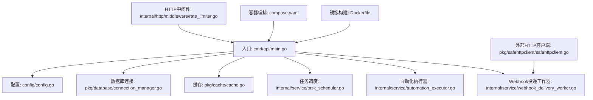
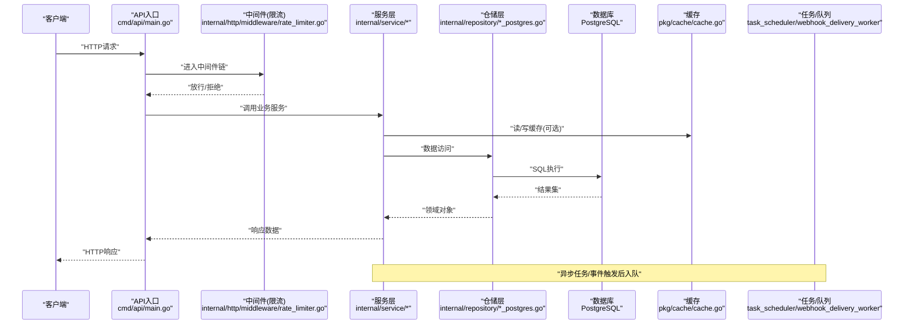
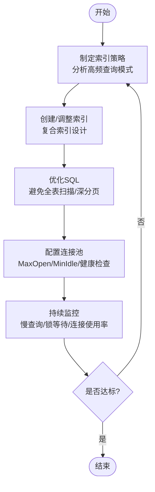
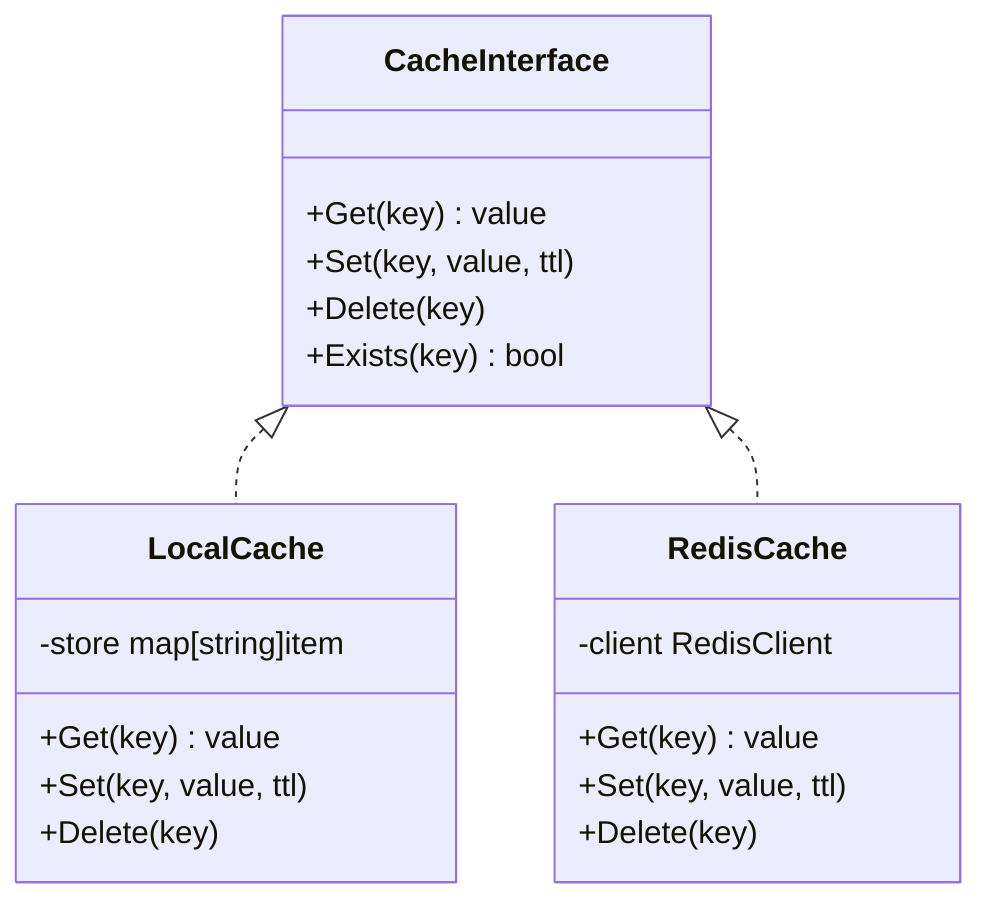
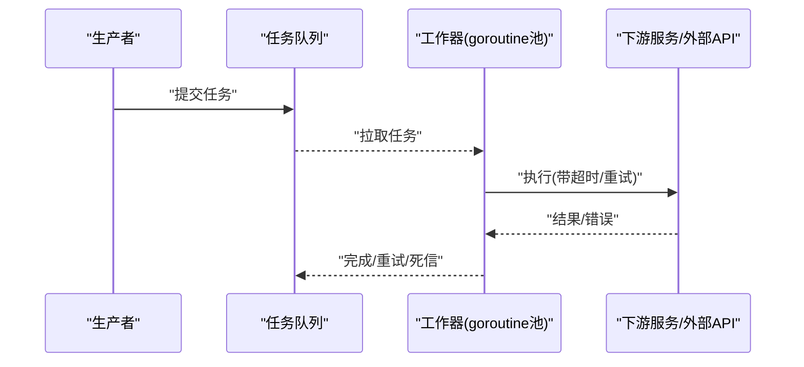
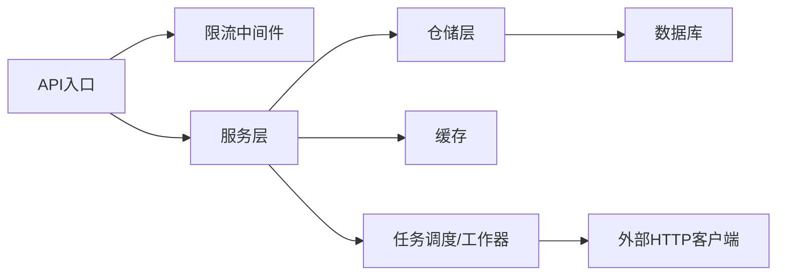

# 性能优化与调优

<cite>
**本文引用的文件**   
- [cmd/api/main.go](file://notifuse/cmd/api/main.go)
- [config/config.go](file://notifuse/config/config.go)
- [internal/database/init.go](file://notifuse/internal/database/init.go)
- [pkg/database/connection_manager.go](file://notifuse/pkg/database/connection_manager.go)
- [pkg/cache/cache.go](file://notifuse/pkg/cache/cache.go)
- [internal/service/task_scheduler.go](file://notifuse/internal/service/task_scheduler.go)
- [internal/service/automation_executor.go](file://notifuse/internal/service/automation_executor.go)
- [internal/service/webhook_delivery_worker.go](file://notifuse/internal/service/webhook_delivery_worker.go)
- [internal/repository/analytics_postgres.go](file://notifuse/internal/repository/analytics_postgres.go)
- [internal/repository/contact_postgres.go](file://notifuse/internal/repository/contact_postgres.go)
- [internal/repository/email_queue_postgres.go](file://notifuse/internal/repository/email_queue_postgres.go)
- [internal/http/middleware/rate_limiter.go](file://notifuse/internal/http/middleware/rate_limiter.go)
- [pkg/ratelimiter/ratelimiter.go](file://notifuse/pkg/ratelimiter/ratelimiter.go)
- [pkg/safehttpclient/safehttpclient.go](file://notifuse/pkg/safehttpclient/safehttpclient.go)
- [compose.yaml](file://notifuse/compose.yaml)
- [Dockerfile](file://notifuse/Dockerfile)
- [Makefile.integration](file://notifuse/Makefile.integration)
- [tests/integration/testutil/db.go](file://notifuse/tests/integration/testutil/db.go)
</cite>

## 目录
1. [简介](#简介)
2. [项目结构](#项目结构)
3. [核心组件](#核心组件)
4. [架构总览](#架构总览)
5. [详细组件分析](#详细组件分析)
6. [依赖关系分析](#依赖关系分析)
7. [性能考量](#性能考量)
8. [故障排查指南](#故障排查指南)
9. [结论](#结论)
10. [附录](#附录)

## 简介
本文件面向Notifuse平台的性能优化与调优，覆盖数据库、缓存、并发、内存与CPU、负载均衡与CDN、静态资源、基准与压力测试、监控指标等关键维度。文档基于仓库中现有实现进行梳理，并给出可落地的优化建议与验证方法，帮助读者在不改变业务语义的前提下提升系统吞吐、降低延迟与资源消耗。

## 项目结构
Notifuse后端采用Go语言构建，入口位于cmd/api，配置集中于config，数据访问通过repository层封装，服务逻辑在service层，HTTP路由与中间件在http层，通用能力（如缓存、限流、HTTP客户端）在pkg层。容器化与集成测试分别由Dockerfile与tests目录支撑。

图表来源
- [cmd/api/main.go](file://notifuse/cmd/api/main.go)
- [config/config.go](file://notifuse/config/config.go)
- [pkg/database/connection_manager.go](file://notifuse/pkg/database/connection_manager.go)
- [pkg/cache/cache.go](file://notifuse/pkg/cache/cache.go)
- [internal/service/task_scheduler.go](file://notifuse/internal/service/task_scheduler.go)
- [internal/service/automation_executor.go](file://notifuse/internal/service/automation_executor.go)
- [internal/service/webhook_delivery_worker.go](file://notifuse/internal/service/webhook_delivery_worker.go)
- [internal/http/middleware/rate_limiter.go](file://notifuse/internal/http/middleware/rate_limiter.go)
- [pkg/safehttpclient/safehttpclient.go](file://notifuse/pkg/safehttpclient/safehttpclient.go)
- [compose.yaml](file://notifuse/compose.yaml)
- [Dockerfile](file://notifuse/Dockerfile)

章节来源
- [cmd/api/main.go](file://notifuse/cmd/api/main.go)
- [config/config.go](file://notifuse/config/config.go)
- [compose.yaml](file://notifuse/compose.yaml)
- [Dockerfile](file://notifuse/Dockerfile)

## 核心组件
- 数据库连接管理：负责PostgreSQL连接池参数、健康检查与生命周期管理，直接影响查询吞吐与稳定性。
- 缓存抽象：提供统一的缓存接口与默认实现，便于接入Redis或内存缓存，用于热点数据与计算结果缓存。
- 任务调度与工作器：定时任务、自动化流程与异步投递，结合goroutine池与队列控制并发度，避免雪崩。
- HTTP中间件与限流：请求级限流、鉴权与日志埋点，保护后端免受突发流量冲击。
- 外部HTTP客户端：统一超时、重试与连接复用策略，减少外部依赖抖动对整体性能的影响。

章节来源
- [pkg/database/connection_manager.go](file://notifuse/pkg/database/connection_manager.go)
- [pkg/cache/cache.go](file://notifuse/pkg/cache/cache.go)
- [internal/service/task_scheduler.go](file://notifuse/internal/service/task_scheduler.go)
- [internal/service/automation_executor.go](file://notifuse/internal/service/automation_executor.go)
- [internal/service/webhook_delivery_worker.go](file://notifuse/internal/service/webhook_delivery_worker.go)
- [internal/http/middleware/rate_limiter.go](file://notifuse/internal/http/middleware/rate_limiter.go)
- [pkg/safehttpclient/safehttpclient.go](file://notifuse/pkg/safehttpclient/safehttpclient.go)

## 架构总览
下图展示从HTTP请求到数据持久化与异步处理的关键路径，以及缓存与限流的位置。

图表来源
- [cmd/api/main.go](file://notifuse/cmd/api/main.go)
- [internal/http/middleware/rate_limiter.go](file://notifuse/internal/http/middleware/rate_limiter.go)
- [pkg/cache/cache.go](file://notifuse/pkg/cache/cache.go)
- [internal/repository/analytics_postgres.go](file://notifuse/internal/repository/analytics_postgres.go)
- [internal/repository/contact_postgres.go](file://notifuse/internal/repository/contact_postgres.go)
- [internal/repository/email_queue_postgres.go](file://notifuse/internal/repository/email_queue_postgres.go)
- [internal/service/task_scheduler.go](file://notifuse/internal/service/task_scheduler.go)
- [internal/service/webhook_delivery_worker.go](file://notifuse/internal/service/webhook_delivery_worker.go)

## 详细组件分析

### 数据库性能优化
- 索引策略
  - 高频过滤字段建立B-Tree索引，如联系人列表的邮箱、标签、更新时间；邮件队列的状态、优先级、下次投递时间。
  - 复合索引优先匹配等值条件列，再按范围排序列，减少回表与临时排序。
  - 定期使用EXPLAIN ANALYZE验证计划，关注Seq Scan与Index Scan比例、回表次数与排序开销。
- 查询优化
  - 避免SELECT *，仅选择必要列；分页使用游标或基于主键的范围查询替代OFFSET深分页。
  - 将大事务拆分为小事务，缩短锁持有时间；批量写入使用UPSERT与批量插入。
  - 读写分离场景下，报表类查询走只读副本，主库专注事务型负载。
- 连接池配置
  - 根据CPU核数与I/O特性设置最大连接数，确保MaxOpenConns略大于并发峰值，MinIdle保持预热。
  - 启用连接健康检查与空闲回收，避免僵尸连接占用资源。
  - 针对长事务与慢查询设置合理的超时与取消传播，防止连接泄漏。

图表来源
- [internal/repository/analytics_postgres.go](file://notifuse/internal/repository/analytics_postgres.go)
- [internal/repository/contact_postgres.go](file://notifuse/internal/repository/contact_postgres.go)
- [internal/repository/email_queue_postgres.go](file://notifuse/internal/repository/email_queue_postgres.go)
- [pkg/database/connection_manager.go](file://notifuse/pkg/database/connection_manager.go)
- [internal/database/init.go](file://notifuse/internal/database/init.go)

章节来源
- [pkg/database/connection_manager.go](file://notifuse/pkg/database/connection_manager.go)
- [internal/database/init.go](file://notifuse/internal/database/init.go)
- [internal/repository/analytics_postgres.go](file://notifuse/internal/repository/analytics_postgres.go)
- [internal/repository/contact_postgres.go](file://notifuse/internal/repository/contact_postgres.go)
- [internal/repository/email_queue_postgres.go](file://notifuse/internal/repository/email_queue_postgres.go)

### 缓存策略设计
- 缓存分层
  - 本地内存缓存用于进程内热点数据（模板编译结果、字典），跨节点共享数据使用Redis。
  - 多级缓存：先查本地，未命中再查Redis，最后回源数据库。
- Redis使用
  - 合理设置TTL与过期策略，避免缓存穿透（布隆过滤器或空值缓存）、击穿（互斥锁）与雪崩（随机过期）。
  - 使用Pipeline与Lua脚本减少网络往返与保证原子性。
- 热点数据处理
  - 识别热点Key，采用预加载与分段更新；对高写热点采用写扩散+延迟双删或订阅变更事件。
  - 缓存一致性：以数据库为权威源，采用失效优先策略，必要时引入版本号或时间戳校验。

图表来源
- [pkg/cache/cache.go](file://notifuse/pkg/cache/cache.go)

章节来源
- [pkg/cache/cache.go](file://notifuse/pkg/cache/cache.go)

### 并发处理优化
- goroutine池
  - 使用有界通道或worker池限制并发度，避免无界goroutine导致OOM。
  - 根据CPU核数与I/O类型调整worker数量，CPU密集型≈CPU核数，I/O密集型可放大至2~4倍。
- 任务队列
  - 将耗时操作（邮件发送、Webhook投递、自动化流程）入队，消费者按容量拉取，削峰填谷。
  - 支持重试、退避与死信队列，保障最终一致性与可观测性。
- 异步处理机制
  - 事件驱动：发布-订阅模型解耦生产与消费；消息体最小化，携带ID与版本。
  - 背压与熔断：当下游不可用或延迟升高时快速失败与降级，保护核心链路。

图表来源
- [internal/service/task_scheduler.go](file://notifuse/internal/service/task_scheduler.go)
- [internal/service/automation_executor.go](file://notifuse/internal/service/automation_executor.go)
- [internal/service/webhook_delivery_worker.go](file://notifuse/internal/service/webhook_delivery_worker.go)

章节来源
- [internal/service/task_scheduler.go](file://notifuse/internal/service/task_scheduler.go)
- [internal/service/automation_executor.go](file://notifuse/internal/service/automation_executor.go)
- [internal/service/webhook_delivery_worker.go](file://notifuse/internal/service/webhook_delivery_worker.go)

### 内存管理与GC/CPU优化
- 内存管理
  - 复用对象（sync.Pool）减少分配，避免在热路径频繁new/alloc。
  - 控制切片扩容，预分配容量；避免大对象长期驻留，及时释放引用。
- GC调优
  - 观察GOGC与PProf堆快照，定位增长热点；在高吞吐场景适当提高GOGC以降低GC频率。
  - 避免在GC期间阻塞关键路径，拆分批处理大小。
- CPU优化
  - 热点函数火焰图分析，减少分支预测失败与锁竞争。
  - 使用零拷贝与字节缓冲，减少序列化/反序列化开销。

章节来源
- [pkg/safehttpclient/safehttpclient.go](file://notifuse/pkg/safehttpclient/safehttpclient.go)

### 负载均衡、CDN与静态资源优化
- 负载均衡
  - 多实例部署配合反向代理（如Nginx/云LB），开启会话亲和按需配置；健康检查与优雅停机。
  - 水平扩展时注意状态外置（缓存/数据库），避免本地状态导致请求漂移问题。
- CDN加速
  - 静态资源（前端包、图片、模板渲染产物）上CDN，开启压缩与缓存头；动态API不走CDN。
  - 使用边缘缓存策略与缓存键区分，避免脏读。
- 静态资源优化
  - 前端打包开启Tree-shaking、代码分割与懒加载；资源指纹与长缓存头。
  - 图片转WebP/AVIF，视频使用分片与自适应码率。

章节来源
- [compose.yaml](file://notifuse/compose.yaml)
- [Dockerfile](file://notifuse/Dockerfile)

### 性能基准测试、压力测试与监控指标
- 基准测试
  - 使用Go内置bench与自定义基准用例，覆盖关键路径（缓存读写、SQL执行、序列化）。
  - 固定环境、关闭无关进程，多次运行取稳定值。
- 压力测试
  - 使用工具模拟并发用户与混合场景，逐步加压直至瓶颈；记录P95/P99延迟与错误率。
  - 关注队列积压、连接池饱和、GC停顿与CPU利用率。
- 监控指标
  - 应用指标：QPS、延迟分布、错误率、goroutine数、内存与GC统计。
  - 基础设施：CPU、内存、磁盘IO、网络带宽、连接池使用率。
  - 业务指标：任务成功率、重试率、缓存命中率、队列深度。

章节来源
- [Makefile.integration](file://notifuse/Makefile.integration)
- [tests/integration/testutil/db.go](file://notifuse/tests/integration/testutil/db.go)

## 依赖关系分析
- 组件耦合
  - API入口依赖中间件与服务层；服务层依赖仓储与缓存；仓储依赖数据库连接管理。
  - 任务调度与工作器依赖外部HTTP客户端与队列存储，形成松耦合的异步边界。
- 外部依赖
  - PostgreSQL作为主存储，Redis作为缓存（可通过缓存抽象切换），SMTP/第三方API作为外部依赖。
- 潜在循环依赖
  - 服务层不应直接依赖HTTP层，仓储不依赖服务层；通过接口与依赖注入解耦。

图表来源
- [cmd/api/main.go](file://notifuse/cmd/api/main.go)
- [internal/http/middleware/rate_limiter.go](file://notifuse/internal/http/middleware/rate_limiter.go)
- [pkg/cache/cache.go](file://notifuse/pkg/cache/cache.go)
- [pkg/database/connection_manager.go](file://notifuse/pkg/database/connection_manager.go)
- [internal/service/task_scheduler.go](file://notifuse/internal/service/task_scheduler.go)
- [internal/service/webhook_delivery_worker.go](file://notifuse/internal/service/webhook_delivery_worker.go)
- [pkg/safehttpclient/safehttpclient.go](file://notifuse/pkg/safehttpclient/safehttpclient.go)

章节来源
- [cmd/api/main.go](file://notifuse/cmd/api/main.go)
- [internal/http/middleware/rate_limiter.go](file://notifuse/internal/http/middleware/rate_limiter.go)
- [pkg/cache/cache.go](file://notifuse/pkg/cache/cache.go)
- [pkg/database/connection_manager.go](file://notifuse/pkg/database/connection_manager.go)
- [internal/service/task_scheduler.go](file://notifuse/internal/service/task_scheduler.go)
- [internal/service/webhook_delivery_worker.go](file://notifuse/internal/service/webhook_delivery_worker.go)
- [pkg/safehttpclient/safehttpclient.go](file://notifuse/pkg/safehttpclient/safehttpclient.go)

## 性能考量
- 数据库
  - 索引与查询优化优先于横向扩展；连接池需与负载模型匹配。
- 缓存
  - 命中率与一致性权衡；热点Key单独治理。
- 并发
  - 有界并发与背压是关键；队列与重试策略决定鲁棒性。
- 内存与CPU
  - 对象复用与零拷贝；GC与热点函数优化。
- 网络与外部依赖
  - 超时、重试与熔断；连接复用与连接池上限。
- 前端与CDN
  - 静态资源瘦身与缓存；首屏与交互体验优化。

[本节为通用指导，无需具体文件来源]

## 故障排查指南
- 慢查询与锁等待
  - 使用数据库慢查询日志与EXPLAIN ANALYZE定位；关注锁等待与行级锁冲突。
- 连接池耗尽
  - 检查MaxOpenConns与活跃连接数；排查长事务与未关闭连接。
- 缓存异常
  - 监控命中率与延迟；排查穿透/击穿/雪崩现象与Key设计。
- 队列堆积
  - 观察消费者并行度与下游可用性；调整重试与退避策略。
- 外部依赖抖动
  - 查看HTTP客户端超时与重试；启用熔断与降级。

章节来源
- [pkg/database/connection_manager.go](file://notifuse/pkg/database/connection_manager.go)
- [pkg/cache/cache.go](file://notifuse/pkg/cache/cache.go)
- [internal/service/webhook_delivery_worker.go](file://notifuse/internal/service/webhook_delivery_worker.go)
- [pkg/safehttpclient/safehttpclient.go](file://notifuse/pkg/safehttpclient/safehttpclient.go)

## 结论
通过索引与查询优化、连接池精细化配置、多级缓存与热点治理、有界并发与队列削峰、内存与GC调优、负载均衡与CDN加速，以及完善的基准/压力测试与监控体系，Notifuse可在高并发与大数据量场景下保持稳定与高性能。建议以数据驱动的方式持续迭代，围绕关键路径进行度量与优化。

[本节为总结，无需具体文件来源]

## 附录
- 常用命令与脚本
  - 集成测试与覆盖率报告参考Makefile与scripts目录。
- 环境变量与配置
  - 数据库、缓存、限流与HTTP客户端相关参数集中在配置模块，按环境差异化部署。

章节来源
- [Makefile.integration](file://notifuse/Makefile.integration)
- [config/config.go](file://notifuse/config/config.go)