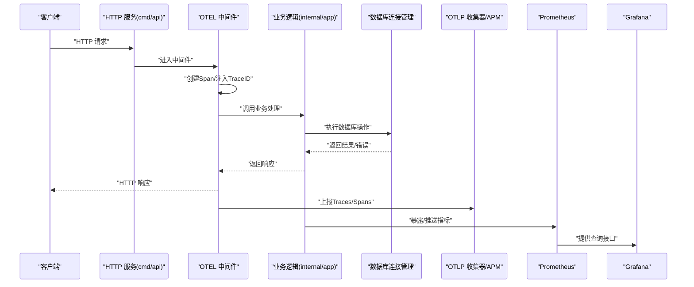
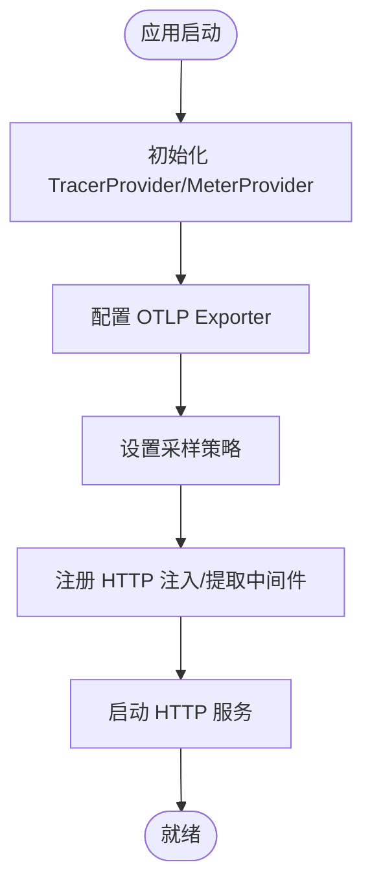
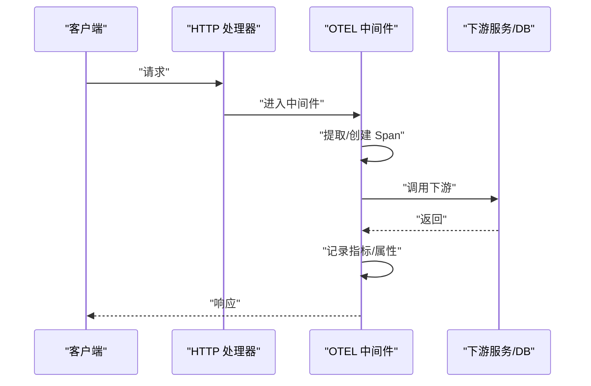
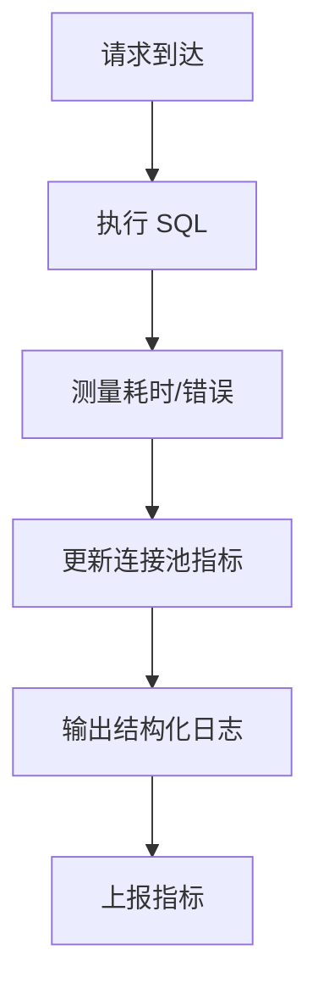
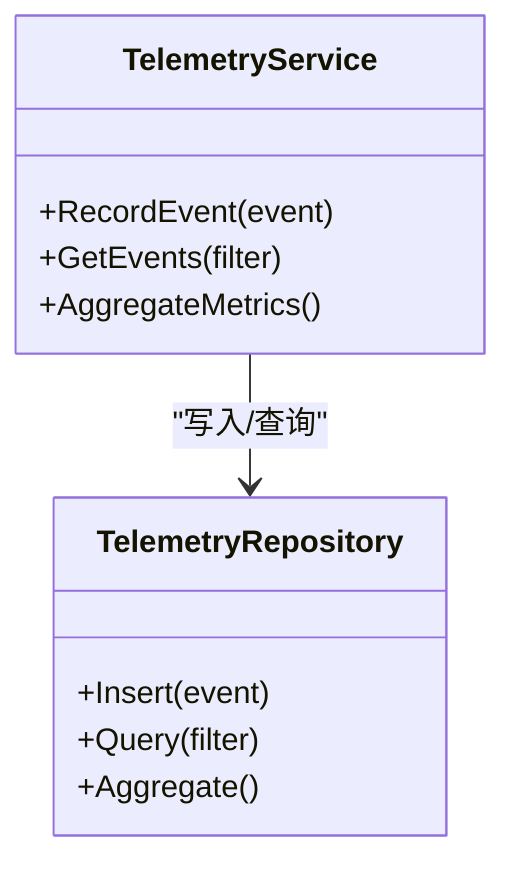
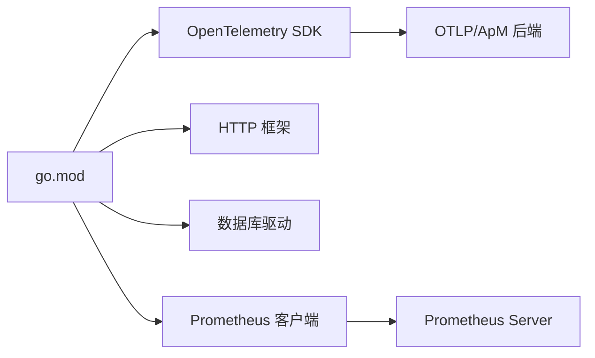

# 性能监控与指标

<cite>
**本文引用的文件**   
- [cmd/api/main.go](file://notifuse/cmd/api/main.go)
- [internal/app/app.go](file://notifuse/internal/app/app.go)
- [pkg/tracing/tracer.go](file://notifuse/pkg/tracing/tracer.go)
- [pkg/tracing/middleware.go](file://notifuse/pkg/tracing/middleware.go)
- [internal/http/middleware/otel_middleware.go](file://notifuse/internal/http/middleware/otel_middleware.go)
- [internal/database/connection_manager.go](file://notifuse/pkg/database/connection_manager.go)
- [internal/service/telemetry_service.go](file://notifuse/internal/service/telemetry_service.go)
- [internal/repository/telemetry_postgres.go](file://notifuse/internal/repository/telemetry_postgres.go)
- [config/config.go](file://notifuse/config/config.go)
- [go.mod](file://notifuse/go.mod)
- [compose.yaml](file://notifuse/compose.yaml)
- [telemetry/main.go](file://notifuse/telemetry/main.go)
- [telemetry/deploy.sh](file://notifuse/telemetry/deploy.sh)
- [telemetry/bigquery_schema.json](file://notifuse/telemetry/bigquery_schema.json)
</cite>

## 目录
1. [简介](#简介)
2. [项目结构](#项目结构)
3. [核心组件](#核心组件)
4. [架构总览](#架构总览)
5. [详细组件分析](#详细组件分析)
6. [依赖分析](#依赖分析)
7. [性能考虑](#性能考虑)
8. [故障排查指南](#故障排查指南)
9. [结论](#结论)
10. [附录](#附录)

## 简介
本文件为 Notifuse 平台构建“性能监控与指标”文档，聚焦分布式追踪系统集成（OpenTelemetry）、关键性能指标定义、Prometheus 采集与 Grafana 可视化、告警规则、性能基线与异常检测、日志聚合与 APM 集成，以及性能问题定位方法论。内容基于仓库中现有实现进行梳理与扩展建议，确保读者既能理解当前能力，也能按图索骥完成落地配置。

## 项目结构
Notifuse 后端以 Go 为主，HTTP 服务入口位于 cmd/api，应用初始化在 internal/app，OpenTelemetry 相关代码分布在 pkg/tracing 与 internal/http/middleware，数据库连接管理在 pkg/database，遥测数据持久化在 internal/service 与 internal/repository，配置集中在 config，编排与外部系统通过 compose.yaml 与 telemetry 子模块协同。

```mermaid
graph TB
subgraph "API 进程"
API["cmd/api/main.go"]
APP["internal/app/app.go"]
TRC["pkg/tracing/*"]
HTTPMW["internal/http/middleware/*"]
DBM["pkg/database/connection_manager.go"]
TSV["internal/service/telemetry_service.go"]
TREP["internal/repository/telemetry_postgres.go"]
end
subgraph "基础设施"
PG["PostgreSQL"]
OTEL["OTLP Collector / APM"]
PROM["Prometheus"]
GRAF["Grafana"]
GCPBQ["BigQuery(可选)"]
end
API --> APP
APP --> TRC
APP --> HTTPMW
APP --> DBM
APP --> TSV
TSV --> TREP
TREP --> PG
TRC --> OTEL
HTTPMW --> OTEL
PROM --> |抓取| API
GRAF --> |查询| PROM
GCPBQ <--|遥测导出| OTEL
```

图表来源
- [cmd/api/main.go:1-200](file://notifuse/cmd/api/main.go#L1-L200)
- [internal/app/app.go:1-200](file://notifuse/internal/app/app.go#L1-L200)
- [pkg/tracing/tracer.go:1-200](file://notifuse/pkg/tracing/tracer.go#L1-L200)
- [internal/http/middleware/otel_middleware.go:1-200](file://notifuse/internal/http/middleware/otel_middleware.go#L1-L200)
- [pkg/database/connection_manager.go:1-200](file://notifuse/pkg/database/connection_manager.go#L1-L200)
- [internal/service/telemetry_service.go:1-200](file://notifuse/internal/service/telemetry_service.go#L1-L200)
- [internal/repository/telemetry_postgres.go:1-200](file://notifuse/internal/repository/telemetry_postgres.go#L1-L200)
- [compose.yaml:1-200](file://notifuse/compose.yaml#L1-L200)

章节来源
- [cmd/api/main.go:1-200](file://notifuse/cmd/api/main.go#L1-L200)
- [internal/app/app.go:1-200](file://notifuse/internal/app/app.go#L1-L200)
- [pkg/tracing/tracer.go:1-200](file://notifuse/pkg/tracing/tracer.go#L1-L200)
- [internal/http/middleware/otel_middleware.go:1-200](file://notifuse/internal/http/middleware/otel_middleware.go#L1-L200)
- [pkg/database/connection_manager.go:1-200](file://notifuse/pkg/database/connection_manager.go#L1-L200)
- [internal/service/telemetry_service.go:1-200](file://notifuse/internal/service/telemetry_service.go#L1-L200)
- [internal/repository/telemetry_postgres.go:1-200](file://notifuse/internal/repository/telemetry_postgres.go#L1-L200)
- [compose.yaml:1-200](file://notifuse/compose.yaml#L1-L200)

## 核心组件
- OpenTelemetry 初始化与传播：负责 TracerProvider/MeterProvider 的创建、Exporter 配置、上下文传播注入与提取。
- HTTP 中间件：在请求进入时创建 Span、注入 TraceID/SpanID，记录响应状态码、耗时等属性。
- 数据库连接管理：对数据库连接池、慢查询、错误率等指标埋点，并输出结构化日志。
- 遥测服务与存储：将业务遥测事件写入 PostgreSQL，供后续分析与报表使用。
- 配置中心：集中管理 OTLP 端点、采样策略、指标开关等环境变量。
- 编排与外部系统：通过 Docker Compose 启动 Prometheus/Grafana；可选将遥测导出至 BigQuery。

章节来源
- [pkg/tracing/tracer.go:1-200](file://notifuse/pkg/tracing/tracer.go#L1-L200)
- [internal/http/middleware/otel_middleware.go:1-200](file://notifuse/internal/http/middleware/otel_middleware.go#L1-L200)
- [pkg/database/connection_manager.go:1-200](file://notifuse/pkg/database/connection_manager.go#L1-L200)
- [internal/service/telemetry_service.go:1-200](file://notifuse/internal/service/telemetry_service.go#L1-L200)
- [internal/repository/telemetry_postgres.go:1-200](file://notifuse/internal/repository/telemetry_postgres.go#L1-L200)
- [config/config.go:1-200](file://notifuse/config/config.go#L1-L200)
- [compose.yaml:1-200](file://notifuse/compose.yaml#L1-L200)

## 架构总览
下图展示了从 HTTP 请求到追踪、指标与日志的全链路路径，以及与外部系统的交互关系。



图表来源
- [cmd/api/main.go:1-200](file://notifuse/cmd/api/main.go#L1-L200)
- [internal/http/middleware/otel_middleware.go:1-200](file://notifuse/internal/http/middleware/otel_middleware.go#L1-L200)
- [internal/app/app.go:1-200](file://notifuse/internal/app/app.go#L1-L200)
- [pkg/database/connection_manager.go:1-200](file://notifuse/pkg/database/connection_manager.go#L1-L200)
- [compose.yaml:1-200](file://notifuse/compose.yaml#L1-L200)

## 详细组件分析

### OpenTelemetry 配置与链路追踪
- 初始化流程：在应用启动阶段创建 TracerProvider/MeterProvider，配置 OTLP Exporter、Sampler、资源标签（服务名、版本、环境等）。
- 上下文传播：HTTP 中间件在入站时提取上游 TraceContext，出站调用自动注入，保证跨服务链路一致。
- 采样策略：根据环境选择全量或概率采样，生产环境建议动态采样以降低开销。
- 指标采集：启用 Go runtime 指标、HTTP 服务器指标、数据库连接池指标，统一命名空间与标签维度。



图表来源
- [pkg/tracing/tracer.go:1-200](file://notifuse/pkg/tracing/tracer.go#L1-L200)
- [internal/http/middleware/otel_middleware.go:1-200](file://notifuse/internal/http/middleware/otel_middleware.go#L1-L200)
- [internal/app/app.go:1-200](file://notifuse/internal/app/app.go#L1-L200)

章节来源
- [pkg/tracing/tracer.go:1-200](file://notifuse/pkg/tracing/tracer.go#L1-L200)
- [internal/http/middleware/otel_middleware.go:1-200](file://notifuse/internal/http/middleware/otel_middleware.go#L1-L200)
- [internal/app/app.go:1-200](file://notifuse/internal/app/app.go#L1-L200)

### HTTP 中间件与调用链分析
- 入站处理：解析请求头中的 TraceContext，创建根 Span，附加方法、路径、协议、客户端 IP 等属性。
- 出站处理：记录响应状态码、Content-Length、耗时，标记错误状态，必要时附加堆栈摘要。
- 链路分析：结合 APM 工具（如 Jaeger、Tempo、SkyWalking）进行火焰图、依赖拓扑与热点分析。



图表来源
- [internal/http/middleware/otel_middleware.go:1-200](file://notifuse/internal/http/middleware/otel_middleware.go#L1-L200)

章节来源
- [internal/http/middleware/otel_middleware.go:1-200](file://notifuse/internal/http/middleware/otel_middleware.go#L1-L200)

### 数据库连接管理与指标埋点
- 连接池：监控活跃连接、空闲连接、等待时间、最大连接数与超时。
- 慢查询：统计超过阈值的查询耗时，输出结构化日志并上报指标。
- 错误率：统计连接失败、SQL 错误、重试次数等。



图表来源
- [pkg/database/connection_manager.go:1-200](file://notifuse/pkg/database/connection_manager.go#L1-L200)

章节来源
- [pkg/database/connection_manager.go:1-200](file://notifuse/pkg/database/connection_manager.go#L1-L200)

### 遥测服务与存储（PostgreSQL）
- 遥测事件：包括自定义业务事件、审计事件、任务调度事件等。
- 存储层：通过 repository 层写入 PostgreSQL，支持分页、过滤与聚合查询。
- 用途：用于报表、趋势分析、合规审计与回溯。



图表来源
- [internal/service/telemetry_service.go:1-200](file://notifuse/internal/service/telemetry_service.go#L1-L200)
- [internal/repository/telemetry_postgres.go:1-200](file://notifuse/internal/repository/telemetry_postgres.go#L1-L200)

章节来源
- [internal/service/telemetry_service.go:1-200](file://notifuse/internal/service/telemetry_service.go#L1-L200)
- [internal/repository/telemetry_postgres.go:1-200](file://notifuse/internal/repository/telemetry_postgres.go#L1-L200)

### 配置与环境变量
- 关键配置项：OTLP 端点、采样率、指标开关、服务名与版本、日志级别等。
- 加载顺序：默认值 -> 配置文件 -> 环境变量 -> 运行时覆盖。
- 安全建议：敏感信息通过密钥管理服务注入，避免硬编码。

章节来源
- [config/config.go:1-200](file://notifuse/config/config.go#L1-L200)

### 编排与外部系统（Prometheus/Grafana/BigQuery）
- Docker Compose：在同一网络下启动 API、PostgreSQL、Prometheus、Grafana，便于本地联调。
- Prometheus：通过 HTTP 端点抓取指标，或使用 Pushgateway 汇总批处理任务指标。
- Grafana：导入内置仪表盘，自定义面板展示 P95/P99 延迟、吞吐、错误率、资源利用率。
- BigQuery（可选）：通过 telemetry 子模块将遥测数据导出至云端进行分析与长期归档。

章节来源
- [compose.yaml:1-200](file://notifuse/compose.yaml#L1-L200)
- [telemetry/main.go:1-200](file://notifuse/telemetry/main.go#L1-L200)
- [telemetry/deploy.sh:1-200](file://notifuse/telemetry/deploy.sh#L1-L200)
- [telemetry/bigquery_schema.json:1-200](file://notifuse/telemetry/bigquery_schema.json#L1-L200)

## 依赖分析
- 直接依赖：OpenTelemetry SDK、HTTP 框架、数据库驱动、Prometheus 客户端。
- 间接依赖：TLS 库、JSON 编解码、时间与时区库。
- 耦合度：中间件与业务解耦良好，指标与追踪通过 Provider 抽象降低耦合。
- 外部集成：OTLP 收集器、APM 后端、云存储（BigQuery）。



图表来源
- [go.mod:1-200](file://notifuse/go.mod#L1-L200)

章节来源
- [go.mod:1-200](file://notifuse/go.mod#L1-L200)

## 性能考虑
- 采样与降采样：生产环境采用动态采样，减少高负载时的开销。
- 指标粒度：合理设置直方图桶与聚合窗口，避免过度细分导致存储压力。
- 异步上报：追踪与指标上报采用异步队列，避免阻塞主流程。
- 资源隔离：为追踪与指标上报分配独立 goroutine 与内存限制。
- 缓存与去重：对高频指标进行合并与去重，降低 Cardinality。
- 容量规划：依据 QPS、P99 延迟与错误率目标，评估 CPU/内存/IO 需求。

[本节为通用指导，不直接分析具体文件]

## 故障排查指南
- 链路断点：检查中间件是否正确注入/提取 TraceContext，确认下游服务是否透传。
- 指标缺失：确认 Prometheus 抓取目标健康状态、端口与路径正确。
- 高延迟：通过火焰图定位热点函数，结合数据库慢查询与连接池指标判断瓶颈。
- 错误率上升：查看错误分类与堆栈摘要，关联最近变更与流量突增。
- 资源泄漏：观察 Goroutine 数量、GC 频率与内存占用，定位未释放资源。
- 日志聚合：统一日志格式与字段，结合 TraceID 进行跨服务关联检索。

章节来源
- [internal/http/middleware/otel_middleware.go:1-200](file://notifuse/internal/http/middleware/otel_middleware.go#L1-L200)
- [pkg/database/connection_manager.go:1-200](file://notifuse/pkg/database/connection_manager.go#L1-L200)
- [internal/service/telemetry_service.go:1-200](file://notifuse/internal/service/telemetry_service.go#L1-L200)

## 结论
通过在 Notifuse 中集成 OpenTelemetry、完善 HTTP 中间件与数据库指标埋点，并结合 Prometheus/Grafana 与可选的 BigQuery 分析，可形成端到端的性能监控体系。建议在生产环境实施动态采样、异步上报与容量规划，建立告警规则与性能基线，持续优化关键路径与资源利用效率。

[本节为总结性内容，不直接分析具体文件]

## 附录

### 关键性能指标定义
- 响应时间：P50/P90/P95/P99 延迟，区分读/写与不同路由。
- 吞吐量：每秒请求数（RPS）、并发连接数、队列长度。
- 错误率：HTTP 5xx、业务错误分类、重试与退避成功率。
- 资源利用率：CPU、内存、GC、磁盘 IO、网络带宽、数据库连接池使用率。
- 可用性：SLI/SLO 达成率、熔断与降级触发次数。

[本节为概念性说明，不直接分析具体文件]

### Prometheus 指标采集与 Grafana 可视化
- 采集：在 API 暴露 /metrics 端点，Prometheus 定期抓取；批处理任务可通过 Pushgateway 汇总。
- 面板：创建延迟分布、吞吐趋势、错误率、资源利用率、连接池使用率等面板。
- 标签规范：统一 service、env、version、method、path、status_code 等标签。

章节来源
- [compose.yaml:1-200](file://notifuse/compose.yaml#L1-L200)

### 告警规则设置
- 延迟告警：P95 > 阈值持续 N 分钟。
- 错误率告警：5xx 比例 > 阈值。
- 资源告警：CPU/内存/连接池使用率 > 阈值。
- 业务告警：队列积压、任务失败率、第三方调用超时。

[本节为通用指导，不直接分析具体文件]

### 性能基线与异常检测
- 基线：在稳定期采集历史分位数与波动范围，作为基准。
- 异常检测：使用同比/环比、季节性分解与滑动窗口检测偏离。
- 回归分析：发布前后对比关键指标，识别回归问题。

[本节为通用指导，不直接分析具体文件]

### 日志聚合分析与 APM 集成
- 日志格式：包含 TraceID、SpanID、用户/工作区标识、请求路径与状态码。
- 聚合方案：ELK/Loki + 索引策略与保留周期。
- APM 集成：对接 Jaeger/Tempo/SkyWalking，开启火焰图与依赖拓扑。

[本节为通用指导，不直接分析具体文件]

### 性能问题定位方法论
- 分层定位：网关/负载均衡 -> API -> 业务逻辑 -> 数据库/外部依赖。
- 指标先行：先观察宏观指标异常，再下钻到具体路由与服务。
- 链路验证：通过 TraceID 串联日志与追踪，确认断点与瓶颈。
- 压测复现：在预发环境复现问题，逐步缩小范围并修复。

[本节为通用指导，不直接分析具体文件]