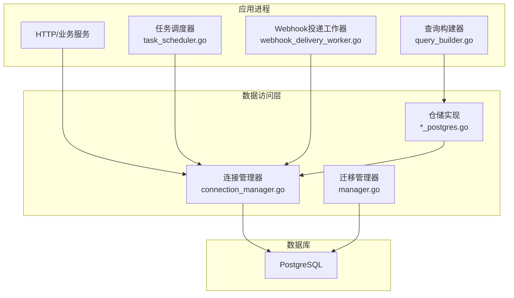
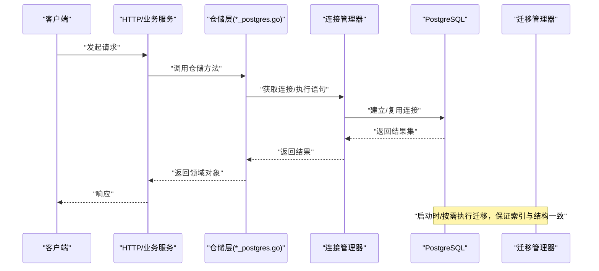
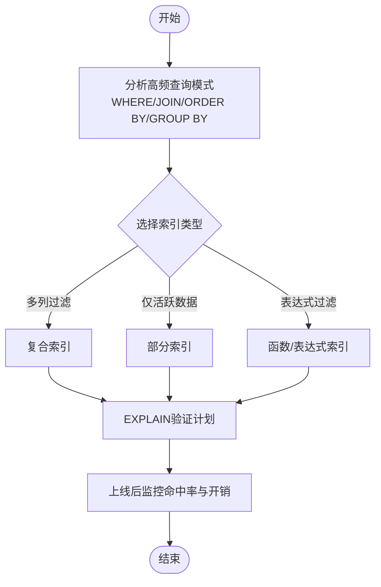
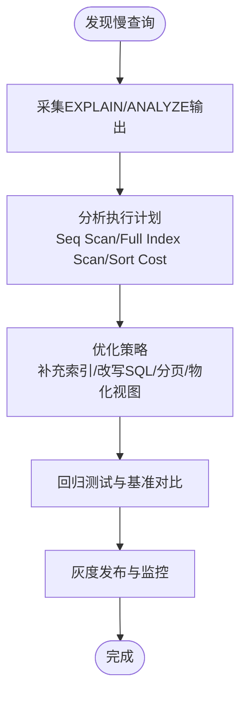
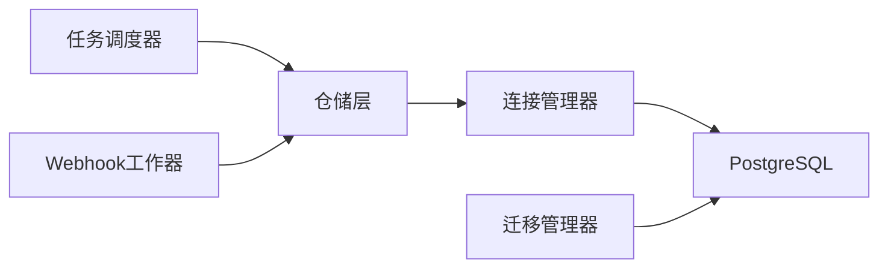

# 数据库性能优化

<cite>
**本文引用的文件**   
- [internal/database/init.go](file://notifuse/internal/database/init.go)
- [pkg/database/connection_manager.go](file://notifuse/pkg/database/connection_manager.go)
- [config/config.go](file://notifuse/config/config.go)
- [internal/migrations/manager.go](file://notifuse/internal/migrations/manager.go)
- [internal/repository/contact_postgres.go](file://notifuse/internal/repository/contact_postgres.go)
- [internal/repository/email_queue_postgres.go](file://notifuse/internal/repository/email_queue_postgres.go)
- [internal/repository/workspace_postgres.go](file://notifuse/internal/repository/workspace_postgres.go)
- [internal/service/query_builder.go](file://notifuse/internal/service/query_builder.go)
- [internal/service/task_scheduler.go](file://notifuse/internal/service/task_scheduler.go)
- [internal/service/webhook_delivery_worker.go](file://notifuse/internal/service/webhook_delivery_worker.go)
</cite>

## 目录
1. [简介](#简介)
2. [项目结构](#项目结构)
3. [核心组件](#核心组件)
4. [架构总览](#架构总览)
5. [详细组件分析](#详细组件分析)
6. [依赖关系分析](#依赖关系分析)
7. [性能考虑](#性能考虑)
8. [故障排查指南](#故障排查指南)
9. [结论](#结论)
10. [附录](#附录)

## 简介
本文件面向Notifuse平台的PostgreSQL数据库性能优化，聚焦以下方面：
- 索引策略设计：复合索引、部分索引与函数索引的使用场景与落地建议
- 查询优化技术：EXPLAIN分析、慢查询识别与优化技巧
- 连接池配置调优：最大连接数、空闲连接管理与超时设置
- 批量操作、事务处理与锁机制最佳实践
- 监控指标、瓶颈分析与容量规划建议

文档结合代码仓库中的数据库初始化、迁移管理、仓储层与关键服务实现进行说明，并提供可操作的优化清单。

## 项目结构
与数据库性能相关的核心位置如下：
- 数据库初始化与连接管理：internal/database、pkg/database
- 迁移管理：internal/migrations
- 仓储层（PostgreSQL）：internal/repository/*_postgres.go
- 查询构建与服务层：internal/service/query_builder.go、task_scheduler.go、webhook_delivery_worker.go
- 配置入口：config/config.go

图表来源
- [internal/database/init.go](file://notifuse/internal/database/init.go)
- [pkg/database/connection_manager.go](file://notifuse/pkg/database/connection_manager.go)
- [internal/migrations/manager.go](file://notifuse/internal/migrations/manager.go)
- [internal/repository/contact_postgres.go](file://notifuse/internal/repository/contact_postgres.go)
- [internal/repository/email_queue_postgres.go](file://notifuse/internal/repository/email_queue_postgres.go)
- [internal/repository/workspace_postgres.go](file://notifuse/internal/repository/workspace_postgres.go)
- [internal/service/query_builder.go](file://notifuse/internal/service/query_builder.go)
- [internal/service/task_scheduler.go](file://notifuse/internal/service/task_scheduler.go)
- [internal/service/webhook_delivery_worker.go](file://notifuse/internal/service/webhook_delivery_worker.go)

章节来源
- [internal/database/init.go](file://notifuse/internal/database/init.go)
- [pkg/database/connection_manager.go](file://notifuse/pkg/database/connection_manager.go)
- [internal/migrations/manager.go](file://notifuse/internal/migrations/manager.go)
- [internal/repository/contact_postgres.go](file://notifuse/internal/repository/contact_postgres.go)
- [internal/repository/email_queue_postgres.go](file://notifuse/internal/repository/email_queue_postgres.go)
- [internal/repository/workspace_postgres.go](file://notifuse/internal/repository/workspace_postgres.go)
- [internal/service/query_builder.go](file://notifuse/internal/service/query_builder.go)
- [internal/service/task_scheduler.go](file://notifuse/internal/service/task_scheduler.go)
- [internal/service/webhook_delivery_worker.go](file://notifuse/internal/service/webhook_delivery_worker.go)

## 核心组件
- 数据库初始化与连接管理
  - 负责创建并暴露数据库连接、连接池参数、健康检查与生命周期管理
  - 为仓储层提供统一的DB句柄或连接获取方式
- 迁移管理
  - 版本化DDL变更，确保索引、约束与表结构演进的可追溯性
- 仓储层（PostgreSQL）
  - 封装具体表的CRUD与复杂查询，是索引与SQL优化的直接落点
- 查询构建器
  - 统一生成动态SQL片段，避免拼接错误与低效条件
- 任务与工作器
  - 定时任务与异步工作器驱动大批量读写与重试逻辑，涉及事务与锁

章节来源
- [internal/database/init.go](file://notifuse/internal/database/init.go)
- [pkg/database/connection_manager.go](file://notifuse/pkg/database/connection_manager.go)
- [internal/migrations/manager.go](file://notifuse/internal/migrations/manager.go)
- [internal/repository/contact_postgres.go](file://notifuse/internal/repository/contact_postgres.go)
- [internal/repository/email_queue_postgres.go](file://notifuse/internal/repository/email_queue_postgres.go)
- [internal/repository/workspace_postgres.go](file://notifuse/internal/repository/workspace_postgres.go)
- [internal/service/query_builder.go](file://notifuse/internal/service/query_builder.go)
- [internal/service/task_scheduler.go](file://notifuse/internal/service/task_scheduler.go)
- [internal/service/webhook_delivery_worker.go](file://notifuse/internal/service/webhook_delivery_worker.go)

## 架构总览
下图展示从请求到数据库的关键路径，以及连接池与迁移在其中的作用。

图表来源
- [internal/database/init.go](file://notifuse/internal/database/init.go)
- [pkg/database/connection_manager.go](file://notifuse/pkg/database/connection_manager.go)
- [internal/migrations/manager.go](file://notifuse/internal/migrations/manager.go)
- [internal/repository/contact_postgres.go](file://notifuse/internal/repository/contact_postgres.go)
- [internal/repository/email_queue_postgres.go](file://notifuse/internal/repository/email_queue_postgres.go)
- [internal/repository/workspace_postgres.go](file://notifuse/internal/repository/workspace_postgres.go)

## 详细组件分析

### 连接池与数据库初始化
- 目标
  - 合理设置最大连接数、空闲连接保留、连接超时与上下文超时，避免连接耗尽与长事务阻塞
- 关键点
  - 最大连接数需结合并发度与单连接QPS估算；预留系统库与后台任务空间
  - 空闲连接不宜过大，避免资源浪费；根据峰值流量与冷启动时间权衡
  - 连接超时与查询超时分离：连接级超时保障快速失败，查询级超时保护热点接口
  - 健康检查与优雅关闭，防止僵尸连接
- 建议
  - 以“并发请求数 × 平均事务内并发度”作为连接数基线，再乘以安全系数
  - 对长耗时批处理使用独立连接池或专用用户/角色，隔离热点事务
  - 通过配置中心集中管理连接池参数，支持热更新与灰度验证

章节来源
- [internal/database/init.go](file://notifuse/internal/database/init.go)
- [pkg/database/connection_manager.go](file://notifuse/pkg/database/connection_manager.go)
- [config/config.go](file://notifuse/config/config.go)

### 迁移与索引治理
- 目标
  - 将索引设计与变更纳入版本化管理，确保生产环境结构与索引一致性
- 关键点
  - 新增索引采用CONCURRENTLY以避免阻塞写入
  - 删除旧索引前评估覆盖范围，避免回退
  - 大表重建索引分阶段执行，配合维护窗口
- 建议
  - 每个迁移只包含单一职责的DDL变更，便于回滚与审计
  - 对高频查询对应的过滤/排序/关联列优先建索引，避免过度索引

章节来源
- [internal/migrations/manager.go](file://notifuse/internal/migrations/manager.go)

### 仓储层与查询优化
- 目标
  - 在仓储层落实高效SQL与索引利用，减少全表扫描与回表
- 关键点
  - 复合索引顺序遵循“等值在前、范围在后”，尽量匹配WHERE最左前缀
  - 对选择性高的列优先建索引；避免在索引列上使用函数导致失效
  - 分页查询使用游标式分页替代OFFSET深翻页
  - 使用EXPLAIN ANALYZE验证计划，关注Seq Scan、Index Scan、Sort成本
- 建议
  - 对高频过滤条件组合建立复合索引
  - 对历史归档数据使用分区+部分索引降低主表体积
  - 对JSON字段常用键建立表达式索引（函数索引）

章节来源
- [internal/repository/contact_postgres.go](file://notifuse/internal/repository/contact_postgres.go)
- [internal/repository/email_queue_postgres.go](file://notifuse/internal/repository/email_queue_postgres.go)
- [internal/repository/workspace_postgres.go](file://notifuse/internal/repository/workspace_postgres.go)
- [internal/service/query_builder.go](file://notifuse/internal/service/query_builder.go)

### 任务与工作器的批量与事务
- 目标
  - 在高吞吐场景下提升吞吐、降低锁竞争与死锁概率
- 关键点
  - 分批提交：每批固定大小，控制事务时长与锁持有时间
  - 幂等写入：使用唯一约束或UPSERT避免重复处理
  - 乐观锁/版本号：减少行级锁冲突
  - 背压与限流：基于队列长度或下游延迟自适应调整并发
- 建议
  - 对邮件队列、Webhook投递等I/O密集型任务，拆分读/写批次，避免长事务
  - 对热点行加锁时使用明确的SELECT FOR UPDATE SKIP LOCKED模式

章节来源
- [internal/service/task_scheduler.go](file://notifuse/internal/service/task_scheduler.go)
- [internal/service/webhook_delivery_worker.go](file://notifuse/internal/service/webhook_delivery_worker.go)

### 索引策略设计（复合/部分/函数）
- 复合索引
  - 适用：多列等值过滤、等值+范围、排序需求
  - 注意：列顺序决定命中能力；避免冗余索引
- 部分索引
  - 适用：仅对活跃/未处理/特定租户数据加速查询
  - 注意：条件需与查询完全匹配，否则无法命中
- 函数索引（表达式索引）
  - 适用：对列做LOWER/UPPER/日期截断/JSONB键提取后过滤
  - 注意：查询中必须使用相同表达式才能命中

[此图为概念流程，不直接映射具体源码文件]

### 慢查询定位与优化流程
- 步骤
  - 开启慢查询日志与统计信息收集
  - 使用EXPLAIN/EXPLAIN ANALYZE定位全表扫描、高成本排序/哈希聚合
  - 针对缺失索引或索引失效问题制定优化方案
  - 小步快跑灰度发布，观察P95/P99延迟与CPU/IO指标
- 常见陷阱
  - 隐式类型转换导致索引失效
  - 函数包裹列导致无法走索引
  - 过宽SELECT增加网络与序列化开销

[此图为概念流程，不直接映射具体源码文件]

## 依赖关系分析
- 组件耦合
  - 仓储层依赖连接管理器提供的DB句柄；迁移管理器在启动期与数据库交互
  - 任务与工作器通过仓储层间接访问数据库
- 外部依赖
  - PostgreSQL版本特性（如并行查询、索引类型、锁行为）直接影响优化效果
- 潜在风险
  - 连接池过小导致排队放大；过大导致上下文切换与内存压力
  - 迁移期间无并发索引可能导致写入抖动

图表来源
- [internal/service/task_scheduler.go](file://notifuse/internal/service/task_scheduler.go)
- [internal/service/webhook_delivery_worker.go](file://notifuse/internal/service/webhook_delivery_worker.go)
- [internal/repository/contact_postgres.go](file://notifuse/internal/repository/contact_postgres.go)
- [internal/repository/email_queue_postgres.go](file://notifuse/internal/repository/email_queue_postgres.go)
- [internal/repository/workspace_postgres.go](file://notifuse/internal/repository/workspace_postgres.go)
- [pkg/database/connection_manager.go](file://notifuse/pkg/database/connection_manager.go)
- [internal/migrations/manager.go](file://notifuse/internal/migrations/manager.go)

## 性能考虑
- 连接池调优
  - 最大连接数：按并发×事务内并发度×安全系数估算，并预留系统库与后台任务
  - 空闲连接：根据冷启动时间与峰值波动设定，避免过多空闲占用资源
  - 超时：连接超时短于查询超时，查询超时短于业务SLA
- 索引与查询
  - 优先命中索引的WHERE/JOIN/ORDER BY设计；避免函数包裹列
  - 分页用游标式；热点查询引入缓存层（Redis/本地缓存）
- 批量与事务
  - 分批提交、幂等写入、乐观锁；热点行使用SKIP LOCKED
- 监控与容量
  - 监控连接使用率、锁等待、索引命中率、慢查询比例、磁盘IO与WAL增长
  - 容量规划关注数据增长速率、索引膨胀与VACUUM频率

[本节为通用指导，不直接分析具体文件]

## 故障排查指南
- 常见问题
  - 连接耗尽：检查连接池上限、长事务、泄漏与异常未释放
  - 锁等待/死锁：分析锁类型、持有时间、热点行与事务边界
  - 索引失效：检查函数包裹、隐式类型转换、统计信息过期
  - 慢查询：定位Seq Scan、高成本Sort/Hash Join，补充索引或改写SQL
- 工具与方法
  - EXPLAIN/EXPLAIN ANALYZE、pg_stat_statements、pg_locks、pg_stat_activity
  - 压测与回放：使用真实负载特征验证优化效果

章节来源
- [internal/database/init.go](file://notifuse/internal/database/init.go)
- [pkg/database/connection_manager.go](file://notifuse/pkg/database/connection_manager.go)
- [internal/repository/contact_postgres.go](file://notifuse/internal/repository/contact_postgres.go)
- [internal/repository/email_queue_postgres.go](file://notifuse/internal/repository/email_queue_postgres.go)
- [internal/repository/workspace_postgres.go](file://notifuse/internal/repository/workspace_postgres.go)
- [internal/service/query_builder.go](file://notifuse/internal/service/query_builder.go)
- [internal/service/task_scheduler.go](file://notifuse/internal/service/task_scheduler.go)
- [internal/service/webhook_delivery_worker.go](file://notifuse/internal/service/webhook_delivery_worker.go)

## 结论
通过合理的连接池配置、完善的索引策略、严格的查询与事务规范，以及持续的监控与容量规划，Notifuse平台可在高并发与大数据量场景下保持稳定与高性能。建议将上述优化纳入日常研发流程与发布门禁，持续迭代。

[本节为总结，不直接分析具体文件]

## 附录
- 推荐实践清单
  - 所有新索引纳入迁移脚本，使用CONCURRENTLY
  - 高频查询强制EXPLAIN验证
  - 分页一律游标式
  - 批量任务分批提交与幂等
  - 上线前后对比关键指标（延迟、吞吐、锁等待、慢查询占比）

[本节为附加内容，不直接分析具体文件]