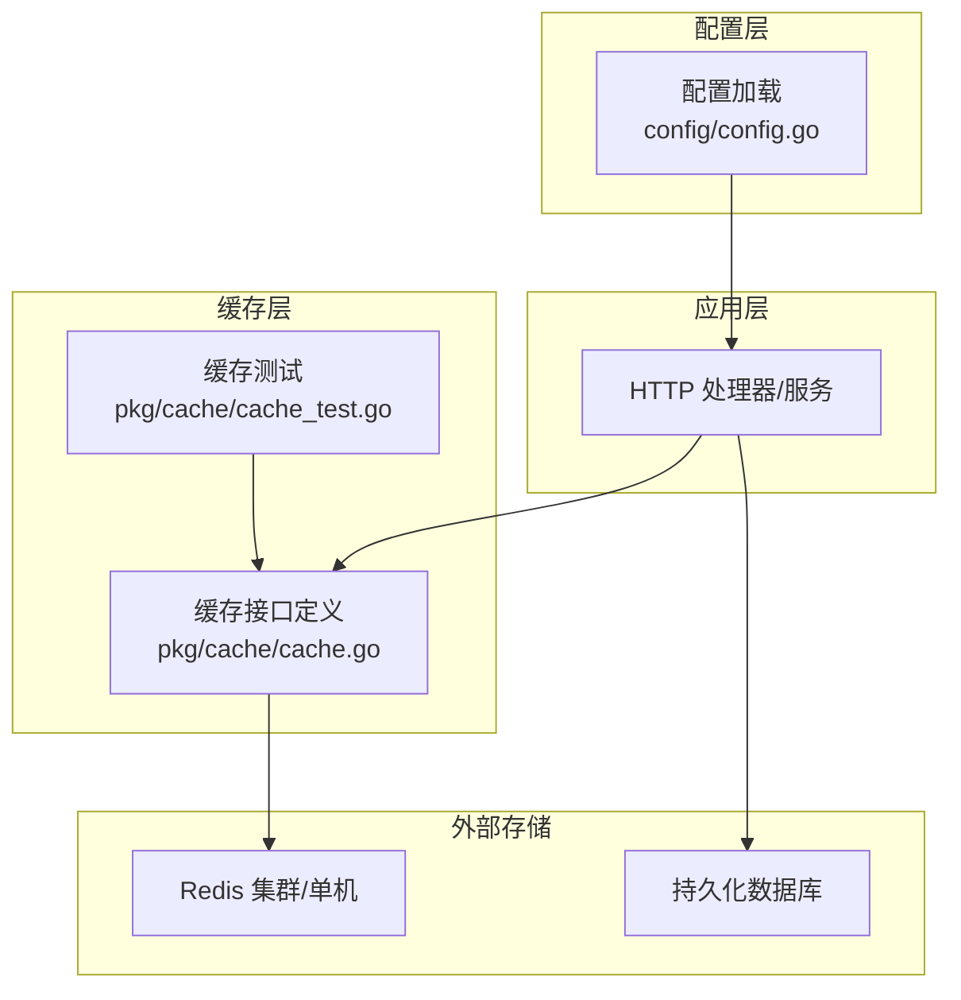
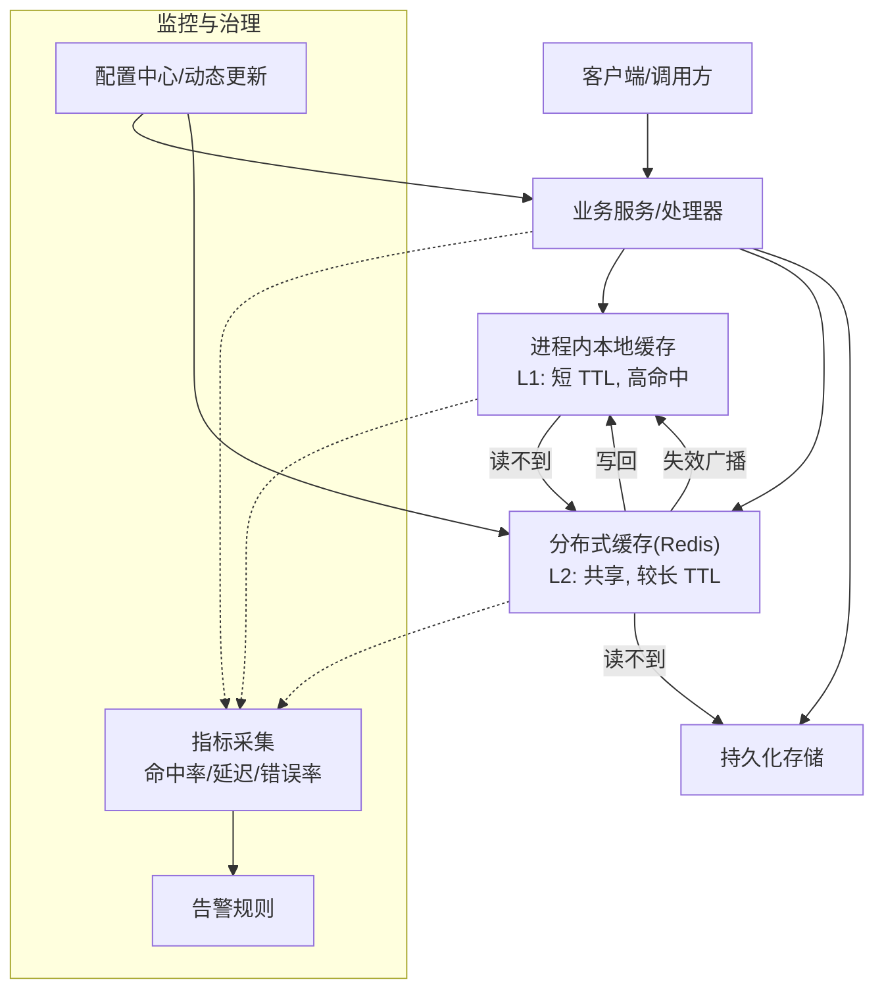
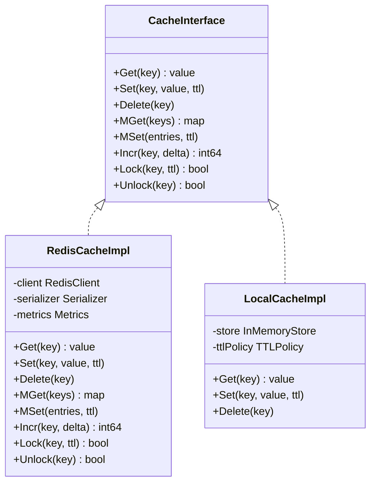
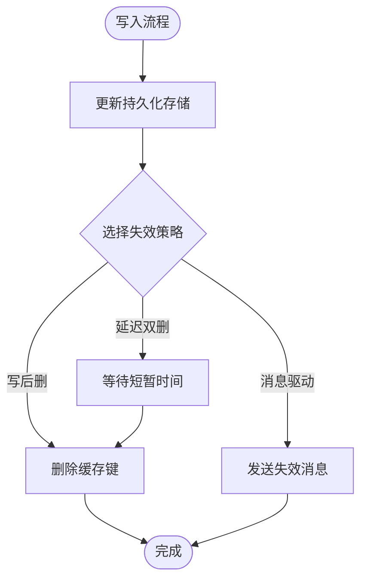
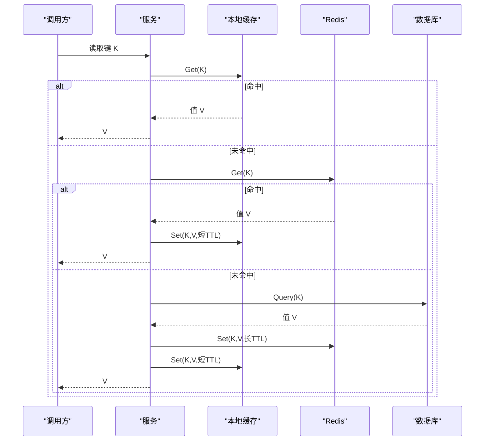
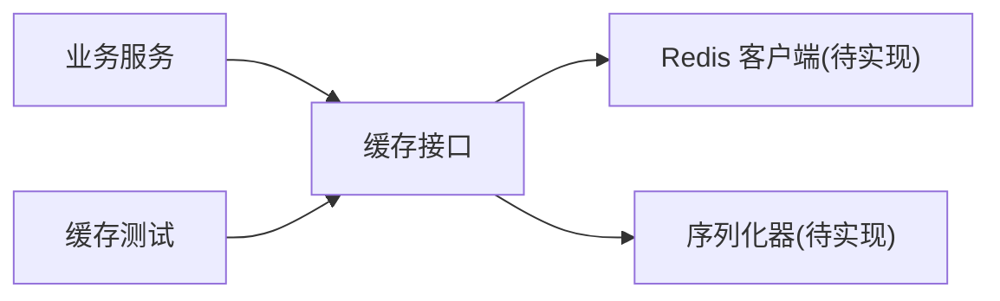

# 缓存策略与实现

<cite>
**本文引用的文件**   
- [pkg/cache/cache.go](file://notifuse/pkg/cache/cache.go)
- [pkg/cache/cache_test.go](file://notifuse/pkg/cache/cache_test.go)
- [config/config.go](file://notifuse/config/config.go)
</cite>

## 目录
1. [简介](#简介)
2. [项目结构](#项目结构)
3. [核心组件](#核心组件)
4. [架构总览](#架构总览)
5. [详细组件分析](#详细组件分析)
6. [依赖分析](#依赖分析)
7. [性能考量](#性能考量)
8. [故障排查指南](#故障排查指南)
9. [结论](#结论)
10. [附录](#附录)

## 简介
本文件为 Notifuse 平台提供全面的缓存策略文档，聚焦于 Redis 缓存的架构设计与落地方案。内容涵盖：
- 缓存分层策略与数据分布方案
- 失效机制（TTL、主动失效、被动失效）
- 热点数据处理（本地缓存 + 分布式缓存的二级缓存架构）
- 一致性保证、穿透防护与雪崩预防
- 命中率监控、内存优化与集群部署配置建议

说明：当前仓库中已存在通用缓存抽象接口定义与测试用例，但尚未发现具体的 Redis 客户端实现或配置项。本文在“现状”基础上给出可落地的设计蓝图与实施建议，便于后续扩展与集成。

## 项目结构
Notifuse 后端采用 Go 语言开发，缓存相关代码位于 pkg/cache 目录，包含缓存接口定义与单元测试；配置入口位于 config 目录。整体结构如下：

图表来源
- [pkg/cache/cache.go](file://notifuse/pkg/cache/cache.go)
- [pkg/cache/cache_test.go](file://notifuse/pkg/cache/cache_test.go)
- [config/config.go](file://notifuse/config/config.go)

章节来源
- [pkg/cache/cache.go](file://notifuse/pkg/cache/cache.go)
- [pkg/cache/cache_test.go](file://notifuse/pkg/cache/cache_test.go)
- [config/config.go](file://notifuse/config/config.go)

## 核心组件
- 缓存接口抽象：统一读写、批量操作、过期控制等能力，屏蔽底层实现差异，便于替换为 Redis、内存或其他存储。
- 缓存测试：覆盖常见路径与边界条件，确保接口契约稳定。
- 配置模块：集中管理连接参数、超时、重试、TLS 等运行时选项（当前未发现具体缓存配置项，建议在配置层新增缓存相关键）。

章节来源
- [pkg/cache/cache.go](file://notifuse/pkg/cache/cache.go)
- [pkg/cache/cache_test.go](file://notifuse/pkg/cache/cache_test.go)
- [config/config.go](file://notifuse/config/config.go)

## 架构总览
下图展示 Notifuse 缓存体系的整体架构与关键交互：

图表来源
- [pkg/cache/cache.go](file://notifuse/pkg/cache/cache.go)
- [config/config.go](file://notifuse/config/config.go)

## 详细组件分析

### 缓存接口与实现规划
- 接口职责
  - 基本读写：Get/Set/Delete
  - 复合类型：序列化/反序列化支持
  - 过期控制：带 TTL 的写入与查询
  - 批量操作：MGet/MSet 提升吞吐
  - 原子性：INCR/DECR/Lock 等
- 实现建议
  - 默认实现：基于 Redis（单节点/哨兵/集群）
  - 可选实现：内存缓存用于测试与本地开发
  - 适配层：统一错误码、超时、重试、熔断、降级

图表来源
- [pkg/cache/cache.go](file://notifuse/pkg/cache/cache.go)

章节来源
- [pkg/cache/cache.go](file://notifuse/pkg/cache/cache.go)

### 缓存分层策略与数据分布
- 分层模型
  - L1 本地缓存：进程内，极低延迟，适合热键与只读小对象
  - L2 分布式缓存（Redis）：跨进程共享，容量大，适合热点与中等热度数据
  - 持久化存储：作为最终一致的数据源
- 数据分布
  - Key 命名规范：前缀+域+实体ID+维度（如 workspace:user:profile:{id}）
  - 分片策略：按业务域划分，避免热点冲突；对超大集合使用哈希桶
  - 序列化：JSON/Protobuf，结合压缩减少带宽占用
- 典型场景
  - 用户会话/权限：L1 短 TTL + L2 长 TTL
  - 模板/配置：L1 常驻 + L2 刷新
  - 计数/限流：L2 INCR 原子操作

章节来源
- [pkg/cache/cache.go](file://notifuse/pkg/cache/cache.go)

### 缓存失效机制
- TTL 设置
  - 按数据新鲜度分级：秒级（实时）、分钟级（准实时）、小时级（静态）
  - 随机抖动：在基础 TTL 上叠加 ±X% 抖动，降低雪崩风险
- 主动失效
  - 写后删：更新持久化后删除对应缓存键
  - 发布订阅：通过 Redis Pub/Sub 通知其他节点失效
- 被动失效
  - 过期淘汰：由 Redis 自动清理
  - 懒加载：读取时检测陈旧并异步刷新

图表来源
- [pkg/cache/cache.go](file://notifuse/pkg/cache/cache.go)

章节来源
- [pkg/cache/cache.go](file://notifuse/pkg/cache/cache.go)

### 热点数据处理：二级缓存架构
- 读路径
  - 先查 L1，命中直接返回
  - 未命中查 L2，命中则回填 L1 并返回
  - 仍未命中则查 DB，回填 L2 与 L1
- 写路径
  - 优先更新 DB，再根据策略失效 L2/L1
  - 对于强一致要求高的场景，可采用“先写 DB，再同步失效 L2，最后异步失效 L1”
- 防抖与互斥
  - 热点重建加锁：防止缓存击穿
  - 异步预热：定时任务预加载热点键

图表来源
- [pkg/cache/cache.go](file://notifuse/pkg/cache/cache.go)

章节来源
- [pkg/cache/cache.go](file://notifuse/pkg/cache/cache.go)

### 一致性保证
- 最终一致：适用于大多数读多写少场景，采用“写后删 + 随机抖动”
- 弱一致：允许短暂脏读，配合版本号/时间戳校验
- 强一致：需要额外协调（如分布式锁），代价较高，谨慎使用

章节来源
- [pkg/cache/cache.go](file://notifuse/pkg/cache/cache.go)

### 缓存穿透防护
- 布隆过滤器：拦截不存在键的请求
- 空值缓存：对不存在的结果缓存短 TTL 的空值
- 请求合并：同一时刻仅一个请求回源，其余等待

章节来源
- [pkg/cache/cache.go](file://notifuse/pkg/cache/cache.go)

### 缓存雪崩预防
- TTL 随机抖动：分散过期时间点
- 多级缓存：L1 吸收突发流量
- 限流与熔断：保护下游 Redis 与 DB
- 预热：系统启动或低峰期预加载热点数据

章节来源
- [pkg/cache/cache.go](file://notifuse/pkg/cache/cache.go)

### 监控与可观测性
- 指标
  - 命中率、QPS、P95/P99 延迟、错误率
  - 内存使用量、Key 数量、淘汰事件
- 日志
  - 关键路径打点：读/写/失效/回源
- 告警
  - 命中率骤降、延迟飙升、错误率异常、内存接近上限

章节来源
- [pkg/cache/cache.go](file://notifuse/pkg/cache/cache.go)

### 内存使用优化
- 合理 TTL：避免长期驻留冷数据
- 压缩与精简：序列化压缩、裁剪冗余字段
- 淘汰策略：LRU/LFU 结合业务访问特征
- 分库分键：避免单键过大导致碎片

章节来源
- [pkg/cache/cache.go](file://notifuse/pkg/cache/cache.go)

### 集群部署配置指南
- 模式选择
  - 单机：开发与小型生产
  - 哨兵：高可用主从切换
  - 集群：水平扩展与分片
- 连接参数
  - 地址列表、密码、TLS、连接池大小、读写超时、重试次数
- 运维要点
  - 定期备份与快照
  - 慢查询与热点键分析
  - 容量规划与扩容流程

章节来源
- [config/config.go](file://notifuse/config/config.go)

## 依赖分析
- 内部依赖
  - 业务服务依赖缓存接口，不感知具体实现
  - 测试依赖缓存接口进行 Mock 与断言
- 外部依赖
  - Redis 客户端（待实现）
  - 序列化器（JSON/Protobuf）
  - 指标与日志库（待接入）

图表来源
- [pkg/cache/cache.go](file://notifuse/pkg/cache/cache.go)
- [pkg/cache/cache_test.go](file://notifuse/pkg/cache/cache_test.go)

章节来源
- [pkg/cache/cache.go](file://notifuse/pkg/cache/cache.go)
- [pkg/cache/cache_test.go](file://notifuse/pkg/cache/cache_test.go)

## 性能考量
- 批量操作：尽量使用 MGet/MSet 减少网络往返
- 零拷贝与复用：复用连接与缓冲区
- 热点键隔离：独立 Key 空间与分片，避免相互影响
- 读写分离：读路径走缓存，写路径走 DB 并异步失效

[本节为通用性能建议，无需特定文件引用]

## 故障排查指南
- 常见问题
  - 命中率低：检查 TTL 是否过短、Key 设计是否合理、是否存在频繁重建
  - 延迟升高：检查 Redis 慢查询、网络抖动、连接池耗尽
  - 数据不一致：确认失效策略是否正确执行，是否存在并发写
- 定位步骤
  - 查看指标与日志，定位异常时间段
  - 抓取热点 Key 与慢命令
  - 复现问题并缩小范围至具体服务与 Key 空间

章节来源
- [pkg/cache/cache.go](file://notifuse/pkg/cache/cache.go)

## 结论
Notifuse 当前提供了统一的缓存接口抽象与测试基础，具备快速扩展为 Redis 实现的有利条件。建议尽快落地 Redis 实现，完善配置、监控与治理，并结合二级缓存与失效策略，构建高可用、高性能的缓存体系。

[本节为总结性内容，无需特定文件引用]

## 附录
- 术语
  - TTL：生存时间
  - L1/L2：一级/二级缓存
  - 雪崩/穿透/击穿：缓存常见风险
- 参考实践
  - 写后删 + 随机抖动
  - 布隆过滤器 + 空值缓存
  - 热点键互斥重建

[本节为补充信息，无需特定文件引用]