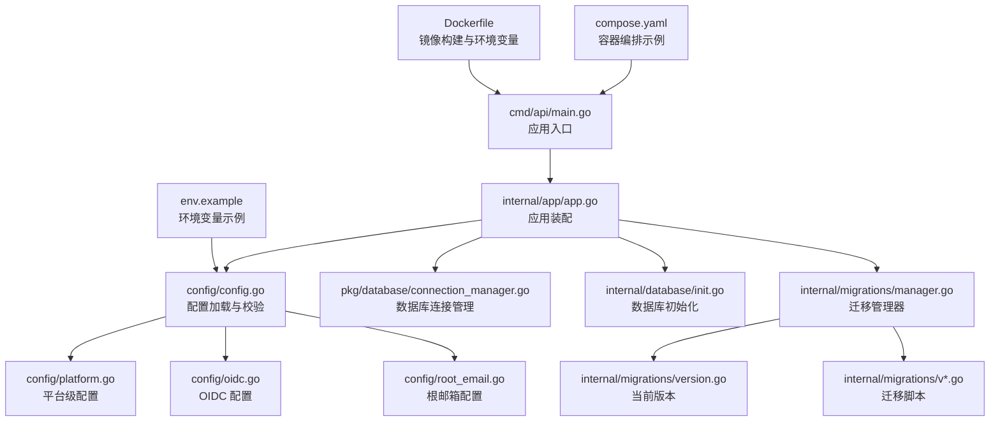
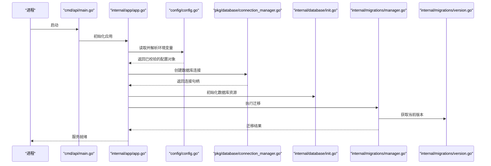
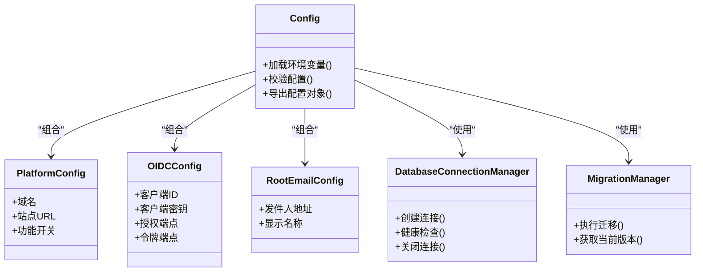

# 环境配置管理

<cite>
**本文引用的文件**   
- [config.go](file://notifuse/config/config.go)
- [platform.go](file://notifuse/config/platform.go)
- [oidc.go](file://notifuse/config/oidc.go)
- [root_email.go](file://notifuse/config/root_email.go)
- [env.example](file://notifuse/env.example)
- [compose.yaml](file://notifuse/compose.yaml)
- [Dockerfile](file://notifuse/Dockerfile)
- [main.go](file://notifuse/cmd/api/main.go)
- [app.go](file://notifuse/internal/app/app.go)
- [connection_manager.go](file://notifuse/pkg/database/connection_manager.go)
- [init.go](file://notifuse/internal/database/init.go)
- [version.go](file://notifuse/internal/migrations/version.go)
- [manager.go](file://notifuse/internal/migrations/manager.go)
- [v10.go](file://notifuse/internal/migrations/v10.go)
- [v20.go](file://notifuse/internal/migrations/v20.go)
- [v34.go](file://notifuse/internal/migrations/v34.go)
</cite>

## 目录
1. [简介](#简介)
2. [项目结构](#项目结构)
3. [核心组件](#核心组件)
4. [架构总览](#架构总览)
5. [详细组件分析](#详细组件分析)
6. [依赖关系分析](#依赖关系分析)
7. [性能与可用性考虑](#性能与可用性考虑)
8. [故障排查指南](#故障排查指南)
9. [结论](#结论)
10. [附录](#附录)

## 简介
本文件为 Notifuse 平台的环境配置管理文档，聚焦于环境变量、配置文件结构与加载机制、关键配置项（数据库连接、邮件服务、第三方 API 密钥、安全设置等）、不同部署环境的模板与最佳实践、配置优先级与动态更新、环境隔离、敏感信息安全管理、配置验证与错误处理，以及配置迁移与版本兼容性指导。目标是帮助开发者与运维人员正确、安全、可维护地管理 Notifuse 的运行期配置。

## 项目结构
Notifuse 的配置相关代码集中在 config 包中，并通过应用启动流程注入到各子系统。数据库连接由独立的连接管理器负责，迁移系统提供版本管理与升级能力。

图表来源
- [main.go:1-200](file://notifuse/cmd/api/main.go#L1-L200)
- [app.go:1-200](file://notifuse/internal/app/app.go#L1-L200)
- [config.go:1-200](file://notifuse/config/config.go#L1-L200)
- [platform.go:1-200](file://notifuse/config/platform.go#L1-L200)
- [oidc.go:1-200](file://notifuse/config/oidc.go#L1-L200)
- [root_email.go:1-200](file://notifuse/config/root_email.go#L1-L200)
- [connection_manager.go:1-200](file://notifuse/pkg/database/connection_manager.go#L1-L200)
- [init.go:1-200](file://notifuse/internal/database/init.go#L1-L200)
- [manager.go:1-200](file://notifuse/internal/migrations/manager.go#L1-L200)
- [version.go:1-200](file://notifuse/internal/migrations/version.go#L1-L200)
- [v10.go:1-200](file://notifuse/internal/migrations/v10.go#L1-L200)
- [v20.go:1-200](file://notifuse/internal/migrations/v20.go#L1-L200)
- [v34.go:1-200](file://notifuse/internal/migrations/v34.go#L1-L200)
- [env.example:1-200](file://notifuse/env.example#L1-L200)
- [compose.yaml:1-200](file://notifuse/compose.yaml#L1-L200)
- [Dockerfile:1-200](file://notifuse/Dockerfile#L1-L200)

章节来源
- [main.go:1-200](file://notifuse/cmd/api/main.go#L1-L200)
- [app.go:1-200](file://notifuse/internal/app/app.go#L1-L200)
- [config.go:1-200](file://notifuse/config/config.go#L1-L200)
- [platform.go:1-200](file://notifuse/config/platform.go#L1-L200)
- [oidc.go:1-200](file://notifuse/config/oidc.go#L1-L200)
- [root_email.go:1-200](file://notifuse/config/root_email.go#L1-L200)
- [connection_manager.go:1-200](file://notifuse/pkg/database/connection_manager.go#L1-L200)
- [init.go:1-200](file://notifuse/internal/database/init.go#L1-L200)
- [manager.go:1-200](file://notifuse/internal/migrations/manager.go#L1-L200)
- [version.go:1-200](file://notifuse/internal/migrations/version.go#L1-L200)
- [env.example:1-200](file://notifuse/env.example#L1-L200)
- [compose.yaml:1-200](file://notifuse/compose.yaml#L1-L200)
- [Dockerfile:1-200](file://notifuse/Dockerfile#L1-L200)

## 核心组件
- 配置加载与校验：集中定义环境变量键名、默认值、类型与校验逻辑，并在应用启动时完成解析与合并。
- 平台级配置：域名、站点 URL、工作区策略、功能开关等。
- OIDC 配置：身份提供商客户端 ID/密钥、授权端点、令牌端点、用户信息等。
- 根邮箱配置：系统级发件人地址与显示名称。
- 数据库连接管理：基于环境变量构建连接字符串，支持连接池参数与健康检查。
- 迁移系统：按版本号顺序执行迁移脚本，确保数据库结构与代码版本一致。

章节来源
- [config.go:1-200](file://notifuse/config/config.go#L1-L200)
- [platform.go:1-200](file://notifuse/config/platform.go#L1-L200)
- [oidc.go:1-200](file://notifuse/config/oidc.go#L1-L200)
- [root_email.go:1-200](file://notifuse/config/root_email.go#L1-L200)
- [connection_manager.go:1-200](file://notifuse/pkg/database/connection_manager.go#L1-L200)
- [init.go:1-200](file://notifuse/internal/database/init.go#L1-L200)
- [manager.go:1-200](file://notifuse/internal/migrations/manager.go#L1-L200)
- [version.go:1-200](file://notifuse/internal/migrations/version.go#L1-L200)

## 架构总览
下图展示了从进程启动到配置加载、数据库连接建立与迁移执行的总体流程。

图表来源
- [main.go:1-200](file://notifuse/cmd/api/main.go#L1-L200)
- [app.go:1-200](file://notifuse/internal/app/app.go#L1-L200)
- [config.go:1-200](file://notifuse/config/config.go#L1-L200)
- [connection_manager.go:1-200](file://notifuse/pkg/database/connection_manager.go#L1-L200)
- [init.go:1-200](file://notifuse/internal/database/init.go#L1-L200)
- [manager.go:1-200](file://notifuse/internal/migrations/manager.go#L1-L200)
- [version.go:1-200](file://notifuse/internal/migrations/version.go#L1-L200)

## 详细组件分析

### 配置加载与校验（config）
- 职责
  - 定义所有环境变量键名、默认值、类型与约束。
  - 在应用启动阶段统一加载、合并与校验。
  - 将配置对象注入到 HTTP 层、服务层与数据访问层。
- 关键要点
  - 使用强类型结构体承载配置，避免运行时拼写错误。
  - 对必填字段进行存在性与格式校验，失败时快速失败。
  - 提供调试模式开关以输出配置摘要（不含敏感值）。
- 建议
  - 新增配置项时，同步更新 env.example 与测试用例。
  - 对敏感字段采用“仅存在性校验”的策略，避免打印或序列化泄露。

章节来源
- [config.go:1-200](file://notifuse/config/config.go#L1-L200)

### 平台级配置（platform）
- 典型字段
  - 站点域名、基础 URL、工作区可见性策略、功能开关等。
- 作用域
  - 影响前端路由生成、跨域策略、对外链接构造等。
- 注意事项
  - 生产环境必须启用 HTTPS 且域名与实际部署一致。
  - 多租户场景下，工作区策略需与权限模型匹配。

章节来源
- [platform.go:1-200](file://notifuse/config/platform.go#L1-L200)

### OIDC 配置（oidc）
- 典型字段
  - 客户端 ID、客户端密钥、授权端点、令牌端点、用户信息端点、回调路径等。
- 行为
  - 用于登录、注册、令牌刷新与用户信息拉取。
- 安全建议
  - 客户端密钥不得硬编码，应通过环境变量或密钥管理服务注入。
  - 严格校验回调地址与状态参数，防止 CSRF 与重放攻击。

章节来源
- [oidc.go:1-200](file://notifuse/config/oidc.go#L1-L200)

### 根邮箱配置（root_email）
- 典型字段
  - 系统级发件人地址、显示名称、回复地址等。
- 用途
  - 系统通知、密码重置、订阅确认等模板邮件的默认发件人。
- 注意事项
  - 与 SMTP 或第三方邮件服务的认证配置配合使用。
  - 生产环境建议使用专用域名与 DKIM/SPF 记录。

章节来源
- [root_email.go:1-200](file://notifuse/config/root_email.go#L1-L200)

### 数据库连接管理（database）
- 职责
  - 根据环境变量构建连接字符串，管理连接池、超时与重试。
  - 提供健康检查与优雅关闭。
- 关键参数
  - 主机、端口、数据库名、用户名、密码、SSL 模式、最大连接数、空闲连接数、连接超时等。
- 建议
  - 使用只读副本进行报表查询，主库承担写操作。
  - 在生产环境开启 SSL/TLS 与连接池监控。

章节来源
- [connection_manager.go:1-200](file://notifuse/pkg/database/connection_manager.go#L1-L200)
- [init.go:1-200](file://notifuse/internal/database/init.go#L1-L200)

### 迁移系统与版本兼容（migrations）
- 职责
  - 按版本号顺序执行迁移脚本，保证数据库结构与代码版本一致。
  - 提供回滚策略与幂等性保障。
- 关键文件
  - 版本定义、迁移管理器与各版本迁移脚本。
- 最佳实践
  - 每个迁移脚本应具备幂等性，重复执行不破坏数据。
  - 大表变更采用分步迁移与在线工具辅助，降低锁表时间。
  - 发布前在预发环境完整演练迁移流程。

章节来源
- [manager.go:1-200](file://notifuse/internal/migrations/manager.go#L1-L200)
- [version.go:1-200](file://notifuse/internal/migrations/version.go#L1-L200)
- [v10.go:1-200](file://notifuse/internal/migrations/v10.go#L1-L200)
- [v20.go:1-200](file://notifuse/internal/migrations/v20.go#L1-L200)
- [v34.go:1-200](file://notifuse/internal/migrations/v34.go#L1-L200)

### 环境变量示例与容器化（env.example / compose / Dockerfile）
- env.example
  - 列出所有可用环境变量键名与注释说明，便于本地开发与 CI 使用。
- compose.yaml
  - 提供开发/测试环境的容器编排示例，包含数据库、缓存与服务依赖。
- Dockerfile
  - 定义镜像构建过程与环境变量注入方式，建议通过构建参数或运行期环境变量传入。

章节来源
- [env.example:1-200](file://notifuse/env.example#L1-L200)
- [compose.yaml:1-200](file://notifuse/compose.yaml#L1-L200)
- [Dockerfile:1-200](file://notifuse/Dockerfile#L1-L200)

## 依赖关系分析
配置模块与应用其他层的依赖关系如下：

图表来源
- [config.go:1-200](file://notifuse/config/config.go#L1-L200)
- [platform.go:1-200](file://notifuse/config/platform.go#L1-L200)
- [oidc.go:1-200](file://notifuse/config/oidc.go#L1-L200)
- [root_email.go:1-200](file://notifuse/config/root_email.go#L1-L200)
- [connection_manager.go:1-200](file://notifuse/pkg/database/connection_manager.go#L1-L200)
- [manager.go:1-200](file://notifuse/internal/migrations/manager.go#L1-L200)

## 性能与可用性考虑
- 连接池
  - 合理设置最大连接数与空闲连接数，避免连接泄漏与过度竞争。
- 超时与重试
  - 为外部依赖（数据库、邮件服务、第三方 API）设置合理的超时与重试策略。
- 健康检查
  - 暴露健康检查端点，结合负载均衡器实现滚动发布与故障转移。
- 日志与指标
  - 记录配置加载结果与关键错误，避免泄露敏感信息；采集连接池与请求延迟指标。

[本节为通用指导，无需源码引用]

## 故障排查指南
- 配置缺失或格式错误
  - 现象：应用启动失败或关键功能不可用。
  - 排查：核对 env.example 中的键名与类型；检查是否遗漏必填项。
- 数据库连接失败
  - 现象：无法建立连接或频繁超时。
  - 排查：确认主机、端口、用户名、密码、SSL 模式；检查网络连通性与防火墙规则。
- OIDC 登录异常
  - 现象：回调失败或令牌无效。
  - 排查：核对客户端 ID/密钥、回调地址、端点 URL；检查时间同步与时区设置。
- 邮件发送失败
  - 现象：SMTP 或第三方服务报错。
  - 排查：检查认证凭据、TLS 设置、域名与 DNS 记录（DKIM/SPF）。
- 迁移失败
  - 现象：启动时报迁移错误或数据不一致。
  - 排查：查看迁移日志与当前版本；必要时回滚至稳定版本并修复迁移脚本。

章节来源
- [config.go:1-200](file://notifuse/config/config.go#L1-L200)
- [connection_manager.go:1-200](file://notifuse/pkg/database/connection_manager.go#L1-L200)
- [manager.go:1-200](file://notifuse/internal/migrations/manager.go#L1-L200)

## 结论
通过统一的配置加载与校验机制、清晰的模块划分与严格的敏感信息管理，Notifuse 能够在多环境中保持一致的行为与安全性。配合完善的迁移系统与容器化编排，可实现安全、可靠、可观测的部署与运维。

[本节为总结，无需源码引用]

## 附录

### 环境变量清单与使用场景（摘选）
以下为常见类别的环境变量键名与用途说明（具体键名与默认值请以实际代码为准）：
- 数据库
  - 主机、端口、数据库名、用户名、密码、SSL 模式、连接池大小、超时等。
  - 用途：建立数据库连接、读写分离、高可用与容错。
- 邮件服务
  - SMTP 服务器、端口、用户名、密码、加密方式；或第三方服务（SendGrid、Mailgun、SES 等）的 API 密钥。
  - 用途：系统通知、用户邮件、事务性邮件。
- OIDC 身份提供商
  - 客户端 ID、客户端密钥、授权端点、令牌端点、用户信息端点、回调路径。
  - 用途：单点登录、用户信息同步、令牌刷新。
- 平台与安全
  - 站点域名、基础 URL、功能开关、速率限制、日志级别、追踪开关。
  - 用途：前端路由、跨域策略、功能灰度、可观测性。
- 根邮箱
  - 系统发件人地址、显示名称、回复地址。
  - 用途：模板邮件默认发件人。

章节来源
- [env.example:1-200](file://notifuse/env.example#L1-L200)
- [config.go:1-200](file://notifuse/config/config.go#L1-L200)
- [platform.go:1-200](file://notifuse/config/platform.go#L1-L200)
- [oidc.go:1-200](file://notifuse/config/oidc.go#L1-L200)
- [root_email.go:1-200](file://notifuse/config/root_email.go#L1-L200)

### 不同部署环境的配置模板与最佳实践
- 开发环境
  - 使用本地数据库与内存缓存；开启详细日志与调试模式；允许自签名证书。
  - 使用最小权限的数据库账户；禁用生产级限流与审计。
- 测试环境
  - 使用独立数据库实例；模拟第三方服务（或使用沙箱）；启用基本限流与审计。
  - 固定依赖版本，确保可重复构建与测试。
- 生产环境
  - 使用受管数据库与只读副本；启用 TLS、WAF 与 WAF 白名单；严格限流与审计。
  - 使用密钥管理服务注入敏感信息；禁止在镜像中嵌入密钥。
  - 启用健康检查与自动重启策略；配置告警与日志聚合。

章节来源
- [compose.yaml:1-200](file://notifuse/compose.yaml#L1-L200)
- [Dockerfile:1-200](file://notifuse/Dockerfile#L1-L200)

### 配置优先级与动态更新
- 优先级
  - 通常遵循：显式传入 > 环境变量 > 配置文件 > 默认值。
  - 建议在应用启动阶段完成最终合并，避免运行期覆盖导致的不一致。
- 动态更新
  - 对于非敏感配置（如功能开关、日志级别），可通过配置中心或热重载机制更新。
  - 敏感配置（如密钥、密码）不建议热更新，应采用滚动发布替换进程。

[本节为通用指导，无需源码引用]

### 敏感信息安全管理
- 存储
  - 使用环境变量或密钥管理服务（如 Vault、云厂商 KMS）注入，避免写入镜像与仓库。
- 传输
  - 强制使用 TLS；内部服务间通信启用 mTLS。
- 访问控制
  - 最小权限原则；定期轮换密钥；审计访问日志。
- 展示与日志
  - 禁止在日志、错误消息或堆栈中输出敏感信息。

[本节为通用指导，无需源码引用]

### 配置验证与错误处理
- 验证
  - 启动时对所有必填项进行存在性与格式校验；对范围型参数进行边界检查。
- 错误处理
  - 配置校验失败时应快速失败并返回明确错误信息；记录上下文但不泄露敏感值。
- 降级
  - 对可选依赖提供降级策略（如邮件服务不可用时队列持久化）。

章节来源
- [config.go:1-200](file://notifuse/config/config.go#L1-L200)

### 配置迁移与版本兼容性
- 迁移流程
  - 启动时检测当前版本与目标版本，按序执行迁移脚本。
  - 迁移失败时中止启动并保留现场以便回滚。
- 兼容性
  - 保持向后兼容的 API 与数据结构；逐步废弃旧字段并提供过渡期。
  - 在预发环境充分验证后再发布到生产。

章节来源
- [manager.go:1-200](file://notifuse/internal/migrations/manager.go#L1-L200)
- [version.go:1-200](file://notifuse/internal/migrations/version.go#L1-L200)
- [v10.go:1-200](file://notifuse/internal/migrations/v10.go#L1-L200)
- [v20.go:1-200](file://notifuse/internal/migrations/v20.go#L1-L200)
- [v34.go:1-200](file://notifuse/internal/migrations/v34.go#L1-L200)