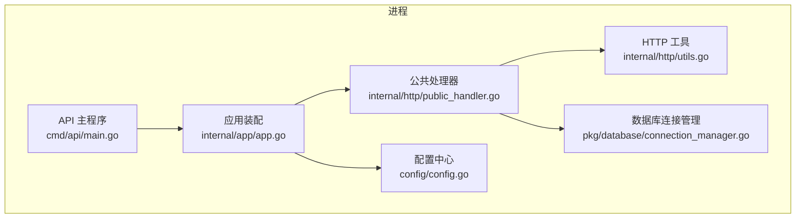
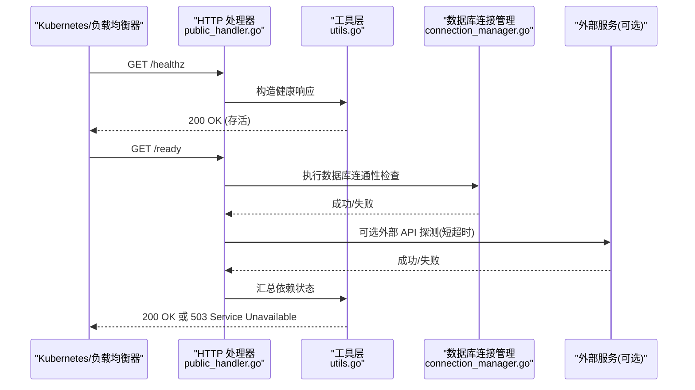
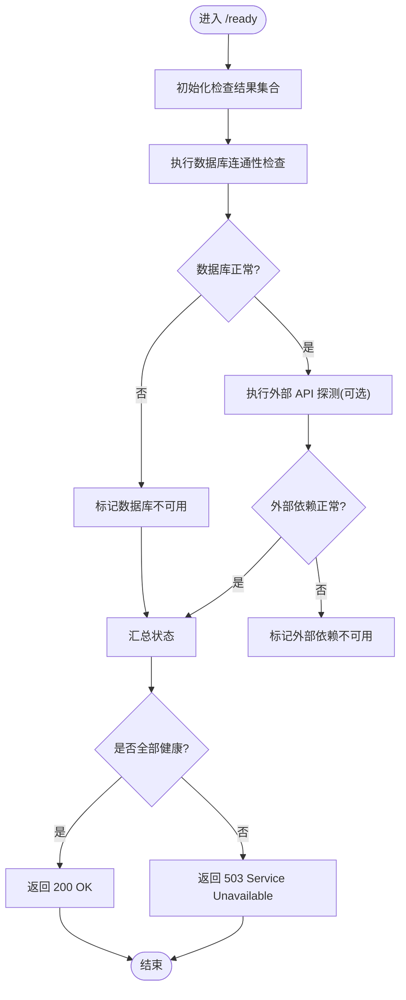
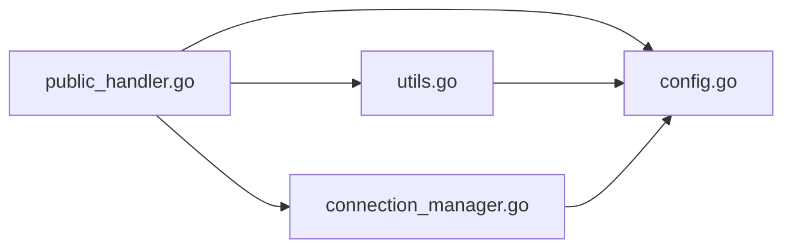

# 健康检查与服务可用性

<cite>
**本文引用的文件**   
- [cmd/api/main.go](file://notifuse/cmd/api/main.go)
- [internal/app/app.go](file://notifuse/internal/app/app.go)
- [pkg/database/connection_manager.go](file://notifuse/pkg/database/connection_manager.go)
- [config/config.go](file://notifuse/config/config.go)
- [internal/http/public_handler.go](file://notifuse/internal/http/public_handler.go)
- [internal/http/utils.go](file://notifuse/internal/http/utils.go)
- [compose.yaml](file://notifuse/compose.yaml)
- [Dockerfile](file://notifuse/Dockerfile)
</cite>

## 目录
1. [简介](#简介)
2. [项目结构](#项目结构)
3. [核心组件](#核心组件)
4. [架构总览](#架构总览)
5. [详细组件分析](#详细组件分析)
6. [依赖关系分析](#依赖关系分析)
7. [性能考量](#性能考量)
8. [故障排查指南](#故障排查指南)
9. [结论](#结论)
10. [附录](#附录)

## 简介
本文件为 Notifuse 平台的健康检查与服务可用性监控文档，聚焦以下目标：
- 设计并实现健康检查端点，覆盖依赖服务状态、数据库连接验证与外部 API 可用性检测。
- 文档化就绪探针（Readiness）与存活探针（Liveness）配置，包括 Kubernetes 探针与负载均衡器集成。
- 解释服务降级与熔断机制的实现思路，涵盖断路器模式与重试策略。
- 提供多区域部署的健康检查策略与故障转移配置建议。
- 绘制服务依赖关系图与依赖健康状态监控方案。

## 项目结构
Notifuse 后端以 Go 编写，HTTP 路由与中间件位于 internal/http，应用启动与装配在 cmd/api 与 internal/app，数据库连接管理位于 pkg/database，配置集中在 config。健康检查相关能力主要分布在以下位置：
- HTTP 入口与路由注册：cmd/api/main.go、internal/app/app.go
- 公共接口处理器：internal/http/public_handler.go
- 通用工具与响应封装：internal/http/utils.go
- 数据库连接管理器：pkg/database/connection_manager.go
- 配置项定义：config/config.go
- 容器编排与运行环境：compose.yaml、Dockerfile

图表来源
- [cmd/api/main.go](file://notifuse/cmd/api/main.go)
- [internal/app/app.go](file://notifuse/internal/app/app.go)
- [internal/http/public_handler.go](file://notifuse/internal/http/public_handler.go)
- [internal/http/utils.go](file://notifuse/internal/http/utils.go)
- [pkg/database/connection_manager.go](file://notifuse/pkg/database/connection_manager.go)
- [config/config.go](file://notifuse/config/config.go)

章节来源
- [cmd/api/main.go](file://notifuse/cmd/api/main.go)
- [internal/app/app.go](file://notifuse/internal/app/app.go)
- [internal/http/public_handler.go](file://notifuse/internal/http/public_handler.go)
- [internal/http/utils.go](file://notifuse/internal/http/utils.go)
- [pkg/database/connection_manager.go](file://notifuse/pkg/database/connection_manager.go)
- [config/config.go](file://notifuse/config/config.go)

## 核心组件
- 健康检查端点
  - 路径约定：/healthz（存活）、/ready（就绪）。可通过配置或默认路由注册到 HTTP 服务器。
  - 返回语义：
    - /healthz：进程是否存活且可接受新请求（不阻塞、无长耗时 I/O）。
    - /ready：服务是否已完全初始化并可对外提供服务（包含依赖校验结果）。
- 依赖健康检查
  - 数据库：通过连接池执行轻量查询（如 SELECT 1）验证连通性与基本读写能力。
  - 外部 API：对关键第三方服务进行短超时探测（例如 OIDC 元数据、邮件发送通道等），失败则标记不可用。
- 探针与负载均衡集成
  - Kubernetes：使用 livenessProbe 与 readinessProbe 分别指向 /healthz 与 /ready。
  - 负载均衡器：将 /healthz 作为健康检查路径，/ready 用于摘除/恢复实例流量。
- 降级与熔断
  - 断路器：对不稳定外部依赖采用断路器模式，快速失败并回退到降级逻辑。
  - 重试策略：对幂等读操作实施指数退避重试；写操作谨慎重试并避免重复提交。
- 多区域与健康策略
  - 按区域暴露独立 /ready 聚合指标，结合全局健康视图进行跨区故障转移。

章节来源
- [internal/http/public_handler.go](file://notifuse/internal/http/public_handler.go)
- [internal/http/utils.go](file://notifuse/internal/http/utils.go)
- [pkg/database/connection_manager.go](file://notifuse/pkg/database/connection_manager.go)
- [config/config.go](file://notifuse/config/config.go)

## 架构总览
下图展示了健康检查在请求链路中的位置与依赖交互。

图表来源
- [internal/http/public_handler.go](file://notifuse/internal/http/public_handler.go)
- [internal/http/utils.go](file://notifuse/internal/http/utils.go)
- [pkg/database/connection_manager.go](file://notifuse/pkg/database/connection_manager.go)

## 详细组件分析

### 健康检查端点设计与实现
- 端点职责
  - /healthz：最小代价的存活检查，仅确认进程可用。
  - /ready：综合检查，包含数据库连通性、必要外部依赖可达性。
- 响应格式
  - 统一 JSON 结构，包含 status、checks（各依赖名称与状态）、timestamp 等字段。
  - 当任一关键依赖失败时，/ready 返回 503，/healthz 仍返回 200。
- 错误与边界
  - 超时控制：所有外部探测设置短超时，避免拖慢探针。
  - 幂等性：健康检查不应产生副作用。
  - 缓存与节流：对昂贵检查可加本地缓存与最小间隔限制。

图表来源
- [internal/http/public_handler.go](file://notifuse/internal/http/public_handler.go)
- [internal/http/utils.go](file://notifuse/internal/http/utils.go)
- [pkg/database/connection_manager.go](file://notifuse/pkg/database/connection_manager.go)

章节来源
- [internal/http/public_handler.go](file://notifuse/internal/http/public_handler.go)
- [internal/http/utils.go](file://notifuse/internal/http/utils.go)
- [pkg/database/connection_manager.go](file://notifuse/pkg/database/connection_manager.go)

### 数据库连接验证
- 验证方式
  - 使用连接池执行轻量查询（如 SELECT 1）验证连通性与基本读写能力。
  - 支持最大空闲连接、最大打开连接、连接超时等参数调优。
- 健康判定
  - 若查询成功，标记数据库健康；否则标记不可用并记录错误类型（网络、认证、权限等）。
- 性能影响
  - 探针频率与超时需平衡，避免频繁压测数据库。

章节来源
- [pkg/database/connection_manager.go](file://notifuse/pkg/database/connection_manager.go)

### 外部 API 可用性检测
- 检测范围
  - 关键外部依赖：OIDC 提供者、邮件发送通道、Webhook 订阅服务等。
- 检测策略
  - 短超时、低并发、幂等读取类探测。
  - 失败时记录错误码与消息，便于定位。
- 降级策略
  - 对非关键依赖失败不影响 /healthz，但会影响 /ready。
  - 对关键依赖失败触发断路器，快速失败并回退。

章节来源
- [internal/http/public_handler.go](file://notifuse/internal/http/public_handler.go)
- [config/config.go](file://notifuse/config/config.go)

### 就绪探针与存活探针配置
- Kubernetes 探针
  - livenessProbe：GET /healthz，失败则重启 Pod。
  - readinessProbe：GET /ready，失败则从 Service 中摘除流量。
- 负载均衡器
  - 使用 /healthz 作为基础健康检查。
  - 使用 /ready 作为业务就绪检查，配合灰度发布与滚动升级。
- 典型参数建议
  - 初始延迟、探测间隔、失败阈值、成功阈值根据环境负载调整。
  - 超时时间应小于探针间隔，避免堆积。

章节来源
- [compose.yaml](file://notifuse/compose.yaml)
- [Dockerfile](file://notifuse/Dockerfile)

### 服务降级与熔断机制
- 断路器模式
  - 对不稳定外部依赖启用断路器，统计失败率与慢调用比例，达到阈值后打开断路器。
  - 半开状态允许少量探测请求，成功后关闭，失败后继续打开。
- 重试策略
  - 幂等读操作：指数退避 + 抖动，限制最大重试次数。
  - 写操作：谨慎重试，必要时引入去重键或幂等令牌。
- 降级逻辑
  - 返回缓存数据、空结果或友好错误提示，保证用户体验与系统稳定性。

章节来源
- [internal/http/public_handler.go](file://notifuse/internal/http/public_handler.go)
- [config/config.go](file://notifuse/config/config.go)

### 多区域部署与健康检查策略
- 区域隔离
  - 每个区域独立部署，/ready 聚合该区域依赖健康状态。
- 故障转移
  - 全局健康视图汇总各区域 /ready 结果，自动将流量切换到健康区域。
- 一致性
  - 跨区数据同步失败时，/ready 可标记“只读”或“受限”模式，避免写入不一致。

章节来源
- [internal/http/public_handler.go](file://notifuse/internal/http/public_handler.go)
- [config/config.go](file://notifuse/config/config.go)

## 依赖关系分析
下图展示健康检查涉及的模块依赖关系。

图表来源
- [internal/http/public_handler.go](file://notifuse/internal/http/public_handler.go)
- [internal/http/utils.go](file://notifuse/internal/http/utils.go)
- [pkg/database/connection_manager.go](file://notifuse/pkg/database/connection_manager.go)
- [config/config.go](file://notifuse/config/config.go)

章节来源
- [internal/http/public_handler.go](file://notifuse/internal/http/public_handler.go)
- [internal/http/utils.go](file://notifuse/internal/http/utils.go)
- [pkg/database/connection_manager.go](file://notifuse/pkg/database/connection_manager.go)
- [config/config.go](file://notifuse/config/config.go)

## 性能考量
- 探针开销
  - 控制 /ready 的检查数量与频率，避免对数据库与外部 API 造成压力。
- 超时与并发
  - 合理设置探针超时与并发上限，防止探针风暴。
- 缓存与节流
  - 对昂贵检查增加本地缓存与最小间隔，降低重复计算。
- 资源隔离
  - 将健康检查与业务请求在不同线程/协程中处理，避免相互阻塞。

[本节为通用指导，无需源码引用]

## 故障排查指南
- 常见问题
  - /ready 返回 503：检查数据库连接、外部 API 可达性与证书有效性。
  - /healthz 频繁重启：确认 livenessProbe 超时与失败阈值设置是否过激。
  - 外部依赖偶发失败：观察断路器状态与重试日志，评估是否需要扩容或切换供应商。
- 诊断步骤
  - 查看 /ready 返回的 checks 明细，定位具体失败依赖。
  - 检查连接池参数与数据库慢查询日志。
  - 核对外部 API 的限流与配额，避免被拒绝。
- 日志与指标
  - 输出健康检查耗时、失败原因与重试次数。
  - 暴露 Prometheus 指标：健康状态、依赖成功率、断路器状态。

章节来源
- [internal/http/public_handler.go](file://notifuse/internal/http/public_handler.go)
- [internal/http/utils.go](file://notifuse/internal/http/utils.go)
- [pkg/database/connection_manager.go](file://notifuse/pkg/database/connection_manager.go)

## 结论
通过统一的 /healthz 与 /ready 端点，Notifuse 实现了清晰的存活与就绪语义，并结合数据库连通性验证与外部 API 探测，确保服务在复杂依赖下的可靠性。配合 Kubernetes 探针与负载均衡器，可实现自动化故障恢复与流量治理。断路器与重试策略进一步提升了系统的韧性。在多区域部署场景下，基于区域健康状态的故障转移策略有助于提升整体可用性。

[本节为总结，无需源码引用]

## 附录
- 配置项建议
  - 健康检查开关、探针间隔、超时、失败阈值、成功阈值。
  - 外部依赖超时、重试次数、退避策略、断路器阈值。
- 示例参考
  - compose.yaml 与 Dockerfile 可用于容器化部署时的环境变量注入与端口映射。

章节来源
- [compose.yaml](file://notifuse/compose.yaml)
- [Dockerfile](file://notifuse/Dockerfile)