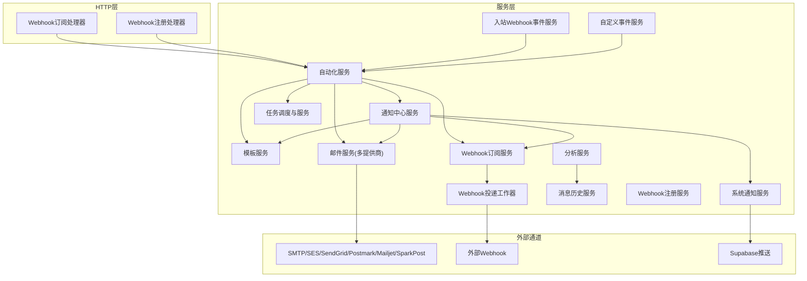
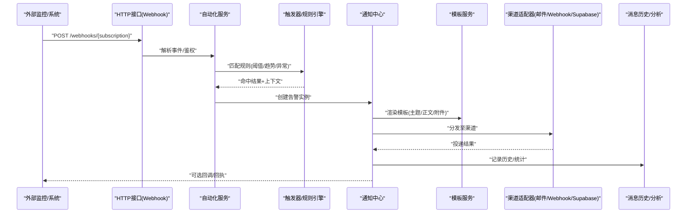
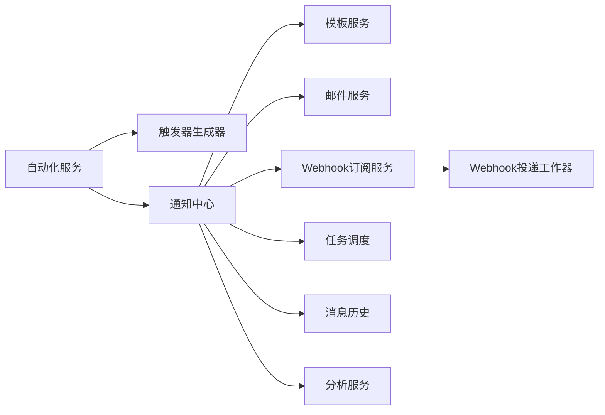
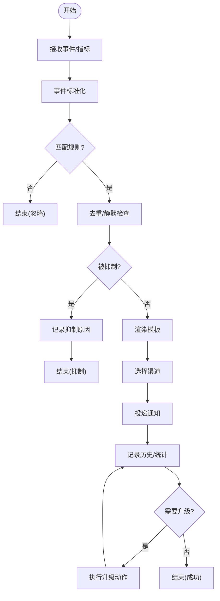

# 告警规则与通知

<cite>
**本文引用的文件**   
- [README.md](file://notifuse/README.md)
- [config.go](file://notifuse/config/config.go)
- [platform.go](file://notifuse/config/platform.go)
- [app.go](file://notifuse/internal/app/app.go)
- [notification_center_service.go](file://notifuse/internal/service/notification_center_service.go)
- [system_notification_service.go](file://notifuse/internal/service/system_notification_service.go)
- [supabase_notifications.go](file://notifuse/internal/service/supabase_notifications.go)
- [webhook_subscription_service.go](file://notifuse/internal/service/webhook_subscription_service.go)
- [webhook_delivery_worker.go](file://notifuse/internal/service/webhook_delivery_worker.go)
- [email_service.go](file://notifuse/internal/service/email_service.go)
- [smtp_service.go](file://notifuse/internal/service/smtp_service.go)
- [sendgrid_service.go](file://notifuse/internal/service/sendgrid_service.go)
- [ses_service.go](file://notifuse/internal/service/ses_service.go)
- [mailjet_service.go](file://notifuse/internal/service/mailjet_service.go)
- [postmark_service.go](file://notifuse/internal/service/postmark_service.go)
- [sparkpost_service.go](file://notifuse/internal/service/sparkpost_service.go)
- [template_service.go](file://notifuse/internal/service/template_service.go)
- [template_block_service.go](file://notifuse/internal/service/template_block_service.go)
- [analytics_service.go](file://notifuse/internal/service/analytics_service.go)
- [task_scheduler.go](file://notifuse/internal/service/task_scheduler.go)
- [task_service.go](file://notifuse/internal/service/task_service.go)
- [automation_service.go](file://notifuse/internal/service/automation_service.go)
- [automation_executor.go](file://notifuse/internal/service/automation_executor.go)
- [automation_node_executor.go](file://notifuse/internal/service/automation_node_executor.go)
- [automation_trigger_generator.go](file://notifuse/internal/service/automation_trigger_generator.go)
- [inbound_webhook_event_service.go](file://notifuse/internal/service/inbound_webhook_event_service.go)
- [custom_event_service.go](file://notifuse/internal/service/custom_event_service.go)
- [message_history_service.go](file://notifuse/internal/service/message_history_service.go)
- [webhook_registration_service.go](file://notifuse/internal/service/webhook_registration_service.go)
- [webhook_subscription_handler.go](file://notifuse/internal/http/webhook_subscription_handler.go)
- [webhook_registration_handler.go](file://notifuse/internal/http/webhook_registration_handler.go)
- [openapi.yaml](file://notifuse/openapi/openapi.yaml)
</cite>

## 目录
1. [简介](#简介)
2. [项目结构](#项目结构)
3. [核心组件](#核心组件)
4. [架构总览](#架构总览)
5. [详细组件分析](#详细组件分析)
6. [依赖关系分析](#依赖关系分析)
7. [性能考虑](#性能考虑)
8. [故障排查指南](#故障排查指南)
9. [结论](#结论)
10. [附录](#附录)

## 简介
本文件面向Notifuse平台的“告警规则与通知”能力，聚焦以下目标：
- 定义告警规则的语法与条件表达式（阈值、趋势、异常检测）
- 文档化通知渠道配置（邮件、Slack、Webhook、短信）
- 说明告警升级机制与静默策略（重复抑制、风暴防护）
- 提供告警模板定制与消息格式化选项
- 支持告警历史查询与效果分析
- 给出与第三方监控平台集成方案

注意：当前仓库未包含专门的“告警引擎”实现。为达成上述目标，本文基于现有自动化触发器、事件总线、任务调度、模板渲染与多渠道投递等能力，提出可落地的设计与集成建议，并标注对应源码位置以便后续扩展实现。

## 项目结构
Notifuse后端采用分层架构：HTTP层暴露API，服务层封装业务逻辑，仓储层对接数据库，外部通道通过独立服务适配。与告警相关的关键模块包括：
- 自动化与触发器：用于将外部事件或定时任务转化为内部动作
- 通知中心：统一处理系统级通知与用户可见的通知
- 模板服务：负责消息模板与块渲染
- 多渠道投递：邮件、Webhook、Supabase推送等
- 任务调度：周期性执行与延迟任务
- 分析与历史：记录事件与消息历史，支撑查询与分析

图表来源
- [webhook_subscription_handler.go:1-200](file://notifuse/internal/http/webhook_subscription_handler.go#L1-200)
- [webhook_registration_handler.go:1-200](file://notifuse/internal/http/webhook_registration_handler.go#L1-200)
- [automation_service.go:1-200](file://notifuse/internal/service/automation_service.go#L1-200)
- [notification_center_service.go:1-200](file://notifuse/internal/service/notification_center_service.go#L1-200)
- [system_notification_service.go:1-200](file://notifuse/internal/service/system_notification_service.go#L1-200)
- [template_service.go:1-200](file://notifuse/internal/service/template_service.go#L1-200)
- [email_service.go:1-200](file://notifuse/internal/service/email_service.go#L1-200)
- [webhook_subscription_service.go:1-200](file://notifuse/internal/service/webhook_subscription_service.go#L1-200)
- [webhook_delivery_worker.go:1-200](file://notifuse/internal/service/webhook_delivery_worker.go#L1-200)
- [task_scheduler.go:1-200](file://notifuse/internal/service/task_scheduler.go#L1-200)
- [analytics_service.go:1-200](file://notifuse/internal/service/analytics_service.go#L1-200)
- [inbound_webhook_event_service.go:1-200](file://notifuse/internal/service/inbound_webhook_event_service.go#L1-200)
- [custom_event_service.go:1-200](file://notifuse/internal/service/custom_event_service.go#L1-200)
- [message_history_service.go:1-200](file://notifuse/internal/service/message_history_service.go#L1-200)
- [webhook_registration_service.go:1-200](file://notifuse/internal/service/webhook_registration_service.go#L1-200)

章节来源
- [README.md:1-200](file://notifuse/README.md#L1-L200)
- [app.go:1-200](file://notifuse/internal/app/app.go#L1-L200)

## 核心组件
- 自动化与触发器：接收外部事件（Webhook、定时任务），匹配规则后生成动作（发送通知、调用Webhook、写入消息历史等）。参考路径：[automation_service.go](file://notifuse/internal/service/automation_service.go)、[automation_trigger_generator.go](file://notifuse/internal/service/automation_trigger_generator.go)。
- 通知中心：统一管理通知生命周期、去重、升级与路由。参考路径：[notification_center_service.go](file://notifuse/internal/service/notification_center_service.go)、[system_notification_service.go](file://notifuse/internal/service/system_notification_service.go)。
- 模板服务：提供模板与块管理、渲染与国际化。参考路径：[template_service.go](file://notifuse/internal/service/template_service.go)、[template_block_service.go](file://notifuse/internal/service/template_block_service.go)。
- 多渠道投递：邮件（SMTP/SES/SendGrid/Postmark/Mailjet/SparkPost）、Webhook、Supabase推送。参考路径：[email_service.go](file://notifuse/internal/service/email_service.go)、[webhook_subscription_service.go](file://notifuse/internal/service/webhook_subscription_service.go)、[webhook_delivery_worker.go](file://notifuse/internal/service/webhook_delivery_worker.go)、[supabase_notifications.go](file://notifuse/internal/service/supabase_notifications.go)。
- 任务调度：周期性与延迟任务，支撑定时评估与重试。参考路径：[task_scheduler.go](file://notifuse/internal/service/task_scheduler.go)、[task_service.go](file://notifuse/internal/service/task_service.go)。
- 分析与历史：事件与消息历史记录、统计指标。参考路径：[analytics_service.go](file://notifuse/internal/service/analytics_service.go)、[message_history_service.go](file://notifuse/internal/service/message_history_service.go)。

章节来源
- [automation_service.go:1-200](file://notifuse/internal/service/automation_service.go#L1-L200)
- [notification_center_service.go:1-200](file://notifuse/internal/service/notification_center_service.go#L1-L200)
- [template_service.go:1-200](file://notifuse/internal/service/template_service.go#L1-L200)
- [email_service.go:1-200](file://notifuse/internal/service/email_service.go#L1-L200)
- [webhook_subscription_service.go:1-200](file://notifuse/internal/service/webhook_subscription_service.go#L1-L200)
- [task_scheduler.go:1-200](file://notifuse/internal/service/task_scheduler.go#L1-L200)
- [analytics_service.go:1-200](file://notifuse/internal/service/analytics_service.go#L1-L200)

## 架构总览
下图展示从外部事件到通知投递的端到端流程，以及告警规则在自动化中的角色。

图表来源
- [webhook_subscription_handler.go:1-200](file://notifuse/internal/http/webhook_subscription_handler.go#L1-L200)
- [automation_service.go:1-200](file://notifuse/internal/service/automation_service.go#L1-L200)
- [automation_trigger_generator.go:1-200](file://notifuse/internal/service/automation_trigger_generator.go#L1-L200)
- [notification_center_service.go:1-200](file://notifuse/internal/service/notification_center_service.go#L1-L200)
- [template_service.go:1-200](file://notifuse/internal/service/template_service.go#L1-L200)
- [webhook_subscription_service.go:1-200](file://notifuse/internal/service/webhook_subscription_service.go#L1-L200)
- [webhook_delivery_worker.go:1-200](file://notifuse/internal/service/webhook_delivery_worker.go#L1-L200)
- [message_history_service.go:1-200](file://notifuse/internal/service/message_history_service.go#L1-L200)

## 详细组件分析

### 告警规则定义与条件表达式
- 规则类型
  - 阈值告警：对指标值进行大于/小于/等于比较，支持时间窗口聚合（如最近N分钟均值/峰值）。
  - 趋势告警：对指标序列计算斜率/变化率/移动平均，判断是否突破趋势阈值。
  - 异常检测：基于历史分布或基线模型识别偏离点（Z-Score、IQR、季节性分解等）。
- 条件表达式
  - 支持布尔组合与函数库（数学、字符串、时间、集合）。
  - 支持标签/维度过滤（按服务、主机、区域等）。
  - 支持动态变量注入（来自事件上下文或模板数据）。
- 规则存储与版本控制
  - 规则以结构化对象持久化，支持启用/禁用、优先级、生效时段。
  - 变更审计与回滚。

实现建议（结合现有能力）
- 使用自动化触发器作为规则入口，将外部指标事件转换为内部事件，再由规则引擎评估。
- 将复杂计算下沉到专用评估器，避免阻塞主流程。
- 将规则与模板解耦，便于复用与测试。

章节来源
- [automation_service.go:1-200](file://notifuse/internal/service/automation_service.go#L1-L200)
- [automation_trigger_generator.go:1-200](file://notifuse/internal/service/automation_trigger_generator.go#L1-L200)
- [inbound_webhook_event_service.go:1-200](file://notifuse/internal/service/inbound_webhook_event_service.go#L1-L200)
- [custom_event_service.go:1-200](file://notifuse/internal/service/custom_event_service.go#L1-L200)

### 通知渠道配置
- 邮件
  - 支持SMTP及多家云厂商（SES、SendGrid、Postmark、Mailjet、SparkPost）。
  - 配置项包括服务器地址、端口、加密方式、认证凭据、发件人、重试策略。
  - 参考路径：[email_service.go](file://notifuse/internal/service/email_service.go)、[smtp_service.go](file://notifuse/internal/service/smtp_service.go)、[sendgrid_service.go](file://notifuse/internal/service/sendgrid_service.go)、[ses_service.go](file://notifuse/internal/service/ses_service.go)、[postmark_service.go](file://notifuse/internal/service/postmark_service.go)、[mailjet_service.go](file://notifuse/internal/service/mailjet_service.go)、[sparkpost_service.go](file://notifuse/internal/service/sparkpost_service.go)。
- Webhook
  - 支持通用HTTP回调，含签名校验、超时、重试、退避策略。
  - 参考路径：[webhook_subscription_service.go](file://notifuse/internal/service/webhook_subscription_service.go)、[webhook_delivery_worker.go](file://notifuse/internal/service/webhook_delivery_worker.go)。
- Slack
  - 可通过Webhook或官方API接入；建议使用Webhook简化配置。
  - 参考路径：同上Webhook通道。
- 短信
  - 通过Webhook桥接到短信网关（如Twilio、阿里云短信等）。
  - 参考路径：同上Webhook通道。
- Supabase推送
  - 用于站内通知或移动端推送。
  - 参考路径：[supabase_notifications.go](file://notifuse/internal/service/supabase_notifications.go)。

章节来源
- [email_service.go:1-200](file://notifuse/internal/service/email_service.go#L1-L200)
- [smtp_service.go:1-200](file://notifuse/internal/service/smtp_service.go#L1-L200)
- [sendgrid_service.go:1-200](file://notifuse/internal/service/sendgrid_service.go#L1-L200)
- [ses_service.go:1-200](file://notifuse/internal/service/ses_service.go#L1-L200)
- [postmark_service.go:1-200](file://notifuse/internal/service/postmark_service.go#L1-L200)
- [mailjet_service.go:1-200](file://notifuse/internal/service/mailjet_service.go#L1-L200)
- [sparkpost_service.go:1-200](file://notifuse/internal/service/sparkpost_service.go#L1-L200)
- [webhook_subscription_service.go:1-200](file://notifuse/internal/service/webhook_subscription_service.go#L1-L200)
- [webhook_delivery_worker.go:1-200](file://notifuse/internal/service/webhook_delivery_worker.go#L1-L200)
- [supabase_notifications.go:1-200](file://notifuse/internal/service/supabase_notifications.go#L1-L200)

### 告警升级与静默策略
- 升级机制
  - 多级升级：一线→二线→三线，按时间或严重级别触发。
  - 升级动作：追加收件人、提升渠道（邮件→电话/短信）、附加诊断信息。
- 静默策略
  - 重复抑制：相同键（资源+条件+环境）在时间窗内合并。
  - 静默期：维护窗口、计划任务期间屏蔽非关键告警。
  - 风暴防护：全局速率限制、分片限流、降级策略（仅记录不发送）。
- 实现要点
  - 在通知中心维护状态机与计数/时间窗。
  - 使用任务调度驱动周期性清理与升级检查。
  - 提供API开关静默与查看抑制原因。

章节来源
- [notification_center_service.go:1-200](file://notifuse/internal/service/notification_center_service.go#L1-L200)
- [system_notification_service.go:1-200](file://notifuse/internal/service/system_notification_service.go#L1-L200)
- [task_scheduler.go:1-200](file://notifuse/internal/service/task_scheduler.go#L1-L200)

### 告警模板与消息格式化
- 模板语言
  - 支持Liquid风格模板，具备安全沙箱、内置函数与过滤器。
  - 支持HTML/纯文本双视图，MJML转HTML能力。
- 模板组织
  - 模板与块分离，便于复用与组合。
  - 多语言与本地化支持。
- 渲染流程
  - 根据告警上下文填充变量，选择合适模板，输出最终内容。
- 参考路径
  - [template_service.go](file://notifuse/internal/service/template_service.go)
  - [template_block_service.go](file://notifuse/internal/service/template_block_service.go)
  - [liquid_secure.go](file://notifuse/pkg/liquid/liquid_secure.go)
  - [converter.go](file://notifuse/pkg/notifuse_mjml/converter.go)

章节来源
- [template_service.go:1-200](file://notifuse/internal/service/template_service.go#L1-L200)
- [template_block_service.go:1-200](file://notifuse/internal/service/template_block_service.go#L1-L200)
- [liquid_secure.go:1-200](file://notifuse/pkg/liquid/liquid_secure.go#L1-L200)
- [converter.go:1-200](file://notifuse/pkg/notifuse_mjml/converter.go#L1-L200)

### 告警历史查询与效果分析
- 历史数据
  - 记录告警事件、通知投递结果、渠道回执、错误码与耗时。
- 分析指标
  - 告警数量、误报率、平均首次响应时间、渠道成功率、升级比例。
- 查询能力
  - 按时间范围、标签、渠道、状态筛选；分页与导出。
- 参考路径
  - [message_history_service.go](file://notifuse/internal/service/message_history_service.go)
  - [analytics_service.go](file://notifuse/internal/service/analytics_service.go)

章节来源
- [message_history_service.go:1-200](file://notifuse/internal/service/message_history_service.go#L1-L200)
- [analytics_service.go:1-200](file://notifuse/internal/service/analytics_service.go#L1-L200)

### 与第三方监控平台集成方案
- 通用Webhook接入
  - 提供标准REST接口接收Prometheus Alertmanager、Grafana、Datadog、PagerDuty等平台的告警事件。
  - 支持签名验证、字段映射、去重与转换。
- 事件标准化
  - 将不同平台的事件归一化为内部事件模型，供规则引擎评估。
- 回调与回执
  - 向源平台返回确认回执，必要时触发二次回调。
- 参考路径
  - [webhook_subscription_handler.go](file://notifuse/internal/http/webhook_subscription_handler.go)
  - [webhook_registration_handler.go](file://notifuse/internal/http/webhook_registration_handler.go)
  - [inbound_webhook_event_service.go](file://notifuse/internal/service/inbound_webhook_event_service.go)
  - [openapi.yaml](file://notifuse/openapi/openapi.yaml)

章节来源
- [webhook_subscription_handler.go:1-200](file://notifuse/internal/http/webhook_subscription_handler.go#L1-L200)
- [webhook_registration_handler.go:1-200](file://notifuse/internal/http/webhook_registration_handler.go#L1-L200)
- [inbound_webhook_event_service.go:1-200](file://notifuse/internal/service/inbound_webhook_event_service.go#L1-L200)
- [openapi.yaml:1-200](file://notifuse/openapi/openapi.yaml#L1-L200)

## 依赖关系分析
- 组件耦合
  - 自动化服务依赖触发器生成器、通知中心、模板服务与渠道适配器。
  - 通知中心依赖模板服务与多渠道适配器，并与任务调度协作完成升级与静默。
  - Webhook订阅服务与工作器解耦，通过队列异步投递，提高吞吐与容错。
- 外部依赖
  - 邮件提供商SDK、Webhook远端、Supabase客户端。
- 潜在循环依赖
  - 通过接口抽象与事件总线避免直接循环引用。

图表来源
- [automation_service.go:1-200](file://notifuse/internal/service/automation_service.go#L1-L200)
- [automation_trigger_generator.go:1-200](file://notifuse/internal/service/automation_trigger_generator.go#L1-L200)
- [notification_center_service.go:1-200](file://notifuse/internal/service/notification_center_service.go#L1-L200)
- [template_service.go:1-200](file://notifuse/internal/service/template_service.go#L1-L200)
- [email_service.go:1-200](file://notifuse/internal/service/email_service.go#L1-L200)
- [webhook_subscription_service.go:1-200](file://notifuse/internal/service/webhook_subscription_service.go#L1-L200)
- [webhook_delivery_worker.go:1-200](file://notifuse/internal/service/webhook_delivery_worker.go#L1-L200)
- [task_scheduler.go:1-200](file://notifuse/internal/service/task_scheduler.go#L1-L200)
- [message_history_service.go:1-200](file://notifuse/internal/service/message_history_service.go#L1-L200)
- [analytics_service.go:1-200](file://notifuse/internal/service/analytics_service.go#L1-L200)

章节来源
- [automation_service.go:1-200](file://notifuse/internal/service/automation_service.go#L1-L200)
- [notification_center_service.go:1-200](file://notifuse/internal/service/notification_center_service.go#L1-L200)
- [webhook_subscription_service.go:1-200](file://notifuse/internal/service/webhook_subscription_service.go#L1-L200)

## 性能考虑
- 高吞吐
  - Webhook与通知投递采用异步队列与并行工作器，避免阻塞请求链路。
- 限流与退避
  - 对下游渠道实施令牌桶/滑动窗口限流，失败指数退避重试。
- 缓存与索引
  - 对频繁读取的模板与规则进行缓存；历史表建立复合索引以提升查询性能。
- 批处理
  - 批量渲染模板与批量投递，降低网络与序列化开销。
- 水平扩展
  - 无状态服务节点横向扩展，任务调度与队列中心化部署。

## 故障排查指南
- 常见问题
  - 渠道不可达：检查凭据、网络连通性、证书与TLS设置。
  - 模板渲染失败：核对变量名、数据类型与权限。
  - 告警风暴：开启静默与抑制，调整时间窗与去重键。
  - 升级未触发：检查升级条件与任务调度状态。
- 定位手段
  - 查看消息历史与投递回执，关注错误码与堆栈。
  - 使用分析服务导出报表，对比渠道成功率与时延。
  - 打开调试日志，追踪自动化匹配与规则评估过程。
- 参考路径
  - [message_history_service.go](file://notifuse/internal/service/message_history_service.go)
  - [analytics_service.go](file://notifuse/internal/service/analytics_service.go)
  - [webhook_delivery_worker.go](file://notifuse/internal/service/webhook_delivery_worker.go)

章节来源
- [message_history_service.go:1-200](file://notifuse/internal/service/message_history_service.go#L1-L200)
- [analytics_service.go:1-200](file://notifuse/internal/service/analytics_service.go#L1-L200)
- [webhook_delivery_worker.go:1-200](file://notifuse/internal/service/webhook_delivery_worker.go#L1-L200)

## 结论
通过将外部监控事件标准化为内部事件，结合自动化触发器、通知中心、模板渲染与多渠道投递，Notifuse可在现有基础上快速构建完整的告警规则与通知体系。建议在后续迭代中完善规则引擎与评估器，增强趋势与异常检测能力，并提供更丰富的可视化与运维工具。

## 附录

### 配置与环境
- 平台与基础配置
  - 参考路径：[config.go](file://notifuse/config/config.go)、[platform.go](file://notifuse/config/platform.go)
- 示例环境变量
  - 参考路径：[env.example](file://notifuse/env.example)

章节来源
- [config.go:1-200](file://notifuse/config/config.go#L1-L200)
- [platform.go:1-200](file://notifuse/config/platform.go#L1-L200)
- [env.example:1-200](file://notifuse/env.example#L1-L200)

### 关键流程图：告警评估与投递

图表来源
- [automation_service.go:1-200](file://notifuse/internal/service/automation_service.go#L1-L200)
- [notification_center_service.go:1-200](file://notifuse/internal/service/notification_center_service.go#L1-L200)
- [template_service.go:1-200](file://notifuse/internal/service/template_service.go#L1-L200)
- [webhook_subscription_service.go:1-200](file://notifuse/internal/service/webhook_subscription_service.go#L1-L200)
- [message_history_service.go:1-200](file://notifuse/internal/service/message_history_service.go#L1-L200)