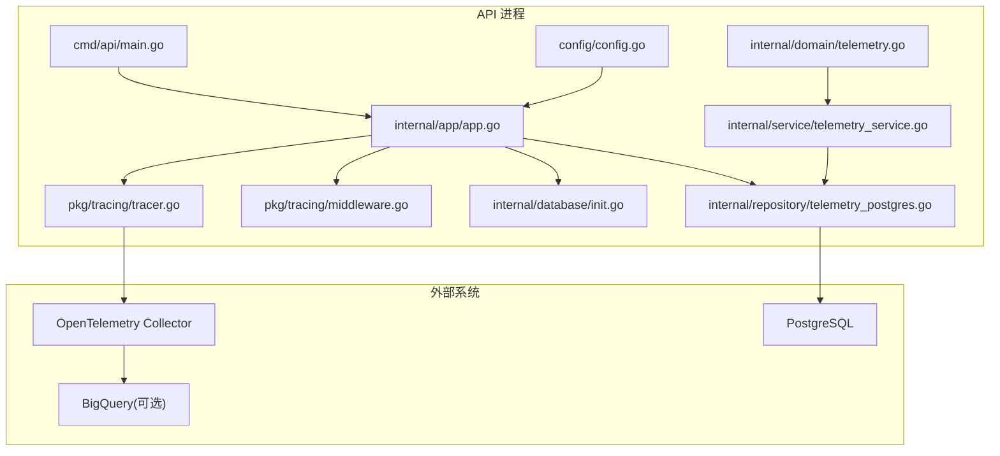
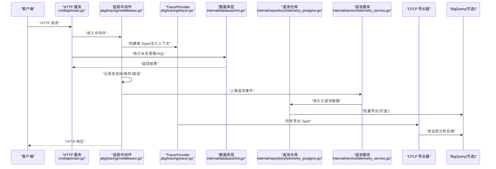
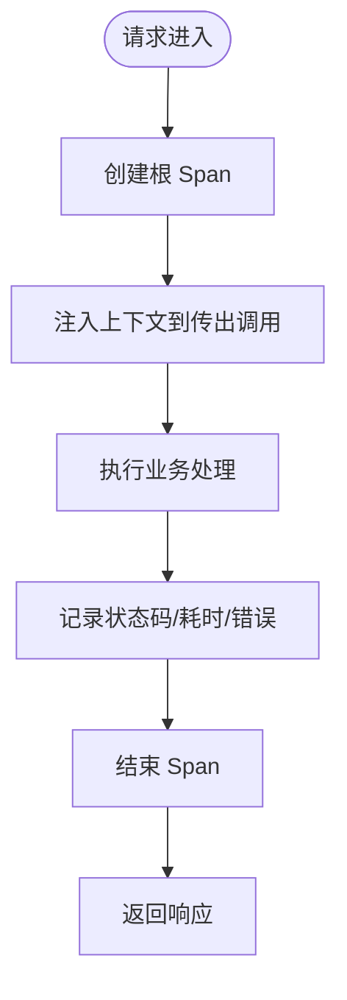
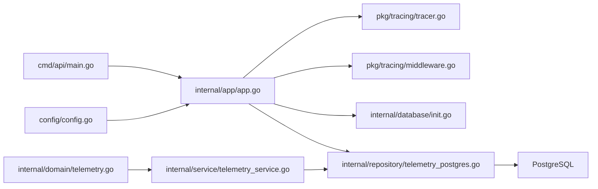

# 应用性能监控(APM)

<cite>
**本文引用的文件**   
- [cmd/api/main.go](file://notifuse/cmd/api/main.go)
- [internal/app/app.go](file://notifuse/internal/app/app.go)
- [pkg/tracing/tracer.go](file://notifuse/pkg/tracing/tracer.go)
- [pkg/tracing/middleware.go](file://notifuse/pkg/tracing/middleware.go)
- [internal/database/init.go](file://notifuse/internal/database/init.go)
- [internal/repository/telemetry_postgres.go](file://notifuse/internal/repository/telemetry_postgres.go)
- [internal/service/telemetry_service.go](file://notifuse/internal/service/telemetry_service.go)
- [internal/domain/telemetry.go](file://notifuse/internal/domain/telemetry.go)
- [config/config.go](file://notifuse/config/config.go)
- [telemetry/main.go](file://notifuse/telemetry/main.go)
- [telemetry/bigquery_schema.json](file://notifuse/telemetry/bigquery_schema.json)
- [telemetry/deploy.sh](file://notifuse/telemetry/deploy.sh)
- [go.mod](file://notifuse/go.mod)
</cite>

## 目录
1. [简介](#简介)
2. [项目结构](#项目结构)
3. [核心组件](#核心组件)
4. [架构总览](#架构总览)
5. [详细组件分析](#详细组件分析)
6. [依赖分析](#依赖分析)
7. [性能考虑](#性能考虑)
8. [故障排查指南](#故障排查指南)
9. [结论](#结论)
10. [附录](#附录)

## 简介
本文件为 Notifuse 平台的应用性能监控(APM)文档，聚焦分布式追踪系统的设计与落地，包括 OpenTelemetry 集成、追踪上下文传播、span 生命周期管理；关键性能指标(KPI)的采集与聚合（请求延迟、吞吐量、错误率、资源利用率）；性能分析工具配置与使用（火焰图、慢查询、内存泄漏检测）；基准测试与回归检测策略；以及 APM 数据可视化与自定义仪表板搭建指南。

## 项目结构
Notifuse 后端采用 Go 语言实现，APM 相关能力主要分布在以下位置：
- 启动与中间件装配：cmd/api/main.go、internal/app/app.go
- 追踪初始化与 HTTP 中间件：pkg/tracing/*
- 数据库连接与 SQL 埋点：internal/database/init.go
- 遥测数据持久化：internal/repository/telemetry_postgres.go、internal/service/telemetry_service.go、internal/domain/telemetry.go
- 外部遥测导出服务：telemetry/*
- 全局配置：config/config.go
- 依赖声明：go.mod

图表来源
- [cmd/api/main.go](file://notifuse/cmd/api/main.go)
- [internal/app/app.go](file://notifuse/internal/app/app.go)
- [pkg/tracing/tracer.go](file://notifuse/pkg/tracing/tracer.go)
- [pkg/tracing/middleware.go](file://notifuse/pkg/tracing/middleware.go)
- [internal/database/init.go](file://notifuse/internal/database/init.go)
- [internal/repository/telemetry_postgres.go](file://notifuse/internal/repository/telemetry_postgres.go)
- [internal/service/telemetry_service.go](file://notifuse/internal/service/telemetry_service.go)
- [internal/domain/telemetry.go](file://notifuse/internal/domain/telemetry.go)
- [config/config.go](file://notifuse/config/config.go)

章节来源
- [cmd/api/main.go](file://notifuse/cmd/api/main.go)
- [internal/app/app.go](file://notifuse/internal/app/app.go)
- [pkg/tracing/tracer.go](file://notifuse/pkg/tracing/tracer.go)
- [pkg/tracing/middleware.go](file://notifuse/pkg/tracing/middleware.go)
- [internal/database/init.go](file://notifuse/internal/database/init.go)
- [internal/repository/telemetry_postgres.go](file://notifuse/internal/repository/telemetry_postgres.go)
- [internal/service/telemetry_service.go](file://notifuse/internal/service/telemetry_service.go)
- [internal/domain/telemetry.go](file://notifuse/internal/domain/telemetry.go)
- [config/config.go](file://notifuse/config/config.go)

## 核心组件
- 追踪器初始化与导出：负责创建 OpenTelemetry TracerProvider、设置采样策略、注册 OTLP 导出器，并暴露获取当前 Tracer 的方法。
- HTTP 追踪中间件：在请求进入时创建根 span，注入/提取上下文，记录请求元信息，并在响应结束时结束 span。
- 数据库 SQL 埋点：通过数据库驱动或库包装，自动为 SQL 执行生成子 span，附带语句类型、表名等属性。
- 遥测服务与存储：将业务事件与指标写入 PostgreSQL，供后续分析与报表展示。
- 外部遥测导出服务：将内部遥测数据转发至 BigQuery 或其他分析后端。
- 配置中心：集中管理 APM 开关、采样率、端点地址等环境变量。

章节来源
- [pkg/tracing/tracer.go](file://notifuse/pkg/tracing/tracer.go)
- [pkg/tracing/middleware.go](file://notifuse/pkg/tracing/middleware.go)
- [internal/database/init.go](file://notifuse/internal/database/init.go)
- [internal/repository/telemetry_postgres.go](file://notifuse/internal/repository/telemetry_postgres.go)
- [internal/service/telemetry_service.go](file://notifuse/internal/service/telemetry_service.go)
- [internal/domain/telemetry.go](file://notifuse/internal/domain/telemetry.go)
- [config/config.go](file://notifuse/config/config.go)

## 架构总览
下图展示了从 API 请求到追踪数据落盘与导出的端到端流程。

图表来源
- [cmd/api/main.go](file://notifuse/cmd/api/main.go)
- [pkg/tracing/middleware.go](file://notifuse/pkg/tracing/middleware.go)
- [pkg/tracing/tracer.go](file://notifuse/pkg/tracing/tracer.go)
- [internal/database/init.go](file://notifuse/internal/database/init.go)
- [internal/repository/telemetry_postgres.go](file://notifuse/internal/repository/telemetry_postgres.go)
- [internal/service/telemetry_service.go](file://notifuse/internal/service/telemetry_service.go)

## 详细组件分析

### 追踪器初始化与导出
- 职责
  - 初始化 TracerProvider，配置采样策略与导出器。
  - 提供获取 Tracer 的全局方法，便于各模块创建 span。
- 关键点
  - 采样策略：生产环境建议基于动态采样，降低高负载时的开销。
  - 导出器：默认使用 OTLP 协议发送至收集器，支持超时与重试。
  - 资源标签：附加服务名、版本、实例 ID 等，便于多维分析。
- 配置项
  - 是否启用追踪、OTLP 端点、采样率、导出批大小与间隔等。

章节来源
- [pkg/tracing/tracer.go](file://notifuse/pkg/tracing/tracer.go)
- [config/config.go](file://notifuse/config/config.go)

### HTTP 追踪中间件与上下文传播
- 职责
  - 为每个请求创建根 span，记录路径、方法、状态码、耗时等。
  - 在入站/出站调用中注入/提取上下文，确保跨服务链路完整。
- 关键点
  - 上下文传播：遵循 W3C Trace Context 标准，兼容第三方网关与下游服务。
  - 错误标记：当出现异常或错误状态码时，标记 span 为错误并记录错误信息。
  - 性能保护：避免对超大请求体或长尾路径进行过度标注。
- 典型流程

图表来源
- [pkg/tracing/middleware.go](file://notifuse/pkg/tracing/middleware.go)

章节来源
- [pkg/tracing/middleware.go](file://notifuse/pkg/tracing/middleware.go)

### 数据库 SQL 埋点
- 职责
  - 为 SQL 执行自动创建子 span，附带操作类型、表名、索引命中等信息。
- 关键点
  - 低侵入：通过数据库驱动包装或通用库实现，无需修改业务代码。
  - 安全：过滤敏感字段，避免泄露密码或令牌。
  - 性能：对高频短查询可开启采样或合并统计。
- 接入位置
  - 数据库初始化阶段完成埋点注册。

章节来源
- [internal/database/init.go](file://notifuse/internal/database/init.go)

### 遥测服务与存储
- 职责
  - 定义遥测领域模型，提供服务接口以持久化事件与指标。
  - 封装对 PostgreSQL 的写入逻辑，支持批量写入与失败重试。
- 关键点
  - 幂等性：重复上报不会导致数据重复。
  - 背压：在高吞吐场景下采用队列与限流，避免阻塞主流程。
  - 可观测性：自身也产生日志与指标，便于监控其健康度。
- 数据模型
  - 包含时间戳、服务名、工作区标识、事件类型、度量值、维度标签等。

章节来源
- [internal/domain/telemetry.go](file://notifuse/internal/domain/telemetry.go)
- [internal/service/telemetry_service.go](file://notifuse/internal/service/telemetry_service.go)
- [internal/repository/telemetry_postgres.go](file://notifuse/internal/repository/telemetry_postgres.go)

### 外部遥测导出服务
- 职责
  - 将内部遥测数据导出至 BigQuery 或其他分析后端，供离线分析与报表。
- 关键点
  - 独立部署：作为独立进程运行，解耦主业务。
  - 容错：具备断线重连与指数退避重试。
  - 模式演进：通过 JSON Schema 管理 BigQuery 表结构变更。

章节来源
- [telemetry/main.go](file://notifuse/telemetry/main.go)
- [telemetry/bigquery_schema.json](file://notifuse/telemetry/bigquery_schema.json)
- [telemetry/deploy.sh](file://notifuse/telemetry/deploy.sh)

## 依赖分析
- 直接依赖
  - OpenTelemetry SDK 与 OTLP 导出器用于追踪与指标导出。
  - PostgreSQL 驱动用于遥测数据存储。
  - 配置包用于读取环境变量与配置文件。
- 间接依赖
  - 日志框架、HTTP 路由、数据库连接池等基础设施。
- 潜在风险
  - 循环依赖：确保 tracing 不反向依赖业务服务。
  - 外部依赖稳定性：对 OTLP 与数据库连接做超时与熔断保护。

图表来源
- [cmd/api/main.go](file://notifuse/cmd/api/main.go)
- [internal/app/app.go](file://notifuse/internal/app/app.go)
- [pkg/tracing/tracer.go](file://notifuse/pkg/tracing/tracer.go)
- [pkg/tracing/middleware.go](file://notifuse/pkg/tracing/middleware.go)
- [internal/database/init.go](file://notifuse/internal/database/init.go)
- [internal/repository/telemetry_postgres.go](file://notifuse/internal/repository/telemetry_postgres.go)
- [internal/service/telemetry_service.go](file://notifuse/internal/service/telemetry_service.go)
- [internal/domain/telemetry.go](file://notifuse/internal/domain/telemetry.go)
- [config/config.go](file://notifuse/config/config.go)

章节来源
- [go.mod](file://notifuse/go.mod)

## 性能考虑
- 采样策略
  - 推荐基于动态采样，结合错误率与分位延迟调整采样阈值。
- 导出批处理
  - 增大批大小与延长导出间隔可降低网络开销，但会增加延迟与内存占用，需权衡。
- 资源标签
  - 仅保留必要维度，避免高基数标签导致聚合成本上升。
- 数据库埋点
  - 对高频短查询开启采样，避免引入额外开销。
- 背压与限流
  - 遥测写入采用队列与速率限制，防止雪崩。

[本节为通用指导，不直接分析具体文件]

## 故障排查指南
- 常见问题
  - 追踪未生效：检查 APM 开关、OTLP 端点、网络连通性与证书配置。
  - 链路断裂：确认上下文传播是否被中间件或第三方库覆盖。
  - 数据丢失：查看遥测服务日志与队列积压情况，检查数据库写入权限与磁盘空间。
- 定位步骤
  - 通过根 span 的 trace_id 关联所有子 span，定位瓶颈节点。
  - 对比不同环境的采样率与批大小，评估对延迟的影响。
  - 针对慢查询，结合 SQL 埋点属性与数据库慢查询日志交叉验证。
- 恢复措施
  - 临时提高采样率以复现问题，随后逐步回滚。
  - 扩容遥测导出服务实例，提升吞吐能力。

章节来源
- [pkg/tracing/tracer.go](file://notifuse/pkg/tracing/tracer.go)
- [pkg/tracing/middleware.go](file://notifuse/pkg/tracing/middleware.go)
- [internal/repository/telemetry_postgres.go](file://notifuse/internal/repository/telemetry_postgres.go)
- [internal/service/telemetry_service.go](file://notifuse/internal/service/telemetry_service.go)

## 结论
Notifuse 的 APM 体系以 OpenTelemetry 为核心，结合 HTTP 中间件与数据库埋点，形成端到端的分布式追踪能力。通过遥测服务与外部导出服务，实现了数据的持久化与分析。建议在上线前明确采样策略与资源标签规范，建立性能基线与回归检测机制，并配套可视化仪表板，持续提升系统的可观测性与稳定性。

[本节为总结性内容，不直接分析具体文件]

## 附录

### KPI 定义与采集
- 请求延迟
  - 指标：P50/P95/P99 延迟、平均延迟。
  - 采集：HTTP 中间件记录请求开始与结束时间差。
- 吞吐量
  - 指标：RPS、并发数、队列长度。
  - 采集：中间件计数器与遥测服务聚合。
- 错误率
  - 指标：HTTP 错误比例、业务错误比例。
  - 采集：中间件根据状态码与异常标记。
- 资源利用率
  - 指标：CPU、内存、GC、goroutine 数量。
  - 采集：运行时指标与系统探针。

章节来源
- [pkg/tracing/middleware.go](file://notifuse/pkg/tracing/middleware.go)
- [internal/service/telemetry_service.go](file://notifuse/internal/service/telemetry_service.go)

### 性能分析工具配置与使用
- 火焰图生成
  - 使用 pprof 采集 CPU 与内存 profile，导出后转换为火焰图。
  - 关注热点函数与调用链，结合 span 定位瓶颈。
- 慢查询分析
  - 结合 SQL 埋点属性与数据库慢查询日志，识别高耗时语句。
  - 优化索引与查询计划，减少锁竞争。
- 内存泄漏检测
  - 定期采集 heap profile，比较增量变化，定位未释放对象。
  - 结合 goroutine profile 排查阻塞与泄漏。

[本节为通用指导，不直接分析具体文件]

### 基准测试与回归检测
- 基准方法
  - 使用压测工具模拟真实流量，记录延迟分布与错误率。
  - 固定硬件与环境，保证结果可比性。
- 回归检测
  - 在 CI 中执行基准用例，设定阈值告警。
  - 对关键路径增加专项测试，如高并发与长尾延迟。

[本节为通用指导，不直接分析具体文件]

### APM 数据可视化与仪表板
- 数据源
  - PostgreSQL：业务遥测与指标。
  - BigQuery：历史分析与离线报表。
- 仪表板建议
  - 概览：RPS、错误率、P95/P99 延迟、资源利用率。
  - 链路：按 trace_id 检索与拓扑视图。
  - 慢查询：Top N 语句与趋势。
- 自定义面板
  - 基于维度标签（服务、工作区、端点）构建筛选器。
  - 使用聚合函数计算分位与比率，设置阈值告警。

章节来源
- [internal/repository/telemetry_postgres.go](file://notifuse/internal/repository/telemetry_postgres.go)
- [telemetry/bigquery_schema.json](file://notifuse/telemetry/bigquery_schema.json)