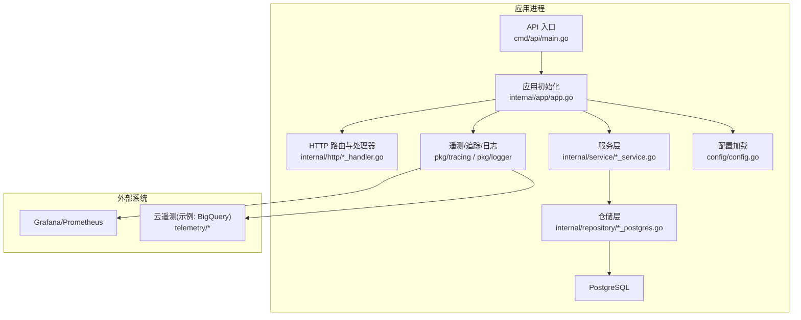
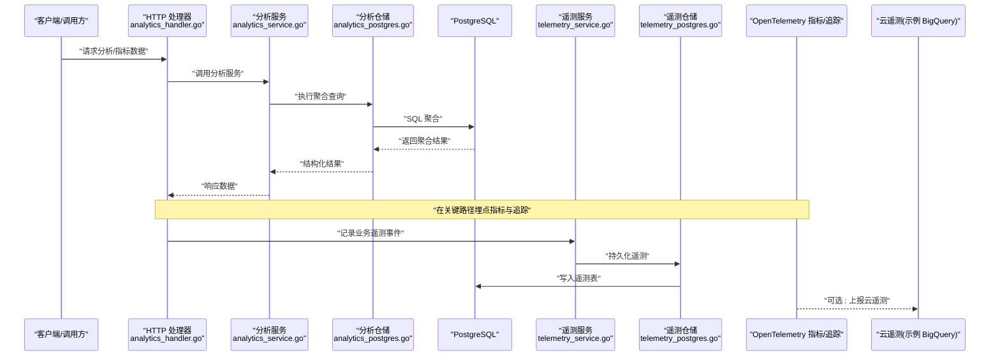
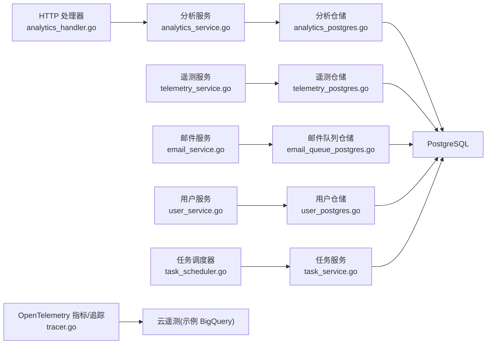

# 指标监控与报表

<cite>
**本文引用的文件**   
- [cmd/api/main.go](file://notifuse/cmd/api/main.go)
- [internal/app/app.go](file://notifuse/internal/app/app.go)
- [internal/database/init.go](file://notifuse/internal/database/init.go)
- [internal/repository/telemetry_postgres.go](file://notifuse/internal/repository/telemetry_postgres.go)
- [internal/service/telemetry_service.go](file://notifuse/internal/service/telemetry_service.go)
- [internal/domain/telemetry.go](file://notifuse/internal/domain/telemetry.go)
- [pkg/tracing/tracer.go](file://notifuse/pkg/tracing/tracer.go)
- [pkg/logger/logger.go](file://notifuse/pkg/logger/logger.go)
- [config/config.go](file://notifuse/config/config.go)
- [openapi/openapi.yaml](file://notifuse/openapi/openapi.yaml)
- [openapi/paths/custom-events.yaml](file://notifuse/openapi/paths/custom-events.yaml)
- [openapi/components/schemas/custom_event.yaml](file://notifuse/openapi/components/schemas/custom_event.yaml)
- [internal/http/analytics_handler.go](file://notifuse/internal/http/analytics_handler.go)
- [internal/service/analytics_service.go](file://notifuse/internal/service/analytics_service.go)
- [internal/repository/analytics_postgres.go](file://notifuse/internal/repository/analytics_postgres.go)
- [internal/domain/analytics.go](file://notifuse/internal/domain/analytics.go)
- [internal/service/email_service.go](file://notifuse/internal/service/email_service.go)
- [internal/repository/email_queue_postgres.go](file://notifuse/internal/repository/email_queue_postgres.go)
- [internal/domain/email_queue.go](file://notifuse/internal/domain/email_queue.go)
- [internal/service/user_service.go](file://notifuse/internal/service/user_service.go)
- [internal/repository/user_postgres.go](file://notifuse/internal/repository/user_postgres.go)
- [internal/domain/user.go](file://notifuse/internal/domain/user.go)
- [internal/service/task_scheduler.go](file://notifuse/internal/service/task_scheduler.go)
- [internal/service/task_service.go](file://notifuse/internal/service/task_service.go)
- [internal/domain/task.go](file://notifuse/internal/domain/task.go)
- [internal/migrations/v28.go](file://notifuse/internal/migrations/v28.go)
- [internal/migrations/v29.go](file://notifuse/internal/migrations/v29.go)
- [internal/migrations/v30.go](file://notifuse/internal/migrations/v30.go)
- [internal/migrations/v31.go](file://notifuse/internal/migrations/v31.go)
- [internal/migrations/v32.go](file://notifuse/internal/migrations/v32.go)
- [internal/migrations/v33.go](file://notifuse/internal/migrations/v33.go)
- [internal/migrations/v34.go](file://notifuse/internal/migrations/v34.go)
- [telemetry/main.go](file://notifuse/telemetry/main.go)
- [telemetry/function.yaml](file://notifuse/telemetry/function.yaml)
- [telemetry/bigquery_schema.json](file://notifuse/telemetry/bigquery_schema.json)
</cite>

## 目录
1. [简介](#简介)
2. [项目结构](#项目结构)
3. [核心组件](#核心组件)
4. [架构总览](#架构总览)
5. [详细组件分析](#详细组件分析)
6. [依赖关系分析](#依赖关系分析)
7. [性能考虑](#性能考虑)
8. [故障排查指南](#故障排查指南)
9. [结论](#结论)
10. [附录](#附录)

## 简介
本文件为 Notifuse 平台的“指标监控与报表”系统提供完整文档，覆盖业务指标定义、采集方法、时序数据库选型与配置、仪表盘设计与可视化（含 Grafana 集成）、报表生成与导出、指标聚合策略与数据保留政策，以及容量规划与趋势分析方法。文档同时结合代码仓库中的现有实现（如遥测、追踪、日志、事件与任务调度等）给出落地建议与扩展路径。

## 项目结构
Notifuse 后端采用 Go 语言构建，模块化分层清晰：HTTP 层暴露 API，服务层封装业务逻辑，仓储层对接持久化存储（PostgreSQL），领域模型定义数据结构，配置与启动入口位于 cmd 与 internal/app。遥测与追踪能力已内置，可通过 OpenTelemetry 输出指标与链路信息；同时存在一个独立的 telemetry 子项目用于将遥测数据投递至云存储（BigQuery）。

图表来源
- [cmd/api/main.go](file://notifuse/cmd/api/main.go)
- [internal/app/app.go](file://notifuse/internal/app/app.go)
- [internal/http/analytics_handler.go](file://notifuse/internal/http/analytics_handler.go)
- [internal/service/analytics_service.go](file://notifuse/internal/service/analytics_service.go)
- [internal/repository/analytics_postgres.go](file://notifuse/internal/repository/analytics_postgres.go)
- [pkg/tracing/tracer.go](file://notifuse/pkg/tracing/tracer.go)
- [pkg/logger/logger.go](file://notifuse/pkg/logger/logger.go)
- [config/config.go](file://notifuse/config/config.go)
- [telemetry/main.go](file://notifuse/telemetry/main.go)

章节来源
- [cmd/api/main.go](file://notifuse/cmd/api/main.go)
- [internal/app/app.go](file://notifuse/internal/app/app.go)
- [config/config.go](file://notifuse/config/config.go)

## 核心组件
- 遥测与追踪
  - 通过内部 tracing 包初始化 OpenTelemetry Tracer/Meter，统一埋点与指标上报。
  - 日志由 logger 包集中管理，便于关联上下文与采样。
- 自定义事件与遥测写入
  - 领域模型 domain/telemetry.go 定义遥测事件结构。
  - 服务层 service/telemetry_service.go 提供写入接口。
  - 仓储层 repository/telemetry_postgres.go 将遥测数据持久化到 PostgreSQL。
- 分析与查询
  - HTTP 层 analytics_handler.go 暴露分析相关接口。
  - 服务层 analytics_service.go 聚合与分析计算。
  - 仓储层 analytics_postgres.go 执行 SQL 聚合查询。
- 邮件发送成功率
  - 基于 email_queue 队列状态与结果统计成功率。
- 用户活跃度
  - 基于 user 表访问/登录等行为计数。
- 任务与定时报表
  - task_service.go 与 task_scheduler.go 提供任务编排与定时执行能力，可用于生成与导出报表。

章节来源
- [pkg/tracing/tracer.go](file://notifuse/pkg/tracing/tracer.go)
- [pkg/logger/logger.go](file://notifuse/pkg/logger/logger.go)
- [internal/domain/telemetry.go](file://notifuse/internal/domain/telemetry.go)
- [internal/service/telemetry_service.go](file://notifuse/internal/service/telemetry_service.go)
- [internal/repository/telemetry_postgres.go](file://notifuse/internal/repository/telemetry_postgres.go)
- [internal/http/analytics_handler.go](file://notifuse/internal/http/analytics_handler.go)
- [internal/service/analytics_service.go](file://notifuse/internal/service/analytics_service.go)
- [internal/repository/analytics_postgres.go](file://notifuse/internal/repository/analytics_postgres.go)
- [internal/domain/email_queue.go](file://notifuse/internal/domain/email_queue.go)
- [internal/repository/email_queue_postgres.go](file://notifuse/internal/repository/email_queue_postgres.go)
- [internal/service/email_service.go](file://notifuse/internal/service/email_service.go)
- [internal/domain/user.go](file://notifuse/internal/domain/user.go)
- [internal/repository/user_postgres.go](file://notifuse/internal/repository/user_postgres.go)
- [internal/service/user_service.go](file://notifuse/internal/service/user_service.go)
- [internal/domain/task.go](file://notifuse/internal/domain/task.go)
- [internal/service/task_service.go](file://notifuse/internal/service/task_service.go)
- [internal/service/task_scheduler.go](file://notifuse/internal/service/task_scheduler.go)

## 架构总览
下图展示从业务请求到指标采集、存储与可视化的端到端流程，并标注了与代码文件的对应关系。

图表来源
- [internal/http/analytics_handler.go](file://notifuse/internal/http/analytics_handler.go)
- [internal/service/analytics_service.go](file://notifuse/internal/service/analytics_service.go)
- [internal/repository/analytics_postgres.go](file://notifuse/internal/repository/analytics_postgres.go)
- [internal/service/telemetry_service.go](file://notifuse/internal/service/telemetry_service.go)
- [internal/repository/telemetry_postgres.go](file://notifuse/internal/repository/telemetry_postgres.go)
- [pkg/tracing/tracer.go](file://notifuse/pkg/tracing/tracer.go)
- [telemetry/main.go](file://notifuse/telemetry/main.go)

## 详细组件分析

### 指标定义与采集方法
- 邮件发送成功率
  - 定义：成功发送数 / 总发送数（按时间窗口与渠道维度聚合）。
  - 采集：在邮件发送生命周期中记录事件（入队、发送、回调结果），并通过遥测服务或分析服务进行聚合。
  - 参考实现位置：
    - [internal/domain/email_queue.go](file://notifuse/internal/domain/email_queue.go)
    - [internal/repository/email_queue_postgres.go](file://notifuse/internal/repository/email_queue_postgres.go)
    - [internal/service/email_service.go](file://notifuse/internal/service/email_service.go)
- 用户活跃度
  - 定义：活跃用户数、会话次数、页面/功能访问频次等。
  - 采集：在用户登录、访问关键页面时埋点，使用遥测服务记录事件，或通过分析服务聚合。
  - 参考实现位置：
    - [internal/domain/user.go](file://notifuse/internal/domain/user.go)
    - [internal/repository/user_postgres.go](file://notifuse/internal/repository/user_postgres.go)
    - [internal/service/user_service.go](file://notifuse/internal/service/user_service.go)
- 系统资源使用率
  - 定义：CPU、内存、磁盘、网络等系统级指标。
  - 采集：通过 OpenTelemetry 收集运行时指标，或引入 Node Exporter/Exporter 方案，统一上报到 Prometheus。
  - 参考实现位置：
    - [pkg/tracing/tracer.go](file://notifuse/pkg/tracing/tracer.go)
- 自定义事件
  - 定义：业务侧自定义事件（如模板渲染耗时、第三方 API 调用延迟等）。
  - 采集：通过 OpenAPI 定义的自定义事件接口接收事件，再由遥测服务持久化。
  - 参考实现位置：
    - [openapi/openapi.yaml](file://notifuse/openapi/openapi.yaml)
    - [openapi/paths/custom-events.yaml](file://notifuse/openapi/paths/custom-events.yaml)
    - [openapi/components/schemas/custom_event.yaml](file://notifuse/openapi/components/schemas/custom_event.yaml)
    - [internal/domain/telemetry.go](file://notifuse/internal/domain/telemetry.go)
    - [internal/service/telemetry_service.go](file://notifuse/internal/service/telemetry_service.go)
    - [internal/repository/telemetry_postgres.go](file://notifuse/internal/repository/telemetry_postgres.go)

章节来源
- [internal/domain/email_queue.go](file://notifuse/internal/domain/email_queue.go)
- [internal/repository/email_queue_postgres.go](file://notifuse/internal/repository/email_queue_postgres.go)
- [internal/service/email_service.go](file://notifuse/internal/service/email_service.go)
- [internal/domain/user.go](file://notifuse/internal/domain/user.go)
- [internal/repository/user_postgres.go](file://notifuse/internal/repository/user_postgres.go)
- [internal/service/user_service.go](file://notifuse/internal/service/user_service.go)
- [pkg/tracing/tracer.go](file://notifuse/pkg/tracing/tracer.go)
- [openapi/openapi.yaml](file://notifuse/openapi/openapi.yaml)
- [openapi/paths/custom-events.yaml](file://notifuse/openapi/paths/custom-events.yaml)
- [openapi/components/schemas/custom_event.yaml](file://notifuse/openapi/components/schemas/custom_event.yaml)
- [internal/domain/telemetry.go](file://notifuse/internal/domain/telemetry.go)
- [internal/service/telemetry_service.go](file://notifuse/internal/service/telemetry_service.go)
- [internal/repository/telemetry_postgres.go](file://notifuse/internal/repository/telemetry_postgres.go)

### 时序数据库选择与配置
- 推荐方案
  - Prometheus + Grafana：适合实时告警与短周期高吞吐指标；PromQL 灵活强大。
  - InfluxDB：适合高写入量与时序分析场景，具备原生聚合函数。
  - 云服务商时序存储（如 BigQuery）：适合长期归档与复杂分析，成本可控且可扩展。
- 在本仓库中的体现
  - 已有遥测服务与仓储可持久化到 PostgreSQL，可作为短期指标存储。
  - telemetry 子项目提供将遥测数据投递至 BigQuery 的示例实现，可作为长期归档与离线分析的数据源。
- 配置要点
  - 指标命名规范：前缀+维度+度量名（如 notifuse.email.send.success_total）。
  - 标签设计：workspace_id、provider、region、status 等常用维度。
  - 采样与降采样：高频指标需设置合理的采样率与降采样策略。
  - 安全与鉴权：对外暴露的指标端点需限制访问范围。

章节来源
- [internal/service/telemetry_service.go](file://notifuse/internal/service/telemetry_service.go)
- [internal/repository/telemetry_postgres.go](file://notifuse/internal/repository/telemetry_postgres.go)
- [telemetry/main.go](file://notifuse/telemetry/main.go)
- [telemetry/function.yaml](file://notifuse/telemetry/function.yaml)
- [telemetry/bigquery_schema.json](file://notifuse/telemetry/bigquery_schema.json)

### 仪表盘设计与可视化展示
- Grafana 集成
  - 数据源：Prometheus、InfluxDB、PostgreSQL、BigQuery 等。
  - 面板类型：折线图、柱状图、热力图、表格、单值面板等。
  - 变量与过滤：按 workspace、provider、region 等维度动态筛选。
- 自定义图表开发
  - 前端可使用 React/ECharts/AntV 等库，通过 API 拉取聚合后的指标数据。
  - 复用分析服务接口，确保口径一致。
- 建议看板
  - 概览：成功率、QPS、错误率、延迟分位。
  - 业务：邮件发送成功率、用户活跃度、自动化任务成功率。
  - 系统：CPU、内存、磁盘、网络、连接池。

[本节为概念性内容，不直接分析具体文件]

### 报表生成与导出
- 定时报表
  - 使用 task_scheduler.go 与 task_service.go 编排定时任务，定期聚合指标并生成报表。
  - 支持导出格式：CSV、PDF、Excel（根据需求扩展）。
- 按需报表
  - 通过 HTTP 接口触发即时聚合与导出，适用于临时分析。
- 数据源
  - 短期：PostgreSQL 分析表/视图。
  - 长期：BigQuery 或其他云分析引擎。

章节来源
- [internal/service/task_scheduler.go](file://notifuse/internal/service/task_scheduler.go)
- [internal/service/task_service.go](file://notifuse/internal/service/task_service.go)
- [internal/domain/task.go](file://notifuse/internal/domain/task.go)

### 指标聚合策略与数据保留政策
- 聚合策略
  - 分钟级/小时级/日级多级聚合，降低查询成本。
  - 预计算热点指标（如成功率、QPS、错误率）以提升响应速度。
- 数据保留
  - 热数据（近 7-30 天）：高粒度存储于 PostgreSQL。
  - 温数据（1-6 个月）：降采样后归档至 BigQuery。
  - 冷数据（6 个月以上）：压缩归档，按需恢复。
- 迁移与版本控制
  - 使用 migrations 管理表结构与索引变更，确保向后兼容。

章节来源
- [internal/migrations/v28.go](file://notifuse/internal/migrations/v28.go)
- [internal/migrations/v29.go](file://notifuse/internal/migrations/v29.go)
- [internal/migrations/v30.go](file://notifuse/internal/migrations/v30.go)
- [internal/migrations/v31.go](file://notifuse/internal/migrations/v31.go)
- [internal/migrations/v32.go](file://notifuse/internal/migrations/v32.go)
- [internal/migrations/v33.go](file://notifuse/internal/migrations/v33.go)
- [internal/migrations/v34.go](file://notifuse/internal/migrations/v34.go)

### 容量规划与趋势分析
- 容量规划
  - 估算指标写入 QPS、峰值与平均负载，评估存储与计算资源。
  - 对 BigQuery 等云分析引擎，关注分区与聚类字段以优化查询成本。
- 趋势分析
  - 同比/环比、移动平均、异常检测（Z-Score、IQR）。
  - 结合业务事件（发布、活动）进行归因分析。

[本节为通用方法论，不直接分析具体文件]

## 依赖关系分析
下图展示关键模块之间的依赖关系，包括 HTTP 层、服务层、仓储层与外部系统。

图表来源
- [internal/http/analytics_handler.go](file://notifuse/internal/http/analytics_handler.go)
- [internal/service/analytics_service.go](file://notifuse/internal/service/analytics_service.go)
- [internal/repository/analytics_postgres.go](file://notifuse/internal/repository/analytics_postgres.go)
- [internal/service/telemetry_service.go](file://notifuse/internal/service/telemetry_service.go)
- [internal/repository/telemetry_postgres.go](file://notifuse/internal/repository/telemetry_postgres.go)
- [internal/service/email_service.go](file://notifuse/internal/service/email_service.go)
- [internal/repository/email_queue_postgres.go](file://notifuse/internal/repository/email_queue_postgres.go)
- [internal/service/user_service.go](file://notifuse/internal/service/user_service.go)
- [internal/repository/user_postgres.go](file://notifuse/internal/repository/user_postgres.go)
- [internal/service/task_scheduler.go](file://notifuse/internal/service/task_scheduler.go)
- [internal/service/task_service.go](file://notifuse/internal/service/task_service.go)
- [pkg/tracing/tracer.go](file://notifuse/pkg/tracing/tracer.go)
- [telemetry/main.go](file://notifuse/telemetry/main.go)

章节来源
- [internal/http/analytics_handler.go](file://notifuse/internal/http/analytics_handler.go)
- [internal/service/analytics_service.go](file://notifuse/internal/service/analytics_service.go)
- [internal/repository/analytics_postgres.go](file://notifuse/internal/repository/analytics_postgres.go)
- [internal/service/telemetry_service.go](file://notifuse/internal/service/telemetry_service.go)
- [internal/repository/telemetry_postgres.go](file://notifuse/internal/repository/telemetry_postgres.go)
- [internal/service/email_service.go](file://notifuse/internal/service/email_service.go)
- [internal/repository/email_queue_postgres.go](file://notifuse/internal/repository/email_queue_postgres.go)
- [internal/service/user_service.go](file://notifuse/internal/service/user_service.go)
- [internal/repository/user_postgres.go](file://notifuse/internal/repository/user_postgres.go)
- [internal/service/task_scheduler.go](file://notifuse/internal/service/task_scheduler.go)
- [internal/service/task_service.go](file://notifuse/internal/service/task_service.go)
- [pkg/tracing/tracer.go](file://notifuse/pkg/tracing/tracer.go)
- [telemetry/main.go](file://notifuse/telemetry/main.go)

## 性能考虑
- 指标写入
  - 批量写入与异步落盘，避免阻塞主流程。
  - 合理设置采样率与限流，防止雪崩。
- 查询优化
  - 使用物化视图与预聚合表，减少实时计算压力。
  - 针对常见查询建立合适索引与分区键。
- 缓存与降级
  - 热点指标加缓存层（如 Redis），超时降级返回最近快照。
- 资源隔离
  - 指标采集与分析任务与核心业务线程/进程隔离，避免相互影响。

[本节为通用指导，不直接分析具体文件]

## 故障排查指南
- 常见问题
  - 指标缺失：检查埋点是否触发、遥测服务是否可用、仓储写入是否成功。
  - 数据不一致：核对不同数据源的口径与时间窗口对齐。
  - 查询缓慢：检查索引、分区与聚合策略，必要时增加预计算。
- 定位手段
  - 使用 OpenTelemetry 追踪定位慢调用链。
  - 查看日志上下文，关联请求 ID 与遥测事件。
  - 对比不同时间窗口的指标变化，识别异常时段。

章节来源
- [pkg/tracing/tracer.go](file://notifuse/pkg/tracing/tracer.go)
- [pkg/logger/logger.go](file://notifuse/pkg/logger/logger.go)
- [internal/service/telemetry_service.go](file://notifuse/internal/service/telemetry_service.go)
- [internal/repository/telemetry_postgres.go](file://notifuse/internal/repository/telemetry_postgres.go)

## 结论
Notifuse 平台已具备完善的遥测、追踪与日志基础能力，并通过 OpenAPI 暴露自定义事件接口，便于业务侧快速接入指标采集。结合 PostgreSQL 与 BigQuery 的组合，可实现短期高吞吐与长期归档分析的双层存储。建议在现有基础上完善 Prometheus/Grafana 集成、制定统一的指标命名与标签规范、建立多级聚合与保留策略，并利用任务调度实现定时报表与导出，从而形成完整的监控与报表体系。

## 附录
- 指标命名与标签规范建议
  - 名称：前缀（如 notifuse）+ 业务域（如 email）+ 度量（如 send_success_total）。
  - 标签：workspace_id、provider、region、status、version 等。
- 看板样例
  - 邮件发送成功率（按 provider 与 region 维度）。
  - 用户活跃度（DAU/WAU/MAU、功能访问 TopN）。
  - 系统资源使用率（CPU、内存、磁盘、网络）。
- 报表样例
  - 日报：成功率、错误率、QPS、延迟分位。
  - 周报：趋势、异常事件、容量利用率。
  - 月报：增长趋势、成本与容量规划建议。

[本节为补充说明，不直接分析具体文件]