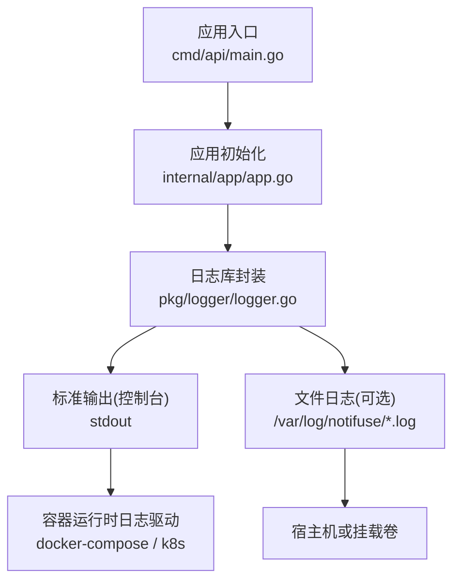
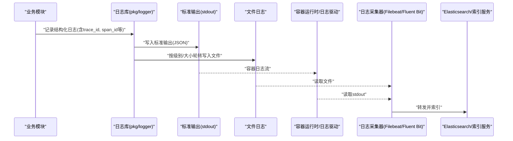
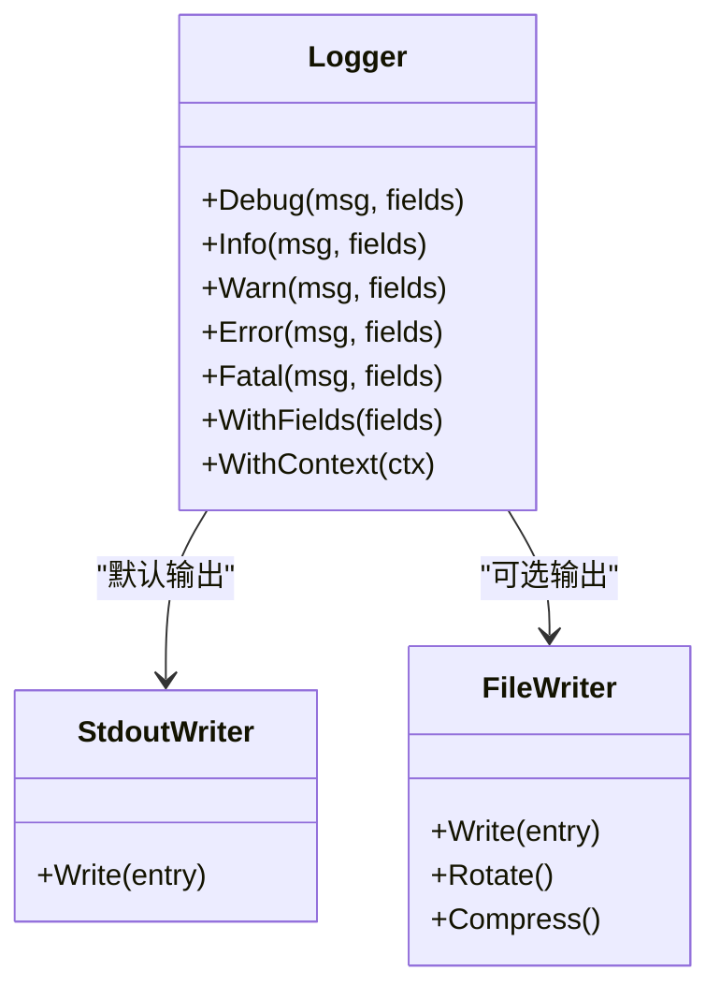
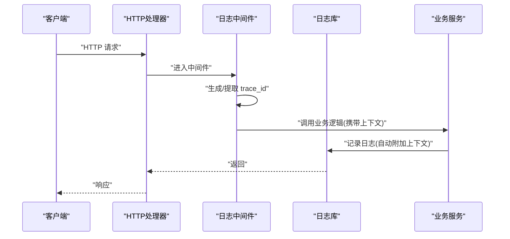
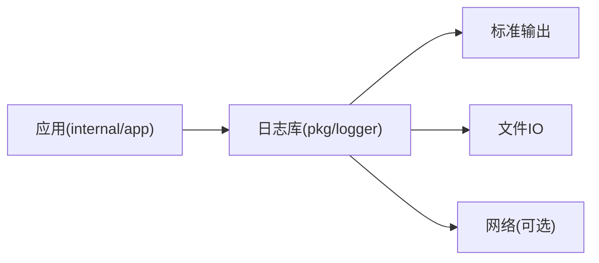

# 日志管理系统

<cite>
**本文引用的文件**   
- [pkg/logger/logger.go](file://notifuse/pkg/logger/logger.go)
- [cmd/api/main.go](file://notifuse/cmd/api/main.go)
- [internal/app/app.go](file://notifuse/internal/app/app.go)
- [config/config.go](file://notifuse/config/config.go)
- [compose.yaml](file://notifuse/compose.yaml)
- [Dockerfile](file://notifuse/Dockerfile)
</cite>

## 目录
1. [简介](#简介)
2. [项目结构](#项目结构)
3. [核心组件](#核心组件)
4. [架构总览](#架构总览)
5. [详细组件分析](#详细组件分析)
6. [依赖分析](#依赖分析)
7. [性能考虑](#性能考虑)
8. [故障排查指南](#故障排查指南)
9. [结论](#结论)
10. [附录](#附录)

## 简介
本文件为 Notifuse 平台的日志管理系统提供完整文档，覆盖结构化日志格式设计、最佳实践、日志收集与聚合、索引策略、查询语法与分析场景、轮转/压缩/保留策略，以及敏感信息脱敏与安全合规要求。目标是帮助开发者与运维人员统一日志规范、提升可观测性与排障效率，并满足安全与合规要求。

## 项目结构
Notifuse 后端采用 Go 语言实现，日志子系统位于 pkg/logger，应用启动时通过 cmd/api/main.go 初始化配置与应用实例 internal/app/app.go，并在 compose.yaml 中定义容器编排与日志输出方式。Dockerfile 用于构建镜像。

图示来源
- [cmd/api/main.go](file://notifuse/cmd/api/main.go)
- [internal/app/app.go](file://notifuse/internal/app/app.go)
- [pkg/logger/logger.go](file://notifuse/pkg/logger/logger.go)
- [compose.yaml](file://notifuse/compose.yaml)
- [Dockerfile](file://notifuse/Dockerfile)

章节来源
- [cmd/api/main.go](file://notifuse/cmd/api/main.go)
- [internal/app/app.go](file://notifuse/internal/app/app.go)
- [pkg/logger/logger.go](file://notifuse/pkg/logger/logger.go)
- [compose.yaml](file://notifuse/compose.yaml)
- [Dockerfile](file://notifuse/Dockerfile)

## 核心组件
- 日志库封装：提供统一的日志接口与默认实现，支持结构化字段注入、上下文传播、级别控制与输出目标选择（标准输出、文件）。
- 应用集成：在应用启动阶段完成日志初始化，将全局日志器注入到各模块。
- 运行环境：容器化部署下，标准输出由容器运行时采集；本地开发可通过文件日志便于调试。

章节来源
- [pkg/logger/logger.go](file://notifuse/pkg/logger/logger.go)
- [cmd/api/main.go](file://notifuse/cmd/api/main.go)
- [internal/app/app.go](file://notifuse/internal/app/app.go)

## 架构总览
下图展示从业务代码到最终落盘/采集的端到端路径，包括结构化字段、上下文传播与外部采集器对接。

图示来源
- [pkg/logger/logger.go](file://notifuse/pkg/logger/logger.go)
- [compose.yaml](file://notifuse/compose.yaml)
- [Dockerfile](file://notifuse/Dockerfile)

## 详细组件分析

### 日志库封装（pkg/logger）
- 职责
  - 提供统一日志接口，屏蔽底层实现差异。
  - 支持结构化字段追加、上下文键值注入。
  - 支持日志级别过滤与输出目标切换。
  - 提供默认实现（标准输出为主，可选文件输出）。
- 关键能力
  - 结构化字段：所有日志以 JSON 形式输出，包含时间戳、级别、消息、模块、请求ID、用户ID、工作区ID、追踪ID等。
  - 上下文传播：通过中间件/调用链注入 trace_id、span_id、user_id、workspace_id 等上下文键，自动附加到每条日志。
  - 级别控制：支持 debug/info/warn/error/fatal 等级别，可按模块或全局开关。
  - 输出目标：默认 stdout；按需启用文件输出，支持按大小/时间轮转与压缩。
- 最佳实践
  - 使用结构化字段而非拼接字符串。
  - 避免在日志中直接输出敏感信息（密码、令牌、证书、个人身份信息），如需记录需先脱敏。
  - 对高频路径使用 info 级别，错误与异常使用 error 级别并附带必要上下文。
  - 为每个请求生成唯一 trace_id，贯穿 HTTP 处理链路。

章节来源
- [pkg/logger/logger.go](file://notifuse/pkg/logger/logger.go)

#### 类图（概念映射）

图示来源
- [pkg/logger/logger.go](file://notifuse/pkg/logger/logger.go)

### 应用集成（cmd/api/main.go 与 internal/app/app.go）
- 职责
  - 加载配置（如日志级别、输出目标、文件路径等）。
  - 初始化全局日志器，并将 logger 注入到各模块。
  - 在 HTTP 中间件中注入 trace_id、用户与工作区上下文，确保后续日志具备完整上下文。
- 关键点
  - 启动顺序：配置加载 -> 日志初始化 -> 服务启动。
  - 中间件：解析请求头或生成新 ID，设置到上下文，供日志库使用。
  - 优雅关闭：在退出前刷新缓冲、关闭文件句柄。

章节来源
- [cmd/api/main.go](file://notifuse/cmd/api/main.go)
- [internal/app/app.go](file://notifuse/internal/app/app.go)

#### 序列图（HTTP 请求中的日志上下文注入）

图示来源
- [cmd/api/main.go](file://notifuse/cmd/api/main.go)
- [internal/app/app.go](file://notifuse/internal/app/app.go)
- [pkg/logger/logger.go](file://notifuse/pkg/logger/logger.go)

### 结构化日志格式设计与字段规范
- 通用字段建议
  - timestamp：ISO 8601 时间戳
  - level：日志级别（debug/info/warn/error/fatal）
  - msg：人类可读的消息
  - module：模块名或包名
  - request_id：请求唯一标识
  - trace_id：分布式追踪ID
  - span_id：当前跨度ID
  - user_id：用户标识（可选）
  - workspace_id：工作区标识（可选）
  - ip：客户端IP（可选）
  - method/path：HTTP 方法与路径（可选）
  - status_code：HTTP 状态码（可选）
  - duration_ms：耗时毫秒（可选）
  - error：错误信息或堆栈摘要（可选）
- 命名约定
  - 全小写、下划线分隔，避免中文键名。
  - 数值类型保持数值，避免字符串化数字。
  - 布尔值使用 true/false。
- 示例说明
  - 参考“通用字段建议”在各模块中保持一致。
  - 对于第三方服务调用，增加 provider、endpoint、latency_ms 等扩展字段。

章节来源
- [pkg/logger/logger.go](file://notifuse/pkg/logger/logger.go)

### 日志收集架构与第三方集成
- 标准输出（推荐）
  - 容器环境下优先使用 stdout，由容器运行时统一采集。
  - 配合 Filebeat/Fluent Bit 等采集器转发至 Elasticsearch/OpenSearch/Loki 等。
- 文件日志（可选）
  - 适用于本地调试或无容器环境。
  - 建议按模块/级别分目录，启用轮转与压缩。
- 第三方日志服务
  - 可在日志库中扩展异步发送器，将日志批量发送至 SaaS 日志平台（如 Datadog、Sentry、Cloud Logging）。
  - 注意退避重试、限流与失败降级（回退到本地文件）。

章节来源
- [compose.yaml](file://notifuse/compose.yaml)
- [Dockerfile](file://notifuse/Dockerfile)
- [pkg/logger/logger.go](file://notifuse/pkg/logger/logger.go)

### 日志聚合与索引策略（Elasticsearch 示例）
- 索引命名
  - 按天滚动：notifuse-YYYY.MM.DD
  - 或按模块/级别拆分：notifuse-{module}-{level}-YYYY.MM.DD
- 映射建议
  - timestamp：date
  - level：keyword
  - module：keyword
  - request_id/trace_id：keyword
  - user_id/workspace_id：keyword
  - ip：ip
  - method/path/status_code/duration_ms：对应类型
- 生命周期管理
  - ILM 策略：热数据保留 7 天，温数据 30 天，冷数据归档或删除。
  - 副本数：生产建议 1，测试 0。
- 采集器配置要点
  - Filebeat/Fluent Bit 多行合并（JSON）、去重、标签注入（host、env、service）。
  - 网络超时与重试、背压与批大小调优。

[本节为概念性指导，不直接分析具体源码文件]

### 日志查询语法与分析场景
- 基础查询
  - 按级别筛选：level=error
  - 按模块筛选：module="email_service"
  - 按请求追踪：trace_id="xxx"
  - 按用户/工作区：user_id="u123", workspace_id="w456"
- 常用分析场景
  - 错误率趋势：统计每小时 error 数量变化。
  - 慢请求定位：duration_ms > 阈值且 level=warn/error。
  - 外部依赖异常：provider 相关字段异常或超时。
  - 用户行为审计：特定 user_id 的操作轨迹。
- 示例（概念性）
  - 查找某用户在某时间段的所有操作日志。
  - 统计某模块的错误占比与 Top 错误消息。

[本节为概念性指导，不直接分析具体源码文件]

### 日志轮转、压缩与保留策略
- 轮转触发
  - 文件大小：单文件超过阈值（如 100MB）触发轮转。
  - 时间间隔：按小时/天滚动。
- 压缩策略
  - 已轮转文件使用 gzip/zstd 压缩，保留 N 份。
- 保留策略
  - 本地保留 7~14 天，云端/索引层按 ILM 策略执行。
- 注意事项
  - 高并发写入时避免频繁 fsync，采用批量落盘。
  - 监控磁盘使用率，超限告警。

章节来源
- [pkg/logger/logger.go](file://notifuse/pkg/logger/logger.go)

### 敏感信息脱敏与安全合规
- 必须脱敏的数据
  - 密码、令牌、密钥、证书、私钥、访问凭证。
  - 个人身份信息（姓名、邮箱、手机号、地址、身份证号）。
  - 支付信息（卡号、CVV、账单详情）。
- 脱敏方法
  - 替换为固定占位符（如 "***"）。
  - 哈希化（仅当需要关联分析时使用不可逆哈希）。
  - 白名单字段：仅允许记录非敏感元数据。
- 合规要求
  - 遵循最小化原则，只记录必要的上下文。
  - 日志传输加密（TLS），存储加密（静态加密）。
  - 访问控制与审计：限制日志查看权限，记录访问审计。
  - 留存期限：根据法规与业务需求设定最短保留期。

[本节为概念性指导，不直接分析具体源码文件]

## 依赖分析
- 组件耦合
  - 业务模块依赖日志库接口，低耦合、易替换实现。
  - 应用启动流程负责配置与注入，集中管理日志器生命周期。
- 外部依赖
  - 容器运行时（stdout 采集）。
  - 可选：文件 IO、压缩库、网络客户端（第三方日志服务）。
- 潜在风险
  - 循环依赖：避免业务模块反向依赖日志库内部实现。
  - 性能瓶颈：高频日志导致 IO 压力，需异步与批量化。

图示来源
- [internal/app/app.go](file://notifuse/internal/app/app.go)
- [pkg/logger/logger.go](file://notifuse/pkg/logger/logger.go)

章节来源
- [internal/app/app.go](file://notifuse/internal/app/app.go)
- [pkg/logger/logger.go](file://notifuse/pkg/logger/logger.go)

## 性能考虑
- 异步写入：在高吞吐场景下，使用异步队列与批量落盘，降低主线程阻塞。
- 采样与节流：对高频 debug 日志进行采样，避免风暴。
- 字段精简：仅在必要时附加大对象或长文本，避免增大日志体积。
- 序列化优化：使用高效 JSON 编码器，减少 GC 压力。
- 监控指标：暴露日志写入延迟、丢弃率、队列长度等指标。

[本节为概念性指导，不直接分析具体源码文件]

## 故障排查指南
- 常见问题
  - 日志缺失：检查中间件是否正确注入上下文；确认日志级别过滤是否过严。
  - 乱码/非 JSON：确认输出格式为 JSON，避免混用不同格式。
  - 磁盘爆满：检查轮转与保留策略是否生效，清理过期文件。
  - 第三方服务失败：检查网络连通、认证凭据、重试与降级策略。
- 诊断步骤
  - 使用 trace_id 串联请求链路。
  - 对比同一请求在不同模块的日志，定位断点。
  - 开启更细粒度日志（临时提高级别），复现后恢复。
- 工具建议
  - 本地：grep/awk/jq 快速检索。
  - 集群：ELK/Loki 等可视化查询与告警。

章节来源
- [pkg/logger/logger.go](file://notifuse/pkg/logger/logger.go)
- [compose.yaml](file://notifuse/compose.yaml)

## 结论
通过统一的日志库封装、严格的字段规范与上下文注入、合理的收集与索引策略，以及完善的脱敏与合规措施，Notifuse 可获得稳定、高效、可观测的日志体系。建议在上线前完成采集器与索引策略联调，建立告警与演练机制，持续优化性能与成本。

## 附录
- 环境变量与配置项（示例）
  - LOG_LEVEL：日志级别（debug/info/warn/error）
  - LOG_OUTPUT：输出目标（stdout/file）
  - LOG_FILE_PATH：文件日志路径
  - LOG_ROTATE_SIZE：轮转大小（MB）
  - LOG_RETENTION_DAYS：本地保留天数
  - LOG_ASYNC：是否异步写入
  - LOG_COMPRESS：是否压缩轮转文件
- 部署清单
  - Dockerfile：镜像构建与基础依赖。
  - compose.yaml：服务编排与日志驱动配置。

章节来源
- [Dockerfile](file://notifuse/Dockerfile)
- [compose.yaml](file://notifuse/compose.yaml)