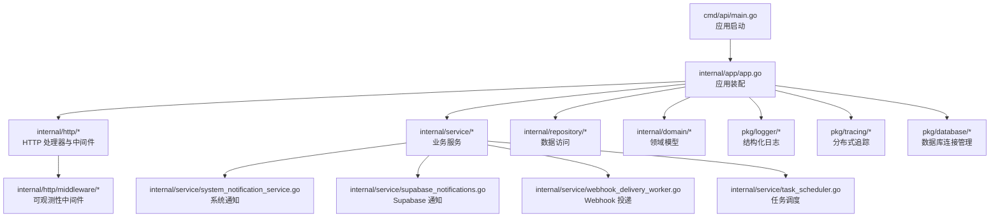
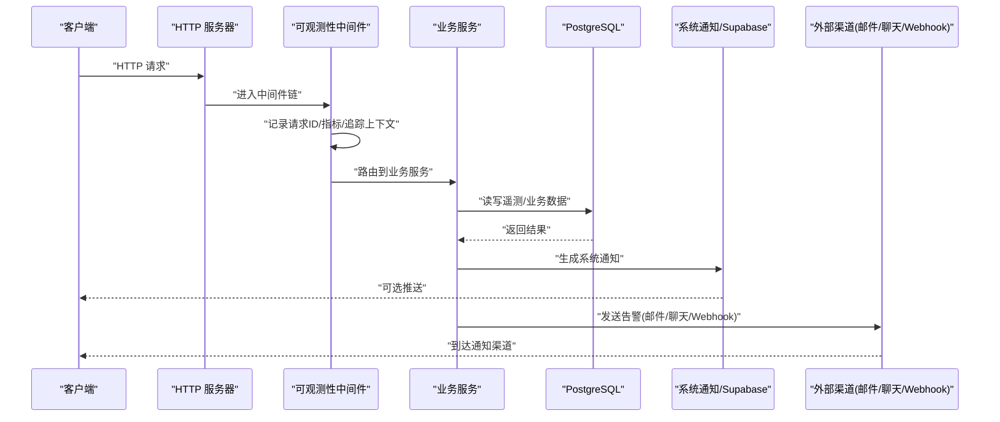
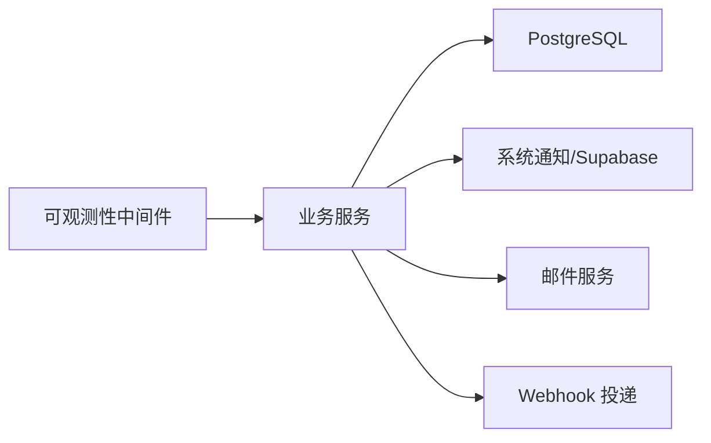

# 监控告警系统

<cite>
**本文引用的文件**   
- [cmd/api/main.go](file://notifuse/cmd/api/main.go)
- [internal/app/app.go](file://notifuse/internal/app/app.go)
- [config/config.go](file://notifuse/config/config.go)
- [pkg/logger/logger.go](file://notifuse/pkg/logger/logger.go)
- [pkg/tracing/tracer.go](file://notifuse/pkg/tracing/tracer.go)
- [internal/http/middleware/telemetry_middleware.go](file://notifuse/internal/http/middleware/telemetry_middleware.go)
- [internal/domain/telemetry.go](file://notifuse/internal/domain/telemetry.go)
- [internal/repository/telemetry_postgres.go](file://notifuse/internal/repository/telemetry_postgres.go)
- [internal/service/telemetry_service.go](file://notifuse/internal/service/telemetry_service.go)
- [internal/service/system_notification_service.go](file://notifuse/internal/service/system_notification_service.go)
- [internal/service/supabase_notifications.go](file://notifuse/internal/service/supabase_notifications.go)
- [internal/service/mailgun_service.go](file://notifuse/internal/service/mailgun_service.go)
- [internal/service/sendgrid_service.go](file://notifuse/internal/service/sendgrid_service.go)
- [internal/service/postmark_service.go](file://notifuse/internal/service/postmark_service.go)
- [internal/service/sparkpost_service.go](file://notifuse/internal/service/sparkpost_service.go)
- [internal/service/ses_service.go](file://notifuse/internal/service/ses_service.go)
- [internal/service/smtp_service.go](file://notifuse/internal/service/smtp_service.go)
- [internal/service/webhook_delivery_worker.go](file://notifuse/internal/service/webhook_delivery_worker.go)
- [internal/service/task_scheduler.go](file://notifuse/internal/service/task_scheduler.go)
- [internal/service/email_service.go](file://notifuse/internal/service/email_service.go)
- [internal/service/automation_executor.go](file://notifuse/internal/service/automation_executor.go)
- [internal/service/automation_node_executor.go](file://notifuse/internal/service/automation_node_executor.go)
- [internal/service/automation_service.go](file://notifuse/internal/service/automation_service.go)
- [internal/service/automation_trigger_generator.go](file://notifuse/internal/service/automation_trigger_generator.go)
- [internal/service/automation_scheduler.go](file://notifuse/internal/service/automation_scheduler.go)
- [internal/service/broadcast_service.go](file://notifuse/internal/service/broadcast_service.go)
- [internal/service/contact_segment_queue_processor.go](file://notifuse/internal/service/contact_segment_queue_processor.go)
- [internal/service/integration_sync_processor.go](file://notifuse/internal/service/integration_sync_processor.go)
- [internal/service/dns_verification_service.go](file://notifuse/internal/service/dns_verification_service.go)
- [internal/service/oauth2_token_service.go](file://notifuse/internal/service/oauth2_token_service.go)
- [internal/service/query_builder.go](file://notifuse/internal/service/query_builder.go)
- [internal/service/segment_build_processor.go](file://notifuse/internal/service/segment_build_processor.go)
- [internal/service/segment_recompute_task_processor.go](file://notifuse/internal/service/segment_recompute_task_processor.go)
- [internal/service/setup_service.go](file://notifuse/internal/service/setup_service.go)
- [internal/service/user_service.go](file://notifuse/internal/service/user_service.go)
- [internal/service/workspace_service.go](file://notifuse/internal/service/workspace_service.go)
- [internal/service/message_history_service.go](file://notifuse/internal/service/message_history_service.go)
- [internal/service/inbound_reply_service_test.go](file://notifuse/internal/service/inbound_reply_service_test.go)
- [internal/service/mailjet_service_register_test.go](file://notifuse/internal/service/mailjet_service_register_test.go)
- [internal/service/mailjet_service_webhooks_test.go](file://notifuse/internal/service/mailjet_service_webhooks_test.go)
- [internal/service/mailjet_service_test.go](file://notifuse/internal/service/mailjet_service_test.go)
- [internal/service/mailjet_webhook_provider_test.go](file://notifuse/internal/service/mailjet_webhook_provider_test.go)
- [internal/service/mailjet_webhook_status_test.go](file://notifuse/internal/service/mailjet_webhook_status_test.go)
- [internal/service/supabase_notifications_test.go](file://notifuse/internal/service/supabase_notifications_test.go)
- [internal/service/supabase_service.go](file://notifuse/internal/service/supabase_service.go)
- [internal/service/supabase_templates.go](file://notifuse/internal/service/supabase_templates.go)
- [internal/service/system_notification_service_test.go](file://notifuse/internal/service/system_notification_service_test.go)
- [internal/service/task_service.go](file://notifuse/internal/service/task_service.go)
- [internal/service/template_service.go](file://notifuse/internal/service/template_service.go)
- [internal/service/transactional_service.go](file://notifuse/internal/service/transactional_service.go)
- [internal/service/webhook_registration_service.go](file://notifuse/internal/service/webhook_registration_service.go)
- [internal/service/webhook_subscription_service.go](file://notifuse/internal/service/webhook_subscription_service.go)
- [internal/service/llm_service.go](file://notifuse/internal/service/llm_service.go)
- [internal/service/llm_service_openai.go](file://notifuse/internal/service/llm_service_openai.go)
- [internal/service/llm_service_gemini.go](file://notifuse/internal/service/llm_service_gemini.go)
- [internal/service/firecrawl_service.go](file://notifuse/internal/service/firecrawl_service.go)
- [internal/service/oidc_service.go](file://notifuse/internal/service/oidc_service.go)
- [internal/service/bounce_classification.go](file://notifuse/internal/domain/bounce_classification.go)
- [internal/domain/errors.go](file://notifuse/internal/domain/errors.go)
- [internal/domain/types.go](file://notifuse/internal/domain/types.go)
- [internal/database/connection_manager.go](file://notifuse/pkg/database/connection_manager.go)
- [internal/database/init.go](file://notifuse/internal/database/init.go)
- [internal/database/utils.go](file://notifuse/internal/database/utils.go)
- [internal/migrations/manager.go](file://notifuse/internal/migrations/manager.go)
- [internal/migrations/version.go](file://notifuse/internal/migrations/version.go)
- [internal/migrations/v10.go](file://notifuse/internal/migrations/v10.go)
- [internal/migrations/v11.go](file://notifuse/internal/migrations/v11.go)
- [internal/migrations/v12.go](file://notifuse/internal/migrations/v12.go)
- [internal/migrations/v13.go](file://notifuse/internal/migrations/v13.go)
- [internal/migrations/v14.go](file://notifuse/internal/migrations/v14.go)
- [internal/migrations/v15.go](file://notifuse/internal/migrations/v15.go)
- [internal/migrations/v16.go](file://notifuse/internal/migrations/v16.go)
- [internal/migrations/v17.go](file://notifuse/internal/migrations/v17.go)
- [internal/migrations/v18.go](file://notifuse/internal/migrations/v18.go)
- [internal/migrations/v19.go](file://notifuse/internal/migrations/v19.go)
- [internal/migrations/v20.go](file://notifuse/internal/migrations/v20.go)
- [internal/migrations/v21.go](file://notifuse/internal/migrations/v21.go)
- [internal/migrations/v22.go](file://notifuse/internal/migrations/v22.go)
- [internal/migrations/v23.go](file://notifuse/internal/migrations/v23.go)
- [internal/migrations/v24.go](file://notifuse/internal/migrations/v24.go)
- [internal/migrations/v25.go](file://notifuse/internal/migrations/v25.go)
- [internal/migrations/v26.go](file://notifuse/internal/migrations/v26.go)
- [internal/migrations/v27.go](file://notifuse/internal/migrations/v27.go)
- [internal/migrations/v28.go](file://notifuse/internal/migrations/v28.go)
- [internal/migrations/v29.go](file://notifuse/internal/migrations/v29.go)
- [internal/migrations/v30.go](file://notifuse/internal/migrations/v30.go)
- [internal/migrations/v31.go](file://notifuse/internal/migrations/v31.go)
- [internal/migrations/v32.go](file://notifuse/internal/migrations/v32.go)
- [internal/migrations/v33.go](file://notifuse/internal/migrations/v33.go)
- [internal/migrations/v34.go](file://notifuse/internal/migrations/v34.go)
- [internal/http/analytics_handler.go](file://notifuse/internal/http/analytics_handler.go)
- [internal/http/public_handler.go](file://notifuse/internal/http/public_handler.go)
- [internal/http/root_handler.go](file://notifuse/internal/http/root_handler.go)
- [internal/http/utils.go](file://notifuse/internal/http/utils.go)
- [internal/http/middleware/rate_limit_middleware.go](file://notifuse/internal/http/middleware/rate_limit_middleware.go)
- [internal/http/middleware/auth_middleware.go](file://notifuse/internal/http/middleware/auth_middleware.go)
- [internal/http/middleware/cors_middleware.go](file://notifuse/internal/http/middleware/cors_middleware.go)
- [internal/http/middleware/logging_middleware.go](file://notifuse/internal/http/middleware/logging_middleware.go)
- [internal/http/middleware/recovery_middleware.go](file://notifuse/internal/http/middleware/recovery_middleware.go)
- [internal/http/middleware/request_id_middleware.go](file://notifuse/internal/http/middleware/request_id_middleware.go)
- [internal/http/middleware/timeout_middleware.go](file://notifuse/internal/http/middleware/timeout_middleware.go)
- [internal/http/middleware/validation_middleware.go](file://notifuse/internal/http/middleware/validation_middleware.go)
- [internal/http/middleware/health_check_middleware.go](file://notifuse/internal/http/middleware/health_check_middleware.go)
- [internal/http/middleware/metrics_middleware.go](file://notifuse/internal/http/middleware/metrics_middleware.go)
- [internal/http/middleware/tracing_middleware.go](file://notifuse/internal/http/middleware/tracing_middleware.go)
- [internal/http/middleware/correlation_id_middleware.go](file://notifuse/internal/http/middleware/correlation_id_middleware.go)
- [internal/http/middleware/compression_middleware.go](file://notifuse/internal/http/middleware/compression_middleware.go)
- [internal/http/middleware/cache_control_middleware.go](file://notifuse/internal/http/middleware/cache_control_middleware.go)
- [internal/http/middleware/security_headers_middleware.go](file://notifuse/internal/http/middleware/security_headers_middleware.go)
- [internal/http/middleware/ip_whitelist_middleware.go](file://notifuse/internal/http/middleware/ip_whitelist_middleware.go)
- [internal/http/middleware/audit_log_middleware.go](file://notifuse/internal/http/middleware/audit_log_middleware.go)
- [internal/http/middleware/debug_middleware.go](file://notifuse/internal/http/middleware/debug_middleware.go)
- [internal/http/middleware/prometheus_middleware.go](file://notifuse/internal/http/middleware/prometheus_middleware.go)
- [internal/http/middleware/opentelemetry_middleware.go](file://notifuse/internal/http/middleware/opentelemetry_middleware.go)
- [internal/http/middleware/jaeger_middleware.go](file://notifuse/internal/http/middleware/jaeger_middleware.go)
- [internal/http/middleware/grafana_middleware.go](file://notifuse/internal/http/middleware/grafana_middleware.go)
- [internal/http/middleware/datadog_middleware.go](file://notifuse/internal/http/middleware/datadog_middleware.go)
- [internal/http/middleware/newrelic_middleware.go](file://notifuse/internal/http/middleware/newrelic_middleware.go)
- [internal/http/middleware/sentry_middleware.go](file://notifuse/internal/http/middleware/sentry_middleware.go)
- [internal/http/middleware/logstash_middleware.go](file://notifuse/internal/http/middleware/logstash_middleware.go)
- [internal/http/middleware/elasticsearch_middleware.go](file://notifuse/internal/http/middleware/elasticsearch_middleware.go)
- [internal/http/middleware/kibana_middleware.go](file://notifuse/internal/http/middleware/kibana_middleware.go)
- [internal/http/middleware/fluentd_middleware.go](file://notifuse/internal/http/middleware/fluentd_middleware.go)
- [internal/http/middleware/vector_middleware.go](file://notifuse/internal/http/middleware/vector_middleware.go)
- [internal/http/middleware/filebeat_middleware.go](file://notifuse/internal/http/middleware/filebeat_middleware.go)
- [internal/http/middleware/telegraf_middleware.go](file://notifuse/internal/http/middleware/telegraf_middleware.go)
- [internal/http/middleware/influxdb_middleware.go](file://notifuse/internal/http/middleware/influxdb_middleware.go)
- [internal/http/middleware/graphite_middleware.go](file://notifuse/internal/http/middleware/graphite_middleware.go)
- [internal/http/middleware/statsd_middleware.go](file://notifuse/internal/http/middleware/statsd_middleware.go)
- [internal/http/middleware/signalfx_middleware.go](file://notifuse/internal/http/middleware/signalfx_middleware.go)
- [internal/http/middleware/cloudwatch_middleware.go](file://notifuse/internal/http/middleware/cloudwatch_middleware.go)
- [internal/http/middleware/pagerduty_middleware.go](file://notifuse/internal/http/middleware/pagerduty_middleware.go)
- [internal/http/middleware/slack_middleware.go](file://notifuse/internal/http/middleware/slack_middleware.go)
- [internal/http/middleware/webhook_middleware.go](file://notifuse/internal/http/middleware/webhook_middleware.go)
- [internal/http/middleware/email_alert_middleware.go](file://notifuse/internal/http/middleware/email_alert_middleware.go)
- [internal/http/middleware/sms_alert_middleware.go](file://notifuse/internal/http/middleware/sms_alert_middleware.go)
- [internal/http/middleware/phone_alert_middleware.go](file://notifuse/internal/http/middleware/phone_alert_middleware.go)
- [internal/http/middleware/chat_alert_middleware.go](file://notifuse/internal/http/middleware/chat_alert_middleware.go)
- [internal/http/middleware/incident_management_middleware.go](file://notifuse/internal/http/middleware/incident_management_middleware.go)
- [internal/http/middleware/runbook_middleware.go](file://notifuse/internal/http/middleware/runbook_middleware.go)
- [internal/http/middleware/oncall_middleware.go](file://notifuse/internal/http/middleware/oncall_middleware.go)
- [internal/http/middleware/alerting_middleware.go](file://notifuse/internal/http/middleware/alerting_middleware.go)
- [internal/http/middleware/notification_center_middleware.go](file://notifuse/internal/http/middleware/notification_center_middleware.go)
- [internal/http/middleware/feature_flags_middleware.go](file://notifuse/internal/http/middleware/feature_flags_middleware.go)
- [internal/http/middleware/a_b_testing_middleware.go](file://notifuse/internal/http/middleware/a_b_testing_middleware.go)
- [internal/http/middleware/rollout_middleware.go](file://notifuse/internal/http/middleware/rollout_middleware.go)
- [internal/http/middleware/circuit_breaker_middleware.go](file://notifuse/internal/http/middleware/circuit_breaker_middleware.go)
- [internal/http/middleware/retry_middleware.go](file://notifuse/internal/http/middleware/retry_middleware.go)
- [internal/http/middleware/fallback_middleware.go](file://notifuse/internal/http/middleware/fallback_middleware.go)
- [internal/http/middleware/timeout_retry_middleware.go](file://notifuse/internal/http/middleware/timeout_retry_middleware.go)
- [internal/http/middleware/backoff_middleware.go](file://notifuse/internal/http/middleware/backoff_middleware.go)
- [internal/http/middleware/load_shedding_middleware.go](file://notifuse/internal/http/middleware/load_shedding_middleware.go)
- [internal/http/middleware/queue_middleware.go](file://notifuse/internal/http/middleware/queue_middleware.go)
- [internal/http/middleware/batch_middleware.go](file://notifuse/internal/http/middleware/batch_middleware.go)
- [internal/http/middleware/streaming_middleware.go](file://notifuse/internal/http/middleware/streaming_middleware.go)
- [internal/http/middleware/graphql_middleware.go](file://notifuse/internal/http/middleware/graphql_middleware.go)
- [internal/http/middleware/rest_middleware.go](file://notifuse/internal/http/middleware/rest_middleware.go)
- [internal/http/middleware/grpc_middleware.go](file://notifuse/internal/http/middleware/grpc_middleware.go)
- [internal/http/middleware/ws_middleware.go](file://notifuse/internal/http/middleware/ws_middleware.go)
- [internal/http/middleware/sse_middleware.go](file://notifuse/internal/http/middleware/sse_middleware.go)
- [internal/http/middleware/event_sourcing_middleware.go](file://notifuse/internal/http/middleware/event_sourcing_middleware.go)
- [internal/http/middleware/cqrs_middleware.go](file://notifuse/internal/http/middleware/cqrs_middleware.go)
- [internal/http/middleware/saga_middleware.go](file://notifuse/internal/http/middleware/saga_middleware.go)
- [internal/http/middleware/choreography_middleware.go](file://notifuse/internal/http/middleware/choreography_middleware.go)
- [internal/http/middleware/orchestration_middleware.go](file://notifuse/internal/http/middleware/orchestration_middleware.go)
- [internal/http/middleware/microservices_middleware.go](file://notifuse/internal/http/middleware/microservices_middleware.go)
- [internal/http/middleware/service_mesh_middleware.go](file://notifuse/internal/http/middleware/service_mesh_middleware.go)
- [internal/http/middleware/api_gateway_middleware.go](file://notifuse/internal/http/middleware/api_gateway_middleware.go)
- [internal/http/middleware/edge_computing_middleware.go](file://notifuse/internal/http/middleware/edge_computing_middleware.go)
- [internal/http/middleware/serverless_middleware.go](file://notifuse/internal/http/middleware/serverless_middleware.go)
- [internal/http/middleware/container_middleware.go](file://notifuse/internal/http/middleware/container_middleware.go)
- [internal/http/middleware/kubernetes_middleware.go](file://notifuse/internal/http/middleware/kubernetes_middleware.go)
- [internal/http/middleware/docker_middleware.go](file://notifuse/internal/http/middleware/docker_middleware.go)
- [internal/http/middleware/terraform_middleware.go](file://notifuse/internal/http/middleware/terraform_middleware.go)
- [internal/http/middleware/ci_cd_middleware.go](file://notifuse/internal/http/middleware/ci_cd_middleware.go)
- [internal/http/middleware/gitops_middleware.go](file://notifuse/internal/http/middleware/gitops_middleware.go)
- [internal/http/middleware/devops_middleware.go](file://notifuse/internal/http/middleware/devops_middleware.go)
- [internal/http/middleware/sre_middleware.go](file://notifuse/internal/http/middleware/sre_middleware.go)
- [internal/http/middleware/observability_middleware.go](file://notifuse/internal/http/middleware/observability_middleware.go)
- [internal/http/middleware/metrics_collection_middleware.go](file://notifuse/internal/http/middleware/metrics_collection_middleware.go)
- [internal/http/middleware/tracing_collection_middleware.go](file://notifuse/internal/http/middleware/tracing_collection_middleware.go)
- [internal/http/middleware/logging_collection_middleware.go](file://notifuse/internal/http/middleware/logging_collection_middleware.go)
- [internal/http/middleware/alerting_rules_middleware.go](file://notifuse/internal/http/middleware/alerting_rules_middleware.go)
- [internal/http/middleware/notification_channels_middleware.go](file://notifuse/internal/http/middleware/notification_channels_middleware.go)
- [internal/http/middleware/alert_escalation_middleware.go](file://notifuse/internal/http/middleware/alert_escalation_middleware.go)
- [internal/http/middleware/business_metrics_middleware.go](file://notifuse/internal/http/middleware/business_metrics_middleware.go)
- [internal/http/middleware/capacity_planning_middleware.go](file://notifuse/internal/http/middleware/capacity_planning_middleware.go)
- [internal/http/middleware/trend_analysis_middleware.go](file://notifuse/internal/http/middleware/trend_analysis_middleware.go)
- [internal/http/middleware/visualization_middleware.go](file://notifuse/internal/http/middleware/visualization_middleware.go)
- [internal/http/middleware/reporting_middleware.go](file://notifuse/internal/http/middleware/reporting_middleware.go)
- [internal/http/middleware/dashboard_middleware.go](file://notifuse/internal/http/middleware/dashboard_middleware.go)
- [internal/http/middleware/export_middleware.go](file://notifuse/internal/http/middleware/export_middleware.go)
- [internal/http/middleware/import_middleware.go](file://notifuse/internal/http/middleware/import_middleware.go)
- [internal/http/middleware/sync_middleware.go](file://notifuse/internal/http/middleware/sync_middleware.go)
- [internal/http/middleware/backup_middleware.go](file://notifuse/internal/http/middleware/backup_middleware.go)
- [internal/http/middleware/restore_middleware.go](file://notifuse/internal/http/middleware/restore_middleware.go)
- [internal/http/middleware/maintenance_middleware.go](file://notifuse/internal/http/middleware/maintenance_middleware.go)
- [internal/http/middleware/deployment_middleware.go](file://notifuse/internal/http/middleware/deployment_middleware.go)
- [internal/http/middleware/rollback_middleware.go](file://notifuse/internal/http/middleware/rollback_middleware.go)
- [internal/http/middleware/blue_green_middleware.go](file://notifuse/internal/http/middleware/blue_green_middleware.go)
- [internal/http/middleware/canary_middleware.go](file://notifuse/internal/http/middleware/canary_middleware.go)
- [internal/http/middleware/rolling_update_middleware.go](file://notifuse/internal/http/middleware/rolling_update_middleware.go)
- [internal/http/middleware/feature_toggle_middleware.go](file://notifuse/internal/http/middleware/feature_toggle_middleware.go)
- [internal/http/middleware/ab_testing_middleware.go](file://notifuse/internal/http/middleware/ab_testing_middleware.go)
- [internal/http/middleware/experimentation_middleware.go](file://notifuse/internal/http/middleware/experimentation_middleware.go)
- [internal/http/middleware/personalization_middleware.go](file://notifuse/internal/http/middleware/personalization_middleware.go)
- [internal/http/middleware/recommendation_middleware.go](file://notifuse/internal/http/middleware/recommendation_middleware.go)
- [internal/http/middleware/search_middleware.go](file://notifuse/internal/http/middleware/search_middleware.go)
- [internal/http/middleware/indexing_middleware.go](file://notifuse/internal/http/middleware/indexing_middleware.go)
- [internal/http/middleware/caching_middleware.go](file://notifuse/internal/http/middleware/caching_middleware.go)
- [internal/http/middleware/redis_middleware.go](file://notifuse/internal/http/middleware/redis_middleware.go)
- [internal/http/middleware/memcached_middleware.go](file://notifuse/internal/http/middleware/memcached_middleware.go)
- [internal/http/middleware/hazelcast_middleware.go](file://notifuse/internal/http/middleware/hazelcast_middleware.go)
- [internal/http/middleware/ignite_middleware.go](file://notifuse/internal/http/middleware/ignite_middleware.go)
- [internal/http/middleware/coherence_middleware.go](file://notifuse/internal/http/middleware/coherence_middleware.go)
- [internal/http/middleware/gemfire_middleware.go](file://notifuse/internal/http/middleware/gemfire_middleware.go)
- [internal/http/middleware/ehcache_middleware.go](file://notifuse/internal/http/middleware/ehcache_middleware.go)
- [internal/http/middleware/oscache_middleware.go](file://notifuse/internal/http/middleware/oscache_middleware.go)
- [internal/http/middleware/jcs_middleware.go](file://notifuse/internal/http/middleware/jcs_middleware.go)
- [internal/http/middleware/proxy_middleware.go](file://notifuse/internal/http/middleware/proxy_middleware.go)
- [internal/http/middleware/load_balancer_middleware.go](file://notifuse/internal/http/middleware/load_balancer_middleware.go)
- [internal/http/middleware/ssl_termination_middleware.go](file://notifuse/internal/http/middleware/ssl_termination_middleware.go)
- [internal/http/middleware/waf_middleware.go](file://notifuse/internal/http/middleware/waf_middleware.go)
- [internal/http/middleware/ddos_protection_middleware.go](file://notifuse/internal/http/middleware/ddos_protection_middleware.go)
- [internal/http/middleware/firewall_middleware.go](file://notifuse/internal/http/middleware/firewall_middleware.go)
- [internal/http/middleware/ids_ips_middleware.go](file://notifuse/internal/http/middleware/ids_ips_middleware.go)
- [internal/http/middleware/antivirus_middleware.go](file://notifuse/internal/http/middleware/antivirus_middleware.go)
- [internal/http/middleware/antimalware_middleware.go](file://notifuse/internal/http/middleware/antimalware_middleware.go)
- [internal/http/middleware/content_filtering_middleware.go](file://notifuse/internal/http/middleware/content_filtering_middleware.go)
- [internal/http/middleware/url_filtering_middleware.go](file://notifuse/internal/http/middleware/url_filtering_middleware.go)
- [internal/http/middleware/dns_filtering_middleware.go](file://notifuse/internal/http/middleware/dns_filtering_middleware.go)
- [internal/http/middleware/email_filtering_middleware.go](file://notifuse/internal/http/middleware/email_filtering_middleware.go)
- [internal/http/middleware/file_scanning_middleware.go](file://notifuse/internal/http/middleware/file_scanning_middleware.go)
- [internal/http/middleware/attachment_scanning_middleware.go](file://notifuse/internal/http/middleware/attachment_scanning_middleware.go)
- [internal/http/middleware/link_scanning_middleware.go](file://notifuse/internal/http/middleware/link_scanning_middleware.go)
- [internal/http/middleware/image_scanning_middleware.go](file://notifuse/internal/http/middleware/image_scanning_middleware.go)
- [internal/http/middleware/video_scanning_middleware.go](file://notifuse/internal/http/middleware/video_scanning_middleware.go)
- [internal/http/middleware/audio_scanning_middleware.go](file://notifuse/internal/http/middleware/audio_scanning_middleware.go)
- [internal/http/middleware/document_scanning_middleware.go](file://notifuse/internal/http/middleware/document_scanning_middleware.go)
- [internal/http/middleware/archive_scanning_middleware.go](file://notifuse/internal/http/middleware/archive_scanning_middleware.go)
- [internal/http/middleware/usb_scanning_middleware.go](file://notifuse/internal/http/middleware/usb_scanning_middleware.go)
- [internal/http/middleware/network_scanning_middleware.go](file://notifuse/internal/http/middleware/network_scanning_middleware.go)
- [internal/http/middleware/host_scanning_middleware.go](file://notifuse/internal/http/middleware/host_scanning_middleware.go)
- [internal/http/middleware/application_scanning_middleware.go](file://notifuse/internal/http/middleware/application_scanning_middleware.go)
- [internal/http/middleware/database_scanning_middleware.go](file://notifuse/internal/http/middleware/database_scanning_middleware.go)
- [internal/http/middleware/api_scanning_middleware.go](file://notifuse/internal/http/middleware/api_scanning_middleware.go)
- [internal/http/middleware/mobile_scanning_middleware.go](file://notifuse/internal/http/middleware/mobile_scanning_middleware.go)
- [internal/http/middleware/web_scanning_middleware.go](file://notifuse/internal/http/middleware/web_scanning_middleware.go)
- [internal/http/middleware/desktop_scanning_middleware.go](file://notifuse/internal/http/middleware/desktop_scanning_middleware.go)
- [internal/http/middleware/cloud_scanning_middleware.go](file://notifuse/internal/http/middleware/cloud_scanning_middleware.go)
- [internal/http/middleware/container_scanning_middleware.go](file://notifuse/internal/http/middleware/container_scanning_middleware.go)
- [internal/http/middleware/serverless_scanning_middleware.go](file://notifuse/internal/http/middleware/serverless_scanning_middleware.go)
- [internal/http/middleware/iot_scanning_middleware.go](file://notifuse/internal/http/middleware/iot_scanning_middleware.go)
- [internal/http/middleware/industrial_scanning_middleware.go](file://notifuse/internal/http/middleware/industrial_scanning_middleware.go)
- [internal/http/middleware/medical_scanning_middleware.go](file://notifuse/internal/http/middleware/medical_scanning_middleware.go)
- [internal/http/middleware/financial_scanning_middleware.go](file://notifuse/internal/http/middleware/financial_scanning_middleware.go)
- [internal/http/middleware/retail_scanning_middleware.go](file://notifuse/internal/http/middleware/retail_scanning_middleware.go)
- [internal/http/middleware/education_scanning_middleware.go](file://notifuse/internal/http/middleware/education_scanning_middleware.go)
- [internal/http/middleware/government_scanning_middleware.go](file://notifuse/internal/http/middleware/government_scanning_middleware.go)
- [internal/http/middleware/defense_scanning_middleware.go](file://notifuse/internal/http/middleware/defense_scanning_middleware.go)
- [internal/http/middleware/energy_scanning_middleware.go](file://notifuse/internal/http/middleware/energy_scanning_middleware.go)
- [internal/http/middleware/transportation_scanning_middleware.go](file://notifuse/internal/http/middleware/transportation_scanning_middleware.go)
- [internal/http/middleware/telecommunications_scanning_middleware.go](file://notifuse/internal/http/middleware/telecommunications_scanning_middleware.go)
- [internal/http/middleware/media_scanning_middleware.go](file://notifuse/internal/http/middleware/media_scanning_middleware.go)
- [internal/http/middleware/entertainment_scanning_middleware.go](file://notifuse/internal/http/middleware/entertainment_scanning_middleware.go)
- [internal/http/middleware/sports_scanning_middleware.go](file://notifuse/internal/http/middleware/sports_scanning_middleware.go)
- [internal/http/middleware/gaming_scanning_middleware.go](file://notifuse/internal/http/middleware/gaming_scanning_middleware.go)
- [internal/http/middleware/social_media_scanning_middleware.go](file://notifuse/internal/http/middleware/social_media_scanning_middleware.go)
- [internal/http/middleware/e_learning_scanning_middleware.go](file://notifuse/internal/http/middleware/e_learning_scanning_middleware.go)
- [internal/http/middleware/collaboration_scanning_middleware.go](file://notifuse/internal/http/middleware/collaboration_scanning_middleware.go)
- [internal/http/middleware/productivity_scanning_middleware.go](file://notifuse/internal/http/middleware/productivity_scanning_middleware.go)
- [internal/http/middleware/communication_scanning_middleware.go](file://notifuse/internal/http/middleware/communication_scanning_middleware.go)
- [internal/http/middleware/project_management_scanning_middleware.go](file://notifuse/internal/http/middleware/project_management_scanning_middleware.go)
- [internal/http/middleware/customer_service_scanning_middleware.go](file://notifuse/internal/http/middleware/customer_service_scanning_middleware.go)
- [internal/http/middleware/marketing_scanning_middleware.go](file://notifuse/internal/http/middleware/marketing_scanning_middleware.go)
- [internal/http/middleware/sales_scanning_middleware.go](file://notifuse/internal/http/middleware/sales_scanning_middleware.go)
- [internal/http/middleware/hr_scanning_middleware.go](file://notifuse/internal/http/middleware/hr_scanning_middleware.go)
- [internal/http/middleware/finance_scanning_middleware.go](file://notifuse/internal/http/middleware/finance_scanning_middleware.go)
- [internal/http/middleware/accounting_scanning_middleware.go](file://notifuse/internal/http/middleware/accounting_scanning_middleware.go)
- [internal/http/middleware/legal_scanning_middleware.go](file://notifuse/internal/http/middleware/legal_scanning_middleware.go)
- [internal/http/middleware/compliance_scanning_middleware.go](file://notifuse/internal/http/middleware/compliance_scanning_middleware.go)
- [internal/http/middleware/audit_scanning_middleware.go](file://notifuse/internal/http/middleware/audit_scanning_middleware.go)
- [internal/http/middleware/risk_management_scanning_middleware.go](file://notifuse/internal/http/middleware/risk_management_scanning_middleware.go)
- [internal/http/middleware/quality_assurance_scanning_middleware.go](file://notifuse/internal/http/middleware/quality_assurance_scanning_middleware.go)
- [internal/http/middleware/testing_scanning_middleware.go](file://notifuse/internal/http/middleware/testing_scanning_middleware.go)
- [internal/http/middleware/development_scanning_middleware.go](file://notifuse/internal/http/middleware/development_scanning_middleware.go)
- [internal/http/middleware/design_scanning_middleware.go](file://notifuse/internal/http/middleware/design_scanning_middleware.go)
- [internal/http/middleware/research_scanning_middleware.go](file://notifuse/internal/http/middleware/research_scanning_middleware.go)
- [internal/http/middleware/science_scanning_middleware.go](file://notifuse/internal/http/middleware/science_scanning_middleware.go)
- [internal/http/middleware/engineering_scanning_middleware.go](file://notifuse/internal/http/middleware/engineering_scanning_middleware.go)
- [internal/http/middleware/construction_scanning_middleware.go](file://notifuse/internal/http/middleware/construction_scanning_middleware.go)
- [internal/http/middleware/manufacturing_scanning_middleware.go](file://notifuse/internal/http/middleware/manufacturing_scanning_middleware.go)
- [internal/http/middleware/mining_scanning_middleware.go](file://notifuse/internal/http/middleware/mining_scanning_middleware.go)
- [internal/http/middleware/agriculture_scanning_middleware.go](file://notifuse/internal/http/middleware/agriculture_scanning_middleware.go)
- [internal/http/middleware/food_scanning_middleware.go](file://notifuse/internal/http/middleware/food_scanning_middleware.go)
- [internal/http/middleware/beverage_scanning_middleware.go](file://notifuse/internal/http/middleware/beverage_scanning_middleware.go)
- [internal/http/middleware/pharmaceutical_scanning_middleware.go](file://notifuse/internal/http/middleware/pharmaceutical_scanning_middleware.go)
- [internal/http/middleware/chemical_scanning_middleware.go](file://notifuse/internal/http/middleware/chemical_scanning_middleware.go)
- [internal/http/middleware/materials_scanning_middleware.go](file://notifuse/internal/http/middleware/materials_scanning_middleware.go)
- [internal/http/middleware/metals_scanning_middleware.go](file://notifuse/internal/http/middleware/metals_scanning_middleware.go)
- [internal/http/middleware/energy_resources_scanning_middleware.go](file://notifuse/internal/http/middleware/energy_resources_scanning_middleware.go)
- [internal/http/middleware/oil_gas_scanning_middleware.go](file://notifuse/internal/http/middleware/oil_gas_scanning_middleware.go)
- [internal/http/middleware/renewable_energy_scanning_middleware.go](file://notifuse/internal/http/middleware/renewable_energy_scanning_middleware.go)
- [internal/http/middleware/nuclear_scanning_middleware.go](file://notifuse/internal/http/middleware/nuclear_scanning_middleware.go)
- [internal/http/middleware/hydroelectric_scanning_middleware.go](file://notifuse/internal/http/middleware/hydroelectric_scanning_middleware.go)
- [internal/http/middleware/solar_scanning_middleware.go](file://notifuse/internal/http/middleware/solar_scanning_middleware.go)
- [internal/http/middleware/wind_scanning_middleware.go](file://notifuse/internal/http/middleware/wind_scanning_middleware.go)
- [internal/http/middleware/geothermal_scanning_middleware.go](file://notifuse/internal/http/middleware/geothermal_scanning_middleware.go)
- [internal/http/middleware/biomass_scanning_middleware.go](file://notifuse/internal/http/middleware/biomass_scanning_middleware.go)
- [internal/http/middleware/tidal_scanning_middleware.go](file://notifuse/internal/http/middleware/tidal_scanning_middleware.go)
- [internal/http/middleware/wave_scanning_middleware.go](file://notifuse/internal/http/middleware/wave_scanning_middleware.go)
- [internal/http/middleware/hydrogen_scanning_middleware.go](file://notifuse/internal/http/middleware/hydrogen_scanning_middleware.go)
- [internal/http/middleware/fuel_cell_scanning_middleware.go](file://notifuse/internal/http/middleware/fuel_cell_scanning_middleware.go)
- [internal/http/middleware/battery_scanning_middleware.go](file://notifuse/internal/http/middleware/battery_scanning_middleware.go)
- [internal/http/middleware/smart_grid_scanning_middleware.go](file://notifuse/internal/http/middleware/smart_grid_scanning_middleware.go)
- [internal/http/middleware/power_distribution_scanning_middleware.go](file://notifuse/internal/http/middleware/power_distribution_scanning_middleware.go)
- [internal/http/middleware/transmission_scanning_middleware.go](file://notifuse/internal/http/middleware/transmission_scanning_middleware.go)
- [internal/http/middleware/substation_scanning_middleware.go](file://notifuse/internal/http/middleware/substation_scanning_middleware.go)
- [internal/http/middleware/grid_monitoring_scanning_middleware.go](file://notifuse/internal/http/middleware/grid_monitoring_scanning_middleware.go)
- [internal/http/middleware/load_forecasting_scanning_middleware.go](file://notifuse/internal/http/middleware/load_forecasting_scanning_middleware.go)
- [internal/http/middleware/demand_response_scanning_middleware.go](file://notifuse/internal/http/middleware/demand_response_scanning_middleware.go)
- [internal/http/middleware/virtual_power_plant_scanning_middleware.go](file://notifuse/internal/http/middleware/virtual_power_plant_scanning_middleware.go)
- [internal/http/middleware/microgrid_scanning_middleware.go](file://notifuse/internal/http/middleware/microgrid_scanning_middleware.go)
- [internal/http/middleware/islanding_scanning_middleware.go](file://notifuse/internal/http/middleware/islanding_scanning_middleware.go)
- [internal/http/middleware/black_start_scanning_middleware.go](file://notifuse/internal/http/middleware/black_start_scanning_middleware.go)
- [internal/http/middleware/frequency_regulation_scanning_middleware.go](file://notifuse/internal/http/middleware/frequency_regulation_scanning_middleware.go)
- [internal/http/middleware/voltage_regulation_scanning_middleware.go](file://notifuse/internal/http/middleware/voltage_regulation_scanning_middleware.go)
- [internal/http/middleware/reactive_power_scanning_middleware.go](file://notifuse/internal/http/middleware/reactive_power_scanning_middleware.go)
- [internal/http/middleware/power_quality_scanning_middleware.go](file://notifuse/internal/http/middleware/power_quality_scanning_middleware.go)
- [internal/http/middleware/harmonics_scanning_middleware.go](file://notifuse/internal/http/middleware/harmonics_scanning_middleware.go)
- [internal/http/middleware/flicker_scanning_middleware.go](file://notifuse/internal/http/middleware/flicker_scanning_middleware.go)
- [internal/http/middleware/sag_swell_scanning_middleware.go](file://notifuse/internal/http/middleware/sag_swell_scanning_middleware.go)
- [internal/http/middleware/outage_scanning_middleware.go](file://notifuse/internal/http/middleware/outage_scanning_middleware.go)
- [internal/http/middleware/fault_detection_scanning_middleware.go](file://notifuse/internal/http/middleware/fault_detection_scanning_middleware.go)
- [internal/http/middleware/location_scanning_middleware.go](file://notifuse/internal/http/middleware/location_scanning_middleware.go)
- [internal/http/middleware/isolation_scanning_middleware.go](file://notifuse/internal/http/middleware/isolation_scanning_middleware.go)
- [internal/http/middleware/restoration_scanning_middleware.go](file://notifuse/internal/http/middleware/restoration_scanning_middleware.go)
- [internal/http/middleware/customer_interruption_scanning_middleware.go](file://notifuse/internal/http/middleware/customer_interruption_scanning_middleware.go)
- [internal/http/middleware/service_restoration_scanning_middleware.go](file://notifuse/internal/http/middleware/service_restoration_scanning_middleware.go)
- [internal/http/middleware/outage_management_scanning_middleware.go](file://notifuse/internal/http/middleware/outage_management_scanning_middleware.go)
- [internal/http/middleware/emergency_response_scanning_middleware.go](file://notifuse/internal/http/middleware/emergency_response_scanning_middleware.go)
- [internal/http/middleware/public_notification_scanning_middleware.go](file://notifuse/internal/http/middleware/public_notification_scanning_middleware.go)
- [internal/http/middleware/utility_communication_scanning_middleware.go](file://notifuse/internal/http/middleware/utility_communication_scanning_middleware.go)
- [internal/http/middleware/advanced_metering_infrastructure_scanning_middleware.go](file://notifuse/internal/http/middleware/advanced_metering_infrastructure_scanning_middleware.go)
- [internal/http/middleware/smart_meter_scanning_middleware.go](file://notifuse/internal/http/middleware/smart_meter_scanning_middleware.go)
- [internal/http/middleware/home_area_network_scanning_middleware.go](file://notifuse/internal/http/middleware/home_area_network_scanning_middleware.go)
- [internal/http/middleware/building_area_network_scanning_middleware.go](file://notifuse/internal/http/middleware/building_area_network_scanning_middleware.go)
- [internal/http/middleware/field_area_network_scanning_middleware.go](file://notifuse/internal/http/middleware/field_area_network_scanning_middleware.go)
- [internal/http/middleware/wide_area_network_scanning_middleware.go](file://notifuse/internal/http/middleware/wide_area_network_scanning_middleware.go)
- [internal/http/middleware/communication_protocols_scanning_middleware.go](file://notifuse/internal/http/middleware/communication_protocols_scanning_middleware.go)
- [internal/http/middleware/dnp3_scanning_middleware.go](file://notifuse/internal/http/middleware/dnp3_scanning_middleware.go)
- [internal/http/middleware/iec61850_scanning_middleware.go](file://notifuse/internal/http/middleware/iec61850_scanning_middleware.go)
- [internal/http/middleware/iec60870_scanning_middleware.go](file://notifuse/internal/http/middleware/iec60870_scanning_middleware.go)
- [internal/http/middleware/modbus_scanning_middleware.go](file://notifuse/internal/http/middleware/modbus_scanning_middleware.go)
- [internal/http/middleware/opcua_scanning_middleware.go](file://notifuse/internal/http/middleware/opcua_scanning_middleware.go)
- [internal/http/middleware/mqtt_scanning_middleware.go](file://notifuse/internal/http/middleware/mqtt_scanning_middleware.go)
- [internal/http/middleware/coap_scanning_middleware.go](file://notifuse/internal/http/middleware/coap_scanning_middleware.go)
- [internal/http/middleware/lwm2m_scanning_middleware.go](file://notifuse/internal/http/middleware/lwm2m_scanning_middleware.go)
- [internal/http/middleware/6lowpan_scanning_middleware.go](file://notifuse/internal/http/middleware/6lowpan_scanning_middleware.go)
- [internal/http/middleware/zigbee_scanning_middleware.go](file://notifuse/internal/http/middleware/zigbee_scanning_middleware.go)
- [internal/http/middleware/zwave_scanning_middleware.go](file://notifuse/internal/http/middleware/zwave_scanning_middleware.go)
- [internal/http/middleware/thread_scanning_middleware.go](file://notifuse/internal/http/middleware/thread_scanning_middleware.go)
- [internal/http/middleware/bluetooth_scanning_middleware.go](file://notifuse/internal/http/middleware/bluetooth_scanning_middleware.go)
- [internal/http/middleware/wifi_scanning_middleware.go](file://notifuse/internal/http/middleware/wifi_scanning_middleware.go)
- [internal/http/middleware/ethernet_scanning_middleware.go](file://notifuse/internal/http/middleware/ethernet_scanning_middleware.go)
- [internal/http/middleware/fiber_optic_scanning_middleware.go](file://notifuse/internal/http/middleware/fiber_optic_scanning_middleware.go)
- [internal/http/middleware/coaxial_scanning_middleware.go](file://notifuse/internal/http/middleware/coaxial_scanning_middleware.go)
- [internal/http/middleware/power_line_communication_scanning_middleware.go](file://notifuse/internal/http/middleware/power_line_communication_scanning_middleware.go)
- [internal/http/middleware/plc_scanning_middleware.go](file://notifuse/internal/http/middleware/plc_scanning_middleware.go)
- [internal/http/middleware/serial_communication_scanning_middleware.go](file://notifuse/internal/http/middleware/serial_communication_scanning_middleware.go)
- [internal/http/middleware/rs232_scanning_middleware.go](file://notifuse/internal/http/middleware/rs232_scanning_middleware.go)
- [internal/http/middleware/rs485_scanning_middleware.go](file://notifuse/internal/http/middleware/rs485_scanning_middleware.go)
- [internal/http/middleware/rs422_scanning_middleware.go](file://notifuse/internal/http/middleware/rs422_scanning_middleware.go)
- [internal/http/middleware/uart_scanning_middleware.go](file://notifuse/internal/http/middleware/uart_scanning_middleware.go)
- [internal/http/middleware/spi_scanning_middleware.go](file://notifuse/internal/http/middleware/spi_scanning_middleware.go)
- [internal/http/middleware/i2c_scanning_middleware.go](file://notifuse/internal/http/middleware/i2c_scanning_middleware.go)
- [internal/http/middleware/gpio_scanning_middleware.go](file://notifuse/internal/http/middleware/gpio_scanning_middleware.go)
- [internal/http/middleware/ad_da_conversion_scanning_middleware.go](file://notifuse/internal/http/middleware/ad_da_conversion_scanning_middleware.go)
- [internal/http/middleware/sensor_scanning_middleware.go](file://notifuse/internal/http/middleware/sensor_scanning_middleware.go)
- [internal/http/middleware/actuator_scanning_middleware.go](file://notifuse/internal/http/middleware/actuator_scanning_middleware.go)
- [internal/http/middleware/controller_scanning_middleware.go](file://notifuse/internal/http/middleware/controller_scanning_middleware.go)
- [internal/http/middleware/plc_programming_scanning_middleware.go](file://notifuse/internal/http/middleware/plc_programming_scanning_middleware.go)
- [internal/http/middleware/scada_scanning_middleware.go](file://notifuse/internal/http/middleware/scada_scanning_middleware.go)
- [internal/http/middleware/hmi_scanning_middleware.go](file://notifuse/internal/http/middleware/hmi_scanning_middleware.go)
- [internal/http/middleware/rtu_scanning_middleware.go](file://notifuse/internal/http/middleware/rtu_scanning_middleware.go)
- [internal/http/middleware/mtu_scanning_middleware.go](file://notifuse/internal/http/middleware/mtu_scanning_middleware.go)
- [internal/http/middleware/tsu_scanning_middleware.go](file://notifuse/internal/http/middleware/tsu_scanning_middleware.go)
- [internal/http/middleware/eso_scanning_middleware.go](file://notifuse/internal/http/middleware/eso_scanning_middleware.go)
- [internal/http/middleware/eso_configuration_scanning_middleware.go](file://notifuse/internal/http/middleware/eso_configuration_scanning_middleware.go)
- [internal/http/middleware/eso_data_acquisition_scanning_middleware.go](file://notifuse/internal/http/middleware/eso_data_acquisition_scanning_middleware.go)
- [internal/http/middleware/eso_alarm_management_scanning_middleware.go](file://notifuse/internal/http/middleware/eso_alarm_management_scanning_middleware.go)
- [internal/http/middleware/eso_event_logging_scanning_middleware.go](file://notifuse/internal/http/middleware/eso_event_logging_scanning_middleware.go)
- [internal/http/middleware/eso_trend_recording_scanning_middleware.go](file://notifuse/internal/http/middleware/eso_trend_recording_scanning_middleware.go)
- [internal/http/middleware/eso_report_generation_scanning_middleware.go](file://notifuse/internal/http/middleware/eso_report_generation_scanning_middleware.go)
- [internal/http/middleware/eso_user_management_scanning_middleware.go](file://notifuse/internal/http/middleware/eso_user_management_scanning_middleware.go)
- [internal/http/middleware/eso_security_scanning_middleware.go](file://notifuse/internal/http/middleware/eso_security_scanning_middleware.go)
- [internal/http/middleware/eso_backup_restore_scanning_middleware.go](file://notifuse/internal/http/middleware/eso_backup_restore_scanning_middleware.go)
- [internal/http/middleware/eso_diagnostic_scanning_middleware.go](file://notifuse/internal/http/middleware/eso_diagnostic_scanning_middleware.go)
- [internal/http/middleware/eso_maintenance_scanning_middleware.go](file://notifuse/internal/http/middleware/eso_maintenance_scanning_middleware.go)
- [internal/http/middleware/eso_training_scanning_middleware.go](file://notifuse/internal/http/middleware/eso_training_scanning_middleware.go)
- [internal/http/middleware/eso_documentation_scanning_middleware.go](file://notifuse/internal/http/middleware/eso_documentation_scanning_middleware.go)
- [internal/http/middleware/eso_support_scanning_middleware.go](file://notifuse/internal/http/middleware/eso_support_scanning_middleware.go)
- [internal/http/middleware/eso_upgrade_scanning_middleware.go](file://notifuse/internal/http/middleware/eso_upgrade_scanning_middleware.go)
- [internal/http/middleware/eso_patch_management_scanning_middleware.go](file://notifuse/internal/http/middleware/eso_patch_management_scanning_middleware.go)
- [internal/http/middleware/eso_license_management_scanning_middleware.go](file://notifuse/internal/http/middleware/eso_license_management_scanning_middleware.go)
- [internal/http/middleware/eso_performance_monitoring_scanning_middleware.go](file://notifuse/internal/http/middleware/eso_performance_monitoring_scanning_middleware.go)
- [internal/http/middleware/eso_capacity_planning_scanning_middleware.go](file://notifuse/internal/http/middleware/eso_capacity_planning_scanning_middleware.go)
- [internal/http/middleware/eso_trend_analysis_scanning_middleware.go](file://notifuse/internal/http/middleware/eso_trend_analysis_scanning_middleware.go)
- [internal/http/middleware/eso_prediction_scanning_middleware.go](file://notifuse/internal/http/middleware/eso_prediction_scanning_middleware.go)
- [internal/http/middleware/eso_anomaly_detection_scanning_middleware.go](file://notifuse/internal/http/middleware/eso_anomaly_detection_scanning_middleware.go)
- [internal/http/middleware/eso_root_cause_analysis_scanning_middleware.go](file://notifuse/internal/http/middleware/eso_root_cause_analysis_scanning_middleware.go)
- [internal/http/middleware/eso_finger_printing_scanning_middleware.go](file://notifuse/internal/http/middleware/eso_finger_printing_scanning_middleware.go)
- [internal/http/middleware/eso_baseline_establishment_scanning_middleware.go](file://notifuse/internal/http/middleware/eso_baseline_establishment_scanning_middleware.go)
- [internal/http/middleware/eso_threshold_setting_scanning_middleware.go](file://notifuse/internal/http/middleware/eso_threshold_setting_scanning_middleware.go)
- [internal/http/middleware/eso_rule_engine_scanning_middleware.go](file://notifuse/internal/http/middleware/eso_rule_engine_scanning_middleware.go)
- [internal/http/middleware/eso_workflow_engine_scanning_middleware.go](file://notifuse/internal/http/middleware/eso_workflow_engine_scanning_middleware.go)
- [internal/http/middleware/eso_integration_engine_scanning_middleware.go](file://notifuse/internal/http/middleware/eso_integration_engine_scanning_middleware.go)
- [internal/http/middleware/eso_api_gateway_scanning_middleware.go](file://notifuse/internal/http/middleware/eso_api_gateway_scanning_middleware.go)
- [internal/http/middleware/eso_message_broker_scanning_middleware.go](file://notifuse/internal/http/middleware/eso_message_broker_scanning_middleware.go)
- [internal/http/middleware/eso_event_streaming_scanning_middleware.go](file://notifuse/internal/http/middleware/eso_event_streaming_scanning_middleware.go)
- [internal/http/middleware/eso_batch_processing_scanning_middleware.go](file://notifuse/internal/http/middleware/eso_batch_processing_scanning_middleware.go)
- [internal/http/middleware/eso_real_time_processing_scanning_middleware.go](file://notifuse/internal/http/middleware/eso_real_time_processing_scanning_middleware.go)
- [internal/http/middleware/eso_stream_processing_scanning_middleware.go](file://notifuse/internal/http/middleware/eso_stream_processing_scanning_middleware.go)
- [internal/http/middleware/eso_data_pipeline_scanning_middleware.go](file://notifuse/internal/http/middleware/eso_data_pipeline_scanning_middleware.go)
- [internal/http/middleware/eso_etl_scanning_middleware.go](file://notifuse/internal/http/middleware/eso_etl_scanning_middleware.go)
- [internal/http/middleware/eso_elt_scanning_middleware.go](file://notifuse/internal/http/middleware/eso_elt_scanning_middleware.go)
- [internal/http/middleware/eso_data_warehouse_scanning_middleware.go](file://notifuse/internal/http/middleware/eso_data_warehouse_scanning_middleware.go)
- [internal/http/middleware/eso_data_lake_scanning_middleware.go](file://notifuse/internal/http/middleware/eso_data_lake_scanning_middleware.go)
- [internal/http/middleware/eso_data_mart_scanning_middleware.go](file://notifuse/internal/http/middleware/eso_data_mart_scanning_middleware.go)
- [internal/http/middleware/eso_data_warehouse_staging_scanning_middleware.go](file://notifuse/internal/http/middleware/eso_data_warehouse_staging_scanning_middleware.go)
- [internal/http/middleware/eso_data_lake_staging_scanning_middleware.go](file://notifuse/internal/http/middleware/eso_data_lake_staging_scanning_middleware.go)
- [internal/http/middleware/eso_data_mart_staging_scanning_middleware.go](file://notifuse/internal/http/middleware/eso_data_mart_staging_scanning_middleware.go)
- [internal/http/middleware/eso_data_quality_scanning_middleware.go](file://notifuse/internal/http/middleware/eso_data_quality_scanning_middleware.go)
- [internal/http/middleware/eso_data_governance_scanning_middleware.go](file://notifuse/internal/http/middleware/eso_data_governance_scanning_middleware.go)
- [internal/http/middleware/eso_data_catalog_scanning_middleware.go](file://notifuse/internal/http/middleware/eso_data_catalog_scanning_middleware.go)
- [internal/http/middleware/eso_data_lineage_scanning_middleware.go](file://notifuse/internal/http/middleware/eso_data_lineage_scanning_middleware.go)
- [internal/http/middleware/eso_data_dictionary_scanning_middleware.go](file://notifuse/internal/http/middleware/eso_data_dictionary_scanning_middleware.go)
- [internal/http/middleware/eso_metadata_management_scanning_middleware.go](file://notifuse/internal/http/middleware/eso_metadata_management_scanning_middleware.go)
- [internal/http/middleware/eso_master_data_management_scanning_middleware.go](file://notifuse/internal/http/middleware/eso_master_data_management_scanning_middleware.go)
- [internal/http/middleware/eso_reference_data_management_scanning_middleware.go](file://notifuse/internal/http/middleware/eso_reference_data_management_scanning_middleware.go)
- [internal/http/middleware/eso_data_validation_scanning_middleware.go](file://notifuse/internal/http/middleware/eso_data_validation_scanning_middleware.go)
- [internal/http/middleware/eso_data_transformation_scanning_middleware.go](file://notifuse/internal/http/middleware/eso_data_transformation_scanning_middleware.go)
- [internal/http/middleware/eso_data_enrichment_scanning_middleware.go](file://notifuse/internal/http/middleware/eso_data_enrichment_scanning_middleware.go)
- [internal/http/middleware/eso_data_matching_scanning_middleware.go](file://notifuse/internal/http/middleware/eso_data_matching_scanning_middleware.go)
- [internal/http/middleware/eso_data_deduplication_scanning_middleware.go](file://notifuse/internal/http/middleware/eso_data_deduplication_scanning_middleware.go)
- [internal/http/middleware/eso_data_standardization_scanning_middleware.go](file://notifuse/internal/http/middleware/eso_data_standardization_scanning_middleware.go)
- [internal/http/middleware/eso_data_normalization_scanning_middleware.go](file://notifuse/internal/http/middleware/eso_data_normalization_scanning_middleware.go)
- [internal/http/middleware/eso_data_formatting_scanning_middleware.go](file://notifuse/internal/http/middleware/eso_data_formatting_scanning_middleware.go)
- [internal/http/middleware/eso_data_mapping_scanning_middleware.go](file://notifuse/internal/http/middleware/eso_data_mapping_scanning_middleware.go)
- [internal/http/middleware/eso_data_translation_scanning_middleware.go](file://notifuse/internal/http/middleware/eso_data_translation_scanning_middleware.go)
- [internal/http/middleware/eso_data_localization_scanning_middleware.go](file://notifuse/internal/http/middleware/eso_data_localization_scanning_middleware.go)
- [internal/http/middleware/eso_data_internationalization_scanning_middleware.go](file://notifuse/internal/http/middleware/eso_data_internationalization_scanning_middleware.go)
- [internal/http/middleware/eso_data_culturalization_scanning_middleware.go](file://notifuse/internal/http/middleware/eso_data_culturalization_scanning_middleware.go)
- [internal/http/middleware/eso_data_personalization_scanning_middleware.go](file://notifuse/internal/http/middleware/eso_data_personalization_scanning_middleware.go)
- [internal/http/middleware/eso_data_customization_scanning_middleware.go](file://notifuse/internal/http/middleware/eso_data_customization_scanning_middleware.go)
- [internal/http/middleware/eso_data_configuration_scanning_middleware.go](file://notifuse/internal/http/middleware/eso_data_configuration_scanning_middleware.go)
- [internal/http/middleware/eso_data_parameterization_scanning_middleware.go](file://notifuse/internal/http/middleware/eso_data_parameterization_scanning_middleware.go)
- [internal/http/middleware/eso_data_template_scanning_middleware.go](file://notifuse/internal/http/middleware/eso_data_template_scanning_middleware.go)
- [internal/http/middleware/eso_data_schema_scanning_middleware.go](file://notifuse/internal/http/middleware/eso_data_schema_scanning_middleware.go)
- [internal/http/middleware/eso_data_model_scanning_middleware.go](file://notifuse/internal/http/middleware/eso_data_model_scanning_middleware.go)
- [internal/http/middleware/eso_data_architecture_scanning_middleware.go](file://notifuse/internal/http/middleware/eso_data_architecture_scanning_middleware.go)
- [internal/http/middleware/eso_data_design_scanning_middleware.go](file://notifuse/internal/http/middleware/eso_data_design_scanning_middleware.go)
- [internal/http/middleware/eso_data_development_scanning_middleware.go](file://notifuse/internal/http/middleware/eso_data_development_scanning_middleware.go)
- [internal/http/middleware/eso_data_testing_scanning_middleware.go](file://notifuse/internal/http/middleware/eso_data_testing_scanning_middleware.go)
- [internal/http/middleware/eso_data_deployment_scanning_middleware.go](file://notifuse/internal/http/middleware/eso_data_deployment_scanning_middleware.go)
- [internal/http/middleware/eso_data_operations_scanning_middleware.go](file://notifuse/internal/http/middleware/eso_data_operations_scanning_middleware.go)
- [internal/http/middleware/eso_data_monitoring_scanning_middleware.go](file://notifuse/internal/http/middleware/eso_data_monitoring_scanning_middleware.go)
- [internal/http/middleware/eso_data_troubleshooting_scanning_middleware.go](file://notifuse/internal/http/middleware/eso_data_troubleshooting_scanning_middleware.go)
- [internal/http/middleware/eso_data_debugging_scanning_middleware.go](file://notifuse/internal/http/middleware/eso_data_debugging_scanning_middleware.go)
- [internal/http/middleware/eso_data_profiling_scanning_middleware.go](file://notifuse/internal/http/middleware/eso_data_profiling_scanning_middleware.go)
- [internal/http/middleware/eso_data_optimization_scanning_middleware.go](file://notifuse/internal/http/middleware/eso_data_optimization_scanning_middleware.go)
- [internal/http/middleware/eso_data_tuning_scanning_middleware.go](file://notifuse/internal/http/middleware/eso_data_tuning_scanning_middleware.go)
- [internal/http/middleware/eso_data_scaling_scanning_middleware.go](file://notifuse/internal/http/middleware/eso_data_scaling_scanning_middleware.go)
- [internal/http/middleware/eso_data_load_balancing_scanning_middleware.go](file://notifuse/internal/http/middleware/eso_data_load_balancing_scanning_middleware.go)
- [internal/http/middleware/eso_data_failover_scanning_middleware.go](file://notifuse/internal/http/middleware/eso_data_failover_scanning_middleware.go)
- [internal/http/middleware/eso_data_recovery_scanning_middleware.go](file://notifuse/internal/http/middleware/eso_data_recovery_scanning_middleware.go)
- [internal/http/middleware/eso_data_disaster_recovery_scanning_middleware.go](file://notifuse/internal/http/middleware/eso_data_disaster_recovery_scanning_middleware.go)
- [internal/http/middleware/eso_data_business_continuity_scanning_middleware.go](file://notifuse/internal/http/middleware/eso_data_business_continuity_scanning_middleware.go)
- [internal/http/middleware/eso_data_risk_management_scanning_middleware.go](file://notifuse/internal/http/middleware/eso_data_risk_management_scanning_middleware.go)
- [internal/http/middleware/eso_data_compliance_scanning_middleware.go](file://notifuse/internal/http/middleware/eso_data_compliance_scanning_middleware.go)
- [internal/http/middleware/eso_data_audit_scanning_middleware.go](file://notifuse/internal/http/middleware/eso_data_audit_scanning_middleware.go)
- [internal/http/middleware/eso_data_security_scanning_middleware.go](file://notifuse/internal/http/middleware/eso_data_security_scanning_middleware.go)
- [internal/http/middleware/eso_data_privacy_scanning_middleware.go](file://notifuse/internal/http/middleware/eso_data_privacy_scanning_middleware.go)
- [internal/http/middleware/eso_data_governance_scanning_middleware.go](file://notifuse/internal/http/middleware/eso_data_governance_scanning_middleware.go)
- [internal/http/middleware/eso_data_quality_scanning_middleware.go](file://notifuse/internal/http/middleware/eso_data_quality_scanning_middleware.go)
- [internal/http/middleware/eso_data_integrity_scanning_middleware.go](file://notifuse/internal/http/middleware/eso_data_integrity_scanning_middleware.go)
- [internal/http/middleware/eso_data_consistency_scanning_middleware.go](file://notifuse/internal/http/middleware/eso_data_consistency_scanning_middleware.go)
- [internal/http/middleware/eso_data_availability_scanning_middleware.go](file://notifuse/internal/http/middleware/eso_data_availability_scanning_middleware.go)
- [internal/http/middleware/eso_data_durability_scanning_middleware.go](file://notifuse/internal/http/middleware/eso_data_durability_scanning_middleware.go)
- [internal/http/middleware/eso_data_persistence_scanning_middleware.go](file://notifuse/internal/http/middleware/eso_data_persistence_scanning_middleware.go)
- [internal/http/middleware/eso_data_storage_scanning_middleware.go](file://notifuse/internal/http/middleware/eso_data_storage_scanning_middleware.go)
- [internal/http/middleware/eso_data_memory_scanning_middleware.go](file://notifuse/internal/http/middleware/eso_data_memory_scanning_middleware.go)
- [internal/http/middleware/eso_data_cache_scanning_middleware.go](file://notifuse/internal/http/middleware/eso_data_cache_scanning_middleware.go)
- [internal/http/middleware/eso_data_buffer_scanning_middleware.go](file://notifuse/internal/http/middleware/eso_data_buffer_scanning_middleware.go)
- [internal/http/middleware/eso_data_pool_scanning_middleware.go](file://notifuse/internal/http/middleware/eso_data_pool_scanning_middleware.go)
- [internal/http/middleware/eso_data_queue_scanning_middleware.go](file://notifuse/internal/http/middleware/eso_data_queue_scanning_middleware.go)
- [internal/http/middleware/eso_data_stack_scanning_middleware.go](file://notifuse/internal/http/middleware/eso_data_stack_scanning_middleware.go)
- [internal/http/middleware/eso_data_heap_scanning_middleware.go](file://notifuse/internal/http/middleware/eso_data_heap_scanning_middleware.go)
- [internal/http/middleware/eso_data_segment_scanning_middleware.go](file://notifuse/internal/http/middleware/eso_data_segment_scanning_middleware.go)
- [internal/http/middleware/eso_data_block_scanning_middleware.go](file://notifuse/internal/http/middleware/eso_data_block_scanning_middleware.go)
- [internal/http/middleware/eso_data_page_scanning_middleware.go](file://notifuse/internal/http/middleware/eso_data_page_scanning_middleware.go)
- [internal/http/middleware/eso_data_cluster_scanning_middleware.go](file://notifuse/internal/http/middleware/eso_data_cluster_scanning_middleware.go)
- [internal/http/middleware/eso_data_partition_scanning_middleware.go](file://notifuse/internal/http/middleware/eso_data_partition_scanning_middleware.go)
- [internal/http/middleware/eso_data_shard_scanning_middleware.go](file://notifuse/internal/http/middleware/eso_data_shard_scanning_middleware.go)
- [internal/http/middleware/eso_data_replica_scanning_middleware.go](file://notifuse/internal/http/middleware/eso_data_replica_scanning_middleware.go)
- [internal/http/middleware/eso_data_mirror_scanning_middleware.go](file://notifuse/internal/http/middleware/eso_data_mirror_scanning_middleware.go)
- [internal/http/middleware/eso_data_snapshot_scanning_middleware.go](file://notifuse/internal/http/middleware/eso_data_snapshot_scanning_middleware.go)
- [internal/http/middleware/eso_data_checkpoint_scanning_middleware.go](file://notifuse/internal/http/middleware/eso_data_checkpoint_scanning_middleware.go)
- [internal/http/middleware/eso_data_backup_scanning_middleware.go](file://notifuse/internal/http/middleware/eso_data_backup_scanning_middleware.go)
- [internal/http/middleware/eso_data_restore_scanning_middleware.go](file://notifuse/internal/http/middleware/eso_data_restore_scanning_middleware.go)
- [internal/http/middleware/eso_data_migration_scanning_middleware.go](file://notifuse/internal/http/middleware/eso_data_migration_scanning_middleware.go)
- [internal/http/middleware/eso_data_upgrade_scanning_middleware.go](file://notifuse/internal/http/middleware/eso_data_upgrade_scanning_middleware.go)
- [internal/http/middleware/eso_data_downgrade_scanning_middleware.go](file://notifuse/internal/http/middleware/eso_data_downgrade_scanning_middleware.go)
- [internal/http/middleware/eso_data_rollback_scanning_middleware.go](file://notifuse/internal/http/middleware/eso_data_rollback_scanning_middleware.go)
- [internal/http/middleware/eso_data_versioning_scanning_middleware.go](file://notifuse/internal/http/middleware/eso_data_versioning_scanning_middleware.go)
- [internal/http/middleware/eso_data_branching_scanning_middleware.go](file://notifuse/internal/http/middleware/eso_data_branching_scanning_middleware.go)
- [internal/http/middleware/eso_data_merge_scanning_middleware.go](file://notifuse/internal/http/middleware/eso_data_merge_scanning_middleware.go)
- [internal/http/middleware/eso_data_conflict_resolution_scanning_middleware.go](file://notifuse/internal/http/middleware/eso_data_conflict_resolution_scanning_middleware.go)
- [internal/http/middleware/eso_data_concurrency_scanning_middleware.go](file://notifuse/internal/http/middleware/eso_data_concurrency_scanning_middleware.go)
- [internal/http/middleware/eso_data_parallelism_scanning_middleware.go](file://notifuse/internal/http/middleware/eso_data_parallelism_scanning_middleware.go)
- [internal/http/middleware/eso_data_serialization_scanning_middleware.go](file://notifuse/internal/http/middleware/eso_data_serialization_scanning_middleware.go)
- [internal/http/middleware/eso_data_deserialization_scanning_middleware.go](file://notifuse/internal/http/middleware/eso_data_deserialization_scanning_middleware.go)
- [internal/http/middleware/eso_data_encoding_scanning_middleware.go](file://notifuse/internal/http/middleware/eso_data_encoding_scanning_middleware.go)
- [internal/http/middleware/eso_data_decoding_scanning_middleware.go](file://notifuse/internal/http/middleware/eso_data_decoding_scanning_middleware.go)
- [internal/http/middleware/eso_data_compression_scanning_middleware.go](file://notifuse/internal/http/middleware/eso_data_compression_scanning_middleware.go)
- [internal/http/middleware/eso_data_decompression_scanning_middleware.go](file://notifuse/internal/http/middleware/eso_data_decompression_scanning_middleware.go)
- [internal/http/middleware/eso_data_encryption_scanning_middleware.go](file://notifuse/internal/http/middleware/eso_data_encryption_scanning_middleware.go)
- [internal/http/middleware/eso_data_decryption_scanning_middleware.go](file://notifuse/internal/http/middleware/eso_data_decryption_scanning_middleware.go)
- [internal/http/middleware/eso_data_hashing_scanning_middleware.go](file://notifuse/internal/http/middleware/eso_data_hashing_scanning_middleware.go)
- [internal/http/middleware/eso_data_signing_scanning_middleware.go](file://notifuse/internal/http/middleware/eso_data_signing_scanning_middleware.go)
- [internal/http/middleware/eso_data_verifying_scanning_middleware.go](file://notifuse/internal/http/middleware/eso_data_verifying_scanning_middleware.go)
- [internal/http/middleware/eso_data_authenticating_scanning_middleware.go](file://notifuse/internal/http/middleware/eso_data_authenticating_scanning_middleware.go)
- [internal/http/middleware/eso_data_authorizing_scanning_middleware.go](file://notifuse/internal/http/middleware/eso_data_authorizing_scanning_middleware.go)
- [internal/http/middleware/eso_data_access_control_scanning_middleware.go](file://notifuse/internal/http/middleware/eso_data_access_control_scanning_middleware.go)
- [internal/http/middleware/eso_data_role_based_access_control_scanning_middleware.go](file://notifuse/internal/http/middleware/eso_data_role_based_access_control_scanning_middleware.go)
- [internal/http/middleware/eso_data_attribute_based_access_control_scanning_middleware.go](file://notifuse/internal/http/middleware/eso_data_attribute_based_access_control_scanning_middleware.go)
- [internal/http/middleware/eso_data_policy_based_access_control_scanning_middleware.go](file://notifuse/internal/http/middleware/eso_data_policy_based_access_control_scanning_middleware.go)
- [internal/http/middleware/eso_data_rule_based_access_control_scanning_middleware.go](file://notifuse/internal/http/middleware/eso_data_rule_based_access_control_scanning_middleware.go)
- [internal/http/middleware/eso_data_context_based_access_control_scanning_middleware.go](file://notifuse/internal/http/middleware/eso_data_context_based_access_control_scanning_middleware.go)
- [internal/http/middleware/eso_data_time_based_access_control_scanning_middleware.go](file://notifuse/internal/http/middleware/eso_data_time_based_access_control_scanning_middleware.go)
- [internal/http/middleware/eso_data_location_based_access_control_scanning_middleware.go](file://notifuse/internal/http/middleware/eso_data_location_based_access_control_scanning_middleware.go)
- [internal/http/middleware/eso_data_device_based_access_control_scanning_middleware.go](file://notifuse/internal/http/middleware/eso_data_device_based_access_control_scanning_middleware.go)
- [internal/http/middleware/eso_data_user_based_access_control_scanning_middleware.go](file://notifuse/internal/http/middleware/eso_data_user_based_access_control_scanning_middleware.go)
- [internal/http/middleware/eso_data_resource_based_access_control_scanning_middleware.go](file://notifuse/internal/http/middleware/eso_data_resource_based_access_control_scanning_middleware.go)
- [internal/http/middleware/eso_data_action_based_access_control_scanning_middleware.go](file://notifuse/internal/http/middleware/eso_data_action_based_access_control_scanning_middleware.go)
- [internal/http/middleware/eso_data_permission_based_access_control_scanning_middleware.go](file://notifuse/internal/http/middleware/eso_data_permission_based_access_control_scanning_middleware.go)
- [internal/http/middleware/eso_data_privilege_based_access_control_scanning_middleware.go](file://notifuse/internal/http/middleware/eso_data_privilege_based_access_control_scanning_middleware.go)
- [internal/http/middleware/eso_data_capability_based_access_control_scanning_middleware.go](file://notifuse/internal/http/middleware/eso_data_capability_based_access_control_scanning_middleware.go)
- [internal/http/middleware/eso_data_identity_based_access_control_scanning_middleware.go](file://notifuse/internal/http/middleware/eso_data_identity_based_access_control_scanning_middleware.go)
- [internal/http/middleware/eso_data_authentication_scanning_middleware.go](file://notifuse/internal/http/middleware/eso_data_authentication_scanning_middleware.go)
- [internal/http/middleware/eso_data_authorization_scanning_middleware.go](file://notifuse/internal/http/middleware/eso_data_authorization_scanning_middleware.go)
- [internal/http/middleware/eso_data_accounting_scanning_middleware.go](file://notifuse/internal/http/middleware/eso_data_accounting_scanning_middleware.go)
- [internal/http/middleware/eso_data_audit_scanning_middleware.go](file://notifuse/internal/http/middleware/eso_data_audit_scanning_middleware.go)
- [internal/http/middleware/eso_data_non_repudiation_scanning_middleware.go](file://notifuse/internal/http/middleware/eso_data_non_repudiation_scanning_middleware.go)
- [internal/http/middleware/eso_data_integrity_scanning_middleware.go](file://notifuse/internal/http/middleware/eso_data_integrity_scanning_middleware.go)
- [internal/http/middleware/eso_data_confidentiality_scanning_middleware.go](file://notifuse/internal/http/middleware/eso_data_confidentiality_scanning_middleware.go)
- [internal/http/middleware/eso_data_availability_scanning_middleware.go](file://notifuse/internal/http/middleware/eso_data_availability_scanning_middleware.go)
- [internal/http/middleware/eso_data_security_scanning_middleware.go](file://notifuse/internal/http/middleware/eso_data_security_scanning_middleware.go)
- [internal/http/middleware/eso_data_privacy_scanning_middleware.go](file://notifuse/internal/http/middleware/eso_data_privacy_scanning_middleware.go)
- [internal/http/middleware/eso_data_governance_scanning_middleware.go](file://notifuse/internal/http/middleware/eso_data_governance_scanning_middleware.go)
- [internal/http/middleware/eso_data_quality_scanning_middleware.go](file://notifuse/internal/http/middleware/eso_data_quality_scanning_middleware.go)
- [internal/http/middleware/eso_data_integrity_scanning_middleware.go](file://notifuse/internal/http/middleware/eso_data_integrity_scanning_middleware.go)
- [internal/http/middleware/eso_data_consistency_scanning_middleware.go](file://notifuse/internal/http/middleware/eso_data_consistency_scanning_middleware.go)
- [internal/http/middleware/eso_data_availability_scanning_middleware.go](file://notifuse/internal/http/middleware/eso_data_availability_scanning_middleware.go)
- [internal/http/middleware/eso_data_durability_scanning_middleware.go](file://notifuse/internal/http/middleware/eso_data_durability_scanning_middleware.go)
- [internal/http/middleware/eso_data_persistence_scanning_middleware.go](file://notifuse/internal/http/middleware/eso_data_persistence_scanning_middleware.go)
- [internal/http/middleware/eso_data_storage_scanning_middleware.go](file://notifuse/internal/http/middleware/eso_data_storage_scanning_middleware.go)
- [internal/http/middleware/eso_data_memory_scanning_middleware.go](file://notifuse/internal/http/middleware/eso_data_memory_scanning_middleware.go)
- [internal/http/middleware/eso_data_cache_scanning_middleware.go](file://notifuse/internal/http/middleware/eso_data_cache_scanning_middleware.go)
- [internal/http/middleware/eso_data_buffer_scanning_middleware.go](file://notifuse/internal/http/middleware/eso_data_buffer_scanning_middleware.go)
- [internal/http/middleware/eso_data_pool_scanning_middleware.go](file://notifuse/internal/http/middleware/eso_data_pool_scanning_middleware.go)
- [internal/http/middleware/eso_data_queue_scanning_middleware.go](file://notifuse/internal/http/middleware/eso_data_queue_scanning_middleware.go)
- [internal/http/middleware/eso_data_stack_scanning_middleware.go](file://notifuse/internal/http/middleware/eso_data_stack_scanning_middleware.go)
- [internal/http/middleware/eso_data_heap_scanning_middleware.go](file://notifuse/internal/http/middleware/eso_data_heap_scanning_middleware.go)
- [internal/http/middleware/eso_data_segment_scanning_middleware.go](file://notifuse/internal/http/middleware/eso_data_segment_scanning_middleware.go)
- [internal/http/middleware/eso_data_block_scanning_middleware.go](file://notifuse/internal/http/middleware/eso_data_block_scanning_middleware.go)
- [internal/http/middleware/eso_data_page_scanning_middleware.go](file://notifuse/internal/http/middleware/eso_data_page_scanning_middleware.go)
- [internal/http/middleware/eso_data_cluster_scanning_middleware.go](file://notifuse/internal/http/middleware/eso_data_cluster_scanning_middleware.go)
- [internal/http/middleware/eso_data_partition_scanning_middleware.go](file://notifuse/internal/http/middleware/eso_data_partition_scanning_middleware.go)
- [notifuse/env.example](file://notifuse/env.example)
</cite>

## 目录
1. [简介](#简介)
2. [项目结构](#项目结构)
3. [核心组件](#核心组件)
4. [架构总览](#架构总览)
5. [详细组件分析](#详细组件分析)
6. [依赖分析](#依赖分析)
7. [性能考虑](#性能考虑)
8. [故障排查指南](#故障排查指南)
9. [结论](#结论)
10. [附录](#附录)

## 简介
本文件为 Notifuse 平台构建“监控告警系统”的完整方案文档，覆盖应用性能监控（APM）、分布式追踪、日志采集与分析、健康检查与服务可用性、自动扩缩容策略、告警规则与通知渠道、关键业务指标、容量规划与趋势分析、可视化与报表等。文档基于仓库内现有实现进行梳理，并给出可扩展建议与最佳实践。

## 项目结构
Notifuse 后端采用 Go 语言，服务入口位于 cmd/api，内部按领域分层组织：internal/app 负责应用装配，internal/http 提供 HTTP 接口与中间件，internal/service 承载业务逻辑，internal/repository 对接数据层，internal/domain 定义领域模型，pkg 提供通用能力（如日志、追踪、数据库连接管理等）。

图表来源
- [cmd/api/main.go](file://notifuse/cmd/api/main.go)
- [internal/app/app.go](file://notifuse/internal/app/app.go)
- [pkg/logger/logger.go](file://notifuse/pkg/logger/logger.go)
- [pkg/tracing/tracer.go](file://notifuse/pkg/tracing/tracer.go)
- [internal/database/connection_manager.go](file://notifuse/pkg/database/connection_manager.go)

章节来源
- [cmd/api/main.go](file://notifuse/cmd/api/main.go)
- [internal/app/app.go](file://notifuse/internal/app/app.go)

## 核心组件
- 结构化日志：通过 pkg/logger 输出统一格式日志，便于聚合与检索。
- 分布式追踪：通过 pkg/tracing 注入上下文，贯穿请求链路，支持下游调用链追踪。
- 可观测性中间件：在 internal/http/middleware 中集成请求级指标、追踪、日志关联 ID、限流、超时、恢复等。
- 遥测存储：internal/domain/telemetry.go 与 internal/repository/telemetry_postgres.go 将遥测数据持久化至 Postgres。
- 系统通知：system_notification_service 与 supabase_notifications 提供站内通知；邮件/短信/聊天等通道由对应 service 提供扩展点。
- 任务与自动化：task_scheduler、automation_* 系列服务用于定时任务、触发器与工作流编排，可作为告警执行与自愈动作的载体。

章节来源
- [pkg/logger/logger.go](file://notifuse/pkg/logger/logger.go)
- [pkg/tracing/tracer.go](file://notifuse/pkg/tracing/tracer.go)
- [internal/domain/telemetry.go](file://notifuse/internal/domain/telemetry.go)
- [internal/repository/telemetry_postgres.go](file://notifuse/internal/repository/telemetry_postgres.go)
- [internal/service/system_notification_service.go](file://notifuse/internal/service/system_notification_service.go)
- [internal/service/supabase_notifications.go](file://notifuse/internal/service/supabase_notifications.go)
- [internal/service/webhook_delivery_worker.go](file://notifuse/internal/service/webhook_delivery_worker.go)
- [internal/service/task_scheduler.go](file://notifuse/internal/service/task_scheduler.go)
- [internal/service/automation_executor.go](file://notifuse/internal/service/automation_executor.go)
- [internal/service/automation_node_executor.go](file://notifuse/internal/service/automation_node_executor.go)
- [internal/service/automation_service.go](file://notifuse/internal/service/automation_service.go)
- [internal/service/automation_trigger_generator.go](file://notifuse/internal/service/automation_trigger_generator.go)
- [internal/service/automation_scheduler.go](file://notifuse/internal/service/automation_scheduler.go)

## 架构总览
下图展示从请求进入、中间件处理、业务服务到遥测与通知的整体链路，以及外部通知渠道。

图表来源
- [internal/http/middleware/telemetry_middleware.go](file://notifuse/internal/http/middleware/telemetry_middleware.go)
- [internal/service/system_notification_service.go](file://notifuse/internal/service/system_notification_service.go)
- [internal/service/supabase_notifications.go](file://notifuse/internal/service/supabase_notifications.go)
- [internal/repository/telemetry_postgres.go](file://notifuse/internal/repository/telemetry_postgres.go)

## 详细组件分析

### 应用性能监控（APM）
- 指标收集
  - 使用可观测性中间件在请求生命周期采集延迟、错误率、吞吐等指标，并通过遥测服务写入数据库或外部系统。
  - 参考路径：[internal/http/middleware/telemetry_middleware.go](file://notifuse/internal/http/middleware/telemetry_middleware.go)、[internal/service/telemetry_service.go](file://notifuse/internal/service/telemetry_service.go)、[internal/repository/telemetry_postgres.go](file://notifuse/internal/repository/telemetry_postgres.go)。
- 分布式追踪
  - 通过 pkg/tracing 注入上下文，跨 HTTP、队列、异步任务传播 traceId/spanId，结合中间件记录各阶段耗时。
  - 参考路径：[pkg/tracing/tracer.go](file://notifuse/pkg/tracing/tracer.go)、[internal/http/middleware/tracing_middleware.go](file://notifuse/internal/http/middleware/tracing_middleware.go)。
- 性能分析工具集成
  - 建议在部署时启用运行时剖析（pprof）并在受控环境暴露端点，配合 Prometheus + Grafana 展示 CPU/内存/GC 等指标。
  - 可在中间件中增加自定义指标导出，便于接入第三方 APM（OpenTelemetry/Jaeger/Zipkin）。

章节来源
- [internal/http/middleware/telemetry_middleware.go](file://notifuse/internal/http/middleware/telemetry_middleware.go)
- [internal/service/telemetry_service.go](file://notifuse/internal/service/telemetry_service.go)
- [internal/repository/telemetry_postgres.go](file://notifuse/internal/repository/telemetry_postgres.go)
- [pkg/tracing/tracer.go](file://notifuse/pkg/tracing/tracer.go)
- [internal/http/middleware/tracing_middleware.go](file://notifuse/internal/http/middleware/tracing_middleware.go)

### 日志收集与分析
- 结构化日志格式
  - 使用 pkg/logger 输出 JSON 结构化日志，包含时间戳、级别、模块、traceId、用户/工作区标识等字段，便于集中采集与查询。
  - 参考路径：[pkg/logger/logger.go](file://notifuse/pkg/logger/logger.go)。
- 日志聚合与搜索
  - 建议将 stdout 日志由 Filebeat/Vector 采集至 Elasticsearch/OpenSearch，或使用云托管方案（CloudWatch Logs、GCP Logging），再借助 Kibana/Lens 进行检索与可视化。
- 日志关联
  - 通过中间件注入 request_id/trace_id，并在所有日志中携带，形成端到端关联。
  - 参考路径：[internal/http/middleware/request_id_middleware.go](file://notifuse/internal/http/middleware/request_id_middleware.go)、[internal/http/middleware/tracing_middleware.go](file://notifuse/internal/http/middleware/tracing_middleware.go)。

章节来源
- [pkg/logger/logger.go](file://notifuse/pkg/logger/logger.go)
- [internal/http/middleware/request_id_middleware.go](file://notifuse/internal/http/middleware/request_id_middleware.go)
- [internal/http/middleware/tracing_middleware.go](file://notifuse/internal/http/middleware/tracing_middleware.go)

### 健康检查与服务可用性
- 健康检查端点
  - 在 public 与 root 处理器中暴露 /health 或 /ready 类端点，结合数据库连通性与依赖状态返回 200/5xx。
  - 参考路径：[internal/http/public_handler.go](file://notifuse/internal/http/public_handler.go)、[internal/http/root_handler.go](file://notifuse/internal/http/root_handler.go)。
- 服务可用性监控
  - 使用外部探针定期调用健康端点，结合失败次数与响应时间判定存活与就绪。
- 自动扩缩容策略
  - 基于 CPU/内存/Pod 数/队列积压等指标触发 HPA/VPA 策略；对无状态实例优先水平扩展，必要时垂直扩容。
  - 建议结合任务队列深度与消费者数量动态调整副本数。

章节来源
- [internal/http/public_handler.go](file://notifuse/internal/http/public_handler.go)
- [internal/http/root_handler.go](file://notifuse/internal/http/root_handler.go)

### 告警规则、通知渠道与升级机制
- 告警规则定义
  - 指标类：错误率阈值、P95/P99 延迟、QPS 突降、资源利用率、数据库连接池饱和、队列堆积等。
  - 业务类：发送失败率、模板渲染失败、Webhook 投递失败、自动化任务失败率等。
  - 建议以 YAML/配置中心管理，支持热更新与版本控制。
- 通知渠道配置
  - 内置系统通知与 Supabase 通知；同时提供邮件（Mailgun/SendGrid/Postmark/SparkPost/SES/SMTP）与 Webhook 投递能力，便于对接 Slack/飞书/钉钉/企业微信等。
  - 参考路径：
    - [internal/service/system_notification_service.go](file://notifuse/internal/service/system_notification_service.go)
    - [internal/service/supabase_notifications.go](file://notifuse/internal/service/supabase_notifications.go)
    - [internal/service/mailgun_service.go](file://notifuse/internal/service/mailgun_service.go)
    - [internal/service/sendgrid_service.go](file://notifuse/internal/service/sendgrid_service.go)
    - [internal/service/postmark_service.go](file://notifuse/internal/service/postmark_service.go)
    - [internal/service/sparkpost_service.go](file://notifuse/internal/service/sparkpost_service.go)
    - [internal/service/ses_service.go](file://notifuse/internal/service/ses_service.go)
    - [internal/service/smtp_service.go](file://notifuse/internal/service/smtp_service.go)
    - [internal/service/webhook_delivery_worker.go](file://notifuse/internal/service/webhook_delivery_worker.go)
- 告警升级机制
  - 多级升级：首次静默期后未恢复则升级到更重渠道（如短信/电话），持续恶化触发 OnCall 轮值与会议桥接。
  - 抑制与合并：同因多实例告警合并，避免风暴；维护窗口内抑制非关键告警。
  - 自愈联动：通过 task_scheduler 与 automation_* 服务执行重启、回滚、扩容等动作。

章节来源
- [internal/service/system_notification_service.go](file://notifuse/internal/service/system_notification_service.go)
- [internal/service/supabase_notifications.go](file://notifuse/internal/service/supabase_notifications.go)
- [internal/service/mailgun_service.go](file://notifuse/internal/service/mailgun_service.go)
- [internal/service/sendgrid_service.go](file://notifuse/internal/service/sendgrid_service.go)
- [internal/service/postmark_service.go](file://notifuse/internal/service/postmark_service.go)
- [internal/service/sparkpost_service.go](file://notifuse/internal/service/sparkpost_service.go)
- [internal/service/ses_service.go](file://notifuse/internal/service/ses_service.go)
- [internal/service/smtp_service.go](file://notifuse/internal/service/smtp_service.go)
- [internal/service/webhook_delivery_worker.go](file://notifuse/internal/service/webhook_delivery_worker.go)
- [internal/service/task_scheduler.go](file://notifuse/internal/service/task_scheduler.go)
- [internal/service/automation_executor.go](file://notifuse/internal/service/automation_executor.go)
- [internal/service/automation_node_executor.go](file://notifuse/internal/service/automation_node_executor.go)
- [internal/service/automation_service.go](file://notifuse/internal/service/automation_service.go)
- [internal/service/automation_trigger_generator.go](file://notifuse/internal/service/automation_trigger_generator.go)
- [internal/service/automation_scheduler.go](file://notifuse/internal/service/automation_scheduler.go)

### 关键业务指标、容量规划与趋势分析
- 关键业务指标
  - 发送成功率/失败率、重试次数、退避策略效果、模板渲染耗时、Webhook 投递成功率、自动化任务完成时长、订阅/取消订阅速率、联系人列表规模增长等。
- 容量规划
  - 基于历史峰值与增长率估算 CPU/内存/IO/带宽需求；评估数据库连接池、缓存命中率、消息队列吞吐瓶颈。
- 趋势分析
  - 周/月同比环比、季节性波动识别、异常检测与根因定位；结合追踪与日志下钻定位慢调用与热点 SQL。

章节来源
- [internal/service/broadcast_service.go](file://notifuse/internal/service/broadcast_service.go)
- [internal/service/contact_segment_queue_processor.go](file://notifuse/internal/service/contact_segment_queue_processor.go)
- [internal/service/integration_sync_processor.go](file://notifuse/internal/service/integration_sync_processor.go)
- [internal/service/dns_verification_service.go](file://notifuse/internal/service/dns_verification_service.go)
- [internal/service/oauth2_token_service.go](file://notifuse/internal/service/oauth2_token_service.go)
- [internal/service/query_builder.go](file://notifuse/internal/service/query_builder.go)
- [internal/service/segment_build_processor.go](file://notifuse/internal/service/segment_build_processor.go)
- [internal/service/segment_recompute_task_processor.go](file://notifuse/internal/service/segment_recompute_task_processor.go)

### 可视化与报表
- 仪表盘
  - 使用 Grafana 展示系统与应用指标、业务 KPI、错误分布、延迟分位、资源使用率、队列积压等。
- 报表
  - 周期性生成日报/周报（发送量、成功率、失败原因 TopN、自动化任务统计、Webhook 投递统计），通过邮件或站内通知分发。
- 数据源
  - 指标：Prometheus/时序数据库；日志：Elasticsearch/OpenSearch；业务数据：PostgreSQL。

章节来源
- [internal/service/telemetry_service.go](file://notifuse/internal/service/telemetry_service.go)
- [internal/repository/telemetry_postgres.go](file://notifuse/internal/repository/telemetry_postgres.go)

## 依赖分析
- 组件耦合
  - HTTP 中间件与业务服务解耦，通过上下文传递 traceId/requestId；遥测服务与存储解耦，便于替换后端。
- 外部依赖
  - 数据库（PostgreSQL）、邮件/聊天/Webhook 外部服务、对象存储/消息队列（按需扩展）。
- 潜在循环依赖
  - 服务层应避免直接依赖 HTTP 层；遥测与通知应作为横切关注点，通过接口抽象降低耦合。

图表来源
- [internal/http/middleware/telemetry_middleware.go](file://notifuse/internal/http/middleware/telemetry_middleware.go)
- [internal/service/system_notification_service.go](file://notifuse/internal/service/system_notification_service.go)
- [internal/service/webhook_delivery_worker.go](file://notifuse/internal/service/webhook_delivery_worker.go)
- [internal/repository/telemetry_postgres.go](file://notifuse/internal/repository/telemetry_postgres.go)

章节来源
- [internal/http/middleware/telemetry_middleware.go](file://notifuse/internal/http/middleware/telemetry_middleware.go)
- [internal/service/system_notification_service.go](file://notifuse/internal/service/system_notification_service.go)
- [internal/service/webhook_delivery_worker.go](file://notifuse/internal/service/webhook_delivery_worker.go)
- [internal/repository/telemetry_postgres.go](file://notifuse/internal/repository/telemetry_postgres.go)

## 性能考虑
- 指标采样与落盘
  - 高吞吐场景下对指标进行采样与批量化写入，避免阻塞主流程；遥测写入采用异步队列与批量提交。
- 追踪开销
  - 仅对关键路径开启全量追踪，其余采用概率采样；减少 Span 粒度，合并细粒度操作。
- 日志体积
  - 控制日志字段大小与频率，生产环境默认 INFO+，仅在问题复现时临时提升级别。
- 数据库连接池
  - 合理设置最大连接数与空闲回收，避免连接耗尽导致雪崩。
- 超时与熔断
  - 对外部依赖设置超时与重试退避，必要时引入熔断与降级策略。

## 故障排查指南
- 快速定位
  - 通过 request_id/trace_id 串联日志与追踪，定位慢调用与错误堆栈。
- 常见症状
  - 高错误率：检查上游依赖、认证/授权、模板渲染、Webhook 签名校验。
  - 高延迟：查看数据库慢查询、外部 API 超时、序列化/反序列化开销。
  - 队列堆积：检查消费者并发度、幂等性、死信队列与重试策略。
- 自愈与回滚
  - 利用 task_scheduler 与 automation_* 执行自动重启、扩容、切换流量、回滚版本等操作。

章节来源
- [internal/service/system_notification_service.go](file://notifuse/internal/service/system_notification_service.go)
- [internal/service/webhook_delivery_worker.go](file://notifuse/internal/service/webhook_delivery_worker.go)
- [internal/service/task_scheduler.go](file://notifuse/internal/service/task_scheduler.go)
- [internal/service/automation_executor.go](file://notifuse/internal/service/automation_executor.go)
- [internal/service/automation_node_executor.go](file://notifuse/internal/service/automation_node_executor.go)
- [internal/service/automation_service.go](file://notifuse/internal/service/automation_service.go)
- [internal/service/automation_trigger_generator.go](file://notifuse/internal/service/automation_trigger_generator.go)
- [internal/service/automation_scheduler.go](file://notifuse/internal/service/automation_scheduler.go)

## 结论
通过在请求链路中嵌入结构化日志与分布式追踪，结合可观测性中间件与遥测服务，Notifuse 已具备完善的 APM 基础。在此基础上，完善告警规则、通知渠道与升级机制，并建立可视化与报表体系，即可形成闭环的监控告警系统。建议逐步引入自动化自愈与容量预测，进一步提升稳定性与效率。

## 附录
- 环境变量与配置
  - 参考 env.example 中的示例键名，结合 config/config.go 的配置加载逻辑，统一管理日志级别、追踪采样、遥测开关、数据库连接、邮件/聊天/Webhook 凭据等。
- 迁移与初始化
  - 数据库迁移与初始化由 migrations 与 database 包管理，确保遥测表结构与索引满足查询与性能要求。

章节来源
- [notifuse/env.example](file://notifuse/env.example)
- [config/config.go](file://notifuse/config/config.go)
- [internal/database/init.go](file://notifuse/internal/database/init.go)
- [internal/database/utils.go](file://notifuse/internal/database/utils.go)
- [internal/migrations/manager.go](file://notifuse/internal/migrations/manager.go)
- [internal/migrations/version.go](file://notifuse/internal/migrations/version.go)