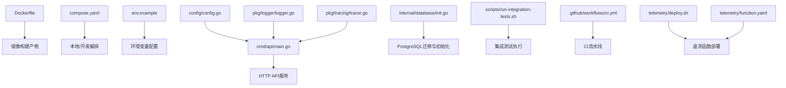
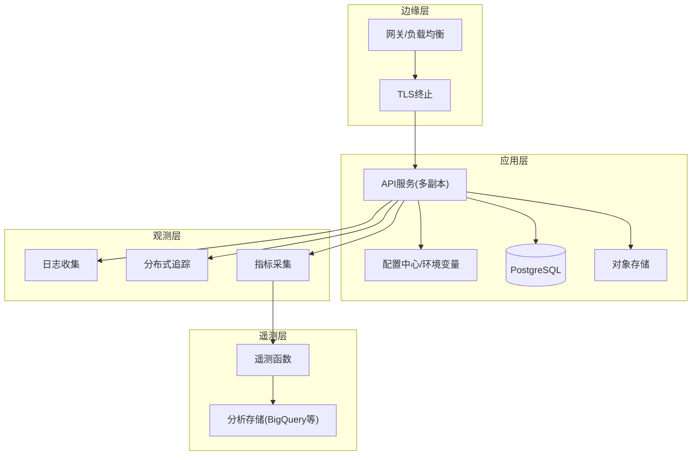
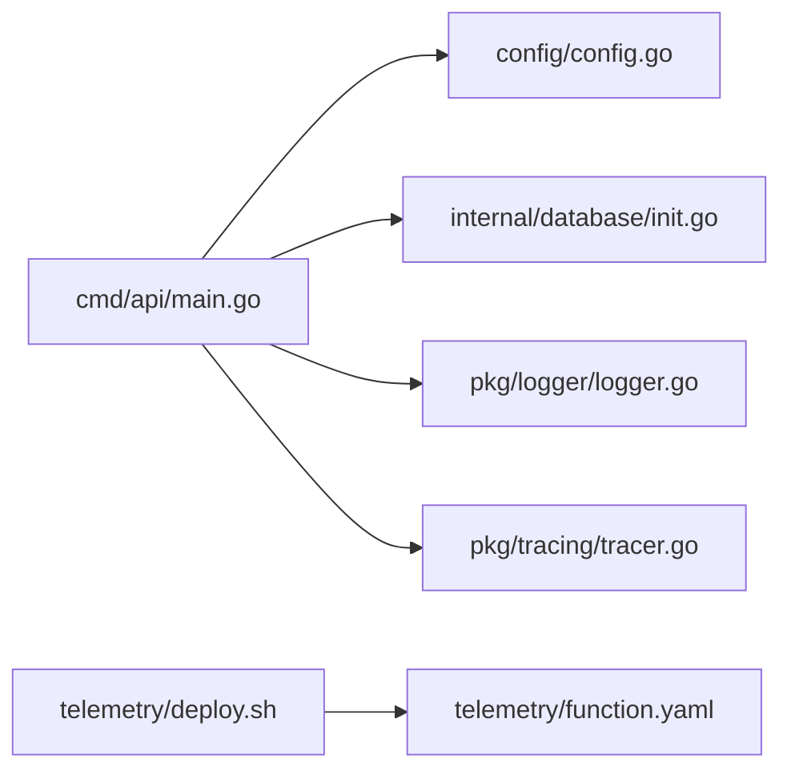

# 部署运维

<cite>
**本文引用的文件**   
- [Dockerfile](file://notifuse/Dockerfile)
- [compose.yaml](file://notifuse/compose.yaml)
- [env.example](file://notifuse/env.example)
- [Makefile](file://notifuse/Makefile)
- [Makefile.integration](file://notifuse/Makefile.integration)
- [cmd/api/main.go](file://notifuse/cmd/api/main.go)
- [config/config.go](file://notifuse/config/config.go)
- [internal/database/init.go](file://notifuse/internal/database/init.go)
- [pkg/logger/logger.go](file://notifuse/pkg/logger/logger.go)
- [pkg/tracing/tracer.go](file://notifuse/pkg/tracing/tracer.go)
- [telemetry/deploy.sh](file://notifuse/telemetry/deploy.sh)
- [telemetry/function.yaml](file://notifuse/telemetry/function.yaml)
- [scripts/run-integration-tests.sh](file://notifuse/scripts/run-integration-tests.sh)
- [.github/workflows/ci.yml](file://notifuse/.github/workflows/ci.yml)
</cite>

## 目录
1. [简介](#简介)
2. [项目结构](#项目结构)
3. [核心组件](#核心组件)
4. [架构总览](#架构总览)
5. [详细组件分析](#详细组件分析)
6. [依赖分析](#依赖分析)
7. [性能考虑](#性能考虑)
8. [故障排查指南](#故障排查指南)
9. [结论](#结论)
10. [附录](#附录)

## 简介
本文件面向Notifuse平台的生产与运维团队，提供容器化部署、配置管理、安全加固、监控告警、容量规划、负载均衡与高可用设计、CI/CD流水线、自动化测试与发布流程的完整指导。文档基于仓库中现有构建与运行工件（Dockerfile、Compose、环境变量示例、入口程序、数据库初始化、日志与追踪等）进行说明，确保可落地执行。

## 项目结构
Notifuse后端以Go语言实现，前端控制台位于console子目录。关键部署相关工件包括：
- 容器镜像构建：Dockerfile
- 本地与开发编排：compose.yaml
- 环境变量模板：env.example
- 应用入口：cmd/api/main.go
- 配置加载：config/config.go
- 数据库初始化：internal/database/init.go
- 日志与追踪：pkg/logger/logger.go、pkg/tracing/tracer.go
- 集成测试脚本：scripts/run-integration-tests.sh
- CI工作流：.github/workflows/ci.yml
- 遥测函数与部署脚本：telemetry/deploy.sh、telemetry/function.yaml

图表来源
- [Dockerfile](file://notifuse/Dockerfile)
- [compose.yaml](file://notifuse/compose.yaml)
- [env.example](file://notifuse/env.example)
- [cmd/api/main.go](file://notifuse/cmd/api/main.go)
- [config/config.go](file://notifuse/config/config.go)
- [internal/database/init.go](file://notifuse/internal/database/init.go)
- [pkg/logger/logger.go](file://notifuse/pkg/logger/logger.go)
- [pkg/tracing/tracer.go](file://notifuse/pkg/tracing/tracer.go)
- [scripts/run-integration-tests.sh](file://notifuse/scripts/run-integration-tests.sh)
- [.github/workflows/ci.yml](file://notifuse/.github/workflows/ci.yml)
- [telemetry/deploy.sh](file://notifuse/telemetry/deploy.sh)
- [telemetry/function.yaml](file://notifuse/telemetry/function.yaml)

章节来源
- [Dockerfile](file://notifuse/Dockerfile)
- [compose.yaml](file://notifuse/compose.yaml)
- [env.example](file://notifuse/env.example)
- [cmd/api/main.go](file://notifuse/cmd/api/main.go)
- [config/config.go](file://notifuse/config/config.go)
- [internal/database/init.go](file://notifuse/internal/database/init.go)
- [pkg/logger/logger.go](file://notifuse/pkg/logger/logger.go)
- [pkg/tracing/tracer.go](file://notifuse/pkg/tracing/tracer.go)
- [scripts/run-integration-tests.sh](file://notifuse/scripts/run-integration-tests.sh)
- [.github/workflows/ci.yml](file://notifuse/.github/workflows/ci.yml)
- [telemetry/deploy.sh](file://notifuse/telemetry/deploy.sh)
- [telemetry/function.yaml](file://notifuse/telemetry/function.yaml)

## 核心组件
- 应用入口与生命周期
  - HTTP服务启动、路由注册、中间件挂载、优雅关闭由入口程序负责。
  - 参考路径：[cmd/api/main.go](file://notifuse/cmd/api/main.go)
- 配置系统
  - 集中式配置加载，支持从环境变量注入；包含OIDC、平台设置、根邮箱等模块。
  - 参考路径：[config/config.go](file://notifuse/config/config.go)
- 数据库与迁移
  - 连接管理与迁移执行在初始化阶段完成，确保版本一致性与数据一致性。
  - 参考路径：[internal/database/init.go](file://notifuse/internal/database/init.go)
- 日志与追踪
  - 结构化日志输出与分布式追踪集成，便于问题定位与性能分析。
  - 参考路径：[pkg/logger/logger.go](file://notifuse/pkg/logger/logger.go)、[pkg/tracing/tracer.go](file://notifuse/pkg/tracing/tracer.go)
- 编排与构建
  - Dockerfile定义镜像构建步骤；compose.yaml用于本地/开发环境编排。
  - 参考路径：[Dockerfile](file://notifuse/Dockerfile)、[compose.yaml](file://notifuse/compose.yaml)
- 环境变量
  - env.example提供生产所需的关键变量清单与默认值建议。
  - 参考路径：[env.example](file://notifuse/env.example)

章节来源
- [cmd/api/main.go](file://notifuse/cmd/api/main.go)
- [config/config.go](file://notifuse/config/config.go)
- [internal/database/init.go](file://notifuse/internal/database/init.go)
- [pkg/logger/logger.go](file://notifuse/pkg/logger/logger.go)
- [pkg/tracing/tracer.go](file://notifuse/pkg/tracing/tracer.go)
- [Dockerfile](file://notifuse/Dockerfile)
- [compose.yaml](file://notifuse/compose.yaml)
- [env.example](file://notifuse/env.example)

## 架构总览
下图展示生产环境的典型分层：外部流量经网关进入API服务，服务访问PostgreSQL与对象存储，并通过遥测函数上报指标到云端分析平台。

图表来源
- [cmd/api/main.go](file://notifuse/cmd/api/main.go)
- [config/config.go](file://notifuse/config/config.go)
- [internal/database/init.go](file://notifuse/internal/database/init.go)
- [pkg/logger/logger.go](file://notifuse/pkg/logger/logger.go)
- [pkg/tracing/tracer.go](file://notifuse/pkg/tracing/tracer.go)
- [telemetry/deploy.sh](file://notifuse/telemetry/deploy.sh)
- [telemetry/function.yaml](file://notifuse/telemetry/function.yaml)

## 详细组件分析

### 容器化与镜像构建
- 构建目标
  - 使用多阶段构建优化镜像体积与安全面。
  - 将二进制与静态资源打包为最小运行时镜像。
- 运行参数
  - 通过环境变量注入配置，避免硬编码。
  - 暴露HTTP端口并配置健康检查端点。
- 参考路径
  - [Dockerfile](file://notifuse/Dockerfile)

章节来源
- [Dockerfile](file://notifuse/Dockerfile)

### 单机部署（Docker Compose）
- 适用场景
  - 开发、演示或小规模生产环境。
- 关键步骤
  - 准备.env文件（复制env.example并填充敏感信息）。
  - 启动编排：包含API服务、PostgreSQL、可选缓存与对象存储。
  - 首次启动自动执行数据库迁移。
- 参考路径
  - [compose.yaml](file://notifuse/compose.yaml)
  - [env.example](file://notifuse/env.example)
  - [internal/database/init.go](file://notifuse/internal/database/init.go)

章节来源
- [compose.yaml](file://notifuse/compose.yaml)
- [env.example](file://notifuse/env.example)
- [internal/database/init.go](file://notifuse/internal/database/init.go)

### 集群部署（Kubernetes）
- 推荐模式
  - Deployment多副本 + Service暴露 + Ingress/TLS终止。
  - ConfigMap/Secret管理配置与密钥。
  - PersistentVolume持久化数据库或共享存储。
  - HorizontalPodAutoscaler按CPU/内存或自定义指标扩缩容。
- 健康检查
  - 配置Liveness/Readiness探针，指向应用健康端点。
- 参考路径
  - [cmd/api/main.go](file://notifuse/cmd/api/main.go)
  - [pkg/logger/logger.go](file://notifuse/pkg/logger/logger.go)
  - [pkg/tracing/tracer.go](file://notifuse/pkg/tracing/tracer.go)

章节来源
- [cmd/api/main.go](file://notifuse/cmd/api/main.go)
- [pkg/logger/logger.go](file://notifuse/pkg/logger/logger.go)
- [pkg/tracing/tracer.go](file://notifuse/pkg/tracing/tracer.go)

### 云原生部署（Serverless/事件驱动）
- 遥测函数
  - 使用serverless函数接收遥测数据并写入分析存储。
  - 通过deploy.sh与function.yaml完成部署。
- 适用场景
  - 指标上报、审计日志归档、离线分析任务。
- 参考路径
  - [telemetry/deploy.sh](file://notifuse/telemetry/deploy.sh)
  - [telemetry/function.yaml](file://notifuse/telemetry/function.yaml)

章节来源
- [telemetry/deploy.sh](file://notifuse/telemetry/deploy.sh)
- [telemetry/function.yaml](file://notifuse/telemetry/function.yaml)

### 配置管理与环境变量
- 原则
  - 所有配置通过环境变量注入；敏感信息使用Secret管理。
  - 区分开发、预发、生产环境配置集。
- 关键变量类别
  - 数据库连接、邮件服务、OIDC、对象存储、遥测端点、日志级别等。
- 参考路径
  - [env.example](file://notifuse/env.example)
  - [config/config.go](file://notifuse/config/config.go)

章节来源
- [env.example](file://notifuse/env.example)
- [config/config.go](file://notifuse/config/config.go)

### 安全加固措施
- 传输安全
  - 强制HTTPS，启用HSTS；证书由网关或Ingress统一终止。
- 身份与授权
  - 启用OIDC；限制管理员权限；最小权限原则。
- 网络隔离
  - 仅开放必要端口；数据库与对象存储置于私有网络。
- 镜像安全
  - 定期扫描镜像漏洞；使用最小基础镜像。
- 参考路径
  - [config/config.go](file://notifuse/config/config.go)
  - [cmd/api/main.go](file://notifuse/cmd/api/main.go)

章节来源
- [config/config.go](file://notifuse/config/config.go)
- [cmd/api/main.go](file://notifuse/cmd/api/main.go)

### 监控告警体系
- 应用性能监控（APM）
  - 启用分布式追踪，关联请求链路；采集关键业务指标。
- 日志收集与分析
  - 结构化JSON日志；集中收集至日志平台；建立索引与告警规则。
- 健康检查
  - 暴露健康端点；编排层周期性探测；失败自动重启或摘除。
- 参考路径
  - [pkg/tracing/tracer.go](file://notifuse/pkg/tracing/tracer.go)
  - [pkg/logger/logger.go](file://notifuse/pkg/logger/logger.go)
  - [cmd/api/main.go](file://notifuse/cmd/api/main.go)

章节来源
- [pkg/tracing/tracer.go](file://notifuse/pkg/tracing/tracer.go)
- [pkg/logger/logger.go](file://notifuse/pkg/logger/logger.go)
- [cmd/api/main.go](file://notifuse/cmd/api/main.go)

### 容量规划与高可用
- 容量规划
  - 根据QPS、并发连接数、消息吞吐评估CPU/内存/带宽。
  - 数据库连接池大小与慢查询优化。
- 负载均衡
  - 七层负载均衡；会话保持按需开启；健康检查与熔断策略。
- 高可用
  - 多副本部署；跨可用区分布；数据库主备/只读副本；对象存储多副本。
- 参考路径
  - [cmd/api/main.go](file://notifuse/cmd/api/main.go)
  - [internal/database/init.go](file://notifuse/internal/database/init.go)

章节来源
- [cmd/api/main.go](file://notifuse/cmd/api/main.go)
- [internal/database/init.go](file://notifuse/internal/database/init.go)

### 负载均衡与健康检查
- 健康检查端点
  - 返回服务就绪状态；结合数据库连通性检测。
- 负载均衡策略
  - 基于权重与延迟的动态调度；灰度发布与蓝绿切换。
- 参考路径
  - [cmd/api/main.go](file://notifuse/cmd/api/main.go)

章节来源
- [cmd/api/main.go](file://notifuse/cmd/api/main.go)

### 灾难恢复方案
- 备份策略
  - 数据库定时快照与增量备份；对象存储版本控制与跨区域复制。
- 恢复演练
  - 定期演练RTO/RPO目标；验证恢复流程与数据一致性。
- 回滚机制
  - 镜像标签不可变；一键回滚到上一稳定版本。
- 参考路径
  - [internal/database/init.go](file://notifuse/internal/database/init.go)

章节来源
- [internal/database/init.go](file://notifuse/internal/database/init.go)

### CI/CD流水线与自动化测试
- 流水线阶段
  - 代码拉取、依赖安装、单元测试、集成测试、构建镜像、推送镜像、部署。
- 自动化测试
  - 使用集成测试脚本拉起依赖并执行用例。
- 参考路径
  - [.github/workflows/ci.yml](file://notifuse/.github/workflows/ci.yml)
  - [scripts/run-integration-tests.sh](file://notifuse/scripts/run-integration-tests.sh)
  - [Makefile](file://notifuse/Makefile)
  - [Makefile.integration](file://notifuse/Makefile.integration)

章节来源
- [.github/workflows/ci.yml](file://notifuse/.github/workflows/ci.yml)
- [scripts/run-integration-tests.sh](file://notifuse/scripts/run-integration-tests.sh)
- [Makefile](file://notifuse/Makefile)
- [Makefile.integration](file://notifuse/Makefile.integration)

## 依赖分析
- 内部依赖
  - 入口程序依赖配置加载、数据库初始化、日志与追踪模块。
- 外部依赖
  - PostgreSQL、对象存储、OIDC提供商、邮件服务、遥测后端。
- 耦合关系
  - 配置与运行时解耦；数据库访问集中在初始化与仓储层；遥测函数独立部署。

图表来源
- [cmd/api/main.go](file://notifuse/cmd/api/main.go)
- [config/config.go](file://notifuse/config/config.go)
- [internal/database/init.go](file://notifuse/internal/database/init.go)
- [pkg/logger/logger.go](file://notifuse/pkg/logger/logger.go)
- [pkg/tracing/tracer.go](file://notifuse/pkg/tracing/tracer.go)
- [telemetry/deploy.sh](file://notifuse/telemetry/deploy.sh)
- [telemetry/function.yaml](file://notifuse/telemetry/function.yaml)

章节来源
- [cmd/api/main.go](file://notifuse/cmd/api/main.go)
- [config/config.go](file://notifuse/config/config.go)
- [internal/database/init.go](file://notifuse/internal/database/init.go)
- [pkg/logger/logger.go](file://notifuse/pkg/logger/logger.go)
- [pkg/tracing/tracer.go](file://notifuse/pkg/tracing/tracer.go)
- [telemetry/deploy.sh](file://notifuse/telemetry/deploy.sh)
- [telemetry/function.yaml](file://notifuse/telemetry/function.yaml)

## 性能考虑
- 应用层
  - 合理设置并发与超时；启用连接复用；减少序列化开销。
- 数据库
  - 调整连接池大小；索引优化；慢查询分析与分页策略。
- 缓存与队列
  - 热点数据缓存；异步处理耗时任务；背压与限流。
- 网络与I/O
  - 压缩响应体；静态资源CDN；对象存储分片上传。
- 参考路径
  - [cmd/api/main.go](file://notifuse/cmd/api/main.go)
  - [internal/database/init.go](file://notifuse/internal/database/init.go)

章节来源
- [cmd/api/main.go](file://notifuse/cmd/api/main.go)
- [internal/database/init.go](file://notifuse/internal/database/init.go)

## 故障排查指南
- 常见问题
  - 启动失败：检查环境变量与配置项；确认数据库连通性与迁移状态。
  - 鉴权异常：核对OIDC客户端ID/密钥与回调地址。
  - 邮件发送失败：校验SMTP/第三方服务凭据与域名解析。
  - 遥测无数据：检查函数部署与网络可达性。
- 诊断手段
  - 查看结构化日志与追踪链路；抓取健康检查与错误码；复现最小用例。
- 参考路径
  - [pkg/logger/logger.go](file://notifuse/pkg/logger/logger.go)
  - [pkg/tracing/tracer.go](file://notifuse/pkg/tracing/tracer.go)
  - [internal/database/init.go](file://notifuse/internal/database/init.go)
  - [telemetry/deploy.sh](file://notifuse/telemetry/deploy.sh)

章节来源
- [pkg/logger/logger.go](file://notifuse/pkg/logger/logger.go)
- [pkg/tracing/tracer.go](file://notifuse/pkg/tracing/tracer.go)
- [internal/database/init.go](file://notifuse/internal/database/init.go)
- [telemetry/deploy.sh](file://notifuse/telemetry/deploy.sh)

## 结论
通过容器化与编排工具，Notifuse可实现从单机到云原生的平滑演进。配合完善的配置管理、安全加固、监控告警与CI/CD流水线，可在保证高可用的同时提升交付效率与稳定性。建议在上线前完成容量评估、演练恢复流程并持续优化性能与成本。

## 附录
- 快速开始（单机）
  - 复制env.example并填写必要变量。
  - 使用编排工具启动服务并等待迁移完成。
  - 访问控制台进行初始设置。
- 参考路径
  - [compose.yaml](file://notifuse/compose.yaml)
  - [env.example](file://notifuse/env.example)
  - [internal/database/init.go](file://notifuse/internal/database/init.go)

章节来源
- [compose.yaml](file://notifuse/compose.yaml)
- [env.example](file://notifuse/env.example)
- [internal/database/init.go](file://notifuse/internal/database/init.go)