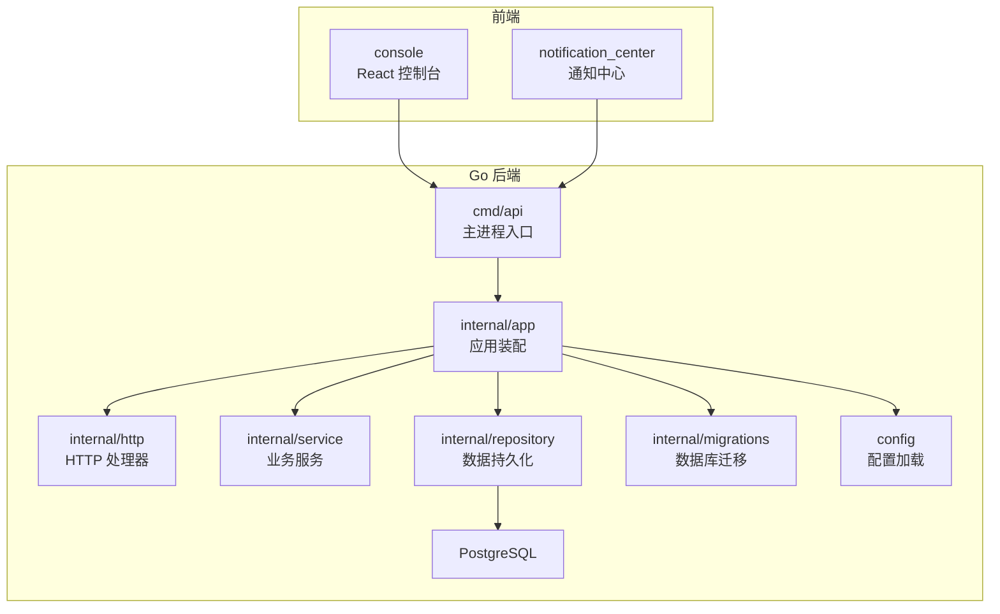
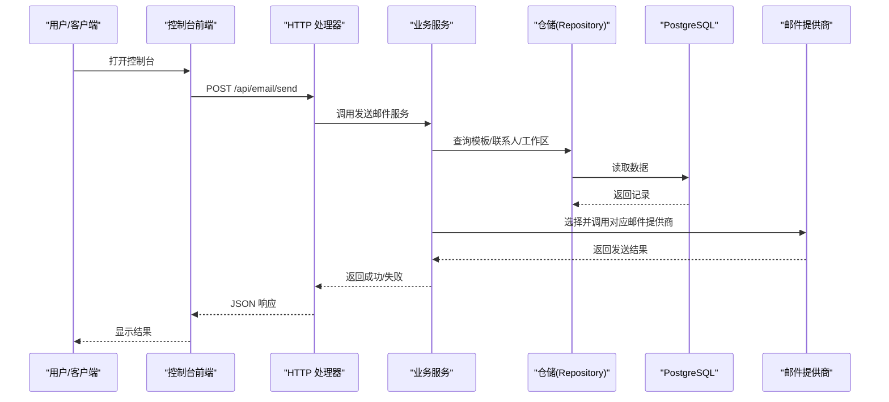
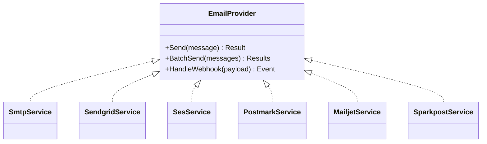
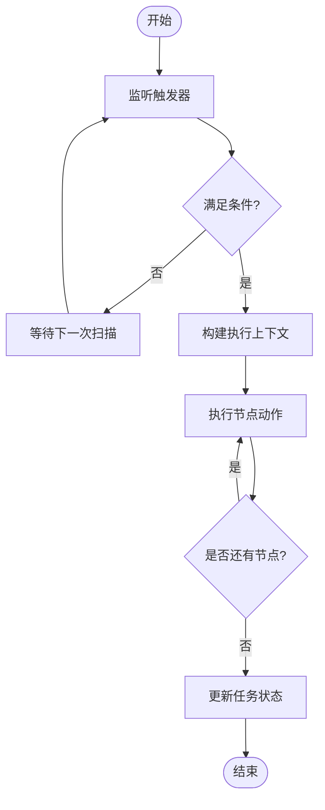
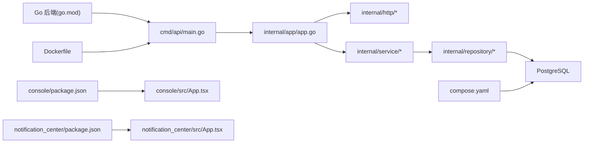

# 项目概述

<cite>
**本文引用的文件**   
- [README.md](file://notifuse/README.md)
- [LICENCE.md](file://notifuse/LICENCE.md)
- [Makefile](file://notifuse/Makefile)
- [compose.yaml](file://notifuse/compose.yaml)
- [env.example](file://notifuse/env.example)
- [Dockerfile](file://notifuse/Dockerfile)
- [go.mod](file://notifuse/go.mod)
- [cmd/api/main.go](file://notifuse/cmd/api/main.go)
- [internal/app/app.go](file://notifuse/internal/app/app.go)
- [config/config.go](file://notifuse/config/config.go)
- [internal/database/init.go](file://notifuse/internal/database/init.go)
- [internal/repository/analytics_postgres.go](file://notifuse/internal/repository/analytics_postgres.go)
- [internal/service/email_service.go](file://notifuse/internal/service/email_service.go)
- [internal/service/smtp_service.go](file://notifuse/internal/service/smtp_service.go)
- [internal/service/sendgrid_service.go](file://notifuse/internal/service/sendgrid_service.go)
- [internal/service/ses_service.go](file://notifuse/internal/service/ses_service.go)
- [internal/service/postmark_service.go](file://notifuse/internal/service/postmark_service.go)
- [internal/service/mailjet_service.go](file://notifuse/internal/service/mailjet_service.go)
- [internal/service/sparkpost_service.go](file://notifuse/internal/service/sparkpost_service.go)
- [internal/service/automation_executor.go](file://notifuse/internal/service/automation_executor.go)
- [internal/service/automation_scheduler.go](file://notifuse/internal/service/automation_scheduler.go)
- [internal/service/contact_service.go](file://notifuse/internal/service/contact_service.go)
- [internal/service/template_service.go](file://notifuse/internal/service/template_service.go)
- [internal/service/broadcast_service.go](file://notifuse/internal/service/broadcast_service.go)
- [internal/http/email_handler.go](file://notifuse/internal/http/email_handler.go)
- [internal/http/automation_handler.go](file://notifuse/internal/http/automation_handler.go)
- [internal/http/contact_handler.go](file://notifuse/internal/http/contact_handler.go)
- [internal/http/template_handler.go](file://notifuse/internal/http/template_handler.go)
- [internal/http/broadcast_handler.go](file://notifuse/internal/http/broadcast_handler.go)
- [console/src/App.tsx](file://notifuse/console/src/App.tsx)
- [console/package.json](file://notifuse/console/package.json)
- [notification_center/src/App.tsx](file://notifuse/notification_center/src/App.tsx)
- [notification_center/package.json](file://notifuse/notification_center/package.json)
</cite>

## 目录
1. [简介](#简介)
2. [项目结构](#项目结构)
3. [核心组件](#核心组件)
4. [架构总览](#架构总览)
5. [详细组件分析](#详细组件分析)
6. [依赖关系分析](#依赖关系分析)
7. [性能与可扩展性](#性能与可扩展性)
8. [故障排查指南](#故障排查指南)
9. [结论](#结论)
10. [附录](#附录)

## 简介
Notifuse 是一个企业级邮件营销与通知平台，提供多提供商集成、自动化工作流、联系人管理、模板与广播发送、数据分析等核心能力。系统采用 Go 后端服务 + React 控制台前端 + 独立通知中心组件的架构设计，支持通过 SMTP 桥接与多种云邮件服务商对接，具备可观测性与高可用扩展能力。

核心价值
- 统一入口：集中管理多个邮件提供商与发送通道，屏蔽底层差异
- 自动化：可视化工作流驱动触发器、条件分支与动作执行
- 数据驱动：全链路事件采集与分析，支撑精细化运营
- 开放集成：Webhook、OIDC/OAuth、SMTP 桥接、Supabase/Firecrawl 等生态集成
- 企业特性：工作区隔离、权限控制、审计与可观测性

适用场景
- 营销自动化（注册欢迎、弃购召回、生命周期触达）
- 事务性通知（订单确认、安全告警、系统通知）
- 内容分发（博客订阅、RSS 聚合、模板化批量推送）
- 多渠道投递（SMTP、SendGrid、SES、Postmark、Mailgun、Mailjet、SparkPost）

许可证与社区
- 许可证信息见仓库根目录许可证文件
- 贡献指南与安全策略见仓库相关文档

快速开始（概览）
- 使用 Docker Compose 一键启动开发环境
- 配置环境变量（数据库、邮件提供商、OIDC 等）
- 访问控制台完成初始化设置并创建第一个工作区
- 通过 API 或控制台进行联系人导入、模板编辑与任务调度

章节来源
- [README.md](file://notifuse/README.md)
- [LICENCE.md](file://notifuse/LICENCE.md)
- [Makefile](file://notifuse/Makefile)
- [compose.yaml](file://notifuse/compose.yaml)
- [env.example](file://notifuse/env.example)

## 项目结构
整体由三个主要子应用组成：
- Go 后端服务（API、HTTP 路由、领域模型、仓储与服务层、迁移与工具）
- React 控制台前端（业务管理与可视化操作）
- 独立通知中心前端（轻量嵌入与展示）

图表来源
- [cmd/api/main.go:1-200](file://notifuse/cmd/api/main.go#L1-L200)
- [internal/app/app.go:1-200](file://notifuse/internal/app/app.go#L1-L200)
- [config/config.go:1-200](file://notifuse/config/config.go#L1-L200)
- [internal/database/init.go:1-200](file://notifuse/internal/database/init.go#L1-L200)
- [internal/repository/analytics_postgres.go:1-200](file://notifuse/internal/repository/analytics_postgres.go#L1-L200)
- [console/src/App.tsx:1-200](file://notifuse/console/src/App.tsx#L1-L200)
- [notification_center/src/App.tsx:1-200](file://notifuse/notification_center/src/App.tsx#L1-L200)

章节来源
- [cmd/api/main.go:1-200](file://notifuse/cmd/api/main.go#L1-L200)
- [internal/app/app.go:1-200](file://notifuse/internal/app/app.go#L1-L200)
- [config/config.go:1-200](file://notifuse/config/config.go#L1-L200)
- [internal/database/init.go:1-200](file://notifuse/internal/database/init.go#L1-L200)
- [console/src/App.tsx:1-200](file://notifuse/console/src/App.tsx#L1-L200)
- [notification_center/src/App.tsx:1-200](file://notifuse/notification_center/src/App.tsx#L1-L200)

## 核心组件
- 应用装配与生命周期
  - 负责加载配置、初始化数据库连接、运行迁移、组装服务与路由、启动 HTTP 服务器与后台任务
- HTTP 层
  - 暴露 RESTful API，处理认证、鉴权、请求校验与响应格式化
- 服务层
  - 封装业务逻辑：邮件发送、自动化执行、联系人管理、模板渲染、广播任务、分析统计等
- 仓储层
  - 基于 PostgreSQL 的数据访问实现，包含分析、联系人、模板、工作区等实体
- 邮件投递适配
  - 抽象统一的邮件接口，具体实现覆盖 SMTP、SendGrid、SES、Postmark、Mailgun、Mailjet、SparkPost
- 自动化引擎
  - 调度器与执行器协同，解析工作流节点、触发器与动作，支持重试与幂等
- 前端控制台
  - 基于 React/Vite 构建，提供可视化工作流编排、联系人与列表管理、模板与广播、分析与设置
- 通知中心
  - 独立前端组件，用于在任意应用中嵌入系统通知与消息中心

章节来源
- [internal/app/app.go:1-200](file://notifuse/internal/app/app.go#L1-L200)
- [internal/http/email_handler.go:1-200](file://notifuse/internal/http/email_handler.go#L1-L200)
- [internal/service/email_service.go:1-200](file://notifuse/internal/service/email_service.go#L1-L200)
- [internal/service/smtp_service.go:1-200](file://notifuse/internal/service/smtp_service.go#L1-L200)
- [internal/service/sendgrid_service.go:1-200](file://notifuse/internal/service/sendgrid_service.go#L1-L200)
- [internal/service/ses_service.go:1-200](file://notifuse/internal/service/ses_service.go#L1-L200)
- [internal/service/postmark_service.go:1-200](file://notifuse/internal/service/postmark_service.go#L1-L200)
- [internal/service/mailjet_service.go:1-200](file://notifuse/internal/service/mailjet_service.go#L1-L200)
- [internal/service/sparkpost_service.go:1-200](file://notifuse/internal/service/sparkpost_service.go#L1-L200)
- [internal/service/automation_executor.go:1-200](file://notifuse/internal/service/automation_executor.go#L1-L200)
- [internal/service/automation_scheduler.go:1-200](file://notifuse/internal/service/automation_scheduler.go#L1-L200)
- [internal/service/contact_service.go:1-200](file://notifuse/internal/service/contact_service.go#L1-L200)
- [internal/service/template_service.go:1-200](file://notifuse/internal/service/template_service.go#L1-L200)
- [internal/service/broadcast_service.go:1-200](file://notifuse/internal/service/broadcast_service.go#L1-L200)
- [console/src/App.tsx:1-200](file://notifuse/console/src/App.tsx#L1-L200)
- [notification_center/src/App.tsx:1-200](file://notifuse/notification_center/src/App.tsx#L1-L200)

## 架构总览
系统采用分层与模块化设计：
- 表现层：控制台与通知中心为静态 SPA，通过 HTTP 调用后端 API
- 接入层：HTTP 处理器负责路由、中间件、参数校验与错误包装
- 业务层：服务模块承载领域逻辑，协调仓储与外部服务
- 数据层：PostgreSQL 作为唯一事实源，配合迁移脚本管理版本演进
- 外部集成：邮件提供商 SDK、OIDC/OAuth、Webhook、Supabase、Firecrawl 等

图表来源
- [internal/http/email_handler.go:1-200](file://notifuse/internal/http/email_handler.go#L1-L200)
- [internal/service/email_service.go:1-200](file://notifuse/internal/service/email_service.go#L1-L200)
- [internal/repository/analytics_postgres.go:1-200](file://notifuse/internal/repository/analytics_postgres.go#L1-L200)
- [internal/service/smtp_service.go:1-200](file://notifuse/internal/service/smtp_service.go#L1-L200)
- [internal/service/sendgrid_service.go:1-200](file://notifuse/internal/service/sendgrid_service.go#L1-L200)
- [internal/service/ses_service.go:1-200](file://notifuse/internal/service/ses_service.go#L1-L200)
- [internal/service/postmark_service.go:1-200](file://notifuse/internal/service/postmark_service.go#L1-L200)
- [internal/service/mailjet_service.go:1-200](file://notifuse/internal/service/mailjet_service.go#L1-L200)
- [internal/service/sparkpost_service.go:1-200](file://notifuse/internal/service/sparkpost_service.go#L1-L200)

## 详细组件分析

### 应用装配与生命周期
- 职责
  - 加载配置与环境变量
  - 初始化数据库连接与迁移
  - 注册 HTTP 路由与中间件
  - 启动后台任务（自动化调度、队列消费等）
  - 优雅关闭与信号处理
- 关键点
  - 配置优先级：默认值 < 配置文件 < 环境变量
  - 迁移按版本号顺序执行，保证向后兼容
  - 健康检查与指标上报便于运维监控

章节来源
- [internal/app/app.go:1-200](file://notifuse/internal/app/app.go#L1-L200)
- [config/config.go:1-200](file://notifuse/config/config.go#L1-L200)
- [internal/database/init.go:1-200](file://notifuse/internal/database/init.go#L1-L200)

### HTTP 层与路由
- 职责
  - 定义 RESTful 端点，处理认证与授权
  - 参数校验、错误码标准化与日志埋点
  - 将请求委派给对应服务层方法
- 关键端点示例
  - 邮件发送、模板管理、联系人增删改查、自动化任务、广播任务、分析统计

章节来源
- [internal/http/email_handler.go:1-200](file://notifuse/internal/http/email_handler.go#L1-L200)
- [internal/http/automation_handler.go:1-200](file://notifuse/internal/http/automation_handler.go#L1-L200)
- [internal/http/contact_handler.go:1-200](file://notifuse/internal/http/contact_handler.go#L1-L200)
- [internal/http/template_handler.go:1-200](file://notifuse/internal/http/template_handler.go#L1-L200)
- [internal/http/broadcast_handler.go:1-200](file://notifuse/internal/http/broadcast_handler.go#L1-L200)

### 服务层与业务逻辑
- 邮件服务
  - 统一抽象邮件发送接口，内部根据配置选择具体提供商实现
  - 支持模板渲染、附件、追踪像素、退订链接等
- 自动化服务
  - 调度器定时扫描触发条件，执行器按图遍历节点并执行动作
  - 支持重试、去重、状态回写与审计
- 联系人服务
  - 批量导入、标签与分组、去重与合规校验
- 模板服务
  - 模板版本管理、块组合、预览与渲染
- 广播服务
  - 大规模发送计划、分片与速率限制、进度跟踪

章节来源
- [internal/service/email_service.go:1-200](file://notifuse/internal/service/email_service.go#L1-L200)
- [internal/service/automation_executor.go:1-200](file://notifuse/internal/service/automation_executor.go#L1-L200)
- [internal/service/automation_scheduler.go:1-200](file://notifuse/internal/service/automation_scheduler.go#L1-L200)
- [internal/service/contact_service.go:1-200](file://notifuse/internal/service/contact_service.go#L1-L200)
- [internal/service/template_service.go:1-200](file://notifuse/internal/service/template_service.go#L1-L200)
- [internal/service/broadcast_service.go:1-200](file://notifuse/internal/service/broadcast_service.go#L1-L200)

### 邮件提供商适配
- 抽象接口
  - 统一 Send、BatchSend、StatusCallback、Webhook 回调等能力
- 具体实现
  - SMTP：通用 SMTP 协议，支持 TLS/STARTTLS 与自定义认证
  - SendGrid、SES、Postmark、Mailgun、Mailjet、SparkPost：各自 SDK 封装与错误映射
- 选择策略
  - 按工作区/域名/模板维度选择提供商
  - 失败自动切换与降级策略

图表来源
- [internal/service/smtp_service.go:1-200](file://notifuse/internal/service/smtp_service.go#L1-L200)
- [internal/service/sendgrid_service.go:1-200](file://notifuse/internal/service/sendgrid_service.go#L1-L200)
- [internal/service/ses_service.go:1-200](file://notifuse/internal/service/ses_service.go#L1-L200)
- [internal/service/postmark_service.go:1-200](file://notifuse/internal/service/postmark_service.go#L1-L200)
- [internal/service/mailjet_service.go:1-200](file://notifuse/internal/service/mailjet_service.go#L1-L200)
- [internal/service/sparkpost_service.go:1-200](file://notifuse/internal/service/sparkpost_service.go#L1-L200)

章节来源
- [internal/service/smtp_service.go:1-200](file://notifuse/internal/service/smtp_service.go#L1-L200)
- [internal/service/sendgrid_service.go:1-200](file://notifuse/internal/service/sendgrid_service.go#L1-L200)
- [internal/service/ses_service.go:1-200](file://notifuse/internal/service/ses_service.go#L1-L200)
- [internal/service/postmark_service.go:1-200](file://notifuse/internal/service/postmark_service.go#L1-L200)
- [internal/service/mailjet_service.go:1-200](file://notifuse/internal/service/mailjet_service.go#L1-L200)
- [internal/service/sparkpost_service.go:1-200](file://notifuse/internal/service/sparkpost_service.go#L1-L200)

### 自动化工作流
- 流程要点
  - 触发器：时间、事件、联系人属性变化
  - 条件：字段匹配、延迟等待、随机分流
  - 动作：发送邮件、更新联系人、调用 Webhook、写入外部系统
- 执行模型
  - 调度器周期性扫描待执行任务
  - 执行器按图遍历，维护节点状态与上下文
  - 失败重试、幂等键与审计日志

图表来源
- [internal/service/automation_scheduler.go:1-200](file://notifuse/internal/service/automation_scheduler.go#L1-L200)
- [internal/service/automation_executor.go:1-200](file://notifuse/internal/service/automation_executor.go#L1-L200)

章节来源
- [internal/service/automation_scheduler.go:1-200](file://notifuse/internal/service/automation_scheduler.go#L1-L200)
- [internal/service/automation_executor.go:1-200](file://notifuse/internal/service/automation_executor.go#L1-L200)

### 前端控制台与通知中心
- 控制台
  - 技术栈：React + Vite + TypeScript
  - 功能：工作区与成员管理、联系人与列表、模板与区块、自动化编排、广播任务、分析与设置
- 通知中心
  - 独立前端包，提供轻量嵌入能力，展示系统通知与消息

章节来源
- [console/src/App.tsx:1-200](file://notifuse/console/src/App.tsx#L1-L200)
- [console/package.json:1-200](file://notifuse/console/package.json#L1-L200)
- [notification_center/src/App.tsx:1-200](file://notifuse/notification_center/src/App.tsx#L1-L200)
- [notification_center/package.json:1-200](file://notifuse/notification_center/package.json#L1-L200)

## 依赖关系分析
- 语言与运行时
  - Go 后端：模块与依赖声明位于 go.mod
  - 前端：控制台与通知中心分别使用 npm 包管理
- 容器化
  - Dockerfile 定义镜像构建步骤
  - compose.yaml 编排数据库与应用服务
- 构建与测试
  - Makefile 提供常用命令（构建、测试、lint、迁移等）

图表来源
- [go.mod:1-200](file://notifuse/go.mod#L1-L200)
- [cmd/api/main.go:1-200](file://notifuse/cmd/api/main.go#L1-L200)
- [internal/app/app.go:1-200](file://notifuse/internal/app/app.go#L1-L200)
- [console/package.json:1-200](file://notifuse/console/package.json#L1-L200)
- [console/src/App.tsx:1-200](file://notifuse/console/src/App.tsx#L1-L200)
- [notification_center/package.json:1-200](file://notifuse/notification_center/package.json#L1-L200)
- [notification_center/src/App.tsx:1-200](file://notifuse/notification_center/src/App.tsx#L1-L200)
- [Dockerfile:1-200](file://notifuse/Dockerfile#L1-L200)
- [compose.yaml:1-200](file://notifuse/compose.yaml#L1-L200)

章节来源
- [go.mod:1-200](file://notifuse/go.mod#L1-L200)
- [Dockerfile:1-200](file://notifuse/Dockerfile#L1-L200)
- [compose.yaml:1-200](file://notifuse/compose.yaml#L1-L200)
- [console/package.json:1-200](file://notifuse/console/package.json#L1-L200)
- [notification_center/package.json:1-200](file://notifuse/notification_center/package.json#L1-L200)

## 性能与可扩展性
- 水平扩展
  - 无状态 API 服务可多实例部署，结合负载均衡提升吞吐
  - 数据库读写分离与连接池优化
- 异步与批处理
  - 自动化调度与广播任务采用后台作业模式，避免阻塞请求路径
  - 批量发送与分片策略降低瞬时压力
- 缓存与索引
  - 热点数据（模板、配置、联系人元数据）建议引入缓存层
  - 针对高频查询字段建立合适索引
- 限流与熔断
  - 对第三方邮件提供商调用实施速率限制与重试退避
  - 关键路径增加熔断保护，防止雪崩

[本节为通用指导，不直接分析具体文件]

## 故障排查指南
- 常见启动问题
  - 数据库连接失败：检查 DSN、网络连通性与权限
  - 迁移失败：核对当前版本与目标版本，查看迁移日志
  - 端口冲突：调整服务端口或停止占用进程
- 邮件发送失败
  - 认证凭据错误：核对密钥/令牌/SMTP 密码
  - 域名未验证：完成 SPF/DKIM/DMARC 配置
  - 供应商限流：检查配额与速率限制，适当降速
- 自动化任务异常
  - 触发器未命中：检查时间与时区设置
  - 节点执行失败：查看执行日志与重试次数
  - 上下文缺失：确认前置动作输出是否正确传递
- 前端无法访问
  - 代理与跨域：检查反向代理与 CORS 配置
  - 环境变量：确认后端地址与鉴权配置

章节来源
- [internal/database/init.go:1-200](file://notifuse/internal/database/init.go#L1-L200)
- [internal/service/email_service.go:1-200](file://notifuse/internal/service/email_service.go#L1-L200)
- [internal/service/automation_executor.go:1-200](file://notifuse/internal/service/automation_executor.go#L1-L200)

## 结论
Notifuse 以清晰的层次化架构与丰富的邮件生态集成，为企业提供了稳定、可扩展且易用的邮件营销与通知平台。通过自动化工作流与数据分析能力，帮助团队实现高效、可衡量的增长闭环。对于初学者，可从控制台上手；对于有经验的开发者，可通过 API 与 Provider 扩展深入定制。

[本节为总结性内容，不直接分析具体文件]

## 附录
- 系统要求
  - 操作系统：Linux/macOS/Windows（推荐 Linux）
  - 运行时：Go（参考 go.mod）、Node.js（控制台与通知中心）
  - 数据库：PostgreSQL（版本参考 compose.yaml）
- 前置依赖
  - 可选：Redis（缓存与会话）、对象存储（附件与媒体）
  - 邮件提供商账号与域名验证
- 快速启动
  - 克隆仓库并复制 env.example 为 .env，填写必要配置
  - 使用 Docker Compose 启动服务
  - 访问控制台完成初始设置
  - 通过 API 或控制台创建第一个自动化与广播任务

章节来源
- [env.example:1-200](file://notifuse/env.example#L1-L200)
- [compose.yaml:1-200](file://notifuse/compose.yaml#L1-L200)
- [Makefile:1-200](file://notifuse/Makefile#L1-L200)
- [go.mod:1-200](file://notifuse/go.mod#L1-L200)